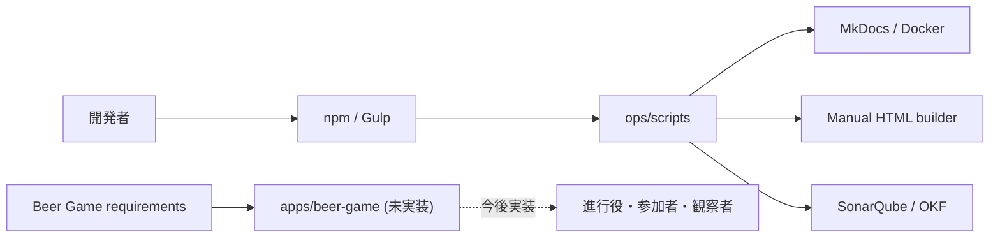
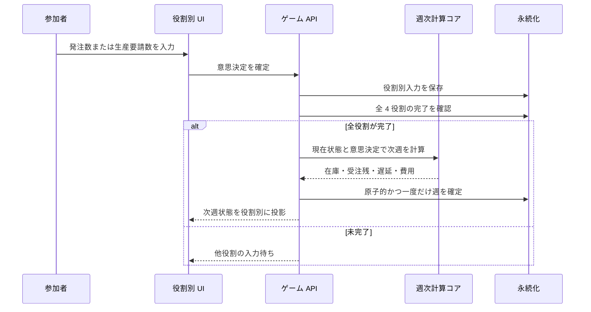

# Architecture

## Architecture Analysis

### System Overview

現在のリポジトリは、ビールゲーム要件ドキュメントと Node.js ベースのドキュメント運用ツールから構成されます。ビールゲーム本体のランタイムアーキテクチャは未実装です。将来のアプリケーション領域として `apps/beer-game/` が確保されています。

### Architectural Style

現状は「ドキュメント中心の単一リポジトリ」です。Gulp が運用タスクの入口となり、`ops/scripts/` の機能別モジュールへ委譲します。対象アプリは実質 greenfield であり、要件から特定の Web アーキテクチャを実装済みと判断できる証拠はありません。

### Component Relationships

<!-- Text fallback: 開発者は npm/Gulp から運用スクリプトを実行し、MkDocs、マニュアル生成、品質管理を利用する。要件文書は未実装の apps/beer-game に入力され、将来は利用者へサービスを提供する。 -->

### Data Flow

現時点でビールゲームの実データフローはありません。要件上は、進行役が設定と需要系列を登録し、参加者の意思決定が注文・生産遅延へ入り、全役割の入力完了後に週次状態を一度だけ確定し、終了後に分析結果へ投影する流れが必要です。

### Key Design Decisions

- Node.js ESM は運用ツールに採用済みですが、対象アプリへの採用決定ではありません。
- ドキュメントは MkDocs と GitHub Actions で公開できます。
- アプリ本体は既存運用ツールと分離して `apps/beer-game/` に配置する余地があります。

### Improvement Opportunities

- ドメイン計算を副作用のない決定論的コアとして分離する。
- 週確定をトランザクションと冪等キーで保護する。
- 役割別認可と情報投影をサーバー境界で強制する。
- リアルタイム画面更新と永続化を交換可能なアダプターに分離する。
- 要件 ID とテストを結び付ける。

## Interaction Diagrams

<!-- Text fallback: 参加者の意思決定を API が保存し、全役割が揃った場合だけ計算コアを呼び、次週状態を原子的に保存して役割別 UI へ返す。 -->

## Sources

- `gulpfile.js`
- `ops/scripts/`
- `docs/requirements/beer-game/requirements_definition.md`

## Assumptions & Open Questions

- 図のゲーム API、計算コア、永続化、UI は要件から導いた候補境界であり、現時点では未実装です。
