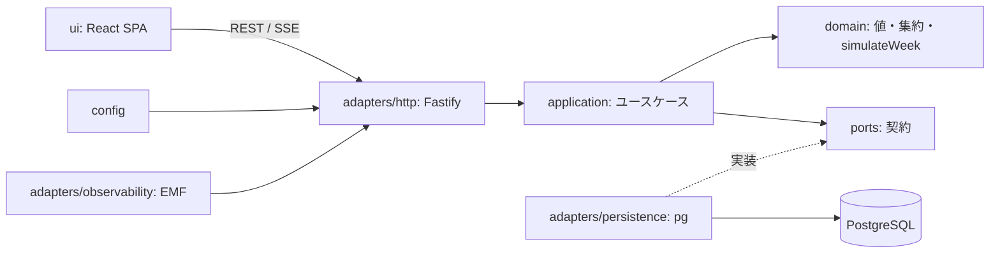
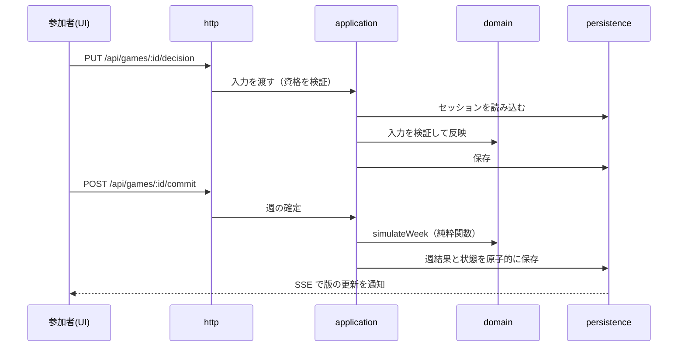
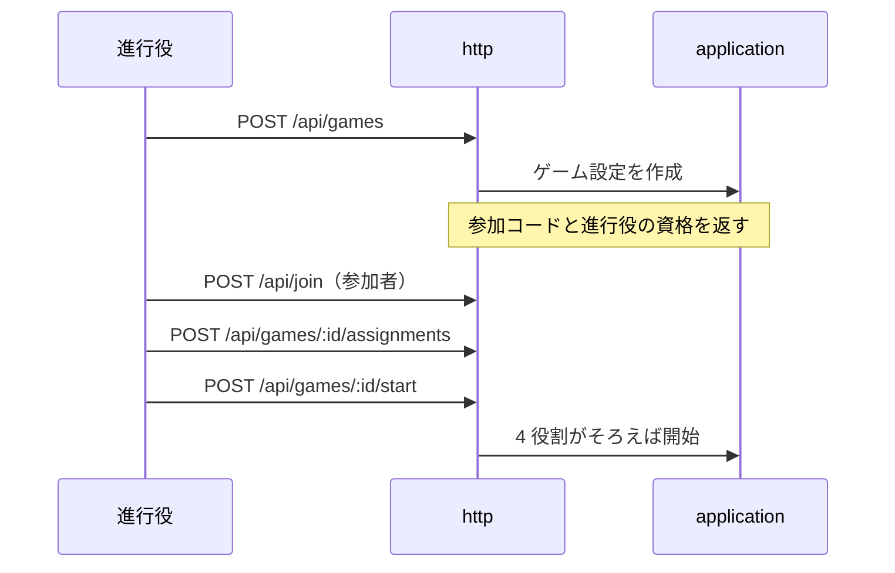

# Architecture Analysis

## System Overview

リポジトリは 2 つの独立したアプリ（`apps/beer-game` の v1 と `apps/beer-game2` の v2）、プロジェクト別のドキュメント群（`docs/`）、ドキュメント運用ツール（ルートの Gulp と `ops/`）、CI/CD（`.github/workflows/`）で構成されます。`apps/beer-game3` は存在しません。以下は主に v2 の構造です。

## Architectural Style

- v2: ports and adapters（ヘキサゴナル）の 1 つの Node プロセス（モジュラーモノリス）と、Vite でビルドする React の SPA。層の依存は ESLint の `no-restricted-imports` で強制（`apps/beer-game2/eslint.config.js`、ADR-003）。
- v1: レイヤード（api / application / domain / infrastructure）に、保持期間削除のワーカー（SQS）と outbox を加えた構成。
- 週次計算は副作用のない純粋関数（`apps/beer-game2/src/domain/simulate-week.ts`）。ゲーム集約とセッション集約を分けている（ADR-004）。
- 永続化は ORM なしで SQL と `pg`。更新通知は SSE（バージョンのみ）と PostgreSQL の `LISTEN/NOTIFY`。
- 配備: コンテナ（ECS）、静的ファイルは S3 と CloudFront、DB は RDS。Terraform で定義。

## Component Relationships

テキスト代替: UI は REST と SSE で HTTP アダプターを呼ぶ。HTTP アダプターはアプリケーション層のユースケースを呼び、ユースケースはドメインと ports（契約）に依存する。永続化アダプターが ports を実装して PostgreSQL に接続する。domain は他の層に依存しない。

## Data Flow

発注の入力は HTTP で受け、アプリケーション層が集約を読み込み、ドメインの規則で検証して保存する。4 役割の入力がそろうと週を確定し、`simulateWeek` が役割別の週結果を返し、トランザクション（unit of work）で保存する。変更後は版が上がり、SSE と `NOTIFY` で購読者へ通知し、UI は最新の状態を取得し直す。

## Key Design Decisions

`docs/adr/beer-game2/` に 13 本（v1 を継承 ADR-002、ports and adapters ADR-003、ゲームとセッションの集約分離 ADR-004、役割別結果と SQL 読み取りモデル ADR-005、SSE はバージョンのみ ADR-006、資格の鍵の版管理 ADR-009、CloudFront のドメインと TLS ADR-011、配送パイプラインと Terraform ADR-012、技術スタックの版 ADR-013 ほか）。v1 は `docs/adr/beer-game/` に 8 本。

## Improvement Opportunities

- 500 行超のファイル（`application/index.ts` 913 行、`pg-repositories.ts` 684 行、`http/server.ts` 615 行）の分割余地。
- v1 と v2 のワークフロー・Dockerfile・マイグレーションの重複。
- 範囲と土台の決定は未確定（`business-overview.md` の未確定事項を参照）。

## Interaction Diagrams

### 週の確定（役割の入力から結果の保存まで）

テキスト代替: 参加者が決定を PUT し、アプリケーション層が集約に反映して保存する。確定の POST でドメインの `simulateWeek` が週結果を計算し、永続化アダプターが原子的に保存して、SSE で版の更新が全員に届く。

### ゲームの作成から開始まで

テキスト代替: 進行役がゲームを作成し、参加者が参加コードで参加する。進行役が役割を割り当て、4 役割がそろうと開始できる。
