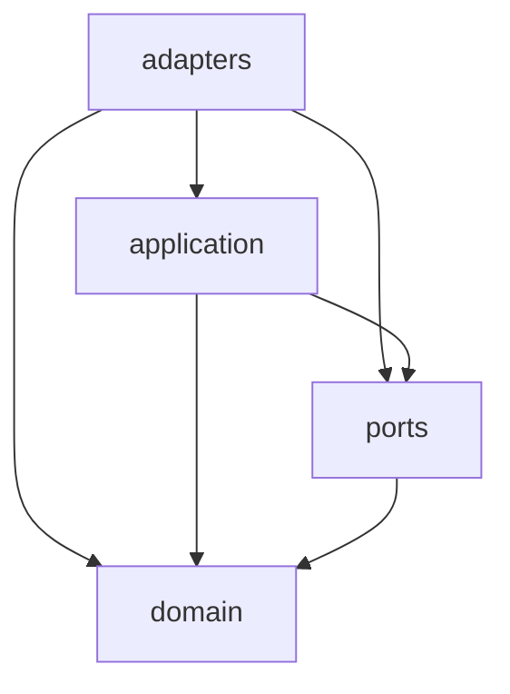

# Dependencies

## パッケージ間

`apps/beer-game` と `apps/beer-game2` は互いに依存しない独立した npm パッケージ。ルートの `package.json` はアプリから参照されない（文書運用専用）。ワークスペース設定（`workspaces`）はない。

## beer-game2 の内部（層）

テキスト代替: adapters は application、ports、domain に依存し、application は ports と domain に、ports は domain に依存する。domain はどこにも依存しない。`config` に依存できるのは adapters と合成のみ（`eslint.config.js`）。循環参照は、lint の規則上は発生しない。個別ファイルの import は読んでいない。

## 外部依存（本番）

- beer-game2: `@fastify/cookie`、`fastify`、`node-pg-migrate`、`pg`、`react`、`react-dom`、`react-router`、`zod`（8 件）。
- beer-game: 上記に加え `@aws-sdk/client-sqs`、`@fastify/cors`、`@fastify/rate-limit`、`@fastify/static`。
- ルート: `dotenv`、`gulp`、`marked`、`plantuml-encoder`。

## 実行時の外部サービス

PostgreSQL（compose、CI のサービス）、AWS（ECS、RDS、S3、CloudFront、Secrets、OIDC）、v1 は SQS。RDS の CA バンドル（`truststore.pki.rds.amazonaws.com`）を Docker イメージの作成時に取得する。

## 脆弱性・古さ

CI は `npm audit --omit=dev --audit-level=high` を beer-game2 で実行する。今回は audit を実行しておらず、結果は未確認。v1 は `^` 範囲で、v2 の固定版より古い（例: Vitest 4 と 5、ESLint 9 と 10）。
