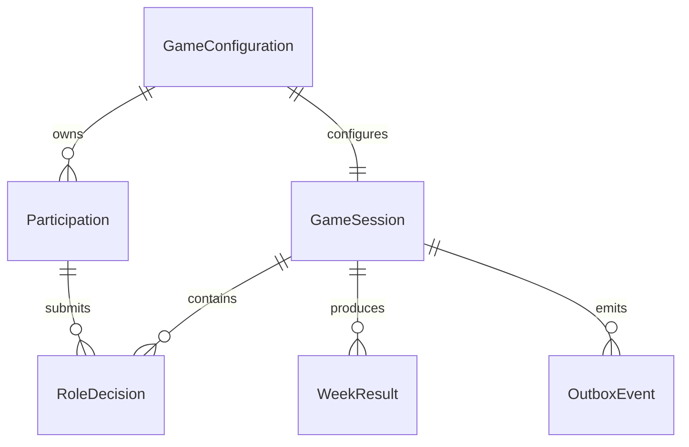

# Functional Specification - u1-walking-skeleton

## Scope and Story Coverage

U1 implements the first working integrated slice for `US1.1`, `US1.2`, `US2.1`, `US2.2`, and `US2.3`: create one game, join and assign four roles, submit one decision per role, explicitly commit one week, and return role-safe state from durable storage.

## Workflow 1 - Create Game

1. The facilitator submits settings, demand series, and an `Idempotency-Key`.
2. The boundary validates text, integer ranges, final week, demand length, and kit conformance using BR1.1–BR1.3.
3. The application checks the actor/operation/resource-scoped idempotency record.
4. In one transaction it creates `GameConfiguration`, a `GameSession` in `LOBBY`, the creation idempotency result, and `GameCreated` outbox event.
5. It returns the join code and raw facilitator credential once; only their protected digests persist.
6. A retry with the same payload returns the same result reference; a different payload returns conflict.

Failure paths preserve all typed values, name the invalid field and correction, and never create a partial game.

## Workflow 2 - Join and Assign Roles

1. A participant submits join code, display name, and idempotency key.
2. The application resolves only an active `LOBBY` game and validates the display name using BR2.1.
3. In one transaction it creates `Participation`, records the idempotent response, and emits `ParticipantJoined`.
4. It returns the raw recovery token once; URLs and logs never contain it.
5. The facilitator assigns each participant one unoccupied role. Duplicate assignment is rejected without changing existing assignments.
6. Session start succeeds only when FACTORY, DISTRIBUTOR, WHOLESALER, and RETAILER are all assigned; it transitions `LOBBY` to `ACTIVE` at week 1.

## Workflow 3 - Read Role-safe State

1. The participant authenticates with the recovery token and requests the session state.
2. The application re-checks credential status, game membership, assigned role, and session identity for every request.
3. It reads one consistent `GameSession` snapshot.
4. Serialization applies BR3.2: own inventory, backlog, arrivals, order, allowed history, current week, decision completion, and resource version are included.
5. Other roles' state, future demand, raw credentials, and credential digests are structurally absent rather than hidden by the browser.

## Workflow 4 - Submit or Revise Role Decision

1. A participant submits quantity, `If-Match` expected decision version, and `Idempotency-Key`.
2. The application authorizes the participant for the target game, session, role, and current open week.
3. It validates the inclusive range `0..quantityUpperBound` and integer representation.
4. If the expected version is current, it creates or replaces that role's current decision, increments its version, records the idempotent result, and emits `DecisionSubmitted` in one transaction.
5. If the version is stale, it rejects the update and returns the latest role-safe state and version; typed client input remains available for reconciliation.
6. Older responses are ignored by clients when their returned version is lower than the newest applied version.

## Workflow 5 - Commit Week

1. The facilitator explicitly requests commit with the current session version and an idempotency key.
2. The application verifies facilitator authorization, `ACTIVE` status, current version, open week, and exactly four valid role decisions.
3. `SimulationEngine` receives an immutable prior snapshot, current customer demand, and the four decisions.
4. It performs the JSD 12-step sequence, advances order/shipment/production pipelines, calculates shipments, ending inventory, ending backlog, and integer-minor-unit costs.
5. The application rechecks non-negative balances, deterministic identifiers, and maximum numeric bounds.
6. In one transaction it persists the next `GameSession` snapshot, immutable `WeekResult`, committed decisions, idempotency result, and `WeekCommitted` outbox event.
7. It advances to the next week, or transitions to `ENDED` when the configured final week is committed.
8. It returns the committed result reference and role-safe state. An identical retry returns the same response; a payload mismatch returns conflict.

Any calculation, storage, or concurrency failure leaves the previous committed week intact and returns a retryable or non-retryable RFC 9457 problem with correlation ID.

## State Machines

### GameSession

| Current | Trigger | Guard | Next | Effect |
|---|---|---|---|---|
| none | createGame | valid settings and new idempotency key | LOBBY | create game/session and join code |
| LOBBY | startSession | facilitator + four unique roles | ACTIVE | initialize week 1 state and delay pipelines |
| LOBBY | startSession | missing/duplicate role | LOBBY | reject and list missing roles |
| ACTIVE | commitWeek | four decisions + current version + not final week | ACTIVE | atomically persist result and advance week |
| ACTIVE | commitWeek | four decisions + current version + final week | ENDED | atomically persist final result and close input |
| ACTIVE/ENDED | stale or duplicate command | version or idempotency guard fails | unchanged | reject or replay without side effect |

### RoleDecision

| Current | Trigger | Guard | Next | Effect |
|---|---|---|---|---|
| absent | submit | active session, authorized role, valid quantity | DRAFT | create version 1 |
| DRAFT | revise | matching expected version | DRAFT | replace quantity and increment version |
| DRAFT | commitWeek | all roles ready | COMMITTED | freeze decision with WeekResult |
| DRAFT | stale revise | mismatched expected version | DRAFT | reject and return latest version |
| COMMITTED | submit/revise | any | COMMITTED | reject as closed week |

## Derived Entity Relationship View

<!-- Text fallback: One GameConfiguration owns many Participation records and one GameSession. The GameSession contains many RoleDecision and WeekResult records and emits OutboxEvent records. Participation authors RoleDecision records. -->

## Derived Rules Summary

- BR1.1–BR1.3 govern exactly-once game creation, kit status, and bounded integer inputs.
- BR2.1–BR2.2 govern safe joining and unique role readiness.
- BR3.1–BR3.2 enforce server-side object authorization and role-safe responses.
- BR4.1–BR4.3 govern optimistic concurrency, explicit facilitator commit, and idempotent retries.
- BR5.1–BR5.3 define deterministic weekly simulation and cost calculation.
- BR6.1 makes the week transition, result, idempotency, and event an all-or-nothing write.

## Error and Corner Behaviour

| Condition | Behaviour |
|---|---|
| Empty or whitespace game/display name | Reject, identify field, preserve form values |
| Quantity at 0 or upper bound | Accept; values outside inclusive range are rejected |
| Double submit / retry | Replay same result for 24 hours without repeating side effect |
| Same key with different payload | Return conflict and preserve original result |
| Two actors edit same role | Only matching expected version succeeds; stale update is rejected |
| Storage unavailable before commit | Return retryable failure; no accepted partial state |
| Failure during multi-record week write | Roll back all state, result, decision, idempotency, and outbox changes |
| Older response arrives last | Client applies only the highest known resource version |
| Credential invalid or wrong game | Return forbidden/not found without revealing protected data |
| Unsupported added response field | Consumer ignores it under v1 additive compatibility |
| JSD preset not yet confirmed | CUSTOM game can exercise the slice; JSD_KIT acceptance remains blocked |

## Contract Alignment

- C1 gains authoritative request/response concepts from the workflows and entities: actor credential, resource version, correlation ID, idempotency scope, 24-hour retention, and payload mismatch conflict.
- C2 is not consumed inside U1, but U1 exposes aggregate-owned interfaces without permitting direct table access.
- C3 events are committed through `OutboxEvent`; event-type-specific schemas remain a required input before U3 implementation.

## Sources

- `inception/units-generation/unit-of-work.md`
- `inception/units-generation/unit-of-work-story-map.md`
- `inception/user-stories/stories.md`
- `inception/requirements-analysis/requirements.md`
- `inception/domain-design/components.md`
- `inception/contract-design/contract-summary.md`
- `construction/u1-walking-skeleton/functional-design/entities.md`
- `construction/u1-walking-skeleton/functional-design/rules.md`
- `construction/u1-walking-skeleton/functional-design/functional-design-questions.md`

## Assumptions & Open Questions

- U1 uses a minimal browser view only to prove the integrated slice; refined cross-flow UI belongs to U5.
- credential entropy, expiry, rotation, timeout budgets, and concrete persistence technology are deferred to NFR Requirements / NFR Design.
- exact JSD preset values remain externally blocked as recorded in Delivery Planning.
