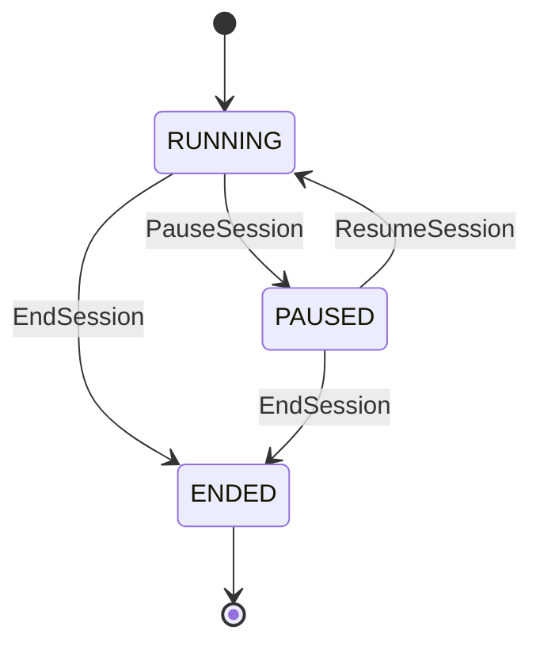

# Functional Specification - U2 Session Continuity

## Commands

### PauseSession / ResumeSession / EndSession

Input は `gameId`、facilitator credential、`expectedVersion`、`idempotencyKey` です。application service は authorization と lifecycle transition を検証し、GameSession、AuditEntry、outbox event を原子的に保存します。pause は draft を削除せず、resume は最後の committed week の次週を active にします。

### SubmitProxyDecision

Input は `gameId`、`week`、`roleId`、`quantity`、`expectedVersion`、`reason` です。facilitator を認可し、通常 decision と同じ validation を適用します。成功時は decision、actor-attributed audit、`ProxyDecisionSubmitted` event を同一 transaction で保存します。

### RecoverParticipation

Input は opaque recovery token です。digest lookup 後に expiry / revocation / membership を検証し、同じ game / role の latest role-safe state と current `stateVersion` を返します。失敗時は token の状態を区別しない `401 RECOVERY_NOT_AVAILABLE` と facilitator への確認案内を返します。

## Queries and synchronization

- `GET /games/{gameId}/state` は actor credential に基づく role-safe projection と `stateVersion` を返します。
- SSE event は `gameId` 内の単調な `eventSequence` と `stateVersion` を持ちます。
- reconnect client は last event id 以降を取得し、gap または version mismatch 時は snapshot query で reconciliation します。
- 複数 tab は BroadcastChannel を補助通知に使用できますが、server version が唯一の整合性 authority です。

## State transitions

Text fallback: session は RUNNING と PAUSED を facilitator 操作で往復し、どちらからも ENDED へ遷移できます。ENDED からの復帰はありません。

## Failure behavior

- stale mutation: `409 STALE_STATE`、current version を返し、保存しません。
- paused participant commit: `409 SESSION_PAUSED`、draft を保持します。
- invalid recovery: `401 RECOVERY_NOT_AVAILABLE`、credential details を返しません。
- database failure: transaction 全体を rollback し、state / audit / outbox の部分成功を許しません。
- restart: database snapshot と未配信 outbox を読み直し、重複 event は idempotent に処理します。

## Acceptance mapping

- AC3.1.1: BR7.2 と PauseSession integration scenario。
- AC3.1.2: BR8.1〜BR8.3 と proxy audit scenario。
- AC3.1.3: BR7.3 と restart / resume scenario。
- AC3.2.1: BR9.1、BR9.3 と recovery scenario。
- AC3.2.2: BR9.2 と invalid / deleted token scenario。
- AC3.2.3: BR10.1、BR10.2 と multi-tab stale response scenario。

## Sources

- `inception/units-generation/unit-of-work.md`
- `inception/units-generation/unit-of-work-story-map.md`
- `inception/user-stories/stories.md`
- `inception/requirements-analysis/requirements.md`
- `inception/domain-design/components.md`
- `inception/contract-design/contract-summary.md`

## Assumptions & Open Questions

- U1 の in-memory authority は U2 実装時に PostgreSQL-backed repository へ置換する必要があります。
