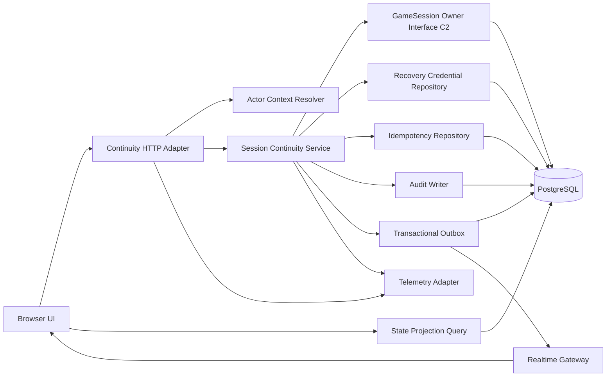

# Logical Components - U2 Session Continuity

## Component inventory

| Component | Responsibility | State owner | Failure domain |
|---|---|---|---|
| Continuity HTTP Adapter | request validation、cookie / CSRF、problem response | none | one application instance |
| Actor Context Resolver | credential verification、membership context | credential repository | database-backed credential scope |
| Session Continuity Service | lifecycle、proxy、recovery orchestration | none; uses C2 | one command transaction |
| GameSession Owner Interface | C2 command load / append、aggregate invariant | U1 GameSession | one game session |
| Recovery Credential Repository | digest、expiry、revocation、rotation | recovery credential rows | one membership |
| Idempotency Repository | request hash と stable result | idempotency rows | one operation scope |
| Audit Writer | pseudonymous immutable audit | audit rows | one transaction |
| Transactional Outbox | durable event handoff | outbox rows | one transaction / dispatcher claim |
| State Projection Query | role-safe snapshot generation | reads PostgreSQL authority | one query / game |
| Realtime Gateway | SSE、Last-Event-ID、polling fallback | no authoritative state | one instance connection set |
| Telemetry Adapter | bounded metrics、logs、traces | observability backend | telemetry degradation only |

## Interaction

Text fallback: Browser は HTTP adapter から continuity command を送り、service は actor context と C2 aggregate interface を使います。state、credential、idempotency、audit、outbox は PostgreSQL transaction で永続化され、Realtime Gateway は outbox event を配信します。gap 時は State Projection Query から snapshot を取得します。

## Isolation and blast radius

- game / session 単位の optimistic lock により、1 game の競合を他 game へ波及させません。
- dispatcher claim と retry state を outbox row 単位に分け、1 event の poison failure を配信全体から隔離します。
- Realtime Gateway は authoritative write path から分離し、SSE failure 時も mutation と snapshot query を継続します。
- Telemetry backend failure は bounded buffer と drop counter で隔離し、business transaction を失敗させません。
- shared PostgreSQL は主要な共通 failure domain であり、Multi-AZ、PITR、pool budget、容量監視を Infrastructure Design で具体化します。

## Contract boundaries

U2 は C2 の public module interface だけで U1-owned GameSession を更新します。event schema は C3 の versioning、correlationId、eventId、aggregateVersion を継承し、`ProxyDecisionSubmitted` を追加する場合は provider-owned contract の additive / major change policy に従って C3 source-of-truth を更新してから実装します。

