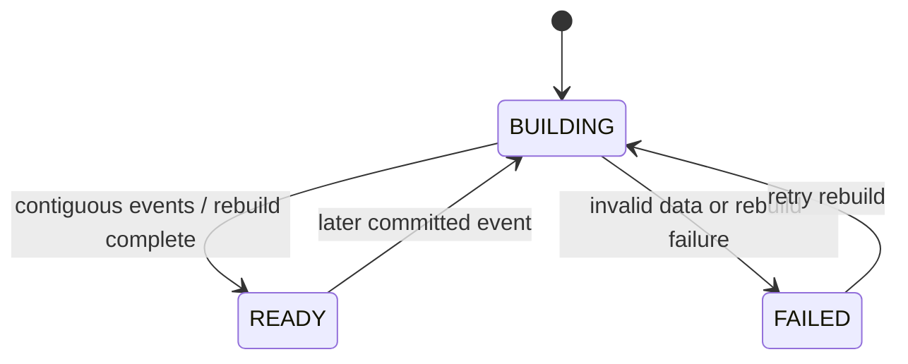
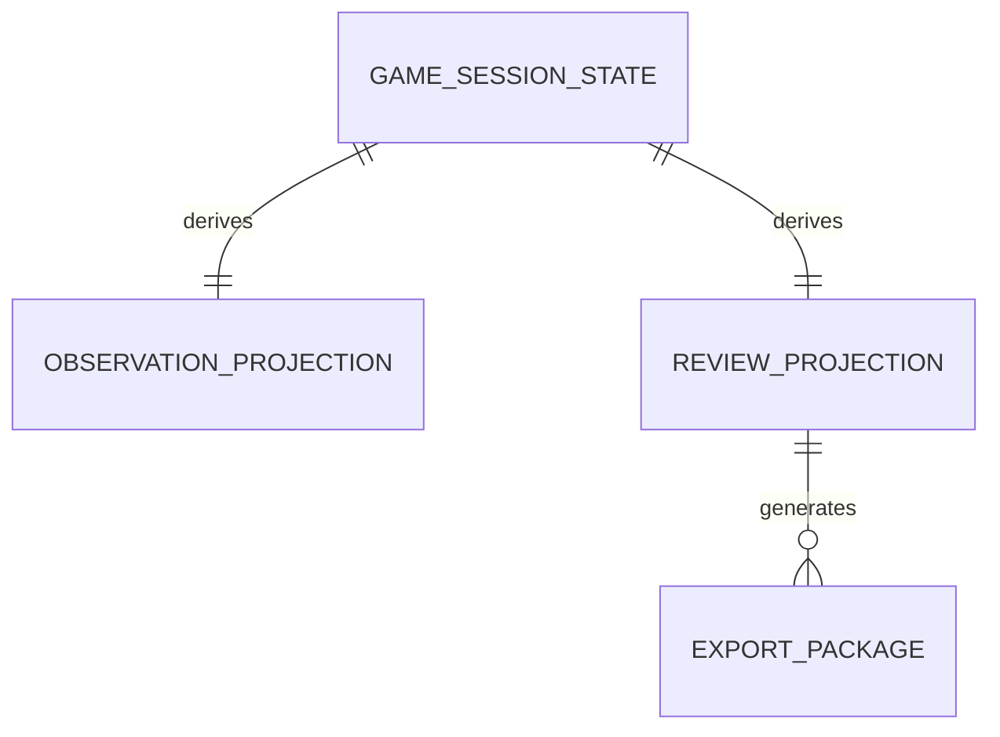

# Functional Specification - U3 Learning View

## Stories

US4.1、US4.2、US4.3 を実装します。

## Workflows

### ConsumeGameChanged

1. C3 event の schemaVersion、eventId、sessionId、aggregateVersion を検証します。
2. eventId が処理済みなら同じ結果を返します。
3. expected version より先なら更新を停止し、replay または snapshot rebuild を要求します。
4. committed data だけから ObservationProjection を更新し、終了時は ReviewProjection を構築します。
5. projection と consumer cursor を同じ transaction で保存します。

### GetObservation

1. actor の game membership と observer / facilitator access を再検査します。
2. BR11.1 と BR11.2 を適用した projection だけを返します。
3. projection lag がある場合は sourceVersion と stale indicator を返し、write model を直接参照しません。

### GetEndedGameReview

1. membership と session status を検査します。
2. ENDED でなければ `409 GAME_NOT_ENDED` を返します。
3. READY projection は需要、注文、在庫、受注残、出荷、週次 / 累積費用を共通週軸で返します。
4. empty dataset は `NO_DATA`、projection failure は `PROJECTION_FAILED` と区別します。

### CreateExport

1. facilitator authorization、ENDED status、idempotency key を検証します。
2. READY ReviewProjection の canonical dataset と sourceVersion を固定します。
3. CSV と JSON を schema version 付きで生成・検証します。
4. 両形式の数量・費用一致と完全性を検査し、両方成功した場合だけ COMPLETE として公開します。

## State machines

ExportPackage は PENDING → GENERATING → COMPLETE または FAILED と遷移し、FAILED から再試行時は新 attempt で GENERATING へ進みます。

## Derived entity relationship

## Derived rules summary

BR11 は観察時 privacy、BR12 は終了後開示、BR13 は export の完全性と認可、BR14 は projection の冪等性と順序を規定します。

## Failure behavior

- unknown major schema version は隔離し projection を進めません。
- version gap は current projection を stale として保持し rebuild を開始します。
- authorization failure は protected field、object reference、存在情報を返しません。
- partial export は download 不能で、failure code と retry availability のみを返します。

## Sources

- `inception/user-stories/stories.md` US4.1〜US4.3
- `inception/contract-design/contract-summary.md` C3、C6
- `inception/domain-design/components.md` LearningView

## Assumptions & Open Questions

- projection rebuild は GameSession owner が提供する snapshot / replay interface を利用し、owner table を直接読みません。

