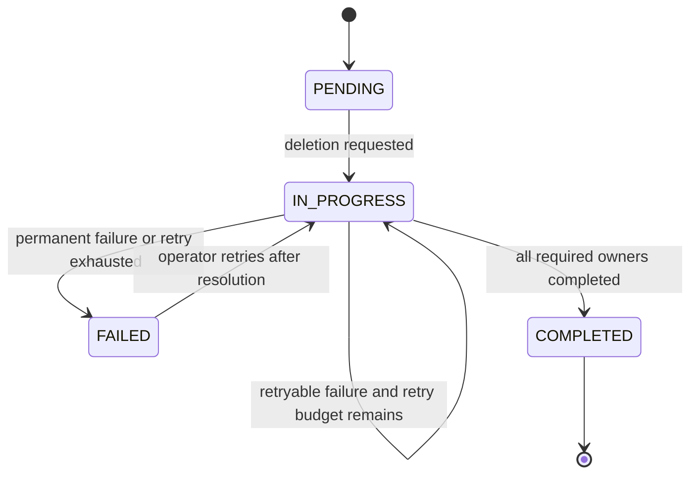
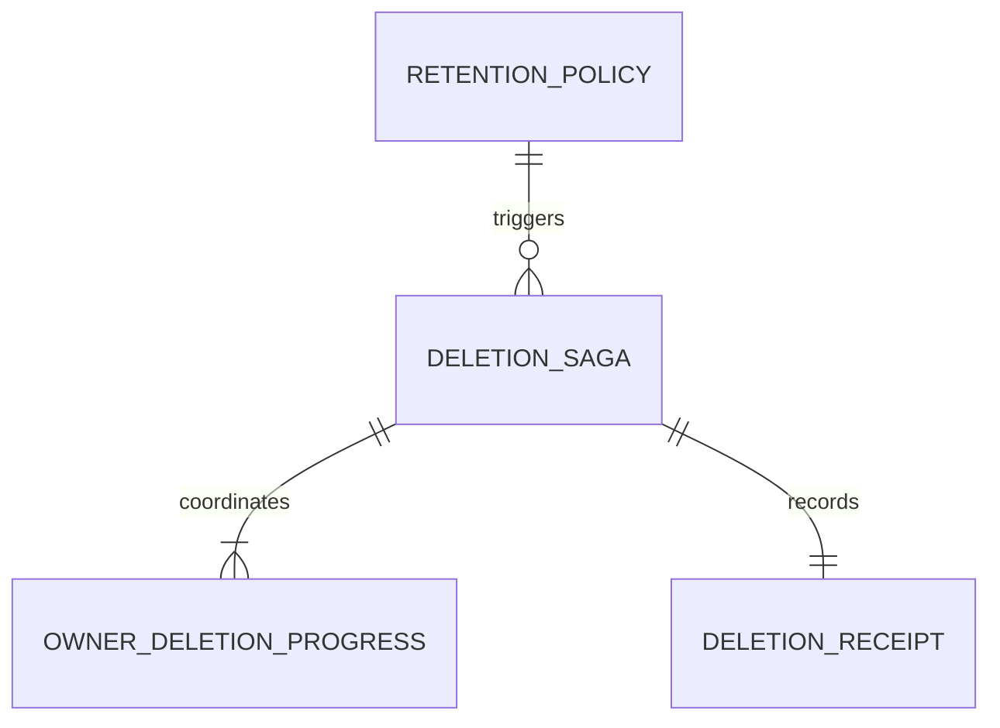

# Functional Specification - U4 Retention Operations

## Stories

US5.1（AC5.1.1〜AC5.1.3）を実装し、US1.1 の retention setting を受け取ります。

## Workflows

### ConfigureRetention

1. ゲーム作成時に retentionDays を検証し、未指定なら 90 日を適用します。
2. `retentionStartsAt` と policy version から `deleteAfter` を決定します。
3. 変更は game owner の境界を通し、過去の期限計算を監査可能にします。

### StartDueDeletion

1. scheduler が期限到達済み policy を走査します。
2. gameId ごとの active saga を検査し、存在すれば再利用します。
3. 新規 Saga は owner Unit ごとの PENDING progress を作成します。
4. C4 `DeletionRequested` を同じ deletionId で公開し、以降の delivery は at-least-once とします。

### ConsumeOwnerCompletion

1. C5 envelope、schemaVersion、deletionId、ownerUnit を検証します。
2. 重複 event は既存 progress と同じ結果で受理します。
3. `completed` は owner progress を完了にします。`retryable-failure` は未完 owner だけを backoff 対象にします。
4. `permanent-failure` または retry 枯渇は Saga を FAILED にし、自動処理を停止します。
5. 全 required owner が completed の場合だけ Saga と receipt を COMPLETED として確定します。

### RetryFailedDeletion

1. 運営者が FAILED reason と未完 owner を確認します。
2. 原因解消後、明示的な retry は同じ deletionId の新 attempt を開始します。
3. 完了済み owner は再削除せず、未完 owner のみへ C4 を再送します。

### ReadRetentionStatus

1. 運営者権限と game scope を server 側で検査します。
2. status、attempt、owner ごとの結果、failureCode、次の操作だけを返します。
3. PII、token、credential digest、削除済み payload は返しません。

## State machines

`OwnerDeletionProgress` は PENDING から COMPLETED、RETRYABLE_FAILURE、PERMANENT_FAILURE のいずれかへ進み、明示的な retry で未完 owner だけが PENDING に戻ります。

## Derived entity relationship

<!-- Text fallback: RetentionPolicy が DeletionSaga を開始し、Saga は複数 owner の進捗と 1 件の receipt を所有します。 -->

## Derived rules summary

BR15.1 は既定期限、BR15.2〜BR15.4 は Saga の冪等性と完了条件、BR15.5〜BR15.6 は失敗回復、BR15.7 は receipt の privacy と保持期間を規定します。

## Failure behavior

- unknown schema major は隔離し Saga を進めません。
- delivery timeout は owner completion の欠落として扱い、成功済み owner を巻き戻しません。
- permanent failure と retry 枯渇は `FAILED` とし、削除済みデータを復元せず未完 owner だけを再試行します。
- receipt 保存失敗時は Saga を COMPLETED にせず、監査証跡の永続化を再試行します。

## Sources

- `inception/units-generation/unit-of-work.md` U4
- `inception/units-generation/unit-of-work-story-map.md` US5.1
- `inception/user-stories/stories.md` AC5.1.1〜AC5.1.3
- `inception/requirements-analysis/requirements.md` FR8.1〜FR8.3、NFR4、NFR7
- `inception/domain-design/components.md` GameConfiguration ownership
- `inception/contract-design/contract-summary.md` C4、C5

## Assumptions & Open Questions

- receipt の 1 年保持は削除対象となる game data とは別 lifecycle であり、game reference は不可逆 digest とします。
