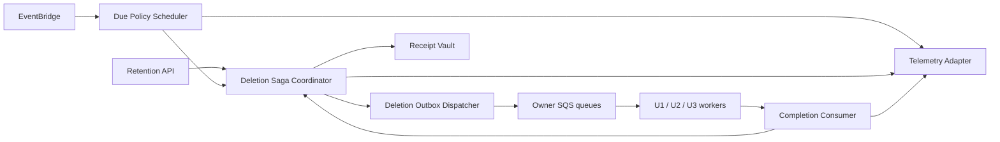

# Logical Components - U4 Retention Operations

## Component inventory

| Component | Responsibility | State / dependency | Failure domain |
|---|---|---|---|
| Retention API | policy と status、manual retry の認可済み interface | Retention Repository | API instance |
| Due Policy Scheduler | due policy の page scan と Saga 開始 | PostgreSQL、EventBridge | scheduler lease |
| Deletion Saga Coordinator | current attempt、owner progress、terminal condition | PostgreSQL | game-scoped Saga |
| Deletion Outbox Dispatcher | C4 の durable publish | outbox、owner SQS | owner queue |
| Completion Consumer | C5 validation、deduplication、attempt binding | inbox、Saga Coordinator | owner message |
| Retry Planner | failure classification、backoff、manual retry | attempt ledger | game / owner |
| Receipt Vault | privacy-safe receipt 作成、暗号化、1 年 cleanup | PostgreSQL、KMS | receipt partition |
| Telemetry Adapter | metric、log、trace、alert delivery | OTel / alert manager | telemetry pipeline |

## Interaction

<!-- Text fallback: EventBridge と Retention API が Saga Coordinator を起動し、outbox と owner queue を通じて各 Unit を呼び出します。Completion Consumer が attempt を検証して Saga を更新し、全 owner 完了後に Receipt Vault が証跡を保存します。全 component は Telemetry Adapter に signal を送ります。 -->

## Isolation and shared resources

PostgreSQL と telemetry backend は共有 resource ですが、transaction、pool 上限、table/index、low-cardinality label で blast radius を制限します。owner queue と DLQ は分離し、U4 は owner data store を共有しません。

## Sources

- `functional-design/functional-spec.md`
- `tech-stack-decisions.md`
- `contract-summary.md` C4 / C5

## Assumptions & Open Questions

None.
