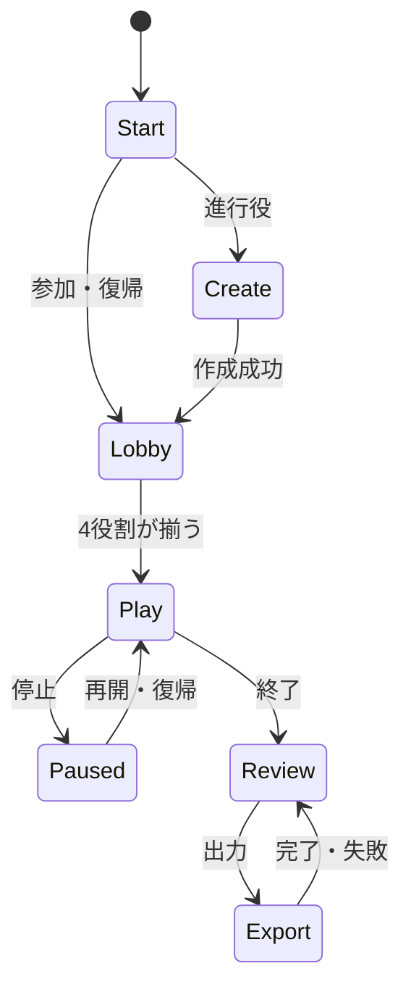

# Functional Specification - U5 Accessible Experience

## Scope and stories

U5 は US1.1〜US5.1 の全 11 story に対する browser UI を担当します。ゲーム作成、参加、週次プレイ、進行役操作、復帰、観察、振り返り、export、保持状態の画面を提供し、業務状態の正本は U1〜U4 の application contract に置きます。UI は role-safe response だけを表示し、非公開値を DOM に保持しません。

## Interaction invariants

- 主要操作は keyboard で完結し、focus は予測可能な順序で移動します。skip link、画面目的を示す H1、可視 focus indicator を全画面に置きます。
- 状態は text と icon で示し、色だけに依存しません。field error は summary と field の両方に置き、入力値を保持します。
- 非同期の通常更新は polite live region、権限・保存失敗は alert で伝えます。自動更新の停止と再開を画面ごとに提供します。
- 200% zoom では 1 column に reflow し、すべての操作を維持します。実際の狭い端末は閲覧中心の案内を出しますが、zoom を画面幅だけで判別して操作を隠しません。
- server の version が現表示より古い応答は捨てます。競合時は自分の未保存値を保持し、最新値と並べて再入力を促します。

## Workflows

### Create and join - US1.1 / US1.2

1. 進行役はキット準拠または custom 条件と保持期間を入力します。client validation は補助とし、server error の対象 field と修正内容を表示します。
2. 保存成功後、参加コードへ focus を移して copy action と lobby への導線を出します。custom 条件は text badge で示します。
3. 参加者は参加コードと表示名を送信します。有効なら復帰資格を browser に保存し、role と lobby を表示します。無効・終了済みなら入力値を残し理由を示します。
4. 進行役は 4 役割の割当てを確認し、不足役割がある間は開始 action の理由を示して実行不可とします。

### Weekly play and commit - US2.1 / US2.2 / US2.3

1. 参加者は現在週、12 ステップの現在地、自役割の許可された在庫・受注残・入荷・受注と次の操作を確認します。他役割の private data と未来需要を受け取らず表示しません。
2. 発注数または生産要請数を text input + numeric input mode で入力します。空白・小数・負数・上限超過は値を保持し、field と summary に修正内容を示します。
3. 確定中は重複操作を抑止し、成功時は live region で状態を知らせます。version conflict は相手の最新値と自分の未保存値を並べます。
4. 進行役は 4 役割の完了を確認し、確認 dialog で対象週・入力・不可逆性を読み、明示 button で週を確定します。処理中と失敗時は dialog 内で状態と再試行方法を示します。
5. commit 後は SSE で最新 version を受け、2 秒以内に画面を更新します。SSE が切れた場合は 1 秒 polling に fallback し、再接続中の表示を出します。利用者が自動更新を停止したときは手動更新 action を残します。

### Pause, recovery, end - US3.1 / US3.2

1. 停止中は入力を read-only とし、理由と進行役待ちを表示します。進行役の代理入力は対象 role、数量、操作者を確認 dialog に表示します。
2. 復帰資格が有効なら同じ role に戻り、最新の確定済み状態を読み直します。無効または削除済みなら進行役への確認方法を示し、token を URL や log に出しません。
3. 複数 tab では新しい aggregate version の通知だけを採用し、古い tab の未保存入力を黙って失わせません。
4. 終了は停止と別の確認 dialog を通します。終了後は入力を禁止し、振り返りへの導線を表示します。

### Observe, review, export - US4.1 / US4.2 / US4.3

1. 観察者には週・ステップ・入力完了状況と安全なチーム合計だけを表示します。逆算可能な合計は「情報保護のため非表示」と理由を示し、値は DOM に置きません。
2. 終了後の振り返りでは、需要、注文、在庫、受注残、出荷、費用を同じ週軸で chart と同値の table に同時表示します。series は text、pattern、直接 label で区別し、table への skip action を置きます。
3. 0 件は「データなし」、通信・読込失敗は error として区別します。プレイ中の終了後データは表示せず、権限 error の details に private data を含めません。
4. CSV / JSON export は生成中・成功・失敗を別状態で示し、部分出力を完了扱いにしません。両形式の schema version と対象 game を明示します。

### Retention status - US5.1

1. 進行役は保持期間と削除予定日、削除 Saga の状態、owner ごとの進捗を読みます。権限がない場合は data を取得・表示しません。
2. FAILED のときは failure code と未完 owner、運営者への連絡導線を示します。手動 retry は結果と影響を確認した後に明示操作します。
3. COMPLETED は全 owner 完了と receipt の保存を server が確定したときだけ表示します。部分完了を「削除完了」と呼びません。

## Screen and state transitions

<!-- Text fallback: 開始から作成または参加でロビーへ進み、4 役割が揃うとプレイします。停止と復帰はプレイへ戻り、終了後に振り返りと出力へ進みます。 -->

各画面の load state は `idle → loading → ready / empty / partial / error` とし、offline は未送信入力を保持します。stale は最新状態の取得まで旧応答を適用しません。paused と ended は server status に従い mutation を禁止します。

## Accessibility and acceptance

WCAG 2.2 AA を目標に、通常文字 4.5:1、large text と component 3:1、focus indicator 3 px / 3:1、24 × 24 CSS px の target size、200% zoom、forced colors、reduced motion を検証します。dialog は見出しへ focus、内部循環、Escape cancel、閉じた後の trigger 復帰を満たします。自動検査に加え、keyboard-only と screen reader の主要 flow を手動確認します。

## Sources

- `inception/units-generation/unit-of-work.md` U5
- `inception/units-generation/unit-of-work-story-map.md` US1.1〜US5.1
- `inception/user-stories/stories.md` AC1.1.1〜AC5.1.3
- `inception/requirements-analysis/requirements.md` NFR1、NFR5、NFR6
- `inception/refined-mockups/mockups.md`、`interaction-spec.md`、`accessibility-checklist.md`
- `inception/contract-design/contract-summary.md` C1、C6
- `functional-design-questions.md` Q1〜Q3

## Assumptions & Open Questions

- SSE endpoint と U4 retention status / manual retry の UI contract は共有契約に未定義です。Code Generation 前に provider / consumer contract と認可・error shape を確定します。
