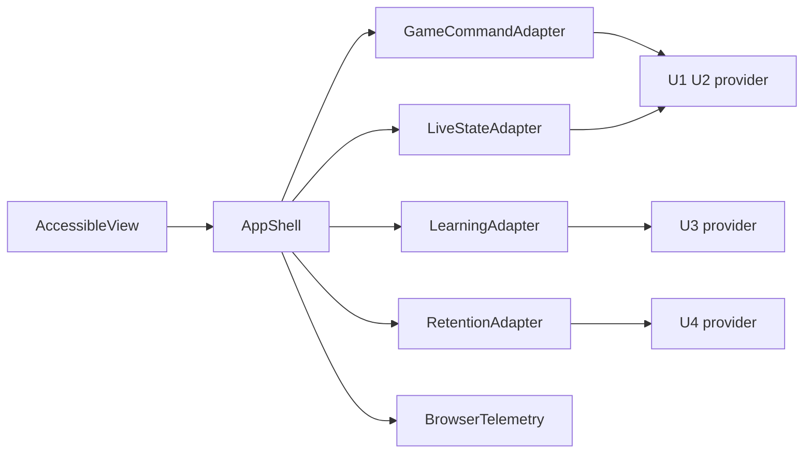

# Logical Components - u5-accessible-experience

## Component inventory

| Component | Ownership | Boundary and failure mode | NFR patterns |
|---|---|---|---|
| AppShell | route、actor context、global status、focus 起点 | server 認可結果に従い、失効時に保護画面を閉じる | NFR3.12、NFR3.13、NFR5.1、NFR5.2 |
| GameCommandAdapter | U1 / U2 の作成、参加、入力、進行役操作 | idempotency key と expected version、error shape の変換。server が正本 | NFR1.10、NFR3.15、NFR7.10 |
| LiveStateAdapter | SSE 購読、polling fallback、snapshot 再照会 | version の単調性、再接続、更新停止。SSE 障害を画面へ伝える | NFR1.11〜NFR1.14、NFR3.13 |
| LearningAdapter | U3 の観察、振り返り、export | role-safe response と complete export のみ受理 | NFR3.14、NFR5.3 |
| RetentionAdapter | U4 の保持状態、retry | operator 認可、partial / failed / completed の区別 | NFR3.13、NFR4.10、NFR4.11 |
| AccessibleView | form、dialog、chart と table、live region | keyboard と screen reader に同じ操作・情報を提供 | NFR5.1〜NFR5.3、NFR6.2、NFR6.3 |
| BrowserTelemetry | 操作 span と correlation ID | allowlist 外の値を送信しない | NFR1.10〜NFR1.12、NFR7.10 |

## Data and failure boundaries

テキスト表現：AccessibleView は AppShell を通じて各 adapter の結果を表示します。GameCommandAdapter と LiveStateAdapter は U1 / U2、LearningAdapter は U3、RetentionAdapter は U4 を呼びます。BrowserTelemetry は機密値を受け取りません。

各 adapter は HTTP / SSE 障害を UI state に変換します。障害を成功として示さず、draft を維持します。U1〜U4 の業務状態と監査履歴は server 側が所有し、U5 は cache した snapshot を正本とみなしません。SSE 停止時の polling request は game / role ごとに 1 本に制限します。

## Verification and delivery boundary

NFR8.1 は AccessibleView と adapter の Given/When/Then、keyboard、error recovery を Vitest / React Testing Library / Playwright で検証します。NFR9.1 は同じ application の CI と staging / production 承認経路で扱います。NFR2 の transaction / durability は U1〜U4 の責任です。

## Sources

- `construction/u5-accessible-experience/nfr-requirements/performance-requirements.md`
- `construction/u5-accessible-experience/nfr-requirements/security-requirements.md`
- `construction/u5-accessible-experience/nfr-requirements/tech-stack-decisions.md`
- `construction/u5-accessible-experience/functional-design/functional-spec.md`
- `inception/contract-design/contract-summary.md`
- `nfr-design-questions.md`

## Assumptions & Open Questions

- provider ごとの browser 契約は未確定であり、adapter の operation 名と DTO は提案段階です。共有契約に確定形を反映してから実装します。
