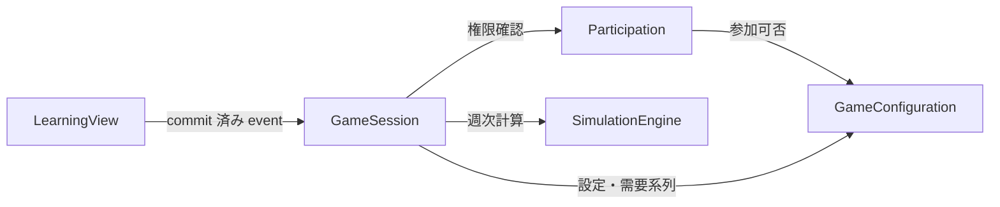

# Domain Components - ビールゲームシミュレーション

## Machine-readable catalogue

```yaml
components:
  - name: GameConfiguration
    summary: ゲーム作成条件、需要系列、保持方針を所有する
    behaviour: >
      終了週、初期在庫、遅延、費用単価、公開範囲、需要系列を検証し、
      キット準拠値からの変更をカスタムとして識別する。保持期限と削除状態も管理する。
    responsibilities:
      - ゲーム定義の作成と検証
      - 需要系列 preset と custom 系列の管理
      - 保持期間と削除 lifecycle の管理
    depends_on: []
    dependents:
      - component: Participation
        interaction: 参加対象のゲームが受付可能か確認する
      - component: GameSession
        interaction: 開始条件と計算条件を取得する
    external_dependencies:
      - name: DurableStore
        kind: database
        purpose: ゲーム定義と保持状態を永続化する
    entities:
      - name: GameDefinition
        identifier: gameId
        attributes: [name, endWeek, initialInventory, delayPolicy, costPolicy, disclosurePolicy, retentionPolicy, customizationStatus, lifecycleStatus]
      - name: DemandSeries
        identifier: demandSeriesId
        attributes: [gameId, sourceKind, weeklyDemand, verificationStatus]
        references:
          - entity: GameDefinition
            owned_by: GameConfiguration
            relationship: 各需要系列は 1 つのゲーム定義に属する

  - name: Participation
    summary: account なしの参加、役割割当て、復帰資格を所有する
    behaviour: >
      参加コードと表示名で参加を受け付け、4 役割を重複なく割り当てる。
      推測困難な復帰資格で同じ参加者と役割へ戻し、権限判定に必要な identity を提供する。
    responsibilities:
      - 参加者 lifecycle の管理
      - 役割割当てと共同参加者の管理
      - 復帰 token の発行、照合、失効
    depends_on:
      - component: GameConfiguration
        interaction: 参加可能なゲームと lifecycle 状態を確認する
        style: sync
    dependents:
      - component: GameSession
        interaction: 操作者のゲーム・役割権限を確認する
    external_dependencies:
      - name: DurableStore
        kind: database
        purpose: 参加者、割当て、credential digest を永続化する
    entities:
      - name: Participant
        identifier: participantId
        attributes: [gameId, displayName, participationStatus]
        references:
          - entity: GameDefinition
            owned_by: GameConfiguration
            relationship: 参加者は 1 つのゲームに参加する
      - name: RoleAssignment
        identifier: roleAssignmentId
        attributes: [gameId, participantId, supplyChainRole, assignmentStatus]
        references:
          - entity: GameDefinition
            owned_by: GameConfiguration
            relationship: 役割割当ては 1 つのゲームに属する
          - entity: Participant
            owned_by: Participation
            relationship: 役割割当ては 1 人の参加者を対象にする
      - name: RecoveryCredential
        identifier: recoveryCredentialId
        attributes: [participantId, credentialDigest, issuedAt, expiresAt, status]
        references:
          - entity: Participant
            owned_by: Participation
            relationship: 復帰資格は 1 人の参加者へ発行される

  - name: SimulationEngine
    summary: 週次の在庫、受注残、遅延、出荷、費用を副作用なしで計算する
    behaviour: >
      前週状態、4 役割の意思決定、需要系列を入力として、12 ステップと 2 週遅延に従う
      次週状態を決定論的に返す。永続化、時刻、network、認可へ依存しない。
    responsibilities:
      - 週次状態遷移の計算
      - 在庫、受注残、出荷、遅延 queue の計算
      - 週次費用と累積費用の計算
    depends_on: []
    dependents:
      - component: GameSession
        interaction: 週確定時に次週状態を計算する
    external_dependencies: []
    entities: []

  - name: GameSession
    summary: ゲーム進行、役割別意思決定、週確定、停止・終了を所有する
    behaviour: >
      ゲームと役割の権限を検査し、非負整数の意思決定を version 付きで受理する。
      4 役割が揃った場合だけ SimulationEngine を呼び、idempotency key と transaction で
      週を一度だけ確定する。停止中と終了後の変更を拒否し、domain event を発行する。
    responsibilities:
      - 12 ステップの進行と状態 machine
      - 役割別情報制約と command authorization
      - 意思決定の競合制御と週確定の原子性
      - 停止、代理入力、再開、終了、復旧、監査 event
    depends_on:
      - component: GameConfiguration
        interaction: ゲーム条件と需要系列を取得する
        style: sync
      - component: Participation
        interaction: 操作者と役割の権限を確認する
        style: sync
      - component: SimulationEngine
        interaction: 次週状態を決定論的に計算する
        style: sync
    dependents:
      - component: LearningView
        interaction: domain event から用途別 read model を構築する
    external_dependencies:
      - name: TransactionalStore
        kind: database
        purpose: 意思決定と週次状態を原子的に永続化する
      - name: EventPublisher
        kind: queue
        purpose: commit 済み domain event を read model 更新へ伝える
    entities:
      - name: GameSessionState
        identifier: sessionId
        attributes: [gameId, currentWeek, currentStep, sessionStatus, version]
        references:
          - entity: GameDefinition
            owned_by: GameConfiguration
            relationship: session は 1 つのゲーム定義を実行する
      - name: RoleDecision
        identifier: roleDecisionId
        attributes: [sessionId, participantId, week, supplyChainRole, quantity, decisionStatus, version]
        references:
          - entity: GameSessionState
            owned_by: GameSession
            relationship: 意思決定は 1 つの session と週に属する
          - entity: Participant
            owned_by: Participation
            relationship: 意思決定には操作者がいる
      - name: WeekSnapshot
        identifier: weekSnapshotId
        attributes: [sessionId, week, roleStates, delayQueues, weeklyCosts, cumulativeCosts, commitKey]
        references:
          - entity: GameSessionState
            owned_by: GameSession
            relationship: snapshot は session の確定済み週を表す
      - name: OperationAudit
        identifier: auditId
        attributes: [sessionId, actorId, actionKind, targetRole, occurredAt, correlationId, outcome]
        references:
          - entity: GameSessionState
            owned_by: GameSession
            relationship: 監査記録は 1 つの session の操作を表す
          - entity: Participant
            owned_by: Participation
            relationship: 操作者が参加者の場合に参照する

  - name: LearningView
    summary: 観察、終了後分析、export 用の安全な read model を所有する
    behaviour: >
      commit 済み event からプレイ中のチーム合計投影と終了後の全役割時系列を構築する。
      逆算で個別値が漏れる集計を抑止し、未来需要を除外する。export は schema version を持ち、
      partial failure を完全な結果として公開しない。
    responsibilities:
      - 観察者向け privacy-safe projection
      - 終了後の時系列分析 projection
      - version 付き CSV / JSON export package
    depends_on:
      - component: GameSession
        interaction: commit 済み domain event を購読して read model を更新する
        style: event
    dependents: []
    external_dependencies:
      - name: ReadModelStore
        kind: database
        purpose: 用途別 projection と生成状態を保存する
      - name: ExportObjectStore
        kind: object-store
        purpose: 完全に生成できた export package を保存する
    entities:
      - name: ObservationProjection
        identifier: observationProjectionId
        attributes: [sessionId, week, step, completionStatus, safeTeamTotals, suppressionReasons]
        references:
          - entity: GameSessionState
            owned_by: GameSession
            relationship: 観察 projection は session の commit 済み状態から作る
      - name: ReviewProjection
        identifier: reviewProjectionId
        attributes: [sessionId, weeklySeries, roleSeries, costSeries, projectionVersion]
        references:
          - entity: GameSessionState
            owned_by: GameSession
            relationship: 振り返り projection は終了済み session を対象にする
      - name: ExportPackage
        identifier: exportPackageId
        attributes: [sessionId, schemaVersion, formats, generationStatus, completedAt]
        references:
          - entity: GameSessionState
            owned_by: GameSession
            relationship: export package は 1 つの終了済み session を表す
```

## Component Diagram



テキスト表現：Participation は GameConfiguration を参照します。GameSession は GameConfiguration、Participation、SimulationEngine を呼び出します。LearningView は GameSession の commit 済み event から投影を構築します。

## Component Summary

| Component | Purpose | Depends On | Dependents | Entities Owned |
|---|---|---|---|---|
| GameConfiguration | ゲーム条件と保持 lifecycle | None | Participation, GameSession | GameDefinition, DemandSeries |
| Participation | 参加、役割、復帰資格 | GameConfiguration | GameSession | Participant, RoleAssignment, RecoveryCredential |
| SimulationEngine | pure な週次計算 | None | GameSession | None |
| GameSession | 進行、意思決定、週確定 | GameConfiguration, Participation, SimulationEngine | LearningView | GameSessionState, RoleDecision, WeekSnapshot, OperationAudit |
| LearningView | 観察、分析、export | GameSession | None | ObservationProjection, ReviewProjection, ExportPackage |

## Entity Ownership

| Entity | Owning Component | Identifier | Attributes | References |
|---|---|---|---|---|
| GameDefinition | GameConfiguration | gameId | name, endWeek, policies, lifecycleStatus | None |
| DemandSeries | GameConfiguration | demandSeriesId | gameId, sourceKind, weeklyDemand | GameDefinition |
| Participant | Participation | participantId | gameId, displayName, status | GameDefinition |
| RoleAssignment | Participation | roleAssignmentId | gameId, participantId, role, status | GameDefinition, Participant |
| RecoveryCredential | Participation | recoveryCredentialId | participantId, digest, expiry, status | Participant |
| GameSessionState | GameSession | sessionId | gameId, week, step, status, version | GameDefinition |
| RoleDecision | GameSession | roleDecisionId | session, actor, week, role, quantity, version | GameSessionState, Participant |
| WeekSnapshot | GameSession | weekSnapshotId | session, week, roleStates, queues, costs, commitKey | GameSessionState |
| OperationAudit | GameSession | auditId | session, actor, action, correlationId, outcome | GameSessionState, Participant |
| ObservationProjection | LearningView | observationProjectionId | session, progress, safe totals, suppression | GameSessionState |
| ReviewProjection | LearningView | reviewProjectionId | session, series, version | GameSessionState |
| ExportPackage | LearningView | exportPackageId | session, schemaVersion, formats, status | GameSessionState |

## External Dependencies

| Component | Dependency | Kind | Purpose |
|---|---|---|---|
| GameConfiguration | DurableStore | database | 定義と保持状態の永続化 |
| Participation | DurableStore | database | 参加情報と credential digest の永続化 |
| GameSession | TransactionalStore | database | 週確定の原子性 |
| GameSession | EventPublisher | queue | commit 済み event の配送 |
| LearningView | ReadModelStore | database | 投影の保存 |
| LearningView | ExportObjectStore | object-store | 完全な export の保存 |

これらは論理 component ではなく、後続 stage で具体的な実装方式を決める外部依存です。

## Boundary Options and Decision

| Decision | Option A | Option B | Option C | Selection |
|---|---|---|---|---|
| 週次計算 | GameSession + pure SimulationEngine。計算を高速・決定論的に test 可能 | GameSession に統合。単純だが副作用と計算が密結合 | 概念ごとに細分化。柔軟だが coordination が過剰 | A |
| 参加 identity | Participation 専用境界。account なしの lifecycle に適合 | GameSession に統合。aggregate が肥大化 | 汎用 Identity。将来性はあるが現要件に過剰 | A |
| 学習表示 | event から用途別 read model。情報漏洩を境界で防止 | entity 直接参照。単純だが権限漏れの risk | 用途ごとに component 化。独立性より分割 cost が大きい | A |

## Rationale

| Component | Separate boundary rationale | Alternatives Rejected |
|---|---|---|
| GameConfiguration | session 実行前後をまたぐ定義と保持 lifecycle を所有する | GameSession への統合は retention と実行状態を混在させる |
| Participation | account なし identity と role authorization の change reason が進行計算と異なる | 汎用 Identity は不要な account model を持ち込む |
| SimulationEngine | 副作用なしの golden test と決定論性を独立して保証できる | GameSession 統合は transaction と計算規則を密結合する |
| GameSession | 週確定の invariant と transaction boundary を 1 箇所に置く | 在庫・注文・費用の細分化は 1 回の週確定に分散 transaction を持ち込む |
| LearningView | write model を公開せず、プレイ中と終了後の開示差を projection で強制する | 画面から entity 直接参照は情報漏洩の risk を高める |

## Sources

- `aidlc/spaces/default/intents/261027-beer-game-development/inception/requirements-analysis/requirements.md`
- `aidlc/spaces/default/intents/261027-beer-game-development/inception/user-stories/stories.md`
- `aidlc/spaces/default/codekb/case-study-beer-game-simulation/architecture.md`
- `aidlc/spaces/default/codekb/case-study-beer-game-simulation/component-inventory.md`
- `aidlc/spaces/default/intents/261027-beer-game-development/inception/practices-discovery/team-practices.md`
- `aidlc/spaces/default/intents/261027-beer-game-development/inception/domain-design/domain-design-questions.md`

## Assumptions & Open Questions

- component 間の正式な API と event schema は Contract Design で定義します。
- deployment topology と具体的な database / queue の選択は Units Generation 以降で決定します。
- 数量上限と credential entropy は Functional Design / NFR Design で具体化します。

