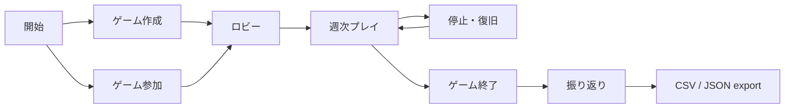

# Refined Mockups - ビールゲームシミュレーション

## Design goals

- 参加者は現在の週、現在のステップ、自役割の公開情報、次の操作を一目で把握できます。
- 進行役は 4 役割の準備状況を確認し、誤操作を防いでゲームを進行できます。
- プレイ中の情報制約と終了後の学習用開示を画面構造でも明確に分離します。
- 主要値と当ステップの操作を常時表示し、履歴と説明は展開式にします。

## Information architecture



テキスト表現：開始からゲーム作成または参加へ進み、ロビー、週次プレイ、終了、振り返り、export の順に遷移します。停止と復旧は週次プレイへ戻る分岐です。

## Screen M01 - 開始

```text
┌──────────────────────────────────────────────────────────────┐
│ Beer Game                                      [ヘルプ]      │
├──────────────────────────────────────────────────────────────┤
│ Bullwhip Effect を体験する supply-chain simulation          │
│                                                              │
│ [ゲームを作成]                                                │
│                                                              │
│ 参加コード [________]  表示名 [____________] [参加する]       │
│                                                              │
│ 状態メッセージ / 入力エラー                                  │
└──────────────────────────────────────────────────────────────┘
```

- 「ゲームを作成」は進行役 flow、「参加する」は参加者 flow を開始します。
- 参加コードと表示名の validation は field 直下に表示し、入力値を保持します。
- 復帰 token が有効な場合は「前回の役割へ戻る」を最上位 action として提示します。

## Screen M02 - ゲーム作成

```text
┌──────────────────────── ゲーム作成 ──────────────────────────┐
│ 基本設定                                                     │
│ 名称 [____________]  終了週 [12 ▼]  保持期間 [90 日]         │
│ 初期在庫 [____]  遅延 [2 週]  在庫費用 [0.50]  欠品費用 [1] │
│                                                              │
│ 需要系列  (● キット準拠  ○ カスタム)                        │
│ [週 1][週 2] ...                                             │
│                                                              │
│ 公開範囲 [プレイ中のチーム合計を許可 ▼]                     │
│ [キャンセル]                                  [ゲーム作成]   │
└──────────────────────────────────────────────────────────────┘
```

- 終了週は 1〜50、数量は非負整数として境界で検証します。
- キット値を変更した場合は「カスタム」badge を名称の隣に表示します。
- error summary を先頭に置き、各 error から対象 field へ移動できます。

## Screen M03 - ロビーと役割割当て

```text
┌──────────── ゲーム「第 1 チーム」 / 準備中 ────────────────┐
│ 参加コード  AB12-CD34                         [コードをコピー]│
├──────────────────────────────────────────────────────────────┤
│ 工場       佐藤                  [割当て変更]  準備完了      │
│ 一次卸     未割当て              [割当てる]    未完了        │
│ 二次卸     鈴木                  [割当て変更]  準備完了      │
│ 小売店     田中                  [割当て変更]  準備完了      │
├──────────────────────────────────────────────────────────────┤
│ [観察用 link]                        [4 役割が揃うまで開始不可]│
└──────────────────────────────────────────────────────────────┘
```

- 状態は text、icon、色の 3 要素で示します。
- 同じ役割の共同参加者を展開表示し、競合時の共同編集ルールを説明します。

## Screen M04 - 参加者の週次プレイ

```text
┌──────── 第 3 週 / 一次卸 ──────── ステップ 8 / 12 ─────────┐
│ [進捗: 1 2 3 4 5 6 7 ●8 9 10 11 12]       接続済み        │
├──────────────────────────────────────────────────────────────┤
│ 在庫 12       受注残 4       到着入荷 6      当週受注 8    │
│ [詳細を表示: 許可された履歴、計算の説明]                    │
├──────────────────────────────────────────────────────────────┤
│ 次の発注数                                                   │
│ [______] units                                               │
│ 入力説明 / validation error                                  │
│                                              [入力を確定]     │
├──────────────────────────────────────────────────────────────┤
│ 他役割: 工場 入力済み / 一次卸 自分 / 二次卸 待機 / 小売済み│
└──────────────────────────────────────────────────────────────┘
```

- 工場では label を「生産要請数」に置き換えます。
- stale response、同時更新、再接続は page 上部の `role=status` alert で通知し、入力値を保持します。
- 停止中は入力を read-only にし、理由と再開待ちを表示します。

## Screen M05 - 進行役 console

```text
┌──────── 第 3 週 / 進行中 ──────────────────────────────────┐
│ [一時停止] [ゲーム終了]                                     │
├──────────────────────────────────────────────────────────────┤
│ 工場       入力済み  10     [代理入力]                      │
│ 一次卸     入力済み   8     [代理入力]                      │
│ 二次卸     未入力           [代理入力]                      │
│ 小売店     入力済み   6     [代理入力]                      │
├──────────────────────────────────────────────────────────────┤
│ 全役割の入力後に利用できます               [週を確定]        │
│ [監査履歴を展開]                                            │
└──────────────────────────────────────────────────────────────┘
```

- 週確定は確認 dialog M06 を必須とします。
- 代理入力には対象役割、値、操作者を確認する dialog を使います。
- 「ゲーム終了」は停止とは別 action とし、終了後の新規入力が拒否されることを明示します。

## Screen M06 - 週確定 dialog

```text
┌──────────────────── 第 3 週を確定 ──────────────────────────┐
│ 4 役割の入力が揃いました。確定後は編集できません。          │
│ 工場 10 / 一次卸 8 / 二次卸 7 / 小売店 6                   │
│ 次に起きること: 遅延 queue を進め、出荷・在庫・費用を保存   │
│                                                              │
│ [戻って確認]                              [第 3 週を確定]    │
└──────────────────────────────────────────────────────────────┘
```

- focus は dialog heading へ移動し、Tab は dialog 内を循環、Escape で閉じます。
- 処理中は button を disabled にして spinner と「確定中」を表示します。
- 二重送信でも同一結果になる一方、UI でも重複操作を防ぎます。

## Screen M07 - 観察

- 現在週、ステップ、役割別の入力完了状態、チーム合計だけを表示します。
- 1 役割の値を逆算できる場合、該当合計は「情報保護のため非表示」とします。
- 役割別の在庫、受注残、注文、未来需要は DOM と API response の双方に含めません。

## Screen M08 - 終了後の振り返り

- 需要、全役割の注文、在庫、受注残、出荷、週次費用、累積費用を同じ週軸で比較します。
- chart は series ごとの pattern と直接 label を持ち、table 表示へ切り替えられます。
- 進行役と観察者に加え、終了済みゲームへ参加した生産役・流通役もアクセスできます。
- プレイ中は同じ route へのアクセスを拒否し、「ゲーム終了後に利用可能」と表示します。
- CSV / JSON export は独立 action とし、partial failure を成功表示しません。

## Responsive behavior

- 1024 px 以上：2 column を含む全操作 layout。
- 768〜1023 px：閲覧と状態確認を許可し、操作開始時に 1024 px 以上を案内。table は horizontal scroll と固定 row header を使用。
- 767 px 以下：主要状態の閲覧と再接続案内のみ。新規ゲーム作成・週確定などの複雑な操作は desktop 利用を案内。
- zoom 200% では情報を 1 column に reflow し、内容と操作を失いません。

## Screen states

| State | 表示 | 回復 action |
|---|---|---|
| Loading | skeleton と対象名 | なし |
| Empty | 「まだデータがありません」 | 文脈に応じた作成・参加 |
| Error | 原因、影響範囲、correlation ID | 再試行または戻る |
| Partial | 取得済み領域と未取得領域を分離 | 未取得部分だけ再試行 |
| Stale | 最新状態がある旨 | 最新状態を読み込む |
| Offline | 入力を保持し未送信と表示 | 再接続して再送確認 |
| Paused | 停止理由と進行役待ち | なし |
| Ended | 入力不可と振り返り導線 | 振り返りへ進む |

## Sources

- `aidlc/spaces/default/intents/261027-beer-game-development/inception/user-stories/stories.md`
- `aidlc/spaces/default/intents/261027-beer-game-development/inception/requirements-analysis/requirements.md`
- `aidlc/spaces/default/intents/261027-beer-game-development/inception/refined-mockups/refined-mockups-questions.md`

## Assumptions & Open Questions

- JSD 教材の具体的な用語と需要系列値は、教材照合後に label と preset へ反映します。
- 需要数・発注数・生産要請数の上限は Domain Design の決定に追従します。

