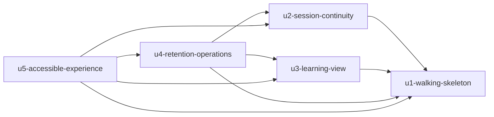

# Unit Dependency DAG

## Machine-readable edges

```yaml
units:
  - name: u1-walking-skeleton
    kind: service
    depends_on: []
  - name: u2-session-continuity
    kind: service
    depends_on: [u1-walking-skeleton]
  - name: u3-learning-view
    kind: service
    depends_on: [u1-walking-skeleton]
  - name: u4-retention-operations
    kind: service
    depends_on: [u1-walking-skeleton, u2-session-continuity, u3-learning-view]
  - name: u5-accessible-experience
    kind: ui
    depends_on: [u1-walking-skeleton, u2-session-continuity, u3-learning-view, u4-retention-operations]
```

## Dependency Diagram



テキスト表現：U1 は独立しています。U2 と U3 はそれぞれ U1 に依存し、相互には依存しません。U4 は U1、U2、U3 に依存します。U5 は U1〜U4 の public application contract に依存します。

## Integrated Walking Skeleton

U1 は DAG の root であり、後続 Unit なしに起動できます。最小 browser UI、application command/query、GameConfiguration、Participation、GameSession、SimulationEngine、transactional persistence を接続し、1 ゲーム、4 役割、1 週の入力と確定、役割別状態表示を実 data で検証します。

## Integration Points

| Consumer Unit | Provider Unit | Integration | Contract intent |
|---|---|---|---|
| U2 | U1 | in-process application interfaces、shared transaction conventions | session lifecycle と recovery を拡張する |
| U3 | U1 | outbox domain events、authorization context | projection を冪等に構築する |
| U4 | U1 | deletion event / completion event | core game data を削除する |
| U4 | U2 | deletion event / completion event | credential と continuity data を削除する |
| U4 | U3 | deletion event / completion event | projection と export を削除する |
| U5 | U1〜U4 | HTTP/API contracts と UI state contracts | browser experience を提供する |

## Parallel Development Opportunities

- U2 と U3 は U1 の stable contract を前提に相互独立であり、並行可能です。
- U4 は U2 と U3 の deletion contract を必要とします。
- U5 の design system と共通 accessibility component は先行検討できますが、各 flow の完成は対応 capability contract に依存します。

## Topology constraints

- この文書は依存 topology のみを示し、推奨実装順序や critical path を決めません。
- Domain Design の entity ownership を Unit 間で複製しません。
- U3 の event consumption と U4 の deletion completion は少なくとも一度の配送を前提に冪等化します。

## Sources

- `unit-of-work.md`
- `components.md`
- `decisions.md`
- `requirements.md`
- `stories.md`

## Assumptions & Open Questions

- 正式な interface、event schema、error contract は Contract Design で定義します。

