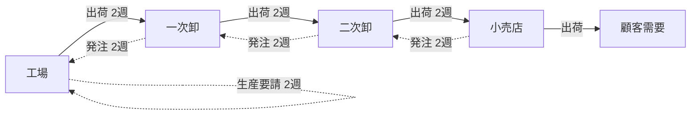
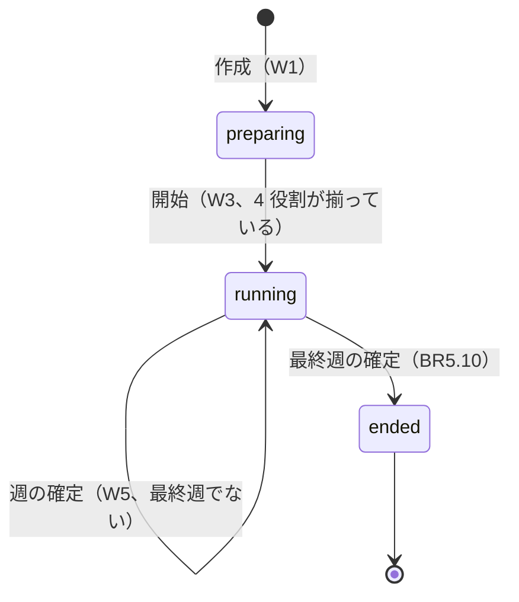
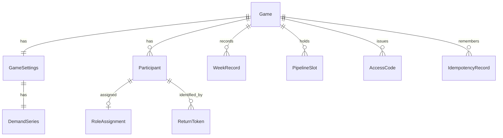

# 機能仕様 - U1 u1-walking-skeleton

U1（薄い一通り）の振る舞いの仕様です。実体の形は `entities.md`、規則は `rules.md` が正本です。この文書は、手順の流れ（ワークフロー）と状態の遷移の正本で、図と規則の一覧は読みやすさのための写しです。

## 受け持つストーリー

| ストーリー | 題 | 主な規則 |
| :--- | :--- | :--- |
| US1.1 | 進行役がゲームを作成する | BR1.1〜BR1.8 |
| US1.2 | 参加者が参加コードでゲームに参加する | BR2.1〜BR2.6 |
| US1.3 | 進行役が役割を割り当てて開始する | BR3.1〜BR3.3 |
| US1.4 | 参加者が自分の役割の状況を見て発注数を入力する | BR4.1〜BR4.7 |
| US1.5 | 週を確定して状態を表示する | BR5.1〜BR5.10 |

画面は `mockups.md` の S0 参加入口、S1 ゲーム作成、S2 ロビー、S3 役割別プレイに従います。S4 進行管理は U3、S5 観察は U4、S6 結果は U5 です。

## 役割とやり取りの形

4 つの役割は、顧客に近い順に 小売店（retailer）、二次卸（wholesaler2）、一次卸（wholesaler1）、工場（factory）です。

- 出荷（モノ）は、工場 → 一次卸 → 二次卸 → 小売店 → 顧客 の向きに流れる。配送の遅延は 2 週。
- 発注（情報）は、小売店 → 二次卸 → 一次卸 → 工場 の向きに流れる。注文情報の遅延は 2 週。
- 工場だけ、発注の代わりに生産要請を出し、生産の遅延は 2 段階（2 週）。
- 小売店の受注は、顧客需要の系列の当週の値。

<!-- Text fallback: モノは工場から一次卸、二次卸、小売店、顧客へ流れ、各区間の配送の遅延は 2 週。発注は小売店から二次卸、一次卸、工場へ流れ、各区間の注文情報の遅延は 2 週。工場の生産要請は工場自身の生産の枠を通り、2 週後に工場の入荷になる。 -->

遅延の枠は、「届く側の役割」ごとに 2 つ持ちます。`remainingWeeks` が 1 の枠は当週（確定する週）に届き、2 の枠は次の週に届きます。確定のたびに枠を 1 つ前進させます。

## ワークフロー

### W1 ゲームを作成する（US1.1）

1. 進行役が、名前、週数、需要系列（省略可）、初期在庫、初期パイプライン数量、費用単価を入力する。
2. 週数（BR1.1）、需要系列の長さと値（BR1.2）、初期値（BR1.3）を検証する。1 つでも不正なら拒否し、入力済みの項目を残す。
3. 需要系列が省略されていれば、仮の既定を入れる（BR1.6）。種別は「カスタム」にする（BR1.7）。
4. ゲームを準備中で作り、参加コード、進行役用コード、観察者用コードを発行する（BR1.4）。コードの平文は、この応答でだけ返す。
5. 進行役に 3 つのコードを示す。

### W2 参加する（US1.2）

1. 参加者が、参加コードと表示名を入力する。
2. コードを検証する（BR2.4）。ゲームが終了済みなら拒否（BR2.2）、進行中なら拒否（BR2.3）。表示名を検証する（BR2.5）。
3. 参加者を追加し、参加順の番号を付ける（BR2.1）。参加者を特定する token を発行する（BR2.6）。
4. 参加者のブラウザに token を保存する。ロビーの一覧に表示名と参加順の番号が加わる。

### W3 役割を割り当てて開始する（US1.3）

1. 進行役が、進行役用コードで、参加者を役割に割り当てる。準備中は、別の役割へ移せる（BR3.2）。進行役用コードのない人は拒否する（BR1.5）。
2. 進行役が開始を要求する。4 役割に 1 人以上が就いていなければ、未割当ての役割を示して拒否する（BR3.1）。
3. 揃っていれば、ゲームを進行中にし、第 1 週を始め、初期状態を固定する（BR3.3）。

### W4 入力する（US1.4）

1. 参加者が、自分の役割の状況を見る。応答は、参加者の役割の投影だけ（BR4.1）。確定前に見せる当週の入荷と受注は、各枠のうち remainingWeeks 1 の数量と、小売店は需要系列の当週の値から求める（確定後でなくても見られる）。
2. 参加者が、発注数（工場は生産要請数）を入力する。識別子（`Idempotency-Key`）を付ける。
3. 判定の順は、認可、再送の照合、状態の検査、入力の検証（BR4.8）。再送なら前回の結果を返して終える（BR4.7）。
4. 状態の検査では、進行中の当週以外を拒否する（BR4.5）。入力の検証では、0 以上 9999 以下の整数だけ受け付ける（BR4.2、BR4.3）。
5. 当週が未確定なら、入力を上書きして保存する（BR4.4）。同じゲームへの書き込みは 1 つずつ順に処理する（BR4.6）。

### W5 週を確定する（US1.5）

1. 進行役が、週の確定を要求する。識別子（`Idempotency-Key`）を付ける。
2. 判定の順は、認可（進行役用コード。BR1.5）、再送の照合（BR4.7）、状態の検査、入力の揃いの検査（BR4.8）。同じ識別子の再送、またはすでに確定済みの同じ週の確定は、状態を変えず、前回の結果を返す（BR5.7）。
3. 状態の検査では、進行中でない、または要求の週が当週でないとき、拒否する（BR5.11）。4 役割の入力が揃っていなければ、未入力の役割を示して拒否する（BR5.1）。確認の操作は条件にしない（BR5.2）。
4. 次の「週の計算」に従って計算する。結果、枠の前進、週の進行を、1 回の保存で行う（BR5.9）。
5. 最終週なら、ゲームを終了にする（BR5.10）。そうでなければ、currentWeek を 1 増やし、次の週の WeekRecord を作る。
6. 結果と新しい状態を返す。画面が、役割ごとの投影を表示する。

## 週の計算

12 ステップのうち、システムが行うステップを、1 つの役割について次の順で行います。計算は SimulationEngine（副作用がなく、時計、乱数、保存、通信に触れない）が行います。

| 順 | ステップ | 内容 |
| :--- | :--- | :--- |
| 1 | ① 入荷の確定 | 入荷 = 配送の枠のうち remainingWeeks 1 の数量（工場は生産の枠の remainingWeeks 1） |
| 2 | ③ 入荷して在庫へ加算 | 利用可能量 = 前週末在庫 + 入荷（BR5.3） |
| 3 | ④ 配送遅れの前進 | 配送の枠（工場は生産の枠）のうち、remainingWeeks 1 を消費し、2 を 1 に前進させる（BR5.4、BR5.6） |
| 4 | ⑤ 受注 | 小売店は顧客需要の当週の値。卸と工場は注文の枠のうち remainingWeeks 1 の数量（BR5.5、BR5.6） |
| 5 | ⑦ 注文情報を処理済みに | 充足対象 = 前週末受注残 + 受注 |
| 6 | ⑧⑨ 在庫と受注残、出荷 | 出荷 = 小さい方。週末在庫と週末受注残を計算する（BR5.3） |
| 7 | ⑩ 注文遅れの前進 | 注文の枠のうち、remainingWeeks 1 を消費し、2 を 1 に前進させる（BR5.5） |
| 8 | ⑫ 上流への発注 | 役割の意思決定を、上流の注文の枠の新しい remainingWeeks 2 として入れる（工場は生産の枠の remainingWeeks 2）。出荷は下流の配送の枠の新しい remainingWeeks 2 として入れる（BR5.4、BR5.5） |

第 1 週の「前週末」の値は、開始のときに設定から決めます。前週末在庫は初期在庫、前週末受注残は 0、前週までの累積費用は 0 です（BR3.3）。第 2 週以降は、前の週の確定済みの記録を使います。

②入荷数の確認、⑥受注数の確認は表示のみで、計算に関わりません（BR5.2）。⑪の発注数は、確定前に各役割が入力した値です。

出荷は、同じ週に下流の配送の枠の末尾へ入るため、下流の同じ週の入荷には加わりません。第 t 週の出荷は第 t+2 週の入荷になります（AC1.5.5）。発注も同じで、第 t 週の発注は第 t+2 週の上流の受注になります（AC1.5.6）。したがって、4 役割の計算は、どの順に行っても同じ結果になります。計算は週の初めの状態を入力とし、4 役割の結果と次の週の枠を、その入力だけから一度に求めます。

費用は、週末在庫 × 在庫単価 + 週末受注残 × 受注残単価（整数の最小単位）です（BR5.8）。

## 状態の遷移

### ゲームの状態

<!-- Text fallback: 作成すると preparing。4 役割が揃って開始すると running。最終週でない週の確定では running のまま。最終週を確定すると ended になる。paused は U3 で足す。 -->

| 遷移 | きっかけ | 条件 | 規則 |
| :--- | :--- | :--- | :--- |
| なし → preparing | 作成 | 設定が妥当 | BR1.1〜BR1.4 |
| preparing → running | 開始 | 4 役割に 1 人以上 | BR3.1、BR3.3 |
| running → running | 週の確定 | 4 役割の入力が揃っている | BR5.1〜BR5.9 |
| running → ended | 最終週の確定 | 週が weekCount | BR5.10 |

準備中以外の状態では、参加（BR2.2、BR2.3）と割当て（BR3.2）を拒否します。一時停止は U3 が足します。

### 当週の入力の状態

| 状態 | 内容 | 次の状態 |
| :--- | :--- | :--- |
| 未入力 | decision が null | 入力すると「入力済み」 |
| 入力済み | decision が値を持つ。確定前は何度でも上書きできる | 上書きしても「入力済み」。確定すると「確定済み」 |
| 確定済み | 結果が入り、変更できない | なし（次の週は新しい WeekRecord） |

## エラーと端の場合

| 場面 | 振る舞い | 規則 |
| :--- | :--- | :--- |
| 入力が整数でない、負数、空欄、9999 超 | 422 validation。他の入力は残る | BR4.2 |
| 他役割の情報の要求 | 403 forbidden。値は返さない | BR4.1 |
| 参加コードだけで進行役の操作 | 403 forbidden | BR1.5 |
| 同じ識別子で内容が違う再送 | 409 conflict | BR4.7 |
| 4 役割の入力が揃っていない確定 | 409 state。未入力の役割を示す | BR5.1 |
| 進行中でないゲーム、または当週でない週の確定 | 409 state。再送なら前回の結果を返す | BR5.11、BR4.8 |
| 確定後に遅れて届いた入力の再送 | 409 にせず、前回の結果を返す | BR4.8 |
| 確定の途中で保存に失敗 | 500 internal。確定前の状態のまま | BR5.9 |
| 同じゲームへの同時の書き込み | 1 つずつ順に処理する。待てなければ unavailable（503）を返し、画面が取り直す | BR4.6 |
| 週数が 1 のゲーム | 第 1 週の確定で終了する | BR5.10 |

## ER 図（entities.md から派生）

<!-- Text fallback: Game は GameSettings を 1 つ持ち、GameSettings は DemandSeries を 1 つ持つ。Game は Participant、WeekRecord、PipelineSlot、AccessCode、IdempotencyRecord を複数持つ。Participant は 0 または 1 の RoleAssignment を持ち、複数の ReturnToken で特定される。 -->

## 規則の概要（rules.md から派生）

| 区分 | 規則 |
| :--- | :--- |
| 検証 | BR1.1、BR1.2、BR1.3、BR2.4、BR2.5、BR4.2、BR4.3 |
| 認可 | BR1.5、BR2.6、BR4.1 |
| 制約 | BR1.8、BR3.1、BR4.5、BR4.6、BR4.7、BR4.8、BR5.1、BR5.7、BR5.9、BR5.11 |
| 計算 | BR5.3、BR5.4、BR5.5、BR5.6、BR5.8 |
| 方針 | BR1.4、BR1.6、BR1.7、BR2.1、BR2.2、BR2.3、BR3.2、BR3.3、BR4.4、BR5.2、BR5.10 |

## この Unit の外で決まること

- 一時停止、再開、進行役による終了、担当者の入れ替え、代理入力、履歴は U3。
- キット準拠の判定、50 週の golden test、障害と同時実行の強化は U2。
- 観察者の入口、復帰用 token の有効期間と失効、試行回数の制限、小売店だけの需要の投影、復元は U4。
- 結果の比較と出力、保持と削除は U5。
- 前の工程のレビューの指摘（U1 の範囲）は、`entities.md` の「契約への反映」で扱った。`contract-summary.md` の C3 の保存先の一覧と `Problem` の種類は、この定義に合わせて直した。

## 上流の資料

`unit-of-work.md`、`unit-of-work-story-map.md`、`stories.md`、`requirements.md`、`components.md`、`contract-summary.md`、`entities.md`、`rules.md`
