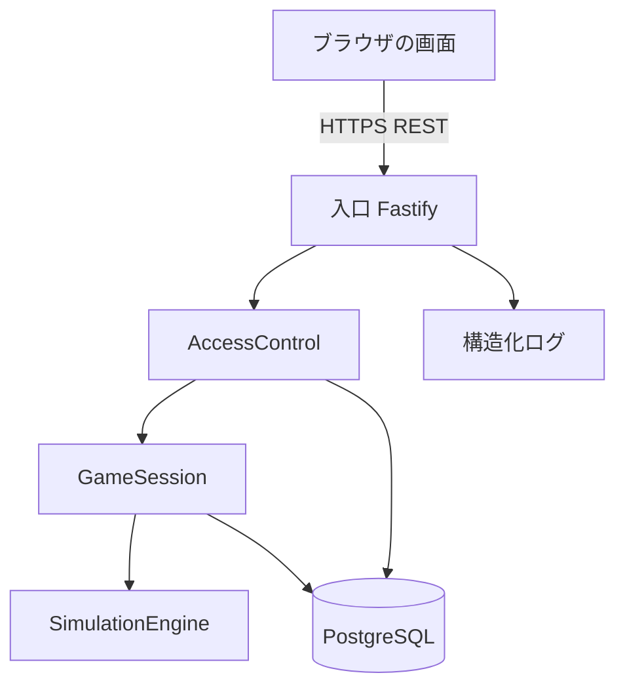

# 論理コンポーネント - U1 u1-walking-skeleton

NFR の設計がどこに効くかを、コンポーネント単位で並べます。デプロイは 1 つのアプリケーションと PostgreSQL です。

## 構成

<!-- Text fallback: ブラウザは HTTPS で入口に要求する。入口は AccessControl で判定し、GameSession を呼ぶ。GameSession は SimulationEngine と PostgreSQL を使う。AccessControl も PostgreSQL を使う。入口は構造化ログを出す。 -->

## コンポーネントと NFR の対応

| コンポーネント | 失敗の領域 | 適用する NFR の設計 |
| :--- | :--- | :--- |
| 入口（Fastify） | アプリケーションの 1 台 | 要求の識別子、構造化ログ、ヘルスチェック、セキュリティヘッダ、入力の検証、共通のエラー形式 |
| AccessControl | 同上 | 資格情報の判定、投影、コードと token の保存、鍵の管理 |
| GameSession | 同上 + データベース | ゲーム単位の行の占有、1 回の保存、版の検査、冪等性の記録 |
| SimulationEngine | 同上（外部に触れない） | 純粋な関数、整数の金額 |
| PostgreSQL | 共有の資源 | 状態の唯一の保存先。接続プール |

## 失敗の影響の範囲

- アプリケーションの 1 台が止まる: ステートレスのため、ほかの台が続ける。1 台なら一時停止し、再起動で復帰する。
- データベースの接続断: 全ゲームの書き込みと読み取りが失敗する。ほかに保存先はない。
- 1 つのゲームの占有の滞留: そのゲームの書き込みだけが待つ。別のゲームは影響を受けない。

## 共有の資源

PostgreSQL の接続プールと、暗号化・照合の鍵。Infrastructure Design で、データベースの構成と秘密情報の渡し方を定める。

## 上流の資料

`performance-design.md`、`security-design.md`、`scalability-design.md`、`reliability-design.md`、`observability-design.md`、`components.md`
