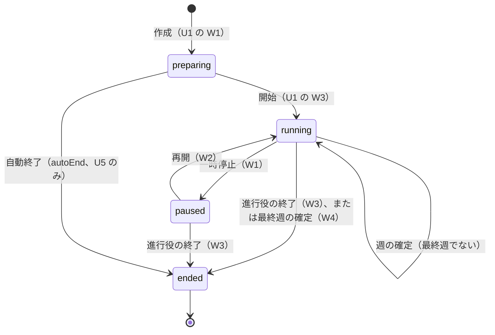
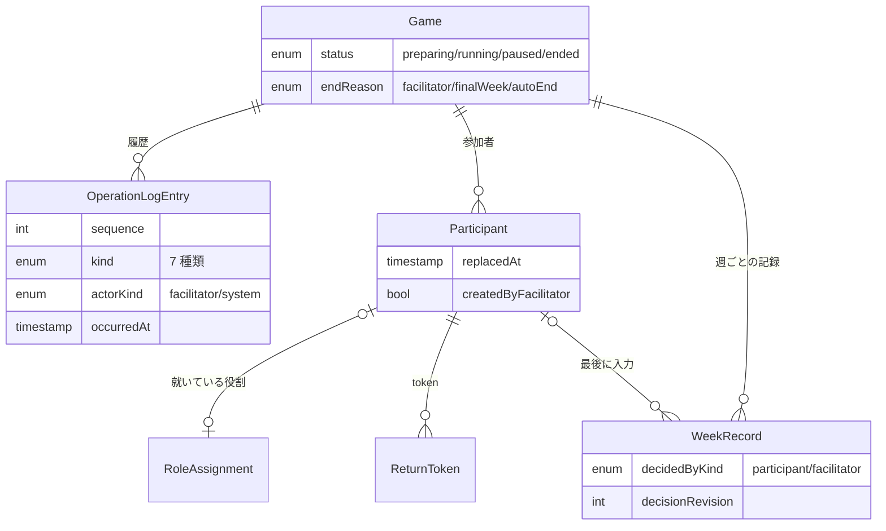

# 機能仕様 - U3 u3-facilitation

U3（運営操作）の振る舞いの仕様です。実体の形は `entities.md`、規則は `rules.md` が正本です。この文書は、手順の流れ（ワークフロー）と状態の遷移の正本で、図と規則の一覧は読みやすさのための写しです。U1 の仕様（`u1-walking-skeleton/functional-design/functional-spec.md`）の上に、一時停止、終了、入れ替え、代理入力、進行管理、履歴を足します。

## 受け持つストーリー

| ストーリー | 題 | 主な規則 |
| :--- | :--- | :--- |
| US2.2 | 同じ役割を複数人で共同担当する | BR12.1〜BR12.3 |
| US2.3 | 同じ表示名の参加者を区別する | BR12.4 |
| US2.5 | 進行役がゲームを一時停止・再開・終了する | BR9.1〜BR9.8 |
| US2.6 | 進行役が役割の担当者を入れ替える | BR10.1〜BR10.6 |
| US2.7 | 進行役が不在の役割に代わって入力する | BR11.1〜BR11.4 |
| US2.8 | 進行役が進行を管理する | BR14.1〜BR14.3 |
| US5.6 | 設定と操作の履歴を追跡できる | BR13.1〜BR13.6 |

画面は `mockups.md` の S4 進行管理に従います。参加者の S3 役割別プレイには、共同担当の置き換わりの表示と、一時停止中の表示を足します。

## 登場する人

| 人 | できること | 根拠 |
| :--- | :--- | :--- |
| 進行役 | 一時停止、再開、終了、入れ替え、代理入力、進行管理の閲覧、履歴の取得 | BR9.8 |
| 参加者 | 自分の役割への入力（共同担当を含む）、自分の役割の閲覧 | BR12.1、BR12.2 |
| 観察者 | U4 が定める。U3 の操作はできない | BR9.8、BR13.5 |

## ワークフロー

### W1 一時停止する（US2.5）

1. 進行役が、進行役用コードで一時停止を要求する。
2. 進行中でなければ、409 `state` で拒否する（BR9.1）。進行役でなければ 403（BR9.8）。
3. ゲームを一時停止にする。currentWeek と入力済みの値は変えない。
4. 履歴（pause）を同じ保存の中で残す（BR13.1）。
5. 一時停止中は、参加者の入力、代理入力、週の確定を拒否し、「一時停止中」を示す。閲覧、再開、終了、入れ替えはできる（BR9.3）。

### W2 再開する（US2.5）

1. 進行役が、進行役用コードで再開を要求する。
2. 一時停止中でなければ、409 `state` で拒否する（BR9.2）。
3. ゲームを進行中に戻す。currentWeek と、一時停止前に保存された入力を保つ。
4. 履歴（resume）を残す。以後、確定の操作ができる。

### W3 進行役が終了する（US2.5）

1. 進行役が終了を要求する。
2. 終了済みなら、現在の状態を返す。履歴は足さない（BR9.6）。準備中なら 409 `state`（BR9.4。準備中からの終了は U5 の自動終了だけ）。
3. 進行中または一時停止中なら、ゲームを終了にし、endedAt を記録し、endReason を facilitator にする。currentWeek は終了した時点の週のまま変えない。その週の確定前の入力は、確定せずに残す（BR9.4）。
4. 履歴（end、reason が facilitator）を残す。
5. 終了後は、入力、代理入力、確定、入れ替え、一時停止、再開を拒否する。閲覧はできる（BR9.5）。

### W4 最終週の確定で自動終了する（US2.5）

U1 の W5 の週の確定に、次を足します。

1. 確定する週が weekCount のとき、週の確定と同じ保存の中で、ゲームを終了にし、endReason を finalWeek にする（BR9.7。終了の遷移そのものは U1 の BR5.10 がすでに行い、U3 は endReason と履歴を足す）。currentWeek は weekCount のまま。
2. 履歴は weekConfirm、続いて end（actorKind は system）を残す。
3. 確定の途中で失敗したら、終了にもならない。
4. 進行役の終了の要求が、最終週の確定とほぼ同時に届いても、ゲーム単位の直列処理（U1 の BR4.6）で順に処理する。後から届いた終了は、すでに終了していれば冪等に現在の状態を返す（BR9.6）。

### W5 担当者を入れ替える（US2.6）

1. 進行役が、入れ替え専用の入口（役割ごとの replacement）に、旧担当者と、新しい担当者の表示名を指定して要求する。この入口は「その役割の旧担当者 1 人を新しい 1 人に替える」形しか表せない。
2. 状態が進行中または一時停止中でなければ拒否する（BR10.5）。既存の割当ての入口（`PUT assignments`）は、進行中と一時停止中は常に 409 `state` で拒否し、入れ替えには replacement を使うよう案内する。他の役割への移動の要求（AC2.6.2）は、この拒否で止まる（BR10.1）。
3. 旧担当者がその役割の担当者でない、またはすでに入れ替え済みなら、409 `conflict` で拒否する（BR10.2、BR10.6）。
4. 新しい参加者を作る（joinOrder は次の番号）。旧担当者の割当てを消して、新しい参加者を同じ役割に就ける。旧担当者に replacedAt を設定する。
5. 旧担当者の復帰用 token を失効させる。新しい復帰用 token を発行し、平文を応答で一度だけ返す（BR10.2、BR10.4）。
6. 役割の在庫、受注残、履歴、確定前の入力は変えない（BR10.3）。
7. 履歴（roleChange、change が replace）を残す。
8. 進行役が新しい担当者に token を伝える。token を失った人を復帰させるときも、同じ手順を同じ表示名で行う。

### W6 代理入力する（US2.7）

1. 進行役が、進行役用コードと識別子で、役割と週と値を指定して入力を要求する（参加者の入力と同じ入口）。
2. 進行中の当週でなければ拒否する。一時停止中と終了後も拒否する（BR9.3、BR9.5）。
3. 値を検証する（0 以上 9999 以下の整数、U1 の BR4.2）。
4. decision を上書きし、decidedByKind を facilitator に、decidedAt を現在時刻に、decisionRevision を 1 増やす（BR11.2）。
5. 履歴（proxyInput）に、進行役、役割、時刻、値を残す（BR11.3）。
6. 担当者がいる役割でも入力でき、確定前なら担当者が後から上書きできる。最後の入力が有効（BR11.1、BR11.2）。
7. 同じ識別子の再送には、前回と同じ結果を返し、履歴を二重に残さない（BR11.4）。

### W7 共同担当の入力と、置き換わりの表示（US2.2）

1. 同じ役割に 2 人以上（最大 4 人）が就いている。
2. 担当者 A が 8 を、続けて担当者 B が 10 を入力すると、decision は 10 になり、decidedByParticipantId は B、decisionRevision は 2 になる（BR12.1）。
3. A の画面は、次のポーリングで、自分が最後に保存した revision と異なる revision を受け取る。入力者が自分でないため、「B のラベル が 10 に変更しました」と示す（BR12.2）。
4. 5 人目の割当ては、準備中に拒否する（BR12.3）。入れ替えは人数を変えない。

### W8 同名の参加者を区別する（US2.3）

1. 「太郎」で 2 人が参加する。どちらも拒否せず、別の参加者として登録する（U1 の BR2.5）。
2. 画面（ロビー、進行管理、共同担当の通知、履歴）は、常に「表示名 #参加順」で表示する。たとえば「太郎 #1」「太郎 #3」（BR12.4）。
3. 後から同名の人が参加しても、すでに表示されているラベルは変わらない。

### W9 進行を管理する（US2.8）

1. 進行役が、進行役用コードで状態を取得する（進行管理画面 S4 は、この投影を数秒おきに取り直す）。
2. 投影に、ゲームの状態、現在の週、4 役割の入力完了状況（入力済み・未入力）、各役割の現在の状態（在庫、受注残、当週の受注、当週の入荷）、担当者の一覧（ラベルと役割）、入力済みの数を含める（BR14.1）。
3. 入力済みの値そのものは含めない（BR14.2）。未入力の役割は、画面で目立たせる。
4. 参加者の token などで進行管理を要求したら、403 で拒否する（BR14.3）。進行役用コードがなければ、画面は権限がないことを示す。
5. 一時停止中と終了後も取得できる。

### W10 履歴を取得する（US5.6）

1. 進行役が、履歴の取得を要求する。進行役でなければ 403 `forbidden`（BR13.5）。
2. sequence の昇順で全件を返す（BR13.2）。各件は、誰が（actorKind）、いつ（occurredAt）、何を（kind と detail）を持つ。
3. 履歴は 7 種類。ゲームの作成の保存で setting が 1 件、準備中の割当てで roleChange（assign、reassign）、進行中と一時停止中の入れ替えで roleChange（replace）、代理入力で proxyInput、週の確定で weekConfirm、一時停止で pause、再開で resume、終了で end が残る（BR13.1〜BR13.4）。
4. 資格情報の平文は含めない（BR13.6）。

## 状態の遷移

### ゲームの状態

<!-- Text fallback: 作成すると preparing。開始すると running。running から一時停止すると paused になり、再開すると running に戻る。最終週でない週の確定では running のまま。running または paused から進行役が終了すると ended。running の最終週の確定でも ended になる。preparing から ended への遷移は、U5 の自動終了（autoEnd）だけで、進行役はできない。ended からは戻らない。 -->

| 遷移 | きっかけ | 条件 | 規則 |
| :--- | :--- | :--- | :--- |
| running → paused | 一時停止 | 進行役。状態が running | BR9.1 |
| paused → running | 再開 | 進行役。状態が paused | BR9.2 |
| running → ended | 終了 | 進行役 | BR9.4 |
| paused → ended | 終了 | 進行役 | BR9.4 |
| running → ended | 最終週の確定 | 週が weekCount。確定の保存の中で | BR9.7 |
| preparing → ended | 自動終了 | reason が autoEnd。U5 の内部呼び出しだけ。進行役はできない | BR9.4、BR9.8 |
| ended → ended | 終了の再送 | 何も変えず現在の状態を返す | BR9.6 |

### 状態ごとに許す操作

| 操作 | preparing | running | paused | ended |
| :--- | :--- | :--- | :--- | :--- |
| 参加者の入力 | 拒否 | 許す | 拒否 | 拒否 |
| 代理入力 | 拒否 | 許す | 拒否 | 拒否 |
| 週の確定 | 拒否 | 許す | 拒否 | 拒否 |
| 担当者の入れ替え | U1 の割当て | 許す | 許す | 拒否 |
| 一時停止 | 拒否 | 許す | 拒否 | 拒否 |
| 再開 | 拒否 | 拒否 | 許す | 拒否 |
| 終了（進行役） | 拒否（自動終了だけ） | 許す | 許す | 冪等 |
| 状態の取得、進行管理、履歴の取得 | 許す | 許す | 許す | 許す |

### 当週の入力の状態

U1 の「未入力 → 入力済み → 確定済み」に、入力した主体を足します。

| 状態 | 内容 | 次の状態 |
| :--- | :--- | :--- |
| 未入力 | decision が null、decisionRevision が 0 | 入力すると「入力済み」 |
| 入力済み | decision が値を持つ。decidedBy は参加者または進行役。確定前は何度でも上書きでき、そのたびに decisionRevision が 1 増える | 上書きしても「入力済み」。確定すると「確定済み」 |
| 確定済み | 結果が入り、decidedBy を含めて変更できない | なし |

## 履歴の種類

| kind | きっかけ | 誰が | 何を（detail） | 規則 |
| :--- | :--- | :--- | :--- | :--- |
| setting | ゲームの作成 | 進行役 | 週数、初期値、費用単価、種別、需要系列の長さ | BR13.4 |
| roleChange | 割当て、付け替え、入れ替え | 進行役 | 参加者のラベル、元と先の役割、入れ替え前の担当者 | BR13.3、BR10.2 |
| proxyInput | 代理入力 | 進行役 | 役割、週、値 | BR11.3 |
| weekConfirm | 週の確定 | 進行役 | 確定した週 | BR13.1 |
| pause | 一時停止 | 進行役 | そのときの週 | BR9.1 |
| resume | 再開 | 進行役 | そのときの週 | BR9.2 |
| end | 終了 | 進行役、または最終週の確定による system | 理由と週 | BR9.4、BR9.7 |

## エラーと端の場合

| 場面 | 振る舞い | 規則 |
| :--- | :--- | :--- |
| 一時停止中に参加者が確定の入力を送る | 409 `state`、理由は一時停止中。保存済みの入力は残る | BR9.3 |
| 一時停止中に進行役が代理入力または週の確定を送る | 同じく 409 `state` | BR9.3 |
| 進行中に再開、一時停止中に一時停止 | 409 `state` | BR9.1、BR9.2 |
| 終了済みのゲームに終了 | 現在の状態を返す。履歴は足さない | BR9.6 |
| 終了済みのゲームに一時停止、再開、入力、入れ替え | 409 `state` | BR9.5 |
| 準備中のゲームに終了 | 409 `state` | BR9.4 |
| 最終週の確定と進行役の終了がほぼ同時 | 直列に処理する。後の終了は冪等 | BR9.6、BR9.7 |
| 最終週の確定の保存に失敗 | 確定前のまま。終了にもならない。履歴も残らない | BR9.7、BR13.1 |
| 進行中または一時停止中に、割当ての入口（`PUT assignments`）で別の役割への移動などを要求 | 409 `state`、入れ替えには replacement を使うよう案内。割当ては変わらない | BR10.1 |
| 一時停止中または終了後に、以前に成功した識別子の入力を再送 | 前回の結果を返す（識別子の照合が状態の検査より先） | BR9.3、BR11.4 |
| 画面を再読み込みした、または入れ替え直後の新しい担当者の画面 | 最初に受け取った revision を基準にし、そこでは置き換わりの通知を出さない | BR12.2 |
| 入れ替えで、旧担当者がその役割にいない | 409 `conflict` | BR10.2 |
| 入れ替えの要求が 2 回届く | 2 回目は 409 `conflict`。参加者を二重に作らず、先の token は有効なまま | BR10.6 |
| 入れ替えた直後の旧 token での要求 | 403 `forbidden` | BR10.4 |
| 入れ替えで、表示名が空または 40 文字超 | 422 `validation` | BR10.2 |
| 代理入力で、値が範囲外 | 422 `validation` | BR11.1 |
| 同じ役割の 2 人がほぼ同時に入力 | 直列に処理し、後に保存した値が有効。先の人の画面に置き換わりを示す | BR12.1、BR12.2 |
| 5 人目を準備中に割り当てる | 409 `conflict`、定員を案内 | BR12.3 |
| 履歴の保存に失敗 | 操作も失敗し、部分更新を残さない | BR13.1 |
| 参加者が進行管理または履歴を要求 | 403 `forbidden` | BR14.3、BR13.5 |

## ER 図（entities.md から派生）

<!-- Text fallback: Game は OperationLogEntry、Participant、WeekRecord を持つ。Participant は最大 1 つの RoleAssignment、複数の ReturnToken を持ち、WeekRecord の最後の入力者として参照される。 -->

## 規則の概要（rules.md から派生）

| グループ | 規則 | 内容 |
| :--- | :--- | :--- |
| 9 ゲームの状態遷移 | BR9.1〜BR9.8 | 一時停止、再開、停止中の拒否、進行役の終了、終了後の拒否、終了の冪等、自動終了、進行役の権限 |
| 10 担当者の入れ替え | BR10.1〜BR10.6 | 同じ役割だけ、新規作成と token の再発行、役割の状態は不変、旧 token の失効、状態の条件、再送の安全 |
| 11 代理入力 | BR11.1〜BR11.4 | 担当者の有無によらず可、通常の入力と同じ扱い、履歴、再送 |
| 12 共同担当と同名 | BR12.1〜BR12.4 | 後勝ち、置き換わりの表示、定員 4 人、常に参加順を併記 |
| 13 操作の履歴 | BR13.1〜BR13.6 | 7 種類、追記のみ、準備中の割当て、作成時の設定、進行役だけ取得、資格情報を含めない |
| 14 進行管理 | BR14.1〜BR14.3 | 入力完了状況と現在の状態、値は示さない、進行役だけ取得 |

## 契約への反映

`contract-summary.md` の C1 に、次を足します。追加は後方互換で、既存の入口の意味は変えません。

| 入口 | 内容 | 状態 |
| :--- | :--- | :--- |
| `POST /games/{gameId}/pause`、`/resume`、`/end` | 一時停止、再開、終了（進行役）。C1 にすでにある。`end` は終了済みでも 200 で現在の状態を返す | 既存 |
| `PUT /games/{gameId}/weeks/{week}/decisions/{role}` | 進行役用コードで呼ぶと代理入力になる。`Idempotency-Key` を使う | 既存の入口を使う |
| `POST /games/{gameId}/roles/{role}/replacement` | 担当者の入れ替え（進行役）。旧担当者の `participantId` と新しい担当者の表示名を受け、新しい参加者と復帰用 token（平文は一度だけ）を返す。進行中と一時停止中の入れ替えは、この入口だけが受け付ける | 新規 |
| `PUT /games/{gameId}/assignments/{participantId}` | 準備中の割当てと付け替え（U1）。進行中と一時停止中は、どんな要求でも 409 `state` で拒否し、入れ替えには replacement を使うよう案内する。C1 の記述「進行中は同じ役割の入れ替えだけ許す」は、この拒否に直す | 既存を直す |
| `GET /games/{gameId}/history` | 履歴の取得（進行役）。sequence の昇順 | 新規 |
| `GET /games/{gameId}/state` | 進行役用コードで呼ぶと進行管理の投影を返す。参加者の投影には、共同担当の置き換わりの項目（revision、入力者のラベル）を足す | 既存の入口に項目を足す |

C3 の ownership のとおり、`operation_log_entries` の表は U3 が別の移行として足します。

## この Unit の外で決まること

- 復帰用 token の有効期間、試行回数の制限、失効の再接続の扱い、観察者の投影: U4 が定める。U3 は入れ替えでの失効と再発行だけを持つ。
- 放置されたゲームの自動終了（autoEnd）と、終了後の保持期間と削除: U5 が定める。U3 は `GameLifecycle.end` の遷移（preparing からの autoEnd を含む）と、endReason の値 autoEnd を受け入れる形だけを持つ。autoEnd は内部の呼び出しで、資格情報の判定を通さない（BR9.8）。
- 途中終了のゲームの結果と出力: U5 が、確定済みの週だけを対象にして定める（BR9.4）。
- 画面のキーボード操作、コントラスト、日本語表示の最終検証: U6 が確かめる。U3 の画面（S4 進行管理、S3 への追加）も、自分の画面について同じ検査を通す。

## 前提と未確定の点

| 項目 | 内容 | 扱い |
| :--- | :--- | :--- |
| 準備中のゲームの終了 | 進行役の終了の要求は 409 `state` で拒否する（BR9.4）。進行役用コードを失った準備中のゲームは、U5 の自動終了（reason が autoEnd）だけが preparing から ended にする（BR9.4、BR9.8） | この設計の前提 |
| 途中終了のときの週 | currentWeek は終了した時点の週のまま。その週の確定前の入力は確定せずに残し、結果と出力（U5）は確定済みの週だけを対象にする（BR9.4） | この設計の決定。U1 の「終了時は weekCount のまま」は finalWeek の場合に限る、に直す（entities.md） |
| 入れ替えの応答が届かなかったとき | 平文の token は一度しか返さず、入れ替えは識別子を使わない。応答を失ったら、進行管理の担当者一覧に出た新しい担当者を旧担当者として、もう一度入れ替える。参加者が 1 人余分に作られ、joinOrder が飛び、ラベルが変わる（たとえば 太郎 #4 → 太郎 #5）ことを許容する | 前提。入れ替えは頻度が低く、識別子の記録に平文を残さないことを優先する（BR10.6） |
| 履歴の保持と件数 | 履歴はゲームと同じ期間保持し、ゲームの削除と同時に消す。件数の上限は設けない | 前提。NFR の工程で規模を確かめる |
| 通常の入力の履歴 | 参加者の通常の入力は 7 種類に含めず、履歴に残さない（WeekRecord の decidedBy で追う）。履歴の件数が入力の回数に比例して増えるのを避ける | 前提 |
| 入れ替えの token の紛失 | 平文の token は一度しか返さない。紛失したら、もう一度入れ替える（BR10.6） | 前提 |

## 上流の資料

`unit-of-work.md`、`unit-of-work-story-map.md`、`stories.md`（US2.2、US2.3、US2.5〜US2.8、US5.6）、`requirements.md`、`components.md`、`contract-summary.md`、`functional-design-questions.md`
