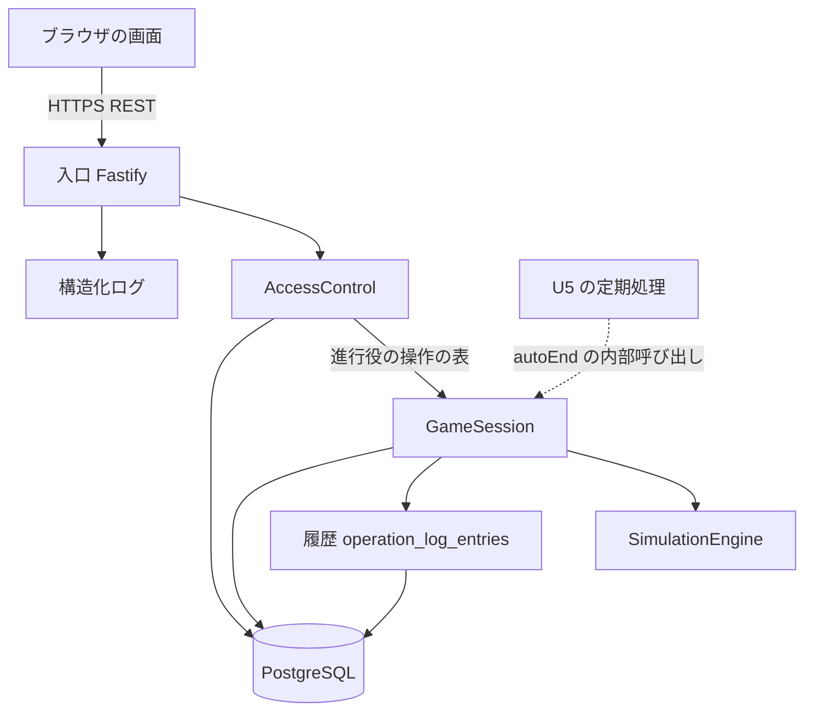

# 論理コンポーネント - U3 u3-facilitation

U3 の NFR の設計がどこに効くかを、コンポーネント単位で並べます。デプロイは U1 と同じ、1 つのアプリケーションと PostgreSQL です。U3 は新しいコンポーネントを足さず、既存の GameSession と AccessControl に操作を足します。

## 構成

<!-- Text fallback: ブラウザは HTTPS で入口に要求する。入口は AccessControl で進行役の操作の表を使って判定し、GameSession を呼ぶ。GameSession は SimulationEngine、履歴の表、PostgreSQL を使う。履歴は GameSession の集約の一部で、同じ保存の中で書く。U5 の定期処理は autoEnd として GameSession を内部から呼ぶ。入口は構造化ログを出す。 -->

## コンポーネントと NFR の対応

| コンポーネント | 失敗の領域 | U3 が足す NFR の設計 |
| :--- | :--- | :--- |
| 入口（Fastify） | アプリケーションの 1 台 | 進行役の操作の経路ごとの認可、入れ替えの応答の `no-store`、reason の固定（facilitator）、拒否のログ（許可リスト） |
| AccessControl | 同上 | 進行役の操作の表、投影の専用の型（進行役は入力値を持たない、参加者は自分の役割の入力者のラベル）、token の失効の判定 |
| GameSession | 同上 + データベース | 状態遷移の表の検査、状態の更新と履歴の追記の 1 トランザクション、入れ替えの原子的な更新、`next_log_sequence` の採番、decisionRevision |
| 履歴（OperationLogEntry） | GameSession の集約の一部 | 追記専用（UPDATE と DELETE の文を持たない）、厳密な型の検証、ゲームの削除への連鎖 |
| SimulationEngine | 同上（外部に触れない） | U3 は変更しない |
| PostgreSQL | 共有の資源 | 履歴の表と索引、`end_reason` と `next_log_sequence` の列の追加の移行 |

## 失敗の影響の範囲

- 操作と履歴の保存の失敗: 同じトランザクションのため、どちらも残らない。そのゲームだけが影響を受ける。
- 1 つのゲームの占有の滞留: そのゲームの書き込みだけが待つ。進行管理の取得と別のゲームは影響を受けない。
- 入れ替えの途中の失敗: ロールバックされ、旧担当者の割当てと token は有効なまま残る。
- アプリケーションの 1 台が止まる: ステートレスのため、状態（一時停止、終了を含む）は保存済みで、再起動で続けられる。

## 共有の資源

PostgreSQL の接続プールと、暗号化・照合の鍵（U1）。U3 は新しい共有の資源を足さない。

## 上流の資料

`performance-design.md`、`security-design.md`、`scalability-design.md`、`reliability-design.md`、`observability-design.md`、`components.md`
