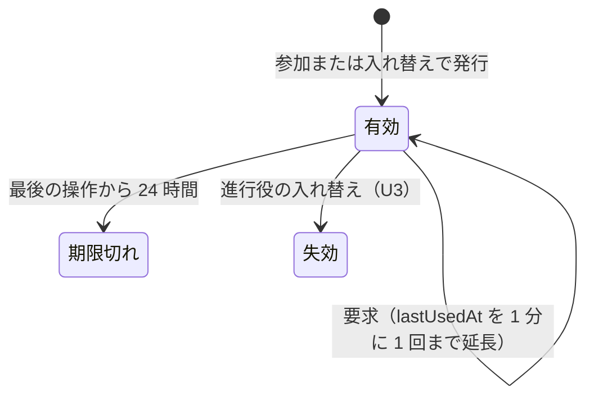
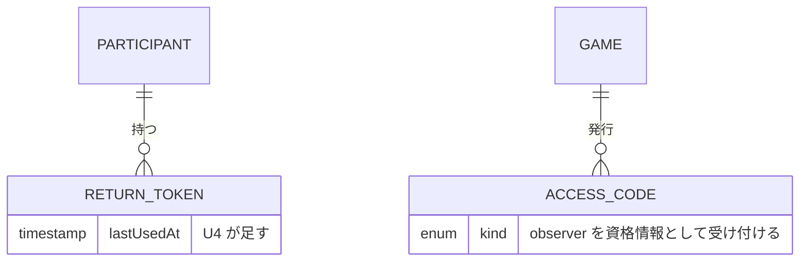

# 機能仕様 - U4 u4-access-recovery

U4（復帰と権限）の振る舞いの仕様です。ワークフローと状態の遷移の正本はこの文書です。実体の形は `entities.md`、判断の規則は `rules.md` が正本で、この文書の ER 図と規則の概要はそこから派生しています。

## 受け持つストーリー

| ストーリー | 内容 | 主な規則 |
| :--- | :--- | :--- |
| US2.1 | 小売店だけが当週の顧客需要を見る | BR16.1、BR16.2 |
| US2.9 | 観察者が入力できずに進行を見る | BR15.1〜BR15.4 |
| US3.1 | 中断したゲームを確定済みの週から復元する | BR20.1、BR20.2 |
| US3.2 | 参加者が切断後に同じ役割へ戻る | BR17.1〜BR17.6、BR20.3 |
| US5.4 | 操作権限をサーバー側で検証する | BR18.1〜BR18.3、BR19.1〜BR19.3 |

## 登場する人

- 参加者（P1）: 参加時に受け取った token をブラウザに保存し、再接続に使う
- 進行役（P2）: 観察者用コードを配る。token を失った参加者を入れ替えで復帰させる（U3）
- 観察者（P3）: 観察者用コードで入り、チーム全体の値だけを見る。入力できない
- システム: 資格情報を毎回検証し、接続元ごとの試行を数える

## ワークフロー

### W1 観察者として入る（US2.9）

1. 観察者が参加画面の「観察者として見る」を選び、観察者用コードを入力する
2. システムが、コードがそのゲームの観察者用コードか検証する（BR15.1）。無効なら理由を示す（403。回数は数えない）
3. 有効なら、コードをブラウザに保存し、観察画面を開く（BR15.4）
4. 画面が数秒おきに状態を取り直し、ObserverView を表示する（BR15.3）。役割別の値は返らない
5. 観察者が入力などの書き込みを送ると、すべて 403 で拒否される（BR15.2）

### W2 小売店が当週までの需要を見る（US2.1）

1. 小売店の参加者が状態を取得する
2. システムが、第 1 週から currentWeek までの顧客需要を投影に含める（BR16.1）。currentWeek より後の週の値は含めない
3. 小売店以外の参加者、観察者、資格情報なしが需要の取得を要求すると、403 で拒否される（BR16.2）

### W3 切断後に同じ役割へ戻る（US3.2）

1. 参加者のブラウザが閉じる、または回線が切れる。確定済みのデータと確定前の入力は、サーバーに保存済みである
2. 画面は、取り直しに失敗している間「接続が切れています。自動で再接続を試みます」と示し、取り直しを続ける（BR20.3）。送信に失敗した入力は欄に残る
3. 同じブラウザで再接続すると、保存した token で状態を取得する
4. token が有効なら（最後の操作から 24 時間以内。BR17.1）、同じ参加者・同じ役割として復帰する（BR17.4）。lastUsedAt は 1 分に 1 回まで延びる（BR17.2）。token は作り直さない（BR17.5）
5. token が期限切れ、失効、不明なら、理由を区別せず同じ文言で拒否し、画面は保存した token を消して参加画面に戻す（BR17.3）。進行役に担当者の入れ替えを依頼する
6. 進行役が入れ替える（U3）と、新しい token が発行され、発行の時刻から有効期間を数える（BR17.6）。新しい token で同じ役割に戻れる

### W4 サービスの再起動から続ける（US3.1）

1. サービスが再起動する。新しい仕組みは動かさない（BR20.1）
2. 要求のたびに、集約を PostgreSQL から読み直す。確定済みの週の状態、確定前の入力、割当て、token、冪等の記録は、再起動の前と一致する（BR20.2）
3. 進行役は第 11 週（確定済みの第 10 週の次）から続ける。再起動の前に成功した識別子の再送には、前回と同じ結果を返す

### W5 無効なコードの試行を制限する（US5.4）

1. 参加の要求が届く。システムが接続元を特定する（BR18.3）
2. 窓から 60 秒より古い時刻を捨てる。窓にすでに 10 件あれば（11 件目の試行）、コードを検証せずに 429 rate_limited で拒否し、この試行も窓に加える（BR18.1、BR18.2）
3. 10 件未満なら、コードを検証する。無効なら時刻を窓に加えて拒否し、有効なら数えずに参加を進める
4. 60 秒間試行しなければ、古い試行が窓から出て、自動で解除される。拒否中に試行を続けると解除が延びる

### W6 すべての要求で権限を検証する（US5.4）

1. 要求が HTTP の入口に届く。入口は GameSession を直接呼ばず、AccessControl に依頼する（BR19.2）
2. AccessControl が、資格情報の種類（参加者、進行役、観察者）と、要求のゲーム・役割への権限を検証する（BR19.1）
3. 他のゲームの役割の識別子、他の役割の識別子、権限のない操作は、403 で拒否する。ゲームや役割の存在を応答の違いで明かさない
4. 全経路の拒否は、網羅試験が保証する（BR19.3）

## 状態の遷移

### 復帰用 token

<!-- Text fallback: token は発行されると有効になる。有効な間は要求のたびに lastUsedAt が（1 分に 1 回まで）延びる。最後の操作から 24 時間を過ぎると期限切れ、進行役が入れ替えると失効する。期限切れと失効はどちらも戻らず、応答は区別しない。 -->

期限切れは行を変えず、判定のたびに時刻を比べて決まる。失効は revokedAt で記録される。どちらからも有効には戻らない。

### 状態ごとの観察者と参加者の見え方

| ゲームの状態 | 観察者 | 小売店の参加者の需要 |
| :--- | :--- | :--- |
| preparing | 現在週 1、状態、入力数 0、費用 0、初期の在庫の合計 | 見えない（開始後に見える。BR16.1） |
| running | チーム全体の値を表示 | 第 1 週から currentWeek まで |
| paused | 同じ（閲覧は許す） | 同じ |
| ended | チーム全体の値のまま（全役割の時系列は U5 の結果画面） | 同じ。結果の開示は U5 |

## エラーと端の場合

| 場合 | 扱い |
| :--- | :--- |
| 観察者が書き込みを送る | 403 forbidden。状態は変わらない（BR15.2） |
| 別のゲームの観察者用コード | 403 forbidden（BR15.1、BR19.1） |
| 期限切れ、失効、不明の token | 同じ文言の 403。画面は保存した token を消す（BR17.3） |
| lastUsedAt の書き込みが失敗する | 要求は拒否せず、ログに出す。期限の判定は直前の値で続く（BR17.2） |
| 窓に 10 件ある状態での 11 件目の参加の試行 | 429 rate_limited。有効なコードでも拒否中は参加できない（BR18.2） |
| ロードバランサーの背後で信頼する段数が未設定 | 全員が 1 つの接続元になる。デプロイの前提として必ず設定する（BR18.3） |
| 権限のない人が不正な入力や状態の合わない要求を送る | 認可が先のため 403 のみ。422 や 409 で存在や状態を明かさない（BR19.1） |
| 利用者が付けた転送元のヘッダ | 信頼するプロキシの設定がなければ使わない。窓の回避を許さない（BR18.3） |
| 第 1 週の確定前に観察者が見る | 初期状態の合計を返す（`entities.md` の ObserverView） |
| 再起動の直前に保存に失敗した入力 | 保存されていないので残らない。画面は失敗を示し、欄の値を残す（BR20.3） |
| 同じ token を 2 つのタブで使う | 同じ参加者として扱う。どちらも有効（BR17.5） |

## ER 図（entities.md から派生）

<!-- Text fallback: 参加者は復帰用 token を持ち、ゲームは参加コード、進行役用コード、観察者用コードを発行する。U4 は token に lastUsedAt を足す。試行の窓と観察者の投影は永続の実体ではない。 -->

## 規則の概要（rules.md から派生）

| グループ | 規則 | 内容 |
| :--- | :--- | :--- |
| 15 観察者 | BR15.1〜15.4 | 観察者用コードを受け付け、書き込みを拒否し、チーム全体の値だけを返す |
| 16 小売店の需要 | BR16.1〜16.2 | 小売店だけが当週までの需要を見る |
| 17 復帰用 token | BR17.1〜17.6 | 24 時間の有効期間、1 分に 1 回の延長、同じ文言の拒否、作り直さない |
| 18 試行回数の制限 | BR18.1〜18.3 | 参加の無効な試行を、直近 60 秒の窓で数える |
| 19 サーバー側の権限 | BR19.1〜19.3 | 毎回の検証、直接 import の禁止、網羅試験 |
| 20 復元 | BR20.1〜20.3 | 新しい仕組みなし、再起動の前後で一致、切断中の画面 |

## 契約への反映

- C1: 顧客需要の専用の経路は足さない。小売店の参加者への `GET /games/{gameId}/state` の投影の項目（`customerDemand`、第 1 週から currentWeek まで）として返し、小売店以外の参加者と観察者の投影には含めない（BR16.2）。資格情報（bearer）は、観察者用コードも受け付ける。`GET /games/{gameId}/state` は、観察者には ObserverView（viewerKind が observer）を返す。無効な参加は 429 rate_limited を返す。追加は後方互換で、版番号は付けない
- C3: `return_tokens` に `last_used_at` の列を別の移行で足す。既存の行は issued_at で埋める
- C4: 観察者用コードは進行役用コードと同じ強度（暗号論的乱数による 128 ビット以上）で、総当たりが現実的でないため、無効な試行は数えない。`AccessControl.authenticate` が observer を特定する。`project` が観察者の投影と小売店の需要を作る。`issue` は変えない

## この Unit の外で決まること

- 仮の数値（24 時間、10 回、60 秒、1 分）の確定と、試行の窓の保存先: NFR 要件、インフラの設計の工程
- 観察画面と参加画面の入口の見た目: 画面の実装（UI 設計の範囲）
- 結果画面と出力での全役割の開示: U5
- 運営者の設定による保持期間と、観察者用コードの削除: U5

## 前提と未確定の点

- [assumption] 観察者の費用と在庫の合計は、役割別の値を逆算できない（合計だけで 4 役割の内訳は分からない）。小さな値の組合せで推測できないかは、レビューで確かめる
- [assumption] 信頼するプロキシの段数は、デプロイの設定で与える。既定は信頼しない
- 試行の窓をアプリ内のメモリに置くか PostgreSQL に置くかは、デプロイの台数を決める工程で決める

## 上流の資料

`rules.md`、`entities.md`、`contract-summary.md`、`requirements.md`、`stories.md`、`functional-design-questions.md`
