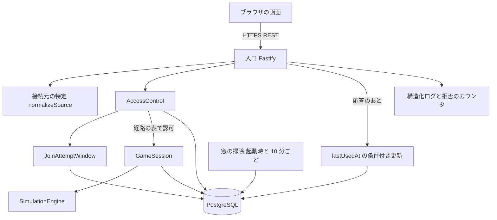

# 論理コンポーネント - U4 u4-access-recovery

U4 の NFR の設計がどこに効くかを、コンポーネント単位で並べます。デプロイは U1 と同じ、1 つのアプリケーションと PostgreSQL です。U4 は新しいサービスを足さず、既存の入口、AccessControl、PostgreSQL に、試行の窓（JoinAttemptWindow）と、窓の掃除の処理を足します。

## 構成

<!-- Text fallback: ブラウザは HTTPS で入口に要求する。入口は接続元を正規化し、AccessControl で資格情報を特定して認可する。参加の要求は AccessControl が JoinAttemptWindow（PostgreSQL の表）で試行を数える。認可を通った要求だけが GameSession を呼ぶ。入口は応答のあとに lastUsedAt の条件付き更新を行う。窓の掃除は起動時と 10 分ごとに古い行を削除する。入口は構造化ログと拒否のカウンタを出す。 -->

## コンポーネントと NFR の対応

| コンポーネント | 失敗の領域 | U4 が足す NFR の設計 |
| :--- | :--- | :--- |
| 入口（Fastify） | アプリケーションの 1 台 | 経路の表（`routeCatalog`）からの登録、GameSession を import しない構造（lint と構造の試験）、`TRUSTED_PROXY_HOPS` の検証と起動の拒否、固定の無効な資格情報の応答、拒否の分類とログ、応答のあとの lastUsedAt の更新 |
| 接続元の特定（normalizeSource） | 同上 | 設定した段数の範囲の転送元、IPv6 の /64、IPv4 射影の正規化 |
| AccessControl | 同上 + データベース | 観察者の特定、操作の表（観察者は状態の取得だけ）、`ObserverView` と小売店の顧客需要の専用の型、`resolveParticipant` の同一の結果、`isExpired` |
| JoinAttemptWindow | データベース（アプリケーションの外に状態を持つ） | `join_attempts` の表、アドバイザリロックの中での削除・件数・追加、10 件の判定、`lock_timeout` 3 秒と 503、接続元ごとに最新 11 件 |
| 窓の掃除 | アプリケーションの各台 | 起動時と 10 分ごとの、ロック中の行を飛ばす削除。複数台で重なっても冪等 |
| GameSession | 同上 + データベース | U4 は変更しない（再起動後の読み直しだけが復元） |
| 構造化ログ・カウンタ | アプリケーションの 1 台 | 3 種類の拒否の許可リストの項目、種類ごとの件数のカウンタ |
| PostgreSQL | 共有の資源 | `join_attempts` の表と 2 つの索引、`return_tokens.last_used_at` の列の追加の移行 |

## 失敗の影響の範囲

- 窓の保存の失敗または待ちの時間切れ: 参加の要求だけが 500 または 503 になる。ほかの要求と進行中のゲームは影響を受けない。制限なしでは通さない。
- lastUsedAt の更新の失敗: 要求は成功のまま。期限の判定は直前の値で続く。
- 掃除の失敗: 次の周期で再実行する。行が残るだけで、制限の判定は 60 秒より古い行を数えないため結果は変わらない。
- 同じ NAT の背後で 1 人が誤入力を続ける: その接続元の参加だけが最大 60 秒止まる。ほかの接続元は影響を受けない。
- 信頼するプロキシの設定の欠落: staging と production では起動せず、誤った構成で動かない。
- アプリケーションの 1 台が止まる: ステートレスのため、保存済みの状態から再起動で続けられる。窓は PostgreSQL にあるため、止まった台の分の試行も残る。

## 共有の資源

PostgreSQL の接続プール、アドバイザリロックの鍵の空間（窓の接続元の鍵）、暗号化・照合の鍵（U1）。ゲームの書き込みの占有（U1、U3）は行の占有で、窓のロックは専用の `classid` を持つ 2 つの整数の形のアドバイザリロックのため、鍵の空間は交わらず、窓のロックはゲームの書き込みを待たせない。

## 上流の資料

`performance-design.md`、`security-design.md`、`scalability-design.md`、`reliability-design.md`、`observability-design.md`、`components.md`
