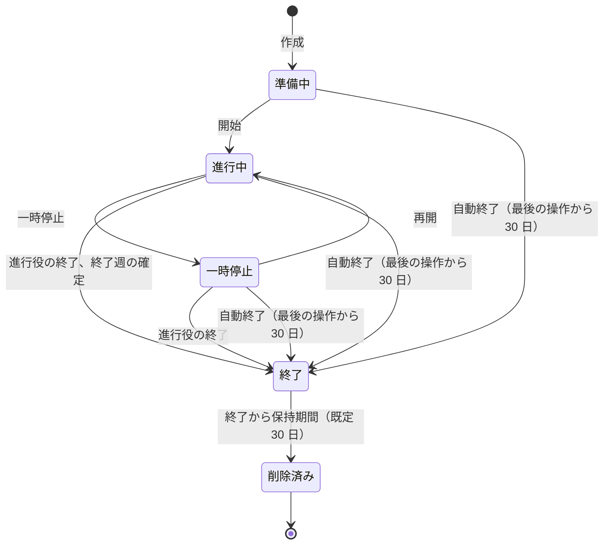
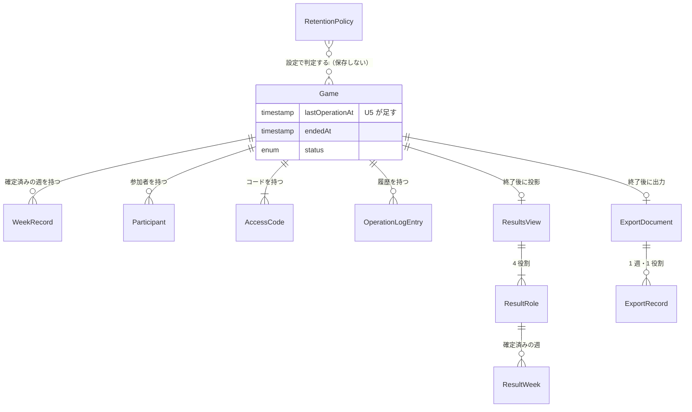

# 機能仕様 - U5 u5-results-retention

U5（結果と出力、保持と削除）の振る舞いの仕様です。ワークフローと状態の遷移の正本はこの文書です。実体の形は `entities.md`、判断の規則は `rules.md` が正本で、この文書の ER 図と規則の概要はそこから派生しています。

## 受け持つストーリー

| ストーリー | 内容 | 主な規則 |
| :--- | :--- | :--- |
| US4.1 | 終了後に全役割の時系列を比較する | BR21.1〜BR21.5、BR22.1〜BR22.6 |
| US4.2 | 進行役が結果を CSV と JSON で出力する | BR23.1〜BR23.10 |
| US5.1 | 運営者が保持期間を設定し、期限後にデータが削除される | BR24.1〜BR24.7、BR25.1〜BR25.5、BR26.1〜BR26.6 |

## 登場する人

- 参加者（P1）: 終了後に、結果画面で自分たちの判断の影響と増幅の過程を比較する。プレイ中は他役割の時系列を見られない
- 進行役（P2）: 結果画面を見て振り返りを進め、CSV と JSON を出力する
- 観察者（P3）: 終了後も、チーム全体の集計値だけを見る。結果画面と出力は使えない
- 運営者（P4）: アプリケーションの設定で保持期間と自動終了の期間を指定する。画面は持たない
- システム: 定期処理で、放置されたゲームを自動終了し、期限を過ぎたゲームを削除する

## ワークフロー

### W1 終了後に全役割の時系列を比較する（US4.1）

1. ゲームが終了する（進行役の終了、終了週の確定、自動終了のいずれか）。参加者の画面と進行役のボードに「結果を見る」が出る（BR22.6）
2. 参加者または進行役が「結果を見る」を選ぶ。画面が `GET /games/{gameId}/results` を呼ぶ
3. AccessControl が資格情報を検証する。そのゲームの参加者または進行役なら通す。観察者、無効な資格情報、別のゲームは、同じ 403 の本文で拒否する（BR21.2）
4. Reporting が、ゲームが終了していることを確かめる。終了前なら拒否する（BR21.1）
5. Reporting が、行を占有せずに集約を読み、確定済みの週の ResultsView を整える（BR21.3、BR21.4、BR21.5）
6. 画面が、初期の指標（費用、累積）の折れ線を 4 役割ぶん同じ週の軸に重ねて表示する。系列は線種と印と凡例で区別する（BR22.1、BR22.2、BR22.3）。同じ数値の表を下に置く（BR22.4）。金額は通貨の形で示す（BR22.5）
7. 利用者が指標（需要、注文、在庫、受注残、出荷、費用）を選ぶと、同じ週の軸で 4 役割の系列に切り替わる。「受注残」を選ぶと、4 役割の受注残が重なる（BR22.1）

### W2 プレイ中の結果の取得を拒否する（US4.1）

1. ゲームが進行中（または準備中、一時停止中）のとき、参加者または進行役が結果を要求する
2. システムは、他役割の時系列、週の数、確定済みの週の数を含まない 403 を返す（BR21.1）。理由は「ゲームが終了するまで、結果は見られません」
3. 画面は結果画面の導線を出していないが、URL を直接開いても、この理由を示す（BR22.6）

### W3 結果を CSV と JSON で出力する（US4.2）

1. 進行役が、終了したゲームの進行役のボードで「CSV で出力」または「JSON で出力」を選ぶ
2. 画面が `GET /games/{gameId}/export?format=csv|json` を、進行役用コードを付けて呼ぶ
3. AccessControl が、呼び出した人が進行役か検証する。参加者、観察者、無効な資格情報は、同じ 403 の本文で拒否する。進行役でもゲームが終了していなければ 409 で拒否する（BR23.1）
4. Reporting が、集約を読み、ExportRecord の列を一度だけ作る（BR23.2、BR23.4）
5. CSV なら、BOM、CRLF、必要な値だけを二重引用符で囲む形に整える（BR23.3）。JSON なら、game と records を持つ文書に整える。金額は整数のセントで出す（BR23.5）
6. 応答は attachment として返し、ファイル名は `beer-game-{gameId}.csv` または `.json`。キャッシュさせない（BR23.7）
7. 表示名にカンマと改行を含む参加者がいても、CSV の行は崩れず、読み戻すと元の値と一致する。表示名の先頭が `=` でも、値は変えない（BR23.3）

### W4 放置されたゲームを自動終了する（US5.1）

1. 定期処理が動く（W6）。自動終了の対象を選ぶ。status が preparing、running、paused のいずれかで、`lastOperationAt` に自動終了の期間（既定 30 日）を足した時刻を過ぎたゲームを、`lastOperationAt` の古い順に上限まで選ぶ（BR25.1、BR26.3）
2. 1 ゲームごとに、ゲームの行を占有して再検査する。選んだあとに操作があれば対象から外す（BR25.4）
3. 対象なら、U3 の `autoEnd` で、status を ended、endedAt を現在の時刻、endReason を autoEnd にし、履歴に end（actorKind が system）を同じ保存の中で足す（BR25.3）
4. 終了した時点から、保持期間を数える（BR24.2）
5. 参加者は、以後の確定の操作を拒否され、結果画面を見られる（W1）

### W5 期限を過ぎたゲームを削除する（US5.1）

1. 定期処理が動く（W6）。削除の対象を選ぶ。status が ended で、`endedAt` に保持期間（既定 30 日）を足した時刻以降のゲームを、`endedAt` の古い順に上限まで選ぶ（BR24.2、BR26.3）。対象は、W4 の前の時点で選ぶ（BR25.5）
2. 1 ゲームごとに、ゲームの行を占有して再検査する。条件を満たさなくなっていれば対象から外し、すでに削除されていれば何もしない（BR24.5）
3. 対象なら、ゲームに紐づくすべてのデータを、1 回の保存の中で削除する（BR24.3）
4. ログに、ゲームの識別子、削除の時刻、理由（retentionExpired）だけを残す。データベースには何も残さない（BR24.6）
5. 削除後、参加コードは無効になり、そのゲームへの要求は、存在しないゲームと同じ 403 で拒否される（BR24.4）

### W6 定期処理の 1 回分を実行する（US5.1）

1. アプリケーションの起動の完了後に 1 回、その後は一定の間隔（既定 60 分）で、タイマーが 1 回の処理を始める。起動時の処理は HTTP の受け付けを待たせない（BR26.1、BR26.5）
2. PostgreSQL のアドバイザリロックを試みる。取れなければ、今回は何もせず、skipped をログに出して終える（BR26.2）
3. 自動終了（W4）を先に、削除（W5）を後に行う。それぞれ、1 回に扱うゲームの数に上限を置く（BR26.3）
4. 1 つのゲームの失敗は、ほかのゲームを止めない。失敗はログに出し、次の周期でやり直す。全体の失敗も、ログに出して次の周期に回す（BR26.4）
5. 結果（自動終了の数、削除の数、失敗の数、所要時間）をログに出し、ロックを解放する
6. 停止の要求があれば、次の周期を予約せず、実行中のゲームの保存が終わるまで待ってから閉じる（BR26.6）

### W7 保持期間の設定を変える（US5.1）

1. 運営者が、アプリケーションの設定（環境変数）の保持期間を、たとえば 30 日から 7 日に変えて、アプリケーションを再起動する（BR24.1）
2. 次の定期処理から、新しい設定で判定する。すでに終了しているゲームも、終了から 7 日を過ぎていれば削除の対象になる（BR24.2）
3. ゲームごとに保持期間を記録していないため、変更のための移行や再計算は要らない

## 状態の遷移

### ゲームの状態と U5 の関わり

<!-- Text fallback: ゲームは準備中から始まり、開始で進行中、一時停止と再開を行き来する。進行役の終了または終了週の確定で終了する。準備中、進行中、一時停止のどれでも、最後の操作から 30 日で自動終了する（U5 が足す）。終了から保持期間（既定 30 日）を過ぎると削除され、以後は存在しないゲームとして扱われる（U5 が足す）。終了と削除済みから戻る遷移はない。 -->

U5 が足すのは、自動終了の 3 本の遷移（準備中・進行中・一時停止から終了へ）と、終了から削除済みへの遷移です。そのほかの遷移は U1・U3 が持ちます。

### 結果の取得の可否

| ゲームの状態 | 参加者 | 進行役 | 観察者 | 資格情報なし・無効 |
| :--- | :--- | :--- | :--- | :--- |
| 準備中・進行中・一時停止 | 403（終了まで見られない） | 403（終了まで見られない） | 403（権限なし） | 403（無効） |
| 終了 | 結果を返す | 結果を返す | 403（権限なし） | 403（無効） |
| 削除済み | 403（無効と同じ本文） | 403（無効と同じ本文） | 403（無効と同じ本文） | 403（無効） |

出力は、進行役が終了したゲームに対してだけ。進行役でも終了前は 409、ほかは上の表の 403 です。

## 画面

### 結果画面（新規）

- 見出し、ゲーム名、種別（キット準拠またはカスタム。画面ではすべてカスタム。FR1.7）、確定済みの週の数
- 指標の選択（需要、注文、在庫、受注残、出荷、費用）。キーボードで選べるボタンの並びで、選択中の状態を色以外でも示す
- 費用を選んだとき、週ごと・累積の切り替え
- 折れ線グラフ（SVG）。横軸が週、縦軸が選んだ指標の数量または金額。4 役割の系列を、線種と印で区別し、凡例を置く
- 数値の表。行が週、列が 4 役割。見出しに指標名と単位を入れる
- チームの累積費用の合計
- ゲーム画面へ戻る導線

### 参加者の画面と進行役のボードへの追加

- ゲームが終了したら、「結果を見る」を出す（BR22.6）
- 進行役のボードに、終了後だけ「CSV で出力」「JSON で出力」を出す。出力はブラウザのダウンロードとして保存する
- 出力ボタンの近くに、表計算ソフトで開くときの注意と、列名の意味の一覧（日本語）を常に表示する（BR23.9）

## 契約への反映

### C1 ブラウザから呼ぶ API

- `GET /games/{gameId}/results`: 終了後だけ。参加者または進行役に ResultsView を返す。終了前は 403、観察者・無効・別のゲーム・削除済みは U4 と同じ 403。契約 C1 の既存の定義のとおり
- `GET /games/{gameId}/export?format=csv|json`: 進行役だけ。終了後だけ。CSV は `text/csv; charset=utf-8`、JSON は `application/json; charset=utf-8`。進行役でも終了前は 409 state、format が不正なら 422。契約 C1 に、409 と 422 の応答を足す
- 定期処理には、HTTP の入口を設けない。Retention は内部から GameSession を呼ぶ

### C3 GameSession の集約と共有スキーマ

- U5 が足す表はない。`retention_policies` は作らない（Q3 の A。契約 C3 の U5 の行を直す）
- `games` に `last_operation_at` の列を足す（別の移行）。状態を変える操作の保存と同じ保存の中で更新する（BR25.2）。移行では既存の行を埋める

### C5 ゲームの終了と削除

- `end` の reason に `autoEnd` を使う（U3 が持つ。U5 が呼ぶ）
- `delete` と `query` を実装する（契約 C5 の形のまま）。削除の対象に、参加コード、進行役用コード、観察者用コード、復帰用 token、冪等の記録、操作の履歴を含める（契約の未確定事項の C5 を、ここで確定する）。U4 は U5 より先に完成しているため、AccessControl の表は削除の対象に含まれる
- `query.staleRunningGames` は `lastOperationAt` の古い順に上限つきで返す。`query.endedGames` は `endedAt` の古い順に上限つきで返す
- `autoEnd` は、占有の中で、期限の時刻を再検査できるようにする（BR25.4）

### U1・U3 の入力検証への変更

- 参加（U1 の join）と担当者の入れ替え（U3 の replace）で、表示名が `=`、`+`、`-`、`@`、タブ、復帰で始まるものを 422 で拒否する（BR23.10）。すでに保存されている表示名は変えない
- U1・U3 の設計文書（表示名の検証の規則）と、それぞれの試験を、コード生成の工程で直す

### 設定

| 環境変数（案） | 意味 | 既定 | 範囲 |
| :--- | :--- | :--- | :--- |
| RETENTION_DAYS | 終了から削除までの日数 | 30 | 1〜3650 |
| AUTO_END_DAYS | 最後の操作から自動終了までの日数 | 30 | 1〜3650 |
| RETENTION_JOB_INTERVAL_MINUTES | 定期処理の間隔（分） | 60 | 1〜1440 |
| RETENTION_BATCH_LIMIT | 1 回の処理で、自動終了と削除のそれぞれに扱う上限 | 100 | 1〜1000 |

変数名は、コード生成の工程で上の名前に確定しました（`retention/policy.ts` の `loadRetentionPolicy`、`config.ts` の `retention`）。実装で決まった差: 参加（join）の表示名の検証は、コードの検証のあと・占有の前に行う（無効な表示名は、進行中のゲームでも 409 でなく 422）。自動終了の `GameSession.autoEnd` は `(gameId, staleBefore)` を取り、結果は `ended`、`not-stale`、`already-ended`、`not-found`。数値は仮の値で、NFR 要件の工程で確定します。

## 派生した図

### 実体の関係（`entities.md` から派生）

<!-- Text fallback: Game は WeekRecord、Participant、AccessCode、OperationLogEntry を持つ。Game に U5 が lastOperationAt を足す。終了後の Game から ResultsView（4 つの ResultRole、それぞれが確定済みの週の ResultWeek を持つ）と ExportDocument（ExportRecord の列）を作る。どちらも保存しない。RetentionPolicy は設定の値で、保存せず、Game の削除と自動終了の判定にだけ使う。 -->

### 規則の概要（`rules.md` から派生）

| 関心 | 規則 |
| :--- | :--- |
| 結果を見られる時と人 | 終了後だけ、参加者と進行役だけ（BR21.1、BR21.2） |
| 結果の内容 | 確定済みの週、4 役割、個人の情報なし、読み取りだけ（BR21.3〜BR21.5） |
| 結果の表示 | 指標の切り替え、線種と印と凡例、費用の切り替え、表、セント（BR22.1〜BR22.6） |
| 出力の対象と内容 | 進行役だけ、終了後だけ、含める項目と含めない項目（BR23.1、BR23.2、BR23.6、BR23.8） |
| 出力の形 | RFC 4180 と BOM、元の値のまま、CSV と JSON の一致、整数のセント、attachment（BR23.3〜BR23.5、BR23.7） |
| 保持と削除 | 設定、毎回の設定で判定、まとめて削除、再検査、ログだけの記録（BR24.1〜BR24.7） |
| 自動終了 | 一時停止中も対象、最後の操作の時刻、autoEnd、再検査、別の期限（BR25.1〜BR25.5） |
| 定期処理 | タイマー、二重実行の防止、順序と上限、失敗の扱い、停止（BR26.1〜BR26.6） |

## 未確定の事項

- 仮の数値（保持期間 30 日、自動終了 30 日、周期 60 分、1 回の上限 100 件）は NFR 要件の工程で確定する。設定として持つため、確定の結果でコードは変わらない
- 契約 C3 の U5 の行（`retention_policies`）を、`games.last_operation_at` の追加に直す必要がある。設計文書（`contract-summary.md`）の更新は、この工程の成果物に合わせて行う
- 複数台での運用のとき、ロックを使って二重実行を防ぐ。台数とロックの接続の扱いは、インフラの設計の工程で確かめる
- JSD の既定の需要系列が未確定のため、結果と出力の種別は、画面ではすべて「カスタム」と表示する（FR1.7）。出力の setupKind は、U2 の判定の結果をそのまま出す

## 上流の資料

`entities.md`、`rules.md`、`components.md`、`unit-of-work.md`、`contract-summary.md`、`requirements.md`、`stories.md`、`functional-design-questions.md`
