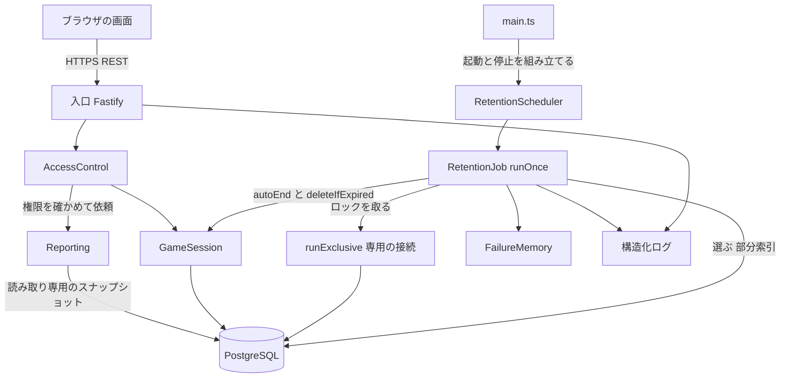

# 論理コンポーネント - U5 u5-results-retention

U5 の NFR の設計がどこに効くかを、コンポーネント単位で並べます。デプロイは U1 と同じ、1 つのアプリケーションと PostgreSQL です。U5 は新しいサービスを足さず、既存の入口、AccessControl、GameSession、PostgreSQL に、Reporting（結果と出力）と Retention（定期処理）を足します。

## 構成

<!-- Text fallback: ブラウザは HTTPS で入口に要求する。入口は AccessControl で権限を確かめ、結果と出力は Reporting が読み取り専用のスナップショットで PostgreSQL から読む。定期処理は main.ts が起動と停止を組み立てる RetentionScheduler が動かし、RetentionJob の 1 回分が、専用の接続でアドバイザリロックを取り、部分索引で対象を選び、GameSession の autoEnd と deleteIfExpired を呼ぶ。失敗したゲームは FailureMemory が持つ。入口と定期処理は構造化ログを出す。入口は Reporting と Retention を直接呼ばない。 -->

## コンポーネントと NFR の対応

| コンポーネント | 失敗の領域 | U5 が足す NFR の設計 |
| :--- | :--- | :--- |
| 入口（Fastify） | アプリケーションの 1 台 | 経路の表に `viewResults` と `exportGame` を足す。出力の応答ヘッダ。取得のログ。Reporting と Retention を import しない（AccessControl 経由） |
| AccessControl | アプリケーションの 1 台 | `requireResultsViewer`（参加者と進行役）と進行役の認可。固定の無効な資格情報の応答。観察者と無資格は同一の 403 |
| Reporting（`src/server/reporting/`） | アプリケーションの 1 台 | `buildResultsView`、`buildExportRecords`、`renderCsv`、`renderJson` の純粋な関数。`readSnapshot` を 1 回呼ぶ。許可リスト方式の専用の型 |
| GameSession | アプリケーションの 1 台と PostgreSQL | `autoEnd(gameId, staleBefore)` と `deleteIfExpired(gameId, expiredBefore)`（占有の中の再検査と結果の区別）。`write` が、状態を変えたときに `last_operation_at` を更新。表示名の検証の 1 か所への集約 |
| Retention（`src/server/retention/`） | アプリケーションの 1 台（複数台ならロックで 1 台だけ） | `RetentionPolicy` の読み込みと判定の関数、`RetentionJob.runOnce`、`RetentionScheduler`（起動、停止、連続の失敗の回数）、`FailureMemory`。ロックを保つ専用の接続とは別の接続でゲームを処理する |
| Store（PostgreSQL の保存） | PostgreSQL | `findStaleGames`、`findExpiredGames`（除外の識別子つき、部分索引）、`runExclusive`（`pg_try_advisory_lock`）、`GameTx.deleteGame`、`GameTx.touchOperation`。メモリ上の保存にも同じ契約を持たせる |
| 画面（React） | ブラウザ | `ResultsScreen`（指標と費用の切り替え、SVG のグラフ、表）、`ExportPanel`（出力ボタン、注意、列名の説明。出力はヘッダ付きの取得 → Blob → ダウンロード）、終了後の導線。表示名の入力欄の制限の表示 |
| 構造化ログ | アプリケーションの 1 台 | `retention_run`、`game_auto_ended`、`game_deleted`、`game_retention_failed`、`retention_run_failed`、`retention_run_repeated_failure`、`results_served`、`export_served`、`retention_config` |

## 共有の資源と blast radius

| 資源 | 使う部品 | 影響の範囲 |
| :--- | :--- | :--- |
| PostgreSQL の接続プール | 入口、GameSession、Reporting、Retention | 定期処理は 1 ゲームずつ順に処理するため、プールの占有は最大 1 本。ロックの専用の接続が 1 本加わる。プールの上限は U1 の設定のまま、定期処理の分を見込んで 1 本分の余裕を持つ |
| アドバイザリロック（定期処理の鍵） | Retention だけ | 取れなければ何もしない。他の処理を待たせない |
| `games` の行のロック | GameSession、Retention | 自動終了と削除は、1 ゲームの行を短時間だけ占有する（1 秒以内）。ほかのゲームの要求には影響しない |
| 構造化ログ | すべて | 個人情報を出さない許可リスト方式 |

## 上流の資料

`performance-design.md`、`security-design.md`、`scalability-design.md`、`reliability-design.md`、`observability-design.md`
