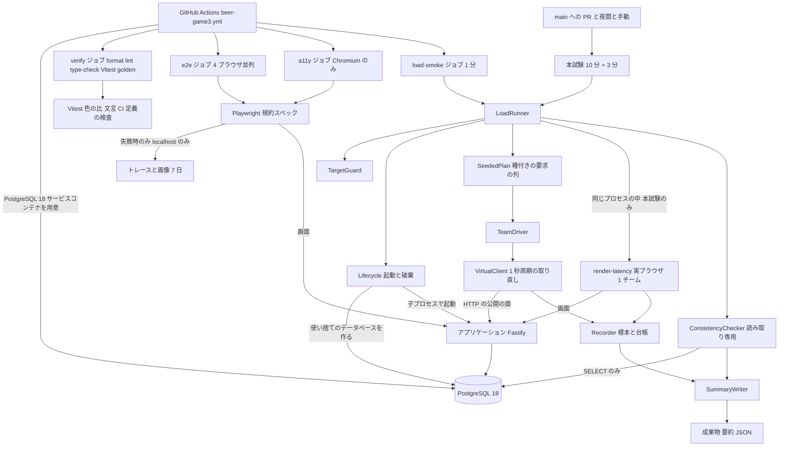

# 論理コンポーネント - U6 u6-nfr-verification

U6 の NFR の設計がどこに効くかを、コンポーネント単位で並べます。U6 は、アプリケーションに新しいサービスや機能を足しません。足すのは、アプリケーションの外にある検証の部品（負荷試験のスクリプト、ブラウザの試験、CI のワークフロー）だけです。アプリケーションの本番の成果物（`dist/`、コンテナ）には含めません。

## 構成

<!-- Text fallback: CI は PostgreSQL 18 のサービスコンテナを用意し、verify、e2e（4 ブラウザ並列）、a11y（Chromium のみ）、load-smoke（1 分）のジョブを動かす。main へのプルリクエスト（リリースの merge 前）、夜間、手動の実行が本試験（通常負荷 10 分と最大想定 3 分）を動かす。LoadRunner が TargetGuard で接続先を検査し、Lifecycle が使い捨てのデータベースを作ってアプリケーションを子プロセスで起動する。SeededPlan が作る要求の列を TeamDriver と VirtualClient が HTTP の公開の面だけで送り、Recorder が標本と成功応答の台帳を持つ。本試験では実ブラウザ 1 チームの render-latency を同じプロセスの中で動かす。終了時に ConsistencyChecker が読み取り専用で全ゲームを検査し、SummaryWriter が要約 JSON を出す。Playwright の試験は失敗時だけ、localhost のときだけ、トレースと画像を 7 日保存する。 -->

## コンポーネントと NFR の対応

配置の場所は `apps/beer-game3/` の下に、アプリケーションの `src/` とは別に置く（例: `verification/load/`、`verification/e2e/`）。具体的なパスは Code Generation の計画で決める。

| コンポーネント | 失敗の領域 | U6 が足す NFR の設計 | 対応する要件 |
| :--- | :--- | :--- | :--- |
| LoadRunner（入口と制御） | 試験の実行（アプリケーションとは別のプロセス） | 設定の読み込みと検証、区間の進行、終了コード（0、1、2） | NFR3.5、NFR4.3 |
| TargetGuard | 試験の実行 | `localhost` 以外の接続先を許可なしで拒否。成果物の保存の可否を決める唯一の判定 | NFR6.1、NFR7.2 |
| Lifecycle | 試験の実行と試験用のデータベース | 使い捨てのデータベースの作成と破棄、アプリケーションの子プロセスの起動と停止、残りの掃除 | NFR2.2 |
| SeededPlan | 試験の実行 | 種付きの擬似乱数から、チームごとの意思決定の列を作る | NFR1.2 |
| TeamDriver と VirtualClient | 試験の実行 | 1 チーム 5 画面の動作（確定と取り直し）。1 秒周期で刻む。切断の模擬 | NFR3.1〜NFR3.3、NFR4.1、NFR5.1 |
| Recorder | 試験の実行 | 標本の保持、最近順位法の百分位、成功応答の台帳。許可リスト方式で秘匿の値を持たない | NFR3.x、NFR2.1、NFR6.3 |
| render-latency（実ブラウザ 1 チーム） | 試験の実行と Chromium | 本試験のみ。LoadRunner と同じプロセスの中で Playwright のライブラリを使う。資格情報はプロセスの外へ出さず、トレース、画像、動画を取らない。LoadRunner が確定の応答を受けた時刻から、5 画面が新しい週を表示するまでを、同じ単調時計で測る | NFR3.2、NFR6.3 |
| ConsistencyChecker と schema-adapter | 試験の実行と試験用のデータベース | 読み取り専用の接続で全ゲームを検査。SQL を 1 部品に閉じ込める | NFR2.1、NFR5.1 |
| SummaryWriter | 試験の実行 | 要約 JSON、構造化ログ、`GITHUB_STEP_SUMMARY` の表。許可リスト方式 | NFR9.1、NFR9.2 |
| Playwright の規約スペック | ブラウザごとの試験 | キーボードの通し、主要な操作（4 ブラウザ）、axe-core、状態の表示、日本語表示（Chromium）。`retries: 0`、固定の待ちの禁止 | NFR8.1、NFR8.2、NFR8.4、NFR10.1、NFR11.1、NFR2.3 |
| 色の比の計算（純粋な関数） | Vitest | 系列の色と背景の比。ブラウザなし | NFR8.3 |
| 文言の検査（Vitest） | Vitest | `messages.ts` の英語の混入の検査 | NFR11.1 |
| CI の定義の検査（Vitest） | Vitest | 権限、シークレット、保持日数、`develop` の取得、`retries` の設定 | NFR6.2、NFR9.2、NFR9.3、NFR3.5 |
| CI ワークフロー（`beer-game3.yml`） | GitHub Actions | ジョブの分割、必須のチェック、成果物の保持、夜間と手動の起動 | NFR1.1、NFR3.5、NFR6.2、NFR10.1 |
| リリース前の確認票 | リポジトリ内の文書 | 1 つ前の世代と実機の Safari の確認の記録 | NFR9.4、NFR10.2 |

## CI のジョブの設計

| ジョブ | 内容 | 起動 | 失敗時の扱い |
| :--- | :--- | :--- | :--- |
| `verify` | formatter、linter、型検査、Vitest（golden test、色の比、文言、CI 定義の検査を含む） | プルリクエストと `develop` / `main` への push | 必須のチェック。失敗すると統合しない |
| `e2e` | キーボードの通し試験と主要な操作の試験。4 ブラウザ（Chromium、Firefox、WebKit、Edge）を行列で並列に | プルリクエスト | 必須のチェック。失敗時のみトレースと画像を保存（7 日） |
| `a11y` | axe-core、状態の表示、日本語表示の検査（Chromium のみ。Q2 の A） | プルリクエスト | 必須のチェック |
| `load-smoke` | 短い負荷試験（1 分、15 チーム）。合否は標本が多い指標だけ | プルリクエスト | 必須のチェック。「無効」（終了コード 2）も失敗として扱う（`reliability-design.md` の実行結果の分類） |
| `load-main` | 10 分間の本試験（通常負荷 10 分と最大想定 3 分、実ブラウザ 1 チーム） | (1) `main` を対象にしたプルリクエスト（リリースの merge の前）、(2) 夜間の定期実行（`develop` を明示して取得）、(3) 手動実行（検査する branch を入力で指定、既定は `develop`） | ワークフローの失敗として通知。要約を成功でも失敗でも 30 日保存（`if: always()`）。(1) は、`main` へ merge する前の必須のチェックにする |

### 本試験の起動の設計（最初のリリースの前を含む）

GitHub の定期実行（`schedule`）と手動実行（`workflow_dispatch`）は、ワークフローの定義が既定の branch（`main`）にあるときだけ動く。これは設計の前提とする。team の方針（`develop` で統合、リリースのときだけ `main` へ merge）では、最初のリリースの merge までは `beer-game3.yml` が `main` にない。そこで、本試験の合否の証拠を得る経路を 3 つ持つ。

| 時期 | 本試験を動かす経路 | 証拠 |
| :--- | :--- | :--- |
| 最初のリリースの merge の前 | `develop` から `main` へのリリース用のプルリクエスト。`pull_request` の起動は、プルリクエストの側のワークフローの定義で動くため、`main` に定義がなくても動く | プルリクエストの必須のチェックと、成果物の要約（30 日、検査した branch とコミットを記録） |
| 最初のリリースの merge の後 | 夜間の定期実行（`develop` を取得）、手動実行（branch を入力で指定）、リリースのプルリクエスト | 同じ |
| どの時期でも | 手元（ローカル）での本試験の実行は、開発中の確認として使ってよいが、**合否の証拠にはしない**（実行環境の記録、成果物の保存、コミットの固定がないため）。リリースの判断は、上の経路の要約で行う | - |

この経路は、手動実行がまだ使えない時期でも、`main` への merge の前に必ず 1 回、CI で本試験が動く。リリースの手順書（`developing-release`）には、「リリース用のプルリクエストの本試験が成功していること」を条件として書く。

## 共有の資源と blast radius

| 資源 | 使う部品 | 影響の範囲 |
| :--- | :--- | :--- |
| 試験用の PostgreSQL（サービスコンテナ） | Lifecycle、ConsistencyChecker | ジョブごとに使い捨て。ほかのジョブや本番に影響しない。データベース名は実行ごとに一意 |
| 実行機（ubuntu の共有機） | 負荷の生成、アプリケーション、PostgreSQL | 同居による測定の保守化。実行環境を要約に記録して切り分ける |
| ローカルの端末（手元での実行） | LoadRunner、Lifecycle | `localhost` に閉じる。残りの掃除は 1 時間より古い `bg3_verify_` のデータベースだけ |
| 成果物の保存 | ワークフロー | 本試験の要約 30 日、トレースと画像 7 日。資格情報は使い捨てで、保存時点では無効 |
| 依存（devDependencies） | Playwright、axe-core | 本番の成果物に含まれない |

## 上流の資料

`performance-design.md`、`security-design.md`、`scalability-design.md`、`reliability-design.md`、`observability-design.md`
