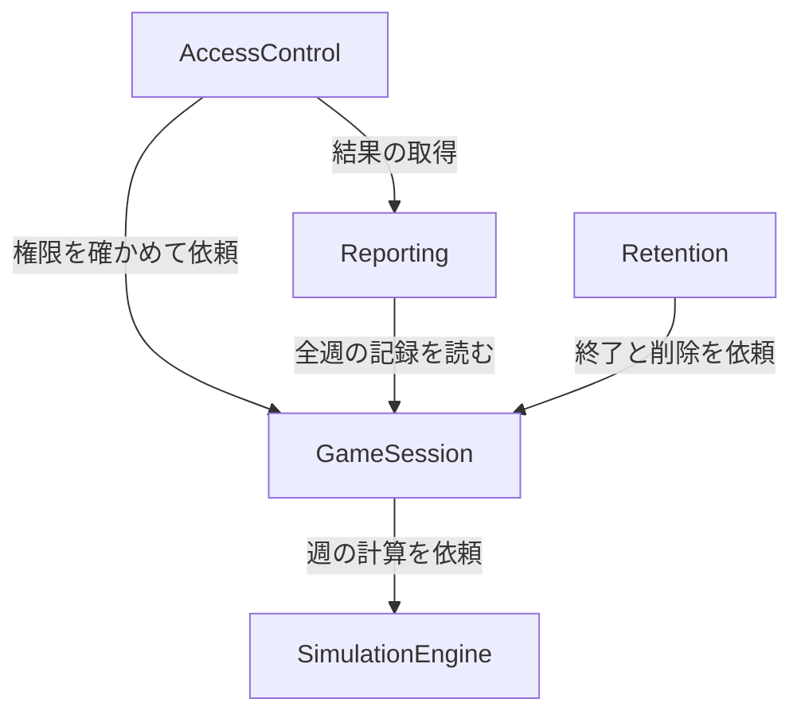

# 部品の一覧（コンポーネントカタログ）

beer-game3 の部品を、要件（`requirements.md`）とストーリー（`stories.md`）から定めました。部品は「自分たちが書くコード」です。データベース、時計、乱数は、部品が使う依存先として扱います。デプロイの形は Units Generation で決めます。土台コードなしで 1 から作るため、`component-inventory.md` と `architecture.md`（beer-game2 の調査結果）は設計の参考にとどめ、部品は引き継ぎません。

前回の作業（beer-game-development）の決定のうち、「週次進行と永続状態は GameSession が所有し、副作用のない決定論的計算を SimulationEngine に分離する」を引き継ぎました。

## 機械可読のカタログ

```yaml
components:
  - name: GameSession
    summary: ゲーム全体の永続状態と週の進行を所有する
    behaviour: >
      ゲームの設定、参加者、役割の割当て、週ごとの記録、遅延の枠（パイプライン）、操作の履歴を 1 つの集約として持つ。
      状態は準備中、進行中、一時停止、終了のいずれか。週の確定は、4 役割の入力がそろったときだけ、一度だけ、
      原子的に行う（同じ週の確定が再び来ても結果は変わらない）。確定前の入力は、入力した時点で保存する。
      準備中は役割の割当てを自由に変えられ、進行中と一時停止中は同じ役割の担当者の入れ替えだけを許す。
      1 つの役割の定員は 4 人。週の計算そのものは SimulationEngine に任せる。
      設定、役割変更、代理入力、週確定、停止、再開、終了の履歴は、操作と同じ保存の中で残す。
      すべての役割の状態を持つが、外へは直接出さない（見せ方は AccessControl が決める）。
    responsibilities:
      - ゲームの作成、設定の保存、キット準拠かカスタムかの判定
      - 参加者の受付と役割の割当て、担当者の入れ替え、開始の条件（各役割に 1 人以上）
      - 発注数・生産要請数の入力の保存、代理入力
      - 週の確定（冪等、原子的）と、ゲームの状態遷移（準備中、進行中、一時停止、終了）
      - 確定済みの週からの復元、確定前の入力の保存
      - 操作の履歴の記録
    depends_on:
      - component: SimulationEngine
        interaction: 週の確定のとき、入力と現在の状態から、次の週の状態と費用を計算してもらう
        style: sync
    dependents:
      - component: AccessControl
        interaction: 呼び出した人の権限を確かめたあと、コマンドの実行と状態の取得を依頼する
      - component: Reporting
        interaction: 終了したゲームの全週の記録を読む
      - component: Retention
        interaction: 保持期限を過ぎたゲームの終了と削除を依頼する
    external_dependencies:
      - name: PostgreSQL
        kind: database
        purpose: ゲームの集約の永続化（1 回の保存で更新する）
      - name: Clock
        kind: other
        purpose: 操作の時刻を得る（試験では固定の時計に差し替える）
    entities:
      - name: Game
        identifier: gameId
        attributes: [name, status, weekCount, currentWeek, setupKind, createdAt, endedAt]
      - name: GameSettings
        identifier: settingsId
        attributes: [weekCount, initialInventory, initialPipelineQuantity, inventoryUnitCost, backlogUnitCost, visibilityScope]
        references:
          - entity: Game
            owned_by: GameSession
            relationship: 各設定は 1 つのゲームに属する
      - name: DemandSeries
        identifier: seriesId
        attributes: [values, isProvisionalDefault]
        references:
          - entity: GameSettings
            owned_by: GameSession
            relationship: 各需要系列は 1 つの設定に属する
      - name: Participant
        identifier: participantId
        attributes: [displayName, joinOrder]
        references:
          - entity: Game
            owned_by: GameSession
            relationship: 各参加者は 1 つのゲームに参加する
      - name: RoleAssignment
        identifier: assignmentId
        attributes: [role, participantId]
        references:
          - entity: Participant
            owned_by: GameSession
            relationship: 各割当ては 1 人の参加者を 1 つの役割に就ける
      - name: WeekRecord
        identifier: weekRecordId
        attributes: [week, role, receipt, ordersReceived, shipped, inventory, backlog, decision, weeklyCost, cumulativeCost, isConfirmed]
        references:
          - entity: Game
            owned_by: GameSession
            relationship: 各週の記録は 1 つのゲームに属する
      - name: PipelineSlot
        identifier: pipelineSlotId
        attributes: [kind, role, remainingWeeks, quantity]
        references:
          - entity: Game
            owned_by: GameSession
            relationship: 各枠は 1 つのゲームの遅延（配送、注文、生産）を表す
      - name: OperationLogEntry
        identifier: logEntryId
        attributes: [kind, actor, occurredAt, detail]
        references:
          - entity: Game
            owned_by: GameSession
            relationship: 各履歴は 1 つのゲームの操作を記録する

  - name: SimulationEngine
    summary: 副作用のない、決定論的な週次計算
    behaviour: >
      現在の状態（在庫、受注残、遅延の枠）、当週の受注、4 役割の意思決定、設定を受け取り、
      12 ステップに従って、次の週の状態、出荷、費用を返す。同じ入力からは常に同じ結果を返す。
      時計、乱数、保存、通信に触れない。利用可能量は前週末在庫 + 当週入荷、充足対象は前週末受注残 + 当週受注、
      出荷は両者の小さい方、週末在庫と週末受注残は max(0, 差)、費用は在庫 × 在庫単価 + 受注残 × 受注残単価。
      配送・注文は 2 週、生産は 2 段階の遅延を、枠の前進で表す。金額は整数の最小単位で扱う。
    responsibilities:
      - 12 ステップに従った週の計算
      - 遅延の枠の前進
      - 費用の計算（浮動小数点を使わない）
    depends_on: []
    dependents:
      - component: GameSession
        interaction: 週の確定のとき、計算を依頼される
    external_dependencies: []
    entities: []

  - name: AccessControl
    summary: コードと token の発行・検証、役割別の見せ方
    behaviour: >
      ゲーム作成時に、推測困難な参加コード、進行役用コード、観察者用コードを発行する。参加者の復帰用 token を発行・検証・無効化する。
      呼び出した人が参加者（どの役割か）、進行役、観察者のどれかを判定し、できる操作を制限する。
      GameSession の全役割の状態から、呼び出した人ごとの見せ方（役割別の投影）を作る。
      参加者には自分の役割の情報だけ、小売店にだけ当週の顧客需要、進行役には全役割の状態、観察者にはチーム全体の集計値だけを返す。
      プレイ中の他役割の時系列は返さず、終了後に開示する。入力状況は、参加者には入力済みの数だけ返す。
      無効なコードによる参加の試行を、同じ接続元ごとに数え、上限を超えたら一時的に拒否する。
      復帰用 token は、最後の操作から有効期間を過ぎたら無効にする。
    responsibilities:
      - 参加コード、進行役用コード、観察者用コード、復帰用 token の発行・検証・失効
      - 呼び出した人の判定と、操作の権限の検証（サーバー側）
      - 役割別の投影（情報制約の強制）
      - 無効なコードの試行回数の制限
    depends_on:
      - component: GameSession
        interaction: 権限を確かめたあと、コマンドの実行と状態の取得を依頼する
        style: sync
      - component: Reporting
        interaction: 終了後の結果の比較表示と出力を、権限を確かめて取得する
        style: sync
    dependents: []
    external_dependencies:
      - name: RandomSource
        kind: other
        purpose: 暗号論的な乱数でコードと token を作る（試験では固定の乱数に差し替える）
      - name: Clock
        kind: other
        purpose: token の有効期間と試行回数の窓を判定する
      - name: PostgreSQL
        kind: database
        purpose: コードと token の保存
    entities:
      - name: AccessCode
        identifier: codeId
        attributes: [kind, gameId, issuedAt, revokedAt]
        references:
          - entity: Game
            owned_by: GameSession
            relationship: 各コードは 1 つのゲームに対して発行される
      - name: ReturnToken
        identifier: tokenId
        attributes: [participantId, issuedAt, lastUsedAt, revokedAt]
        references:
          - entity: Participant
            owned_by: GameSession
            relationship: 各 token は 1 人の参加者の復帰に使われる

  - name: Reporting
    summary: 終了後の結果の比較と出力
    behaviour: >
      終了したゲームの全週の記録から、需要と 4 役割の時系列（注文、在庫、受注残、出荷、費用）を比較用に整える。
      ゲーム設定と全週の記録を、CSV と JSON で出力する。出力には、週、役割、各数量、費用、意思決定、
      キット準拠かカスタムかの区別を含め、同じ数値が両方の形式で一致する。値にカンマや改行を含んでも崩れない。
      プレイ中のゲームの比較は作らない。
    responsibilities:
      - 比較表示用の時系列の整形
      - CSV と JSON の出力
    depends_on:
      - component: GameSession
        interaction: 終了したゲームの設定と全週の記録を読む
        style: sync
    dependents:
      - component: AccessControl
        interaction: 権限を確かめたあと、結果の取得を依頼する
    external_dependencies: []
    entities: []

  - name: Retention
    summary: 保持期間、自動終了、削除
    behaviour: >
      保持期間（既定はゲーム終了後 30 日、運営者の設定で変更可能）を過ぎたゲームのデータを削除し、参加コードを無効にする。
      最後の操作から 30 日、終了していないゲームを自動的に終了させ、その時点から保持期間を数える。
      定期的に動き、時刻を注入して試験できる。
    responsibilities:
      - 保持期間と自動終了の期間の判定
      - 期限を過ぎたゲームの削除
    depends_on:
      - component: GameSession
        interaction: 期限を過ぎたゲームの終了と削除を依頼する
        style: sync
    dependents: []
    external_dependencies:
      - name: Clock
        kind: other
        purpose: 期限の判定（試験では固定の時計に差し替える）
      - name: Scheduler
        kind: other
        purpose: 定期的に起動する
    entities:
      - name: RetentionPolicy
        identifier: policyId
        attributes: [retentionDays, autoEndDays]
```

## 部品の図



<!-- Text fallback: AccessControl は GameSession と Reporting を呼ぶ。Reporting は GameSession を呼ぶ。Retention は GameSession を呼ぶ。GameSession は SimulationEngine を呼ぶ。循環はない。 -->

## 部品の概要

| 部品 | 目的 | 呼ぶ先 | 呼ばれる元 | 所有する実体 |
| :--- | :--- | :--- | :--- | :--- |
| GameSession | ゲーム全体の永続状態と週の進行 | SimulationEngine | AccessControl、Reporting、Retention | Game、GameSettings、DemandSeries、Participant、RoleAssignment、WeekRecord、PipelineSlot、OperationLogEntry |
| SimulationEngine | 副作用のない週次計算 | なし | GameSession | なし |
| AccessControl | コードと token、役割別の見せ方 | GameSession、Reporting | なし（入口の層から呼ばれる） | AccessCode、ReturnToken |
| Reporting | 結果の比較と出力 | GameSession | AccessControl | なし |
| Retention | 保持期間、自動終了、削除 | GameSession | なし（定期的な起動から呼ばれる） | RetentionPolicy |

## 実体の所有

| 実体 | 所有する部品 | 識別子 | 属性 | 参照 |
| :--- | :--- | :--- | :--- | :--- |
| Game | GameSession | gameId | name、status、weekCount、currentWeek、setupKind、createdAt、endedAt | なし |
| GameSettings | GameSession | settingsId | weekCount、initialInventory、initialPipelineQuantity、inventoryUnitCost、backlogUnitCost、visibilityScope | Game |
| DemandSeries | GameSession | seriesId | values、isProvisionalDefault | GameSettings |
| Participant | GameSession | participantId | displayName、joinOrder | Game |
| RoleAssignment | GameSession | assignmentId | role、participantId | Participant |
| WeekRecord | GameSession | weekRecordId | week、role、receipt、ordersReceived、shipped、inventory、backlog、decision、weeklyCost、cumulativeCost、isConfirmed | Game |
| PipelineSlot | GameSession | pipelineSlotId | kind、role、remainingWeeks、quantity | Game |
| OperationLogEntry | GameSession | logEntryId | kind、actor、occurredAt、detail | Game |
| AccessCode | AccessControl | codeId | kind、gameId、issuedAt、revokedAt | Game（GameSession） |
| ReturnToken | AccessControl | tokenId | participantId、issuedAt、lastUsedAt、revokedAt | Participant（GameSession） |
| RetentionPolicy | Retention | policyId | retentionDays、autoEndDays | なし |

実体は、所有と形（識別子、属性の名前、他の部品の実体への参照）だけを定めています。型、制約、取りうる値、関連の多重度は、Functional Design の `entities.md` で定めます。

## 外部の依存

| 部品 | 依存先 | 種類 | 目的 |
| :--- | :--- | :--- | :--- |
| GameSession | PostgreSQL | データベース | ゲームの集約を 1 回の保存で更新する |
| GameSession | Clock | その他 | 操作の時刻（試験では固定の時計） |
| AccessControl | PostgreSQL | データベース | コードと token の保存 |
| AccessControl | RandomSource | その他 | 暗号論的な乱数でコードと token を作る |
| AccessControl | Clock | その他 | token の有効期間、試行回数の窓 |
| Retention | Clock | その他 | 期限の判定 |
| Retention | Scheduler | その他 | 定期的な起動 |

## 根拠

| 部品 | 別の部品にする理由 |
| :--- | :--- |
| GameSession | ゲームの状態という、永続化と整合性の中心。変更の理由は「ゲームの進め方の規則」で、集約の単位でもある |
| SimulationEngine | 副作用がなく、決定論的であることが NFR1（再現性）の要。変更の理由は「計算の規則」で、保存や通信とは独立に試験できる |
| AccessControl | 「誰に何を見せるか、誰が何をできるか」は、最も守りたい制約（FR4）。変更の理由は「権限と公開範囲の規則」で、状態の規則とは別 |
| Reporting | 結果の整形と出力という、読み取り専用の関心。変更の理由は「出力の形式」で、状態の規則と独立 |
| Retention | 時刻に駆動される、運用上の関心（保持、自動終了、削除）。変更の理由は「保持の方針」で、ゲームの進め方とは独立 |

### 却下した案

- 2 つにまとめる案: アクセス、結果、保持が GameSession に混ざり、情報制約の変更が状態の規則に波及する。試験の単位も大きくなる。
- 6 つ以上に細かく分ける案: 参加者と役割（Roster）、週の進行（Progress）、履歴（AuditLog）を分けると、週の確定のたびに複数の部品をまたいで原子性を保つ必要があり、複雑さに見合う利点がない。1 ゲームの規模が小さい。

詳しい決定は `decisions.md` を参照してください。

## 上流の資料

`requirements.md`、`stories.md`、`team-practices.md`、`architecture.md`（beer-game2 の調査結果。参考のみ）、`component-inventory.md`（同上）
