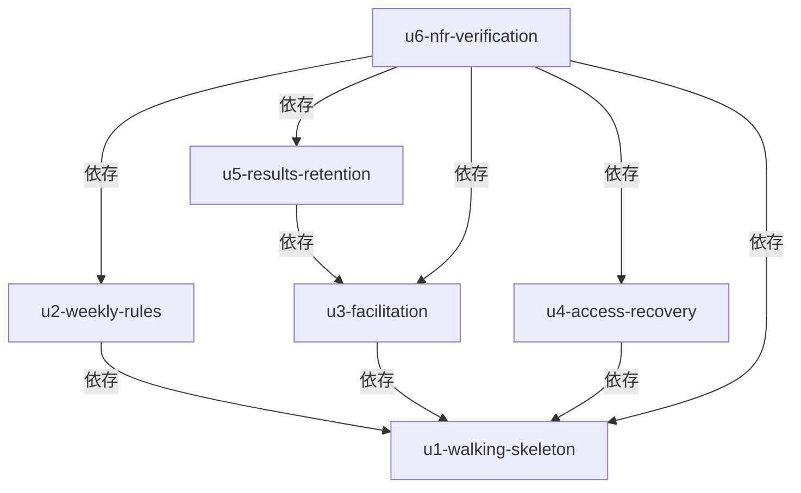

# Unit の依存関係

Unit 同士の依存の形（どれがどれに依存できるか）だけを定めます。どの順で実装するかは、次の Delivery Planning で決めます。

## 依存の図



<!-- Text fallback: U2、U3、U4 は U1 に依存する。U5 は U3 に依存する。U6 は U1、U2、U3、U4、U5 のすべてに依存する。U1 は何にも依存しない。循環はない。 -->

## 依存の根拠

| 依存 | 根拠 |
| :--- | :--- |
| U2 は U1 に依存 | 週の確定の保証は、U1 の確定の処理に対して加える（US2.4 は US1.5 に依存、US1.6 は US1.1 に依存） |
| U3 は U1 に依存 | 運営操作は、開始済みのゲームと役割の割当てを前提にする（US2.5、US2.6 は US1.3 に依存、US2.7、US2.8 は US1.4 に依存） |
| U4 は U1 に依存 | 権限と復帰は、参加、割当て、入力の仕組みの上に作る（US2.1 は US1.4、US3.1、US3.2 は US1.5 などに依存） |
| U5 は U3 に依存 | 結果の出力と削除は、終了したゲームを前提にする。終了の仕組み（一時停止・再開・終了、終了週での自動終了）は U3 が持つ（US5.1 は US2.5 に依存。US4.1 は終了後の開示で、終了の状態を前提にする） |
| U6 は U1〜U5 に依存 | 「任意の画面」の条件は、全画面が揃ってから確かめる（US5.5、US5.7）。負荷試験は、通常の操作の全体を流して測る（US5.3） |

## Unit 間の接点

同じアプリケーションの中の Unit は、次の接点で結びつきます。

| 接点 | 提供する Unit | 使う Unit | 内容 |
| :--- | :--- | :--- | :--- |
| ゲームの集約の保存と読み込み | U1 | U2、U3、U4、U5 | GameSession の保存と読み込み。1 回の保存で集約を更新する（ADR-003） |
| 週の計算の入出力 | U1 | U2 | SimulationEngine が、現在の状態、受注、意思決定、設定を受け取り、次の状態、出荷、費用を返す（ADR-006） |
| コードの検証と役割別の投影 | U1 | U3、U4、U5 | AccessControl の呼び出し元の判定と投影。U4 が観察者、token、制限を加える |
| ゲームの状態遷移（終了を含む） | U3 | U5 | 終了したゲームの全週の記録を Reporting が読み、保持期間を過ぎたゲームを Retention が削除する |
| 共有のデータベース | U1 | すべて | PostgreSQL。スキーマの変更は、Unit ごとに別の移行として足す |

接点の契約の詳細は、Contract Design で定めます。

## 並行して開発できる組

次の Unit の組には、依存がありません。したがって、複数の順序が成り立ちます。順序の選択は、Delivery Planning の仕事です。

- U2、U3、U4 は、U1 の後で、互いに依存しないため、並行できる。
- U5 は U3 の後に始められる。U2 や U4 の完了を待つ必要はない。

## 先頭の Unit の動かし方

先頭の Unit（U1）は、team の方針に従う、1 ゲーム、4 役割、1 週分の薄い一通りです。ほかの Unit に依存しないため、U1 だけで、作成から週の確定と状態の表示まで動きます。U1 は、必要な部品の最小の部分（GameSession、SimulationEngine、AccessControl の最小の形）を持ち、画面、アプリケーション、ドメイン計算、PostgreSQL への保存の接続を、機能を広げる前に確かめます。`bolt-plan.md` の印だけで実行の順序は変わらないため、この依存の図が、実行の順序の基準になります。

## 依存の定義（機械可読）

```yaml
units:
  - name: u1-walking-skeleton
    kind: service
    depends_on: []
  - name: u2-weekly-rules
    kind: service
    depends_on: [u1-walking-skeleton]
  - name: u3-facilitation
    kind: service
    depends_on: [u1-walking-skeleton]
  - name: u4-access-recovery
    kind: service
    depends_on: [u1-walking-skeleton]
  - name: u5-results-retention
    kind: service
    depends_on: [u3-facilitation]
  - name: u6-nfr-verification
    kind: service
    depends_on: [u1-walking-skeleton, u2-weekly-rules, u3-facilitation, u4-access-recovery, u5-results-retention]
```

## 上流の資料

`unit-of-work.md`、`components.md`、`decisions.md`、`requirements.md`、`stories.md`
