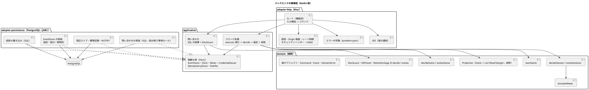
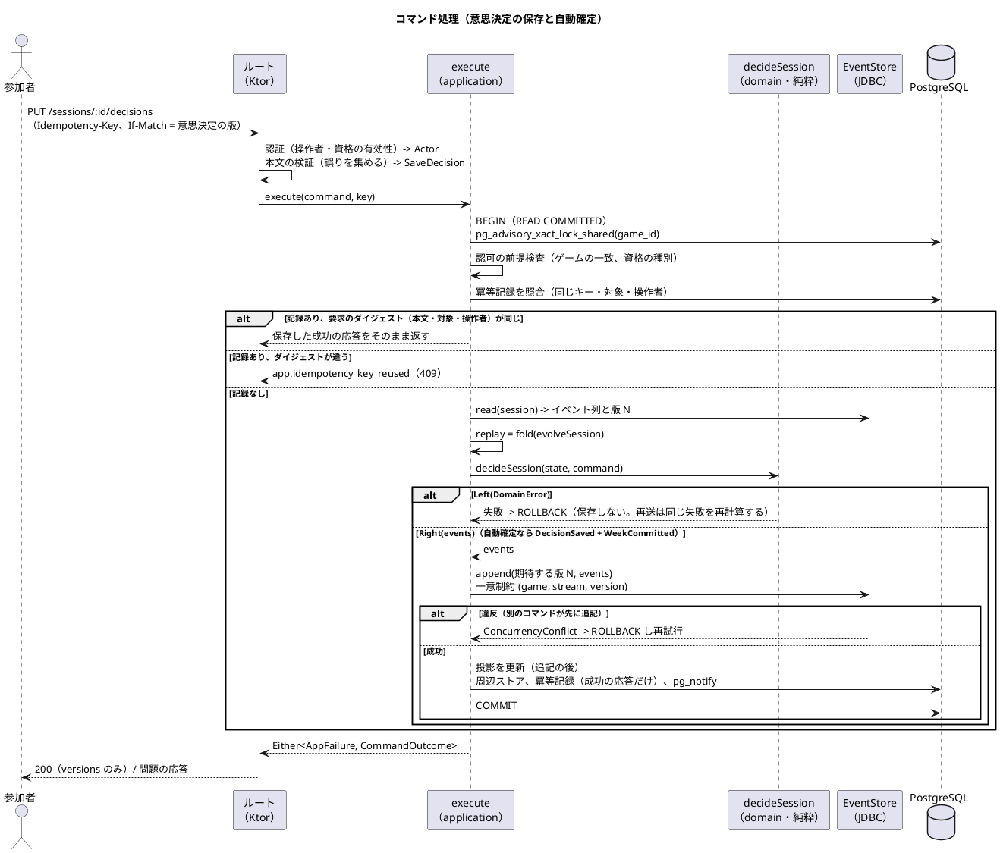
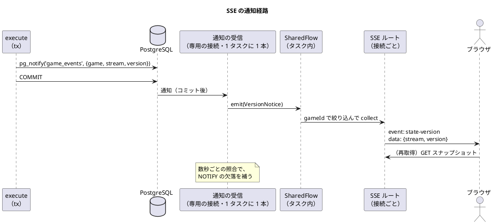

# バックエンドアーキテクチャ - ビールゲームシミュレーション（Kotlin 版）

## 概要

本書は、beer-game-kotlin のバックエンドのアーキテクチャを、パターン選択の根拠とあわせて定義します。**`docs/` を設計の正本**とします。実装コードはまだ存在しません。本書の Kotlin のコードは、型と関数の形を示す設計上のスケッチです。

[beer-game2 のバックエンドアーキテクチャ](../beer-game2/architecture-backend.md) の機能・API の振る舞い・セキュリティ・運用要件を正本として引き継ぎ、次の点を **Kotlin・関数型・イベントソーシング（ES）+ CQRS** で設計し直します。

- 書き込みは、`decide` / `evolve`（[ドメインモデル](./domain-model.md)）を呼ぶ**薄いコマンド処理**に集約します。ロック（`SELECT ... FOR UPDATE`）と版つき更新は、追記の一意制約と自動再試行に置き換えます（再構築との同時実行の制御にだけ、アドバイザリロックを使います）（[データモデル](./data-model.md)）。
- 読み取りは、同期投影の表を SQL で読む**問い合わせ側**です。
- 依存は、インターフェースの階層でなく**関数の型の束**で表します（[ガイド §7.2](../../reference/関数型プログラミングガイド_Kotlin編.md)）。
- 失敗は例外でなく `Either` で返し、境界で HTTP の応答へ写します（[ガイド 第 3 章](../../reference/関数型プログラミングガイド_Kotlin編.md)）。

技術スタックのバージョンは [技術スタック](./tech-stack.md) と [インフラストラクチャ](./architecture-infrastructure.md) の確認結果に従います。本書は、ライブラリの版を断定しません。

## パターンの選択

[アーキテクチャ設計ガイド](../../reference/アーキテクチャ設計ガイド.md) の選択フローに沿って判断します。

| 判断項目 | 本システムの答え | 帰結 |
| :--- | :--- | :--- |
| 業務領域のカテゴリー | 中核の業務領域（週次計算と進行） | ドメインモデルパターン。ルールは `decide` に集める |
| 金額・分析・監査記録 | 分析と記録が必要。**状態の履歴そのものが学習の素材** | **イベントソーシング**。状態はイベントの列。イベントが監査の記録を兼ねる（ユーザーの方針） |
| 永続化モデルが複数か | 書き込み（イベント列）と読み取り（観察・振り返り・出力）で形が異なる | **CQRS**。コマンド側は `events` へ追記、問い合わせ側は投影テーブルを SQL で読む（[ガイド §7.5](../../reference/関数型プログラミングガイド_Kotlin編.md)） |

**採用する構造は、「核の純粋関数 + 外側の薄い副作用の層」です**（[ガイド §7.8](../../reference/関数型プログラミングガイド_Kotlin編.md)）。核は、入力の検証、`decide`、`evolve`、投影、`simulateWeek`、`Disclosure` です。副作用は、HTTP、データベース、時計、乱数、ログです。beer-game2 のポートとアダプターと同じ依存の向きを、関数の型で表します。

## 全体構成



### 層と依存の向き

依存は、外側から内側（ドメイン）への**一方向**です。`domain` は、Kotlin の標準ライブラリと Arrow Core だけに依存します。

| 層（Gradle モジュール） | 責務 | 依存してよい先 |
| :--- | :--- | :--- |
| `domain` | 値オブジェクト、`Command`、`Event`、`DomainError`、`decide` / `evolve`、`startGame`、`simulateWeek`、`Disclosure`、`KitPreset`、投影の純粋関数、`RetentionSaga` の純粋関数。**業務ルールはここにある** | なし（Kotlin 標準ライブラリ、Arrow Core のみ） |
| `application` | 関数の束（`Ports`）の型の定義、コマンド処理 `execute`、問い合わせ、競合の再試行、周辺ストアへの書き込み内容の導出（純粋）。トランザクションの境界を決める。**ルールは持たない** | `domain` |
| `adapter-http` | Ktor のルート、DTO の検証（`Either` で誤りを集める）、認証、Origin 検査、レート制限、ヘッダー、SSE、エラーの写像 | `application`、`domain` |
| `adapter-persistence` | JDBC による `EventStore`、投影の書き込み、問い合わせ、周辺ストア、冪等記録、NOTIFY、イベントの JSON 変換（`EventCodec`）、マイグレーション | `application`、`domain` |
| `app` | 設定の読み込みと検証、関数の束の組み立て（ワイヤリング）、起動のモード（api、retention、migrate、rebuild-projections） | 全モジュール |

この規則は、**Gradle のモジュール依存**（コンパイル時に import できない）と、**検査のルール**（detekt と PMD のカスタムルール。[ガイド §9.6](../../reference/関数型プログラミングガイド_Kotlin編.md)）の二重で守ります。違反は、CI で失敗とします。

### 依存を関数の束で表す

外部とのやり取りを、`typealias` と `data class` の関数の束で表します（[ガイド §7.2](../../reference/関数型プログラミングガイド_Kotlin編.md)）。テストでは、同じ型の関数に差し替えます。副作用のある関数は `suspend` とし、型で副作用を示します（[ガイド §4.2](../../reference/関数型プログラミングガイド_Kotlin編.md)）。

```kotlin
typealias Now = suspend () -> Instant
typealias NewId = suspend () -> UUID
typealias IssueCredential = suspend (CredentialKind, ExpiresAt) -> IssuedCredential   // 乱数とダイジェスト。生の値は応答だけが運ぶ

/** イベントストア。PostgreSQL 版とインメモリ版を差し替える（データモデルのスケッチと同じ形） */
data class EventStore(
    val read: suspend (Tx, GameId, StreamType) -> Either<AppFailure, StreamRead>,                    // Left は Persistence
    val append: suspend (Tx, Map<StreamType, StreamVersion>, List<NewEvent>) -> Either<AppFailure, Unit>, // Left は ConcurrencyConflict か Persistence
    val transaction: TransactionRunner,
)

/** 失敗の型は AppFailure（正本。下の「コマンド処理の流れ」）。追記の競合は AppFailure.ConcurrencyConflict で、独立した AppendFailure の型は持たない。データモデルの署名もこれに合わせる */
fun interface TransactionRunner {
    suspend operator fun <A> invoke(block: suspend (Tx) -> Either<AppFailure, A>): Either<AppFailure, A>
}

/** コマンドの応答。画面の表示に使う内容は持たない（ストリームごとの追記後の版だけ） */
data class CommandOutcome(val versions: Versions)
data class Versions(val game: StreamVersion?, val session: StreamVersion?)

/** 追記と同じトランザクションで書く、イベント以外の行（投影、周辺ストア、冪等記録、通知） */
data class SideStores(
    val project: suspend (Tx, GameId, List<EventEnvelope<DomainEvent>>) -> Either<PersistenceFailure, Unit>,
    val writePeripheral: suspend (Tx, List<PeripheralWrite>) -> Either<PersistenceFailure, Unit>,
    val findIdempotent: suspend (Tx, IdempotencyKey) -> Either<PersistenceFailure, StoredResponse?>,
    val saveIdempotent: suspend (Tx, IdempotencyKey, StoredResponse) -> Either<PersistenceFailure, Unit>,
    val notify: suspend (Tx, List<VersionNotice>) -> Either<PersistenceFailure, Unit>,   // pg_notify。コミットで配信される
)

data class Ports(val now: Now, val newId: NewId, val issueCredential: IssueCredential,
                 val events: EventStore, val side: SideStores)
```

**`EventStore.transaction` の意味論**は次のとおりです。

| 項目 | 設計 |
| :--- | :--- |
| 原子性 | ブロックが `Left` を返したら **ROLLBACK**。追記と投影（周辺ストア・冪等記録・通知を含む）は、同じトランザクションで、全部成功か全部失敗のどちらか。投影が `Left` を返したら、追記も取り消される |
| 分離レベル | **READ COMMITTED**。競合の検出は、分離レベルでなく `events` の一意制約（`uq_events_stream_version`）で行う |
| ロック（再構築との同時実行） | コマンドのトランザクションは、`BEGIN` の直後に **`pg_advisory_xact_lock_shared(game_id)`** を取る（コマンドどうしは互いを待たない）。投影の再構築は排他の `pg_advisory_xact_lock(game_id)` を取り、コマンドと同時に走らない（下の「投影の更新と再構築」）。`game_id` は、UUID から導いた 64 ビット整数に写す（衝突は不要な待ちを生むだけで、整合性は損なわない）。トランザクションの終わりで自動的に解放される |
| 再試行の対象 | `AppFailure.ConcurrencyConflict`。アダプターは、`uq_events_stream_version` の違反、SQLSTATE **40001**（直列化失敗）、**40P01**（デッドロック）をすべて `ConcurrencyConflict` に写す。`execute` が、読み込みからやり直す（上限つき） |
| キャンセル | COMMIT と ROLLBACK は **`NonCancellable`** で行う。`CancellationException` は握りつぶさず、**再送出**する（`PersistenceFailure` に変えない）。クライアントの切断でコルーチンがキャンセルされても、トランザクションは必ず閉じる |

`decide` は `Now` や `NewId` を持ちません。時刻、`GameId`、`JoinCode`、`ParticipantId` などは、ルートがコマンドの値に詰めてから `execute` へ渡します（[ドメインモデル](./domain-model.md) 変更 12、[ガイド §4.4](../../reference/関数型プログラミングガイド_Kotlin編.md)）。

## コマンド側

### コマンド処理の流れ

[ガイド §7.8](../../reference/関数型プログラミングガイド_Kotlin編.md) の流れ（HTTP → 検証 → コマンド → `handle` → ストア → 射影）を、本システムに当てはめます。



```kotlin
/** アプリケーション層の失敗の唯一の正本。EventStore、execute、ルートの写像がすべてこの型を使う（データモデルの署名も同じ） */
sealed interface AppFailure {
    data class Invalid(val errors: NonEmptyList<ValidationError>) : AppFailure       // 境界で集めた入力の誤り（ルートが execute の前に作る）
    data class Domain(val error: DomainError) : AppFailure                           // decide が返した業務上の失敗
    data object ConcurrencyConflict : AppFailure                                     // 追記の競合。uq_events_stream_version の違反、40001、40P01。execute が再試行する
    data object RetryExhausted : AppFailure                                          // 競合の再試行が上限に達した、または再構築のロックの待ちが上限に達した。app.retry_exhausted（503、Retry-After）
    data object IdempotencyKeyReused : AppFailure                                    // 同じキーで要求の内容（本文・対象・操作者）が違う。app.idempotency_key_reused（409）
    data object Unauthorized : AppFailure                                            // 資格が無効（失効・期限切れ・不明を区別しない）。app.unauthorized（403）
    data class Persistence(val failure: PersistenceFailure) : AppFailure             // 例外を境界で値にしたもの。500 と相関 ID
}

/** 1 本のストリームのコマンド。ストリームごとの decide / evolve を渡すだけで、ルールは持たない */
suspend fun <S, C, E> Ports.execute(
    stream: StreamRef, initial: S, evolve: (S, E) -> S,
    decide: (S, C) -> Either<DomainError, List<E>>,
    command: C, ctx: CommandContext,
): Either<AppFailure, CommandOutcome> =
    withAppendRetry(ctx.maxAttempts) {
        events.transaction { tx ->
            either {
                // 順序: 認証（ルートで済み）-> 認可の前提検査 -> 冪等記録の照合 -> 読み込み -> decide -> 追記・投影
                ctx.authorizePrecheck(tx).bind()                              // 資格の有効性、ゲームの一致。無効なら Unauthorized（403）
                side.findIdempotent(tx, ctx.key).mapLeft(AppFailure::Persistence).bind()
                    ?.let { return@either ctx.replayStored(it).bind() }       // 成功の応答だけが保存されている。digest（本文・対象・操作者）が違えば IdempotencyKeyReused
                val read = events.read(tx, stream.gameId, stream.type).bind()
                val state = read.events.fold(initial, evolve)                  // 再生（純粋）
                val decided = decide(state, command).mapLeft(AppFailure::Domain).bind()
                events.append(tx, mapOf(stream.type to read.version), decided.toNew(ctx, read.version)).bind()
                side.project(tx, stream.gameId, decided.enveloped(ctx, read.version)).mapLeft(AppFailure::Persistence).bind()
                // 周辺ストアと通知も、同じ tx で書く（省略）。冪等記録は、成功の応答（versions）だけを保存する
                // decide が Left のときは、冪等記録を書かない。ブロックが Left を返すので transaction が ROLLBACK する
                val outcome = CommandOutcome(Versions(/* 追記したストリームの追記後の版 */))
                side.saveIdempotent(tx, ctx.key, outcome.toStored()).mapLeft(AppFailure::Persistence).bind()
                outcome
            }
        }
    }

/** AppFailure.ConcurrencyConflict だけを再試行する（アダプターが、版の違反・40001・40P01 をこの値に写している）。業務上の競合（DecisionConflict など）は decide が返すので再試行しない */
tailrec suspend fun <A> withAppendRetry(
    remaining: Int, block: suspend () -> Either<AppFailure, A>,
): Either<AppFailure, A> =
    when (val r = block()) {
        is Either.Left ->
            when {
                r.value is AppFailure.ConcurrencyConflict && remaining > 1 -> withAppendRetry(remaining - 1, block)
                r.value is AppFailure.ConcurrencyConflict -> AppFailure.RetryExhausted.left()
                else -> r
            }
        is Either.Right -> r
    }
```

要点は次のとおりです。

- **`execute` はストリームの種類に依存しません。** `GameState` と `SessionState` の違いは、渡す `initial`、`evolve`、`decide` だけです。ルートが「どのコマンドをどのストリームへ流すか」の表を持ちます（下の API の表）。
- **`StartGame` だけ**は、`game` と `session` の両ストリームを読み、`startGame` の結果を、両方の期待する版を持って 1 回の追記で書く別の関数（`executeStart`）にします（[ガイド §7.6](../../reference/関数型プログラミングガイド_Kotlin編.md) の複数ストリームのコマンド）。
- **処理の順は固定**です。認証（操作者・資格の有効性）→ 認可の前提検査 → 冪等記録の照合 → 読み込み → `decide` → 追記・投影。認可を冪等記録の照合より**先**に置くため、入れ替えで失効した旧担当者が過去のキーを再送しても 403 になり、保存済みの応答（参加・復帰では資格の生の値）は返りません。
- **冪等記録に保存するのは、成功した応答だけ**です。業務の失敗（`Left`）は保存せず、再送は同じ失敗を再計算して返します。保存する応答は `versions`（追記後の版）だけです（H8）。
- 追記は **`decide` が空の列を返したときは行いません**（同じ役割への再割り当てなど）。冪等記録だけを書きます（このとき、同時の重複は `pk_idempotency_records` で検出します。下の冪等性の節）。
- **自動確定のための特別な処理はありません。** `decideSession` が `DecisionSaved`（または `ProxyDecisionSubmitted`）と `WeekCommitted`（と `SessionEnded`）を 1 回の戻り値で返すため、`execute` から見ると、複数イベントの追記が 1 回あるだけです。手動と自動の確定が同時に起きても、2 回目は追記が版の違反となり、再試行後の `decide` が `WeekAdvanced` または `AlreadyEnded` を返します（確定は一度だけ）。
- **投影は追記の後に更新します**（同じトランザクション）。追記で一意制約に負けたコマンドは、投影を更新する前に失敗するので、投影の書き込みどうしが競合しません。`game_overview` は `game` と `session` の両方のイベントから更新されるため、複数の投影の行を書くコマンドが並びうる点は、**ロックの順序の規則**で守ります（下の「投影の行のロックの順序」、設計判断 BD6）。イベントストアにはロックを使いません。
- **コマンドは、トランザクションの先頭で `pg_advisory_xact_lock_shared(game_id)` を取ります**（再構築との同時実行の制御。M23）。取れるまでの待ちには上限（`lock_timeout`）を置き、超えたら `AppFailure.RetryExhausted`（503、`Retry-After`）を返します。上限の値と、再構築中のコマンドの応答（短く待つか、すぐ 503 を返すか）は未決事項です。

### 周辺ストアへの書き込み

表示名と資格のダイジェストはイベントに入れません（ドメインモデル D7）。コマンドが運んだ値（`DisplayName`、`IssuedCredential`）から、追記と同じトランザクションで書く内容を、**純粋関数で導出**します。

```kotlin
sealed interface PeripheralWrite {
    data class SaveDisplayName(val gameId: GameId, val subject: ActorRef, val name: DisplayName) : PeripheralWrite
    data class IssueCredentialRow(val gameId: GameId, val digest: CredentialDigest, val kind: CredentialKind,
                                  val subjectId: UUID, val keyVersion: Int, val expiresAt: Instant) : PeripheralWrite
    data class RevokeCredentialRow(val gameId: GameId, val subject: CredentialSubject, val at: Instant) : PeripheralWrite
}
fun peripheralWrites(command: GameCommand, issued: IssuedCredentials, events: List<GameEvent>): List<PeripheralWrite>
```

「`credentials` の発行・失効が、対応する `Credential*` などのイベントと必ず一緒に起きる」ことは、統合テストで確認します（[データモデル](./data-model.md)）。

### 冪等性

[データモデル](./data-model.md) の仕組み（`idempotency_records`、24 時間、応答を暗号化）を、次のように実装します。

| 項目 | 設計 |
| :--- | :--- |
| キー | 変更系は `Idempotency-Key` を必須とする。`scope` は「操作の名前 + 対象」（例: `decision:RETAILER`）。保存するのはキーのダイジェスト |
| 要求の同一性 | `request_digest` = 正規化した本文・対象・**操作者の ID** の HMAC。同じキーで違う内容（別の操作者を含む）は `app.idempotency_key_reused`（409） |
| 照合の位置 | **認証と認可の前提検査の後**、読み込みの前。失効した資格が過去のキーを再送しても 403 で、保存済みの応答は返さない |
| 保存する内容 | **成功した応答（`versions`）だけ**。業務の失敗（`Left`）は保存しない。再送は同じ失敗を再計算して返す |
| 書き込み | 追記と同じトランザクション。検索は、認可の前提検査の直後（再試行のたびに行う） |
| 同時の重複 | 同じキーの 2 つの要求が同時に来ても、追記の版の違反（`uq_events_stream_version`）で一方が負け、**再試行で記録を見つけて**同じ応答を返す。**空の列を返す操作**の同時の重複は、`pk_idempotency_records` の違反を、記録の再照合に写す（下の競合の再試行の表） |
| ゲーム作成 | 新しい `game_id` を採り、`scope = 'create'` の部分一意索引（`uq_idempotency_create`）で重複を検出する。違反時は記録を再照合し、保存済みの応答を返す（500 にしない） |
| 応答 | 資格の生の値を含む操作（作成、参加、復帰）の応答は、鍵付きで暗号化して保存する。暗号化と復号は境界（`adapter-persistence`）が行い、鍵は Secrets Manager から注入する |
| 掃除 | `expires_at` を過ぎた行を、定期のタスクで削除する（ゲームの保持削除とは別） |

### 競合の再試行

再試行・再照合の対象にする**一意制約を名前つきで一覧**にします。正本は [データモデル](./data-model.md) で、同じ表を持ちます。

| 制約名 | 表 | 衝突の意味 | 扱い |
| :--- | :--- | :--- | :--- |
| `uq_events_stream_version` | `events` | 同じストリームへの同時の追記 | 読み直して `decide` からやり直す（`ConcurrencyConflict`、上限つき） |
| `uq_idempotency_create` | `idempotency_records`（`scope='create'` の部分一意索引） | 同じキーのゲーム作成の同時の重複 | 記録を再照合し、保存済みの応答を返す（500 にしない） |
| `pk_idempotency_records` | `idempotency_records` | 同じキー・同じ対象の同時の重複（空の列を返す操作を含む） | 記録を再照合し、本文の digest が同じなら保存済みの応答、違えば `app.idempotency_key_reused`（409） |

上の 3 つ以外の一意制約違反は、設計上起きないはずなので、**500 と相関 ID（ログ）**とします。

| 種類 | 発生源 | 扱い |
| :--- | :--- | :--- |
| `ConcurrencyConflict`（追記の版の違反）、SQLSTATE 40001・40P01 | `events` の一意制約、直列化失敗、デッドロック | **`execute` が自動で再試行する**（再読み込み -> 再評価）。上限は小さな固定回数で、実装開始時に競合の頻度を測って決める（[データモデル](./data-model.md)）。上限に達したら `AppFailure.RetryExhausted`（`code` = `app.retry_exhausted`、**503 と `Retry-After`**。利用者に操作し直しを促す） |
| `DecisionConflict` | `decide`（意思決定の版が古い） | 再試行しない。409 で、最新値と最後の保存者を返す（変更を黙って失わせない） |
| `WeekAdvanced`、`DecisionsChanged`、`AlreadyStarted`、`AlreadyEnded` | `decide` | 再試行しない。409 で、現在の状態を示す（`DecisionsChanged` は現在の値と保存者を返す） |
| `IdempotencyKeyReused` | 冪等記録 | 再試行しない。409（`app.idempotency_key_reused`） |
| `Unauthorized` | 認可の前提検査 | 再試行しない。403（`app.unauthorized`） |

再試行は、**認可を含めて `decide` を最初から評価し直す**ため、再読み込みの後に権限や状態が変わっていても正しく判定します。再試行のあいだに待ちは入れず、上限に達しても失敗が続くときは、遅延を足す（ジッターつきの `Schedule`。[ガイド §4.3](../../reference/関数型プログラミングガイド_Kotlin編.md)）かどうかを、計測して決めます（未決事項）。

### 永続化の境界

JDBC のブロッキング I/O は、`withContext(Dispatchers.IO)` に閉じ込め、例外は `Either.catch` で `PersistenceFailure` に変換します（[ガイド §7.6](../../reference/関数型プログラミングガイド_Kotlin編.md)）。一意制約の違反（SQLSTATE `23505`）は、**制約の名前**で見分けます。`uq_events_stream_version` は `AppFailure.ConcurrencyConflict`、`uq_idempotency_create` と `pk_idempotency_records` は冪等記録の再照合、それ以外は `AppFailure.Persistence`（500 と相関 ID）です（上の表）。SQLSTATE 40001 と 40P01 も `AppFailure.ConcurrencyConflict` に写し、同じ再試行の対象にします。アドバイザリロックの待ちが `lock_timeout` を超えたとき（SQLSTATE 55P03）は `AppFailure.RetryExhausted` に写します。キャンセルの扱いは、`EventStore.transaction` の意味論に従います（`CancellationException` を `Persistence` に変えない）。

## 問い合わせ側

問い合わせは、イベントストアを経由せず、**投影の表を SQL で読む**ことで返します。

| 項目 | 設計 |
| :--- | :--- |
| 読み込み | 読み取り専用のデータベースロールで、投影の表を SELECT する。1 つの問い合わせは、1 つの画面の分だけを返す |
| 開示 | 取得した行に、純粋関数 `Disclosure` を掛ける（将来の需要の除外、寄与者数が 2 未満の合計の抑止、終了後だけ全役割）。**表の選択**も、利用者の種別で決める |
| 観察者 | 観察者の問い合わせが読む表は、**`game_overview`（参加コードを含まない）、`session_overview`、`week_team_totals` の 3 表に統一**する。**別の読み取り専用ロール（接続プール）**を使い、役割別の表（`week_role_results`、`role_current_states`、`current_decisions`）と、**参加コードを持つ `game_join_codes`** に DB の権限として到達できない（[データモデル](./data-model.md) の最小権限。NF-S18）。観察者に参加コードが見えると参加者として加われるため（FR-17・BR-17） |
| 参加コード | `join_code` は `game_overview` から分け、投影の表 **`game_join_codes(game_id, join_code)`** に置く。読むのは**進行役・参加者の問い合わせだけ**（読み取り用のロール）。観察者のロールには、この表の SELECT を与えない |
| 版 | 応答に、どのストリームの、どの版までを反映したか（`projection_checkpoints.projected_version`）を載せる。画面は版で新旧を判断する（[フロントエンド](./architecture-frontend.md)） |
| 一貫した読み取り | 問い合わせは、**読み取り専用の REPEATABLE READ のトランザクション**で行い、**`projection_checkpoints` を同じトランザクションで読む**。応答の `versions` が、同じ応答の行より新しくならない（行より新しい版を返すと、画面が通知を捨てて古い表示のまま残る）。複数の表を読む問い合わせも、同じ時点の行を返す。これは、投影の再構築（1 つのトランザクションで置き換え）の途中の状態を読まないことにもなる |
| 表示名 | `display_profiles` を結合する。読めるのは、そのゲームの操作者だけ |
| 一貫性 | 同期投影なので、追記が成功した後の問い合わせは必ず反映済み。通知を受けて取得した状態の版は、通知の版以上。コマンドの応答の `versions` 以上の版のスナップショットを、画面は取得できる |
| 出力 | 出力のパッケージは**要求時に生成**する。全域の純粋関数 `buildExport(settings, weekRoleResults): ExportPackage`（`Either` を返さない）が、`week_role_results` と設定から作り、`checksum` と `schema_version` も要求時に算出する。**表 `export_packages` は持たない**ため、最終週の確定は出力の作成に依存しない。大きい場合のキャッシュは将来の検討（未決事項） |

### 投影の更新と再構築

- 投影の更新は、`Projection`（純粋。`Event -> List<RowChange>`）と、SQL への書き込み（境界）に分けます。`RowChange` は、行の変更（Upsert / Delete と、表・主キー・値）です。**投影は他の投影を読まず、イベントのペイロードだけから行の変更を作る**ため、再構築の順序に依存しません。1 件の `WeekCommitted` が複数の表の変更を返せます。境界は、返された `RowChange` を同じトランザクションで適用します（[ドメインモデル](./domain-model.md)）。
- 投影の再構築は、`app` の `rebuild-projections` モード（運用のタスク）で行います。**1 ゲームを 1 トランザクション**で、排他の `pg_advisory_xact_lock(game_id)` を取り、ゲームの投影の行を削除し、`events` を版の順に畳み込んで `RowChange` を適用し、`projection_checkpoints` を更新します。コマンドは共有のロックを取るので、**再構築と同時には走りません**（待つ）。問い合わせは REPEATABLE READ なので、置き換えが終わるまで古い行を読み、途中の状態を読みません。
- **研修中の運用**: 投影が不整合になったら、運用担当が運営者を通じて進行役に「停止」を依頼し、**停止中に再構築して再開**します。停止中でも追記を伴う操作（代理入力、資格の再発行、観察者の参加）は走りうるため、上のロールによって再構築と直列化します。これにより「研修中は再構築しない」という制約を外します（[運用要件](./operation.md) の手順 B-1 と障害パターン 13）。**暫定の決定で、人の確認が要ります。**

#### 投影の行のロックの順序

1 つのトランザクションで複数の投影の行を更新するときは、**デッドロックを避けるため、順序の規則に従います**。(1) ロックの順は「`pg_advisory_xact_lock_shared`（または排他）→ 投影の表を表名の辞書順 → 同じ表では主キーの昇順」。(2) 1 件のコマンドが返す `RowChange` は、適用の前にこの順に並べ替える。(3) `events` の追記は、投影の更新より前に行う（既存の順序）。それでも検出された 40P01 は、`ConcurrencyConflict` と同じく再試行します。なお、**設計判断 BD6 の `FOR UPDATE`（`game_overview` の行ロック）は、`RowChange` が行の読み込みを要さなくなったため、今のイベント構成では実際には競合を防いでいません**（`game` と `session` のイベントは別の列を更新し、行の UPDATE は暗黙の行ロックで直列化される）。実装開始時に、明示的な `FOR UPDATE` を残すか判断します（未決事項）。
- 次の 3 つの性質を、別の名前で確認します（旧称の「再生の同値性」は使いません）。(a) **永続化往復の同値性**: コマンド実行中のメモリ上の状態と、DB から読んだイベントを再生した状態が一致する（シリアライズ、アップキャスト、版の順序を通る）。(b) **計算と事実の一致**: `fold(evolve)` の結果が、イベントのペイロード（`nextStates` など）と `simulateWeek` を直接回した結果に一致する（[ドメインモデル](./domain-model.md) D5）。(c) **投影の整合**: `fold(evolve)` の結果と投影の行が一致する（運用で日次に検査する）。

## イベントの JSON 変換

| 項目 | 設計 |
| :--- | :--- |
| 場所 | `adapter-persistence` の `EventCodec`。**ドメインのイベントには、シリアライズの注釈を付けない**（設計判断 BD5） |
| 形 | 永続化用の DTO（**kotlinx.serialization**。`@Serializable`、`@SerialName` で `event_type` を固定。決定済み）と、ドメインイベントの相互変換（`EventCodec`）。`schema_version` を持つ。**アップキャストは `adapter-persistence` が持つ** |
| アップキャスト | 旧版の DTO を新版へ変換する純粋関数の列。読み込み時に、`evolve` へ渡す前に適用する（[データモデル](./data-model.md) の規則） |
| 網羅の検査 | 変換は `when` で網羅し、イベントの追加でコンパイルが失敗する。全イベントの往復（`encode` -> `decode`）の性質テストを置く |
| 秘匿 | DTO に、表示名・資格の値・招待コードの値のフィールドを**持たせない**（型で防ぐ） |

## API 設計方針

- 方式は **REST + JSON**（`/api/v1`）。リアルタイム通知は SSE。beer-game2 と同じです。
- エラーは `application/problem+json`（`type`、`title`、`status`、`detail`、`code`、`correlationId`）。`code` は小文字のドット区切り `<領域>.<名前>`（例: `session.week_advanced`）、`type` は `/problems/{code}`（相対 URI）で、**同じ値を 2 通りに表したもの**です。**予期しないエラーは、相関 ID つきで必ず記録する。**
- 変更系は `Idempotency-Key` を必須とする。**`If-Match` は `SaveDecision`（意思決定の版）にだけ付けます**（beer-game2 は「版」と一括りでした）。

| 版・前提の運び方 | 対象 | コマンドの項目 |
| :--- | :--- | :--- |
| `If-Match` = 意思決定の版（`DecisionVersion`） | `PUT /sessions/:id/decisions` | `SaveDecision.expectedDecisionVersion` |
| 本文に `requestedWeek` と `basis`（役割ごとの意思決定の版）。`If-Match` は使わない | `POST /sessions/:id/weeks/:week/commit` | `CommitWeek(requestedWeek, basis: RoleMap<DecisionVersion>)` |
| 本文に `requestedWeek` を持つ。意思決定の版は要求しない | `PUT /sessions/:id/proxy-decisions/:role` | `SubmitProxyDecision(requestedWeek, …)` |
| 不要 | そのほか | 追記の競合は、サーバーが再試行で吸収する |

- コマンドの**応答**は、`{ versions: { game, session } }`（追記後のストリームごとの版）だけを返します。画面の表示は応答から作りません（下の「応答とスナップショット」）。

- 認証は、Cookie（`HttpOnly`、`Secure`、`SameSite=Strict`）の資格。**資格には有効期限と失効があり、鍵は版を持つ。**
- 変更系は、Origin（または Referer）を検査する。セキュリティヘッダー（CSP、HSTS、`nosniff`、Referrer-Policy）をすべての応答に付ける。
- すべての応答に `x-correlation-id` を付ける。

### エンドポイントとコマンドの対応

エンドポイントの区分、認可は beer-game2 と同じです。コマンドの流れる先のストリームを加えます。

| 区分 | エンドポイントの例 | コマンド（ストリーム） | 認可 |
| :--- | :--- | :--- | :--- |
| ゲーム | `POST /games` | `CreateGame`（`game`） | 誰でも可 |
| | `GET /games/:id/lobby` | （問い合わせ。`lobby_*`） | 進行役、参加者 |
| | `PUT /games/:id/participants/:pid/role` | `AssignRole`（`game`） | 進行役 |
| | `DELETE /games/:id/participants/:pid/role` | `UnassignRole`（`game`） | 進行役 |
| 参加 | `POST /participations/join` | `JoinGame`（`game`） | 参加コード |
| | `POST /participations/recover` | `RecoverParticipation`（`game`） | 復帰資格（進行役を含む） |
| 観察 | `POST /games/:id/observer-invitations` | `InviteObserver`（`game`） | 進行役 |
| | `DELETE /games/:id/observer-invitations/:invid` | `RevokeObserverInvitation`（`game`） | 進行役 |
| | `POST /observers/join` | `JoinAsObserver`（`game`） | 観察用の招待コード |
| 進行 | `POST /games/:id/start` | `startGame`（`game` + `session`） | 進行役 |
| | `POST /sessions/:id/{pause,resume,end}` | `PauseSession`、`ResumeSession`、`EndSession`（`session`） | 進行役 |
| | `POST /sessions/:id/weeks/:week/commit` | `CommitWeek(requestedWeek, basis)`（`session`）。本文に `requestedWeek` と `basis` | 進行役 |
| | `PUT /sessions/:id/commit-mode` | `SetCommitMode`（`session`） | 進行役 |
| 意思決定 | `PUT /sessions/:id/decisions` | `SaveDecision`（`session`） | 参加者（その役割の共同担当） |
| | `PUT /sessions/:id/proxy-decisions/:role` | `SubmitProxyDecision(requestedWeek, …)`（`session`）。一時停止中も受け付ける | 進行役 |
| | `GET /sessions/:id/state` | （問い合わせ） | 役割に応じた投影 |
| 通知 | `GET /games/:id/events`（SSE） | — | ゲームに属する操作者 |
| 学習 | `GET /games/:id/{observation,review}`、`GET /games/:id/exports` | （問い合わせ。出力は要求時に `buildExport` で生成） | 観察は参加者・進行役・観察者、振り返りと出力は終了後 |
| 資格 | `POST /games/:id/credentials/revoke`、`POST …/reissue` | `RevokeCredential`、`ReissueCredential`（`game`） | 進行役 |
| 保持 | `GET /games/:id/retention`、`POST …/retry` | （問い合わせ。`retry` は保持の手続きへ） | 進行役 |
| 運用 | `GET /health`、`GET /ready` | — | なし |

beer-game2 の `POST /sessions/:id/start` は、`session` を対象にしていました。本書は、**開始が 2 つのストリームにまたがる**ため、ゲームの資源として `POST /games/:id/start` にします（beer-game2 からの変更。API の表を持つ他文書への影響として、呼び出し元で確認してください）。

### 入力の検証とエラーの写像

- ルートは、DTO（`kotlinx.serialization`）を、スマートコンストラクタで `Command` に変換します。誤りは**すべて集め**（`zipOrAccumulate`。[ガイド §3.4](../../reference/関数型プログラミングガイド_Kotlin編.md)）、`422` で、項目ごとの誤りを返します（[ユーザーストーリー](../../requirements/beer-game2/user_story.md) AC1.1.2、AC1.1.4）。本文の構文エラーは `400`。
- ドメインのエラーは、分類で HTTP の状態へ写します。**写像は 1 か所（`adapter-http`）の純粋関数**で、`when` の網羅で漏れをなくします。

| 分類（[ドメインモデル](./domain-model.md)） | HTTP | 備考 |
| :--- | :--- | :--- |
| `Forbidden` | 403 | 無効な資格と、権限の不足は、同じ形で返す（列挙の防止）。招待コードの失効・期限切れ・不明は区別せず、同じ `game.invitation_invalid` を返す |
| `NotFound` | 404 | 存在を明かしてはならない対象は、`403` と同じ応答にする |
| `InvalidState` | 409 | 現在の状態を `detail` に示す |
| `Conflict` | 409 | `DecisionConflict`（`session.decision_conflict`）は、最新値と最後の保存者を本文に含める。`WeekAdvanced`（`session.week_advanced`）は、週が進んでいることを示す。`DecisionsChanged`（`session.decisions_changed`）は、現在の値と保存者を含める |
| `RuleViolation` | 422 | `StartConditionNotMet` は不足する役割を、`IncompleteDecisions` は不足する役割を示す |
| `ValidationError` | 422 | 複数の誤りを配列で返す |
| `AppFailure.IdempotencyKeyReused` | 409 | `app.idempotency_key_reused` |
| `AppFailure.RetryExhausted` | 503 | `app.retry_exhausted`。**`Retry-After` ヘッダーを付ける**。再試行の上限、または再構築のロックの待ちの上限を超えたとき |
| `AppFailure.Persistence` | 500 | `type` は持つ（`/problems/app.internal`）。利用者へは相関 ID だけを返す |
| `AppFailure.Unauthorized` | 403 | `app.unauthorized`。失効・期限切れ・不明を区別しない |
| `AppFailure.Invalid` | 422、400 | 項目ごとの誤り（下記）。構文エラーは 400 |

**アプリケーション層の失敗にも、安定した `code` を与えます。** 画面は、`type` が `/problems/app.retry_exhausted` のときだけ「もう一度お試しください」を出します（利用者が操作し直したら、新しい冪等キーを使う）。`type` を持たない 5xx（負荷分散装置の 503 など）、タイムアウト、切断は「結果が不明」として、**同じキーで再送**します（新しいキーで再送すると、ゲーム作成などが二重になる）。この区別を成り立たせるため、**バックエンド自身が返す 503 は、必ず `type` を持ちます**（[フロントエンド](./architecture-frontend.md)）。

`AppFailure` の型の正本は、上の「コマンド処理の流れ」のコードです。`DomainError` は `AppFailure.Domain` に包まれ、`ConcurrencyConflict` は再試行されるだけで利用者には返らない（上限に達すると `RetryExhausted`）ため、HTTP の写像はこの 7 種を `when` で網羅します。

`StaleVersion` は廃止しました。`CommitWeek` の判定の順は、「週が違う → `WeekAdvanced`」「週が同じで `basis` が現在の各役割の意思決定の版と違う → `DecisionsChanged`」です（共同担当が保存し直しただけで「すでに確定されています」と出る誤りを避けます）。

エラーの識別子は、**`code` を 1 つ**に決めます。小文字のドット区切り `<領域>.<名前>`（例: `session.week_advanced`、`session.decision_conflict`、`session.decisions_changed`、`game.invitation_invalid`、アプリ層は `app.retry_exhausted`、`app.idempotency_key_reused`、`app.unauthorized`、`app.internal`）です。失効・期限切れ・不明を区別する識別子（`invitation-expired` など）は**使いません**。どの資格の失敗かの文言は、画面が「自分が送った資格の種類」から選びます（[フロントエンド](./architecture-frontend.md)）。`problem+json` の `type` は `/problems/{code}`（相対 URI）、拡張メンバー `code` に同じ値を載せます。フロントエンドの辞書の鍵は `code` で、OpenAPI の契約にも載せます（[フロントエンド](./architecture-frontend.md)）。辞書の正本は [UI 設計](./ui-design.md) の「code 列つきの表」です。各 `DomainError` の `code` と分類は [ドメインモデル](./domain-model.md) が持ちます。

### 応答とスナップショット

コマンドの応答は `{ versions: { game, session } }` だけで、画面の表示は応答から作りません。画面は応答を受けたらすぐスナップショット（`GET state`）を取得し、`versions` に追いつくまで待って表示します。SSE は、他の人の変更の通知（と取得の補助）です。SSE が切れていても、自分の保存は画面に出ます。自動確定でも同じで、最後に保存した人の応答にも確定結果は含めず、週の進行はスナップショットで見ます。

## 自動確定

自動確定のための処理は、アプリケーション層にありません。[ドメインモデル](./domain-model.md) の `decideSession` が、`SaveDecision`、`SubmitProxyDecision`、`ResumeSession`、`SetCommitMode(AUTO)` のそれぞれで、`Active` かつ `AUTO` で 4 役割が揃っていれば `WeekCommitted`（最終週なら `SessionEnded` も）を同じ戻り値に含めます。`execute` は、イベントが 1 件でも 3 件でも、1 回の追記として扱います。

- **一時停止中**（`Paused`）の `SubmitProxyDecision`（進行役のみ）は受け付けますが、自動確定はしません。`SetCommitMode(AUTO)` を `Paused` 中に行った場合も確定せず、**再開時**に判定します（確定は、再開時の自動確定か手動確定）。参加者の `SaveDecision` は `Paused` で拒否します。
- `SubmitProxyDecision` は `requestedWeek` を持ち、週が違えば `WeekAdvanced`（`session.week_advanced`）です。意思決定の版は要求しませんが、版は従来どおり 1 増やします。

| 同時に起きること | 結果 |
| :--- | :--- |
| 最後の意思決定の保存と、進行役の手動の確定 | 先に追記した方が成立する。後の方は版の違反で再試行され、`decide` が `WeekAdvanced`（手動の確定の `requestedWeek` が進んだ週と違う）または意思決定の確定済みを検出する。確定は一度だけ |
| 共同担当の 2 人の同時の保存 | 先の方が成立する。後の方は再試行で再評価され、`DecisionConflict` と最新値を返す |
| 確定と一時停止 | 先に追記した方が成立する。後の方は再評価で、一時停止中の確定は `NotActive` になる |

## 通知（SSE）

- SSE は、**版の通知だけ**を送ります（`state-version`。ストリームの種別 `game` / `session` と版）。内容は運びません。beer-game2 の設計（ADR-006）を引き継ぎます。
- SSE は、**他の人の変更の通知**（と取得の補助）です。自分の保存の表示は、コマンドの応答の `versions` を受けて取得するスナップショットで行うため、SSE が切れていても出ます。
- **再生（`Last-Event-ID`）は行いません。** 接続の開始と再接続のたびに、クライアントが現在のスナップショットを取得します。
- 発信は、追記と**同じトランザクション**の `pg_notify`（ペイロードはゲーム ID、ストリームの種別、版だけ）。コミットされたときだけ配信されるため、**ロールバックされた通知は出ません**。



| 項目 | 設計 |
| :--- | :--- |
| 受信 | `LISTEN` 専用の JDBC 接続を、1 タスクにつき 1 本、接続プールの外に持つ。受信ループは `Dispatchers.IO` 上のコルーチンで動かし、切断したら再接続して購読し直す |
| 配信 | 受信した通知を `MutableSharedFlow` へ流し、SSE の接続ごとに `gameId` で絞って送る（`Flow` は [ガイド §4.5](../../reference/関数型プログラミングガイド_Kotlin編.md)）。**遅い接続のために全体を止めない**（バッファの上限と、あふれた接続の切断） |
| 補完 | 購読中のゲームについて、数秒ごとに `projection_checkpoints` の版を照会し、通知より新しければ通知を出す。`NOTIFY` が失われても、また接続の切断中の追記があっても、収束する |
| 認可 | 接続時に、ゲームに属する操作者であることを検査する。資格の失効・期限切れは、定期の照合で検出して切断する |
| 心拍 | 定期的にコメント行を送り、負荷分散装置（アイドルタイムアウト 60 秒）に切られないようにする。間隔は 60 秒より短い値を実装開始時に決める |
| 終了 | プロセスの停止（SIGTERM）時は、接続を閉じる。クライアントは再接続し、スナップショットを取得して追いつく |
| 通知の遅延 | 追記のコミットから、SSE の送信までを測る（メトリクス） |

SSE は、Ktor のサーバープラグイン **`ktor-server-sse`** で実装します（[技術スタック](./tech-stack.md) で決定済み）。プラグインのバージョンごとの API の確認は、実装開始時にウォーキングスケルトンの負荷試験（SSE の接続数）と合わせて行い、使えない場合の逃げ道は、`respondTextWriter` で `text/event-stream` を直接書くことです。

## 保持削除

[ドメインモデル](./domain-model.md) の `RetentionSaga`（純粋な `decide` / `evolve`）と、[データモデル](./data-model.md) の `deletion_*` を、定期のタスク（`app` の retention モード）で駆動します。

1. 期限到来の検出（`retention_policies` と `deletion_runs`）。
2. `StartDeletion` を `decide` し、`deletion_runs` を更新する。
3. **削除用のロール**で、`DELETE FROM game_roots`、`deletion_runs` と `deletion_attempts` の削除、`deletion_receipts` への挿入を、1 トランザクションで行う。
4. 失敗なら `RecordFailure` を `decide` する（最大 5 回、指数バックオフ。続けて失敗したら通知する）。

保持のモードは、API のプロセスと別です。同じイメージの別の起動引数で、定期的に起動します（[インフラストラクチャ](./architecture-infrastructure.md)）。

## 観測性

[ガイド §7.7](../../reference/関数型プログラミングガイド_Kotlin編.md) の「監視は合成で足す」に従い、`execute` と問い合わせの関数を、**ラップして**ログとメトリクスを足します。ビジネスのコードを変えません。

```kotlin
fun Ports.observed(log: (LogRecord) -> Unit, emit: (Metric) -> Unit, now: () -> Instant): Ports = /* 各関数を observe でラップ */
```

| 項目 | 設計 |
| :--- | :--- |
| ログ | 構造化 JSON。`LogRecord` はデータクラスで、**項目として、資格・表示名・非公開の値を持たない**（型で除外する。秘匿の設定に頼らない）。相関 ID、操作、結果、ストリームの版、所要時間、ゲームの不透明な ID を含む。出力は標準出力（コンテナのログドライバが収集）。ログの基盤は **SLF4J + Logback**（決定済み。[技術スタック](./tech-stack.md)）。アプリのログは `LogRecord` の JSON、Logback は枠組みのログ用 |
| 秘密の型 | 秘密の値は、`toString` が伏せ字になる `Secret<A>`（`value class`）で持つ。誤ってログや例外のメッセージへ出ても漏れない |
| エラー | 予期しないエラーは、スタックと相関 ID を含めて、必ず記録する。利用者へは、相関 ID だけを返す |
| メトリクス | 応答時間（操作・結果別）、エラー率、`ConcurrencyConflict` の件数と再試行の回数、`DecisionConflict`、確定の方式（手動 / 自動）、**再生したイベント数と再生の所要時間**（スナップショットの要否の判断材料）、投影の更新時間、SSE の接続数、通知の遅延、接続プールの使用状況、JVM のヒープと GC の停止時間、削除の経過時間。CloudWatch の Embedded Metric Format の JSON 行を標準出力へ出す（追加のサーバーを持たない。beer-game2 と同じ） |
| 追跡 | 相関 ID を、HTTP、コマンド（`correlationId`）、イベントの封筒、SSE の通知、ログに伝える。コルーチンをまたぐ伝播は、コルーチンのコンテキストで行う |
| ヘルスチェック | `GET /health`（生存）と `GET /ready`（`SELECT 1`、接続プールの取得、**通知の受信の接続が生きていること**）。負荷分散には `/ready` を使う |
| 不変条件の監視 | `projection_checkpoints.projected_version` と `MAX(stream_version)` の不一致、週確定の重複、`credentials` と資格のイベントの不一致、**投影の整合**（`fold(evolve)` の結果と投影の行の一致。日次）を、定期の検査でメトリクスとアラートにする |

## セキュリティ

beer-game2 の設計を引き継ぎ、Kotlin 版での実現方法を加えます。

| 項目 | 設計 |
| :--- | :--- |
| 資格 | 256 ビットの乱数（`SecureRandom`）。保存はダイジェスト（HMAC-SHA256 を想定。方式は確定時に ADR）と**鍵の版**。鍵は複数の版を同時に持つ（`KeyRing`）。**本番では鍵の設定を必須にし、未設定なら起動に失敗する**（`AppConfig.load` が `Either` で全項目の誤りを集め、失敗なら終了する。[ガイド §3.4](../../reference/関数型プログラミングガイド_Kotlin編.md)） |
| 有効期限と失効 | 進行役の資格、復帰資格、観察用の招待、ブラウザセッションのすべてが、有効期限と失効を持つ。判定は純粋関数 `CredentialValidity.status(now)` |
| 認証と認可 | 認証は Ktor のプラグインで Cookie から `Actor` を決める（`credentials` / `browser_sessions` を引く）。**認可はドメインの `decide` が行う**（役割、共同担当、進行役、観察者は読み取りだけ）。ルートの認可の検査は、ゲームの一致までにとどめる |
| 入力 | DTO のスキーマと、スマートコンストラクタの範囲検査。本文のサイズ上限と数量の上限を設ける |
| レート制限 | 全体に加え、**参加、復帰、観察用の招待の参加を専用に制限**する（総当たりの対策）。状態の共有は未決事項（設計判断 BD8） |
| ヘッダー | CSP、HSTS、`nosniff`、Referrer-Policy を、すべての応答に付ける（Ktor のプラグインまたは自前のインターセプタ）。CloudFront のレスポンスヘッダーポリシーとの二重化は許容する |
| 秘匿 | 表示名と資格は、イベント、ログ、出力、通知に含めない（NF-S14）。型（`Secret<A>`、`LogRecord`、イベントの DTO）で守る |
| データベースのロール | 用途別に分ける: **書き込み**（`events` は INSERT / SELECT のみ。投影と周辺ストアの書き込み）、**読み取り**（投影の SELECT）、**観察者の読み取り**（`game_overview`、`session_overview`、`week_team_totals` の SELECT だけ。`game_join_codes` は含まない）、**削除**（保持削除）、**所有者**（マイグレーションだけ）。生の認証情報は Secrets Manager から注入する |
| 依存関係 | CI で、依存関係の脆弱性と秘密情報を検査する（ツールは [インフラストラクチャ](./architecture-infrastructure.md) に記載） |

## モジュール構成と依存の検査

```text
apps/beer-game-kotlin/
├── settings.gradle.kts
├── gradle/libs.versions.toml         （バージョンカタログ。版はここだけに書く）
├── domain/                           （純粋。Arrow Core のみ）
│   └── src/main/kotlin/.../{shared,game,session,retention,simulation,projection,disclosure}/
├── application/                      （Ports、execute、問い合わせ、再試行）
├── adapter-http/                     （Ktor のルート、検証、認証、SSE、エラーの写像）
│   └── src/main/kotlin/.../{routes,security,sse,problem}/
├── adapter-persistence/              （JDBC、EventStore、投影の SQL、EventCodec、マイグレーション）
│   └── src/main/resources/db/migration/  （Flyway の番号つきの SQL。001〜006。導入は承認待ち）
├── app/                              （main、AppConfig、ワイヤリング、起動のモード）
├── contracts/openapi.yaml            （API の契約。手書きの正本。フロントエンドの型の源）
├── ui/                               （フロントエンド。別のパッケージとして扱う）
└── infra/                            （Terraform）
```

| 検査 | 内容 | 失敗時 |
| :--- | :--- | :--- |
| モジュールの依存 | `domain` は他のモジュールを参照できない（Gradle の依存宣言）。`application` は `adapter-*` を参照できない | ビルドが失敗 |
| 外部ライブラリの制限 | `domain` と `application` は、Ktor、JDBC、`kotlinx.serialization`、ログの基盤を依存に持たない。依存関係の宣言の検査で確認する | CI が失敗 |
| 関数型の規約 | `var` プロパティ、`!!`、`throw`、一般的な `catch`、`runBlocking`、`reduce`、`suspend` でない関数での時計・乱数・UUID の呼び出しの禁止（[ガイド §9.6](../../reference/関数型プログラミングガイド_Kotlin編.md) の PMD の XPath ルール、または detekt）。対象は `domain` と `application` | CI が失敗 |
| 静的解析 | detekt（複雑度、潜在的なバグ、例外の握りつぶし）、ktlint（整形。`.editorconfig` で調整。[ガイド §9.4](../../reference/関数型プログラミングガイド_Kotlin編.md)）。コンパイラの警告をエラーにする | CI が失敗 |
| 契約 | OpenAPI と実装の一致を、契約テストで確認する（[フロントエンド](./architecture-frontend.md)） | CI が失敗 |

ツールの版と、採用する Kotlin の版との互換性は、実装開始時に確認します（未決事項。detekt の安定版が採用する Kotlin の版に対応しているかの確認を含む）。

## 品質属性への対応

| 品質属性 | 対応する設計 |
| :--- | :--- |
| 整合性 | ストリームの版の一意制約（ロックなし）、1 トランザクションでの追記・投影・周辺ストア・冪等記録、確定の一回性（`decide` と版）、自動確定を 1 回の追記で行う |
| 可用性・水平スケール | 状態を持たない API（状態はイベントの再生で毎回導く）。SSE は版の通知で、再接続時にスナップショットを取得して収束する |
| 性能 | 1 ストリームの再生は千件前後。スナップショットなしで足りるかを、再生時間のメトリクスと負荷試験で確認する（NFR-03） |
| 保守性 | モジュールの依存と関数型の規約を CI で守る。ルールは `decide` に集める。ルートを機能別に分ける |
| 観測性 | 合成による構造化ログとメトリクス、相関 ID、準備のヘルスチェック、不変条件の監視 |
| テスト容易性 | ドメインは純粋で、入力と出力だけでテストする。`Ports` を同じ型の関数に差し替え、インメモリの `EventStore` でアプリケーション層をテストする。永続化と並行性は実際の PostgreSQL で検証する（[ガイド 第 8 章](../../reference/関数型プログラミングガイド_Kotlin編.md)） |

## テスト戦略との対応

ドメインは、既知の系列の golden test と性質テスト（在庫・受注残が非負、計算と事実の一致、イベントの往復）で網羅します（[ガイド §8.3](../../reference/関数型プログラミングガイド_Kotlin編.md)）。コマンド処理は、インメモリの `EventStore` と固定の時計・ID で、ルートは Ktor のテスト用のホスト、永続化と並行性（共同担当の競合、自動確定と手動確定の競合、複数プロセス、`events` の追記専用の権限と否定テスト、永続化往復の同値性、観察者の接続プールの配線、連鎖削除の網羅）は、PostgreSQL 18 の実物で確認します。詳細は [テスト戦略](./test-strategy.md) を参照してください。

## beer-game2 からの変更

| # | beer-game2 | beer-game-kotlin | 理由 |
| :--- | :--- | :--- | :--- |
| 1 | Fastify、TypeScript。層は ESLint の `no-restricted-imports` で守る | Ktor、Kotlin。層は Gradle のモジュールと、関数型の規約の検査で守る | ユーザーの方針（Kotlin） |
| 2 | 集約を `SELECT ... FOR UPDATE` で読み、メソッドを呼び、版つきで更新 | 状態をイベントから再生し、`decide`、追記（版の一意制約）。**ロックなし**、競合は自動再試行 | ES + CQRS（[ガイド §7.3〜§7.6](../../reference/関数型プログラミングガイド_Kotlin編.md)） |
| 3 | ユースケースが集約のメソッドを呼ぶ | `execute` は `decide` / `evolve` を受け取る汎用の関数。ルールを持たない | ルールは純粋関数に |
| 4 | ポート（インターフェース）とアダプター | 関数の束（`typealias` と `data class`）。`suspend` が副作用の型 | [ガイド §7.2、§4.2](../../reference/関数型プログラミングガイド_Kotlin編.md) |
| 5 | 例外とエラー応答 | `Either` と `Raise`。境界でエラーを HTTP へ写す | [ガイド 第 3 章](../../reference/関数型プログラミングガイド_Kotlin編.md) |
| 6 | 入力は最初の誤りで止まる（想定） | 誤りを集めて返す | AC1.1.2、AC1.1.4 |
| 7 | 観察は役割別の結果を `SUM` | 観察は `week_team_totals`。別の接続プールと DB 権限で役割別の表に到達できない | 最小権限（BR-17） |
| 8 | 版つきの更新で、`WHERE version = $expected` | `If-Match` は `SaveDecision`（意思決定の版）だけ。`CommitWeek` は本文の `requestedWeek` と `basis`。追記の競合は、サーバーが再試行する | 共同担当の保存で確定が `StaleVersion` にならないように（H6） |
| 9 | 開始は `POST /sessions/:id/start` | `POST /games/:id/start`（2 ストリームへ追記） | 開始が 2 ストリームにまたがる |
| 10 | 通知は `LISTEN/NOTIFY`、再生なし | 同じ。通知に、ストリームの種別を加える | `game` と `session` の版が別 |
| 11 | ログの秘匿は、設定で除外 | `LogRecord` が秘匿の項目を持たない。`Secret<A>` | 型で守る（[ガイド §7.7](../../reference/関数型プログラミングガイド_Kotlin編.md)） |
| 12 | データベースのロールの分離は明記なし | 書き込み・読み取り・観察者・削除・所有者に分離。`events` は追記専用 | 追記専用と最小権限（[データモデル](./data-model.md)） |
| 13 | メトリクスは EMF（Pino のログ） | EMF を踏襲し、再生のイベント数・時間、再試行の回数、JVM のヒープと GC を加える | ES と JVM に固有の指標 |
| 14 | 設定の検証は、起動時にスキーマで | `AppConfig.load` が `Either` で全項目を集めて検証し、失敗なら起動しない | 純粋な検証（[ガイド §3.4](../../reference/関数型プログラミングガイド_Kotlin編.md)） |
| 15 | 出力は `export_packages` を保存 | 出力は要求時に `buildExport` で生成。表なし | 最終週の確定を出力の作成から切り離す（H3） |
| 16 | 冪等記録の照合の位置・保存の範囲は明記なし | 認可の前提検査の後に照合。`request_digest` に操作者の ID。保存は成功の応答だけ | 失効した旧担当者の再送で資格の生の値が返らないように（H4） |
| 17 | コマンドの応答に結果を含める（想定） | 応答は `versions` だけ。表示はスナップショットから | 更新の経路を 1 つに（H8） |
| 18 | エラーは `type` の識別子（`decision-conflict` など） | `code` を `<領域>.<名前>` に統一。`type` は `/problems/{code}` | 辞書の鍵を契約にする（H9） |
| 19 | 観察者は `game_overview` を含む表を読む（参加コードの扱いは明記なし） | `join_code` を `game_join_codes` に分け、観察者は `game_overview`・`session_overview`・`week_team_totals` の 3 表だけを読む | 観察者が参加コードから参加者として加われないように（M1。BR-17） |
| 20 | アプリ層の失敗の識別子は明記なし | `AppFailure` を単一の正本とし、`app.retry_exhausted`（503、`Retry-After`）・`app.idempotency_key_reused`・`app.unauthorized` に `code` を与える。`type` のない 5xx は「結果が不明」として同じキーで再送 | LB の 503 と区別でき、新しいキーでの二重作成を防ぐ（M7、M14） |
| 21 | 問い合わせの読み取りの一貫性は明記なし | 読み取り専用の REPEATABLE READ で、`projection_checkpoints` を同じトランザクションで読む | 行より新しい版を返さない（M15） |
| 22 | 投影の再構築の同時実行制御は未決 | コマンドは `pg_advisory_xact_lock_shared(game_id)`、再構築は排他の `pg_advisory_xact_lock(game_id)`。研修中は停止して再構築 | 「研修中は再構築しない」の制約を外す（M23。暫定） |
| 23 | 投影は `Projection<Row>` の `apply(row, event)` | `Event -> List<RowChange>`。他の投影を読まない | 再構築の順序に依存しない（M12） |
| 24 | Fastify の JSON 処理、node-pg-migrate、Pino、Fastify の SSE | kotlinx.serialization と `EventCodec`、Flyway（導入は承認待ち）、Logback、`ktor-server-sse`、手書きの OpenAPI | 未決の取り残しの解消（M16） |

## 設計判断

[ADR](../../adr/beer-game2/) の判断のうち、ES + CQRS と Kotlin に関わるものは再評価して、ここに記録します。新しい ADR にする場合は、この節を元にします。

### BD1: 層の依存の守り方

| 案 | 内容 | 評価 |
| :--- | :--- | :--- |
| **A（採用）** | Gradle のマルチモジュール + 関数型規約の検査 | `domain` の依存を、コンパイル時に機械的に強制できる。モジュールごとにテストとビルドが分かれる。設定の量が増える |
| B | 1 モジュール + パッケージ規約を検査ツールで守る | ビルドは単純。依存の違反が、ツールの設定の穴で通りうる |

トレードオフ: A は、モジュールの数だけ設定が要ります。中核の純粋性を守る価値が上回ると判断します。

### BD2: 依存の表し方

| 案 | 内容 | 評価 |
| :--- | :--- | :--- |
| **A（採用）** | 関数の型の束（`typealias`、`data class`）。組み立ては `app` で手動 | ガイドの流儀。差し替えが関数で済み、DI のコンテナ（リフレクション）に依存しない。組み立てのコードが長くなる |
| B | インターフェースと DI のライブラリ | 依存の関係を宣言できる。ライブラリが増え、純粋関数の核とは相性がよくない |

### BD3: 永続化へのアクセス

| 案 | 内容 | 評価 |
| :--- | :--- | :--- |
| **A（採用）** | JDBC と手書きの SQL（接続プール）。`withContext(Dispatchers.IO)` で包む | 追記の一意制約、`pg_notify`、アドバイザリロックを明示できる。beer-game2 の「ORM を使わない」を踏襲 |
| B | SQL のビルダー、または ORM（導入には承認が要る） | 型安全な SQL。イベントストアの追記の制御が間接になる |
| C | 非同期のドライバ（R2DBC） | ブロッキングを避けられる。ガイドの `Dispatchers.IO` の流儀から離れ、追加の依存と検証が要る |

### BD4: HTTP の枠組み

| 案 | 内容 | 評価 |
| :--- | :--- | :--- |
| **A（採用、ユーザーの方針）** | Ktor | コルーチン前提で、`suspend` の関数と相性がよい。SSE、認証、レート制限などのプラグインがある（個々の使用は実装開始時に確認） |
| B | http4k（ガイドの例） | `HttpHandler` が関数で、ガイドの流儀に近い。ユーザーが Ktor を指定 |

トレードオフ: ガイドは http4k の例で書かれています。Ktor では、ルートを**薄く**保ち、ルートの本体が「検証 → `execute` → 写像」の 3 つだけを呼ぶようにして、関数型の核と HTTP を分けます。

### BD5: イベントのシリアライズの置き場所

| 案 | 内容 | 評価 |
| :--- | :--- | :--- |
| **A（採用）** | 永続化の DTO と、ドメインのイベントの相互変換（`EventCodec`） | `domain` がシリアライズの基盤に依存しない。イベントの形の変更（アップキャスト）を、永続化の層で閉じられる。変換のコードが増える（往復の性質テストで守る） |
| B | ドメインのイベントに注釈を付けて直接シリアライズ | 変換のコードが無い。ドメインが基盤に依存し、`schema_version` の管理がドメインに漏れる |

### BD6: 同期投影の競合

| 案 | 内容 | 評価 |
| :--- | :--- | :--- |
| **A（採用）** | 追記 -> 投影の順。`game_overview` のように複数ストリームが更新する投影は、行の変更（`RowChange`）を、ロックの順序の規則（表名の辞書順、主キーの昇順）に従って適用する。明示的な `FOR UPDATE` は、今のイベント構成では実際には競合を防がない（`game` と `session` が別の列を更新し、UPDATE の暗黙の行ロックで足りる）。残すかは実装時に判断する | 追記で負けたコマンドは投影に触れない。投影の行のロックは短い。デッドロックは順序の規則で避ける |
| B | 投影を先に更新し、後で追記 | 追記に負けるとロールバックするだけだが、投影の行で無駄な待ちが生まれる |
| C | 投影を別のワーカーで非同期に更新 | 書き込みと読み取りを分離できる。結果整合で、通知の版が投影に追いつかない窓が生まれる（[データモデル](./data-model.md) の判断） |

### BD7: 競合の再試行の置き場所

| 案 | 内容 | 評価 |
| :--- | :--- | :--- |
| **A（採用）** | `execute`（アプリケーション層）が、`ConcurrencyConflict` だけを再試行する | 再読み込みと `decide` の再評価が 1 か所。再試行の回数を計測できる |
| B | クライアントへ 409 を返して再送を促す | サーバーが単純。共同担当の同時入力で、利用者に見える失敗が増える（`DecisionConflict` と区別できない） |

### BD8: レート制限の状態の共有（beer-game2 から継続）

| 案 | 内容 | 評価 |
| :--- | :--- | :--- |
| A | プロセス内の制限のみ | 単純。実効の上限がタスク数で増える |
| B | データベースの表に、窓ごとのカウンタを持つ | 実効の上限がタスク数で増えない。表の追加（データモデルの変更）と書き込みの負荷が生じる |
| C | 前段（WAF の rate-based ルールなど）で制限する | アプリに状態が要らない。独自ドメインと CloudFront の構成に依存する |

結論は未決とし、まず A（アプリ内）+ C（前段）の併用を提案します。B を採る場合は、[データモデル](./data-model.md) に表を追加します。

### BD9: メトリクスの出力

| 案 | 内容 | 評価 |
| :--- | :--- | :--- |
| **A（採用）** | EMF の JSON 行を、自前の小さな関数で標準出力へ | 依存を増やさない。beer-game2 と同じ。JVM の指標は標準の管理 API（`ManagementFactory`）から採る |
| B | Micrometer と CloudWatch への出力の実装 | JVM やプールの指標が自動で揃う。依存と設定が増える |

### BD10: 出力の生成の時機

| 案 | 内容 | 評価 |
| :--- | :--- | :--- |
| **A（採用）** | 要求時に、全域の純粋関数 `buildExport` で `week_role_results` と設定から生成する。表は持たない | 最終週の確定が出力に依存しない。`Either` を返さない。要求のたびに計算する（大きい場合はキャッシュを将来検討） |
| B | 最終週の確定と同じトランザクションで `export_packages` へ同期投影 | 取得は速い。Should の出力の失敗が Must の確定を妨げ、「準備中」の表示も要る |

### BD11: 冪等記録の照合の位置と保存の範囲

| 案 | 内容 | 評価 |
| :--- | :--- | :--- |
| **A（採用）** | 認可の前提検査の後に照合。digest に操作者の ID を含める。保存は成功の応答だけ | 失効した資格の再送は 403。失敗は再計算するため、状態の変化に追随する。失敗の再計算のコストは小さい |
| B | 照合を最初に行い、失敗も保存する | 同じ応答を返せる。失効した旧担当者に、保存済みの応答（資格の生の値）が返りうる |

## 前提と見直しの条件

- スナップショットを導入する条件: 再生の所要時間が NFR-03（入力確定の 95 パーセンタイルを 1 秒以内）の予算を圧迫すると、**実測で分かった場合**だけ（[データモデル](./data-model.md)）。
- 非同期の投影へ移す条件: 同期投影のトランザクション時間が、書き込みの性能を圧迫する場合（[データモデル](./data-model.md)）。
- イベントの外部配信を設ける条件: 他のシステムとの連携、または非同期の処理が必要になった場合（beer-game2 と同じ）。
- 集約をさらに分ける条件: 1 つの `session` で、共同担当による入力の競合が、利用に影響する場合。

## 未決事項

**決定済み（取り残しの解消。M16）**: `DomainError.code` と分類は [ドメインモデル](./domain-model.md) が持つ。マイグレーションは Flyway（[技術スタック](./tech-stack.md) T4。**導入は承認待ち**）。ログは Logback。JSON は kotlinx.serialization と `EventCodec`（アップキャストは `adapter-persistence`）。OpenAPI は `contracts/openapi.yaml` の手書きを正本とする。SSE は `ktor-server-sse`。`POST /games/:id/start` への変更は、[フロントエンド](./architecture-frontend.md) の変更表に載せた。

**選定・確認が未決のもの**（「承認待ち」とは別）:

- 再構築のロック（`pg_advisory_xact_lock_shared` / 排他）の待ちの上限（`lock_timeout`）と、再構築中のコマンドの応答（短く待つか、すぐ 503 `app.retry_exhausted` を返すか）。研修中の停止・再構築・再開の手順は暫定で、人の確認が要る（M23）。
- `game_overview` の明示的な `FOR UPDATE` を残すか（BD6。ロックの順序の規則で足りるかを実装時に確認）。
- 再試行の上限（`ConcurrencyConflict`、40001、40P01）と、間隔（ジッター）の要否。競合の頻度を測って決める。
- 出力（`buildExport`）が大きい場合のキャッシュの要否（将来の検討）。
- レート制限の状態を共有する方法（BD8）。
- `ktor-server-sse`、レート制限、`CallId` の各プラグインの、採用する版での API の確認（実装開始時）。
- 通知の受信の接続（`LISTEN`）が、接続プーラーやプロキシを前段に置いた場合に動くか（本設計では置かない前提）。
- detekt と ktlint の、採用する Kotlin の版への対応の確認。detekt の安定版が対応していない場合の代替（PMD のカスタムルール、または detekt の次の版の採用判断）。
- 資格のダイジェストの方式（HMAC の方式と鍵の導出）と、応答の暗号化の方式（ADR にする）。
- 設定の上限（数量、遅延、本文のサイズ）の値と、検査の方法（beer-game2 から継続）。
- `events` に UPDATE / DELETE を与えないロールでも、連鎖削除が動くことの確認（[データモデル](./data-model.md) から継続）。

## 出典

- [ドメインモデル設計（Kotlin 版）](./domain-model.md)、[データモデル設計（Kotlin 版）](./data-model.md)、[非機能要件](./non-functional.md)、[運用要件](./operation.md)
- [beer-game2 のバックエンドアーキテクチャ](../beer-game2/architecture-backend.md)
- [ガイド 関数型プログラミング（Kotlin 編）](../../reference/関数型プログラミングガイド_Kotlin編.md) 第 3 章（型で表すエラー）、第 4 章（副作用の管理）、第 7 章（アーキテクチャ）、第 8 章（テスト戦略）、第 9 章（静的解析）
- [アーキテクチャ設計ガイド](../../reference/アーキテクチャ設計ガイド.md)
- [ADR-003](../../adr/beer-game2/003-ports-and-adapters-with-lint.md)、[004](../../adr/beer-game2/004-separate-game-and-session-aggregates.md)、[005](../../adr/beer-game2/005-role-results-and-sql-read-models.md)、[006](../../adr/beer-game2/006-sse-version-only.md)、[007](../../adr/beer-game2/007-cascade-deletion-without-queues.md)、[008](../../adr/beer-game2/008-auto-commit-and-event-audit.md)、[009](../../adr/beer-game2/009-credential-key-versions.md)
