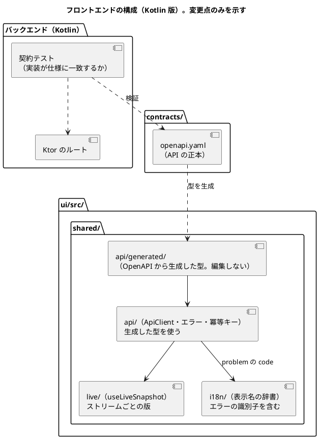
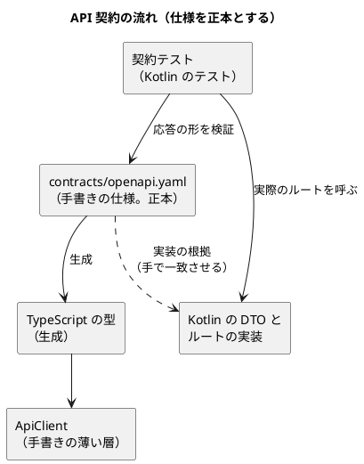
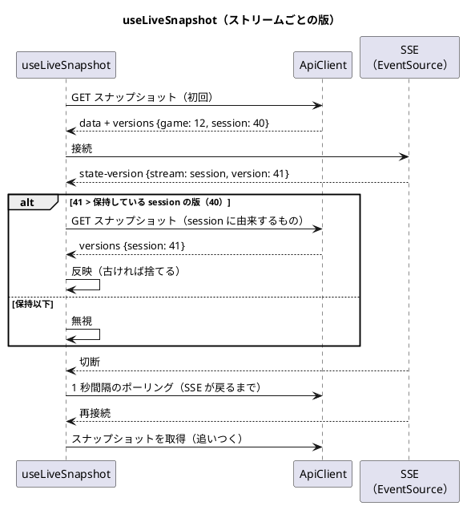

# フロントエンドアーキテクチャ - ビールゲームシミュレーション（Kotlin 版）

## 概要

本書は、beer-game-kotlin のフロントエンドのアーキテクチャを定義します。**`docs/` を設計の正本**とします。実装コードはまだ存在しません。

フロントエンドは、[beer-game2 のフロントエンドアーキテクチャ](../beer-game2/architecture-frontend.md) を**そのまま踏襲**します（React / TypeScript、Vite、URL ルーター、`features/` の構成、カスタムフック、表示名の辞書、アクセシビリティ）。画面と画面遷移は [UI 設計](./ui-design.md)、機能と振る舞いは beer-game2 の要件が正本です。

変わるのは、**バックエンドが Kotlin（Ktor、ES + CQRS）になったことで影響を受ける点だけ**です。本書は、その変更点を丁寧に扱い、変わらない点は beer-game2 の該当節を参照します。

- API の契約を、TypeScript の型の共有（beer-game2）から、**OpenAPI を介した型の生成**へ変えます。
- ES では、ゲームに**2 つのストリームの版**（`game`、`session`）があるため、版の扱いと通知を調整します。
- エラーの応答に**安定した識別子（`code`）**を持たせ、表示名の辞書と結びつけます。
- 保存後の画面の更新は、**応答の `versions` を受けてスナップショットを取得する経路だけ**にします。

バックエンドの API は [バックエンドアーキテクチャ](./architecture-backend.md) を参照してください。

## 決定の整理

beer-game2 の決定のうち、**変更する点を太字**で示します。

| 決定項目 | 採用 | beer-game2 との違い・根拠 |
| :--- | :--- | :--- |
| プロジェクト規模 | 小規模（機能単位の構造 `features/`） | 変更なし |
| レンダリング戦略 | SPA（React） | 変更なし |
| ビルド | Vite（静的ファイル。CloudFront から配信）。開発時は `/api` をプロキシ | 変更なし。プロキシの先が Ktor になる |
| ルーティング | URL ルーター（パスで画面を表す）。URL にはゲーム ID だけ | 変更なし |
| 状態管理 | コンポーネントの状態 + 画面ごとのカスタムフック。グローバルな状態ライブラリなし | 変更なし |
| **API の契約** | **OpenAPI（`contracts/openapi.yaml`）を正本とし、TypeScript の型を生成する** | beer-game2 は、バックエンドとフロントエンドが TypeScript の型を共有できた。Kotlin では共有できない（設計判断 FD1） |
| サーバー状態 | `ApiClient` + `useLiveSnapshot`（SSE の版の通知 + 再取得） | **版は、ストリームごと**に比較する（設計判断 FD2） |
| **エラーの扱い** | **`problem+json` の拡張メンバー `code`（`<領域>.<名前>`）から表示名を引く** | beer-game2 は、ステータスと文言から判断していた（設計判断 FD3） |
| **保存後の更新** | **コマンドの応答は `versions` だけ。画面は応答の後すぐスナップショットを取得し、`versions` に追いつくまで待って表示する** | 更新の経路を 1 つにする（設計判断 FD4） |
| スタイル | CSS（設計トークン） | 変更なし |
| アクセシビリティ | キーボード、フォーカス管理、200% 拡大、WCAG 2.2 AA。画面ごとの題名とフォーカス移動 | 変更なし |
| 表示名の管理 | 役割・状態・確定方式・**エラーの `code`**を、1 か所の辞書に持つ。正本は [UI 設計](./ui-design.md) の「code 列つきの表」 | エラーの `code` を加える |

## 全体構成

`features/` と `shared/` の構成は、[beer-game2](../beer-game2/architecture-frontend.md) と同じです。**追加または変更する要素**は次のとおりです。

画面ごとの機能（`game-setup/`、`participation/`、`observer/`、`play/`、`console/`、`review/`、`retention/`）、ルーティングの表、画面遷移は、beer-game2 から変更しません（[beer-game2 の全体構成](../beer-game2/architecture-frontend.md)）。

### 開発と配信

| 項目 | 設計 |
| :--- | :--- |
| 開発 | Vite の開発サーバーが、`/api` を Ktor へプロキシする（接続先は環境変数。ポートは固定の値を書かない）。バックエンドは Gradle で起動し、データベースは Docker の PostgreSQL（**B1 の実装は、ローカルなら H2 でもよい**。`APP_ENV=local DB_KIND=h2`）。**B1 の実装の場所は `apps/beer-game-kotlin/web/`**（設計の `ui/` でなく `web/`。Vite のポートは環境変数 `UI_PORT`・`API_PORT`）。**中継（Vite）を通すと、バックエンドが見る `Host` と `Origin` が一致せず、変更系の要求が 403 になる**（実ブラウザで初めて判明）。バックエンドの Origin 検査を弱めず、`ALLOWED_ORIGINS=http://localhost:<UI のポート>` を指定する（開発手順書への反映は未実施） |
| 型の生成 | `contracts/openapi.yaml` から、`ui/src/shared/api/generated/` へ生成する。**生成物はコミットしない**（ビルドの前に必ず生成する）。仕様が変わると、型エラーで影響する画面が分かる。**B2 の実装（2026-11-15）は、この設計と異なり、生成物 `web/src/api/generated/schema.d.ts` をコミットし、`api:check` で差分 0 を検査する**（変更表 18。人の確認が要る）。**B1 の実装は、生成ツールの選定・承認が B2 のため、`web/src/api/types.ts` に B1 の範囲を手書きした**（ファイルの先頭に明記。`ErrorCode` は openapi.yaml の enum の手写しで、辞書は `Record<ErrorCode, ...>` なので、`code` を足すと型エラーで漏れが分かる。仕様との同期は手動で、自動の検査は B2 の契約テストまで無い） |
| 配信 | 静的ファイルを、S3 へ版つきで配置し、CloudFront から配信する（[インフラストラクチャ](./architecture-infrastructure.md)）。**フロントエンドは、バックエンドのイメージに含めない**（beer-game2 と同じ） |
| E2E | Playwright。開発者が使う開発サーバーとは別の、専用のポートで起動する（開発中のサーバーを止めない）。**B1 の実装: Cucumber-JS + Playwright（Chromium）。Vite は 5273、バックエンドは 3100**（3000・5173 は使わない）。前提の準備は実 API、操作は実ブラウザ |

## API の契約

### 契約の置き場所と流れ

| 項目 | 設計 |
| :--- | :--- |
| 仕様 | `contracts/openapi.yaml` に、エンドポイント、リクエスト・レスポンスのスキーマ、**`problem+json` の `code` の一覧**（`type` は `/problems/{code}`）、ヘッダー（`Idempotency-Key`、`If-Match`、`x-correlation-id`）、SSE の通知の形を書く |
| 型の生成 | 仕様から TypeScript の**型だけ**を生成する（実行時のコードを持たない生成物を選ぶ）。**B2 で `openapi-typescript` 7.13.0 を導入した**（`api:generate`。生成物は `src/api/generated/schema.d.ts` にコミットし、`api:check` で「生成し直してコミット済みと差分 0」を検査する。`redocly lint`（`api:lint`）で仕様を検証する。peer の TypeScript は `overrides` で 6.0.3 に通した） |
| 実装との一致 | Kotlin 側に、**契約テスト**を置く。実際のルートを呼び、応答が仕様のスキーマに適合することを検査する。仕様の更新を忘れたルートの変更は、CI で失敗する。**B2 で、`app` の test に契約テスト 13 件を置いた**（networknt `json-schema-validator`。[テスト戦略](./test-strategy.md)）。SSE と、スキーマで表せない条件は検査できない |
| `ApiClient` | 生成した型を使う、手書きの薄い層（`fetch` の包み、`Idempotency-Key` の付与、`If-Match`（`SaveDecision` だけ）、`problem+json` の `code` の解釈、相関 ID の取り出し）。`ApiClient` は引き続き差し替え可能にして、コンポーネントをテストする |
| 変更の手順 | API を変えるときは、**仕様 -> 契約テスト（失敗）-> Kotlin の実装 -> 型の再生成 -> 画面**の順に進める |

### 版（ストリームごと）

ES では、1 ゲームに**2 つの独立した版**があります（`game` と `session`。[データモデル](./data-model.md)）。beer-game2 は、集約ごとの 1 つの版でした。

| 画面のデータ | 由来 | 応答に載せる版 |
| :--- | :--- | :--- |
| ロビー（参加者、役割、招待） | `game` ストリームの投影 | `versions.game` |
| 進行状態、役割別の状態、現在の意思決定 | `session` ストリームの投影 | `versions.session` |
| ゲームの概要（状態、確定方式） | 両方 | `versions.game`、`versions.session` |
| 観察、振り返り | `session` ストリームの投影 | `versions.session` |

- すべてのスナップショットの応答は、**`versions: { game?, session? }`** を持ちます。値は、その応答が反映した投影の版（`projection_checkpoints.projected_version`）です。
- `If-Match` は **`SaveDecision`（意思決定の版）にだけ**付けます。**`CommitWeek` は `If-Match` を使わず**、本文に `requestedWeek` と `basis`（確認ダイアログの時点で見ていた、役割ごとの意思決定の版）を持ちます（[バックエンドアーキテクチャ](./architecture-backend.md)）。画面は、スナップショットが運ぶ値を、そのまま送ります。**意思決定の版**（役割ごと）は、現在の意思決定の応答の項目として持ちます。
- コマンドの**応答**は `{ versions: { game, session } }`（追記後のストリームごとの版）だけで、画面の表示は応答から作りません。

## リアルタイム更新の方式

beer-game2 の方式（版の通知 + 再取得、再生なし、切断時のポーリング、利用者による停止と手動更新）を引き継ぎます。変更は次の 2 点です。

| 項目 | 変更 |
| :--- | :--- |
| 通知の形 | `state-version` の通知が、**ストリームの種別（`game` / `session`）と版**を運ぶ |
| 版の比較 | **ストリームごとに**、保持している版と比べる。通知の版が保持より大きければ、そのストリームに由来するスナップショットだけを再取得する。取得した版が保持より古ければ捨て、同じ版で内容が違えば反映する |
| 自分の変更の反映 | コマンドの応答の `versions` を受けたら、SSE を待たず**すぐスナップショットを取得**し、`versions` に追いつくまで（古ければ短く再取得して）待ってから表示する。SSE は他の人の変更の通知（と取得の補助）で、切れていても自分の保存は画面に出る |

**B1 の実装の範囲（2026-11-14）。** SSE と `useLiveSnapshot` は B1 では実装していません（B1 の範囲外）。コマンドの応答の `versions` に追いつくまで再取得する `catchUp`（`web/src/api/catchUp.ts`）と、手動更新のボタンだけです。古い応答を適用しない規則、「結果が不明」の表示（クライアントは同じ冪等キーで自動再送するが、「結果を確認しています…」と入力欄の読み取り専用は無い）、「あなたが保存した値（反映中）」の表示は未実装です（未決事項）。

**同期投影**（[データモデル](./data-model.md)）なので、通知を受けて取得したスナップショットの版は、通知の版以上であることが保証されます。また、問い合わせは読み取り専用の REPEATABLE READ のトランザクションで `projection_checkpoints` を行と同じ時点で読むため、**応答の `versions` が、同じ応答の行より新しくなることはありません**（[バックエンドアーキテクチャ](./architecture-backend.md)）。**投影の遅れによる再取得の繰り返しは、画面で扱う必要がありません。** ただし、念のため、版が通知に追いつかない場合は、短い間隔で限られた回数だけ再取得し、それでも追いつかなければ、ポーリングに切り替えます（防御的な処理。実測で不要と分かれば削る）。

## 共同入力の扱い

beer-game2 と同じ振る舞い（現在の入力値、版、最後に保存した人の表示。拒否時は最新値と最後の保存者を示し、入力を保持して再入力を促す）を引き継ぎます。バックエンドの対応が変わる点だけを示します。

| 項目 | 変更 |
| :--- | :--- |
| 競合の応答 | `409` の `problem+json`（`code` = `session.decision_conflict`）に、**最新値、意思決定の版、最後に保存した人の表示名**を含める（`DecisionConflict(role, latest)`） |
| 版 | 保存は、画面が見ている**意思決定の版**を `If-Match` で送る（`If-Match` はこの操作だけ）。他の人が先に保存すると、版が進み、拒否される |
| 確定の前提 | 手動の確定（`CommitWeek`）は、本文の `requestedWeek` と `basis` で送る。週が進んでいれば `session.week_advanced`（「第 N 週はすでに確定されています。」）。週が同じで入力が変わっていれば `session.decisions_changed`（「確定の前に入力が変わりました。最新の値を確認してください。」）で、**更新した値で確認ダイアログを開き直す** |
| サーバー側の再試行 | 同時の保存による追記の競合は、サーバーが自動で再試行するため、**利用者には見えない**。画面に見えるのは、意思決定の版の競合だけ |
| 自動確定 | 最後の意思決定の保存が、確定も同時に起こすことがある（確定方式が自動のとき）。**保存の応答に、確定の結果を含めない**。画面は応答の `versions` を受けてスナップショットを取得し、週の進行をスナップショットから見る（更新の経路を 1 つにする） |
| 週が変わったとき | 週が変わったら（`409` の後でも、SSE の通知でも）、入力欄を**空**にし、直前の値は「第 N 週に入力していた値: 10（未保存）」と**参考表示**する。他の人の保存（同じ週）では、入力中の値を保持する（[UI 設計](./ui-design.md)） |

## エラーの識別子と表示名

バックエンドは、エラーごとに**安定した識別子 `code`** を返します。書式は小文字のドット区切り `<領域>.<名前>`（例: `session.decision_conflict`、`session.week_advanced`、`session.decisions_changed`、`game.invitation_invalid`、`app.retry_exhausted`、`app.idempotency_key_reused`、`app.unauthorized`）です。`problem+json` の `type` は `/problems/{code}`（相対 URI）で、拡張メンバー `code` が同じ値を持ちます。**辞書の鍵は `code`** です。

| 項目 | 設計 |
| :--- | :--- |
| 辞書 | `shared/i18n` の辞書に、**`code` -> 表示名・案内**を持つ。正本は [UI 設計](./ui-design.md) の「code 列つきの表」。生成した型の `code` の列挙を鍵にした**網羅的な表**（`Record<ProblemCode, ...>`）にして、`code` が増えると、型エラーで辞書の漏れが分かる |
| 未知の `code` | 辞書に無い `code` や、`code` の無い応答（ネットワークの失敗など）は、汎用の文言と相関 ID を表示する |
| 招待・資格の無効 | 失効・期限切れ・不明は**区別せず**同じ `code`（`game.invitation_invalid` など）が返る（列挙の防止）。`invitation-expired` のように区別する識別子は使わない。参加・復帰の失敗の文言は、**画面が「自分が送った資格の種類」（参加コード／観察用の招待／復帰用の資格）から選ぶ**。原因（失効か、期限切れか、不明か）を推測する文言は出さない |
| アプリ層の失敗（`app.*`） | `type` が `/problems/app.retry_exhausted` のとき**だけ**「もう一度お試しください」を出す（`Retry-After` に従い、利用者が操作し直したら**新しい**冪等キー）。`app.idempotency_key_reused`（409）と `app.unauthorized`（403）は辞書の表示名で扱う。**`type` を持たない 5xx**（負荷分散装置の 503 など）、タイムアウト、切断は「結果が不明」として、**同じ冪等キーで自動で再送**する（確認中は入力欄を読み取り専用にする）。新しいキーで再送すると、ゲーム作成などが二重になるため。バックエンド自身が返す 503 は必ず `type` を持つ。画面の文言は [UI 設計](./ui-design.md) |
| 相関 ID | 引き続き、エラー表示に出す（問い合わせで、サーバーのログと突き合わせる） |
| 入力の誤り（`422`） | 項目ごとの誤り（誤りの配列）を、対応する入力欄の近くに示す。バックエンドが誤りを**すべて集めて**返す（AC1.1.2、AC1.1.4）ので、画面は、1 回の送信で全項目の誤りを出せる |
| 資格の無効 | 無効な資格と権限の不足は、同じ形で返る（列挙の防止）。画面は、権限が無ければ、参加・復帰の画面へ誘導する（beer-game2 と同じ） |

## 状態の持ち方

beer-game2 から変更しません（画面の位置は URL、サーバー状態は画面ごとのカスタムフック、入力は `useState`、認証は `HttpOnly` の Cookie、表示名は辞書）。ストリームごとの版は、`useLiveSnapshot` の内部の状態として持ちます。

## 品質属性への対応

| 品質属性 | 対応する設計 |
| :--- | :--- |
| アクセシビリティ | beer-game2 と同じ |
| 堅牢性 | ストリームごとの版比較、SSE 切断時のポーリング、競合時は入力を保持して更新を促す。**契約の型により、API の変更が型エラーとして現れる** |
| セキュリティ | beer-game2 と同じ（資格は JavaScript から読めない Cookie。CSP を前提に、インラインのスクリプトを使わない） |
| 観測性 | エラー表示に相関 ID を出す |
| テスト容易性 | `ApiClient` を差し替えてコンポーネントをテストする。API の形は、**契約テスト**（バックエンド側）で保証する |

## テスト戦略との対応

画面は Testing Library、`ApiClient` とライブ更新は単体テスト、利用の流れは Playwright で確認します（[テスト戦略](./test-strategy.md)）。加えて、次を確認します。

- 契約テスト（Kotlin 側）が、仕様と実装の一致を保証する。
- 生成した型でフロントエンドをビルドし、仕様の変更による型エラーを検出する（CI の順序: 仕様の検証 -> 型の生成 -> 型の検査 -> テスト）。
- `useLiveSnapshot` は、ストリームごとの版（通知が先に来る、古い版を捨てる、同じ版で内容が違う、接続の切断と再接続）を単体テストで確認する。

## beer-game2 からの変更

| # | beer-game2 | beer-game-kotlin | 理由 |
| :--- | :--- | :--- | :--- |
| 1 | バックエンドとフロントエンドが TypeScript の型を共有する（想定） | OpenAPI を正本とし、型を生成する。契約テストで一致を保証する | バックエンドが Kotlin になり、型を共有できない |
| 2 | スナップショットの版は 1 つ | `versions: { game, session }`。通知も、ストリームの種別つき | ES のストリームが 2 本 |
| 3 | `If-Match` に「版」 | `If-Match` は `SaveDecision`（意思決定の版）だけ。`CommitWeek` は本文の `requestedWeek` と `basis` | 共同担当の保存で、確定が誤って「確定済み」にならないように |
| 4 | エラーはステータスと文言で判断 | `problem+json` の `code`（`<領域>.<名前>`）で、辞書から表示名を引く | ドメインのエラーを型で表した（Kotlin 版のドメイン） |
| 5 | 入力の誤りの返し方は、最初の誤りの想定 | 誤りの配列（全項目）を、入力欄に示す | 誤りを集める検証（[ガイド §3.4](../../reference/関数型プログラミングガイド_Kotlin編.md)） |
| 6 | 保存の応答で画面を更新できる | 応答は `versions` だけ。画面は応答のあと、すぐスナップショットを取得して表示する（SSE を待たない） | 自動確定が、保存と同時に確定を起こす。SSE が切れても自分の保存が出る |
| 7 | 競合は、版の不一致の 1 種類 | 意思決定の版の競合だけが画面に見える。追記の競合は、サーバーが再試行する | ロックなしの並行制御 |
| 8 | 週が進んだときの入力欄の扱いは明記なし | 週が変わったら入力欄を空にし、直前の値は参考表示する | 打ちかけの値が次の週に残って誤って保存されるのを防ぐ |
| 9 | 進行の開始は `POST /sessions/:id/start` | `POST /games/:id/start`。`ApiClient` の開始の関数、契約の型、`console/` の開始の操作の呼び出し先が変わる（画面の URL と遷移は変わらない） | 開始が `game` と `session` の 2 ストリームにまたがる（[バックエンドアーキテクチャ](./architecture-backend.md)） |
| 10 | アプリ層の失敗の区別は明記なし | `type` が `app.retry_exhausted` のときだけ「もう一度」。`type` のない 5xx・タイムアウト・切断は「結果が不明」として同じキーで自動再送 | 負荷分散装置の 503 と区別でき、二重の作成を防ぐ（M7） |
| 11 | 参加・復帰の失敗の文言の選び方は明記なし | 自分が送った資格の種類から選ぶ。失効・期限切れ・不明は区別しない | 列挙の防止（M11） |

上記以外（URL ルーター、`features/`、表示名の辞書、アクセシビリティ、SSE の方式）は、beer-game2 のままです。

**B1 の実装で、設計から変わった点（2026-11-14）。**

| # | 設計書の初稿 | B1 の実装 | 理由 |
| :--- | :--- | :--- | :--- |
| 12 | 型は OpenAPI から生成（`ui/src/shared/api/generated/`） | `web/src/api/types.ts` に手書き。生成は B2 | 生成ツールの選定・承認が B2 |
| 13 | フロントエンドの場所は `ui/` | `web/`。`features/` は `welcome`・`setup`・`participation`・`lobby`・`play`・`console`（S01〜S06）。共通は `api/`（`client.ts`・`errors.ts`・`problems.ts`＝`code` の辞書・`catchUp.ts`・`ApiContext.tsx`）、`components/` | B1 は最小の画面に絞った |
| 14 | `useLiveSnapshot`（SSE の版の通知 + 再取得） | `catchUp` と手動更新。SSE は未実装 | B1 の範囲外 |
| 15 | 開発時の中継は `/api` を Ktor へ | 中継を通すと Origin が一致せず変更系が 403。`ALLOWED_ORIGINS` を指定する | 実ブラウザで初めて判明（Step 10） |
| 16 | 参加者向けロビー（S04）が参加後に見える | B1 の API はロビーが進行役だけで、参加の応答が `gameId` を返さない。参加者は参加後に進めない（未決事項） | API の欠け |
| 17 | `.catch(() => {})` などの握りつぶしの検出（lint の方針は未決） | B1 は、テストがエラーを握りつぶさない運用。lint の規則は入れていない。**B2 でも入れていない（未実施。B3 以降で決める）**。ESLint は `steps/`・`support/`（.mjs）の対象外 | 実バグを隠した beer-game2 の B1 の学び #2 |
| 18（B2 の実装。2026-11-15） | 型は OpenAPI から生成し、**生成物はコミットしない**。B1 は `web/src/api/types.ts` に手書き | **`openapi-typescript` 7.13.0 で生成し、生成物 `src/api/generated/schema.d.ts` をコミットする**（`api:check` が差分 0 を検査。ビルドの前の生成ではなく、コミット済みの生成物と一致させる運用）。`types.ts` は生成物からの写しに置き換え、手書きは画面だけの型（`CreateGameResult`、`ProblemBody`、整数以外も受ける `CreateGameRequest`）と実行時の値（`ROLES`）に絞った。`CreateGameRequest` が仕様より狭くならないこと、`ROLES` が `Role` を網羅することは、型の検査で守る。仕様の `GameState.sessionId` の `required` 化（`string \| null`）で、画面の型が正しくなった | B2 の Step 5。「コミットしない」とした設計と異なる（人の確認が要る） |
| 20（B6 Step 7 の実装。2026-11-16） | 競合（`session.decision_conflict`）は、一般の失敗の通知（`ErrorNotice`）で示す。状況の応答に保存者・共同担当は無い | `PlayPage` に競合の状態（最新の入力と、入力した値の保持）と、保存の共通化（`submit`）を足し、競合は `ConflictNotice` で示す。`latestOf`（競合の本文の `latest` を、形を確かめて取り出す。応答は信頼できない入力）、`formatClock`（保存の時刻を、ブラウザの時刻帯で「時:分」）、`editorName`。仕様と生成した型は変えない（`decisionEditor`・`coHolders`・`DecisionEntry` は Step 1 から型にある） | B6 Step 7。`PlayPage.test.tsx`・`@ui` |
| 19（B5 Step 7 の実装。2026-11-15） | `ApiClient` は B1 の操作だけ。参加の応答は `versions` だけ（変更表 16 の「参加者は参加後に進めない」） | `ApiClient` に `pauseSession`・`resumeSession`・`recoverParticipation` を足し、`createGame` の結果に `recoveryCode`、`joinGame` の結果に `gameId` を持たせた（型は生成物の `CreateGameResponse`・`JoinResponse`・`RecoverResponse`）。S03 は、参加後に `gameId` でプレイの画面へ進み、復帰（ゲーム ID と任意の復帰コード。復帰のあとに `getGameState` で行き先を決める）を持つ。`ErrorNotice` の権限の導線は「参加・復帰の画面へ」で、URL のゲームの ID を `?gameId=` に持たせる。`problems.ts` の `describeProblem` は、資格を送った操作（`context.credential`）の 403 を、`app.unauthorized`（復帰）でも `game.invitation_invalid`（参加）でも、送った資格の種類から選ぶ。`Record<ErrorCode, ...>` の辞書の B5 の `code`（`session.paused` ほか 8 件）に文言を加えた。**`features/` の新しいディレクトリ・コンポーネントは作らず**、S03 は `participation/JoinPage.tsx` に収めた。構造のアクセシビリティの自前の検査 `src/testing/a11y.ts`（コンポーネントのテスト用。axe の代わりではない） | B5 の判断項目 7・13。範囲外: 代理入力・資格の失効と再発行・終了の画面（B6 以降）、自動更新（SSE） |

## 設計判断

### FD1: API の契約の持ち方

| 案 | 内容 | 評価 |
| :--- | :--- | :--- |
| **A（採用）** | OpenAPI の仕様を手書きの正本とし、TypeScript の型を生成する。Kotlin 側は契約テストで一致を保証する | 仕様が正本で、変更の影響が型エラーで現れる。仕様の記述と、実装との一致の維持に手間がかかる（契約テストで補う） |
| B | Kotlin のルートから仕様を生成する（コードが正本） | 仕様の記述が不要。Ktor の対応の状況と、`problem+json` の識別子や SSE の記述の表現力を、実装開始時に確認する必要がある。仕様がコードの副産物になり、レビューしにくい |
| C | 型を手で二重に書く（契約テストなし） | 追加の道具が要らない。型のずれが、実行時まで分からない |

トレードオフ: A は、仕様を書く手間があります。beer-game2 では型の共有で自動的に守られていた一致を、契約テストで機械的に守ります。B は、`problem+json` の `code` の列挙や SSE の記述の表現力に不安があり、仕様がコードの副産物になってレビューしにくいため採らないと決めました（解決済み）。

### FD2: 版の比較をストリームごとにする

| 案 | 内容 | 評価 |
| :--- | :--- | :--- |
| **A（採用）** | ストリームごとの版を持ち、比較する | 通知の意味とデータの由来が一致する。`game` の操作（資格の失効など）が `session` の画面を無駄に再取得させない |
| B | 2 つの版を合成した 1 つの値にする | 画面の実装が単純。由来が分からず、不要な再取得が増える |

### FD3: エラーの識別

| 案 | 内容 | 評価 |
| :--- | :--- | :--- |
| **A（採用）** | `problem+json` の拡張メンバー `code`（`<領域>.<名前>`）を辞書の鍵にする（`type` は `/problems/{code}`） | 文言の変更や多言語化の影響が辞書に閉じる。仕様に `code` の一覧を載せ、型で網羅を確認できる |
| B | HTTP のステータスと `detail` の文言で判断 | 実装が単純。文言の変更が画面の判断を壊す |

### FD4: 保存後の画面の更新経路

| 案 | 内容 | 評価 |
| :--- | :--- | :--- |
| **A（採用）** | 応答は `versions` だけ。画面は応答のあとスナップショットを取得し、`versions` に追いつくまで待って表示する | 更新の経路が 1 つ。SSE が切れていても自分の保存が出る。自動確定でも同じ。取得が 1 回増える |
| B | 応答に結果（確定を含む）を載せて画面を更新し、SSE で追いつく | 取得が減る。応答と SSE の 2 経路で、順序の入れ替わりを扱う必要がある |

## 未決事項

**決定済み**: OpenAPI は `contracts/openapi.yaml` の**手書きを正本**とする（FD1 の A。Ktor からの生成案 B は採らない）。進行の開始は `POST /games/:id/start`（変更表 9）。`code` の列挙は仕様が持ち、辞書の正本は [UI 設計](./ui-design.md)。

**選定が未決**（外部ライブラリの導入は、決まった後に承認を得る）:

- OpenAPI から TypeScript の型を生成するツールの選定と、生成する型の形（実装開始時に確認して決める）。
- 契約テストの方法（仕様の適合の検査に使うライブラリ、または自前の検査）。

**その他の未決**:

- 表示名の辞書の形式（多言語化の要否を含む。beer-game2 から継続）。
- 設計トークン（色、間隔）の管理方法と、コントラスト比の自動検査の方法（beer-game2 から継続）。
- ルーターのライブラリの選定（[技術スタック](./tech-stack.md) で決める。beer-game2 から継続）。
- 防御的な再取得（通知の版に追いつかない場合）を、実装に含めるか。同期投影の保証の実測の後に判断する。

**B1 の実装で出た未決（2026-11-14。人の判断が要る）:**

- **【解消。B5 Step 6・7】参加者が、参加の後に進めない（API の欠け）。** B5 で参加の応答に `gameId` を足し、Step 7 で、参加後にプレイの画面へ自動で進むようにした（以下は B1 当時の記述）。 参加の応答は `versions` だけで、`gameId` も `Location` も返さないため、参加者は `gameId` を知る手段が無く、S03 は「参加しました。進行役が開始するまでお待ちください。」で止まる。S05 は `/games/:id/play` を直接開けば動く（コンポーネントのテストで確認）が、実ブラウザの E2E では確かめていない（`@ui` は進行役の 1 本）。対応案は、参加の応答に `gameId`（`Location`）を足すこと（バックエンド・仕様の変更）。S04 の参加者向けの表示は、ロビーの取得が進行役専用のため作れていない。
- Gherkin の「「週を確定」を押す」は、確認ダイアログを書いていない（UI 設計は確認ダイアログを必須とするため、窓口が「第 N 週を確定」まで押す）。シナリオに 1 ステップ足すか。
- SSE と自動更新、古い応答を適用しない規則、「結果が不明」の表示、反映中の表示、参加コードのコピー、S01 のヘルプへの導線、オフライン。Dialog の Tab の循環・Escape・フォーカスの復帰は実装したが、**試験していない**。
- アクセシビリティ: ラベル、`aria-invalid`・`aria-describedby`、`aria-live`・`role="status"`・`role="alert"`、見出しへのフォーカス、`document.title`、スキップリンクは実装し一部試験した。**axe の自動検査、コントラスト比、200% 拡大、スクリーンリーダーは未実施**（B5 Step 7 で、S03・S05 の停止中・S06 の停止・再開のダイアログについて、自前の DOM 構造の検査 `src/testing/a11y.ts` を足したが、axe は未導入）。
- 進行役のコンソールは、各役割の入力値を出すが、担当者の名前と保存者は出さない（状態の API に項目が無い）。4 分割・週ごとの履歴・終了・代理入力・資格の失効と再発行は B6 以降（**停止・再開は B5 Step 7 で実装**）。
- 仮置きの文言・値（`game.not_preparing`「参加の受付は終了しています。」、付け替えの確認のボタン「移す」「戻って確認」、「確定した週の結果」の 1 行の形式、一般の文言、未知の `code` の扱い）。作成画面の初期値（最終週 12、需要系列 4 を 12 週）は画面イメージの例で、キットの既定は ASM-01 のとおり未確定。費用は最小単位の整数のまま表示している（単位は未決）。`npm install` が「中程度の脆弱性 8 件」と表示した（未調査）。Node は 24.11.0 で実行した（設計の Node 26 は未導入。`.nvmrc` は未作成）。

## 出典

- [バックエンドアーキテクチャ（Kotlin 版）](./architecture-backend.md)、[ドメインモデル（Kotlin 版）](./domain-model.md)、[データモデル（Kotlin 版）](./data-model.md)、[UI 設計](./ui-design.md)
- [beer-game2 のフロントエンドアーキテクチャ](../beer-game2/architecture-frontend.md)
- [アーキテクチャ設計ガイド](../../reference/アーキテクチャ設計ガイド.md)
- [ガイド 関数型プログラミングガイド（Kotlin 編）](../../reference/関数型プログラミングガイド_Kotlin編.md) §3.4（誤りを集める）
- [ADR-006](../../adr/beer-game2/006-sse-version-only.md)、[ADR-010](../../adr/beer-game2/010-url-router-and-features.md)
