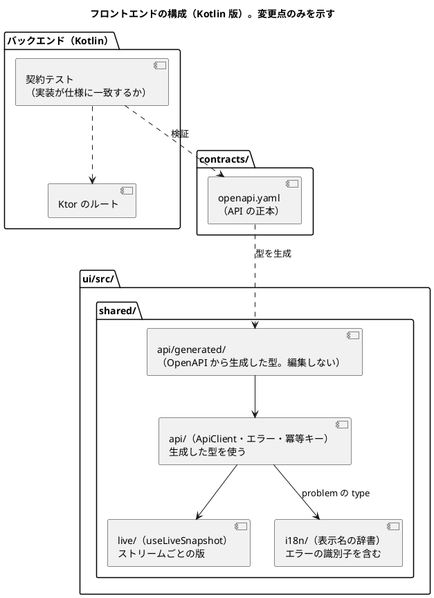
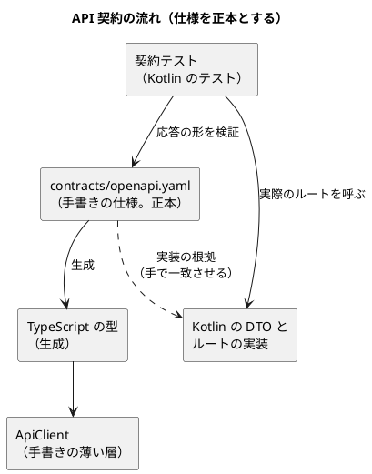
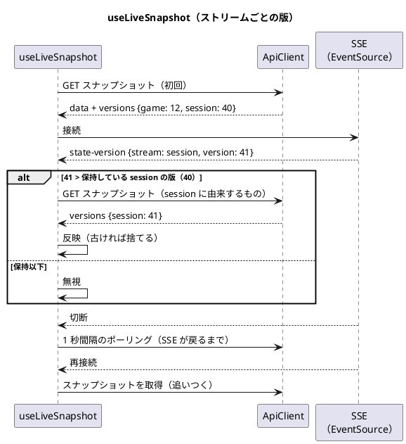

# フロントエンドアーキテクチャ - ビールゲームシミュレーション（Kotlin 版）

## 概要

本書は、beer-game-kotlin のフロントエンドのアーキテクチャを定義します。**`docs/` を設計の正本**とします。実装コードはまだ存在しません。

フロントエンドは、[beer-game2 のフロントエンドアーキテクチャ](../beer-game2/architecture-frontend.md) を**そのまま踏襲**します（React / TypeScript、Vite、URL ルーター、`features/` の構成、カスタムフック、表示名の辞書、アクセシビリティ）。画面と画面遷移は [UI 設計](./ui-design.md)、機能と振る舞いは beer-game2 の要件が正本です。

変わるのは、**バックエンドが Kotlin（Ktor、ES + CQRS）になったことで影響を受ける点だけ**です。本書は、その変更点を丁寧に扱い、変わらない点は beer-game2 の該当節を参照します。

- API の契約を、TypeScript の型の共有（beer-game2）から、**OpenAPI を介した型の生成**へ変えます。
- ES では、ゲームに**2 つのストリームの版**（`game`、`session`）があるため、版の扱いと通知を調整します。
- エラーの応答に**安定した識別子**を持たせ、表示名の辞書と結びつけます。

バックエンドの API は [バックエンドアーキテクチャ](./architecture-backend.md) を参照してください。

## 決定の整理

beer-game2 の決定のうち、**変更する点を太字**で示します。

| 決定項目 | 採用 | beer-game2 との違い・根拠 |
| :--- | :--- | :--- |
| プロジェクト規模 | 小規模（機能単位の構造 `features/`） | 変更なし |
| レンダリング戦略 | SPA（React） | 変更なし |
| ビルド | Vite（静的ファイル。CloudFront から配信）。開発時は `/api` をプロキシ | 変更なし。プロキシの先が Ktor になる |
| ルーティング | URL ルーター（パスで画面を表す）。URL にはゲーム ID だけ | 変更なし |
| 状態管理 | コンポーネントの状態 + 画面ごとのカスタムフック。グローバルな状態ライブラリなし | 変更なし |
| **API の契約** | **OpenAPI（`contracts/openapi.yaml`）を正本とし、TypeScript の型を生成する** | beer-game2 は、バックエンドとフロントエンドが TypeScript の型を共有できた。Kotlin では共有できない（設計判断 FD1） |
| サーバー状態 | `ApiClient` + `useLiveSnapshot`（SSE の版の通知 + 再取得） | **版は、ストリームごと**に比較する（設計判断 FD2） |
| **エラーの扱い** | **`problem+json` の `type`（安定した識別子）から表示名を引く** | beer-game2 は、ステータスと文言から判断していた（設計判断 FD3） |
| スタイル | CSS（設計トークン） | 変更なし |
| アクセシビリティ | キーボード、フォーカス管理、200% 拡大、WCAG 2.2 AA。画面ごとの題名とフォーカス移動 | 変更なし |
| 表示名の管理 | 役割・状態・確定方式・**エラーの識別子**を、1 か所の辞書に持つ | エラーの識別子を加える |

## 全体構成

`features/` と `shared/` の構成は、[beer-game2](../beer-game2/architecture-frontend.md) と同じです。**追加または変更する要素**は次のとおりです。

画面ごとの機能（`game-setup/`、`participation/`、`observer/`、`play/`、`console/`、`review/`、`retention/`）、ルーティングの表、画面遷移は、beer-game2 から変更しません（[beer-game2 の全体構成](../beer-game2/architecture-frontend.md)）。

### 開発と配信

| 項目 | 設計 |
| :--- | :--- |
| 開発 | Vite の開発サーバーが、`/api` を Ktor へプロキシする（接続先は環境変数。ポートは固定の値を書かない）。バックエンドは Gradle で起動し、データベースは Docker の PostgreSQL |
| 型の生成 | `contracts/openapi.yaml` から、`ui/src/shared/api/generated/` へ生成する。**生成物はコミットしない**（ビルドの前に必ず生成する）。仕様が変わると、型エラーで影響する画面が分かる |
| 配信 | 静的ファイルを、S3 へ版つきで配置し、CloudFront から配信する（[インフラストラクチャ](./architecture-infrastructure.md)）。**フロントエンドは、バックエンドのイメージに含めない**（beer-game2 と同じ） |
| E2E | Playwright。開発者が使う開発サーバーとは別の、専用のポートで起動する（開発中のサーバーを止めない） |

## API の契約

### 契約の置き場所と流れ

| 項目 | 設計 |
| :--- | :--- |
| 仕様 | `contracts/openapi.yaml` に、エンドポイント、リクエスト・レスポンスのスキーマ、**`problem+json` の `type` の一覧**、ヘッダー（`Idempotency-Key`、`If-Match`、`x-correlation-id`）、SSE の通知の形を書く |
| 型の生成 | 仕様から TypeScript の**型だけ**を生成する（実行時のコードを持たない生成物を選ぶ）。生成ツールは実装開始時に確認して決める |
| 実装との一致 | Kotlin 側に、**契約テスト**を置く。実際のルートを呼び、応答が仕様のスキーマに適合することを検査する。仕様の更新を忘れたルートの変更は、CI で失敗する。検証の方法は未決事項 |
| `ApiClient` | 生成した型を使う、手書きの薄い層（`fetch` の包み、`Idempotency-Key` の付与、`If-Match`、`problem+json` の解釈、相関 ID の取り出し）。`ApiClient` は引き続き差し替え可能にして、コンポーネントをテストする |
| 変更の手順 | API を変えるときは、**仕様 -> 契約テスト（失敗）-> Kotlin の実装 -> 型の再生成 -> 画面**の順に進める |

### 版（ストリームごと）

ES では、1 ゲームに**2 つの独立した版**があります（`game` と `session`。[データモデル](./data-model.md)）。beer-game2 は、集約ごとの 1 つの版でした。

| 画面のデータ | 由来 | 応答に載せる版 |
| :--- | :--- | :--- |
| ロビー（参加者、役割、招待） | `game` ストリームの投影 | `versions.game` |
| 進行状態、役割別の状態、現在の意思決定 | `session` ストリームの投影 | `versions.session` |
| ゲームの概要（状態、確定方式） | 両方 | `versions.game`、`versions.session` |
| 観察、振り返り | `session` ストリームの投影 | `versions.session` |

- すべてのスナップショットの応答は、**`versions: { game?, session? }`** を持ちます。値は、その応答が反映した投影の版（`projection_checkpoints.projected_version`）です。
- 変更系の `If-Match` は、操作ごとに異なります（意思決定の版、または `session` ストリームの版。[バックエンドアーキテクチャ](./architecture-backend.md)）。画面は、スナップショットが運ぶ値を、そのまま送ります。**意思決定の版**（役割ごと）は、現在の意思決定の応答の項目として持ちます。

## リアルタイム更新の方式

beer-game2 の方式（版の通知 + 再取得、再生なし、切断時のポーリング、利用者による停止と手動更新）を引き継ぎます。変更は次の 2 点です。

| 項目 | 変更 |
| :--- | :--- |
| 通知の形 | `state-version` の通知が、**ストリームの種別（`game` / `session`）と版**を運ぶ |
| 版の比較 | **ストリームごとに**、保持している版と比べる。通知の版が保持より大きければ、そのストリームに由来するスナップショットだけを再取得する。取得した版が保持より古ければ捨て、同じ版で内容が違えば反映する |

**同期投影**（[データモデル](./data-model.md)）なので、通知を受けて取得したスナップショットの版は、通知の版以上であることが保証されます。**投影の遅れによる再取得の繰り返しは、画面で扱う必要がありません。** ただし、念のため、版が通知に追いつかない場合は、短い間隔で限られた回数だけ再取得し、それでも追いつかなければ、ポーリングに切り替えます（防御的な処理。実測で不要と分かれば削る）。

## 共同入力の扱い

beer-game2 と同じ振る舞い（現在の入力値、版、最後に保存した人の表示。拒否時は最新値と最後の保存者を示し、入力を保持して再入力を促す）を引き継ぎます。バックエンドの対応が変わる点だけを示します。

| 項目 | 変更 |
| :--- | :--- |
| 競合の応答 | `409` の `problem+json`（`type` = `decision-conflict`）に、**最新値、意思決定の版、最後に保存した人の表示名**を含める（`DecisionConflict(role, latest)`） |
| 版 | 保存は、画面が見ている**意思決定の版**を `If-Match` で送る。他の人が先に保存すると、版が進み、拒否される |
| サーバー側の再試行 | 同時の保存による追記の競合は、サーバーが自動で再試行するため、**利用者には見えない**。画面に見えるのは、意思決定の版の競合だけ |
| 自動確定 | 最後の意思決定の保存が、確定も同時に起こすことがある（確定方式が自動のとき）。保存の応答の後、通知で週が進むので、画面は通知で最新に更新する。**保存の応答に、確定の結果を含めて画面を更新しない**（更新の経路を 1 つにする） |

## エラーの識別子と表示名

バックエンドは、ドメインのエラーごとに**安定した識別子**を `problem+json` の `type` に載せます（例: `decision-conflict`、`incomplete-decisions`、`start-condition-not-met`、`invitation-expired`）。

| 項目 | 設計 |
| :--- | :--- |
| 辞書 | `shared/i18n` の辞書に、**識別子 -> 表示名・案内**を持つ。生成した型の識別子の列挙を鍵にした**網羅的な表**（`Record<ProblemType, ...>`）にして、識別子が増えると、型エラーで辞書の漏れが分かる |
| 未知の識別子 | 辞書に無い識別子や、`type` の無い応答（ネットワークの失敗など）は、汎用の文言と相関 ID を表示する |
| 相関 ID | 引き続き、エラー表示に出す（問い合わせで、サーバーのログと突き合わせる） |
| 入力の誤り（`422`） | 項目ごとの誤り（誤りの配列）を、対応する入力欄の近くに示す。バックエンドが誤りを**すべて集めて**返す（AC1.1.2、AC1.1.4）ので、画面は、1 回の送信で全項目の誤りを出せる |
| 資格の無効 | 無効な資格と権限の不足は、同じ形で返る（列挙の防止）。画面は、権限が無ければ、参加・復帰の画面へ誘導する（beer-game2 と同じ） |

## 状態の持ち方

beer-game2 から変更しません（画面の位置は URL、サーバー状態は画面ごとのカスタムフック、入力は `useState`、認証は `HttpOnly` の Cookie、表示名は辞書）。ストリームごとの版は、`useLiveSnapshot` の内部の状態として持ちます。

## 品質属性への対応

| 品質属性 | 対応する設計 |
| :--- | :--- |
| アクセシビリティ | beer-game2 と同じ |
| 堅牢性 | ストリームごとの版比較、SSE 切断時のポーリング、競合時は入力を保持して更新を促す。**契約の型により、API の変更が型エラーとして現れる** |
| セキュリティ | beer-game2 と同じ（資格は JavaScript から読めない Cookie。CSP を前提に、インラインのスクリプトを使わない） |
| 観測性 | エラー表示に相関 ID を出す |
| テスト容易性 | `ApiClient` を差し替えてコンポーネントをテストする。API の形は、**契約テスト**（バックエンド側）で保証する |

## テスト戦略との対応

画面は Testing Library、`ApiClient` とライブ更新は単体テスト、利用の流れは Playwright で確認します（[テスト戦略](./test-strategy.md)）。加えて、次を確認します。

- 契約テスト（Kotlin 側）が、仕様と実装の一致を保証する。
- 生成した型でフロントエンドをビルドし、仕様の変更による型エラーを検出する（CI の順序: 仕様の検証 -> 型の生成 -> 型の検査 -> テスト）。
- `useLiveSnapshot` は、ストリームごとの版（通知が先に来る、古い版を捨てる、同じ版で内容が違う、接続の切断と再接続）を単体テストで確認する。

## beer-game2 からの変更

| # | beer-game2 | beer-game-kotlin | 理由 |
| :--- | :--- | :--- | :--- |
| 1 | バックエンドとフロントエンドが TypeScript の型を共有する（想定） | OpenAPI を正本とし、型を生成する。契約テストで一致を保証する | バックエンドが Kotlin になり、型を共有できない |
| 2 | スナップショットの版は 1 つ | `versions: { game, session }`。通知も、ストリームの種別つき | ES のストリームが 2 本 |
| 3 | `If-Match` に「版」 | 意思決定の版、または `session` ストリームの版（操作ごと） | ES の版が 2 種類 |
| 4 | エラーはステータスと文言で判断 | `problem+json` の `type`（安定した識別子）で、辞書から表示名を引く | ドメインのエラーを型で表した（Kotlin 版のドメイン） |
| 5 | 入力の誤りの返し方は、最初の誤りの想定 | 誤りの配列（全項目）を、入力欄に示す | 誤りを集める検証（[ガイド §3.4](../../reference/関数型プログラミングガイド_Kotlin編.md)） |
| 6 | 保存の応答で画面を更新できる | 保存の応答では更新せず、通知で更新する（更新の経路を 1 つに） | 自動確定が、保存と同時に確定を起こす |
| 7 | 競合は、版の不一致の 1 種類 | 意思決定の版の競合だけが画面に見える。追記の競合は、サーバーが再試行する | ロックなしの並行制御 |

上記以外（URL ルーター、`features/`、表示名の辞書、アクセシビリティ、SSE の方式）は、beer-game2 のままです。

## 設計判断

### FD1: API の契約の持ち方

| 案 | 内容 | 評価 |
| :--- | :--- | :--- |
| **A（採用）** | OpenAPI の仕様を手書きの正本とし、TypeScript の型を生成する。Kotlin 側は契約テストで一致を保証する | 仕様が正本で、変更の影響が型エラーで現れる。仕様の記述と、実装との一致の維持に手間がかかる（契約テストで補う） |
| B | Kotlin のルートから仕様を生成する（コードが正本） | 仕様の記述が不要。Ktor の対応の状況と、`problem+json` の識別子や SSE の記述の表現力を、実装開始時に確認する必要がある。仕様がコードの副産物になり、レビューしにくい |
| C | 型を手で二重に書く（契約テストなし） | 追加の道具が要らない。型のずれが、実行時まで分からない |

トレードオフ: A は、仕様を書く手間があります。beer-game2 では型の共有で自動的に守られていた一致を、契約テストで機械的に守ります。B は、Ktor の仕様の生成の機能が要件を満たすと確認できれば、手間の面で再検討します（未決事項）。

### FD2: 版の比較をストリームごとにする

| 案 | 内容 | 評価 |
| :--- | :--- | :--- |
| **A（採用）** | ストリームごとの版を持ち、比較する | 通知の意味とデータの由来が一致する。`game` の操作（資格の失効など）が `session` の画面を無駄に再取得させない |
| B | 2 つの版を合成した 1 つの値にする | 画面の実装が単純。由来が分からず、不要な再取得が増える |

### FD3: エラーの識別

| 案 | 内容 | 評価 |
| :--- | :--- | :--- |
| **A（採用）** | `problem+json` の `type` に、安定した識別子を載せ、辞書で引く | 文言の変更や多言語化の影響が辞書に閉じる。仕様に識別子の一覧を載せ、型で網羅を確認できる |
| B | HTTP のステータスと `detail` の文言で判断 | 実装が単純。文言の変更が画面の判断を壊す |

## 未決事項

- OpenAPI から TypeScript の型を生成するツールの選定と、生成する型の形（実装開始時に確認して決める）。
- 契約テストの方法（仕様の適合の検査に使うライブラリ、または自前の検査）。
- Ktor から仕様を生成する案（FD1 の B）の、採用する Ktor の版での対応状況の確認。
- 表示名の辞書の形式（多言語化の要否を含む。beer-game2 から継続）。
- 設計トークン（色、間隔）の管理方法と、コントラスト比の自動検査の方法（beer-game2 から継続）。
- ルーターのライブラリの選定（[技術スタック](./tech-stack.md) で決める。beer-game2 から継続）。
- 防御的な再取得（通知の版に追いつかない場合）を、実装に含めるか。同期投影の保証の実測の後に判断する。

## 出典

- [バックエンドアーキテクチャ（Kotlin 版）](./architecture-backend.md)、[ドメインモデル（Kotlin 版）](./domain-model.md)、[データモデル（Kotlin 版）](./data-model.md)、[UI 設計](./ui-design.md)
- [beer-game2 のフロントエンドアーキテクチャ](../beer-game2/architecture-frontend.md)
- [アーキテクチャ設計ガイド](../../reference/アーキテクチャ設計ガイド.md)
- [ガイド 関数型プログラミングガイド（Kotlin 編）](../../reference/関数型プログラミングガイド_Kotlin編.md) §3.4（誤りを集める）
- [ADR-006](../../adr/beer-game2/006-sse-version-only.md)、[ADR-010](../../adr/beer-game2/010-url-router-and-features.md)
