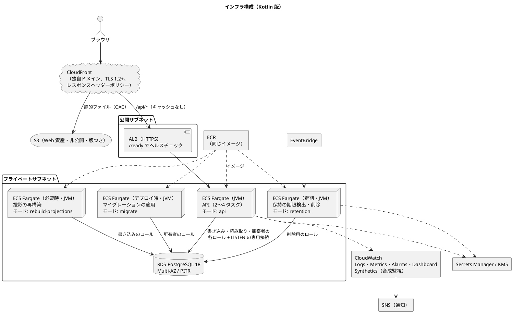
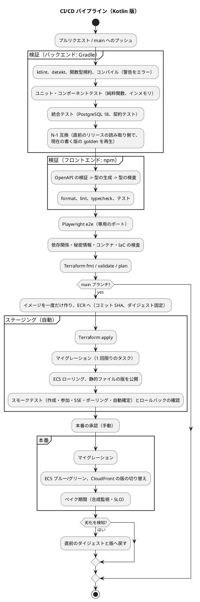

# インフラストラクチャアーキテクチャ - ビールゲームシミュレーション（Kotlin 版）

## 概要

本書は、beer-game-kotlin の実行環境と配信の構成を定義します。**`docs/` を設計の正本**とします。実装コードも、インフラのコードも、まだ存在しません。

[beer-game2 のインフラストラクチャアーキテクチャ](../beer-game2/architecture-infrastructure.md) の構成（CloudFront の単一オリジン、ECS Fargate、RDS for PostgreSQL、ECR、Terraform、GitHub Actions の OIDC、ステージング自動・本番承認とブルー/グリーン、観測）を**そのまま踏襲**します。変わるのは、バックエンドが **Node.js から JVM（Kotlin）になったこと**と、**ES + CQRS** に起因する点だけです。

- コンテナと起動、メモリ、終了の扱い（JVM 固有）
- ビルド（Gradle）と CI の手順
- データベースのロールと、接続の持ち方（`events` の追記専用、通知の受信）
- 運用のタスクの種類（api、retention、migrate、rebuild-projections）

アプリは [バックエンド](./architecture-backend.md)、[フロントエンド](./architecture-frontend.md)、運用は [運用要件](./operation.md) を参照してください。

## 確認したバージョン

ライブラリとツールのバージョンは、**2026-11-14 に、Maven Central のメタデータ、Gradle の公式のバージョン情報、endoflife.date、Docker Hub で確認した値**です。確認できなかったものは「実装開始時に確認」とします。実装の開始時に、最新の安定版へ更新して固定します。

| 区分 | 技術 | 確認した版 | 出典・備考 |
| :--- | :--- | :--- | :--- |
| 実行環境 | JDK（Eclipse Temurin、LTS） | **25** | endoflife.date の `eclipse-temurin`（2026-11-14 に再確認）。25 は LTS、2025-09-22 リリース、**EOL 2031-09-30**。コンテナに実際に使う配布（Eclipse Temurin のイメージ）の値で、[技術スタック](./tech-stack.md) と同じ。Oracle JDK の期限（2030-09-30）は、使わない配布の値のため採用しない |
| 言語 | Kotlin | **2.4.21**（安定版の最新）。2.5.0 は RC | Maven Central（kotlin-stdlib）。2.5.0 の安定版が出たときに更新を判断する |
| ビルド | Gradle | **9.9.1** | Gradle の公式のバージョン情報（current） |
| Web | Ktor（`ktor-server-core`） | **3.6.1** | Maven Central |
| 関数型 | Arrow Core | **2.3.0** | Maven Central |
| 並行処理 | kotlinx.coroutines | **1.11.0** | Maven Central |
| JSON | kotlinx.serialization（JSON） | **1.13.0** | Maven Central |
| DB ドライバ | PostgreSQL JDBC | **42.7.14** | Maven Central |
| 接続プール | HikariCP | **7.1.0** | Maven Central |
| マイグレーション | Flyway（`flyway-core`） | **13.12.2** | Maven Central。**選定済み**（[技術スタック](./tech-stack.md) T4）。**導入は新しい依存関係として承認待ち**。ライセンスと機能の範囲は導入時に確認 |
| ログ | Logback（`logback-classic`） | **1.6.6** | Maven Central。**選定済み**（アプリのログは自前の `LogRecord` の JSON、Logback は枠組みのログ用）。導入は承認待ち |
| 静的解析 | detekt（`io.gitlab.arturbosch.detekt`） | **1.23.8**（安定版の最新、2025-02-21）。`dev.detekt` の 2.0.0 は alpha | Maven Central。**採用する Kotlin 2.4 に 1.23.8 が対応するかは未確認。ウォーキングスケルトンの最初のビルドの受入条件**（規約違反のコードを 1 つ置き、CI が落ちること。[テスト戦略](./test-strategy.md)）。代替（PMD の XPath、detekt 2 alpha、ktlint のカスタムルール）は、最初のビルドで落ちなければ確定、落ちる場合は最初の Bolt の中で選ぶ |
| 整形 | ktlint | **1.8.0** | Maven Central |
| ローカル開発用 DB | H2（`com.h2database:h2`） | **2.5.252**（確認日 2026-11-14） | Maven Central の `maven-metadata.xml`（`<release>`。ファイルの公開は 2026-09-26）。**ローカル開発だけ**（本番・ステージング・CI・統合テストでは使わない。[技術スタック](./tech-stack.md) T7）。公式のサポート期限は確認できていない。**導入は承認待ち** |
| コンテナのイメージ | Eclipse Temurin | タグ `25-jre`、`25-jre-noble` を確認 | Docker Hub。軽量な派生（Alpine など）の有無は確認していない |

| 確認できていない事項 | 扱い |
| :--- | :--- |
| Kotlin 2.4.21 と Gradle 9.9.1 の互換性、Kotlin が JDK 25 を対象にできること | 実装開始時に、Gradle と Kotlin の互換性の表で確認する |
| Ktor 3.6.1、Arrow 2.3.0 が要求する Kotlin の版 | 実装開始時に、各ドキュメントで確認する |
| Micrometer | 最新は 1.18.0 の RC のみ確認した。採用しない案（バックエンドの BD9）のため、確認は不要 |
| H2 の PostgreSQL モードで動く範囲、H2 と JDK 25・Flyway の組み合わせ | 公式ドキュメント（features）では、アドバイザリロック、LISTEN/NOTIFY、部分インデックス、ロール/GRANT、JSONB、SQLSTATE、分離レベルの差異を**確認できなかった**。**B1 の最初に実測して確定する** |

**beer-game2 から変えないバージョン**（beer-game2 の [技術スタック](../beer-game2/tech-stack.md) が 2026-11-09 に確認した値を引き継ぐ）: PostgreSQL 18（RDS の標準サポートは 2031-02-28 まで）、Node.js 26（フロントエンドのビルド用。Active LTS、EOL 2029-04-30）、Terraform 1.17 以上、AWS プロバイダー `~> 6.0`、`postgres:18-alpine`（ローカルの DB）。この日付の確認結果を、本書は再確認していません。

## 決定の整理

beer-game2 から**変更する点を太字**で示します。

| 決定項目 | 採用 | beer-game2 との違い・根拠 |
| :--- | :--- | :--- |
| クラウド | AWS（`ap-northeast-1`） | 変更なし |
| デプロイ形態 | コンテナ（ECS Fargate） | 変更なし |
| 配信 | CloudFront の単一オリジン（静的ファイルは S3、`/api/*` は ALB）。独自ドメインと ACM、TLS 1.2 以上、レスポンスヘッダーポリシー | 変更なし |
| データベース | RDS for PostgreSQL 18（Multi-AZ、暗号化、PITR、バックアップ 7 日） | 変更なし。**データベースのロールを用途別に分ける**。**ローカル開発だけ H2 の PostgreSQL モード**（設計判断 ID6。ステージング・本番は PostgreSQL のまま） |
| 非同期・キュー | 使わない | 変更なし（SQS と所有者別ワーカーは作らない） |
| 定期処理 | EventBridge による ECS タスク（保持の期限検出・削除） | 変更なし。**同じイメージの別の起動引数**で起動する |
| **イメージ** | **ECR。JRE のイメージ（Temurin 25）の上に、Gradle のビルド成果物を載せる。マルチステージ** | Node 26 のイメージから変更 |
| **実行環境** | **JVM。コンテナのメモリに応じたヒープ、SIGTERM での正常終了、起動時間を考慮した準備のヘルスチェック** | Node から JVM へ（設計判断 ID1、ID3） |
| 秘密情報 | Secrets Manager（鍵の版を複数保持）、KMS | 変更なし。**データベースの接続情報が、ロールごとに分かれる** |
| IaC | Terraform（リモートの状態、ロック、環境ごとに分離、モジュール化） | 変更なし |
| **ビルド** | **Gradle（Kotlin DSL、バージョンカタログ、ラッパーを固定）** | npm から Gradle へ（バックエンド）。フロントエンドは npm のまま |
| CI/CD | GitHub Actions（OIDC）。ステージングは自動、本番は承認 + ブルー/グリーン | 変更なし。**検証の手順が Gradle になる** |
| 観測 | 構造化ログ（CloudWatch Logs）、メトリクス（EMF）、合成監視、アラーム、ダッシュボード | 変更なし。**JVM と ES に固有の指標を加える** |

## 全体構成



### 構成要素

CloudFront、S3（Web）、ALB、保持の定期タスク、RDS、ECR、ネットワーク、観測の基本は、[beer-game2](../beer-game2/architecture-infrastructure.md) と同じです。**変更する要素と、JVM に固有の設定**を示します。

| 要素 | 設定 |
| :--- | :--- |
| CloudFront | beer-game2 と同じ。SSE（`/api/v1/games/:id/events`）は、キャッシュなしで、オリジンの応答を待つ時間の上限を超えない心拍を送る（バックエンドの設計）。オリジンの応答の待ち時間の設定は、実装開始時に確認する |
| ALB | HTTPS、アイドルタイムアウト 60 秒、ヘルスチェックは `/ready`。**JVM の起動に時間がかかるため、サービスのヘルスチェックの猶予期間を設ける**（値は起動時間の実測で決める） |
| API サービス | Fargate、常時 2 タスク、CPU 60% で 2〜4 に自動増減。ステートレス。本番はブルー/グリーン（CodeDeploy）、ステージングはローリング。**タスクのサイズの初期案: 1 vCPU / 2 GiB。ヒープ、再生の所要時間、GC の測定の後に決める**（設計判断 ID2） |
| 保持・マイグレーション・再構築のタスク | **同じイメージ**を、起動引数（`retention`、`migrate`、`rebuild-projections`）で切り替える。保持は EventBridge で 5 分ごと、マイグレーションはデプロイの一部（アプリの起動前）に 1 回限り、再構築は運用者が必要なときに起動する（**研修中は、運営者を通じて進行役に「停止」を依頼し、停止中に再構築して再開**する。停止中でも追記を伴う操作は走るため、再構築は `pg_advisory_xact_lock(game_id)`（排他）を取り、コマンド側は `pg_advisory_xact_lock_shared(game_id)` を取る。[データモデル](./data-model.md)、[運用要件](./operation.md)） |
| RDS | beer-game2 と同じ。**ロールを用途別に作る**（下の表） |
| 秘密情報 | DB の接続情報を、**ロールごとに別の秘密**として持つ。資格の鍵（複数の版）、応答の暗号鍵は変更なし。実行ロールには、そのタスクに必要な秘密の参照権限だけを与える |
| 観測 | beer-game2 と同じ。JSON ログとメトリクス（EMF）は標準出力へ出し、コンテナのログドライバが CloudWatch Logs へ送る。**JVM のヒープ・GC、再生のイベント数と時間、再試行の回数**のアラームを加える |

### データベースのロールと接続

[データモデル](./data-model.md) の**追記専用**と**最小権限**を、ロールで実現します。ロールの作成と権限は、マイグレーションが定義します。

| ロール | 使うタスク | 権限 | 接続の持ち方 |
| :--- | :--- | :--- | :--- |
| 書き込み | api（コマンド）、rebuild-projections | `events` は INSERT / SELECT のみ。投影・周辺ストア・冪等記録は読み書き | 接続プール（HikariCP）。トランザクション単位 |
| 読み取り | api（問い合わせ） | 投影の SELECT のみ | 接続プール |
| 観察者の読み取り | api（観察者の問い合わせ） | `week_team_totals`、`game_overview`（参加コードなし）、`session_overview` の SELECT のみ。役割別の表と、参加コードを持つ `game_join_codes` には到達できない（M1） | 別の接続プール |
| 通知の受信 | api | `LISTEN` のみ | **プールの外の専用の接続**（1 タスクにつき 1 本） |
| 削除 | retention | `game_roots` の DELETE、`deletion_*` の読み書き。連鎖削除が、`events` に DELETE を持たないロールでも動くかは、実装開始時に確認する（[データモデル](./data-model.md) の未決事項） | 接続プール（小さく） |
| 所有者 | migrate | スキーマの変更（DDL）、ロールと権限の定義 | 1 回限りの接続 |

**ローカルの H2 では**、上のロールの分離、接続プールの分離、`LISTEN` の専用接続は**再現しない**（PostgreSQL の統合テストでだけ検証する）。通知の受信は、ポート `ChangeNotifier` の H2 版（プロセス内のイベント）に置き換わる。本番・ステージングは、この表のとおり PostgreSQL のロールで動く。

**接続数の見積もり**: タスク数 × （書き込み + 読み取り + 観察者の各プールの最大 + 通知 1 本）+ 運用のタスク。この合計が、RDS のインスタンスの接続数の上限を超えないことを、タスクの最大数（4）で確認します。プールの大きさは、負荷試験で決めます（未決事項）。接続を集約するプロキシや接続プーラーは、`LISTEN` が動かない可能性があるため、**本設計では置きません**。

## 環境

| 環境 | 用途 | デプロイ | Terraform の状態 |
| :--- | :--- | :--- | :--- |
| ローカル | 開発・確認（起動・動作確認） | バックエンドは Gradle で起動、フロントエンドは Vite（`/api` をプロキシ）。**DB は H2 の PostgreSQL モード（既定。Docker 不要。`DB_KIND=h2`）**。PostgreSQL 18 で確認したい場合は `DB_KIND=postgres`（Docker）。H2 では、アドバイザリロックとイベント通知はプロセス内の実装（単一プロセスのみ）、ロール・部分一意索引などは省略される（**省略した制約はローカルで守られない**。[データモデル](./data-model.md)） | — |
| CI | 検証 | GitHub Actions（**PostgreSQL 18** のサービスコンテナと Testcontainers）。統合テストと受け入れ（`@api`）は PostgreSQL で実行し、**H2 は使わない** | — |
| ステージング | 本番前の確認 | main へのマージで自動（ローリング）。**PostgreSQL（RDS）のみ。H2 は起動時に拒否** | 専用 |
| 本番 | 運用 | 手動の承認後（ブルー/グリーン）。**PostgreSQL（RDS）のみ。H2 は起動時に拒否** | 専用 |

### ローカルの開発環境と H2 の拒否

- **Docker なしで起動できる**: ローカルの既定は、プロセス内の H2（PostgreSQL モード）。マイグレーションは Flyway のベンダー別の場所の H2 用を適用する（共通の部分を最大化し、差分だけを分ける。配置は B1 で確定）。
- **選択は設定で行う**: `DB_KIND=postgres|h2`。`AppConfig.load` が、環境の種別（`APP_ENV=local|ci|staging|production` など。名前は B1 で確定）と合わせて検証する。
- **本番・ステージングで H2 を拒否する検査**: `APP_ENV` が `staging` または `production` のとき、`DB_KIND=h2`、または JDBC の URL が `jdbc:h2:` で始まる設定は、`AppConfig.load` が**起動前に失敗**させる（起動しない。通知の受信や接続の準備に進まない）。この検査は、設定の単体テストで、**環境ごとの全組み合わせ**を確かめる。Terraform のタスク定義も `DB_KIND=postgres` を固定で渡し、H2 の依存関係は本番のイメージに含めない（二重の防御）。
- **ローカルの乖離の防止**: CI の統合テスト・受け入れは PostgreSQL が正で、H2 でしか通らない記述は禁止する（[テスト戦略](./test-strategy.md)）。

各環境の Terraform の状態は、暗号化したリモートの保管先（S3 とロック）に、環境ごとに分けて持ちます（beer-game2 と同じ）。

## コンテナと JVM

### イメージ

```text
FROM（ビルド）  eclipse-temurin:25-jdk       … Gradle でビルド（ラッパーの版を固定）
FROM（実行）    eclipse-temurin:25-jre-noble … JRE と、ビルド済みの成果物だけ
                ENTRYPOINT [ "<起動スクリプト>", "<モード>" ]   … api / retention / migrate / rebuild-projections
```

- **マルチステージ**にし、実行用のイメージには、JRE とアプリの成果物（依存の JAR とアプリの JAR）だけを含めます。ビルドの道具（JDK、Gradle、ソース）を含めません。
- 依存の JAR と、アプリの JAR を**別の層**にして、アプリだけの変更で、層のキャッシュが効くようにします。
- 実行は**非 root のユーザー**。ファイルシステムは読み取り専用を目指します（一時ファイルが要る場合だけ、書き込み可能な領域を設ける）。
- イメージのタグは、コミット SHA（ECR の不変のタグ。beer-game2 と同じ）。
- ベースイメージは `25-jre-noble` を想定します（確認したタグ）。小さな派生を使うかどうかは、脆弱性の検査の結果とサイズで決めます（未決事項）。

### JVM の設定（初期案。測定で決める）

| 項目 | 設計 |
| :--- | :--- |
| ヒープの上限 | コンテナのメモリに対する割合で指定する（`-XX:MaxRAMPercentage`）。ヒープ以外（メタスペース、スレッドのスタック、直接メモリ）の余裕を残す。割合は、初期案を 70% 前後とし、ヒープの使用量の測定で決める |
| メモリ不足 | OutOfMemoryError で**プロセスを終了**させる（`-XX:+ExitOnOutOfMemoryError`）。ECS が再起動し、ヘルスチェックが回復を扱う |
| ログ | 標準出力。ガベージコレクションのログも標準出力へ出す |
| CPU | JVM は起動直後に、クラスの読み込みと JIT のコンパイルで CPU を使う。自動増減は、**起動直後の CPU の高まりを新しいタスクの追加の理由と誤解しない**ように、クールダウンを設ける（値は測定で決める） |
| 起動の短縮 | 必要になれば、AppCDS などのクラスデータの共有を検討する（効果は測定してから）。**ネイティブイメージは採用しない**（設計判断 ID1） |

### 起動と終了

| 局面 | 設計 |
| :--- | :--- |
| 起動 | 設定を読み込み、検証する（`AppConfig.load`。失敗なら起動しない。**本番・ステージングで `DB_KIND=h2` なら失敗する**）-> 接続プールを作る -> 通知の受信を始める -> HTTP の受付を始める。`/ready` は、**データベースの接続、通知の受信の接続の生存**が確認できるまで、準備できていない（503）を返す。起動のたびに投影の再構築はしない。**起動時間の測る区間（L4）**: [NF-P16](./non-functional.md) と [運用要件](./operation.md) と同じく、**コンテナのプロセスの開始から `/ready` が成功するまで**（マイグレーションの適用を除く。p95 30 秒以下は提案）。サービスのヘルスチェックの猶予期間は、この実測の p95 より長く取る。RTO 15 分（NF-R4）は、この起動時間と、必要な場合の再構築（NF-P18）を含めて見積もる |
| マイグレーションとの順序 | マイグレーションのタスクが完了してから、アプリのタスクを起動する（デプロイの手順で保証）。アプリは起動時に、**期待するスキーマの版が適用済みか**を確認し、未適用なら準備できていない |
| 終了 | ECS は、タスクの停止時に SIGTERM を送り、一定の時間の後に強制終了する（停止の猶予時間は、サービスの設定で調整できる）。アプリは SIGTERM で、**新しい要求の受付を止め、処理中の要求を完了させ、SSE の接続を閉じ、接続プールを閉じる**。クライアントは、SSE が切れても再接続し、スナップショットを取得して追いつく（再生なしの設計） |
| 負荷分散との整合 | ALB のターゲットの登録解除の遅延（deregistration delay）と、アプリの終了の猶予を整合させる。長い SSE の接続は、猶予の後に切られてよい（クライアントが再接続する） |
| 保持・マイグレーション・再構築 | 1 回限りの処理。正常終了は終了コード 0、失敗は 0 以外。失敗は CloudWatch のアラームで通知する |

## ビルド（Gradle）

| 項目 | 設計 |
| :--- | :--- |
| 構成 | Gradle のマルチプロジェクト（`domain`、`application`、`adapter-http`、`adapter-persistence`、`app`。[バックエンド](./architecture-backend.md)）。Kotlin DSL |
| 版の管理 | **バージョンカタログ**（`gradle/libs.versions.toml`）に、版を 1 か所だけ書く。Gradle のラッパーは、版とチェックサムを固定してコミットする |
| 依存の固定 | 依存関係の検証（チェックサムの検証）を有効にすることを検討する（導入の可否は実装開始時に判断） |
| 警告 | コンパイラの警告をエラーにする（型検査を CI の関門にする） |
| 静的解析 | detekt、ktlint、関数型規約の検査を、`check` に組み込む（[バックエンド](./architecture-backend.md) の「モジュール構成と依存の検査」） |
| テスト | `test`（ユニット、コンポーネント）と、`integrationTest`（実際の PostgreSQL 18。`events` の追記専用の権限、連鎖削除の網羅、複数プロセスの競合）を分ける |
| 成果物 | アプリのモジュールが、起動用の配布物（依存の JAR を別に持つ形）を作る（設計判断 ID1 の C を除く） |
| フロントエンド | `ui/` は npm（Node 26）でビルドし、Gradle のビルドとは独立。仕様から型を生成する手順を、ビルドの前に置く（[フロントエンド](./architecture-frontend.md)） |

## CI/CD



- CI は、GitHub Actions の **OIDC** で、環境ごとの最小権限のロールを引き受ける（長期のアクセスキーを置かない）。beer-game2 と同じ。
- JDK と Gradle の準備、Gradle のキャッシュは、公式のアクションで行い、各アクションの版は、コミット SHA で固定する（beer-game2 と同じ方針）。
- 依存関係の検査は、JVM の依存関係（Maven Central の成果物）に対応するツールを、実装開始時に選ぶ（未決事項）。秘密情報、コンテナ、IaC の検査は beer-game2 のツールの方針（gitleaks、Trivy、Checkov または同等のもの）を引き継ぐ。
- ステージングで承認した**同じイメージのダイジェスト**を、本番へ昇格させる。
- スキーマの変更は、旧アプリが動く間は、必須の列・制約を削除しない（拡張 → 互換 → 縮小）。**イベントは書き換えない**（形の変更は `schema_version` とアップキャスト。[データモデル](./data-model.md)）。投影の形の変更は、マイグレーションの後に**投影の再構築**で埋めるため、再構築のタスクをデプロイの手順に含められるようにする。
- **N-1 互換のジョブ（M22）**: 直前のリリースの読み取り側（アップキャストと `evolve`）で、現在の書く版の golden を再生する（[テスト戦略](./test-strategy.md)）。新しいイベントの種類の追加は `schema_version` で制御できないため、**読む側を先にリリースする規則（読める版 → 書く版）に、「新しいイベントの種類を書き始める前に、読む側を 1 リリース以上先行させる」を加える**。ロールバックで旧イメージが動いても、新しいイベントを読める状態を保つため。
- スモークテストに、**自動確定**（4 役割の入力で、週が確定すること）を加える。

## 品質属性への対応

| 品質属性 | 対応する設計 |
| :--- | :--- |
| 可用性 | API 2 タスク以上、RDS Multi-AZ、`/ready` のヘルスチェック（通知の受信の生存を含む）、最小正常率 100% のローリング、ブルー/グリーン、正常終了（SIGTERM） |
| スケーラビリティ | CPU ベースの自動増減（2〜4）。状態を持たない API。1 コマンドは 1 ゲームのストリームの再生だけを行い、データベースが律速。接続数の上限を、タスクの最大数で確認 |
| セキュリティ | beer-game2 と同じ。加えて、**データベースのロールの分離**（`events` の追記専用、観察者の最小権限）、非 root、依存関係の脆弱性の検査 |
| 運用性 | Terraform、構造化ログ、メトリクス（JVM と ES の指標を含む）、合成監視、アラーム、ロールバック、復元の訓練。**イベントの再生による投影の再構築**を、運用のタスクとして持つ |
| コスト | Fargate の最小構成、`db.t4g.small`、月次の予算通知。**JVM は Node より、メモリの使用量が大きくなる前提**で、タスクのサイズの初期案を 2 GiB とする（測定で見直す） |

## beer-game2 からの変更

| # | beer-game2 | beer-game-kotlin | 理由 |
| :--- | :--- | :--- | :--- |
| 1 | `node:26-alpine`、コンパイル済みの JavaScript だけを含める | `eclipse-temurin:25-jdk`（ビルド）と `25-jre-noble`（実行）。依存の JAR とアプリの JAR を別の層に | バックエンドが JVM（Kotlin） |
| 2 | npm、`package-lock.json`、`tsx` は開発時のみ | Gradle、バージョンカタログ、ラッパーの固定 | 同上 |
| 3 | タスクのメモリは、明記なし | 初期案 1 vCPU / 2 GiB。`MaxRAMPercentage`、OOM で終了 | JVM のヒープ |
| 4 | 起動が速い前提 | ヘルスチェックの猶予期間、起動時の準備の確認（スキーマの版、通知の受信）、SIGTERM での正常終了 | JVM の起動時間と SSE の接続 |
| 5 | 保持・マイグレーションの 2 種類の定期・1 回限りのタスク | 同じイメージの 4 つのモード（api、retention、migrate、rebuild-projections） | ES で、投影の再構築が運用のタスクになる |
| 6 | DB の接続情報は 1 種類 | ロールごとの接続情報（書き込み、読み取り、観察者、削除、所有者）。通知の受信の専用の接続 | `events` の追記専用、最小権限、`LISTEN` |
| 7 | CI は `npm` の検証 | Gradle の検証 + 契約テスト + 型の生成 + npm の検証。スモークに自動確定を加える | Kotlin と OpenAPI の契約 |
| 8 | メトリクスは、応答時間・競合など | JVM のヒープ・GC、再生のイベント数と時間、再試行の回数、投影の不一致を加える | JVM と ES |
| 9 | マイグレーションは node-pg-migrate | **Flyway**（番号つきの SQL。選定済み。導入は承認待ち。設計判断 ID4） | JVM のエコシステム |
| 10 | 再構築の概念が無い | 研修中は、停止を依頼して停止中に再構築する。アドバイザリロックで排他（M23）。観察者のロールは参加コードを持つ表に到達できない（M1） | ES + CQRS |
| 11 | CI に新旧の互換の検査は無い | N-1 互換のジョブを加える。JDK の期限は Temurin の値（2031-09-30）に統一 | M22、M17 |
| 12 | ローカルの DB は Docker の PostgreSQL 18 | ローカル開発だけ H2 の PostgreSQL モード（Docker 不要）。CI・ステージング・本番は PostgreSQL のまま。本番・ステージングでは起動時の検査で H2 を拒否 | ユーザーの決定（2026-11-14）。設計判断 ID6 |

## 設計判断

### ID1: JVM の実行形態

| 案 | 内容 | 評価 |
| :--- | :--- | :--- |
| **A（採用）** | 通常の JVM（JRE 25）で、起動のモードを引数で切り替える | 標準の構成で、検証の費用が小さい。起動が遅く、メモリが大きい（ヘルスチェックの猶予と、タスクのサイズで吸収する） |
| B | ネイティブイメージ（ネイティブコンパイル） | 起動が速く、メモリが小さい可能性がある。ビルドの時間、リフレクションを使うライブラリの設定、検証の費用が増える。**本システムの規模（同時 15 チーム）では、利点に見合わない**と判断する |
| C | 1 つの実行可能な JAR（依存を含む） | 配布が単純。依存の変更でも全体が再作成され、層のキャッシュが効かない |

トレードオフ: A は、JVM の起動時間とメモリを、運用の設定（猶予期間、タスクのサイズ、クールダウン）で吸収します。実測で問題が出たら、AppCDS などを足します。B は、必要になった場合に見直します。

### ID2: タスクのサイズ

| 案 | 内容 | 評価 |
| :--- | :--- | :--- |
| **A（採用、初期案）** | 1 vCPU / 2 GiB。測定で見直す | JVM のヒープとメタスペース、スレッドの余裕を確保できる見込み。コストが増える |
| B | 0.5 vCPU / 1 GiB | コストが小さい。ヒープと GC の余裕が少なく、再生と JIT の負荷でレイテンシが揺れるおそれがある |

**数値は、実測の前の初期案です。** 負荷試験で、再生の所要時間、GC の停止時間、ヒープの使用量を測って決めます。

### ID3: 通知の受信の接続の置き場所

| 案 | 内容 | 評価 |
| :--- | :--- | :--- |
| **A（採用）** | API の各タスクが、プールの外に `LISTEN` の専用の接続を 1 本持つ | beer-game2 と同じ方式。接続数が、タスク数に比例して 1 本ずつ増えるだけ |
| B | 通知を専用のサービスに集約して、各タスクへ配る | 接続が減る。サービスが増え、障害点が増える |

### ID4: マイグレーションの管理ツール

| 案 | 内容 | 評価 |
| :--- | :--- | :--- |
| **A（採用）** | Flyway（番号つきの SQL、履歴テーブル） | [データモデル](./data-model.md) の「番号つきの SQL」に合う。JVM のエコシステム。ライセンスの範囲と機能は導入時に確認 |
| B | Liquibase | 変更の記述形式が豊富。XML や YAML の変更セットが、SQL の直接の管理より間接になる |
| C | 自前（番号つきの SQL と履歴テーブル） | 依存が増えない。履歴と適用の標準化を自前で作る |

[技術スタック](./tech-stack.md) の T4 で選定済みです（選定は未決ではない）。導入は、**新しい依存関係として承認待ち**です。

### ID5: データベースのロールの分離

| 案 | 内容 | 評価 |
| :--- | :--- | :--- |
| **A（採用）** | 用途別のロール（書き込み、読み取り、観察者、削除、所有者） | `events` の追記専用と、観察者の最小権限が、アプリのバグでも守られる。秘密と接続プールが増える |
| B | 1 つのロールで、アプリが規約で守る | 構成が単純。バグが直接の漏えいと、イベントの書き換えにつながる |

### ID6: ローカル開発は H2 の PostgreSQL モード（ユーザーの決定、2026-11-14）

| 案 | 内容 | 評価 |
| :--- | :--- | :--- |
| **A（採用）** | ローカル開発だけ H2 の PostgreSQL モード。CI・統合テスト・ステージング・本番は PostgreSQL 18。実行は `DB_KIND` で選び、本番・ステージングでは起動時に H2 を拒否する | Docker なしで起動できる。単一プロセスの制約と省略した制約があり、ローカルと CI の乖離が起きうる（対策は [技術スタック](./tech-stack.md) T7） |
| B | ローカルも Docker の PostgreSQL 18 | 乖離がない。Docker が要る |
| C | H2 を CI・ステージングにも使う | 環境が軽くなる。RDS の本番と離れ、並行性・権限の検証が空になる。却下 |

トレードオフ: A は、拒否の検査（設定の単体テストと、Terraform の固定値）で、H2 の本番混入を防ぐ。H2 でしか通らない記述は禁止し、PostgreSQL の統合テストを正とする。

## 前提と見直しの条件

- 常時 2 タスクで足りる前提: 同時に進行するゲームが少数（学習セッション単位）。負荷試験で、JVM の起動とヒープを含めて確認する。
- キューを再導入する条件: 削除以外の非同期処理（外部への配信、重い出力の生成）が必要になった場合。
- 非同期の投影へ移す条件: 同期投影が書き込みの性能を圧迫する場合。その場合は、投影を更新する別のタスクが増える。
- ネイティブイメージを検討する条件: 起動時間またはメモリが、運用の設定で吸収できなくなった場合。
- WAF の導入: 攻撃の兆候、またはセキュリティ要件の強化があった場合。

## 未決事項

- Kotlin 2.4.21、Gradle 9.9.1、JDK 25、Ktor 3.6.1、Arrow 2.3.0 の互換性の確認（実装開始時）。
- detekt 1.23.8 が Kotlin 2.4 に対応するかは、**最初のビルドの受入条件**で確認する（規約違反コードで CI が落ちること）。代替の選択の期限は、最初のビルドで落ちなければ確定、落ちる場合は最初の Bolt の中。
- コンテナのベースイメージ（Temurin の `25-jre-noble` を想定。JDK の期限は 2031-09-30 に統一済み）の、軽量な派生の採否と、そのサポート期限の確認。
- タスクのサイズ、ヒープの割合、接続プールの大きさ、ヘルスチェックの猶予期間、自動増減のクールダウンの値（負荷試験で決める）。
- `LISTEN` の接続と、RDS の接続数の上限の整合（タスクの最大数での確認）。
- 依存関係の脆弱性の検査ツールの選定（JVM の依存関係に対応するもの）。
- 独自ドメインの取得と、DNS（Route 53）の管理者。
- ブルー/グリーンの実装（CodeDeploy）と、ステージングのローリングの差の許容。
- 合成監視（CloudWatch Synthetics）の費用と、頻度（1 分ごと）の妥当性。
- アカウントの分離（環境ごと）の方針。
- **H2（設計判断 ID6）**: 導入は承認待ち。PostgreSQL モードで動く範囲は公式ドキュメントで確認できなかったため、B1 の最初に実測する。環境の種別の設定名（`APP_ENV` など）と、Flyway のベンダー別の場所の配置は B1 で確定する。H2 2.5.252 と JDK 25・Flyway 13.12.2 の組み合わせ、公式のサポート期限は実装開始時に確認する。
- 投影の再構築のタスクを、デプロイの標準の手順に含める条件。再構築中の追記の扱いは、アドバイザリロックで決定済み（M23）。未決は、ロック待ちの上限と、再構築中のコマンドの応答（[データモデル](./data-model.md) の未決事項）。

## 出典

- [バックエンドアーキテクチャ（Kotlin 版）](./architecture-backend.md)、[データモデル（Kotlin 版）](./data-model.md)、[運用要件](./operation.md)、[非機能要件](./non-functional.md)
- [beer-game2 のインフラストラクチャアーキテクチャ](../beer-game2/architecture-infrastructure.md)、[beer-game2 の技術スタック](../beer-game2/tech-stack.md)
- バージョンの確認元（2026-11-14）: Maven Central のメタデータ（H2、Kotlin、Ktor、Arrow、kotlinx.coroutines、kotlinx.serialization、PostgreSQL JDBC、HikariCP、Flyway、Logback、detekt、ktlint、Micrometer）、Gradle の公式のバージョン情報（`services.gradle.org/versions/current`）、endoflife.date（`eclipse-temurin`）、Docker Hub（`eclipse-temurin` のタグ）
- [アーキテクチャ設計ガイド](../../reference/アーキテクチャ設計ガイド.md)
- [ガイド 関数型プログラミングガイド（Kotlin 編）](../../reference/関数型プログラミングガイド_Kotlin編.md) 第 9 章（静的解析）
- [ADR-007](../../adr/beer-game2/007-cascade-deletion-without-queues.md)、[ADR-011](../../adr/beer-game2/011-cloudfront-domain-tls-headers.md)、[ADR-012](../../adr/beer-game2/012-delivery-pipeline-and-terraform.md)
