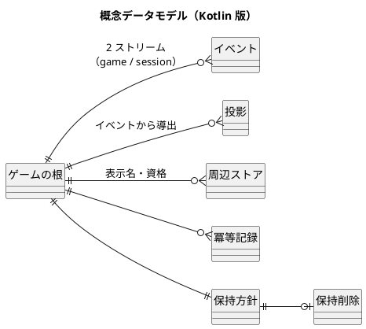
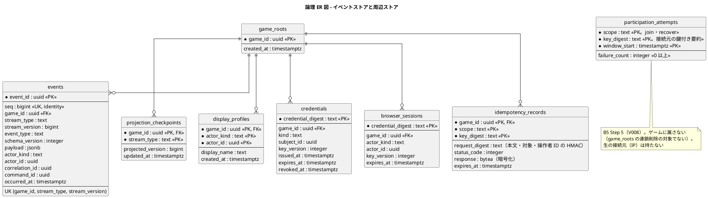
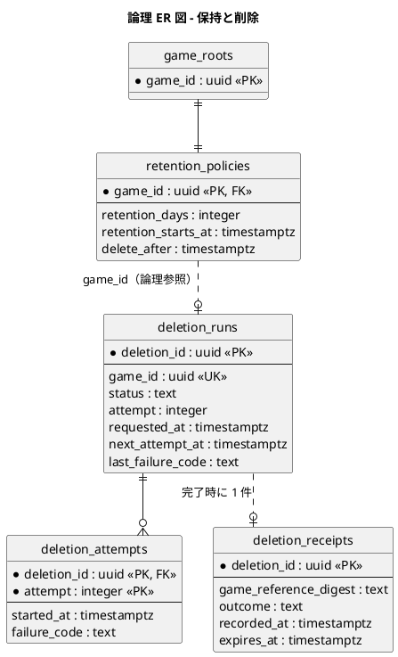
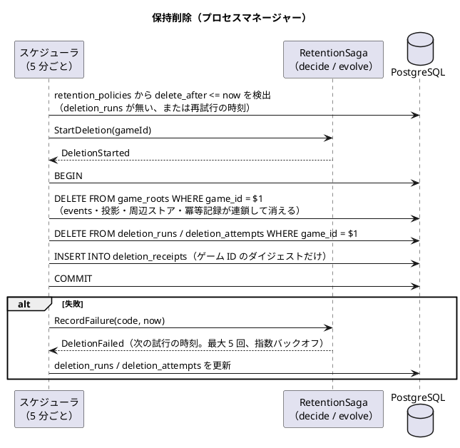

# データモデル設計 - ビールゲームシミュレーション（Kotlin 版）

## 概要

本書は、beer-game-kotlin のデータモデルを、概念データモデルから論理データモデルへ段階的に定義します。**`docs/` を設計の正本**とします。

[beer-game2 のデータモデル](../beer-game-ts/data-model.md) は、集約ごとの現在の状態を表に持ち、版つきで更新していました。本書は、[ドメインモデル（Kotlin 版）](./domain-model.md) の**イベントソーシング + CQRS**に合わせ、次のように作り直します。

- **書き込み側の正本は、追記専用の `events` 表**です。状態は、イベントの再生（`fold(evolve)`）で導きます。
- **読み取り側は、投影テーブル**です。イベントの追記と同じトランザクションで更新し、いつでもイベントから作り直せます。
- イベントに入れない**個人情報（表示名）と秘密（資格のダイジェスト）は、周辺ストア**に置きます（NF-S14）。
- すべての表は `game_roots(game_id)` への外部キー（`ON DELETE CASCADE`）を持ち、**1 回の削除で漏れなく消えます**（NFR-07、ADR-007 を引き継ぎ）。

データベースは PostgreSQL 18 で、スキーマは番号つきの SQL マイグレーションで管理します（ツールは Flyway を採用案とし、導入は承認待ちです。[技術スタック](./tech-stack.md) T4）。**ただし、開発機でのローカル開発（起動と動作確認）だけは、H2 の PostgreSQL モードで動かせるようにします**（ユーザーの決定、2026-11-14。[ADR-014](../../adr/beer-game-kotlin/014-h2-for-local-development.md)）。統合テスト、CI、ステージング、本番は PostgreSQL 18 のままです。PostgreSQL 固有の機能（アドバイザリロック、LISTEN/NOTIFY）はポートの裏に隠し、H2 版では守られない制約があります（「[ローカル開発（H2 の PostgreSQL モード）](#ローカル開発h2-の-postgresql-モード)」）。永続化の失敗は、例外のまま漏らさず境界で `Either` に変換します（[ガイド §7.6](../../reference/関数型プログラミングガイド_Kotlin編.md)）。

### beer-game2 からの設計方針の変更

| # | beer-game2 | beer-game-kotlin | 理由 |
| :--- | :--- | :--- | :--- |
| 1 | `games`・`sessions` などが現在の状態を持ち、`version` で版つき更新 | **`events` が正本**。`games` などは投影（読み取りモデル）になり、更新の版を持たない | ES（ドメインモデル D1） |
| 2 | 版は `games.version`、`sessions.version`（行の版） | **ストリームの版**（`events.stream_version`）。`(game_id, stream_type, stream_version)` の一意制約で、楽観的並行制御を行う | 追記の競合の検出 |
| 3 | `events` は、監査と通知の再送のための記録（`published_at`） | `events` は**状態の正本**であり、監査を兼ねる。通知は版だけで再送が不要なので `published_at` を廃止 | SSE は版の通知だけ（ADR-006） |
| 4 | 現在の意思決定は `role_decisions`（行を更新） | イベント（`DecisionSaved` など）が正本。`current_decisions` が投影 | 投影 |
| 5 | `week_results` / `week_role_results` は集約の表（確定時に書く） | `WeekCommitted` が正本。`week_commits` / `week_role_results` が投影 | CQRS（ADR-005 の意図を維持） |
| 6 | 観察は、`week_role_results` を `SUM` して返す | **`week_team_totals` を別の投影**にし、観察者の問い合わせは役割別の行に到達しない | 最小権限（逆算の防止、BR-17） |
| 7 | 表示名・資格ダイジェストは、集約の表の列 | **周辺ストア**（`display_profiles`、`credentials`）。イベントには入れない | NF-S14（イベント = 監査） |
| 8 | 保持削除は、`games` の `CASCADE` | `game_roots` を根にした `CASCADE`。`retention_*` も同じ根を使う | `games` が投影になったため、根を独立させる |
| 9 | `deletion_runs` は `game_id` を残す | 完了と同じトランザクションで `deletion_runs`・`deletion_attempts` の行も消す。証跡はダイジェストだけ | 削除後にゲーム ID を含む行を残さない（AC5.1.4） |
| 10 | 冪等記録は 24 時間（`idempotency_records`） | 維持。同じトランザクションで追記と一緒に書く | NFR2.6（NF-R6） |

## 概念データモデル



| 概念エンティティ | 対応するドメイン概念 | 説明 |
| :--- | :--- | :--- |
| ゲームの根（`game_roots`） | — | 連鎖削除の根。ゲームの作成と同じトランザクションで 1 行作る |
| イベント（`events`） | Game・Session の 2 ストリーム | 追記専用。状態の正本であり、監査の記録を兼ねる |
| 投影 | 読み取りモデル（[ドメインモデル](./domain-model.md) の投影） | ロビー、役割別の週結果、観察（チーム合計）、現在の意思決定など（出力は投影にしない） |
| 周辺ストア | D7 | 表示名、資格のダイジェスト、ブラウザセッション。イベントに入れない値 |
| 冪等記録 | 横断 | 重複排除と、同じ結果の再返却（応答は暗号化） |
| 保持方針、保持削除 | RetentionSaga（D8） | 期限と、削除の進行（プロセスマネージャーの状態） |

### ドメインの概念と表の対応

| ドメイン（Kotlin） | 表 | 種別 |
| :--- | :--- | :--- |
| `GameEvent`、`SessionEvent` | `events` | 書き込み側の正本 |
| ストリーム `(GameId, StreamType)` | `events` の `(game_id, stream_type)` | — |
| `GameOverview` | `game_overview` | 投影（参加コードを持たない） |
| `GameJoinCodes` | `game_join_codes` | 投影（観察者は読めない。M1） |
| `GameSettingsView` | `game_settings` | 投影 |
| `Lobby` | `lobby_participants`、`lobby_observer_invitations`、`lobby_observers` | 投影 |
| `SessionOverview` | `session_overview` | 投影 |
| `RoleCurrentState` | `role_current_states` | 投影 |
| `CurrentDecisions` | `current_decisions` | 投影 |
| `WeekRoleResults`（振り返り） | `week_commits`、`week_role_results` | 投影 |
| `WeekTeamTotals`（観察） | `week_team_totals` | 投影 |
| `ExportPackage` | （表なし） | 問い合わせ時に純粋関数 `buildExport` で作る（投影にしない） |
| `RetentionPolicyView` | `retention_policies` | 投影 |
| 表示名 | `display_profiles` | 周辺ストア |
| 資格（進行役・復帰・観察用の招待） | `credentials` | 周辺ストア |
| ブラウザセッション | `browser_sessions` | 周辺ストア |
| 冪等キー | `idempotency_records` | 横断 |
| 参加・復帰の失敗の窓（総当たりの制限。B5 Step 5） | `participation_attempts` | 横断（ゲームに属さない） |
| `RetentionSaga` | `deletion_runs`、`deletion_attempts`、`deletion_receipts` | 状態（D8） |

## 論理データモデル

### ER 図（イベントストアと周辺ストア）



### ER 図（投影テーブル）

```plantuml
@startuml
title 論理 ER 図 - 投影テーブル（読み取りモデル）
hide circle
skinparam linetype ortho

entity "game_roots" as roots {
  * game_id : uuid <<PK>>
}

entity "game_overview" as overview {
  * game_id : uuid <<PK, FK>>
  --
  status : text
  final_week : integer
  commit_mode : text
  settings_kind : text
  settings_changes : jsonb
  retention_days : integer
  created_at : timestamptz
  started_at : timestamptz
  ended_at : timestamptz
}

entity "game_join_codes" as jc {
  * game_id : uuid <<PK, FK>>
  --
  join_code : text <<UK>>
}

entity "game_settings" as settings {
  * game_id : uuid <<PK, FK>>
  --
  demand : jsonb
  initial_conditions : jsonb
  holding_cost_minor : integer
  backlog_cost_minor : integer
  order_delay_weeks : integer
  shipment_delay_weeks : integer
  production_delay_weeks : integer
  disclosure_policy : text
}

entity "lobby_participants" as lp {
  * participant_id : uuid <<PK>>
  --
  game_id : uuid <<FK>>
  role : text
  joined_at : timestamptz
  replaced_at : timestamptz <<B5 Step 5.5。V007。NULL は入れ替えられていない>>
}

entity "lobby_observer_invitations" as li {
  * invitation_id : uuid <<PK>>
  --
  game_id : uuid <<FK>>
  expires_at : timestamptz
  revoked_at : timestamptz
  created_at : timestamptz
}

entity "lobby_observers" as lo {
  * observer_id : uuid <<PK>>
  --
  game_id : uuid <<FK>>
  invitation_id : uuid
  joined_at : timestamptz
}

entity "session_overview" as so {
  * game_id : uuid <<PK, FK>>
  --
  status : text
  week : integer
  submitted_role_count : integer
  started_at : timestamptz
  ended_at : timestamptz
}

entity "role_current_states" as rcs {
  * game_id : uuid <<PK, FK>>
  * role : text <<PK>>
  --
  inventory : integer
  backlog : integer
  order_pipeline : jsonb
  shipment_pipeline : jsonb
  production_pipeline : jsonb
  cumulative_cost_minor : bigint
  arrivals : integer（当週に処理する入荷）
  orders : integer（当週の受注。小売店は当週の需要）
  as_of_week : integer
}

entity "current_decisions" as cd {
  * game_id : uuid <<PK, FK>>
  * role : text <<PK>>
  --
  week : integer
  quantity : integer
  decision_version : bigint
  editor_kind : text
  editor_id : uuid
  updated_at : timestamptz
}

entity "week_commits" as wc {
  * game_id : uuid <<PK, FK>>
  * week : integer <<PK>>
  --
  commit_kind : text
  contributors : integer
  stream_version : bigint
  committed_at : timestamptz
}

entity "week_role_results" as wrr {
  * game_id : uuid <<PK, FK>>
  * week : integer <<PK, FK>>
  * role : text <<PK>>
  --
  demand : integer
  shipped : integer
  ordered : integer
  ending_inventory : integer
  ending_backlog : integer
  weekly_cost_minor : integer
  cumulative_cost_minor : bigint
}

entity "week_team_totals" as wtt {
  * game_id : uuid <<PK, FK>>
  * week : integer <<PK, FK>>
  --
  total_ordered : integer
  total_inventory : integer
  total_backlog : integer
  contributors : integer
}

entity "retention_policies" as rp {
  * game_id : uuid <<PK, FK>>
  --
  retention_days : integer
  retention_starts_at : timestamptz
  delete_after : timestamptz
}

roots ||--|| overview
roots ||--|| jc
roots ||--|| settings
roots ||--o{ lp
roots ||--o{ li
roots ||--o{ lo
roots ||--o| so
roots ||--o{ rcs
roots ||--o{ cd
roots ||--o{ wc
wc ||--|{ wrr
wc ||--|| wtt
roots ||--|| rp
@enduml
```



### ER 図（保持と削除）



`deletion_runs` と `deletion_attempts` は `game_roots` へ外部キーを持ちません（ゲームのデータが消えた後も、再試行の記録として生き残るため）。**完了と同じトランザクションで、この 2 表の行も削除**し、`game_id` を含む行を残しません。`deletion_receipts` は、ゲームを特定しない証跡（ダイジェストだけ）で、1 年後に削除します。

## イベントストア

### ストリームと版

- ストリームは `(game_id, stream_type)` で識別します。1 ゲームにつき `GAME`（準備）と `SESSION`（進行）の 2 本です（ドメインモデル D1）。
- `stream_version` は、ストリームの中で 1 から連続する整数です。`State.version`（`evolve` が数えた適用数）と等しくなります。
- `seq` は、ゲームをまたぐ追記の順序（`bigint` の identity）です。監査と将来の購読者の取り込み順に使います。コミットの順序とは必ずしも一致しないため、**業務上の順序は `stream_version`** とします。

### 追記と楽観的並行制御

```text
read:    SELECT ... FROM events WHERE game_id = $1 AND stream_type = $2 ORDER BY stream_version
decide:  純粋（State と Command から List<Event>）
append:  INSERT INTO events (...stream_version = expected + 1 .. expected + n ...)
         -> 一意制約 uq_events_stream_version (game_id, stream_type, stream_version) の違反 = ConcurrencyConflict
```

1. アプリケーション層は、対象ストリームの全イベントを読み、`replay` で状態にします。**読んだときの版（`expected`）**を覚えます。
2. `decide` が返したイベント列を、**`expected + 1` から連続する版**で、1 回のトランザクションで追記します。
3. 同じ版が既にあれば、一意制約の違反になります。これを `AppFailure.ConcurrencyConflict`（`Either` の左）に変換して返します。**行や版のロックは取りません**（beer-game2 の `SELECT ... FOR UPDATE` は不要になります）。ただし、**コマンドは、そのゲームの共有ロックを、ポート `ProjectionLock` を通してトランザクションの先頭で取ります**（PostgreSQL 版の実体は `pg_advisory_xact_lock_shared(game_id)`。H2 版はプロセス内の読み書きロック）。共有ロックどうしは待ち合わないので、コマンドの並行性は変わりません。投影の再構築が排他ロックを取る間だけ、コマンドが待ちます（下記「投影の再構築」）。
4. `ConcurrencyConflict`（`AppFailure.ConcurrencyConflict`）は、**自動で再試行します**（上限は小さな固定回数。実装開始時に決める。上限に達したら `AppFailure.RetryExhausted`）。再読み込みで状態が進んでいるため、`decide` が再評価され、業務上の競合（`DecisionConflict`、`WeekAdvanced`、`DecisionsChanged`、`AlreadyStarted`）は `decide` が正しく返します。再試行で結果が変わらない失敗は、そのまま利用者へ返します。
5. `decide` が空のイベント列を返したとき（例: 同じ役割への再割り当て）は、追記しません。

複数ストリームのコマンド（`StartGame`）は、両ストリームを読み、両方の期待する版を持って、**同じトランザクションで**追記します（[ガイド §7.6](../../reference/関数型プログラミングガイド_Kotlin編.md)）。

```kotlin
// 関数の束として定義し、PostgreSQL 版とインメモリ版を差し替える（ガイド §7.2、§7.6）
// 失敗の型 AppFailure の正本は architecture-backend.md（M14）。ここは同じ形を示すスケッチ
sealed interface AppFailure {
    data class Domain(val error: DomainError) : AppFailure          // decide が返した業務上の失敗
    data object ConcurrencyConflict : AppFailure                    // uq_events_stream_version の違反、SQLSTATE 40001・40P01（旧 AppendFailure を統合）
    data object RetryExhausted : AppFailure                         // 競合の再試行が上限に達した（503 app.retry_exhausted）
    data object IdempotencyKeyReused : AppFailure                   // 409 app.idempotency_key_reused
    data object Unauthorized : AppFailure                           // 403 app.unauthorized
    data class Persistence(val failure: PersistenceFailure) : AppFailure   // 例外を境界で値にしたもの
    // 境界の入力の誤り（Invalid）の扱いは backend の定義に従う
}

data class EventStore(
    val read: suspend (Tx, GameId, StreamType) -> Either<AppFailure, StreamRead>,   // events と version（B1 の実装は Left を AppFailure で返す）
    // B1 の実装: 追記後の封筒の列（版つき）を返す。同期投影が版つきの封筒を要するため。ConcurrencyConflict か Persistence
    val append: suspend (Tx, Map<StreamType, StreamVersion>, List<NewEvent>) -> Either<AppFailure, List<EventEnvelope<DomainEvent>>>,
    val transaction: TransactionRunner,
)
// B1 の実装: 総称のメソッドは fun interface にできない（コンパイルエラーを確認）ので、通常の interface
interface TransactionRunner {
    suspend operator fun <A> invoke(block: suspend (Tx) -> Either<AppFailure, A>): Either<AppFailure, A>   // Left で ROLLBACK
}
// `GameCreated` を含む追記は、同じトランザクションで game_roots を作る（B1 の実装。append の中）
```

### 共同入力の競合は、ストリームの版とは別

共同担当の意思決定の競合（FR-16）は、**ストリームの版でなく、イベント内の意思決定の版**（`DecisionSaved.decisionVersion`）で検出します。同じ役割の 2 人が同時に保存すると、一方はストリームの版で衝突します。再読み込みすると、もう一方の保存が反映されているため、`decide` は `DecisionConflict(role, latest)` を返し、最新値と最後の保存者を示します（変更を黙って失いません）。

### 冪等性

| 層 | 仕組み | 範囲 |
| :--- | :--- | :--- |
| コマンドの再送（HTTP） | `idempotency_records`。`(game_id, scope, key_digest)` で検索し、`request_digest` が同じなら、保存した**成功の応答**（暗号化）をそのまま返す。違えば `app.idempotency_key_reused`（409） | 24 時間（NF-R6） |
| 追記の一回性 | ストリームの版の一意制約 | 永続 |
| 週確定の一回性 | `WeekCommitted` は 1 週につき 1 件。`decide` が `requestedWeek` と意思決定の版（`basis`）を検査する（ストリームの版は前提にしない） | 永続 |
| 開始の一回性 | `SessionStarted` は `SESSION` ストリームの版 1 | 永続 |

`idempotency_records` の行は、**追記と同じトランザクション**で書きます。これにより、「追記は成功したが記録が無い」状態を作りません。応答が資格の生の値を含む操作（ゲームの作成、参加、復帰）の再送も、同じ値を返せます（応答を暗号化して保存するため）。

**コマンド処理の順**は、「ロック（共有）→ 認証（操作者・資格の有効性）→ 認可の前提検査 → 冪等記録の照合 → 読み込み → `decide` → 追記・投影」です（B1 の実装では、認証は `execute` の中、同じトランザクションの中で行う。[バックエンドアーキテクチャ](./architecture-backend.md)）。冪等記録の照合を認可より先に置きません。入れ替えで失効した旧担当者が以前のキーを再送しても、保存済みの応答（参加・復帰では資格の生の値）を返さず、403 にするためです。

- `request_digest` は、**本文・対象・操作者の ID** の鍵付き HMAC です。同じキーでも操作者が違えば `app.idempotency_key_reused`（409）になります。
- 保存するのは**成功した応答だけ**です。業務の失敗（`Left`）は保存しません。再送は、同じ失敗を再計算して返します（状態が変わっていれば結果も変わりうる）。
- 失効した資格が過去のキーを再送しても、認証の段階で 403 です（保存済みの応答は返りません）。

ゲーム作成の冪等は、作成の要求（`scope = 'create'`）を、`GameCreated` の追記と同じトランザクションで、新しい `game_id` で保存します。同じ冪等キーの再送は、`(scope, key_digest)` の部分一意索引（`WHERE scope = 'create'`）で検索します。

### 一意制約の衝突の扱い（制約名の正本）

再試行・再照合の対象にする一意制約を、名前つきで次に定めます。**この表が正本**で、[バックエンドアーキテクチャ](./architecture-backend.md) も同じ表を持ちます。

| 制約名 | 表 | 衝突の意味 | 扱い |
| :--- | :--- | :--- | :--- |
| `uq_events_stream_version` | `events` | 同じストリームへの同時の追記 | 読み直して `decide` からやり直す（`ConcurrencyConflict`、上限つき） |
| `uq_idempotency_create` | `idempotency_records`（`scope = 'create'` の部分一意索引） | 同じキーのゲーム作成の同時の重複 | **`ConcurrencyConflict` に写し**、`execute` の再試行の `find` が記録を見つけて、保存済みの応答を返す（500 にしない）。PostgreSQL は一意違反の後のトランザクションが使えず、同じトランザクションで再照合できないため（B1 の実装） |
| `pk_idempotency_records` | `idempotency_records` | 同じキー・同じ対象の同時の重複（空の列を返す操作を含む） | 同上。再試行の `find` が、本文の digest が同じなら保存済みの応答、違えば `app.idempotency_key_reused`（409）を返す |

上の 3 つ以外の一意制約違反は、設計上起きないはずなので、500 と相関 ID（ログ）で返します。制約には、この名前を明示して付けます（マイグレーション 001・002）。参加コードの重複（`uq_game_join_codes_code`）は、12 文字（約 60 ビット）の乱数で実際には起きないとして再試行しません（`Persistence`、500。B1 の実装）。

**H2 版（ローカルのみ）の扱い。** `uq_events_stream_version` と `pk_idempotency_records` は、通常の一意制約・主キーなので、共通のマイグレーションに同じ名前で置きます（**B1 で確認済み**: H2 は違反時の制約名をメッセージに含む。小文字（`DATABASE_TO_LOWER=TRUE`）で、大文字小文字を区別せず探す。「方言の差分」）。**`uq_idempotency_create`（`scope = 'create'` の部分一意索引）は、H2 の PostgreSQL モードで動かないことを B1 で実測したため（`CREATE UNIQUE INDEX … WHERE` は構文エラー）、H2 版では省略し、アプリケーション側の検査（挿入の前に `(scope, key_digest)` を検索し、重複が見つかれば `ConcurrencyConflict`）に置き換えます。**ゲーム作成の同時の重複は、ローカルでは制約で守られません（単一プロセスで 1 人が使う前提で許容。検証は PostgreSQL の統合テストだけで行う）。

イベントの封筒の `command_id` は、同じコマンドから生まれたイベントを束ねるための識別子で、冪等キーとは別です（冪等キーのダイジェストはイベントに入れません）。

### イベントのスキーマ

- `payload` は JSON（`jsonb`）で、`event_type` を型の判別に使います。`schema_version` は、ペイロードの形の版です。
- **イベントは変更しません。** 形が変わるときは、新しい `schema_version` を追加し、読み込み時に**アップキャスト**（旧版 → 新版の純粋関数）して `evolve` へ渡します。
- ペイロードに、表示名・資格の値・招待コードの値を入れません（ドメインモデル D7）。

### 追記専用の保護

- アプリケーションが使う DB ロールには、`events` の **INSERT と SELECT だけ**を与え、UPDATE と DELETE を与えません。
- 保持削除は、別のロールが `game_roots` を削除し、**外部キーの連鎖**で `events` の行が消えます。連鎖削除が、`events` に DELETE 権限を持たないロールでも動くことは、**B2 の Step 3 で実測した（2026-11-14、PostgreSQL 18）**: `events` の DELETE 権限が無い削除ロールで `game_roots` を 1 回 DELETE すると、`game_id` を持つ全表から当該ゲームの行が消え、別のゲームの行は残った。PostgreSQL が参照の整合性のトリガーを、子の表の所有者の権限で実行するためで、**`SECURITY DEFINER` の関数や別の削除用ロールは不要**（R6 は解消。1 回の実測で、他の版は未確認）。

**V102 のロールと GRANT（B2。B5 Step 5.5 で 101 から付け替え）。** ロールは `beergame_writer`・`beergame_reader`・`beergame_observer`・`beergame_deleter`（`NOLOGIN`、非特権、継承なし。`CREATE ROLE` は存在しなければ作る）。所有者は新しいロールを作らず、マイグレーションを実行する接続のユーザー（本番の RDS で、マイグレーション用のユーザーをどう作るかは未決）。

| ロール | 権限 |
| :--- | :--- |
| `beergame_writer` | `events`・`game_roots` は SELECT・INSERT のみ。投影・周辺ストア・冪等記録・`projection_checkpoints` は SELECT・INSERT・UPDATE・DELETE（再構築が行を消すため） |
| `beergame_reader` | 投影の表（`projection_checkpoints`・`game_join_codes`・`game_settings` を含む）と `display_profiles`（ロビーの表示名の結合）の SELECT のみ。`credentials`・`browser_sessions`・`idempotency_records` は含めない（用途別のプールの配線で確定。未決） |
| `beergame_observer` | `game_overview`・`session_overview`・`week_team_totals` の SELECT のみ（`game_join_codes`・役割別の表には到達できない） |
| `beergame_deleter` | `game_roots` の SELECT・DELETE（WHERE 句の列の参照に SELECT が要る）。**B11 の V103 で、`retention_policies` の SELECT、`deletion_runs`・`deletion_attempts` の SELECT・INSERT・UPDATE・DELETE、`deletion_receipts` の SELECT・INSERT・DELETE を足した**（`events` ほかの DELETE は持たない）。V103 は、`beergame_writer` に `retention_policies`（投影）の読み書き、`beergame_reader` に `retention_policies`・`deletion_runs` の SELECT も与える（`deletion_attempts`・`deletion_receipts` は読めない） |

**B9: 観察者の接続プール（スキーマの変更なし）。** 観察の問い合わせ（`ObservationReader`。`JdbcObservationReader`）は、この 3 表だけを読む。PostgreSQL では、設定 `DB_OBSERVER_ROLE`（例: `beergame_observer`）を指定すると、観察者用の別の接続プール（接続のたびに `SET ROLE`）を使い、観察は DB の権限でも 3 表に限られる（統合テスト `PostgresPersistenceSpec` が、3 表は読めて、`game_join_codes`・役割別の表・`game_settings` は 42501 になることを確かめる）。未指定は主のプールと同じ接続（コードの上では同じく 3 表だけを読む）。ログイン用のユーザーの作成（`beergame_observer` のメンバーにする）は、B3 以降の運用で、未実施。観察者のロールは `game_settings` と `projection_checkpoints` を読めないため、公開範囲と版は、主の読み取りから、行より先に読む。招待コードは `credentials`（`kind = OBSERVER_INVITATION`、`subject_id` は招待の ID）にダイジェストだけを持ち、観察者の表示名は `display_profiles`（`actor_kind = OBSERVER`）、ブラウザセッションは `browser_sessions`（`actor_kind = OBSERVER`）に持つ。

**否定テスト（`RolePrivilegesSpec`、11 件）**: 書き込みロールが `events` を UPDATE・DELETE・TRUNCATE できない、`game_roots` を DELETE・UPDATE・TRUNCATE（`CASCADE` つきを含む）できない、4 ロールが表の所有者でも所有者ロールのメンバーでもなく特権属性が無い、削除ロールの DELETE 権限が `game_roots` だけ、観察者が SELECT できる表が設計の 3 表と完全に一致し書き込み権限が無い、連鎖削除、書き込みロールが過剰に絞られていない（INSERT・SELECT ができる）こと、全ロールが `flyway_schema_history` を読めないこと。拒否は SQLSTATE 42501 で確認する。権限を変異で足す（`GRANT UPDATE, DELETE, TRUNCATE ON events TO beergame_writer` など）と 11 件中 6 件が失敗することを確認した。
- **この保護（ロール、GRANT、`TRUNCATE` の拒否）は PostgreSQL の統合テストでだけ検証します。H2 版（ローカル）では省略し、単一の接続ユーザーで動かします。ローカルでは追記専用は守られません**（下記「ローカル開発（H2 の PostgreSQL モード）」）。

### スナップショット

**導入しません。** 判断は次のとおりです。

| 観点 | 見積もり（前提を明示） |
| :--- | :--- |
| 1 ストリームの最大長 | `SESSION` は、50 週 ×（4 役割 × 数回の保存 + 確定 1 + 例外の操作）で、**千件前後**と見積もる。`GAME` は、参加者・割り当て・招待・資格で、数十〜百件程度 |
| 再生のコスト | 純粋な `fold` で、千件程度の `evolve` は小さい（実測で確認する） |
| 規模 | 同時 15 チーム（NFR-04）。1 コマンドが読むのは 1 ゲームのストリームだけ |
| 1 ゲームの保存量 | 千件 × 1〜数 KB で、数 MB 以下 |

| 案 | 内容 | 評価 |
| :--- | :--- | :--- |
| **A（採用）** | スナップショットなし。毎回、ストリーム全体を再生する | 実装が単純で、復元（FR-12）は再生と同じ経路。上の見積もりでは十分 |
| B | 確定のたびに `session_snapshots` を作り、そこからの差分を再生する | 再生が短くなる。スナップショットの版管理（スキーマ変更時の無効化）と、保持削除の対象が増える |

導入の基準: コマンド処理の再生時間が、NFR-03（入力確定の 95 パーセンタイルを 1 秒以内）の予算を圧迫すると**実測で分かった場合**にだけ、`B` を導入します。

## 投影

### 更新の方式（同期投影）

投影は、**イベントの追記と同じトランザクション**で更新します（同期投影）。

| 案 | 内容 | 評価 |
| :--- | :--- | :--- |
| **A（採用）** | 追記と同じトランザクションで、投影の行を更新する | 追記の直後に、読み取りが必ず反映される（週確定後の画面反映 2 秒、NFR-03。SSE の版の通知を受けて取得した状態が、通知の版以上であることを保証）。投影の遅れによる障害の種類が無い |
| B | 別のワーカーが、`seq` を購読して非同期に更新（チェックポイントあり） | 書き込みと読み取りを分離できる。結果整合で、通知の版が投影に追いつかない窓が生まれる。ワーカーの運用が増える |

トレードオフ: A は、追記のトランザクションが長くなります。投影の更新は、イベント 1 件につき数行の更新で、計算は純粋で軽いため許容します。将来、読み取りの負荷が書き込みを圧迫する場合に、B へ移行できるよう、投影は `Projection`（`Event -> List<RowChange>`。純粋で、他の投影を読まない。[ドメインモデル](./domain-model.md)）として書き、行の変更の適用と分けます。1 件のイベント（例: `WeekCommitted`）が複数の表の変更を返せます。

`projection_checkpoints` は、投影が適用した最後のストリームの版を持ちます。次の目的に使います。

- 検証: `projected_version` と `MAX(stream_version)` が一致することを、整合性の検査で確認する。
- 再構築: 投影の作り直しの範囲を決める。

### 投影の再構築

投影の行は、`events` からいつでも作り直せます。**手順**: ゲームの投影の行を削除し、`events` を `stream_version` の順に畳み込み、`projection_checkpoints` を更新する。スキーマの変更（投影の列の追加など）は、マイグレーションの後にこの再構築で埋めます。

#### 再構築の同時実行制御（アドバイザリロック。M23）

研修中に投影が不整合になったときの業務手順は、「運用担当が運営者を通じて進行役に**停止**を依頼し、**停止中に再構築して再開**する」です（[運用要件](./operation.md)）。停止中でも、追記を伴う操作（代理入力、資格の再発行、観察者の参加）は受け付けるため、再構築とコマンドを**同じゲームについて同時に走らせない**制御が要ります。

ロックは、**ポート `ProjectionLock`**（関数の束。定義は [バックエンドアーキテクチャ](./architecture-backend.md)）の裏に隠し、2 つの実装を持ちます。

| 役 | ポートの関数 | PostgreSQL 版（統合テスト・CI・ステージング・本番） | H2 版（ローカルのみ） | 取る場所 |
| :--- | :--- | :--- | :--- | :--- |
| コマンド（追記と投影の更新） | `acquireShared(tx, gameId)` | `pg_advisory_xact_lock_shared(game_id)` | プロセス内の読み書きロックの読み取り側（ゲームごと） | トランザクションの先頭（読み込みの前） |
| 再構築 | `acquireExclusive(tx, gameId)` | `pg_advisory_xact_lock(game_id)` | 同じ読み書きロックの書き込み側 | トランザクションの先頭。投影の行の削除から `projection_checkpoints` の更新までを 1 トランザクションで行う |

- PostgreSQL 版の `game_id` は 64 ビットのキーへ写す（UUID の上位 64 ビットなど）。トランザクションの終了で自動的に解放される（`xact`）。H2 版は、トランザクションの終了（COMMIT / ROLLBACK）のフックで解放する。
- **H2 版のロックは単一のプロセスでだけ有効です。複数のプロセスでは保証しません**（`rebuild-projections` を API と別のプロセスで動かすと、再構築とコマンドは直列にならない。ローカルでは API を止めてから再構築する）。
- 共有ロックどうしは待ち合わないので、通常のコマンドの並行性は変わりません。再構築中は、コマンドは排他ロックが外れるまで待ちます。再構築が 1 トランザクションなので、コマンドが見るのは再構築の前後のどちらかで、途中の投影は見えません。
- これにより、「研修中は再構築しない」という制約は不要になります（停止は業務上の運用であり、データの整合のためのものではなくなる。停止を依頼する理由は、再構築中の入力の待ちを避けるため）。
- ロック待ちの上限（`lock_timeout`）と、待ちが上限を超えたときのコマンドの応答は、未決事項です（短く待って再試行、または 503 `app.retry_exhausted` と `Retry-After`）。

**B12 の実装（2026-11-17。スキーマの変更なし）**: 再構築は、ゲームごとに 1 トランザクションで、排他のロックを先頭で取り、投影の 13 表と `projection_checkpoints` の当該ゲームの行を消し（子の表から）、`events` を**追記順（`seq`）**に読み直して、同期投影と同じ書き込み（`ProjectionWriter`）で作り直す。対象は投影の表だけで、削除の進行（`deletion_*`）と周辺ストア（資格・ブラウザセッション・冪等記録など）は、イベントから導けないので対象外。整合の検査は、(a) `projected_version` と `MAX(stream_version)` の一致、(b) 全行が、作り直した行と一致、の 2 つで、(b) は同じトランザクションで作り直して比べたあとに**取り消す**（投影は変わらない）。起動モードは `rebuild-projections [ゲーム ID ...]` と `verify-projections`（[Bolt 12 終了報告](../../development/beer-game-kotlin/bolt_12_report.md)）。

#### 複数の投影の行を更新する順序（L3）

同期投影が複数の行を更新するとき、デッドロックを避けるため、**更新の順序を固定**します。表の順序は、`game_overview` → `game_join_codes` → `game_settings` → `lobby_participants` → `lobby_observer_invitations` → `lobby_observers` → `session_overview` → `role_current_states` → `current_decisions` → `week_commits` → `week_role_results` → `week_team_totals` → `retention_policies` です。同じ表の中では、主キーの昇順（`role` は FACTORY、DISTRIBUTOR、WHOLESALER、RETAILER の順）で更新します。1 件の `WeekCommitted` の変更（`RowChange` の列）も、この順序に並べ替えてから適用します。

なお、今のイベントの構成では、投影の行の更新どうしが実際に競合することはほぼありません。追記（`uq_events_stream_version`）で負けたコマンドは、投影を更新する前に失敗し、同じストリームのコマンドは追記で直列になります。`game_overview` は `game` と `session` の両方のイベントから更新されますが、`game` ストリームのコマンドで `game_overview` を変えるのは作成と開始だけで、開始は両ストリームを同時に追記するため、`session` ストリームの `SessionEnded`・`AutoCommitChanged` と同時に走りません。したがって、`architecture-backend.md` の設計判断 BD6 の投影の行の `SELECT ... FOR UPDATE` は、今の構成では実際には競合を防ぐ場面がなく、順序の規則が主な防止策です（将来、複数の投影の書き手が増えたときのための保険）。

### 投影テーブルの定義

| テーブル | 主キー | 購読するイベント | 主な制約・内容 |
| :--- | :--- | :--- | :--- |
| `game_overview` | `game_id` | `GameCreated`、`GameStarted`、`AutoCommitChanged`、`SessionEnded` | `status` は `PREPARING`・`STARTED`・`ENDED`（`SessionEnded` で導出）。`final_week` は 1〜50。`commit_mode` は `MANUAL`・`AUTO`。`settings_kind` は `KIT`・`CUSTOM`。`settings_changes` に準拠値から変えた項目。**参加コードは持たない**（観察者が読むため。M1） |
| `game_join_codes` | `game_id` | `GameCreated` | `join_code` 一意（索引）。**進行役と、参加の問い合わせ（参加コードの照合）だけ**が読む。観察者のロールには SELECT を与えない（BR-17） |
| `game_settings` | `game_id` | `GameCreated` | 需要系列、初期条件、費用、遅延、公開範囲。遅延と単価は 0 以上。**進行役の画面にだけ**使う（将来の需要を含むため） |
| `lobby_participants` | `participant_id` | `ParticipantJoined`、`RoleAssigned`、`RoleUnassigned`、**`ParticipantReplaced`（B5 Step 3.5）** | `game_id` は外部キー。`role` は 4 値または NULL。**`(game_id, role)` の一意制約は無い**（共同担当、FR-16）。表示名は `display_profiles` と結合。**役割の入れ替えで外れた旧担当者の行は消さず**（履歴と入力者のラベルのため）、`ParticipantReplaced` で `role` を NULL にし、**`replaced_at`（入れ替えられた時刻。NULL は未入れ替え）を書く**。**この列は V007（B5 Step 5.5。V003 を書き換えず、`ALTER TABLE` で足した）**（下の「役割の入れ替えと永続化」） |
| `lobby_observer_invitations` | `invitation_id` | `ObserverInvited`、`ObserverInvitationRevoked` | 有効期限、失効。招待コードの値は持たない |
| `lobby_observers` | `observer_id` | `ObserverJoined` | 役割を持たない |
| `session_overview` | `game_id` | `SessionStarted`、`SessionPaused`、`SessionResumed`、`SessionEnded`、`DecisionSaved`、`ProxyDecisionSubmitted`、`WeekCommitted` | `status` は `ACTIVE`・`PAUSED`・`ENDED`。`week > 0`。**`submitted_role_count`（0〜4。入力済みの役割数。値は含めない）**。`DecisionSaved`・`ProxyDecisionSubmitted` のペイロードの `submittedRoleCount`（保存後に入力済みの役割数。`decide` が数える。投影は他の行を読まないため、増減をイベントが運ぶ）をそのまま書き、`WeekCommitted` で 0 に戻す。観察者が読める（AC4.1.1。M3） |
| `role_current_states` | `(game_id, role)` | `SessionStarted`、`WeekCommitted` | 当該役割の在庫、受注残、待ち行列、累積費用、**`arrivals`（当週に処理する入荷）と `orders`（当週の受注。小売店は当週の需要）**（M2）。`SessionStarted` と `WeekCommitted`（`nextStates`）で更新。**当該役割の参加者と進行役だけ**が読める。小売店は、需要系列（`game_settings`、進行役専用）でなく、この行から当週の需要を読む |
| `current_decisions` | `(game_id, role)` | `DecisionSaved`、`ProxyDecisionSubmitted`、`WeekCommitted` | 当週の意思決定。`decision_version > 0`、`quantity >= 0` と上限（検査）。`editor_*` に最後に保存した人。確定で行を削除する |
| `week_commits` | `(game_id, week)` | `WeekCommitted` | `commit_kind` は `MANUAL`・`AUTO`。`stream_version` に、確定のイベントの版。**一度だけ確定**されることを、主キーでも守る |
| `week_role_results` | `(game_id, week, role)` | `WeekCommitted` | **役割別の週結果**。需要（受注）、出荷、発注、週末在庫、週末受注残、週次費用、累積費用。`(game_id, week)` は `week_commits` への外部キー（`CASCADE`） |
| `week_team_totals` | `(game_id, week)` | `WeekCommitted` | 週ごとのチーム合計（発注、在庫、受注残）と寄与者数。**役割別の値を持たない** |
| `retention_policies` | `game_id` | `GameCreated` | `retention_days` は 1〜3650（既定 90）、`delete_after > retention_starts_at` |

### 出力は投影にしない（`export_packages` の廃止）

出力（`ExportPackage`）は、同期投影にも非同期投影にもしません。**問い合わせの時に**、全域の純粋関数 `buildExport(settings, weekRoleResults): ExportPackage`（`Either` を返さない）で、`week_role_results` と設定（`game_overview`、`game_settings`）から作ります。`checksum` と `schema_version` も要求時に算出します。表 `export_packages` は持ちません。したがって、最終週の確定（`WeekCommitted` と `SessionEnded` の追記）は出力の作成に依存せず、画面に「準備中」の状態は要りません。

| 案 | 内容 | 評価 |
| :--- | :--- | :--- |
| **A（採用）** | 問い合わせ時に `buildExport` で作る | 最終週の確定（Must）が出力（Should）の失敗に左右されない。途中状態が無い。表が 1 つ減る |
| B | `SessionEnded` の同期投影として保存（旧案） | 取得が速い。投影の失敗が最終週の確定を失敗させうる |
| C | `SessionEnded` の後に別のトランザクションで作る | 確定とは切り離せるが、「準備中」の状態と再試行が要る |

トレードオフ: 要求のたびに計算します。1 ゲームの結果は小さい（50 週 × 4 役割）ため許容し、大きければ将来キャッシュを検討します（未決事項）。

### 読み取りの規則（認可と開示）

| 利用者 | 読めるもの | 読めないもの |
| :--- | :--- | :--- |
| 参加者（プレイ中） | 自分の役割の `role_current_states`・`current_decisions`・`week_role_results`、共通の `game_overview`・`session_overview`、ロビー（自分の役割と共同担当）。参加の問い合わせは `game_join_codes` で参加コードを照合する（値は返さない） | 他役割の行、`game_settings` の将来の需要、`week_team_totals` |
| 進行役 | 全役割の入力状況、`game_settings`、`game_join_codes`、`lobby_*`、`week_team_totals`、確定した週の記録 | 参加者の資格の値 |
| 観察者 | `game_overview`（参加コードなし）、`session_overview`（`submitted_role_count` を含む）、`week_team_totals`（公開範囲と寄与者数で抑止）。**この 3 表だけ**（NF-S18、backend と同じ） | **`game_join_codes`（参加コード）**、役割別の値、将来の需要、`week_role_results`（終了前） |
| 全員（終了後） | `week_role_results`（全役割の時系列） | — |
| 進行役（出力） | 要求時に `buildExport` が作る出力（CSV・JSON）。`week_role_results` と設定から導出する | — |

観察者の問い合わせは、DB の権限でも `game_join_codes`・`week_role_results`・`role_current_states`・`current_decisions` に**到達できない**ようにします（観察者のロールに SELECT を与えるのは、上の 3 表だけ）（最小権限。アプリのバグでも役割別の値が漏れにくい。**H2 版（ローカル）にはロールがなく、この DB の権限は守られない**。権限の否定テストは PostgreSQL の統合テストでだけ行う）。寄与者数による抑止（`contributors < 2` なら合計を出さない）は、問い合わせの層（`Disclosure`）で行います。

### 設計判断: 観察のための `week_team_totals`

| 案 | 内容 | 評価 |
| :--- | :--- | :--- |
| **A（採用）** | 確定時に、チーム合計を別の行にして保存する | 観察者向けの読み取りが役割別の行に触れない（権限で分離できる）。beer-game2 は、`SUM` を毎回計算した |
| B | 観察のたびに `week_role_results` を `SUM` する（beer-game2） | 行が 1 種類で単純。観察者の問い合わせが役割別の値に到達できてしまい、実装の誤りが直接の漏えいになる |

## 周辺ストア

イベントに入れない値を保存する、状態を持つ表です（ドメインモデル D7）。**追記と同じトランザクション**で書きます。書く内容は、コマンドが運んだ値（`DisplayName`、`IssuedCredential`）と、イベントの ID だけです。

| テーブル | 主キー | 内容 | 制約 |
| :--- | :--- | :--- | :--- |
| `display_profiles` | `(game_id, actor_kind, actor_id)` | 参加者と観察者の表示名 | `actor_kind` は `PARTICIPANT`・`OBSERVER`。表示名は 1〜80 文字（前後の空白を除く）。**ログ・イベント・出力に含めない**（NF-S14） |
| `credentials` | `credential_digest` | 進行役の資格、参加者の復帰資格、観察用の招待のダイジェスト | `kind` は `FACILITATOR`・`PARTICIPANT_RECOVERY`・`OBSERVER_INVITATION`。鍵付き HMAC のダイジェストと**鍵の版**だけを保存（ADR-009）。`expires_at`、`revoked_at` を持つ。**生の値は保存しない**。**B5 Step 4 の実装: ブラウザセッションとは別の値・別のダイジェスト**（復帰（`RecoverParticipation`）の認証だけに使う） |
| `browser_sessions` | `credential_digest` | ブラウザセッション（24 時間。設定値 `SESSION_TTL_HOURS`） | `actor_kind` は `FACILITATOR`・`PARTICIPANT`・`OBSERVER`。`expires_at` で掃除。**B5 Step 4 の実装: 操作の認証は、この表だけを見る**（`expires_at > 現在`。B1 は `credentials` と同じダイジェストで結んでいた）。失効は、行の**削除**で表す（`revoked_at` の列は持たない） |

`credentials.revoked_at` は、`CredentialRevoked` を追記する同じトランザクションで更新します（再発行では、新しい行を挿入します。旧行は失効のまま残ります）。**B5 Step 4 の実装**: 同じトランザクションで、**同じ主体（`game_id`、`actor_kind`、`actor_id`）の `browser_sessions` の行を削除**します（ゲート 1 の H2 案 A。スキーマ変更なし。再発行しても、失効前のブラウザセッションは復活しません）。この 2 つの行の変更は、追記したイベントから導きます（`CredentialRevoked` が追記されたら、必ず失効の行の変更が付きます。手動の失効と、役割の入れ替えの `CredentialRevoked` の両方）。`key_version` は、資格の値の接頭辞（`v<版>.`）が示す版で、保存時の検証の鍵を決めます。**整合のルール**: 「`credentials` の失効・発行が、対応する `Credential*` イベント（または `GameCreated`・`ParticipantJoined`・`ObserverInvited`・`ObserverJoined`・`ParticipationRecovered`）と必ず一緒に起きる」ことを、統合テストで確認します。

### 参加・復帰の失敗の窓（B5 Step 5。NF-S11・NF-S19。ゲート 5 で人が確認する）

参加（`POST /participations/join`）と復帰（`POST /participations/recover`。HTTP の配線は Step 6）の**総当たり**を止める、専用のレート制限の保存先です。全体の制限（接続元ごとの固定窓、600 件/分）は、プロセス内のままで、役割が違います（全体の負荷の保護。専用の制限は、認可の失敗だけを数える）。

| 項目 | 内容 |
| :--- | :--- |
| 表 | `participation_attempts`（V008。共通のマイグレーション。H2 と PostgreSQL の両方） |
| 列 | `scope`（`join`・`recover`）、`key_digest`（接続元の鍵付き要約）、`window_start`（窓の開始時刻）、`failure_count`（0 以上） |
| 主キー | `(scope, key_digest, window_start)`。索引 `ix_participation_attempts_window (window_start)`（古い行の掃除） |
| 保存する情報 | **接続元の鍵付き要約だけ**。TCP の接続元（`remoteHost`）を正規化して（IPv4 はそのまま、IPv4 射影の IPv6 は IPv4、IPv6 は上位 64 ビット `/64`）、HMAC-SHA256（鍵は冪等キーの鍵。部分の並びを `"attempt-source"` で分ける）にする。**生の IP アドレスは DB に残さない**（全表の全列に、生の値が無いことを契約テストで確認）。ログの `src` と窓の鍵は同じ値で突き合わせられる |
| ゲームとの関係 | **ゲームに属さない**（`game_id` を持たず、`game_roots` の連鎖削除の対象でない。B11 の「`game_id` を持つ全表から行が消える」検査の対象外）。窓が終わった行は、新しい窓の最初の記録のときに掃除する |
| 数え方 | 検査の**前**に 1 を足し（別のトランザクション。失敗が取り消されても残る）、上限を超えたら検査せずに 429、認可の失敗（不明な参加コード、無効な復帰資格）でなければ 1 を戻す。成功と、形式が不正な本文（入力の検証の失敗）は数えない。先に足すのは、同時の要求が上限を超えて検査を通り抜けないため |
| 同時の呼び出し | `INSERT … ON CONFLICT DO NOTHING`（行が無ければ 0 で作る）→ `UPDATE … SET failure_count = failure_count + 1`（行をロックして直列化）→ `SELECT`。PostgreSQL 固有の機能は使わず、同じ SQL が H2 でも動く。契約テストで、同時の 24 回の呼び出しが、1〜24 の連番を 1 回ずつ受け取ることと、別の接続プール（別のインスタンス）の呼び出しが合算されることを確認 |
| 設定値 | `ATTEMPT_MAX_FAILURES`（既定 10）、`ATTEMPT_WINDOW_SECONDS`（既定 600）。**根拠のない（未計測の）仮置き**。運営者との合意は未取得 |
| GRANT（PostgreSQL） | `beergame_writer` に `SELECT, INSERT, UPDATE, DELETE`（`102__database_roles.sql`）。読み取り・観察者・削除のロールには与えない（`RolePrivilegesSpec` の否定テスト） |

**信頼の範囲**: 接続元は TCP の接続元（`X-Forwarded-For` は信頼しない）。**ALB の背後では、接続元が ALB になり、全利用者が同じ窓に入る**。ALB・CloudFront の背後の接続元の取り方（信頼するホップの数）は、B14（AWS・本番の定義）で決める（設計書の未決事項。本 Bolt の範囲外）。

### 役割の入れ替えと永続化（B5 Step 3.5。提案。ゲート 3.5 で人が確認する）

開始後の役割の入れ替え（[ドメインモデル](./domain-model.md)の「役割の入れ替え」）は、**次の 3 つを、イベントの追記と同じトランザクションで**行います。

| 対象 | 更新 | 根拠 |
| :--- | :--- | :--- |
| `credentials` | 旧担当者（`CredentialRevoked` の `subject`）の行の `revoked_at` を更新する（手動の失効〔`RevokeCredential`〕と同じ処理。イベントの種類で呼ぶ） | 資格の自動失効。失効後の再送は、認証の段階で 403（ADR-004） |
| `browser_sessions` | 旧担当者（`game_id`、`actor_id`）の行を**削除する**（ゲート 1 の H2 案 A。スキーマ変更なし。`browser_sessions` に失効の列は足さない） | 旧担当者のブラウザセッションを止める。`credentials` の行は、失効の痕跡として残る |
| `lobby_participants` | `ParticipantReplaced` で旧担当者の `role` を NULL にし、`replaced_at` を書く（**下の確認点**） | ロビーが、入れ替えられた旧担当者と、割り当て待ちの参加者を区別する |

**整合のルール**（上の「周辺ストア」の規則の延長）: 「入れ替えの `CredentialRevoked` と、`credentials.revoked_at` の更新、`browser_sessions` の行の削除が、必ず一緒に起きる」ことを統合テストで確認します。

**旧担当者の履歴と入力者のラベルを残す**: `participants` の行に当たる `lobby_participants` の行、`display_profiles` の行（表示名）、過去のイベント（`DecisionSaved.editor`）、`current_decisions` の入力者は、**物理削除も更新もしません**。入力者のラベルは、`display_profiles` の表示名で引きます。

**確認点（確認必須。スキーマ変更。人の判断）**: 現在の Kotlin 版のスキーマに、**beer-game3 の `participants.replaced_at` に当たる列はありません**（実ファイルの確認。2026-11-15）。`lobby_participants` は `participant_id`・`game_id`・`role`・`joined_at` だけ（`V003__projections_lobby.sql`）、`credentials` は `revoked_at` を持ちます（`V002__peripheral_stores.sql`）。

| 案 | 内容 | 長所 | 短所 |
| :--- | :--- | :--- | :--- |
| **A（提案）** | 共通のマイグレーションを 1 つ足し、`lobby_participants.replaced_at timestamptz`（NULL 可。既存行は NULL）を追加する。`ParticipantReplaced` の投影が書く。番号は、B11 の保持（006）と衝突させない（実装時に決める。**この計画ではマイグレーションを書かない**） | ロビーと状態の投影が、入れ替えられた旧担当者を確実に示せる。投影は再構築で埋められる（イベントからの導出） | スキーマ変更（拡張だけ。ロールバックしやすい）。H2・PostgreSQL の両方で通ることの確認が要る |
| B | スキーマを変えない。入れ替えの旧担当者を `RoleUnassigned` で「役割なし」に戻す（`ParticipantReplaced` を持たない） | 列が増えない。イベントの種類も 1 つ減る | ロビーが旧担当者を割り当て待ちと区別できず、**進行役が割り当てても `game.credential_already_revoked` で拒否される**（画面で説明できない）。`credentials.revoked_at` の結合を読みに足せば導出できるが、投影の独立性が下がる |

提案は A です。**A を採ると、`LobbyParticipant` の応答に `replaced`（boolean）が増えます**（`contracts/openapi.yaml` に条件付きの提案として書いた。B を採るなら削除し、`ParticipantReplaced` を `RoleUnassigned` に置き換える）。

**決定と実装（B5 Step 5.5。2026-11-15）**: 案 A は、Step 3.5 のゲートで承認済み（スキーマ変更。マイグレーション追加の承認は判断項目 5）。共通のマイグレーション `V007__lobby_participants_replaced_at.sql`（`ALTER TABLE lobby_participants ADD COLUMN replaced_at timestamp with time zone`。NULL 可。既存行は NULL）を足した。H2 と PostgreSQL 18 の両方で適用でき、永続化の契約テスト（`ProjectionContract`）が、`ParticipantReplaced` の投影（旧担当者の行は消えず `role` が NULL・`replaced_at` に入れ替えの時刻、新担当者は `role` を持ち `replaced_at` は NULL）を確かめる（Step 4 で保留していた `SQLSTATE 42S22` の契約）。`LobbyParticipant.replaced` を応答へ返す配線は Step 6。

## 保持削除

### 削除の網羅

ゲームに属するすべての表（`deletion_*` と、**ゲームに属さない `participation_attempts`（B5 Step 5。接続元の窓。`game_id` を持たず、窓が終わると掃除される）を除く**）が、`game_roots(game_id)` への外部キー（`ON DELETE CASCADE`）を持ちます。**`DELETE FROM game_roots WHERE game_id = $1` の 1 回で、イベント、投影、周辺ストア、冪等記録が連鎖して消えます**（ADR-007）。`deletion_runs`・`deletion_attempts` は、同じトランザクションで明示的に削除します。

削除の網羅は、次のテストで確認します。

> 削除の完了後に、`game_id` 列を持つ**すべての表**に、そのゲームの行が残らない（表の一覧は、`information_schema` から取得して検査する）。

### 保持削除の流れ



`deletion_receipts` は、ゲームの ID を含みません（`game_reference_digest` は、鍵付き HMAC のダイジェスト）。バックアップに削除前のデータが残る期間は、保持方針に明記します（AC5.1.5。[運用要件](./operation.md)）。

### テーブル定義（保持と削除）

| テーブル | 主キー | 主な制約 | 役割 |
| :--- | :--- | :--- | :--- |
| `retention_policies` | `game_id` | `game_roots` への外部キー（`CASCADE`）。`delete_after > retention_starts_at` | 保持方針（`GameCreated` の投影）。期限で索引を持つ。`retention_starts_at` は**作成時**（暫定。下記）。beer-game2 の「方針の版」は持たない（方針が単一で、版の比較が要らない） |

**保持の起点（M5。暫定の決定。人の確認が要る）。** `retention_starts_at` は作成時とします（現在の配線どおり）。ロビー・ゲーム作成後・S09 に、削除予定日（`delete_after`）と「バックアップには削除後も最大 7 日残る」を表示し、終了後の振り返りと出力の猶予が短くなりうることも画面で示します。**暫定です。終了済みゲームは終了時から数える案（ユーザー代表の提案）は未決**です。
| `deletion_runs` | `deletion_id` | `game_id` 一意（外部キーなし）。`status` は `PENDING`・`IN_PROGRESS`・`FAILED`・`COMPLETED` | 削除の進行。完了のトランザクションで行を削除 |
| `deletion_attempts` | `(deletion_id, attempt)` | `deletion_id` は外部キー | 試行履歴。完了のトランザクションで削除 |
| `deletion_receipts` | `deletion_id` | `game_reference_digest` は 64 文字。`expires_at > recorded_at` | 削除の証跡。1 年後に削除 |

## テーブル定義（イベントストアと横断）

| テーブル | 主キー | 主な制約 | 役割 |
| :--- | :--- | :--- | :--- |
| `game_roots` | `game_id` | — | 連鎖削除の根。`GameCreated` と同じトランザクションで挿入 |
| `events` | `event_id` | `game_id` は外部キー（`CASCADE`）。`stream_type` は `GAME`・`SESSION`。**`(game_id, stream_type, stream_version)` 一意（制約名 `uq_events_stream_version`）**。`stream_version >= 1`。`schema_version >= 1` | 追記専用の状態の正本。監査の記録を兼ねる（操作者の種別と ID、入力値を含む。表示名と資格は含まない） |
| `projection_checkpoints` | `(game_id, stream_type)` | `game_id` は外部キー（`CASCADE`） | 投影が適用した最後の版 |
| `idempotency_records` | `(game_id, scope, key_digest)`（制約名 `pk_idempotency_records`） | `game_id` は外部キー（`CASCADE`）。応答は暗号化。`expires_at` は 24 時間後。`scope = 'create'` の部分一意索引 `uq_idempotency_create` | 冪等キーと**成功した応答だけ**の保存 |
| `participation_attempts` | `(scope, key_digest, window_start)`（制約名 `pk_participation_attempts`） | `scope` は `join`・`recover`（`ck_participation_attempts_scope`）。`failure_count >= 0`（`ck_participation_attempts_count`）。**`game_id` を持たない**（ゲームに属さない）。生の接続元を持たない | 参加・復帰の失敗の窓（総当たりの制限。B5 Step 5。上の「参加・復帰の失敗の窓」） |

## マイグレーション

- スキーマの変更は、**番号つきの SQL マイグレーション**で行い、適用の履歴を DB に残します。管理ツールは Flyway を採用案とします（導入は承認待ち。[技術スタック](./tech-stack.md) T4）。
- **PostgreSQL 用と H2 用で、共通の部分を最大化し、差分だけを分けます**（Flyway のベンダー別の場所。**配置は B1 の Step 7 で確定しました（2026-11-14）**: 共通 `V001〜V005`、PostgreSQL `V102`。H2 専用は不要。下表の「確定」の列。V001〜V005 はマイグレーションの承認待ち（B1 の Gate 7）。導入した版は [技術スタック](./tech-stack.md)）。
- 変更は、**拡張 → 互換 → 縮小**の順に分け、ロールバックできる単位にします（NFR-12）。
- **イベントは、マイグレーションで書き換えません。** イベントの形の変更は `schema_version` とアップキャストで吸収します。投影の形の変更は、マイグレーションで表を直し、**再構築**で埋めます。

| 番号（予定） | 場所 | 内容 |
| :--- | :--- | :--- |
| 001 | 共通 | `game_roots`、`events`（名前つきの一意制約、`CHECK`）、`projection_checkpoints` |
| 002 | 共通 | 周辺ストア: `display_profiles`、`credentials`、`browser_sessions`、`idempotency_records`（主キー `pk_idempotency_records`） |
| 003 | 共通 | 投影（準備）: `game_overview`、`game_join_codes`、`game_settings`、`lobby_*` |
| 004 | 共通 | 投影（進行）: `session_overview`、`role_current_states`、`current_decisions` |
| 005 | 共通 | 投影（結果）: `week_commits`、`week_role_results`、`week_team_totals` |
| 006 | 共通 | 保持: `retention_policies`、`deletion_runs`、`deletion_attempts`、`deletion_receipts`。**B11 で実装した（`V006__retention.sql`。B5 は使わず空けてあった番号）。承認は未取得**。`retention_policies` は `GameCreated` の投影（`delete_after` = 作成時 + 保持日数）。`deletion_attempts` は `deletion_runs` への外部キー（`CASCADE`）。`status` が `FAILED` で `next_attempt_at` が無い行は、再試行の上限に達して再試行をやめた状態（サガの `Abandoned`）。`IN_PROGRESS` の `next_attempt_at` は、貸出の期限（30 分。過ぎると次の試行として再開する） |
| 103 | PostgreSQL | **B11**（`V103__retention_roles.sql`）。保持の表の GRANT（書き込み・読み取り・削除の 3 ロール。上の表）。**承認は未取得** |
| 007 | 共通 | **B5 Step 5.5**（`V007__lobby_participants_replaced_at.sql`）: `lobby_participants.replaced_at timestamptz`（NULL 可）の追加（拡張だけ） |
| 008 | 共通 | **B5 Step 5.5**（`V008__participation_attempts.sql`）: 参加・復帰の失敗の窓 `participation_attempts`（主キー `pk_participation_attempts`、`CHECK`、索引 `ix_participation_attempts_window`） |
| 101 | PostgreSQL | **B5 Step 5.5 で付け替え**（`V101__idempotency_create_unique_index.sql`。B1 で 102 として作った）。部分一意索引 `uq_idempotency_create`（`WHERE scope = 'create'`）、`jsonb` の列に依存する検査 |
| 102 | PostgreSQL | **B5 Step 5.5 で付け替え**（`V102__database_roles.sql`。B2 で 101 として作った）。DB ロールと GRANT（書き込み・読み取り・観察者・削除。所有者はマイグレーションの接続のユーザー）、`events` の追記専用、`TRUNCATE` の拒否、観察者向けの権限。**`participation_attempts` の GRANT（書き込みロールだけ）を含む**。共通の表（001〜008）がすべて揃った後に適用される番号 |
| 201 | H2 | **作らない**（B1 の Step 7 で、共通の V001〜V005 が H2 にそのまま適用できたため）。省略した制約は、ローカルでは守られない |

**確定（B1。2026-11-14）**: ファイル名は `V001__event_store.sql`、`V002__peripheral_stores.sql`、`V003__projections_lobby.sql`、`V004__projections_session.sql`、`V005__projections_results.sql`（共通）、`V102__idempotency_create_unique_index.sql`（PostgreSQL）。**006（保持）は B11、101（DB ロールと GRANT）は B2**で、B1 では作りません（V101 は空けてある）。**これは B2 までの記録で、B5 Step 5.5 の付け替えにより、PostgreSQL は 101＝冪等記録の索引、102＝ロールと GRANT になった（下の「B5 Step 5.5 の番号」）。**

```text
db/migration/
├── common/      V001〜V005（B1。両方言で動く DDL。方言で型が違う列は Flyway のプレースホルダ ${json_type} で切り替える）、
│                V007・V008（B5 Step 5.5）。V006（保持）は B11 の予約として空けてある
├── postgres/    V101（B1 の冪等記録の索引。旧 102）、V102（B2 のロールと GRANT。旧 101。B5 Step 5.5 で付け替え）
└── h2/          作らない
# Flyway の場所: PostgreSQL = common + postgres、H2 = common
# 適用順（PostgreSQL）: 001 → 002 → 003 → 004 → 005 → 007 → 008 → 101 → 102。H2 は 001〜005・007・008
```

#### B5 Step 5.5 の番号（ゲート 5 で人が確認する）

| 項目 | 内容 |
| :--- | :--- |
| 追加 | 共通 **007**（`lobby_participants.replaced_at`）と **008**（`participation_attempts`）。**006 は B11（保持）の予約のまま空け、B5 は使わない**（Flyway は欠番を許す） |
| 付け替え | PostgreSQL の **101 と 102 を入れ替えた**（`git mv`）。冪等記録の索引（B1。旧 102）を **101**、ロールと GRANT（B2。旧 101）を **102** にした。作った順と番号の順を合わせ、ロールの GRANT が、共通の表（001〜008）がすべて揃った後に適用される番号にする |
| GRANT | `participation_attempts` の GRANT は、**102 に含めた**（付け替えと同時のため。永続環境が無い間だけできる）。共通のマイグレーションはロールの無い H2 にも適用されるので、GRANT を書けない |
| 今後の規則 | 共通の表を足したら、その表の GRANT は、**その表のマイグレーションより大きい番号の PostgreSQL 専用のマイグレーション（103〜）**に書く（既定の権限は与えない。V102 のコメントにも書いた）。B11 の `deletion_*`（006）の GRANT も同じ |
| B11 の注意 | 006 は 007・008 より小さい。**B11 の着手時に、007 以降が適用済みの DB（永続環境）があれば、Flyway は 006 を検証エラーにする**。そのときは 006 ではなく、次の空き番号（009 以降）を使う（欠番を許す）。**永続環境（ステージング・本番）を作る前に、番号を確定する** |
| 安全性 | 付け替えは、**永続環境がまだ無い間だけ**安全（適用済みの DB は、Flyway の版・チェックサムの検証に当たる）。ローカルの PostgreSQL（`docker-compose` など）に、古い 101・102 を適用済みの DB が残っていれば、作り直す（CI は使い捨て）。本 Bolt でステージング・本番は作っていない |

- **V101 と V102 の順序の注意（B2。B5 Step 5.5 で解消）。** B2 で、Flyway が適用済みの最大の版より小さい未適用の版を検証エラーにするため、V101（ロール）が V102（索引）より小さいと、V102 まで適用済みの DB に適用できない問題が出ていました。**Step 5.5 の付け替えで、作った順（B1 の索引 → B2 のロール）と番号の順を合わせました**。この問題は、永続環境が無い間の付け替えで解消し、以降は上の「今後の規則」に従います。
- 追記専用の保護、観察者向けの権限、部分一意索引は PostgreSQL の場所（101・102）にだけ置きます。投影の `CHECK`（数量の上限）は、共通（001〜005）に含めます。
- `events.payload` の型は、PostgreSQL は `jsonb`、H2 は `json` です（プレースホルダ `${json_type}`。**B1 で確定**）。書き込みは方言ごとに分けます（PostgreSQL は `CAST(? AS jsonb)`、H2 は `? FORMAT JSON`）。読み込みは両方 `CAST(payload AS VARCHAR)`。
- 共通の DDL は H2 で通ることを B1 の Step 7 で確認しました（`text` 型の主キー・一意制約、`GENERATED ALWAYS AS IDENTITY`、`timestamp with time zone`、`bytea`、`ON DELETE CASCADE`、`CHECK`）。再適用は 0 件です。
- **B1 の投影の実装で、設計と違う点**（2026-11-14）。(1) `role_current_states.production_pipeline` は **NULL を許し、B1 では書かない**（キットでは配送の待ち行列と同じ。`shipment_pipeline` に `RoleState.deliveryPipeline`、`order_pipeline` に `orderPipeline` を書く）。(2) `game_settings` の初期条件・遅延・公開範囲は B1 では書かない（キット準拠のイベントに載らない。カスタムは B7）。(3) 観察者向けの 3 表（`lobby_observer_invitations`・`lobby_observers`・`week_team_totals`）は、003・005 の中に**表を作るが、書き込みは B9 まで省く**（判断項目 #12 の決定。試験は「確定後も、観察者向けの 3 表に行が無い」ことを固定している。B9 で書き始めるときに、この試験を直す）。

## ローカル開発（H2 の PostgreSQL モード）

ユーザーの決定（2026-11-14）により、**開発機でのローカル開発（起動と動作確認）だけ**、H2 の PostgreSQL モードで動かせるようにします（[ADR-014](../../adr/beer-game-kotlin/014-h2-for-local-development.md)、提案中）。Docker や PostgreSQL がなくても起動できることが目的です。

**範囲の線引き。**

| 用途 | データベース |
| :--- | :--- |
| ローカル開発（開発機での起動・動作確認） | **H2（PostgreSQL モード）** または PostgreSQL。設定 `DB_KIND=h2\|postgres` で選ぶ（[バックエンドアーキテクチャ](./architecture-backend.md)） |
| 統合テスト、受け入れ（Cucumber の `@api`）、CI | **PostgreSQL 18**（Testcontainers） |
| ステージング、本番 | **PostgreSQL 18**（RDS）。起動時の検査で H2 を拒否する |

**H2 を、設計の検証（並行性、権限、部分一意索引、連鎖削除）や性能の計測には使いません。** それらの正は PostgreSQL の統合テストです。

**実測（B1 の Step 1。2026-11-14）。** 公式ドキュメントで確認できなかった項目を、H2 2.5.252（PostgreSQL モード。`MODE=PostgreSQL;DATABASE_TO_LOWER=TRUE`）で実際に動かして確かめた。結果は下の「方言の差分」の表のとおり。**結論: アドバイザリロック、`LISTEN`/`NOTIFY`、部分一意索引、`GRANT TRUNCATE` は動かず、設計どおり、ポートの裏に隠す・省略するのが妥当。権限の強制（SELECT のみのロールの拒否）、分離レベル、`ON DELETE CASCADE`、SQLSTATE（23505・23513・40001）は動いた。** 設計が H2 で成り立たなくなる項目は無く、**ローカル構成は成立する**。実測の手順は、使い捨てのコード（リポジトリに残さない）で、29 項目を実行した。**Flyway の H2 への適用は、Step 7 で確認した**（共通の V001〜V005 がそのまま適用でき、再適用は 0 件。`${json_type}` のプレースホルダだけで方言を切り替える。H2 専用のマイグレーションは不要）。

**確認できた事実と、できなかった事実。** 2026-11-14 に H2 の公式ドキュメント（[features](https://h2database.com/html/features.html) の PostgreSQL 互換モード）を確認した範囲では、アドバイザリロック、LISTEN/NOTIFY、部分インデックス、ロールと GRANT、JSONB、SQLSTATE、分離レベルの差異は、**ドキュメントで確認できませんでした**。**これらは B1 の Step 1・7 で実測して確定しました**（H2 2.5.252。結果は下の「方言の差分」の表）。**未確認のまま残るもの**: H2 での性能、分離レベルの動作の同一性、表の所有者の扱い（`GRANT` まわり）、2 つの API プロセスでの動作。

### 方言の差分

| 項目 | PostgreSQL 18 | H2（PostgreSQL モード。ローカルのみ） | 扱い |
| :--- | :--- | :--- | :--- |
| 再構築との直列化（アドバイザリロック） | `pg_advisory_xact_lock(_shared)` | **動かない**（実測: 関数が無い。SQLState 90022） | ポート `ProjectionLock` の裏に隠す。H2 版は**プロセス内の読み書きロック**（単一プロセスでのみ有効） |
| SSE の版の通知（LISTEN/NOTIFY） | `pg_notify` と専用の LISTEN 接続 | **動かない**（実測: `LISTEN`・`NOTIFY` は構文エラー、`pg_notify` は関数が無い） | ポート `ChangeNotifier` の裏に隠す。H2 版は**プロセス内のイベント**（コミット後に配信。単一プロセスでのみ有効） |
| 部分一意索引 `uq_idempotency_create` | あり（`WHERE scope = 'create'`） | **動かない**（実測: `CREATE UNIQUE INDEX … WHERE` は構文エラー。通常の一意制約は動く） | H2 版は**省略**し、アプリケーション側の再照合に置き換える |
| DB ロールと GRANT（書き込み・読み取り・観察者・削除・所有者）、追記専用、`TRUNCATE` の拒否 | あり | **一部動く**（実測: `CREATE ROLE`・`GRANT SELECT`・`REVOKE`・`CREATE USER` は動き、SELECT のみのロールは INSERT・UPDATE・DELETE・`TRUNCATE`・DROP・CREATE を拒否した（SQLState 90096）。**`GRANT TRUNCATE` は構文エラー**。表の所有者の扱いは未確認） | H2 版は**省略**（単一の接続ユーザー）。H2 でも権限の一部は強制されるが、**権限の検証の正は PostgreSQL の統合テスト**（`GRANT TRUNCATE` と所有者の挙動が検証できないため） |
| 接続プールの分離（観察者用など） | 用途別 | 単一のプール | H2 版は**省略** |
| `jsonb` | `events.payload` | **型は通るが挙動が違う**（実測: `jsonb` は H2 では `json`。**`setString` で入れた文字列は、JSON の文字列値になる**（`"{\"a\":1}"`）。`FORMAT JSON` を付けて初めて JSON のオブジェクトになる） | **H2 版の `events.payload` は `json` 型で、`FORMAT JSON` で書く（B1 で確定。PostgreSQL は `jsonb` と `CAST(? AS jsonb)`、読み込みは両方 `CAST(payload AS VARCHAR)`）**。型は Flyway のプレースホルダ `${json_type}`、書き込みの SQL は `Dialect.jsonParam` で分ける。`timestamptz` は H2 の PostgreSQL モードで不明なデータ型のため、**共通の DDL は `timestamp with time zone` と書く**（実測） |
| 分離レベル（READ COMMITTED、読み取り専用の REPEATABLE READ） | 指定どおり | **設定は通る**（実測: READ COMMITTED・REPEATABLE READ・SERIALIZABLE の設定が通る。動作の同一性は未確認） | H2 では検証しない（PostgreSQL の統合テストが正） |
| SQLSTATE（40001、40P01、55P03、23505 の制約名） | アダプターが `AppFailure` に写す | **一部動く**（実測: 一意違反は 23505、`CHECK` 違反は 23513、REPEATABLE READ の同時更新は **40001**。**違反した制約の名前は、メッセージに大文字で含まれる**（`UQ_EVENTS_STREAM_VERSION`）。PostgreSQL のような制約名の専用フィールドは無い。`DATABASE_TO_LOWER=TRUE` では小文字（例: `public.pk_idempotency_records INDEX ...`）。**メッセージには行の値（`VALUES (...)`）も含まれ、日本語のロケールで出る**） | H2 版の写像: 23505 はメッセージ中の制約名（**大文字小文字を区別せず**）で `uq_events_stream_version` などに写す。40001 は `ConcurrencyConflict` として再試行する。**`PersistenceFailure` にメッセージを載せない**（SQLSTATE と制約名だけ。PostgreSQL は `PSQLException.serverErrorMessage.constraint` と、詳細を除く主メッセージだけ）。B1 で実装済み |
| Flyway の適用（B1 の Step 7 で確認） | `common` + `postgres` | **共通の V001〜V005 がそのまま適用できた**（`text` 型の主キー・一意制約、`GENERATED ALWAYS AS IDENTITY`、`timestamp with time zone`、`bytea` を含む。再適用は 0 件） | H2 専用のマイグレーションは作らない |
| 名前つきの一意制約、`ON DELETE CASCADE`、`CHECK` | あり | **動く**（実測: 名前つきの一意制約、`ON DELETE CASCADE`（親の削除で子が 0 件になる）、名前つきの `CHECK`、`uuid`・`bytea`・`information_schema`・`pg_catalog.pg_class` の参照） | 共通の DDL に置く |

### H2 版で省略する制約（ローカルでは守られない）

次の制約は、H2 版では**守られません**。ローカルで動いたことは、これらの制約が正しいことを意味しません。

1. `uq_idempotency_create`（同じキーのゲーム作成の同時の重複。アプリ側の再照合だけ）。
2. `events` の追記専用（UPDATE・DELETE・`TRUNCATE` の拒否）。
3. DB ロールの分離と、観察者のロールが `game_join_codes` などへ到達できないこと（NF-S18）。アプリのバグによる漏えいを DB が止めない。
4. 接続プールの分離（観察者用のプールの配線）。
5. 複数のプロセスにまたがる、再構築との直列化と SSE の通知（`ProjectionLock`・`ChangeNotifier` は単一のプロセスでだけ有効）。
6. 削除用のロールの限定（`game_roots` 以外を直接削除できないこと）。
7. 分離レベルによる一貫した読み取り（REPEATABLE READ）の保証。

### 乖離のリスクと対策

ローカル（H2）で通っても、CI（PostgreSQL）で落ちる乖離が起きえます。対策は次のとおりです。

1. **H2 でしか通らない記述を禁止する。** PostgreSQL の統合テストが正で、H2 のために共通の DDL や SQL を曲げない（通らない文は PostgreSQL 側と H2 側に分ける）。
2. **ポートの契約テストを両実装で実行する。** `ProjectionLock`・`ChangeNotifier` の契約テストを、PostgreSQL 版は統合テスト、H2 版はユニットテストで実行する。
3. **受け入れ（Cucumber の `@api`）は PostgreSQL で実行する。**
4. 本番・ステージングでの H2 の拒否（起動時の検査。[バックエンドアーキテクチャ](./architecture-backend.md)）。

## インデックス（主なもの）

| 表 | 索引 | 目的 |
| :--- | :--- | :--- |
| `events` | `(game_id, stream_type, stream_version)`（一意） | ストリームの読み込み、楽観的並行制御 |
| `events` | `(seq)`（一意） | 監査と購読者の取り込み順 |
| `events` | `(game_id, actor_kind, actor_id)` | 操作者ごとの監査の検索 |
| `game_join_codes` | `(join_code)`（一意） | 参加コードでの検索（観察者は読めない） |
| `credentials` | `(game_id, kind, subject_id)`、`(expires_at)` | 主体ごとの検索、期限切れの掃除 |
| `browser_sessions` | `(game_id, expires_at)` | 期限切れの掃除 |
| `participation_attempts` | `(window_start)`（`ix_participation_attempts_window`。主キーは `(scope, key_digest, window_start)`） | 窓が終わった行の掃除（B5 Step 5） |
| `lobby_participants` | `(game_id)` | ロビーの一覧 |
| `idempotency_records` | `(expires_at)`、`(scope, key_digest)`（部分一意、`WHERE scope = 'create'`。**PostgreSQL のみ。H2 版は省略**） | 期限切れの掃除、作成の再送の検索 |
| `retention_policies` | `(delete_after, game_id)` | 期限到来の検出 |
| `deletion_runs` | 再試行の予定（`next_attempt_at`）の部分索引 | 再試行 |

投影の主キー（`(game_id, week, role)` など）が、振り返りと出力の問い合わせ（`WHERE game_id = $1 ORDER BY week, role`）の索引を兼ねます。

## 設計判断のまとめ

| # | 判断 | 採用 | 主な代替案 |
| :--- | :--- | :--- | :--- |
| 1 | ストリームの単位 | 1 ゲームにつき `GAME`・`SESSION` の 2 本（ドメインモデル D1） | 1 本、役割ごと |
| 2 | 並行制御 | 版の一意制約 + 自動再試行（行・版のロックなし）。再構築との同時実行だけ、ゲーム単位のアドバイザリロック（コマンドは共有、再構築は排他） | `SELECT ... FOR UPDATE`（beer-game2）、コマンドも排他のアドバイザリロック（並行性が落ちる） |
| 3 | スナップショット | なし。実測で必要になれば導入 | 確定ごとのスナップショット |
| 4 | 投影の更新 | 同期（追記と同じトランザクション） | 非同期ワーカー + チェックポイント |
| 5 | 観察の合計 | `week_team_totals` を別の投影に | `SUM` を毎回計算（beer-game2） |
| 6 | 個人情報と秘密 | 周辺ストア（イベントに入れない） | 暗号化してイベントに含める |
| 7 | 保持削除 | `game_roots` の連鎖削除 + 状態の行 | 表ごとの削除、`retention` ストリーム |
| 8 | 冪等性 | 冪等記録（24 時間、成功した応答だけを暗号化して保存）を追記と同じトランザクションで。認可の後に照合 | `command_id` の一意制約だけ（資格の再返却ができない） |
| 9 | 出力 | 問い合わせ時に純粋関数 `buildExport` で作る（`export_packages` 廃止） | 同期投影、`SessionEnded` 後の非同期投影 |
| 10 | ローカル開発の DB | H2 の PostgreSQL モード（ローカルだけ。ユーザーの決定）。PostgreSQL 固有の機能はポート（`ProjectionLock`・`ChangeNotifier`）の裏に隠し、2 実装を持つ。部分一意索引・ロール・プール分離などは PostgreSQL の統合テストでだけ検証し、H2 版では省略する | ローカルも PostgreSQL（Docker）、H2 を統合テストにも使う（検証が弱くなるため不採用） |

## beer-game2 からの変更

| # | beer-game2 | beer-game-kotlin | 理由 |
| :--- | :--- | :--- | :--- |
| 1 | `games`、`sessions`、`role_decisions` が現在の状態（版つき更新） | `events` が正本。`game_overview`、`session_overview`、`current_decisions` などは投影 | ES + CQRS |
| 2 | 楽観的排他は `WHERE version = $expected`、行数 0 で競合 | 追記の一意制約違反を競合とし、自動再試行 | ロックなしの並行制御 |
| 3 | `events` に `aggregate_type`、`aggregate_version`、`published_at` | `stream_type`、`stream_version`、`seq`、`command_id`。`published_at` を廃止 | 状態の正本。通知は再送不要 |
| 4 | `games` が連鎖削除の根 | `game_roots` を根に独立 | `games` が投影になるため |
| 5 | `participants`（表示名・復帰資格・役割の列） | `lobby_participants`（役割）、`display_profiles`（表示名）、`credentials`（資格）に分割 | NF-S14。イベントに入れない |
| 6 | `observers`、`observer_invitations`（資格を含む） | `lobby_observers`、`lobby_observer_invitations`（投影）、`display_profiles`、`credentials` | 同上 |
| 7 | `games` に設定のすべてと進行役の資格 | `game_overview`（公開してよい項目）、`game_settings`（需要系列など、進行役向け）、`credentials`（進行役の資格） | 開示の分離（将来の需要） |
| 8 | `week_results`（確定の記録）、`week_role_results` | `week_commits`、`week_role_results`（投影）。`session_version` の代わりに `stream_version` | ES |
| 9 | 観察は `SUM` で計算 | `week_team_totals`（投影）。権限で役割別の行から分離 | 最小権限（BR-17） |
| 10 | `sessions.settings`、`sessions.role_states`（JSONB） | `SessionStarted` のイベントと `role_current_states`（行） | 設定の写しはイベントが持つ。現在の役割状態は投影 |
| 11 | `export_packages`（`PENDING`・`COMPLETE`・`FAILED`） | 表を廃止。問い合わせ時に全域の純粋関数 `buildExport` で作る | 最終週の確定を出力の作成から切り離す。途中状態が無い |
| 12 | 保持の `deletion_runs` は完了後も行が残る（`game_id` つき） | 完了のトランザクションで `deletion_runs`・`deletion_attempts` も削除 | 削除後にゲーム ID を含む行を残さない（AC5.1.4） |
| 13 | `retention_policies` は `games` を参照しない | `game_roots` への外部キー（連鎖削除）。証跡は `deletion_receipts` に限る | 投影として一緒に消す |
| 14 | 復元は DB のバックアップ | 同じ + イベントの再生で状態と投影を再構築できる（FR-12） | ES の利点 |
| 15 | 冪等記録の照合順と保存対象の規定なし | 認証 → 認可の前提検査 → 冪等記録の照合。`request_digest` に操作者 ID を含め、成功した応答だけを保存 | 失効した資格の再送で保存済みの応答を返さない |
| 16 | 一意制約の名前の規定なし | `uq_events_stream_version`、`uq_idempotency_create`、`pk_idempotency_records` を正本の表で定め、衝突の扱いを決める | 同時の重複を 500 にしない |
| 17 | `games.join_code`（観察者の読み取りの範囲は規定なし） | `game_overview` から参加コードを分け、`game_join_codes` に置く。観察者のロールには SELECT を与えない。観察者が読める表は 3 表 | BR-17（M1） |
| 18 | `session_overview` は状態・週・時刻 | `submitted_role_count` を加える（`DecisionSaved`・`ProxyDecisionSubmitted` のペイロードから） | AC4.1.1（M3） |
| 19 | 現在の役割状態は在庫・受注残・待ち行列・累積費用 | `role_current_states` に `arrivals`・`orders`（小売店は当週の需要）を加える | 小売店が需要系列を読まずに当週の需要を得る（M2） |
| 20 | 投影は `(行, イベント) -> 行`（初稿） | `Event -> List<RowChange>`。複数の表の変更を返せる。更新の順序を固定 | M12、L3 |
| 21 | `EventStore` の失敗は `AppendFailure` と `PersistenceFailure` | `AppFailure`（sealed interface）に統合。`transaction` の戻りは `Either<AppFailure, A>`。正本は backend | M14 |
| 22 | 再構築の同時実行制御は未決 | ゲーム単位のアドバイザリロック（コマンドは共有、再構築は排他）。研修中も停止して再構築できる | M23 |
| 23 | 保持の起点は未決 | 暫定で作成時。画面に削除予定日とバックアップの残存を表示。終了時起点の案は未決 | M5 |
| 24 | データベースは PostgreSQL だけ | ローカル開発だけ H2（PostgreSQL モード）も使えるようにする。再構築のロックと SSE の通知はポートの裏で 2 実装。H2 版で省略する制約を明記 | ユーザーの決定（2026-11-14。ADR-014） |
| 25 | マイグレーションは 1 系統 | 共通（001〜006）・PostgreSQL（101〜）・H2（201〜）の場所に分ける案。配置は B1 で確定 | 共通を最大化し、差分だけを分ける |
| 26（以降は B1 の実装で変わった点。2026-11-14） | 共通 001〜006、PostgreSQL 101〜、H2 201〜 の配置案 | **共通 `V001〜V005`、PostgreSQL `V102` に確定。H2 専用は作らない**。006 は B11、101 は B2 | 共通の DDL が H2 にそのまま適用できた（Step 7） |
| 27 | `events.payload` の H2 の型は未定（仮置き） | PostgreSQL は `jsonb`（`CAST(? AS jsonb)`）、H2 は `json`（`? FORMAT JSON`）。型はプレースホルダ `${json_type}` | `setString` で入れた文字列が H2 では JSON の文字列値になる（Step 1・7） |
| 28 | 冪等記録の重複は、記録を再照合する | `ConcurrencyConflict` に写し、再試行の `find` で見つける | PostgreSQL は、一意違反の後のトランザクションが使えない（Step 7） |
| 29 | `EventStore.read` の失敗は `PersistenceFailure`、`append` は `Unit`、`transaction` は `fun interface Transaction` | `read` は `AppFailure`、`append` は封筒の列、`TransactionRunner` は通常の `interface`。`GameCreated` の追記は `game_roots` を同じトランザクションで作る | 同期投影が版つきの封筒を要する。総称のメソッドは `fun interface` にできない |
| 30 | `role_current_states.production_pipeline` は必須の想定 | NULL を許し、B1 では書かない。`shipment_pipeline` に `deliveryPipeline`、`order_pipeline` に `orderPipeline` | キットでは生産の待ち行列が配送と同じ。B1 のイベントに初期条件が載らない |
| 31 | 観察者向けの 3 表（003・005 の中）は B1 で作り、書く | 表は作るが、**書き込みは B9 まで省く** | B1 に観察者のイベントが無く、公開範囲の規則（`Disclosure`）は B9 |
| 32（以降は B2 の実装で変わった点。2026-11-15） | 連鎖削除が `events` に DELETE 権限が無いロールでも動くかは未検証（実装開始時に確認） | **実測済み（動く）**。V101 でロール 4 つ（`beergame_writer`・`reader`・`observer`・`deleter`）と GRANT。否定テスト 11 件（PostgreSQL 18）。`SECURITY DEFINER` は不要 | B2 の Step 3 |
| 33 | V101 は V102 の前のつもり（番号の順序は考慮なし） | **V101 < V102 のため、V102 まで適用済みの DB に Flyway がそのまま適用できない**。永続環境の前に、`outOfOrder` か番号の付け替えを決める（未決） | Flyway の既定の検証。**B5 Step 5.5 で、番号の付け替えにより解消**（行 39） |
| 34 | 読み取りロールの表の一覧は無い | `display_profiles` を含める（ロビーの表示名の結合）。`credentials`・`browser_sessions`・`idempotency_records` は含めない（未決） | B2 の判断 |
| 35（B5 Step 4。2026-11-15） | ブラウザセッションと復帰資格は、同じダイジェストで両表に書く（B1 の仮置き）。認証は両表を結ぶ。失効は `credentials.revoked_at` | **別の値・別のダイジェスト**。認証は `browser_sessions` だけ、復帰の認証は `credentials` だけを見る。失効は `credentials.revoked_at` の更新と、同じ主体の `browser_sessions` の行の**削除**（同じトランザクション。スキーマ変更なし） | ゲート 1 の H2 案 A・ADR-015。失効後の再発行で古いセッションが復活しない。`DELETE` の権限は `beergame_writer` にある（V101。PostgreSQL の統合テストで実行して確認） |
| 36（同上） | 入れ替えられた旧担当者の `lobby_participants` に `replaced_at` を書く | 投影（`Projections.lobbyParticipants`）は `ParticipantReplaced` で `role` を NULL にし `replaced_at` を書く行の変更を作る（純粋関数の試験まで）。**`replaced_at` の列は、マイグレーション（Step 5.5）まで DB に無い**ため、この投影を DB に適用すると失敗する（H2 で `SQLSTATE 42S22` を実測）。`ParticipantReplaced` を追記する経路は Step 6 の配線まで無い | Step 5.5 で列を足してから、永続化の契約を足す。**Step 5.5 で実施済み**（V007。行 37） |
| 37（B5 Step 5。2026-11-15） | `lobby_participants.replaced_at` は V003 に無い（提案） | **V007 で追加**（`ALTER TABLE`。NULL 可。拡張だけ）。H2・PostgreSQL 18 の両方で、`ParticipantReplaced` の投影の永続化の契約が通る（旧担当者の行は消えず `role` が NULL・`replaced_at` に時刻） | 判断項目 5 のマイグレーション追加の承認、Step 3.5 のスキーマ変更の承認（案 A） |
| 38（同上） | 参加・復帰の専用のレート制限の保存先は未決（BD8。プロセス内） | **DB に窓の表 `participation_attempts` を持つ**（V008。判断項目 4 の案 A）。接続元の鍵付き要約だけを保存し、ゲームに属さない。GRANT は 102 に含める | NF-S11・NF-S19（タスク数に依らない上限）。**ゲート 5 で人が確認する**（方式、保存する情報、スキーマ変更、番号） |
| 39（同上） | PostgreSQL は 101＝ロールと GRANT、102＝冪等記録の索引（作った順と番号の順が逆） | **101＝冪等記録の索引、102＝ロールと GRANT に付け替え**（`git mv`）。006 は B11 の予約として空け、B5 は 007・008 | 判断項目 5 の付け替えの承認。永続環境が無い間だけ安全。**番号はゲート 5 で人が確認する** |

## 未決事項

- マイグレーションの管理ツールは Flyway です（[技術スタック](./tech-stack.md) T4。B1 で導入。マイグレーション 001〜005 は B1 の Gate 7 の承認待ち）。適用の自動化は、B1 の実装で **H2（local）の起動時は自動、PostgreSQL の `api` は適用せず `migrate` モード**とした（本番での運用の最終決定は、導入の承認後）。
- 追記の `ConcurrencyConflict` の自動再試行の上限と、再試行の間隔（実装開始時に、競合の頻度を測って決める）。
- `events` に UPDATE/DELETE を与えないロールでも、`game_roots` の連鎖削除が動くことの確認: **解決済み（B2 の実測。動く。代替は不要）**。**未決（B2 で出たもの）**: V101 と V102 の順序（**B5 Step 5.5 で付け替えて解消**。006 の空けた番号の扱いは、B11 の着手時と永続環境の前に確定する）、読み取りロールの権限の範囲（`credentials` ほか）、所有者のロールの作り方（RDS）、通知の受信（`LISTEN`）専用のロールと接続、`deletion_*` の GRANT（B11）、アプリの用途別のロール・接続への切り替え（B3 以降）。
- 再構築の同時実行制御（解決済み: アドバイザリロック。コマンドは共有、再構築は排他。M23）。**未決**: ロック待ちの上限（`lock_timeout`）と、再構築中のコマンドの応答（短く待って再試行、または 503 `app.retry_exhausted` と `Retry-After`）。研修中の再構築の所要時間の実測。
- 数量の上限を、`CHECK`（固定値）にするか、設定の値と照合する検査にするか（beer-game2 から継続）。
- `retention_starts_at` の起点: **暫定で作成時**（M5）。終了済みゲームは終了時から数える案（ユーザー代表の提案）は未決で、人の確認が要る（ドメインモデルの未決事項と共通）。
- 出力（`buildExport`）の結果が大きい、または要求が多い場合のキャッシュの要否（解決済み: 表 `export_packages` は廃止し、要求時に作る。キャッシュは実測で必要になれば検討）。
- `events` の長期の保持と、ゲーム削除前の分析の要否（beer-game2 から継続）。
- 同期投影のトランザクション時間の実測。書き込みを圧迫する場合は、非同期投影へ移す（設計判断 4）。
- JSON のシリアライズ方式とアップキャストの置き場所（解決済み: kotlinx.serialization と `EventCodec`。アップキャストは adapter-persistence。[バックエンドアーキテクチャ](./architecture-backend.md)、[技術スタック](./tech-stack.md)）。
- **H2 の PostgreSQL モードで動く範囲の実測: B1 の Step 1・7 で完了**（結果は「方言の差分」。共通の DDL と省略の一覧、プレースホルダを確定した）。残り: H2 での性能、分離レベルの動作の同一性、表の所有者の扱い（`GRANT` まわり）。**H2 の版の確認と導入の承認は、B1 の Gate 2 の記録**（[技術スタック](./tech-stack.md)）。
- **`session_overview.week` が最終週 + 1 になる（B1 で判明。未解決）。** 確定で週を「次の週」へ進めるが、最終週（`finalWeek`）が `WeekCommitted` の封筒にもペイロードにも無いため、最終週が 50 未満のゲームが最終週を確定すると `week` が最終週 + 1 になる（`SessionEnded` は週を持たない）。確定のイベントか投影が最終週を知る手段（`SessionStarted` の設定を投影が覚える、`WeekCommitted` に最終週を載せる、など）の決定が要る。ENDED の表示は `status` で判断できるので、B1 の受入条件には影響しない。
- **投影の整合性の検査と投影の再構築は B12 で実装した（上記）。** `LISTEN` の切断中の欠落を `projection_checkpoints` の数秒ごとの照合で補う処理、冪等記録の掃除の定期タスクは、B1 では**未実装**。
- 参加者のロビーの並び（`joined_at`、同時刻なら `participant_id` の順）。参加の順を保つ規則は未決（B1 の受入条件に無い）。
- H2 版の `ProjectionLock` が `lock_timeout` 相当の待ちの上限をどう扱うか（PostgreSQL 版は SQLSTATE 55P03 を `RetryExhausted` に写す。H2 版は待ちの上限つきの取得で同じ契約を満たす）。
- 観察者の DB ロールに SELECT を与える表（`game_overview`・`session_overview`・`week_team_totals`）の権限の否定テスト（`game_join_codes` を読めないこと）は、B2 の `RolePrivilegesSpec` で確認した（観察者が SELECT できる表が 3 表と完全に一致）。観察者の接続プールの配線の検査（H13）は B3 以降（[テスト戦略](./test-strategy.md)）。

## 出典

- [ドメインモデル設計（Kotlin 版）](./domain-model.md)
- [ADR-014 ローカル開発に H2（PostgreSQL モード）を使う](../../adr/beer-game-kotlin/014-h2-for-local-development.md)、[H2 公式ドキュメント（features）](https://h2database.com/html/features.html)（2026-11-14 確認）
- [ガイド 関数型プログラミング（Kotlin 編）](../../reference/関数型プログラミングガイド_Kotlin編.md) 第 7 章（イベントソーシング、CQRS、永続化とトランザクション境界）
- [beer-game2 データモデル設計](../beer-game-ts/data-model.md)、[要件定義](../../requirements/beer-game-ts/requirements_definition.md)
- [ADR-005](../../adr/beer-game-ts/005-role-results-and-sql-read-models.md)、[ADR-007](../../adr/beer-game-ts/007-cascade-deletion-without-queues.md)、[ADR-008](../../adr/beer-game-ts/008-auto-commit-and-event-audit.md)、[ADR-009](../../adr/beer-game-ts/009-credential-key-versions.md)
