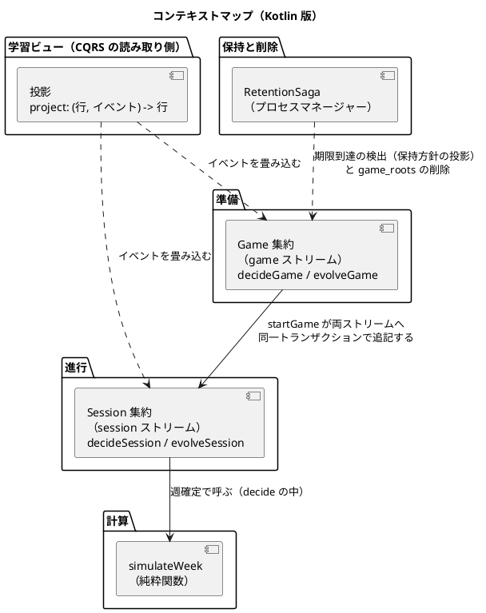
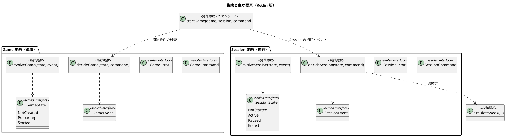
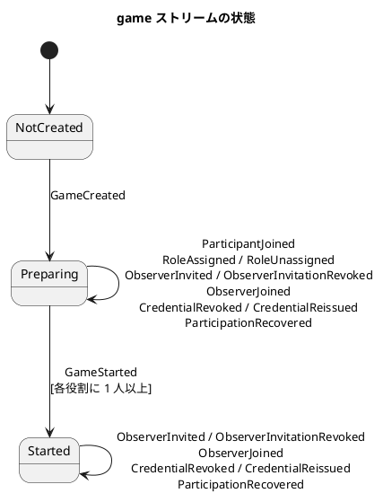
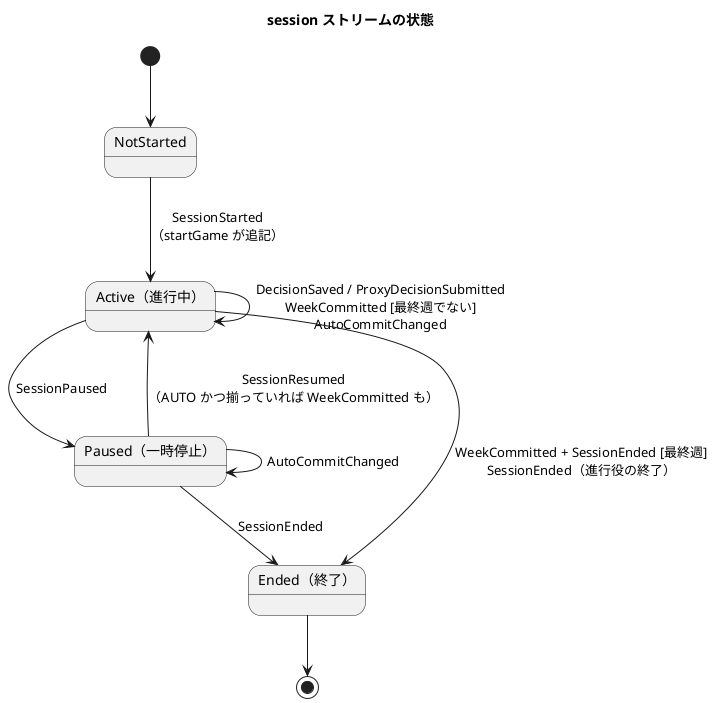

# ドメインモデル設計 - ビールゲームシミュレーション（Kotlin 版）

## 概要

本書は、beer-game-kotlin のドメインモデルを定義します。機能と振る舞いは [beer-game2 のドメインモデル](../beer-game2/domain-model.md) を正本として引き継ぎ、次の 3 点を **Kotlin・関数型・イベントソーシング（ES）+ CQRS** で設計し直します。

- 状態はイベントの列です。集約は `decide(state, command): Either<DomainError, List<Event>>` と `evolve(state, event): State` の 2 つの純粋関数で表します（[ガイド §7.3](../../reference/関数型プログラミングガイド_Kotlin編.md)、[§7.4](../../reference/関数型プログラミングガイド_Kotlin編.md)）。
- ADT（State・Command・Event・DomainError）は `sealed interface` と `data class` / `value class` で表し、失敗は例外でなく `Either` と `Raise` で返します（[ガイド §3.5](../../reference/関数型プログラミングガイド_Kotlin編.md)）。
- 読み取りは、イベントを畳み込む純粋関数（投影）に分けます（CQRS、[ガイド §7.5](../../reference/関数型プログラミングガイド_Kotlin編.md)）。

入力は [要件定義](../../requirements/beer-game2/requirements_definition.md)（BR-01〜BR-17、FR-01〜FR-18、NFR-01〜NFR-12）、[システムユースケース](../../requirements/beer-game2/system_usecase.md)、[ユーザーストーリー](../../requirements/beer-game2/user_story.md) です。**`docs/` を設計の正本**とします。実装コードはまだ存在しません。本書の Kotlin のコードは、型と関数の形を示す設計上のスケッチです。

### 設計の前提と原則

- 学習用シミュレーションであり、勝敗の判定でなく「構造が振る舞いを生む」ことの体験が目的です。
- 参加者はアカウントを作らず、参加コードと表示名で参加します。観察者は観察用の招待で参加します。
- 週次の計算は決定論的で、同じ入力から同じ結果を返します（NFR-01）。
- プレイ中は役割ごとに見える情報を制限し、終了後に全役割の時系列を開示します。
- **ルールは集約（`decide`）が持ちます。** アプリケーション層は、イベントの読み込み、`decide` の呼び出し、追記だけを行い、業務ルールを持ちません。
- **ドメインは純粋です。** 時刻、乱数、資格のダイジェスト、永続化は境界（アダプター）が担い、コマンドの値として渡します（[ガイド §4.4](../../reference/関数型プログラミングガイド_Kotlin編.md)）。
- 集約は、整合性が必要な最小の範囲です。他の集約へは識別子で参照します。
- **個人情報と秘密は、イベントに入れません**（NF-S14）。イベントには識別子と有効期限だけを置きます（[データモデル](./data-model.md) の周辺ストア）。

## 戦略的設計

### 境界付けられたコンテキストの分類

| コンテキスト | 分類 | 理由 | 集約・主な要素 |
| :--- | :--- | :--- | :--- |
| シミュレーション計算 | 中核 | JSD 改訂版キットの 12 ステップと遅延を忠実に再現することが教材価値そのもの | 純粋関数 `simulateWeek` |
| 進行（プレイ） | 中核 | 4 役割の意思決定を揃えて週を一度だけ確定する整合性。共同入力と自動確定がここにある | Session 集約（`session` ストリーム） |
| 準備（設定と参加） | 補完 | カスタム条件、参加者・共同担当・観察者の管理。規則は多いが、更新頻度は低い | Game 集約（`game` ストリーム） |
| 学習ビュー | 補完 | 開示範囲（逆算で個別値が漏れない集計）に固有のルールがある | 投影（読み取りモデル） |
| 保持と削除 | 一般 | 期限後の一括削除と再試行は一般的な仕組み | RetentionSaga（プロセスマネージャー） |

### コンテキストマップ



- 実線は、同期の呼び出しです。点線は、イベントの購読または参照です。
- `Session` は、開始時のイベント（`SessionStarted`）に、設定と役割の割り当ての**写し**を持ちます。以後は `Game` のストリームを読まずに、操作者の役割の確認と週の確定ができます（設計判断 D4）。
- 2 つのストリームにまたがるコマンドは `StartGame` だけです（設計判断 D3）。

## ユビキタス言語

beer-game2 の用語を引き継ぎます（定義は [beer-game2](../beer-game2/domain-model.md) を参照）。ES で加わった用語と、コード上の名称を示します。

| 用語 | コード上の名称 | 定義 |
| :--- | :--- | :--- |
| ストリーム | `StreamType`（`GAME`、`SESSION`） | 1 つの集約のイベントの列。1 ゲームにつき `game` と `session` の 2 本。識別は `(GameId, StreamType)` |
| ストリームの版 | `StreamVersion` | ストリームに追記したイベントの通し番号（1 から）。楽観的並行制御に使う。`State.version` と等しい |
| コマンド | `GameCommand`、`SessionCommand` | 利用者の意図。現在の状態に照らして検証され、成功すればイベントになる |
| イベント | `GameEvent`、`SessionEvent` | 起きた事実。過去形で命名し、変更しない。状態の唯一の源 |
| 決定 | `decide` | `(State, Command) -> Either<DomainError, List<Event>>`。純粋 |
| 進化 | `evolve` | `(State, Event) -> State`。純粋で全域（失敗しない） |
| 再生 | `replay` | イベント列を `fold(evolve)` で状態へ畳み込むこと |
| 投影 | `project` | イベントを畳み込んで読み取りモデルの行を作る純粋関数 |
| 意思決定の版 | `DecisionVersion` | 役割ごと・週ごとの意思決定の版。共同入力の競合検出に使う。**ストリームの版とは別** |
| 操作者 | `Actor` | コマンドを発行した主体（進行役・参加者・観察者・匿名） |
| 周辺ストア | — | イベントに入れない個人情報（表示名）と秘密（資格ダイジェスト）の保存先（[データモデル](./data-model.md)） |

## 戦術的設計

### 全体像



### 値オブジェクト

不変で、属性値が同じなら同じものとして扱います。**スマートコンストラクタ**（`of`）で生成時に検証し、不正な値が存在できないようにします。`value class` はコンパイル時に型を区別するゼロコストの包みです（`GameId` と `ParticipantId` を取り違えられません）。検証は `Either` で返し、複数の入力はエラーを集めます（[ガイド §3.4](../../reference/関数型プログラミングガイド_Kotlin編.md)）。

```kotlin
@JvmInline value class GameId(val value: UUID)
@JvmInline value class ParticipantId(val value: UUID)

@JvmInline value class Quantity private constructor(val value: Int) {
    companion object {
        const val DEFAULT_MAX = 1000
        fun of(n: Int): Either<ValidationError.QuantityOutOfRange, Quantity> =
            if (n in 0..DEFAULT_MAX) Quantity(n).right()
            else ValidationError.QuantityOutOfRange(n, DEFAULT_MAX).left()
    }
}

enum class Role { FACTORY, DISTRIBUTOR, WHOLESALER, RETAILER }   // 上流から下流の順

/** 4 役割すべてに値を持つ総称コンテナ。部分的な Map を作れないため、「4 役割が揃う」を型で表す */
data class RoleMap<out A>(val factory: A, val distributor: A, val wholesaler: A, val retailer: A) {
    operator fun get(role: Role): A = when (role) {
        Role.FACTORY -> factory; Role.DISTRIBUTOR -> distributor
        Role.WHOLESALER -> wholesaler; Role.RETAILER -> retailer
    }
    fun <B> map(f: (Role, A) -> B): RoleMap<B> = /* 4 役割に f を適用 */ TODO()
}
```

| 値オブジェクト | 型（コード上の名称） | 属性・制約 |
| :--- | :--- | :--- |
| 識別子 | `GameId`、`ParticipantId`、`ObserverId`、`InvitationId` | UUID を包む `value class`。**セッションの識別子は `GameId` と同じ**（1 ゲーム 1 セッション。`SessionId` は導入しない） |
| 役割（Role） | `enum class Role` | FACTORY、DISTRIBUTOR、WHOLESALER、RETAILER。上流から下流の順序を持つ |
| 役割ごとの値 | `RoleMap<A>` | 4 役割すべての値。意思決定が揃った状態、役割状態、週結果に使う |
| 数量（Quantity） | `value class Quantity` | 0 以上の整数、上限あり（既定 1000）。発注数・生産要請数 |
| 週（Week） | `value class Week` | 1 から最終週まで（1〜50） |
| 金額（Money） | `value class Money` | 最小単位（整数）。在庫単価・受注残単価・週次費用。小数を持たない |
| 需要系列（DemandSeries） | `value class DemandSeries` | 各週の顧客需要。0 以上の整数で、長さは最終週以上 |
| 遅延（Delay） | `value class Delay` | 週数（0 以上の整数）。注文、配送、生産ごと。キットの既定は 2（生産は 2 段階） |
| 待ち行列（Pipeline） | `value class Pipeline` | 長さが遅延に等しい `List<Quantity>`。先頭が次週に到着する |
| 初期条件（InitialConditions） | `data class` | 各役割の初期在庫、初期の注文・配送・生産の待ち行列。既定はキット準拠（在庫 12、各段 4） |
| 費用方針（CostPolicy） | `data class` | 在庫単価、受注残単価。既定は 0.50 と 1.00（最小単位で保持） |
| 公開範囲（DisclosurePolicy） | `enum class` | プレイ中に観察者へ見せる範囲。既定はチーム合計（寄与者が 2 未満なら非表示） |
| 確定方式（CommitMode） | `enum class` | `MANUAL`（既定）、`AUTO` |
| 設定の種別（SettingsKind） | `sealed interface` | `Kit` または `Custom(changes: Set<SettingsField>)`。設定から**導出**して保持する |
| ゲーム設定（GameSettings） | `data class` | 上記の組。`of` で全項目を検証し、エラーを集める |
| 役割状態（RoleState） | `data class` | 在庫、受注残、注文・配送・生産の `Pipeline`、累積費用 |
| 役割別の週結果（RoleWeekResult） | `data class` | 受注（需要）、出荷、**発注（その週の意思決定）**、週末在庫、週末受注残、週次費用、累積費用 |
| 表示名（DisplayName） | `value class` | 前後の空白を除いて 1〜80 文字。**イベントには入れない** |
| 参加コード・招待コード | `JoinCode`、`InvitationCode` | 推測困難な乱数から作る（8 桁以上）。**2 つは別の型・別の値**。招待コードの値はイベントに入れない |
| 資格の有効性（CredentialValidity） | `data class` | 発行時刻、有効期限、失効時刻。`status(now)` が有効・失効・期限切れを返す純粋関数 |
| 保持方針（RetentionPolicy） | `data class` | 保持日数 1〜3650（既定 90）、保持開始、削除期限 |
| 操作者（Actor） | `sealed interface` | `Facilitator(gameId)`、`Participant(id)`、`Observer(id)`、`Anonymous`。認証はアダプターが行い、結果の `Actor` をコマンドに載せる |
| ストリームの版（StreamVersion） | `value class` | 単調に増える整数。楽観的並行制御の期待値 |
| 意思決定の版（DecisionVersion） | `value class` | 役割・週ごとに 0 から。保存のたびに 1 増える |

**検証の誤りと業務ルールの失敗を分けます。** 入力の形（範囲外・空・不正な型）は `ValidationError` として、境界でコマンドを作るときに**すべて集めて**返します。状態に照らした業務ルール違反は `DomainError` として、`decide` が 1 件返します。

```kotlin
sealed interface ValidationError {
    data class QuantityOutOfRange(val actual: Int, val max: Int) : ValidationError
    data class FinalWeekOutOfRange(val actual: Int) : ValidationError
    data class DemandSeriesInvalid(val weekIndex: Int, val reason: String) : ValidationError  // 対象週を示す（AC1.1.2）
    data class DisplayNameInvalid(val length: Int) : ValidationError
    data class RetentionOutOfRange(val actual: Int) : ValidationError
    // 初期在庫、遅延、単価などの範囲外も同様に項目ごとに持つ
}

fun GameSettings.Companion.of(raw: RawSettings): Either<NonEmptyList<ValidationError>, GameSettings> = either {
    zipOrAccumulate(
        { checkFinalWeek(raw.finalWeek) },
        { checkDemand(raw.demand, raw.finalWeek) },
        { checkInitialConditions(raw.initialConditions) },
        { checkCostPolicy(raw.costPolicy) },
        { checkDelays(raw.delays) },
    ) { fw, demand, init, cost, delays -> GameSettings(fw, demand, init, cost, delays, raw.disclosure, raw.commitMode) }
}
```

`SettingsKind` は、`KitPreset.classify(settings)` が導出する純粋関数です。キット準拠値から変えた項目（`SettingsField`: 週数、需要系列、初期条件、費用単価、遅延）を列挙し、1 つでも変えたら `Custom` とします（BR-14）。

### 共通の型

```kotlin
/** 全イベントに付く封筒。ペイロードとは別に、永続化と追跡に必要な項目を持つ */
data class EventEnvelope<out E>(
    val eventId: UUID, val gameId: GameId, val streamType: StreamType,
    val streamVersion: StreamVersion,       // 1 から。ストリームの中で連続する
    val schemaVersion: Int,                 // ペイロードの版（データモデルの上げ下ろし規則）
    val actor: ActorRef,                    // 種別と ID だけ（表示名を含めない）
    val correlationId: UUID,                // HTTP からログ・イベント・通知まで伝える
    val commandId: UUID,                    // 同じコマンドから生まれたイベントを束ねる
    val occurredAt: Instant,                // コマンドが運んだ時刻（decide は時計を持たない）
    val payload: E,
)

/** 全コマンドが持つ共通項目 */
sealed interface Command { val actor: Actor; val at: Instant }
```

エラーを HTTP の状態へ写す責務は、アダプター（[バックエンドアーキテクチャ](./architecture-backend.md)）が持ちます。ドメインのエラーは、次の分類を持ちます。

| 分類 | 意味 | 例 |
| :--- | :--- | :--- |
| `Forbidden` | 操作者に権限がない | 進行役以外の割り当て、他役割への入力、観察者の操作 |
| `NotFound` | 対象が存在しない | 未知の参加者、未知の招待 |
| `InvalidState` | 現在の状態では許されない | 準備中でない参加、一時停止中の確定 |
| `Conflict` | 競合または古い版 | 意思決定の版違い、週・ストリームの版違い |
| `RuleViolation` | 業務ルール違反 | 開始条件の不足、入力が揃わない週確定 |

**すべての `DomainError`（`GameError`・`SessionError`）は、安定した `code` と `category` を持ちます。** `code` は problem+json の `type` と、フロントエンドの表示文言の辞書の鍵に使うため、一度決めたら変えません（例: `session.week_advanced`、`session.decision_conflict`）。`category` は上の分類で、HTTP の状態への写像の入力になります。

```kotlin
sealed interface DomainError { val code: String; val category: ErrorCategory }
enum class ErrorCategory { Forbidden, NotFound, InvalidState, Conflict, RuleViolation }
// 例: data class WeekAdvanced(val requested: Week, val current: Week) : SessionError {
//         override val code = "session.week_advanced"; override val category = ErrorCategory.Conflict }
```

`WeekAdvanced` は「確定で週が進んだ後の保存」を表し、`DecisionConflict`（同じ週で他の人が先に保存した）と区別します。画面の文言も別です（[UI 設計](./ui-design.md)）。

### Game 集約（準備）

ストリームは `game`。1 ゲームにつき 1 本です。集約は、設定、参加者、役割の割り当て、観察用の招待、資格の有効性を所有します。トランザクション境界は 1 回のコマンドです。

#### State

```kotlin
sealed interface GameState {
    val version: StreamVersion

    data object NotCreated : GameState                       // ストリームが空
    data class Preparing(val data: GameData) : GameState     // 参加・割り当てを受け付ける
    data class Started(val data: GameData) : GameState       // 設定と割り当てを固定
}

data class GameData(
    val gameId: GameId,
    val settings: GameSettings,
    val retention: RetentionPolicy,
    val participants: Map<ParticipantId, ParticipantEntry>,    // role は null でもよい
    val invitations: Map<InvitationId, InvitationEntry>,
    val observers: Map<ObserverId, InvitationId>,
    val credentials: Map<CredentialSubject, CredentialValidity>,
)
data class ParticipantEntry(val role: Role?)
```

`Ended` は持ちません。ゲームの終了は進行（Session）の事実であり、`game` ストリームには書きません。ゲームの状態（準備中・開始済み・終了）は、投影 `game_overview` が両ストリームから導出します（設計判断 D2）。

#### Command

```kotlin
sealed interface GameCommand : Command {
    data class CreateGame(override val actor: Actor, override val at: Instant, val gameId: GameId,
        val joinCode: JoinCode, val settings: GameSettings, val retentionDays: Int,
        val facilitatorCredentialExpiresAt: Instant) : GameCommand
    data class JoinGame(override val actor: Actor, override val at: Instant, val participantId: ParticipantId,
        val displayName: DisplayName, val credentialExpiresAt: Instant) : GameCommand
    data class AssignRole(override val actor: Actor, override val at: Instant, val participantId: ParticipantId, val role: Role) : GameCommand
    data class UnassignRole(override val actor: Actor, override val at: Instant, val participantId: ParticipantId) : GameCommand
    data class InviteObserver(override val actor: Actor, override val at: Instant, val invitationId: InvitationId, val expiresAt: Instant) : GameCommand
    data class RevokeObserverInvitation(override val actor: Actor, override val at: Instant, val invitationId: InvitationId) : GameCommand
    data class JoinAsObserver(override val actor: Actor, override val at: Instant, val observerId: ObserverId,
        val invitationId: InvitationId, val displayName: DisplayName, val credentialExpiresAt: Instant) : GameCommand
    data class RevokeCredential(override val actor: Actor, override val at: Instant, val subject: CredentialSubject) : GameCommand
    data class ReissueCredential(override val actor: Actor, override val at: Instant, val subject: CredentialSubject, val expiresAt: Instant) : GameCommand
    data class RecoverParticipation(override val actor: Actor, override val at: Instant, val subject: CredentialSubject, val credentialExpiresAt: Instant) : GameCommand
}
// StartGame は 2 ストリームにまたがるため、GameCommand ではなく startGame 関数の入力として定義する（後述）
```

`displayName` と資格のダイジェスト（`IssuedCredential`）は、コマンドの値として運ばれますが、**イベントには写しません**。アプリケーション層が、同じトランザクションで周辺ストアへ書きます（設計判断 D7）。

#### decide と evolve

```kotlin
fun decideGame(state: GameState, command: GameCommand): Either<GameError, List<GameEvent>> = either {
    when (command) {
        is CreateGame -> {
            ensure(state is NotCreated) { GameError.AlreadyCreated }
            ensure(command.actor is Actor.Anonymous) { GameError.Forbidden("作成は匿名の操作者のみ") }
            listOf(GameCreated(command.gameId, command.joinCode, command.settings,
                command.retentionDays, command.facilitatorCredentialExpiresAt))
        }
        is JoinGame -> {
            val data = state.preparing().bind()                 // 準備中でなければ NotPreparing
            listOf(ParticipantJoined(command.participantId, command.credentialExpiresAt))
        }
        is AssignRole -> {
            val data = state.preparing().bind()
            ensure(command.actor.isFacilitatorOf(data.gameId)) { GameError.Forbidden("割り当ては進行役のみ") }
            val current = ensureNotNull(data.participants[command.participantId]) { GameError.ParticipantNotFound(command.participantId) }
            when (current.role) {
                command.role -> emptyList()                      // 変化なし。履歴に足さない
                null -> listOf(RoleAssigned(command.participantId, command.role))
                else -> listOf(RoleUnassigned(command.participantId, current.role),     // 付け替え = 2 イベント
                               RoleAssigned(command.participantId, command.role))
            }
        }
        // ... 残りのコマンドも同じ形（when は網羅され、追加時にコンパイラが漏れを示す）
    }
}

fun evolveGame(state: GameState, event: GameEvent): GameState = when (event) {
    is GameCreated -> Preparing(GameData.from(event)).at(version = 1)
    is RoleAssigned -> state.updateData { it.assign(event.participantId, event.role) }.bumped()
    is GameStarted -> (state as Preparing).let { Started(it.data) }.bumped()
    // 全イベントを when で網羅する。evolve は失敗しない（検証は decide の責務）
}
```

#### 不変条件

| 不変条件 | 内容 | 根拠 | 違反時の `GameError`（分類） |
| :--- | :--- | :--- | :--- |
| 設定の妥当性 | 最終週 1〜50、需要系列の長さは最終週以上、各値と単価は範囲内。準拠値から変えたら「カスタム」として記録する（導出） | BR-13、BR-14 | `ValidationError`（境界で集める） |
| 作成の一回性 | ストリームが空のときだけ作成できる | FR-01、AC1.1.1 | `AlreadyCreated`（`InvalidState`） |
| 参加の受付 | 準備中の間だけ、参加と割り当てを受け付ける | 状態モデル | `NotPreparing`（`InvalidState`） |
| 役割の割り当て | 1 人の参加者は高々 1 つの役割。**1 つの役割に複数の参加者を割り当てられる**。付け替えは解除と割り当ての 2 イベント | FR-16、BR-15 | — |
| 開始条件 | 4 役割のそれぞれに、1 人以上が割り当てられている | UC-04、FR-03 | `StartConditionNotMet(missing)`（`RuleViolation`） |
| 観察用の招待 | 参加コードと別の値。失効または期限切れの招待では新しい参加ができない。観察者は役割を持てない | FR-17、BR-17 | `InvitationRevoked`、`InvitationExpired`、`InvitationNotFound` |
| 資格の有効性 | 進行役・参加者・観察者の資格は有効期限と失効を持つ。失効済みを再度失効できない。再発行は新しい有効期限を持つ | NFR-06、NF-S4 | `CredentialAlreadyRevoked`（`InvalidState`） |
| 設定の固定 | 開始後は、設定と役割の割り当てを変更しない | — | `NotPreparing` |
| 権限 | 割り当て、招待、失効・再発行、開始は進行役だけ | — | `Forbidden` |

#### Game 集約の状態遷移



開始後も、観察者の招待と参加、資格の失効・再発行、復帰は受け付けます（プレイ中の観察と、漏れた資格への対応のため）。参加者の追加と役割の割り当ては受け付けません。

### Session 集約（進行）

ストリームは `session`。1 ゲームにつき 1 本で、開始（`SessionStarted`）で始まります。集約は、週、4 役割の状態、現在の意思決定、確定方式、役割の割り当ての写しを所有します。**週結果の履歴は状態に持ちません**（投影の責務。状態は次の週を決めるのに必要な最小限にします）。

#### State

```kotlin
sealed interface SessionState {
    val version: StreamVersion

    data object NotStarted : SessionState
    data class Active(val data: SessionData) : SessionState
    data class Paused(val data: SessionData) : SessionState
    data class Ended(val data: SessionData) : SessionState
}

data class SessionData(
    val gameId: GameId,
    val settings: GameSettings,                           // 開始時の写し
    val assignments: RoleMap<Set<ParticipantId>>,         // 開始時の写し（開始後は変わらない）
    val week: Week,
    val roleStates: RoleMap<RoleState>,
    val decisions: Map<Role, DecisionEntry>,              // 当週に保存された意思決定。確定でクリア
    val decisionVersions: RoleMap<DecisionVersion>,       // 当週の版。確定で 0 に戻す
    val commitMode: CommitMode,
)
data class DecisionEntry(val quantity: Quantity, val version: DecisionVersion, val editor: Editor)
```

#### Command

```kotlin
sealed interface SessionCommand : Command {
    data class PauseSession(override val actor: Actor, override val at: Instant) : SessionCommand
    data class ResumeSession(override val actor: Actor, override val at: Instant) : SessionCommand
    data class EndSession(override val actor: Actor, override val at: Instant) : SessionCommand
    data class SaveDecision(override val actor: Actor, override val at: Instant, val role: Role,
        val requestedWeek: Week,                       // 画面が表示している週。確定後の古い画面からの保存を区別する
        val quantity: Quantity, val expectedDecisionVersion: DecisionVersion) : SessionCommand
    data class SubmitProxyDecision(override val actor: Actor, override val at: Instant, val role: Role, val quantity: Quantity) : SessionCommand
    data class CommitWeek(override val actor: Actor, override val at: Instant,
        val requestedWeek: Week, val expectedVersion: StreamVersion) : SessionCommand
    data class SetCommitMode(override val actor: Actor, override val at: Instant, val mode: CommitMode) : SessionCommand
}
// SessionStarted は startGame が生成する（SessionCommand に開始は無い）
```

#### decide と evolve（自動確定を含む）

自動確定は、`decide` が **1 回のコマンドから複数のイベントを返す**ことで表します。ES では、「最後の意思決定の保存と週確定が同じトランザクション」は、追記が 1 回であることと同じです（[ガイド §7.4](../../reference/関数型プログラミングガイド_Kotlin編.md) の複数イベントの例、ADR-008）。

```kotlin
fun decideSession(state: SessionState, command: SessionCommand): Either<SessionError, List<SessionEvent>> = either {
    when (command) {
        is SaveDecision -> {
            val data = state.active().bind()                        // 進行中でなければ NotActive
            ensure(command.actor.isAssignedTo(command.role, data.assignments)) { SessionError.Forbidden("その役割の参加者だけ") }
            ensure(command.requestedWeek == data.week) {
                SessionError.WeekAdvanced(command.requestedWeek, data.week)   // 共同入力の競合（DecisionConflict）とは別の分類
            }
            val current = data.decisionVersions[command.role]
            ensure(command.expectedDecisionVersion == current) {
                SessionError.DecisionConflict(command.role, latest = data.decisions[command.role])  // 最新値と最後の保存者を返す
            }
            val saved = DecisionSaved(data.week, command.role, command.quantity, current.next(), command.actor.asEditor())
            val after = evolveSession(state, saved)
            listOf(saved) + autoCommitEvents(after, command)         // AUTO かつ 4 役割が揃えば WeekCommitted（+ SessionEnded）
        }
        is CommitWeek -> {
            val data = state.active().bind()
            ensure(command.actor.isFacilitator(data.gameId)) { SessionError.Forbidden("確定は進行役のみ") }
            ensure(command.requestedWeek == data.week && command.expectedVersion == state.version) {
                SessionError.StaleVersion(data.week, state.version)
            }
            commitEvents(data, CommitKind.MANUAL).bind()             // 揃っていなければ IncompleteDecisions
        }
        // ... 他のコマンド
    }
}

/** 確定のイベント列。simulateWeek は decide の中で呼ばれる純粋関数 */
private fun Raise<SessionError>.commitEvents(data: SessionData, kind: CommitKind): List<SessionEvent> {
    val decisions = data.completeDecisions() ?: raise(SessionError.IncompleteDecisions(data.missingRoles()))
    val outcome = simulateWeek(data.settings, data.week, data.roleStates, decisions)
    val committed = WeekCommitted(data.week, kind, decisions, outcome.results, outcome.nextStates, contributors = 4)
    return if (data.week == data.settings.finalWeek) listOf(committed, SessionEnded(EndReason.FINAL_WEEK))
           else listOf(committed)
}

fun evolveSession(state: SessionState, event: SessionEvent): SessionState = when (event) {
    is DecisionSaved -> state.updateData { it.withDecision(event) }.bumped()
    is WeekCommitted -> state.updateData {
        it.copy(roleStates = event.nextStates,                     // イベントの値をそのまま採用（再計算しない）
                week = if (it.week == it.settings.finalWeek) it.week else it.week.next(),
                decisions = emptyMap(), decisionVersions = RoleMap.all(DecisionVersion.ZERO))
    }.bumped()
    is SessionEnded -> (state as? Active ?: state as Paused).let { Ended(it.data()) }.bumped()
    // 全イベントを網羅
}
```

`evolveSession` は `WeekCommitted` の `nextStates` をそのまま採用し、`simulateWeek` を呼び直しません（設計判断 D5）。

#### 不変条件

| 不変条件 | 内容 | 根拠 | 違反時の `SessionError`（分類） |
| :--- | :--- | :--- | :--- |
| 意思決定の条件 | 進行中のときだけ、0〜上限の整数を、役割ごとに 1 件保存できる | BR-10 | `NotActive`（`InvalidState`） |
| 共同入力 | 同じ役割の意思決定は、1 つの値と 1 つの**意思決定の版**を、共同担当で共有する。版が古い保存は拒否し、**最新値と最後の保存者**を返す（変更を黙って失わない） | FR-16、BR-15 | `DecisionConflict(role, latest)`（`Conflict`） |
| 代理入力 | 進行役だけが任意の役割へ入力できる。入力値、操作者、時刻をイベントに残す。意思決定の版を 1 増やすので、古い版を持つ参加者の保存は拒否される | FR-15 | `Forbidden` |
| 役割の確認 | 保存できるのは、`SessionStarted` の割り当ての写しに含まれる参加者だけ。観察者は常に拒否 | FR-04、FR-17 | `Forbidden` |
| 週確定の条件 | 4 役割の意思決定が揃うまで確定できない | BR-12 | `IncompleteDecisions(missing)`（`RuleViolation`） |
| 週確定の一回性 | 要求された週とストリームの版が現在と一致する場合だけ確定する。再送は、アプリケーション層の冪等記録が同じ結果を返す | FR-09 | `StaleVersion`（`Conflict`） |
| 週確定の結果 | **役割別の週結果**（需要、出荷、発注、在庫、受注残、費用）と次週の役割状態を、1 つのイベントに含める | FR-13、FR-14 | — |
| 自動確定 | 確定方式が `AUTO` で、進行中のときだけ、**最後の意思決定を保存するコマンドの `decide` が、保存と確定のイベントを一度に返す**。一時停止中は確定しない。再開時または `AUTO` への変更時に、揃っていれば確定する | FR-18、BR-16 | — |
| 終了 | 最終週を確定すると、同じ `decide` が `SessionEnded` を返す。終了後は、入力と確定を拒否する | 状態モデル | `AlreadyEnded`（`InvalidState`） |
| 権限 | 意思決定は、その役割の参加者だけ。確定、停止、再開、終了、確定方式の変更は進行役だけ | — | `Forbidden` |
| 非負・保存則 | 在庫と受注残は負にならない。確定の前後で、出荷数が下流の配送待ち行列へ入る | FR-06、BR-05〜BR-08 | （`simulateWeek` の性質テスト） |

自動確定が保存と確定を**1 回の追記**で行うため、「入力がそろったあと、確定の前に、別の人が変更する」隙間は生じません。手動の確定と自動確定が同時に起きても、2 回目の追記は期待するストリームの版が古く（楽観的並行制御）、再読み込みすると状態が進んでいるので、確定は一度だけです。

#### Session 集約の状態遷移



### 2 ストリームにまたがる StartGame

開始は、`game` ストリームに `GameStarted`、`session` ストリームに `SessionStarted` を**同一トランザクションで**追記する、唯一のコマンドです。`game` と `session` の両方を読み、両方の期待する版を持って追記します（[ガイド §7.6](../../reference/関数型プログラミングガイド_Kotlin編.md) の複数ストリームのコマンド）。

```kotlin
data class StartDecision(val game: List<GameEvent>, val session: List<SessionEvent>)

fun startGame(game: GameState, session: SessionState, command: StartGame): Either<StartError, StartDecision> = either {
    val data = game.preparing().bind()
    ensure(command.actor.isFacilitator(data.gameId)) { Forbidden("開始は進行役のみ") }
    ensure(session is SessionState.NotStarted) { AlreadyStarted }
    val assignments = data.roleAssignments()                       // RoleMap<Set<ParticipantId>>
    val missing = Role.entries.filter { assignments[it].isEmpty() }
    ensure(missing.isEmpty()) { StartConditionNotMet(missing) }
    StartDecision(
        game = listOf(GameStarted(data.gameId)),
        session = listOf(SessionStarted(data.settings, assignments, initialStates(data.settings), data.settings.commitMode)),
    )
}
```

二重の開始は、`session` ストリームの版 1 への追記が重複するため、片方が必ず失敗します（開始の一回性）。失敗側は再読み込みして `AlreadyStarted` を得ます。

### 週次計算（simulateWeek）

`simulateWeek` は、永続化・時刻・通信・認可に依存しない**純粋関数**です。`decide` の内部から呼ばれ、結果は `WeekCommitted` に**事実として固定**されます。

```kotlin
data class WeekOutcome(val results: RoleMap<RoleWeekResult>, val nextStates: RoleMap<RoleState>)

fun simulateWeek(
    settings: GameSettings,          // 遅延、費用方針、需要系列
    week: Week,
    states: RoleMap<RoleState>,      // 前週末の断面
    decisions: RoleMap<Quantity>,    // 4 役割の当週の発注数または生産要請数
): WeekOutcome
```

| 項目 | 内容 |
| :--- | :--- |
| 入力 → 出力 | 前週の断面、4 役割の意思決定、設定 → 次週の断面、役割別の週結果 |
| 規則の正本 | 12 ステップと遅延（BR-02〜BR-09）。利用可能量 = 前週末在庫 + 当週入荷。充足対象 = 前週末受注残 + 当週受注。出荷 = 両者の小さい方。週末在庫 = `max(0, 利用可能量 - 充足対象)`、週末受注残 = `max(0, 充足対象 - 利用可能量)`。週次費用 = 週末在庫 × 在庫単価 + 週末受注残 × 受注残単価 |
| 全域性 | 入力の型（`RoleMap`、`Quantity`、`Week`）が検証済みなので、`Either` を返さない（失敗しない） |
| 需要 | 顧客需要は `settings.demand[week]` から小売店にだけ与える。他の役割の受注は、下流の注文が注文遅延を経て届いた値 |
| 検証 | 既知の系列の golden test、性質テスト（在庫・受注残が非負、出荷が利用可能量を超えない）、**再生の同値性**（`fold(evolve)` の結果が、生で計算した結果と一致する）。[ガイド §8.3](../../reference/関数型プログラミングガイド_Kotlin編.md) |

規則の詳細（12 ステップの順序、待ち行列の前進）は beer-game2 と同じで、本書は新しい規則を加えません。決定論性は `simulateWeek` が乱数・時計を持たないことで保たれます（NFR-01）。

### RetentionSaga（プロセスマネージャー）

期限に達したゲームを削除し、実行結果の証跡だけを残す手続きです。**ES のストリームにはせず、状態を持つプロセスマネージャー**として扱います（設計判断 D8）。状態遷移は純粋な `decide` / `evolve` で表し、永続化は [データモデル](./data-model.md) の `deletion_runs` ほか（状態の行）に置きます。

```kotlin
sealed interface RetentionState {
    data object Pending : RetentionState
    data class InProgress(val attempt: Int) : RetentionState
    data class Failed(val attempt: Int, val nextAttemptAt: Instant, val failureCode: String) : RetentionState
    data object Completed : RetentionState
}
sealed interface RetentionCommand { /* StartDeletion, RecordFailure(code, now), RecordCompletion */ }
sealed interface RetentionEvent  { /* DeletionStarted, DeletionFailed, DeletionCompleted */ }
```

| 不変条件 | 内容 |
| :--- | :--- |
| 一度だけ | 完了後は、同じゲームの削除を開始できない |
| 再試行 | 失敗は最大 5 回、指数バックオフで再試行する。続けて失敗したら通知する（ADR-007） |
| 完了の定義 | **`game_roots` の削除（全データの連鎖削除）が成功したとき**だけ完了とする。半分の削除を完了としない |
| 網羅 | 削除後に、ゲームの ID を含む行が、どの表にも残らない（NFR-07、AC5.1.4） |

## ドメインイベント

すべてのイベントは、封筒（`EventEnvelope`）に、ストリームの版、スキーマ版、操作者（種別と ID）、相関 ID、コマンド ID、発生時刻を持ちます。**イベントそのものが監査の記録**です（専用の別テーブルは作りません。ADR-008）。表示名と資格の値はペイロードに含めません。

### game ストリーム

| ID | イベント | 発生条件（コマンド） | ペイロード |
| :--- | :--- | :--- | :--- |
| EV-G01 | `GameCreated` | `CreateGame`。ストリームが空 | `gameId`、`joinCode`、`settings`（最終週、需要系列、初期条件、費用方針、遅延、公開範囲、確定方式、種別 `Kit`/`Custom` と変更項目）、`retentionDays`、`facilitatorCredentialExpiresAt` |
| EV-G02 | `ParticipantJoined` | `JoinGame`。準備中 | `participantId`、`credentialExpiresAt` |
| EV-G03 | `RoleAssigned` | `AssignRole`。進行役、準備中、役割が変わる | `participantId`、`role` |
| EV-G04 | `RoleUnassigned` | `UnassignRole`、または `AssignRole` による付け替え（解除の側） | `participantId`、`role`（解除前の役割） |
| EV-G05 | `ObserverInvited` | `InviteObserver`。進行役 | `invitationId`、`expiresAt` |
| EV-G06 | `ObserverInvitationRevoked` | `RevokeObserverInvitation`。進行役、有効な招待 | `invitationId` |
| EV-G07 | `ObserverJoined` | `JoinAsObserver`。有効で期限内の招待 | `observerId`、`invitationId`、`credentialExpiresAt` |
| EV-G08 | `CredentialRevoked` | `RevokeCredential`。進行役、有効な資格 | `subject`（`kind`: FACILITATOR / PARTICIPANT / OBSERVER、`id`） |
| EV-G09 | `CredentialReissued` | `ReissueCredential`。進行役 | `subject`、`expiresAt` |
| EV-G10 | `ParticipationRecovered` | `RecoverParticipation`。有効な復帰資格 | `subject`（FACILITATOR / PARTICIPANT）、`credentialExpiresAt`（復帰資格を更新した新しい期限） |
| EV-G11 | `GameStarted` | `StartGame`。進行役、準備中、各役割に 1 人以上 | `gameId` |

### session ストリーム

| ID | イベント | 発生条件（コマンド） | ペイロード |
| :--- | :--- | :--- | :--- |
| EV-S01 | `SessionStarted` | `StartGame`（`game` ストリームの `GameStarted` と同一トランザクション） | `settings`（設定の写し）、`assignments`（`RoleMap<Set<ParticipantId>>` の写し）、`initialStates`（`RoleMap<RoleState>`）、`commitMode` |
| EV-S02 | `SessionPaused` | `PauseSession`。進行役、進行中 | なし |
| EV-S03 | `SessionResumed` | `ResumeSession`。進行役、一時停止中 | なし |
| EV-S04 | `SessionEnded` | `EndSession`（進行役）、または最終週の `WeekCommitted` と同じ `decide` | `reason`（`FINAL_WEEK` / `FACILITATOR`） |
| EV-S05 | `DecisionSaved` | `SaveDecision`。進行中、その役割の参加者、意思決定の版が一致 | `week`、`role`、`quantity`、`decisionVersion`（保存後の版）、`editor`（`participantId`） |
| EV-S06 | `ProxyDecisionSubmitted` | `SubmitProxyDecision`。進行役、進行中 | `week`、`role`、`quantity`、`decisionVersion`（保存後の版）、`editor`（進行役）。入力値・操作者・時刻（封筒）を残す（FR-15） |
| EV-S07 | `AutoCommitChanged` | `SetCommitMode`。進行役 | `mode`（`MANUAL` / `AUTO`） |
| EV-S08 | `WeekCommitted` | `CommitWeek`（進行役、4 役割が揃う、週と版が一致）、または `AUTO` の `SaveDecision` / `ResumeSession` / `SetCommitMode` が揃った状態を作った場合 | `week`、`commitKind`（`MANUAL` / `AUTO`）、`decisions`（`RoleMap<Quantity>`、確定した発注）、`results`（`RoleMap<RoleWeekResult>`）、`nextStates`（`RoleMap<RoleState>`）、`contributors`（寄与者数。現在は 4 役割） |

`RoleWeekResult` は、受注（需要）、出荷、発注、週末在庫、週末受注残、週次費用、累積費用を持ちます。`WeekCommitted` は 1 件で、1 週の事実のすべてを含みます。

### beer-game2 のイベントとの対応

beer-game2 のイベントの名称は、すべて維持しました。変更は、`ParticipantJoined` と `ObserverJoined` から表示名と資格の値を除いたこと、および `GameEnded` を持たないことです（設計判断 D2）。

## 投影（読み取りモデル）

投影は、イベントを畳み込んで読み取り用の行を作る**純粋関数**です。永続化（SQL）は境界の責務です。

```kotlin
/** 投影 1 本の形。(現在の行, イベント) -> 次の行。行が無いときは null */
fun interface Projection<Row> {
    fun apply(row: Row?, event: EventEnvelope<DomainEvent>): Row?
}

/** CQRS の読み取り側。ストリーム全体を fold して行を再構築できる（再構築・検証用） */
fun <Row> Projection<Row>.replay(events: List<EventEnvelope<DomainEvent>>): Row? =
    events.fold(null as Row?) { row, event -> apply(row, event) }
```

投影の更新は、イベントの追記と**同じトランザクション**で行います（同期投影。[データモデル](./data-model.md) の設計判断）。投影はいつでも、イベントの再生で作り直せます。

| 投影 | 購読するイベント | 内容 | 閲覧できる人 |
| :--- | :--- | :--- | :--- |
| `GameOverview` | `GameCreated`、`GameStarted`、`SessionEnded`、`AutoCommitChanged` | ゲームの状態（準備中 / 開始済み / 終了）、参加コード、最終週、確定方式、設定の種別と変更項目 | ゲームの参加者・進行役・観察者 |
| `GameSettingsView` | `GameCreated` | 需要系列、初期条件、費用、遅延、公開範囲 | 進行役。参加者・観察者には、需要系列の将来分を出さない（開示の判定、下記） |
| `Lobby` | `ParticipantJoined`、`RoleAssigned`、`RoleUnassigned`、`ObserverInvited`、`ObserverInvitationRevoked`、`ObserverJoined`、`CredentialRevoked` | 参加者の一覧（役割、共同担当）、観察用の招待の一覧。表示名は周辺ストアから結合する | 進行役。参加者には自分の役割と同じ役割の参加者 |
| `SessionOverview` | `SessionStarted`、`SessionPaused`、`SessionResumed`、`SessionEnded`、`WeekCommitted` | 状態、現在週、開始・終了時刻 | ゲームの参加者・進行役・観察者 |
| `RoleCurrentState` | `SessionStarted`、`WeekCommitted` | 役割ごとの現在の在庫、受注残、待ち行列、累積費用 | 当該役割の参加者と進行役。他役割へは出さない（FR-04） |
| `CurrentDecisions` | `DecisionSaved`、`ProxyDecisionSubmitted`、`WeekCommitted` | 当週の役割ごとの意思決定（値、版、最後の保存者）。確定でクリア | 当該役割の参加者（自分の値）、進行役（入力状況） |
| `WeekRoleResults`（振り返り） | `WeekCommitted` | 週 × 役割の結果（需要、出荷、発注、在庫、受注残、費用、累積費用）。**終了後に全役割**を開示する | 終了後は全員。プレイ中は自分の役割の行だけ |
| `WeekTeamTotals`（観察） | `WeekCommitted` | 週ごとのチーム合計（発注、在庫、受注残）と寄与者数。**役割別の値を持たない** | 観察者・進行役。公開範囲と寄与者数で抑止（下記） |
| `ExportPackage` | `SessionEnded`（と `WeekCommitted` の結果） | 設定と全週記録の CSV・JSON。設定の種別（カスタムの識別）を含む | 進行役 |
| `RetentionPolicyView` | `GameCreated` | 保持日数、保持開始、削除期限（削除の検出に使う） | 運営（システム）。進行役に状況を示す |

**開示の判定（`Disclosure`）** は、投影の読み取りに掛ける純粋関数です。

| ルール | 内容 | 根拠 |
| :--- | :--- | :--- |
| 観察の合計 | 公開範囲が「チーム合計」のときだけ、`WeekTeamTotals` の確定済みの週を出す。寄与者が 2 未満の週は合計を抑止し、理由を示す | BR-17、AC4.1.1、AC4.1.3 |
| 役割別の値 | 役割別の週結果は、終了後だけ全員へ開示する。プレイ中は、自分の役割の行だけ | FR-04、FR-13 |
| 将来の需要 | 需要系列は、プレイ中は小売店にだけ当週分を示し、将来分は取得できない | BR-11 |

観察用の `WeekTeamTotals` は、確定の時点で役割別の値と別の行にしておきます。観察者向けの問い合わせが、役割別の行に**到達できない**ようにするためです（最小権限。[データモデル](./data-model.md)）。

## 設計判断

### D1: ストリームの単位は、1 ゲームにつき `game` と `session` の 2 本

| 案 | 内容 | 評価 |
| :--- | :--- | :--- |
| **A（採用）** | `game`（準備）と `session`（進行）の 2 本 | beer-game2 の ADR-004 と同じ整合性の範囲。進行中の追記が準備のストリームと競合しない。1 ストリームは最大でも数百〜千件程度（見積もり: 50 週 ×（4 役割 × 数回の保存 + 確定）） |
| B | 1 ゲームにつき 1 本 | 開始が単純になる。進行中の追記が、資格の失効や復帰と同じ版を取り合い、競合の再試行が増える |
| C | 役割ごとのストリーム | 週確定（4 役割が揃って一度だけ）が複数のストリームにまたがり、分散した整合性が必要になる |

トレードオフ: A は、`StartGame` だけが 2 ストリームをまたぐ例外になります（D3）。C は整合性の範囲に合いません。

### D2: ゲームの「終了」は `game` ストリームに書かず、投影で導出する

| 案 | 内容 | 評価 |
| :--- | :--- | :--- |
| **A（採用）** | `SessionEnded` を終了の事実とし、`GameOverview.status` が導出する | ストリームをまたがない。`game` 側の規則（終了後の割り当て拒否など）は、`Started` で既に拒否される |
| B | `SessionEnded` の購読者が `GameEnded` を `game` へ追記する | 結果整合になり、終了直後の短い間、2 つのストリームが食い違う |
| C | 最終週の確定で 2 ストリームへ同時に追記する | 進行中の追記が `game` の版を取り合い、資格の失効や復帰と競合する |

トレードオフ: A は、「ゲームが終了したか」を `game` ストリームだけから知れません。この判定は、読み取り側（投影）だけが必要とします。終了後の資格の扱い（NF-S4）は、`Started` の規則で足りるかを未決事項で確認します。

### D3: `StartGame` は 2 ストリームへの原子的な追記

`game` に `GameStarted`、`session` に `SessionStarted` を同一トランザクションで追記します（ガイド §7.6 の複数ストリームのコマンド）。両ストリームの期待する版を渡し、競合を検出します。

| 案 | 内容 | 評価 |
| :--- | :--- | :--- |
| **A（採用）** | 1 トランザクションで 2 ストリームへ追記 | 開始の一回性を保つ。beer-game2 の「例外的な同一トランザクション」と同じ |
| B | `GameStarted` の購読者が `SessionStarted` を追記（プロセスマネージャー） | 結果整合。`GameStarted` と `SessionStarted` の間に、開始済みだが進行できない状態が生まれ、障害時の回復手順が要る |

### D4: `SessionStarted` が設定と役割の割り当ての写しを運ぶ

`session` の `decide` は、`game` ストリームを読みません。操作者の役割の確認を、`SessionStarted` の写しだけで行います。

| 案 | 内容 | 評価 |
| :--- | :--- | :--- |
| **A（採用）** | 写しを運ぶ | `session` が自己完結し、読み込みが 1 ストリームで済む。開始後は設定も割り当ても変わらないので、写しは古くならない |
| B | 毎回 `game` を読んで確認 | beer-game2 の ADR-004 が懸念した「毎回の読み取り」が残る。ストリームの版の取り合いは起きないが、読み込みと整合の確認が増える |

トレードオフ: 開始後に、参加者の入れ替えや共同担当の追加をしたくなった場合は、写しを更新するイベントが要ります（未決事項）。

### D5: `WeekCommitted` は結果と次週の状態を事実として含む

| 案 | 内容 | 評価 |
| :--- | :--- | :--- |
| **A（採用）** | イベントに `results` と `nextStates` を含め、`evolve` は採用するだけ | 後で計算規則を直しても、過去のゲームの再生結果が変わらない。投影は再計算せずに行を作れる。復元（FR-12）は再生だけで一致する |
| B | イベントには入力（意思決定）だけを持たせ、`evolve` が `simulateWeek` で再計算 | イベントが小さい。規則の変更が過去のゲームを書き換える。再生のたびに計算する |

トレードオフ: A はイベントが大きい（1 週で 4 役割分の結果と待ち行列）。1 ゲームの総量は小さい（[データモデル](./data-model.md)）。

### D6: 自動確定は `decide` が複数イベントを返すことで表す

前述の `SaveDecision` の `decide` を参照してください。代替案は、保存の後に購読者が確定コマンドを発行する案（結果整合で、保存と確定の間に別の人が変更できる）と、確定に猶予を設ける案（確定が遅れ、実装が複雑になる）です。ADR-008 の判断を引き継ぎます。

### D7: 個人情報と秘密は、イベントに入れず周辺ストアに置く

表示名は個人情報（NFR-07）、資格のダイジェストは秘密です。NF-S14 は「監査、ログ、テレメトリ、出力に、表示名と資格を含めない」ことを求め、**イベントは監査の記録**です。

| 案 | 内容 | 評価 |
| :--- | :--- | :--- |
| **A（採用）** | イベントは ID と有効期限だけ。表示名は `display_profiles`、資格のダイジェストは `credentials` に、同じトランザクションで書く | イベントを監査として公開・出力しても漏れない。再生では表示名が復元されないが、業務の状態には不要 |
| B | イベントに暗号化して含め、鍵の破棄で消す（crypto-shredding） | 再生で復元できる。鍵管理が増え、保持削除は元々行単位で足りる |
| C | イベントに平文で含める | NF-S14 に反する |

### D8: RetentionSaga は ES にせず、プロセスマネージャーの状態を持つ

保持削除の記録は、ゲームのデータが消えた後も残す必要があります（証跡）。

| 案 | 内容 | 評価 |
| :--- | :--- | :--- |
| A | `events` に `retention` ストリームを追加 | `events` は `game_roots` への外部キーで連鎖削除されるため、削除の記録が一緒に消える。例外が要る |
| B | 削除の記録専用のイベント表を別に作る | 一貫するが、表が 1 つ増え、再生する利点（履歴はごく小さい）が無い |
| **C（採用）** | 状態の行（`deletion_runs`、`deletion_attempts`、`deletion_receipts`）。遷移の規則は純粋な `decide` / `evolve` | 単純。試行の履歴は `deletion_attempts` が持つ |

トレードオフ: 「状態はイベントの列」の例外です。ゲームの業務の事実ではなく、運用の手続きの状態であることが理由です。

### D9: 共同担当の割り当ての付け替え

`AssignRole` は、すでに別の役割にいる参加者に対して `RoleUnassigned` と `RoleAssigned` の 2 イベントを返します（[ガイド §7.4](../../reference/関数型プログラミングガイド_Kotlin編.md) の 1 コマンドから複数イベント）。同じ役割への再割り当ては、イベントを返さず（`Right(emptyList())`）、履歴に足しません。代替案は、付け替えを拒否して先に解除を要求する案です（進行役の操作が増える）。

## beer-game2 からの変更

| # | beer-game2 | beer-game-kotlin | 理由 |
| :--- | :--- | :--- | :--- |
| 1 | 集約は、状態を直接更新し、イベントは監査用に別に残す | 集約は `decide` / `evolve` の純粋関数。状態はイベントの列 | ES（ガイド §7.3〜§7.4） |
| 2 | 集約のメソッド（`assign`、`commitWeek` など）が状態を変更する | `sealed interface` の Command を `decide` が検証し、Event を返す。失敗は `Either<DomainError, …>` | 型で失敗を表す（ガイド §3） |
| 3 | `Game` 集約に `ended` を含む | `game` ストリームは `Preparing` / `Started`。終了は投影が導出（D2） | ストリームをまたがない |
| 4 | 開始は 2 つの集約の同一トランザクション（例外） | `startGame` が 2 ストリームへ原子的に追記（D3）。`SessionStarted` が設定と割り当ての写しを運ぶ（D4） | 版つきの追記で一回性を保つ |
| 5 | 操作者の役割を `Game` の割り当てで確認（読み取り） | `SessionStarted` の写しで確認 | `session` を自己完結に |
| 6 | 自動確定は、同一トランザクション内で `Session` が判断 | `decide` が `DecisionSaved` と `WeekCommitted`（と `SessionEnded`）を 1 回の追記で返す | ES での表現（D6） |
| 7 | 週結果は、集約の履歴と、役割別の行（DB） | `WeekCommitted` に含め、`WeekRoleResults` が投影 | CQRS |
| 8 | 値オブジェクトは TypeScript の型 | `value class`、`RoleMap<A>`、スマートコンストラクタ（`Either`） | 不正な値を型で排除 |
| 9 | 設定の検証は、最初の誤りで止まる（想定） | 入力の誤りを `NonEmptyList<ValidationError>` に集める（[ガイド §3.4](../../reference/関数型プログラミングガイド_Kotlin編.md)） | AC1.1.2、AC1.1.4 |
| 10 | 表示名・資格のダイジェストは、集約の表に置く | イベントに入れず、周辺ストアへ（D7） | NF-S14（イベントが監査の記録） |
| 11 | RetentionSaga は集約 | プロセスマネージャー。状態の行で持つ（D8） | 削除後も証跡を残す |
| 12 | 時刻・乱数はユースケースが集約へ渡す | コマンドの `at`、`gameId`、`JoinCode` などの値として運ぶ。`decide` は時計を読まない | 純粋性の維持（ガイド §4.4） |
| 13 | 共同担当の付け替えは暗黙 | `AssignRole` が 2 イベントを返す（D9） | イベントで事実を残す |
| 14 | `WeekCommitted` に役割別の結果と確定の方式 | 同じ内容に、`decisions`、`nextStates` を加える（D5） | 再生で一致し、規則の変更に強い |

## 未決事項

- 開始後に、共同担当の参加者を**追加**できるか。できる場合、写しを更新するイベントが要ります（D4）。当面は、準備中だけとします（beer-game2 と同じ）。
- 観察用の招待の有効期間の既定値、観察者の人数の上限、参加者数の上限、観察者の復帰の要否（beer-game2 の未決事項を引き継ぎ）。
- 遅延の週数のカスタム範囲（0〜何週まで）と、待ち行列の初期値の決め方。`Pipeline` の長さが遅延に等しいという前提の確認。
- 自動確定の猶予（beer-game2 は設けない）。設けるなら `decide` に時間の入力が要ります。
- `SetCommitMode(AUTO)` で、すでに 4 役割が揃っている場合に、ただちに確定するか（本書は確定する案）。ユーザーストーリー AC2.4.x と照合します。
- 代理入力に意思決定の版を要求しない（進行役の最終決定）扱いが、AC3.1.x と整合するか。
- キット準拠の既定の需要系列（ASM-01）。JSD の値を確認するまで、`KitPreset` の `demand` は未確定です。
- 数量の上限（既定 1000）を、固定値にするか、`GameSettings` の項目にするか。
- 終了後の資格の扱い（NF-S4）。`Started` の規則で足りるか、終了後は `Ended` の投影で拒否するか。
- 保持の開始の起点（作成時か、終了時か）。本書の `RetentionPolicy` は、作成時を既定とします。
- `WeekCommitted` の `contributors` の意味（公開範囲の拡張時に、4 役割以外を取りうるか）。

## 出典

- [ガイド 関数型プログラミング（Kotlin 編）](../../reference/関数型プログラミングガイド_Kotlin編.md) 第 3 章（型で表すエラー）、第 6 章（代数構造）、第 7 章（アーキテクチャ）
- [beer-game2 ドメインモデル設計](../beer-game2/domain-model.md)、[データモデル設計](./data-model.md)
- [要件定義](../../requirements/beer-game2/requirements_definition.md)、[システムユースケース](../../requirements/beer-game2/system_usecase.md)、[ユーザーストーリー](../../requirements/beer-game2/user_story.md)
- [ADR-004](../../adr/beer-game2/004-separate-game-and-session-aggregates.md)、[ADR-005](../../adr/beer-game2/005-role-results-and-sql-read-models.md)、[ADR-007](../../adr/beer-game2/007-cascade-deletion-without-queues.md)、[ADR-008](../../adr/beer-game2/008-auto-commit-and-event-audit.md)、[ADR-009](../../adr/beer-game2/009-credential-key-versions.md)
