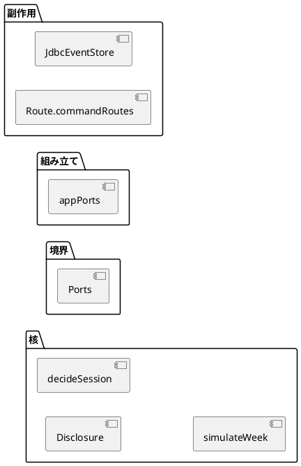

# サイトシーイング・マップ（生成）: アプリケーションアーキテクチャ

この文書は、コードの注釈とソースから生成した。手で編集しない（試験 `LivingDocumentationSpec` が、コードとの不一致で失敗する）。再生成: `./gradlew :domain:generateLivingDocs`。

このアプリケーションの構造は、**核の純粋関数と、外側の薄い副作用の層**。まず見るべき場所を、7 つに絞って示す。
見どころは、注釈 `@KeyLandmark` を付けた要素を、ソースの走査で集めたもの（名前や場所は名指ししない）。
順序は付けない（処理の流れを順にたどるには、[ガイドツアー](./cqrs-tour.md)を使う）。

## 全体の構成

見どころを、区分ごとの枠に並べる（順序は付けない。枠の間に矢印は引かない）。

### 層の間の依存の向き

ビルドの定義（各モジュールの `build.gradle.kts`）から導いた、モジュールの依存。内側は、外側を知らない。

- `domain` は、どのモジュールにも依存しない（最も内側）
- `application` は `domain` に依存する
- `adapter-persistence` は `application`、`domain` に依存する
- `adapter-http` は `application`、`domain` に依存する
- `app` は `adapter-http`、`adapter-persistence`、`application`、`domain` に依存する

### 核

副作用を持たない純粋な規則。入力から結果を決める。テストが速く、同じ入力は同じ結果になる

#### `Disclosure`（型）

開示の規則。投影から読んだ行に、呼び出した人ごとの規則を掛ける純粋関数で、他の役割の値は読み取りの型に持たせない

場所: `apps/beer-game-kotlin/application/src/main/kotlin/beergame/application/Disclosure.kt`

#### `decideSession`（関数）

進行の規則のすべてを、状態とコマンドから事実を決める 1 つの純粋関数に集める。入出力は値だけで、規則を変えても外側の層は変わらない

場所: `apps/beer-game-kotlin/domain/src/main/kotlin/beergame/domain/Session.kt`

#### `simulateWeek`（関数）

週次計算の純粋関数。時計・乱数・永続化を知らず、同じ入力から同じ結果を返す。アーキテクチャの中心で、外側のどの層からも呼ばれる

場所: `apps/beer-game-kotlin/domain/src/main/kotlin/beergame/domain/SimulateWeek.kt`

### 境界

核と副作用の層の間の約束。副作用を関数の束に閉じ込め、テストでは同じ型の関数に差し替える

#### `Ports`（型）

副作用を関数の束に閉じ込める境界。時計・乱数・永続化・通知を、application は型として知るだけで、実装を知らない

場所: `apps/beer-game-kotlin/application/src/main/kotlin/beergame/application/AppPorts.kt`

### 組み立て

本物の実装を束ねて、アプリケーションを起動する唯一の場所。他の層は、ここを知らない

#### `appPorts`（関数）

本物の実装を束ねて、application の境界（Ports）を満たす唯一の場所。他の層は、ここを知らない

場所: `apps/beer-game-kotlin/app/src/main/kotlin/beergame/app/Wiring.kt`

### 副作用

HTTP・データベースなどの外界との接点。薄く保ち、規則は核へ寄せる

#### `JdbcEventStore`（型）

永続化の入口。application が定めた EventStore の約束を、データベースで満たす。規則は持たず、追記と読み出しだけを担う

場所: `apps/beer-game-kotlin/adapter-persistence/src/main/kotlin/beergame/persistence/JdbcEventStore.kt`

#### `Route.commandRoutes`（関数）

HTTP の入口。要求を値のコマンドに変えるだけの薄い層で、規則は持たず、結果を応答に写す

場所: `apps/beer-game-kotlin/adapter-http/src/main/kotlin/beergame/http/CommandRoutes.kt`
