# ガイドツアー（生成）: CQRS

この文書は、コードの注釈とソースから生成した。手で編集しない（試験 `LivingDocumentationSpec` が、コードとの不一致で失敗する）。再生成: `./gradlew :domain:generateLivingDocs`。

処理の流れを、コマンド側 → イベントと投影 → 問い合わせ側の順に案内する。（9 ステップ）
ステップは、注釈 `@GuidedTour` を付けた要素を、ソースの走査で集めて、rank の順に並べたもの（名前や場所は名指ししない）。
各ステップの説明は、注釈の `description` から取り出す。コマンドとイベントの対応は[イベント一覧](./events.md)を参照する。

## 全体の流れ

図の矢印は、読む順序を示す（実行時の呼び出しの順とは限らない。たとえば、問い合わせ側は投影を読むだけで、書き込みの後続ではない）。

```plantuml
@startuml
left to right direction
package "コマンド側" {
  rectangle "1. Route.commandRoutes" as S1
  rectangle "2. Ports.runCommand" as S2
  rectangle "3. decideSession" as S3
}
package "イベントと投影" {
  rectangle "4. JdbcEventStore" as S4
  rectangle "5. Projections" as S5
  rectangle "6. JdbcProjectionWriter" as S6
}
package "問い合わせ側" {
  rectangle "7. Route.queryRoutes" as S7
  rectangle "8. Ports.snapshot" as S8
  rectangle "9. JdbcProjectionReader" as S9
}
S1 --> S2
S2 --> S3
S3 --> S4
S4 --> S5
S5 --> S6
S6 --> S7
S7 --> S8
S8 --> S9
@enduml
```

### コマンド側

#### 1. `Route.commandRoutes`（関数）

コマンドの入口。HTTP の要求を、入力を検証したコマンドに変える。状態は返さず、版だけを返す。次に、認証と冪等を含む共通の流れへ渡す

場所: [`apps/beer-game-kotlin/adapter-http/src/main/kotlin/beergame/http/CommandRoutes.kt`](https://github.com/k2works/case-study-beer-game-simulation/blob/develop/apps/beer-game-kotlin/adapter-http/src/main/kotlin/beergame/http/CommandRoutes.kt)

#### 2. `Ports.runCommand`（関数）

コマンドの共通の流れ。認証・冪等記録・競合の再試行を担い、読み込み・decide・追記・投影を順に呼ぶ。競合したときは、認可を含めて最初から評価し直す

場所: [`apps/beer-game-kotlin/application/src/main/kotlin/beergame/application/Execute.kt`](https://github.com/k2works/case-study-beer-game-simulation/blob/develop/apps/beer-game-kotlin/application/src/main/kotlin/beergame/application/Execute.kt)

#### 3. `decideSession`（関数）

進行の規則を判断し、事実（イベント）の列を返す純粋関数。状態を変えず、副作用も無い。返した事実が、次に追記される

場所: [`apps/beer-game-kotlin/domain/src/main/kotlin/beergame/domain/Session.kt`](https://github.com/k2works/case-study-beer-game-simulation/blob/develop/apps/beer-game-kotlin/domain/src/main/kotlin/beergame/domain/Session.kt)

### イベントと投影

#### 4. `JdbcEventStore`（型）

事実を events に追記する。ストリームごとの版の一意制約で、同時の更新のうち片方だけを通す。追記した事実が、投影の元になる

場所: [`apps/beer-game-kotlin/adapter-persistence/src/main/kotlin/beergame/persistence/JdbcEventStore.kt`](https://github.com/k2works/case-study-beer-game-simulation/blob/develop/apps/beer-game-kotlin/adapter-persistence/src/main/kotlin/beergame/persistence/JdbcEventStore.kt)

#### 5. `Projections`（型）

事実から、読み取りモデルの行の変更を導く純粋関数の集まり。問い合わせの形に合わせて、役割別の値と合計を別の投影に分ける

場所: [`apps/beer-game-kotlin/domain/src/main/kotlin/beergame/domain/Projection.kt`](https://github.com/k2works/case-study-beer-game-simulation/blob/develop/apps/beer-game-kotlin/domain/src/main/kotlin/beergame/domain/Projection.kt)

#### 6. `JdbcProjectionWriter`（型）

導いた行の変更を、追記と同じトランザクションで書く（同期投影）。書いた版を projection_checkpoints に残し、問い合わせ側が古い表示を捨てられるようにする

場所: [`apps/beer-game-kotlin/adapter-persistence/src/main/kotlin/beergame/persistence/JdbcProjectionWriter.kt`](https://github.com/k2works/case-study-beer-game-simulation/blob/develop/apps/beer-game-kotlin/adapter-persistence/src/main/kotlin/beergame/persistence/JdbcProjectionWriter.kt)

### 問い合わせ側

#### 7. `Route.queryRoutes`（関数）

問い合わせの入口。コマンドとは別の経路で、イベントストアを経由せずに、投影を読む

場所: [`apps/beer-game-kotlin/adapter-http/src/main/kotlin/beergame/http/QueryRoutes.kt`](https://github.com/k2works/case-study-beer-game-simulation/blob/develop/apps/beer-game-kotlin/adapter-http/src/main/kotlin/beergame/http/QueryRoutes.kt)

#### 8. `Ports.snapshot`（関数）

認証して投影を読み、呼び出した人ごとの開示の規則を掛けて返す。他の役割の値は、返さない

場所: [`apps/beer-game-kotlin/application/src/main/kotlin/beergame/application/Query.kt`](https://github.com/k2works/case-study-beer-game-simulation/blob/develop/apps/beer-game-kotlin/application/src/main/kotlin/beergame/application/Query.kt)

#### 9. `JdbcProjectionReader`（型）

投影の表を、読み取り専用のトランザクションで読む。行と同じ時点の版を返し、イベントを再生しない

場所: [`apps/beer-game-kotlin/adapter-persistence/src/main/kotlin/beergame/persistence/JdbcProjectionReader.kt`](https://github.com/k2works/case-study-beer-game-simulation/blob/develop/apps/beer-game-kotlin/adapter-persistence/src/main/kotlin/beergame/persistence/JdbcProjectionReader.kt)
