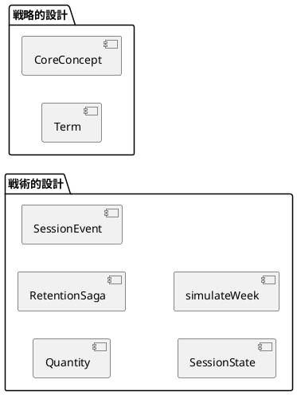

# サイトシーイング・マップ（生成）: ドメイン駆動設計（DDD）

この文書は、コードの注釈とソースから生成した。手で編集しない（試験 `LivingDocumentationSpec` が、コードとの不一致で失敗する）。再生成: `./gradlew :domain:generateLivingDocs`。

このアプリケーションの設計は、**戦略的設計（言葉と、力を注ぐ場所）と、戦術的設計（モデルの部品）**で読む。まず見るべき場所を、7 つに絞って示す。
見どころは、注釈 `@KeyLandmark` を付けた要素を、ソースの走査で集めたもの（名前や場所は名指ししない）。
順序は付けない（処理の流れを順にたどるには、[ガイドツアー](./cqrs-tour.md)を使う）。

## 全体の構成

見どころを、区分ごとの枠に並べる（順序は付けない。枠の間に矢印は引かない）。

### 戦略的設計

業務の言葉をそろえ、力を注ぐ場所（中核）を決める。何を作り込み、何を割り切るかの判断

#### `CoreConcept`（型）

中核の識別。設計書の境界付けられたコンテキストの分類で「中核」とされたものだけに付け、力を注ぐ場所を絞る

場所: `apps/beer-game-kotlin/domain/src/main/kotlin/beergame/domain/Documentation.kt`

#### `Term`（型）

ユビキタス言語。業務の言葉と定義・出典を、型に付けて残す。用語集はここから生成され、コードと会話の言葉がずれない

場所: `apps/beer-game-kotlin/domain/src/main/kotlin/beergame/domain/Documentation.kt`

### 戦術的設計

モデルの部品。集約・値オブジェクト・ドメインイベント・ドメインサービス・プロセスマネージャー

#### `Quantity`（型）

値オブジェクト。0〜1000 の整数という不変条件を、生成の時点で守る。範囲外の値は、型として存在できない

場所: `apps/beer-game-kotlin/domain/src/main/kotlin/beergame/domain/Quantities.kt`

#### `RetentionSaga`（型）

プロセスマネージャー。保持期間の削除という、複数の段階にまたがる手続きの進み方（再試行・間隔）を、状態を持たず決める

場所: `apps/beer-game-kotlin/domain/src/main/kotlin/beergame/domain/RetentionSaga.kt`

#### `SessionEvent`（型）

ドメインイベント。進行で起きた事実を、過去形で表す。状態はここから取り戻し、投影の元にもなる

場所: `apps/beer-game-kotlin/domain/src/main/kotlin/beergame/domain/Session.kt`

#### `SessionState`（型）

集約（進行）。イベントの畳み込みで復元し、4 役割の入力を揃えて週を一度だけ確定する整合性の境界

場所: `apps/beer-game-kotlin/domain/src/main/kotlin/beergame/domain/Session.kt`

#### `simulateWeek`（関数）

ドメインサービス。1 つの集約や値に収まらない週の計算を、状態を持たない純粋な関数として表す。副作用が無い

場所: `apps/beer-game-kotlin/domain/src/main/kotlin/beergame/domain/SimulateWeek.kt`
