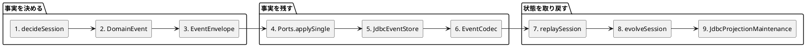

# ガイドツアー（生成）: イベントソーシング

この文書は、コードの注釈とソースから生成した。手で編集しない（試験 `LivingDocumentationSpec` が、コードとの不一致で失敗する）。再生成: `./gradlew :domain:generateLivingDocs`。

状態を保存せず、起きた事実だけを残す流れを、事実を決める → 事実を残す → 状態を取り戻すの順に案内する。（9 ステップ）
ステップは、注釈 `@GuidedTour` を付けた要素を、ソースの走査で集めて、rank の順に並べたもの（名前や場所は名指ししない）。
各ステップの説明は、注釈の `description` から取り出す。コマンドとイベントの対応は[イベント一覧](./events.md)を参照する。

## 全体の流れ

図の矢印は、読む順序を示す（実行時の呼び出しの順とは限らない。たとえば、問い合わせ側は投影を読むだけで、書き込みの後続ではない）。

### 事実を決める

#### 1. `decideSession`（関数）

状態とコマンドから、起きる事実（イベント）の列を決める純粋関数。状態を書き換えず、事実だけを返す。返した事実が、状態の唯一の正本になる

場所: [`apps/beer-game-kotlin/domain/src/main/kotlin/beergame/domain/Session.kt`](https://github.com/k2works/case-study-beer-game-simulation/blob/develop/apps/beer-game-kotlin/domain/src/main/kotlin/beergame/domain/Session.kt)

#### 2. `DomainEvent`（型）

起きた事実の型。過去形で命名し、いったん残したら変更しない。個人情報と秘密は入れず、識別子と有効期限だけを持つ

場所: [`apps/beer-game-kotlin/domain/src/main/kotlin/beergame/domain/Foundation.kt`](https://github.com/k2works/case-study-beer-game-simulation/blob/develop/apps/beer-game-kotlin/domain/src/main/kotlin/beergame/domain/Foundation.kt)

#### 3. `EventEnvelope`（型）

事実に付ける封筒。ストリームの版・書いた版・操作者・相関 ID・時刻を、ペイロードとは別に持つ。版が、追記の順序と同時更新の検出の基準になる

場所: [`apps/beer-game-kotlin/domain/src/main/kotlin/beergame/domain/Foundation.kt`](https://github.com/k2works/case-study-beer-game-simulation/blob/develop/apps/beer-game-kotlin/domain/src/main/kotlin/beergame/domain/Foundation.kt)

### 事実を残す

#### 4. `Ports.applySingle`（関数）

1 本のストリームの事実を読み込み、再生して状態を作り、decide し、返った事実を追記する。decide が空なら、何も追記しない

場所: [`apps/beer-game-kotlin/application/src/main/kotlin/beergame/application/StreamDef.kt`](https://github.com/k2works/case-study-beer-game-simulation/blob/develop/apps/beer-game-kotlin/application/src/main/kotlin/beergame/application/StreamDef.kt)

#### 5. `JdbcEventStore`（型）

事実を events に追記する専用の入口。更新も削除もしない。期待した版と違えば、版の一意制約が同時の更新を検出し、片方だけを通す

場所: [`apps/beer-game-kotlin/adapter-persistence/src/main/kotlin/beergame/persistence/JdbcEventStore.kt`](https://github.com/k2works/case-study-beer-game-simulation/blob/develop/apps/beer-game-kotlin/adapter-persistence/src/main/kotlin/beergame/persistence/JdbcEventStore.kt)

#### 6. `EventCodec`（型）

事実を JSON に符号化して残し、読むときに復号する。旧い版の事実は、アップキャストで新しい版へ変換して読むので、残した事実は書き換えずに、型の進化に耐える

場所: [`apps/beer-game-kotlin/adapter-persistence/src/main/kotlin/beergame/persistence/EventCodec.kt`](https://github.com/k2works/case-study-beer-game-simulation/blob/develop/apps/beer-game-kotlin/adapter-persistence/src/main/kotlin/beergame/persistence/EventCodec.kt)

### 状態を取り戻す

#### 7. `replaySession`（関数）

事実の列を先頭から畳み込んで、現在の状態を取り戻す。decide が作らない列を見つけたら、不正な遷移として記録する

場所: [`apps/beer-game-kotlin/domain/src/main/kotlin/beergame/domain/Foundation.kt`](https://github.com/k2works/case-study-beer-game-simulation/blob/develop/apps/beer-game-kotlin/domain/src/main/kotlin/beergame/domain/Foundation.kt)

#### 8. `evolveSession`（関数）

事実を 1 つずつ状態へ畳み込む。規則は持たず、確定済みの結果を採用するだけなので、再生しても同じ状態に戻る

場所: [`apps/beer-game-kotlin/domain/src/main/kotlin/beergame/domain/SessionEvolve.kt`](https://github.com/k2works/case-study-beer-game-simulation/blob/develop/apps/beer-game-kotlin/domain/src/main/kotlin/beergame/domain/SessionEvolve.kt)

#### 9. `JdbcProjectionMaintenance`（型）

事実を追記順に読み直して、投影を作り直す。投影が壊れても、事実から復元できる。ゲームごとに 1 トランザクションで行い、検査は同じ手順を行って比べたあと取り消す

場所: [`apps/beer-game-kotlin/adapter-persistence/src/main/kotlin/beergame/persistence/JdbcProjectionMaintenance.kt`](https://github.com/k2works/case-study-beer-game-simulation/blob/develop/apps/beer-game-kotlin/adapter-persistence/src/main/kotlin/beergame/persistence/JdbcProjectionMaintenance.kt)
