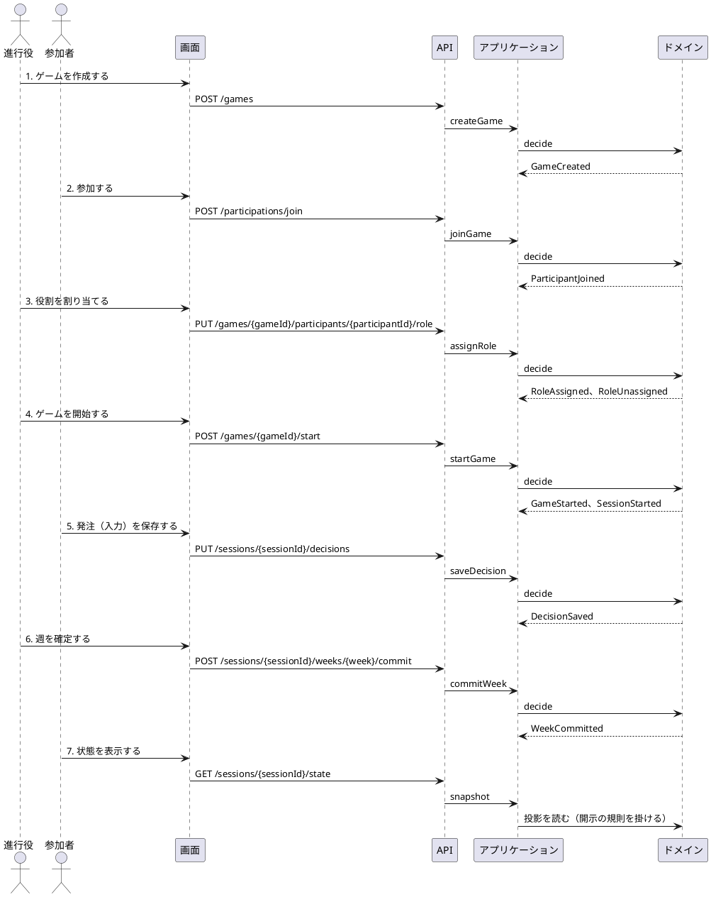

# ウォーキングスケルトンのガイドツアー（生成）

この文書は、コードの注釈とソースから生成した。手で編集しない（試験 `LivingDocumentationSpec` が、コードとの不一致で失敗する）。再生成: `./gradlew :domain:generateLivingDocs`。

最初の縦の切片（1 ゲーム・4 役割・1 週）を、操作の順に、画面からイベントと投影までたどる。
各層の場所は、コードの走査から導く。見つからなければ、ツアーが古いので、試験が失敗する。
API の経路は、仕様（`contracts/openapi.yaml`。基準の URL は `/api/v1`）の操作から読む。

## 全体の流れ

## 1. ゲームを作成する（進行役）

| 層 | 場所 |
| :--- | :--- |
| 画面 | `apps/beer-game-kotlin/web/src/features/setup/CreateGamePage.tsx`（`api.createGame(…`を呼ぶ） |
| API | `POST /games`（操作 `createGame`） |
| ルート | `apps/beer-game-kotlin/adapter-http/src/main/kotlin/beergame/http/CommandRoutes.kt` |
| アプリケーション | `apps/beer-game-kotlin/application/src/main/kotlin/beergame/application/Commands.kt` の `Ports.createGame` |
| コマンド | `apps/beer-game-kotlin/domain/src/main/kotlin/beergame/domain/Game.kt`（`data class CreateGame(…`） |
| イベント | EV-G01 `GameCreated`（game） |
| 購読する投影 | `gameOverview`、`gameJoinCodes`、`gameSettings`、`retentionPolicies` |
| 受入 | `apps/beer-game-kotlin/features/game-setup/game-creation.feature`（@AC1.1.1） |

## 2. 参加する（参加者）

| 層 | 場所 |
| :--- | :--- |
| 画面 | `apps/beer-game-kotlin/web/src/features/participation/JoinPage.tsx`（`api.joinGame(…`を呼ぶ） |
| API | `POST /participations/join`（操作 `joinGame`） |
| ルート | `apps/beer-game-kotlin/adapter-http/src/main/kotlin/beergame/http/CommandRoutes.kt` |
| アプリケーション | `apps/beer-game-kotlin/application/src/main/kotlin/beergame/application/Commands.kt` の `Ports.joinGame` |
| コマンド | `apps/beer-game-kotlin/domain/src/main/kotlin/beergame/domain/Game.kt`（`data class JoinGame(…`） |
| イベント | EV-G02 `ParticipantJoined`（game） |
| 購読する投影 | `lobbyParticipants` |
| 受入 | `apps/beer-game-kotlin/features/game-setup/joining-ui.feature`（@AC1.2.1） `apps/beer-game-kotlin/features/game-setup/joining.feature`（@AC1.2.1） |

## 3. 役割を割り当てる（進行役）

| 層 | 場所 |
| :--- | :--- |
| 画面 | `apps/beer-game-kotlin/web/src/features/lobby/LobbyPage.tsx`（`api.assignRole(…`を呼ぶ） |
| API | `PUT /games/{gameId}/participants/{participantId}/role`（操作 `assignRole`） |
| ルート | `apps/beer-game-kotlin/adapter-http/src/main/kotlin/beergame/http/CommandRoutes.kt` |
| アプリケーション | `apps/beer-game-kotlin/application/src/main/kotlin/beergame/application/Commands.kt` の `Ports.assignRole` |
| コマンド | `apps/beer-game-kotlin/domain/src/main/kotlin/beergame/domain/Game.kt`（`data class AssignRole(…`） |
| イベント | EV-G03 `RoleAssigned`（game） EV-G04 `RoleUnassigned`（game） |
| 購読する投影 | `lobbyParticipants` |
| 受入 | `apps/beer-game-kotlin/features/game-setup/co-assignment.feature`（@AC1.2.5） `apps/beer-game-kotlin/features/game-setup/joining.feature`（@AC1.2.5） |

## 4. ゲームを開始する（進行役）

| 層 | 場所 |
| :--- | :--- |
| 画面 | `apps/beer-game-kotlin/web/src/features/lobby/LobbyPage.tsx`（`api.startGame(…`を呼ぶ） |
| API | `POST /games/{gameId}/start`（操作 `startGame`） |
| ルート | `apps/beer-game-kotlin/adapter-http/src/main/kotlin/beergame/http/CommandRoutes.kt` |
| アプリケーション | `apps/beer-game-kotlin/application/src/main/kotlin/beergame/application/Commands.kt` の `Ports.startGame` |
| コマンド | `apps/beer-game-kotlin/domain/src/main/kotlin/beergame/domain/StartGame.kt`（`data class StartGame(…`） |
| イベント | EV-G11 `GameStarted`（game） EV-S01 `SessionStarted`（session） |
| 購読する投影 | `gameOverview`、`sessionOverview`、`roleCurrentStates` |
| 受入 | `apps/beer-game-kotlin/features/game-setup/joining.feature`（@AC1.2.3） |

## 5. 発注（入力）を保存する（参加者）

| 層 | 場所 |
| :--- | :--- |
| 画面 | `apps/beer-game-kotlin/web/src/features/play/PlayPage.tsx`（`api.saveDecision(…`を呼ぶ） |
| API | `PUT /sessions/{sessionId}/decisions`（操作 `saveDecision`） |
| ルート | `apps/beer-game-kotlin/adapter-http/src/main/kotlin/beergame/http/CommandRoutes.kt` |
| アプリケーション | `apps/beer-game-kotlin/application/src/main/kotlin/beergame/application/Commands.kt` の `Ports.saveDecision` |
| コマンド | `apps/beer-game-kotlin/domain/src/main/kotlin/beergame/domain/Session.kt`（`data class SaveDecision(…`） |
| イベント | EV-S05 `DecisionSaved`（session） |
| 購読する投影 | `sessionOverview`、`currentDecisions` |
| 受入 | `apps/beer-game-kotlin/features/weekly-play/decision.feature`（@AC2.2.1） |

## 6. 週を確定する（進行役）

| 層 | 場所 |
| :--- | :--- |
| 画面 | `apps/beer-game-kotlin/web/src/features/console/ConsolePage.tsx`（`api.commitWeek(…`を呼ぶ） |
| API | `POST /sessions/{sessionId}/weeks/{week}/commit`（操作 `commitWeek`） |
| ルート | `apps/beer-game-kotlin/adapter-http/src/main/kotlin/beergame/http/CommandRoutes.kt` |
| アプリケーション | `apps/beer-game-kotlin/application/src/main/kotlin/beergame/application/Commands.kt` の `Ports.commitWeek` |
| コマンド | `apps/beer-game-kotlin/domain/src/main/kotlin/beergame/domain/Session.kt`（`data class CommitWeek(…`） |
| イベント | EV-S08 `WeekCommitted`（session） |
| 購読する投影 | `sessionOverview`、`roleCurrentStates`、`currentDecisions`、`weekCommits`、`weekRoleResults`、`weekTeamTotals` |
| 受入 | `apps/beer-game-kotlin/features/weekly-play/co-input.feature`（@AC2.3.1） `apps/beer-game-kotlin/features/weekly-play/walking-skeleton-ui.feature`（@AC2.3.1） `apps/beer-game-kotlin/features/weekly-play/week-commit.feature`（@AC2.3.1） |

## 7. 状態を表示する（参加者）

| 層 | 場所 |
| :--- | :--- |
| 画面 | `apps/beer-game-kotlin/web/src/features/play/PlayPage.tsx`（`api.getSessionState(…`を呼ぶ） |
| API | `GET /sessions/{sessionId}/state`（操作 `getSessionState`） |
| ルート | `apps/beer-game-kotlin/adapter-http/src/main/kotlin/beergame/http/QueryRoutes.kt` |
| アプリケーション | `apps/beer-game-kotlin/application/src/main/kotlin/beergame/application/Query.kt` の `Ports.snapshot` |
| コマンド | なし（問い合わせ） |
| イベント | なし（問い合わせ） |
| 購読する投影 | なし |
| 受入 | `apps/beer-game-kotlin/features/weekly-play/situation.feature`（@AC2.1.1） |
