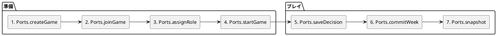

# ガイドツアー（生成）: ウォーキングスケルトン

この文書は、コードの注釈とソースから生成した。手で編集しない（試験 `LivingDocumentationSpec` が、コードとの不一致で失敗する）。再生成: `./gradlew :domain:generateLivingDocs`。

最初の縦の切片（1 ゲーム・4 役割・1 週）を、準備（作成・参加・割り当て・開始）とプレイ（入力・確定・状態の表示）の操作の順に案内する。（7 ステップ）
ステップは、注釈 `@GuidedTour` を付けた要素を、ソースの走査で集めて、rank の順に並べたもの（名前や場所は名指ししない）。
各ステップの説明は、注釈の `description` から取り出す。コマンドとイベントの対応は[イベント一覧](./events.md)を参照する。

## 全体の流れ

図の矢印は、読む順序を示す（実行時の呼び出しの順とは限らない。たとえば、問い合わせ側は投影を読むだけで、書き込みの後続ではない）。

### 準備

#### 1. `Ports.createGame`（関数）

進行役がゲームを作成する。設定を検証し、参加コードと進行役の資格を発行する。ここから、参加と割り当てを受け付ける準備中が始まる

API: `POST /games`（操作 `createGame`）

発行するイベント: EV-G01 `GameCreated`

場所: `apps/beer-game-kotlin/application/src/main/kotlin/beergame/application/Commands.kt`

#### 2. `Ports.joinGame`（関数）

参加者が、参加コードと表示名で参加する。アカウントは作らず、復帰資格を発行する。表示名はイベントに入れず、周辺ストアにだけ書く

API: `POST /participations/join`（操作 `joinGame`）

発行するイベント: EV-G02 `ParticipantJoined`

場所: `apps/beer-game-kotlin/application/src/main/kotlin/beergame/application/Commands.kt`

#### 3. `Ports.assignRole`（関数）

進行役が、参加者に役割を割り当てる。4 役割のそれぞれに 1 人以上が要る。別の役割にいる人を選ぶと、付け替えになる

API: `PUT /games/{gameId}/participants/{participantId}/role`（操作 `assignRole`）

発行するイベント: EV-G03 `RoleAssigned`、EV-G04 `RoleUnassigned`

場所: `apps/beer-game-kotlin/application/src/main/kotlin/beergame/application/Commands.kt`

#### 4. `Ports.startGame`（関数）

進行役がゲームを開始する。各役割に参加者がそろっていれば、game と session の両ストリームへ原子的に追記し、第 1 週が始まる

API: `POST /games/{gameId}/start`（操作 `startGame`）

発行するイベント: EV-G11 `GameStarted`、EV-S01 `SessionStarted`

場所: `apps/beer-game-kotlin/application/src/main/kotlin/beergame/application/Commands.kt`

### プレイ

#### 5. `Ports.saveDecision`（関数）

参加者が、自分の役割の当週の数量（発注、工場は生産要請）を保存する。意思決定の版が一致しなければ、競合として知らせる

API: `PUT /sessions/{sessionId}/decisions`（操作 `saveDecision`）

発行するイベント: EV-S05 `DecisionSaved`

場所: `apps/beer-game-kotlin/application/src/main/kotlin/beergame/application/Commands.kt`

#### 6. `Ports.commitWeek`（関数）

進行役が、4 役割の入力が揃った週を確定する。週の計算の結果と次週の状態を、事実として一度だけ固定する

API: `POST /sessions/{sessionId}/weeks/{week}/commit`（操作 `commitWeek`）

発行するイベント: EV-S08 `WeekCommitted`

場所: `apps/beer-game-kotlin/application/src/main/kotlin/beergame/application/Commands.kt`

#### 7. `Ports.snapshot`（関数）

進行役と参加者が、状態を表示する。確定した第 2 週の状況と、各役割の第 1 週の結果を、呼び出した人に許された範囲だけ返す

API: `GET /sessions/{sessionId}/state`（操作 `getSessionState`）

発行するイベント: なし（問い合わせ）

場所: `apps/beer-game-kotlin/application/src/main/kotlin/beergame/application/Query.kt`
