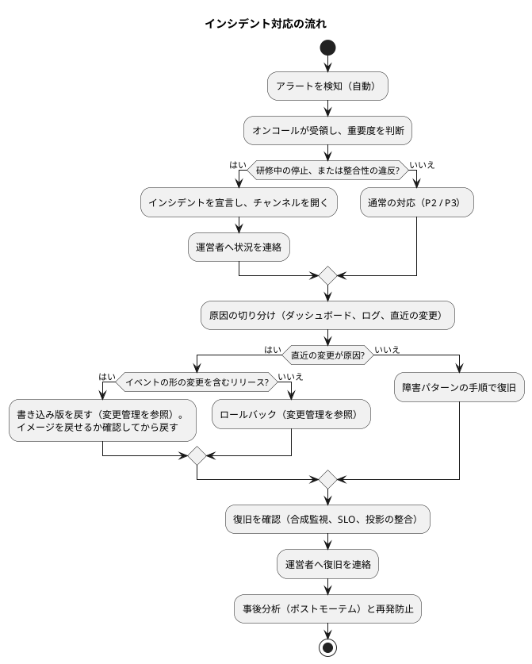
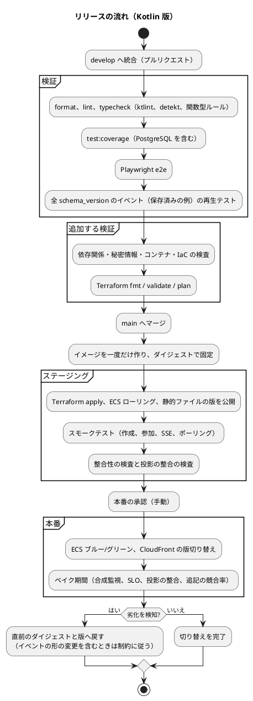

# 運用要件定義 - ビールゲームシミュレーション（Kotlin 版）

## 概要

本書は、beer-game-kotlin を本番で運用するための要件を、運用フロー、監視、バックアップ、障害対応、変更管理の順に定義します。**`docs/` を正本**とします。

運用要件は [beer-game2 の運用要件](../beer-game2/operation.md) を正本として引き継ぎ、落としません。変えるのは、次の 4 点だけです。

- バックエンドが Kotlin（JVM）になったことによる、監視と起動の扱い（[技術スタック](./tech-stack.md)）。
- **状態の正本が `events` 表**になったことによる、バックアップ・復旧の考え方（投影は、イベントから作り直せる）。
- **イベントの形を変える**という、ES 固有の変更管理（スキーマの進化とアップキャスト）。
- 投影と追記に固有の監視項目（投影の整合、追記の競合率）。

設計の根拠は [データモデル](./data-model.md)、[ドメインモデル](./domain-model.md)、[インフラ](./architecture-infrastructure.md)、[非機能要件](./non-functional.md) です。実装コード、Terraform、アラームは、**まだ存在しません**。本書の「アラーム」「手順書」は、作成する対象の設計です。

運用の体制、通知先、連絡先は、**組織に依存するため未決定**です。本書では、決めるべき項目として「要確認」にしています（beer-game2 と同じ）。

### 凡例（beer-game2 の状態）

beer-game2 の表の「状態」の列は、beer-game2 の設計での扱いを示します。本書の表では、「Kotlin 版」の列に、本書での扱いを書きます。

| 記号 | 意味 |
| :--: | :--- |
| 引継 | beer-game2 の要件をそのまま引き継ぐ |
| 変更 | 内容を Kotlin・ES + CQRS に合わせて変える |
| 新 | Kotlin 版で加える |

## 運用の前提

| 項目 | 内容 |
| :--- | :--- |
| 利用の形態 | 研修・授業のセッション（数十分〜数時間）。同時に進行するゲームは最大 15（拡張目標 25）。常時の高負荷は無い（引継） |
| 重視する時間帯 | 研修の実施中。**運営者が事前に実施日時を運用側へ伝える仕組みが必要**（SLO の「宣言された時間帯」。引継。未決） |
| 運用の主体 | 運営者（進行役の所属組織）と、システムの運用担当（プラットフォーム、アプリケーション）。体制は要確認（引継） |
| 守るべき資産 | **`events` 表（状態の正本）**、資格、保持期間内のゲームの記録。確定済みの週の記録は RPO 0（変更: 資産の中心が `events`） |
| 作り直せるもの | 投影（読み取りモデル）は、`events` から再構築できる。バックアップ上の保護の優先度は `events` が最上位（新） |
| 実行環境 | JVM 上の Kotlin。ECS のタスクで動かす想定（[インフラ](./architecture-infrastructure.md)）。JDK・Kotlin・Ktor の版とサポート期限は、実装開始時に公式情報で確認する（新） |
| 主な SLO | 月間可用性 99.5%、研修中の完全停止を 1 分以内に検知、RTO 15 分、RPO 0（[非機能要件](./non-functional.md)。引継） |

## 運用フロー

運用は、自動化を前提にします。手動の作業は、判断が要るものと、年次のものに限ります。

| 周期 | 作業 | 主体 | 自動化 | Kotlin 版 |
| :--- | :--- | :--- | :--- | :--: |
| 常時 | ヘルスチェック、アラートの通知 | 自動 | ALB のヘルスチェック、CloudWatch のアラーム | 引継 |
| 研修の前 | 実施日時の連絡を受け、直前の合成監視（作成から参加、SSE まで）で正常を確認する。**JVM は起動直後の応答が遅いため、直前にタスクのウォームアップが済んでいることも確認する** | 運用担当 | 合成監視を自動化 | 変更 |
| 研修の中 | アラートに即応できる状態にする（オンコール） | 運用担当 | — | 引継 |
| 日次 | ダッシュボードで、エラー率、応答時間、**追記の競合率、投影の整合**、削除の滞留（期限超過の経過時間）と失敗の件数を確認する | 運用担当 | アラートで代替 | 変更 |
| 日次 | コストの確認（予算の 80% 実績、100% 予測の通知） | 自動 | AWS Budgets | 引継 |
| 日次 | 期限切れの資格、ブラウザセッション、冪等記録の掃除（[データモデル](./data-model.md) の索引） | 自動 | 定期タスク | 新 |
| 週次 | 失敗した削除（`FAILED`）の確認。失敗があれば、失敗コードから原因を調べ、再試行する | 運用担当 | 失敗時の通知 | 引継 |
| 月次 | SLO のレポート（可用性、p95、削除の SLO）、容量のレビュー（JVM のヒープと GC を含む）、依存関係の更新とセキュリティのパッチ | 運用担当 | レポートを自動生成 | 変更 |
| 四半期 | 復元の訓練（時点復旧）。**投影の再構築の訓練**（`events` から投影を作り直し、投影の整合の検査で確認する） | 運用担当 | 手順をスクリプト化 | 変更 |
| 年次 | 鍵のローテーション、権限の棚卸し、ランタイム（JDK）・Kotlin・基盤イメージのサポート期限の確認、監査への対応 | 運用担当、セキュリティ責任者 | — | 変更 |
| 随時 | リリースとロールバック（変更管理を参照）。**イベントの形の変更を伴うリリースは、2 段階で行う** | 開発・運用 | CI/CD | 変更 |

## 監視設計

### 監視項目と閾値

閾値は、[非機能要件](./non-functional.md) の数値と、beer-game2 の監視設計から導きます。両者に無い値は**提案**で、本書の「提案」と書いた閾値は、実装後の実測で見直します。**警告（Warning）は担当者の確認、重大（Critical）は即時の対応**です。アラート疲れを避けるため、対応が必要なものだけを通知にします。

メトリクスは、アプリが出力します。出力の方式（EMF、Micrometer など）と名前空間は、[技術スタック](./tech-stack.md) と [インフラ](./architecture-infrastructure.md) で決めます。本書は、**何を監視するか**を定義し、メトリクスの名前は仮とします。

#### beer-game2 から引き継ぐ項目

| 区分 | 監視項目 | Warning | Critical | 情報源 | Kotlin 版 |
| :--- | :--- | :--- | :--- | :--- | :--: |
| 可用性 | 研修中の主要な操作（作成、参加、確定）の成功 | — | 1 分間、成功が無い | 合成監視 | 引継 |
| 可用性 | 5xx の割合 | 1% 超（5 分） | 5% 超（1 分） | ALB、アプリ | 引継 |
| 性能 | API の応答（p95） | 800 ms 超（5 分） | 1 秒超（5 分） | ALB、アプリ | 引継 |
| 性能 | 週確定から画面反映（p95） | 1.5 秒超（5 分） | 2 秒超（5 分） | 合成ブラウザ | 引継 |
| 性能 | SSE の切断・ポーリング切替の割合 | 5% 超（5 分） | 10% 超（5 分） | アプリ、ALB | 引継 |
| 整合性 | 週結果の重複、不変条件の違反、イベントの欠落 | — | 1 件でも発生 | アプリのメトリクス | 変更（下記の ES の整合性の検査を含む） |
| 配信 | SSE の通知の遅延（p95）。**アウトボックスは廃止**（通知は版だけ。[データモデル](./data-model.md)） | 1 秒超（5 分） | 5 秒超（5 分） | アプリ | 変更 |
| データベース | CPU、接続プールの使用率 | 70% 超 | 80% 超（10 分） | RDS、アプリ | 引継 |
| データベース | フェイルオーバー、バックアップの失敗 | — | 発生 | RDS イベント | 引継 |
| 容量 | ECS タスクの CPU | 60% 超（自動増減の目標） | 80% 超（10 分） | ECS | 引継 |
| 削除 | 期限超過の削除の経過時間 | 18 時間 | 24 時間 | `retention_policies` と `deletion_runs` の問い合わせ | 引継 |
| 削除 | 削除の再試行の回数（上限 5 回に近づいたもの） | 3 回目 | 5 回（上限） | アプリのメトリクス | 引継 |
| 削除 | 削除の恒久的な失敗（`FAILED`） | — | 発生から 5 分以内に通知 | アプリ | 引継 |
| セキュリティ | Origin 拒否、認証失敗の急増 | 平常の 3 倍（提案） | 平常の 10 倍（提案） | アプリ | 引継 |
| コスト | 月次の予算 | 実績 80% | 予測 100% | AWS Budgets | 引継 |

#### Kotlin 版で加える項目

| 区分 | 監視項目 | Warning | Critical | 情報源 | 根拠 |
| :--- | :--- | :--- | :--- | :--- | :--- |
| 投影 | **投影の遅れ（整合）**: `projection_checkpoints.projected_version` と `events` の `MAX(stream_version)` の差。直近 24 時間に追記のあったゲームを 5 分ごとに検査 | — | 1 ゲームでも差が 0 でない | 整合性の検査ジョブ | 投影は追記と同じトランザクションで更新する（同期投影）ため、**差は常に 0 であるべき**。差が出たら、更新の漏れかトランザクションの外での書き込みを示す |
| 投影 | **反映待ちの再取得**: 画面が通知された版（または応答の版）に追いつくまでに、再取得が必要だった割合 | 0.1% 超（5 分。提案） | 1% 超（5 分。提案） | アプリ | 同期投影では 0 に近いはず。非 0 は、読み取りレプリカの導入、または非同期投影への移行（データモデルの設計判断 4）の影響を早く知るための先行指標 |
| 投影 | 非同期投影へ移行した場合の遅れ（コミットから投影までの時間、版の数） | 1 秒超（5 分） | 5 秒超（5 分） | アプリ | **現在は対象外**。非同期投影へ移行する場合に有効化する。閾値は SSE の通知の遅延に揃える（提案） |
| 投影 | **投影の整合の検査**: 進行中のゲームの `fold(evolve)` の結果と、投影の行の一致 | — | 不一致 1 件 | 検査ジョブ（日次） | 投影の純粋関数のバグを検知する。テスト戦略の性質（c）「投影の整合」の本番版（旧称「再生の同値性」は使わない。永続化往復の同値性、計算と事実の一致は CI のテストで保護する） |
| 追記 | **追記の競合率**: コマンドあたりの `ConcurrencyConflict` の発生割合（自動再試行の前） | 5% 超（5 分。提案） | 20% 超（5 分。提案） | アプリ | 共同入力や手動と自動の確定の同時実行で、競合は正常にも起きる。上限を超えたら、競合が構造的に増えている（ストリームの粒度、再試行の設計）。実測で見直す |
| 追記 | **再試行の上限超過**（自動再試行を使い切って利用者へ失敗を返した件数） | 1 件（5 分） | 5 件（5 分。提案） | アプリ | 利用者に失敗が見える。上限回数は実装開始時に決める（データモデルの未決事項） |
| 追記 | 再生の所要時間（ストリームの読み込みと `fold`）の p95 | 100 ms 超（5 分。提案） | 300 ms 超（5 分。提案） | アプリ | NFR-03（入力確定の p95 を 1 秒以内）の予算の一部。**超過が続いたら、スナップショットの導入を検討する**（データモデルの導入基準） |
| イベント | **イベントの読み込み失敗**（未知の `event_type`、未知の `schema_version`、デコード失敗） | — | 1 件でも発生 | アプリ | 新しい版のイベントを旧版のアプリが読んだ、またはアップキャストの漏れ。**変更管理のロールバックの制約を参照** |
| JVM | ヒープの使用率（GC 後） | 70% 超（10 分） | 85% 超（10 分） | JVM のメトリクス | OOM の予兆。上限はコンテナのメモリから決める（[インフラ](./architecture-infrastructure.md)） |
| JVM | GC の一時停止時間（p99） | 200 ms 超（5 分。提案） | 500 ms 超（5 分。提案） | JVM のメトリクス | API の p95 800 ms と SSE の遅延に影響する。GC の種類と設定は実装開始時に実測で決める |
| JVM | コンテナの OOM による再起動、およびスレッドの飽和（ブロッキング I/O 用ディスパッチャー（ガイド §7.6 の `Dispatchers.IO`）と接続プールの待ち） | 待ちが 100 ms 超（5 分。提案） | OOM の再起動 1 件 | ECS、JVM、アプリ | 接続プールの使用率の監視に加え、プールの枯渇で `suspend` が詰まることを検知する |
| JVM | 起動の遅さ: タスクの起動からヘルスチェックの成功までの時間 | 60 秒超（提案） | 120 秒超（提案） | ECS | JVM は起動が遅い。ローリングデプロイと自動増減に影響する。猶予期間（ヘルスチェックの開始待ち）は、実測で決める |

「整合性」の行（週結果の重複、不変条件の違反、イベントの欠落）は、Kotlin 版では次を指します。

- `events` の `stream_version` に欠番がある（一意制約と連続性の検査）。
- `week_commits` の件数と、`events` の `WeekCommitted` の件数の不一致。
- `decide` の `Either` が `RuleViolation` 以外の内部エラーを返した、または 500 になった。
- 一意制約の違反（`(game_id, stream_type, stream_version)` を除く。これは競合として扱い、上の「追記の競合率」で見る）。

### ヘルスチェック

| 種類 | 内容 | Kotlin 版 |
| :--- | :--- | :--: |
| 生存（liveness） | プロセスが応答する（`GET /health`） | 引継 |
| 準備（readiness） | データベースに接続できる（`SELECT 1`）。通らないタスクは ALB の対象から外れる（`GET /ready`） | 引継 |

加えて、**準備（readiness）には、起動時のマイグレーションの適用が終わっていること**を含めます（JVM の起動中に、ヘルスチェックが「準備完了」を返さないため）。JVM のウォームアップ（最初の数リクエストの遅さ）の扱いは、ヘルスチェックの猶予期間とあわせて、[インフラ](./architecture-infrastructure.md) で決めます。

### ログと追跡

ログと計測は、ビジネスのコードを変えず、関数をラップして足します（[ガイド §7.7](../../reference/関数型プログラミングガイド_Kotlin編.md)）。ログの 1 件は、データクラスで表す構造化ログです。

| 項目 | 要件 | Kotlin 版 |
| :--- | :--- | :--: |
| アプリのログ | 構造化 JSON（相関 ID、操作、結果、**ストリームの版、追記したイベントの数**、所要時間）。資格、表示名、招待コード、非公開の値を含めない | 変更 |
| 集約と保持 | 暗号化した CloudWatch Logs。本番 90 日、その他 14 日 | 引継 |
| 追跡 | 相関 ID を HTTP、トランザクション、**イベントの封筒（`correlationId`、`commandId`）**、SSE に伝える | 変更 |
| 監査 | **`events` が監査の記録**（設定、役割変更、代理入力、週確定、停止、再開、終了、資格の失効・再発行）。専用の監査表は持たない。保持の再試行は `deletion_attempts` | 変更 |

監査の検索は、`events` の `(game_id, actor_kind, actor_id)` の索引を使います。`events` には表示名と資格の値が無いため、**運用担当が監査を調べても個人情報に触れません**（NF-S14）。表示名が必要な場合は、周辺ストアの `display_profiles` を、運用担当の権限の範囲で別に参照します。

### ダッシュボード

次を 1 つの画面で見られるようにします（未整備）。

- リクエスト量・応答時間・エラー、進行中のゲーム数と SSE の接続数。
- 確定の成功・競合・ロールバック。
- **追記の競合率、再試行の上限超過、再生の所要時間、投影の整合（差が 0 のゲームの割合）**（新）。
- **JVM のヒープ、GC の一時停止、スレッド、接続プール**（新）。
- DB の状態、SLO の消費、削除の状況（現在と 30 日の推移）。

## アラートとエスカレーション

重要度の定義と対応の目標は、beer-game2 と同じです。Kotlin 版で加えた項目の重要度を次に示します。

| 重要度 | 定義 | 通知 | 対応の目標 | Kotlin 版で加えた項目 |
| :--- | :--- | :--- | :--- | :--- |
| P1（重大） | 研修中の停止、データの整合性の違反、削除の恒久的な失敗、バックアップの失敗 | 即時にオンコールを呼び出す。インシデントのチャンネルを開く | 5 分以内に着手（提案） | 投影の整合の不一致（投影の整合の検査）、イベントの読み込み失敗、OOM の再起動 |
| P2（高） | 性能の劣化、配信の遅延、削除の遅れ | 担当チャンネルへ通知する | 研修中は 15 分、それ以外は翌営業日（提案） | 追記の競合率・再試行の上限超過、再生の所要時間、GC の一時停止、ヒープの使用率 |
| P3（中） | 予算、容量の予兆 | 担当者へ通知する | 週次で確認 | 起動の遅さ、反映待ちの再取得 |

**要確認**: オンコールの当番、呼び出しの手段、インシデントのチャンネル、運営者への連絡窓口は、未定義です（beer-game2 と同じ。未決事項）。

## バックアップ設計

### 対象と方式

**状態の正本は `events` 表**です。投影、冪等記録、ブラウザセッションなどは、失っても、`events` と周辺ストアから作り直せる、または再発行できる、二次的なデータです。ただし周辺ストア（`display_profiles`、`credentials`）は、**イベントから復元できない**ため、`events` と同じ重要度で保護します。

| 対象 | 方式 | 保持 | 復旧の扱い | Kotlin 版 |
| :--- | :--- | :--- | :--- | :--: |
| データベース（`events`、周辺ストア、投影、保持削除の状態。PostgreSQL 18） | RDS の自動バックアップによる時点復旧（PITR）と、Multi-AZ の同期スタンバイ | 7 日 | `events` と周辺ストアは**唯一の源**。投影は、復旧後に整合を検査し、不一致なら再構築する | 変更 |
| Web の静的ファイル | S3 のバージョニング、ビルド成果物（版つきで不変） | バージョンごと | 引継 | 引継 |
| イメージ | レジストリの不変の版（ダイジェスト固定）。**イベントの形を変えたリリースの旧イメージは、戻せる期間を記録する**（変更管理） | 直近の複数世代 | ダイジェストで戻す | 変更 |
| インフラの定義 | Git（Terraform） | 無期限 | 引継 | 引継 |
| Terraform の状態 | 暗号化した S3 のリモートの保管と排他ロック。環境ごとに分離（[ADR-012](../../adr/beer-game2/012-delivery-pipeline-and-terraform.md)） | 版つき | 引継 | 引継 |
| 秘密情報 | Secrets Manager。資格の鍵は**複数の版を同時に保持**（[ADR-009](../../adr/beer-game2/009-credential-key-versions.md)） | — | 引継 | 引継 |
| エクスポートの成果物 | **保存しない**。要求時に、`week_role_results` と設定から純粋関数 `buildExport` で作る（`checksum`、`schema_version` も要求時に算出）。表 `export_packages` は無い | — | 投影（`week_role_results`）の復旧に従う。個別のバックアップは不要 | 変更 |

### RPO と RTO

| 指標 | 目標 | 根拠 | Kotlin 版 |
| :--- | :--- | :--- | :--: |
| RPO | 確定済みの週は 0 | 追記のコミット後にだけ応答する。Multi-AZ の同期スタンバイ。**確定済みの週の事実は `WeekCommitted` として `events` にあり、投影が壊れても失われない** | 引継 |
| RTO | 15 分 | 最後の確定済みの週から再開できる。**投影だけの障害は、再構築で復旧するため、DB の復元より短い目標とする（提案: 15 分）。** 再構築の所要時間は、訓練で実測して記録する | 変更 |

### 復元の手順（要件）

#### A. データベース全体の復元（`events` の破損、誤操作）

1. 復元の対象時点を決める（直前の確定週など）。新しいインスタンスへ時点復旧する。
2. 復元後は、**保持の定期タスクを実行して、期限切れのゲームを再び削除**し、削除済みのゲームが残っていないことを確認してから、利用を再開する（復元で、削除済みのゲームが再び現れないようにする）。
3. **整合性の検査を実行する**: ストリームの版の連続性、`projection_checkpoints` と `MAX(stream_version)` の一致。
4. **投影の整合の検査を実行する**: 進行中のゲーム全件で、`events` を `fold(evolve)` した結果と、投影の行（`session_overview`、`role_current_states`、`current_decisions` など）が一致することを確認する。不一致なら、下記 B の再構築を行う。
5. アプリの接続先を切り替え、合成監視で、作成、参加、SSE が通ることを確認する。
6. 進行中だったゲームを確認し、運営者へ連絡する。復元の時点より後の、利用者が行った操作は失われる（確定済みの週は RPO 0 の範囲で守られる）。

#### B. 投影の再構築（`events` は正常で、投影だけが不整合または破損）

1. 対象を決める（1 ゲーム、または全ゲーム）。**研修中のゲームの再構築は、そのゲームの追記を止められる手段が決まるまでは行わない**（データモデルの未決事項。追記を止めるか、アドバイザリロックを取るか）。研修の時間帯でない時間に行う。
2. 対象のゲームの投影の行を削除し、`events` を `stream_version` の順に畳み込んで、投影の行と `projection_checkpoints` を作り直す（データモデルの「投影の再構築」）。
3. 再構築の結果を、整合性の検査と投影の整合の検査で確認する。
4. 差が残る場合は、**投影の純粋関数のバグ**として扱う。再構築を繰り返さず、変更管理の緊急変更で修正する。

再構築は、`events` を読むだけで、`events` を変更しません（誤って状態の正本を壊さない）。再構築が書くのは、投影と `projection_checkpoints` だけです。所要時間の見積もり（1 ゲームのストリームは千件前後）は小さい想定ですが、**実測は訓練で記録する**（未決）。

**訓練**: 四半期に 1 度、およびリリース前、バックアップ方針の変更時に、復元の訓練（A）と投影の再構築の訓練（B）を行い、RPO と RTO の実測値を記録します。復元の手順がテスト可能な形（手順書とスクリプト）で用意されていなければ、バックアップ設計は完了していません。

### バックアップと削除の関係

保持期間後に削除しても、**自動バックアップには最大 7 日間、削除前のデータが残ります**（`events` を含む）。この期間を、保持方針に明記し、運営者へ示します（NF-S16。引継）。進行役のロビーに、保持期間・削除予定日と「データベースのバックアップには、削除後も最大 7 日残ります」を表示します。復元時は、上の A の手順 2 で、削除済みのゲームを再び削除します。

保持の定期タスクは、EventBridge Scheduler から 5 分ごとに起動します（引継）。削除は 1 ゲームずつ 1 つのトランザクションで、**`game_roots` の連鎖削除で、`events` を含むすべての行が消えます**（[データモデル](./data-model.md)）。失敗したら何も消えず、次の起動で再試行します。5 回失敗したゲームは再試行をやめ、エラーのログと終了コード 1 を残し、通知します。`deletion_runs` と `deletion_attempts` の行は、完了のトランザクションで削除し、**削除後にゲームの ID を含む行を残しません**。削除の受領記録（`deletion_receipts`）は、ゲームを特定できないダイジェストで 1 年残します。

## 障害対応設計

### 障害パターンと復旧

beer-game2 の 12 パターンを引き継ぎ、ES + CQRS と JVM で加わる 4 パターンを、番号 13〜16 として加えます。

| # | パターン | 検知 | 影響 | 初動と復旧 | 目標 |
| :--- | :--- | :--- | :--- | :--- | :--- |
| 1 | API のタスクの異常（クラッシュ、メモリ） | ALB のヘルスチェック、ECS | 一部の接続が切れる。SSE は再接続、状態は DB にあるため失われない | ECS が自動で置き換える。続く場合は直近のリリースを疑い、ロールバック。**OOM が原因なら、ヒープの設定とリークを調べる（パターン 15）** | 自動 |
| 2 | API の全停止 | 合成監視、5xx | 研修が止まる | 直近の変更なら、ロールバック。それ以外は、DB と依存の状態を確認し、タスクを再起動する | 15 分 |
| 3 | データベースのフェイルオーバー | RDS のイベント | 数十秒の接続断。確定の一部が失敗しうる | 自動の切替を待つ。失敗した操作は、**冪等キーで再送できる**（追記と同じトランザクションの冪等記録）。接続の回復を確認 | 数分 |
| 4 | データベースの破損・誤操作 | 整合性のアラート、利用者の報告 | 記録の不整合 | 時点復旧（バックアップ設計の手順 A）。復元ゲート、整合性の検査、投影の整合の検査を守る | 15 分 |
| 5 | SSE の不通（ALB、CloudFront、タスク） | SSE の切断率 | 反映が 1 秒間隔のポーリングに落ちる（最大 4 秒の遅れ） | 利用は継続できる。原因（タイムアウト、ヘッダーの転送）を調べて直す | 影響は軽微 |
| 6 | デプロイの失敗、またはリリース直後の劣化 | ヘルスチェック、SLO の消費、ベイク期間 | 一部または全体の劣化 | ロールバック（直前のダイジェストへ戻す）。**イベントの形の変更を含むリリースは、変更管理の制約に従う** | 15 分 |
| 7 | 削除の失敗（`deletion_runs` が `FAILED`、または再試行の上限に近い） | 削除の失敗のアラーム、期限超過の経過時間 | 保持期間後のデータが残る | 失敗コードを確認し、原因（データベースの負荷、ロック、**`events` の連鎖削除の権限**など）を直してから、保持状態の画面（または API）で再試行する。削除は 1 トランザクションのため、「半分だけ削除」は起きない | 24 時間（SLO） |
| 8 | 資格の漏洩（進行役、復帰、観察用の招待、セッション） | 利用者の報告、認証失敗の急増 | 他人が役割・進行・観察を行える | 進行役が資格を失効・再発行できる（`CredentialRevoked`、`CredentialReissued`）。観察用の招待は失効して再発行する。必要なら、当該ゲームを停止する（停止中も、進行役は代理入力を行える。参加者の保存は拒否される）。重大な場合は、運用担当が、ゲームを終了して作り直すよう運営者へ依頼する | 15 分 |
| 9 | 鍵の誤設定・漏洩（資格の鍵、暗号鍵） | 認証失敗の急増、起動の失敗（本番は、未設定で起動に失敗する） | 全資格が無効、または偽造の危険 | **鍵のローテーション手順**: 新しい版を追加 → デプロイ → 新しい資格は新しい版で発行 → 旧版は、資格の期限が切れるまで検証用に残す → 旧版を廃止する。漏洩の場合は、旧版を即時に廃止し、全資格を失効させる | 30 分 |
| 10 | CloudFront の設定ミス（ヘッダーの転送、キャッシュ） | 認証失敗・Origin 拒否の急増 | ログインや更新が壊れる | 直前の設定へ戻す（IaC） | 15 分 |
| 11 | 利用者側の操作ミス（誤った週確定、誤った終了） | 運営者の連絡 | 元に戻せない | 確定は元に戻せない（設計。`events` は追記専用で、確定済みのイベントを取り消さない）。終了後は、新しいゲームを作る。確認ダイアログで予防する | — |
| 12 | 依存関係の重大な脆弱性 | 脆弱性の検査 | 攻撃の危険 | 緊急変更として、パッチを適用してリリース | 72 時間以内（Critical。提案） |
| 13 | 投影の不整合（整合性の検査の不一致、画面の表示がイベントと合わない） | 投影の整合のアラート、投影の整合の検査 | 画面が古い、または誤った値を示す。**正本の `events` は無事**なので、確定の記録は守られる | 原因を特定する前に、影響のゲームを特定する。**投影の再構築（バックアップ設計の手順 B）**で復旧する。再構築しても不一致なら、投影の純粋関数のバグとして、緊急変更で直す | 15 分（提案） |
| 14 | 追記の競合の多発（競合率、再試行の上限超過の増加） | 追記の競合率のアラーム | 保存や確定が、利用者へ失敗として返る。画面は入力を保持する（[UI 設計](./ui-design.md)） | 競合が特定のゲームに集中していないか、リトライの設定、タスクの数（同一ストリームへの同時書き込みが増える設定）、直近の変更を確認する。**リトライの上限回数は、実測の競合頻度で見直す**。一時的に、手動と自動の確定の併用を避けるよう、運営者へ案内する | 30 分（提案） |
| 15 | JVM のメモリ・GC の劣化（ヒープの逼迫、一時停止の長期化、OOM） | ヒープの使用率、GC の一時停止、OOM の再起動 | 応答が遅くなる、タスクが落ちる | ダッシュボードで直近の変更（デプロイ、イベントの再生量）を確認し、**まずタスクを増やす・置き換える**。続く場合は、ヒープの設定、再生で読み込むイベントの量（長いストリーム）、ヒープダンプの取得（運用担当の承認）を調べ、直近のリリースを疑う | 30 分（提案） |
| 16 | イベントの読み込み失敗（未知の `schema_version`、デコード失敗） | イベントの読み込み失敗のアラーム（1 件で重大） | 該当ゲームの操作が失敗する。新しい版のイベントを旧版のアプリが読んだ可能性 | **直近のリリースがイベントの形を変えたか確認する。** 変えた場合は、アプリを新しい版に戻す（旧版への巻き戻しでは悪化する）。旧版の読み取り側を新しい版に対応させる緊急変更を行う。変更管理の「ロールバックの制約」を参照 | 15 分 |

各パターンの**手順書**（コマンド、確認の画面、判断の基準）は、`docs/operation/beer-game-kotlin/` に作成します（運用手順書の一覧を参照）。

### 事後分析

インシデントのあとに、時系列、原因、検知の遅れ、復旧の手段、再発防止を記録します（ポストモーテム）。個人の責任を問わず、仕組みの改善を目的にします。記録は `docs/journal/beer-game-kotlin/` または `docs/operation/beer-game-kotlin/` に置きます。投影の不整合とイベントの読み込み失敗は、**原因となったイベントの種類と版を記録**し、テスト（永続化往復の同値性、計算と事実の一致、投影の整合、アップキャストの試験）へ反映します。

## 変更管理設計

### リリースの流れ

`ktlint`、`detekt` の導入は [ガイド 第 9 章](../../reference/関数型プログラミングガイド_Kotlin編.md) に従い、CI で実行します（失敗した変更は merge しません）。

### ロールバック

| 対象 | ロールバックの手段 | テスト |
| :--- | :--- | :--- |
| アプリ（API、保持の定期タスク） | 直前のイメージのダイジェストを指定してデプロイ。**ただし、新しい `schema_version` のイベントが書かれた後は、旧イメージへ戻せないことがある（次節）** | ステージングで、ロールバックの手順を毎回確認する |
| Web の静的ファイル | CloudFront の配信する版（プレフィックス、マニフェスト）を戻す | 同上 |
| インフラ | Terraform の直前の版へ戻す（状態の版管理が前提） | `plan` を確認してから適用 |
| データベースのスキーマ | **破壊的な変更を前提にしない**。拡張 → 互換の期間 → 縮小の順に適用し、旧アプリが動く間は、必須の列・表を消さない | マイグレーションごとに、旧アプリとの互換を確認する |
| 投影の形（列の追加など） | マイグレーションで拡張し、再構築で埋める。旧アプリが動く間は、列を消さない。再構築は変更をやり直すだけで、`events` は不変 | 再構築の後の投影の整合の検査 |

### イベントスキーマの進化（ES 固有）

イベントは変更しません（[データモデル](./data-model.md)）。形を変えるときは、新しい `schema_version` を追加し、読み込み時に**アップキャスト**（旧版から新版への純粋関数）を適用して、`evolve` へ渡します。

| 変更の種類 | 例 | `schema_version` | 対応 |
| :--- | :--- | :--- | :--- |
| 項目の追加 | `WeekCommitted` に新しい集計を加える | 上げる | アップキャストで既定値を補う。既定値が決められない項目は、イベントの意味を変えるため、別のイベントを検討する |
| 項目の名前・型の変更 | 数量の表現の変更 | 上げる | アップキャストで変換する。変換が一意に決まらない場合は、変更しない |
| 項目の削除 | 不要になった項目 | 上げる | 読み込み時に捨てる。**監査の情報（操作者、入力値）は削除しない** |
| 新しいイベントの追加 | 共同担当の追加（ドメインモデルの未決事項） | — | `evolve` と投影の `when` に分岐を追加する。旧版のアプリは未知の種類として失敗する（下記の 2 段階で防ぐ） |
| イベントの分割・統合 | 1 つを 2 つに分ける | 上げる | アップキャストは、1 件を複数件へ展開できる関数にする。ストリームの版は変えない（展開は読み込み時の見かけ） |
| イベントの廃止 | 使わなくなった種類 | — | 過去のイベントを再生できる限り、`evolve` から外さない |

**2 段階のリリース（読む → 書く）**: 新しい `schema_version` を書く変更は、次の 2 段階で行います。旧版のアプリが新しい版のイベントを読むと、パターン 16 になるためです。

1. **読める版を上げる**: 新しいアプリは、新旧の両方を**読め**、書くのは旧 `schema_version` のまま。ローリングデプロイの途中で旧アプリと混在しても、旧アプリは新しい版のイベントに出会わない。
2. **書く版を上げる**: 全タスクが新しいアプリになり、ベイク期間（合成監視、整合性）を通したあと、設定で、新しい `schema_version` を**書く**ように切り替える。設定の変更は、本番の環境変数の変更に当たるため、**確認必須**（承認ゲート）。

| 案 | 内容 | 評価 |
| :--- | :--- | :--- |
| **A（採用）** | 読む版と書く版を設定で分け、2 段階で進める | ロールバックの余地を最大にできる（書く版を戻せば、旧イメージへ戻せる）。リリースが 2 回に分かれる。設定の誤りを防ぐ手順が要る |
| B | 1 回のリリースで読み書きを同時に切り替え、問題があれば前進で直す（前方修正） | リリースが 1 回で済む。新しい版のイベントが書かれた後は旧イメージへ戻せず、障害の復旧が「新しい版を直す」だけになる |
| C | マイグレーションで過去のイベントを新しい形へ書き換える | 読み込み時のアップキャストが不要になる。**イベントは変更しないという原則に反し、監査と再生の信頼を失う**。却下 |

トレードオフ: A は、リリースの回数と、設定の管理が増えます。B は単純ですが、研修中の障害時に取れる手段が減ります。

**ロールバックの制約**: 書く版を上げたあと、新しい版のイベントがすでに `events` にある場合、旧イメージへのロールバックは、旧アプリがそのイベントを読めないため**できません**。この場合の復旧は、(1) 新しい版を直して前進する、または (2) 書く版を戻して、新しい版のイベントが書かれる前の状態まで DB を復元する（データを失う。研修の途中では避ける）、のどちらかです。リリースの記録に、「旧イメージへ戻せる期間（書く版を上げる前まで）」を記載します。

**検証**: CI で、保存済みの**全 `schema_version` のイベントの例**（golden）を、アップキャストして再生し、結果が期待どおりであることを確認します。リリース前に、ステージングで、旧版が書いたイベントを新版で再生し、投影が一致することを確認します。

### 変更の承認

| 区分 | 例 | 承認 | 実施の時間帯 |
| :--- | :--- | :--- | :--- |
| 標準変更 | 画面の文言、テストの追加、依存関係のパッチ（検査を通過） | プルリクエストのレビューと CI | 随時（研修の時間帯を避ける） |
| 通常変更 | 機能の追加、スキーマの変更、インフラの変更、**イベントの形の変更（読む版・書く版の各段階）**、**投影の形の変更と再構築** | レビュー、ステージングでの確認、本番は手動承認 | 研修が無い時間帯 |
| 緊急変更 | 重大な脆弱性、データの整合性の障害、**投影のバグの修正**、**イベントの読み込み失敗の復旧** | 運用責任者の承認（事後に記録） | 随時 |

**研修の実施日時の前後は、通常変更を凍結**します（運営者から連絡された日時を、運用の予定に載せる。未決）。変更は、Git の履歴、ADR、更新ログ（`docs/log.md`）で追跡します。

## セキュリティ運用

| 項目 | 要件 | Kotlin 版 |
| :--- | :--- | :--: |
| 権限 | 最小権限（IAM ロール、タスクロール、デプロイロール）。長期のアクセスキーを置かず、CI は OIDC で一時的な権限を使う。**アプリの DB ロールは、`events` への INSERT と SELECT だけ**（追記専用）。保持削除は別のロール | 変更 |
| 鍵と秘密情報 | Secrets Manager で保管し、ローテーションする。画像、ログ、成果物に含めない。鍵の版を管理し、ローテーション後も既存の資格を期限まで検証する | 引継 |
| 脆弱性管理 | 依存関係（Gradle 等の依存）、秘密情報、コンテナ、IaC を CI で検査し、Critical と High はリリースを止める。月次で更新する | 変更 |
| パッチ | ランタイム（JDK）、Kotlin、コンテナの基盤イメージのサポート期限を管理する（[技術スタック](./tech-stack.md)。確認は実装開始時） | 変更 |
| 監査 | 運用担当の本番への操作（コンソール、コマンド）を記録する（CloudTrail）。**ゲームの操作の監査は `events`** | 変更 |
| 個人情報 | 収集は表示名のみ。**ログ、監視、受領記録、`events` に含めない**（周辺ストアだけ） | 変更 |

## データ運用

| 項目 | 要件 | Kotlin 版 |
| :--- | :--- | :--: |
| 保持と削除 | 保持期間（既定 90 日、1〜3650 日）の後に削除。期限到達の 99% を 24 時間以内に完了。**`game_roots` のカスケード削除で、`events` を含めて漏れなく消える**（[ADR-007](../../adr/beer-game2/007-cascade-deletion-without-queues.md)） | 変更 |
| 削除の運用 | 失敗した削除を、運営側が状況を確認し、再試行できる（保持状態の画面と API） | 引継 |
| 削除の証跡 | ゲームを特定できない形の受領記録を 1 年残し、期限後に削除する | 引継 |
| 復元後の扱い | 復元後に、保持の定期タスクを実行して、期限切れのゲームを再び削除する。整合性の検査と投影の整合の検査を行う | 変更 |
| 追記専用 | `events` の UPDATE と DELETE を、アプリのロールに与えない。`game_roots` の連鎖削除が、`events` に DELETE 権限を持たないロールでも動くかは、最初のスライドの Red のテストで確かめる（データモデルの未決事項）。動かなければ、削除用のロールまたは `SECURITY DEFINER` の関数。**`events` に更新・削除を拒否するトリガーを足すと、連鎖削除も止まる**ため、足さない（[非機能要件](./non-functional.md) NF-S20） | 新 |
| 出力（エクスポート） | 表 `export_packages` は無い。出力は問い合わせ時に `buildExport` で作るため、**出力の保存・バックアップ・再作成の運用は無い**。大きい場合のキャッシュは、将来の検討（未決事項） | 変更 |
| 期限切れの掃除 | `credentials`、`browser_sessions`、`idempotency_records` の期限切れの行を、定期タスクで削除する | 新 |
| スキーマの変更 | マイグレーションを、履歴で管理し、**デプロイ時に 1 回限りのタスクで**、拡張 → 互換 → 縮小の順に適用する。ツールは [技術スタック](./tech-stack.md) で決める。**イベントは書き換えない**（形の変更は `schema_version` とアップキャスト） | 変更 |

## 容量・コスト管理

| 項目 | 内容 | Kotlin 版 |
| :--- | :--- | :--: |
| 容量のレビュー | 月次。同時ゲーム数、SSE の接続数、API の p95、DB の接続プールの使用率の推移を確認する。**加えて、JVM のヒープ・GC、再生の所要時間、追記の競合率を確認する** | 変更 |
| 拡張の契機 | API の p95 が 800 ms 超（5 分）、DB の接続プールが 70% 超、SSE の遅延が p95 1 秒超のときに、容量アラートを出す。**再生の所要時間の p95 が 100 ms を超え続けたときは、スナップショットの導入を検討する** | 変更 |
| 自動の増減 | API は CPU 60% を目標に、2〜4 タスクで自動増減。**JVM の起動の遅さを、増減の応答の遅れとして見込む**（[インフラ](./architecture-infrastructure.md) で猶予を決める） | 変更 |
| 上限を超える見込み | 25 ゲーム・100 接続を超える利用は、実測の飽和点と DB の競合を見て判断する | 引継 |
| コスト | 月次の予算を設定し、実績 80% と予測 100% で通知。開発環境は、夜間に縮小する（提案）。**`events` は追記され続けるが、保持削除で期限後に消えるため、無制限には増えない** | 変更 |

## 運用手順書の一覧（作成予定）

`docs/operation/beer-game-kotlin/` に作成する手順書です。**すべて未作成**で、Bolt の進行に合わせて作成します。手順書は、新しい独自スクリプトを作らず、**定義済みのタスクを使う**方針です（プロジェクトの規約）。必要なタスクが無い場合は、`operating-script` で正式なタスクとして追加します。

| 手順書 | 内容 | 優先度 | Kotlin 版 |
| :--- | :--- | :--: | :--: |
| アプリケーション開発環境セットアップ | ローカルの構築（JDK、Docker、Gradle 等のビルド、マイグレーション）。ツールは技術スタックで決める | 高 | 変更 |
| 障害対応（パターン別） | 上の障害パターン 16 件の手順 | 高 | 変更 |
| リリースとロールバック | 手順、承認、ベイク、切り戻し。**イベントの形を変える場合の 2 段階（読む → 書く）と、旧イメージへ戻せる期間** | 高 | 変更 |
| 復元の訓練 | 時点復旧、復元ゲート、**整合性の検査、投影の整合の検査**、記録の様式 | 高 | 変更 |
| **投影の再構築** | 対象の決め方（1 ゲーム・全ゲーム）、追記を止める手段、実行、検査、失敗時の扱い | 高 | 新 |
| **整合性の検査** | 投影の整合（チェックポイント）、ストリームの版の連続性、投影の整合の検査。実行と結果の読み方 | 高 | 新 |
| **イベントスキーマの変更** | `schema_version` の追加、アップキャスト、golden の更新、書く版の切り替え | 高 | 新 |
| 保持削除の運用 | 状況の確認、失敗の対応、再試行 | 中 | 引継 |
| 資格の失効・再発行 | 進行役の資格、観察用の招待、復帰資格の失効と再発行（漏洩時の手順） | 高 | 引継 |
| ステージング・本番のセットアップ | AWS の構築（Terraform、ネットワーク、秘密情報） | 中 | 引継 |
| 鍵のローテーション | 資格の鍵、暗号鍵、DB の認証情報 | 中 | 引継 |
| **JVM の調査** | ヒープ、GC、スレッドの確認と、ヒープダンプの取得（承認、取り扱い） | 中 | 新 |
| 運用コマンド | 運用で使うコマンドの一覧 | 中 | 引継 |

## beer-game2 からの変更

| # | beer-game2 | beer-game-kotlin | 理由 |
| :--- | :--- | :--- | :--- |
| 1 | 守るべき資産は、確定済みの週の記録 | **`events` 表が状態の正本**。投影は再構築できる | ES（[データモデル](./data-model.md)） |
| 2 | バックアップは、DB 全体の時点復旧 | 同じ。加えて、**投影の再構築**を復旧の手段にする（RTO の目標を分ける） | 投影の障害を、DB の復元なしで直せる |
| 3 | 復元後は、保持の定期タスクで再削除 | 加えて、整合性の検査と、投影の整合の検査（旧称「再生の同値性の検査」から改名） | 投影が正本と一致することを確認する。「再生の同値性」は、テスト戦略で 3 つの別名の性質（永続化往復の同値性、計算と事実の一致、投影の整合）に分けた |
| 4 | 配信の遅延の監視は、アウトボックスと SSE | アウトボックスを廃止し（通知は版だけ）、SSE の通知の遅延を監視 | ADR-006、データモデルの変更 3 |
| 5 | 監視にアプリの 5xx、応答、DB、削除など | **投影の整合、追記の競合率、再試行の上限超過、再生の所要時間、イベントの読み込み失敗**を加える | ES + CQRS 固有の失敗の検知 |
| 6 | Node.js のランタイムの監視 | **JVM のヒープ、GC、スレッド、起動の遅さ**を加える | Kotlin（JVM） |
| 7 | 監査は、専用のイベントの記録 | `events` が監査の記録。個人情報を含まない | NF-S14、ドメインモデル D7 |
| 8 | マイグレーションで履歴を管理し、拡張 → 互換 → 縮小 | 同じ。加えて、**イベントの形はマイグレーションで書き換えない**。2 段階（読む → 書く）で `schema_version` を進める | ES のイベントは不変 |
| 9 | ロールバックは、旧イメージのダイジェストへ戻す | 同じ。ただし、**新しい `schema_version` のイベントが書かれた後は、旧イメージへ戻せない**ことがある | 旧アプリが新しい版を読めない |
| 10 | 障害パターンは 12 件 | 16 件（投影の不整合、追記の競合の多発、JVM のメモリ・GC、イベントの読み込み失敗を追加） | 同上 |
| 11 | 手順書は 9 件 | 13 件（投影の再構築、整合性の検査、イベントスキーマの変更、JVM の調査を追加） | 同上 |
| 12 | 年次の確認は、Node 22 のサポート期限 | JDK・Kotlin・基盤イメージのサポート期限。**版と期限は、実装開始時に公式情報で確認する** | 確認できていない事実を書かない |
| 13 | エクスポートの成果物（`export_packages`）の保存とバックアップ | 保存しない。要求時に `buildExport` で作る。運用の対象から外れる（H3） | 最終週の確定を出力の作成から切り離す |
| 14 | 「再生の同値性の検査」（本番の検査） | 「投影の整合の検査」に改名（H11） | 本番の検査は投影の行との一致だけを見る。テストの性質は 3 つに分ける |

## beer-game2 の差分への対応（引継）

beer-game2 が、beer-game（v1）の差分（11 件）に対して決めた対応を、**すべて引き継ぎます**。

| # | v1 の差分 | 対応 |
| :--- | :--- | :--- |
| 1 | ログ、メトリクス、ダッシュボードが無い | 構造化ログ、エラーの記録、メトリクス、ダッシュボードを最初から実装する（NF-O1〜NF-O5）。ログとメトリクスは合成で足す（[ガイド §7.7](../../reference/関数型プログラミングガイド_Kotlin編.md)） |
| 2 | `/health` がデータベースを確認しない | `GET /ready`（`SELECT 1`）を ALB のヘルスチェックにする（NF-O10） |
| 3 | デプロイが未実装。レジストリが GHCR と ECR で不一致 | ECR に統一。ステージング自動、本番は承認 + ブルー/グリーン（[ADR-012](../../adr/beer-game2/012-delivery-pipeline-and-terraform.md)） |
| 4 | 通知先と体制が未定義 | **未決**（組織の判断）。下記の未決事項 |
| 5 | 復元の訓練が無い。バックアップ（7 日）と保持削除の関係が未整理 | 訓練を四半期とリリース前に行う。バックアップの保持を保持方針に明記する |
| 6 | Terraform の状態の保管先が未定義。ネットワーク・ECR・WAF が定義の外 | リモートの状態とネットワークのモジュール（ADR-012） |
| 7 | マイグレーションが手動で、履歴が無い | 履歴管理し、デプロイ時に自動で適用する。ツールは技術スタックで決める |
| 8 | 資格の失効と鍵のローテーションの手段が無い | 資格の失効・再発行と、鍵の版管理を実装する（[ADR-009](../../adr/beer-game2/009-credential-key-versions.md)） |
| 9 | 運用手順書がすべて未作成 | Bolt の進行に合わせて作成する（優先度「高」から） |
| 10 | 研修の実施日時を運用側へ伝える仕組みが無い | **未決**。運営者が日時を連絡する手順と、運用の予定表を決める |
| 11 | 削除の運用のアラートが、インフラに定義されていない | 監視項目の表のとおり、アラームを定義する（期限超過の経過時間と失敗の件数が中心） |

## 未決事項

- **オンコールの体制、通知先（SNS のメール以外）、エスカレーション、運営者への連絡窓口**（組織の判断。beer-game2 から継続）。
- **研修の実施日時を、運営者から運用側へ伝える手順**と、運用の予定表（beer-game2 から継続）。
- 合成監視の頻度（1 分ごと）と費用の妥当性。
- 復元の訓練と、投影の再構築の訓練を実施する担当者と時期。
- **投影の再構築の同時実行制御**（そのゲームの追記を止めるか、アドバイザリロックを取るか）。データモデルの未決事項と共通。決まるまで、研修中のゲームの再構築はしない。
- **`ConcurrencyConflict` の再試行の上限と間隔**。追記の競合率と再試行の上限超過の閾値（5%、20%、1 件、5 件）は提案であり、実測で見直す。
- **JVM の閾値**（ヒープ、GC の一時停止、起動の時間）と、GC・ヒープの設定は、実測で決める。メトリクスの出力方式と名前空間（EMF か Micrometer か）は、技術スタックとインフラで決める。
- **JDK・Kotlin・Ktor・Arrow 等の版とサポート期限**は、実装開始時に公式情報で確認し、確認日と出典を技術スタックに記す。
- **出力（`buildExport`）のキャッシュ**。要求時に作るため、大きい場合は将来キャッシュを検討する（ui-design、データモデルの未決事項と共通）。
- **`events` の連鎖削除と、アプリの DB ロールの権限**（最初のスライドの Red のテストで確かめる。データモデルの未決事項）。運用では、動かない場合の削除用のロールの運用手順が加わる。
- **スナップショットの導入基準**（再生の所要時間の p95 が 100 ms 超）の妥当性。NFR-03 の予算の配分（再生に何割を許すか）は、性能の実測で決める。
- **イベントスキーマの 2 段階（読む → 書く）の運用**で、書く版の設定をどこで持つか（環境変数か、設定サービスか）。変更の承認の流れと合わせて決める。
- 非同期投影へ移行した場合の「投影の遅れ」の閾値（現在は同期投影のため、検査の対象は整合の差のみ）。

## 出典

- [非機能要件定義](./non-functional.md)、[インフラストラクチャアーキテクチャ](./architecture-infrastructure.md)、[技術スタック](./tech-stack.md)、[データモデル設計（Kotlin 版）](./data-model.md)、[ドメインモデル設計（Kotlin 版）](./domain-model.md)、[バックエンドアーキテクチャ](./architecture-backend.md)
- [beer-game2 運用要件定義](../beer-game2/operation.md)
- [運用要件定義ガイド](../../reference/運用要件定義ガイド.md)
- [ガイド 関数型プログラミング（Kotlin 編）](../../reference/関数型プログラミングガイド_Kotlin編.md) 第 7 章（§7.3 イベントソーシング、§7.5 CQRS、§7.6 永続化とトランザクション境界、§7.7 監視は合成で足す）、第 9 章（静的解析）
- [ADR-007](../../adr/beer-game2/007-cascade-deletion-without-queues.md)、[ADR-008](../../adr/beer-game2/008-auto-commit-and-event-audit.md)、[ADR-009](../../adr/beer-game2/009-credential-key-versions.md)、[ADR-012](../../adr/beer-game2/012-delivery-pipeline-and-terraform.md)
