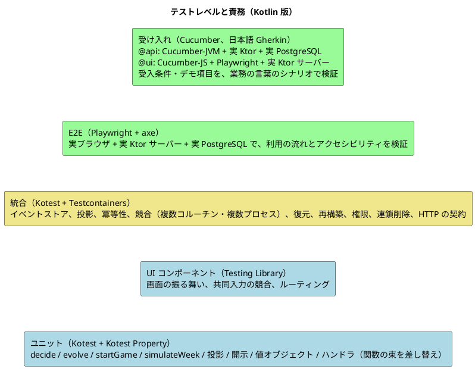
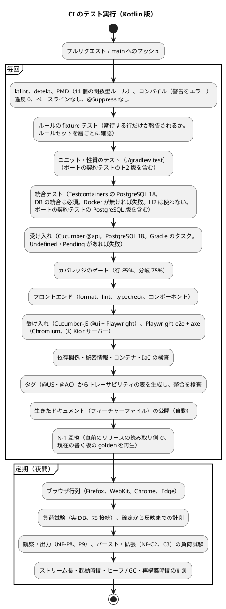

# テスト戦略 - ビールゲームシミュレーション（Kotlin 版）

## 概要

本書は、beer-game-kotlin のテスト戦略を定義します。**`docs/` を設計の正本**とします。実装コードはまだ存在しません。

[beer-game2 のテスト戦略](../beer-game2/test-strategy.md) を出発点に、次の 3 点を Kotlin・関数型・イベントソーシング（ES）+ CQRS に合わせて作り直します。

- **ドメインが純粋関数**（`decideGame` / `evolveGame` / `decideSession` / `evolveSession` / `startGame` / `simulateWeek`）になるため、テストの大半が「入力を与えて出力を確かめる」だけになる。ES では、テストの形が **Given（過去のイベント）/ When（コマンド）/ Then（新しいイベント、またはエラー）** にそのまま対応する（[ガイド 第 8 章](../../reference/関数型プログラミングガイド_Kotlin編.md)）。
- 状態が**イベントの列**になるため、「再生しても同じ状態になる」「投影を作り直しても同じ行になる」という**性質**を、プロパティベーステストで保証する（[ガイド §8.3](../../reference/関数型プログラミングガイド_Kotlin編.md)）。
- 並行性が「行のロック」から「**ストリームの版の一意制約 + 自動再試行**」に変わるため、競合・冪等性・復元の検証を、実際の PostgreSQL で行う（[データモデル](./data-model.md)）。

- **ローカル開発は H2 の PostgreSQL モード、検証は PostgreSQL 18**（2026-11-14 のユーザーの決定。[技術スタック](./tech-stack.md) 設計判断 T7）。H2 は開発機での起動・動作確認だけに使い、統合テスト・受け入れ・CI・ステージング・本番は PostgreSQL 18 のままにする。PostgreSQL 固有の機能（アドバイザリロック、`LISTEN` / `NOTIFY`）はポートの裏に隠し、**ポートの契約テストを両実装で実行**する（下の「ローカル開発の H2 とテストの分担」）。

機能と振る舞いの受入条件は beer-game2 の [ユーザーストーリー](../../requirements/beer-game2/user_story.md) を正本として引き継ぎます。変えるのは、**検証の手段**だけです。

### 基準にする値

beer-game2 のテスト戦略は、beer-game（v1）の実測（199 件、行 90.5%、分岐 79.8%）を基準に目標を決めました。**Kotlin 版は新規のコードで、実測値がありません**。したがって、数値の目標は、beer-game2 の値を**出発点の提案**として引き継ぎ、ウォーキングスケルトンの実測で見直します（設計判断 T-2）。

## テスト形状の選択

[テスト戦略ガイド](../../reference/テスト戦略ガイド.md) では、アーキテクチャに応じて形状を選びます。

| 判断項目 | Kotlin 版の答え | 帰結 |
| :--- | :--- | :--- |
| 業務の中心 | **純粋関数**（`decide` / `evolve` / `simulateWeek` / 投影） | ドメインを厚くテストする（ピラミッド型）。**モックが要らない**（過去のイベントとコマンドを与えるだけ） |
| 永続化の特性 | ストリームの版の一意制約による追記の競合、自動再試行、同一トランザクションでの追記・投影・冪等記録、連鎖削除、追記専用の権限が、実際の PostgreSQL に依存する | 統合テストは、ガイドの標準（15%）より厚くする |
| 画面 | URL ルーティングを持つ SPA。API の契約は beer-game2 と同じ | 画面のテストは beer-game2 から変えない |

**採用する形状は、ピラミッド型です。統合テストは約 3 割までを認めます**（beer-game2 と同じ）。

### 目標の分布

| レベル | 目標の割合 | 理由 |
| :--- | :--- | :--- |
| ユニット（ドメイン、投影、アプリケーション）+ UI コンポーネント | 65% 以上 | 純粋関数は速く、規則の網羅に向く。ES の Given/When/Then は、ここで書く |
| 統合（API + DB） | 30% 以下 | 並行性、冪等性、復元、再構築、権限の検証に必要な分 |
| E2E・受け入れ（Cucumber `@api` / `@ui`、Playwright） | 5% 以下 | 受入条件・デモ項目の要所だけ。実サーバー・実 DB を通すため、件数は絞る（シナリオの数の目標は、B1 の実績で見直す） |

プロパティベーステストは、**1 件のテストが多数の入力を試す**ため、件数の割合ではなく、ユニットの一部として数えます。

## テストレベルの定義



| レベル | 責務 | 対象 | 依存の扱い |
| :--- | :--- | :--- | :--- |
| ユニット（ドメイン） | 規則と計算を検証する。**Given（過去のイベント）→ When（コマンド）→ Then（イベント列、または `DomainError`）**の形で書く | `decideGame`、`evolveGame`、`decideSession`、`evolveSession`、`startGame`、`simulateWeek`、`KitPreset.classify`、`GameSettings.of`、`Disclosure`、`RetentionSaga` の `decide` / `evolve`、値オブジェクト | 外部に依存しない（純粋）。時刻・ID・乱数は、コマンドの値として与える（[ドメインモデル](./domain-model.md)） |
| ユニット（性質） | **どんな入力でも成り立つ性質**を検証する（下記） | 上記すべて、投影、シリアライズ | 同上。`Arb` で入力を生成する |
| ユニット（投影） | イベントから**行の変更の列**（`Event -> List<RowChange>`。Upsert / Delete と表・主キー・値）を作る純粋関数 `Projection` を検証する。**投影は他の投影を読まず、イベントのペイロードだけから作る**ため、再構築の順序に依存しないこと、1 件の `WeekCommitted` が複数の表の変更を返すことを確かめる。開示の判定も含む | `Projection.apply` / `replay`、`Disclosure` | 純粋 |
| ユニット（アプリケーション） | 「読む → `decide` → 追記 → 再試行 → 冪等記録」の手順を検証する | コマンドハンドラ、問い合わせ | `EventStore` などの**関数の束**を、メモリ上の実装または失敗を返す関数に差し替える（[ガイド §8.2](../../reference/関数型プログラミングガイド_Kotlin編.md)） |
| UI コンポーネント | 画面の表示、入力、エラー、フォーカス、共同入力の競合、ルーティング | `ui/src/features/` | beer-game2 と同じ（`ApiClient` を差し替える） |
| HTTP の統合 | 境界（認証、Origin 検査、冪等キー、版、エラー形式、セキュリティヘッダー、相関 ID、レート制限、SSE）の契約を検証する | Ktor のアダプター（`testApplication`） | ハンドラはメモリ上の関数の束、または実 DB |
| DB の統合 | 永続化、**ストリームの版の競合と自動再試行**、同一トランザクションでの追記・投影・冪等記録・周辺ストア、**複数ストリームの原子的な追記（`StartGame`）**、**再生・再構築・復元**、**追記専用の権限**、連鎖削除の網羅、マイグレーションを、実際の PostgreSQL 18 で検証する | `EventStore`、投影の更新、周辺ストア、`RetentionSaga` の実行、2 つの API プロセス | Testcontainers の PostgreSQL 18（専用のコンテナ。誤った DB への接続を、接続先の検査で防ぐ）。**H2 は使わない** |
| **受け入れ（Cucumber）** | **受入条件とデモ項目**を、日本語 Gherkin のシナリオとして、実サーバー・実 DB を通して検証する。シナリオが人と AI の契約で、Cucumber の実行結果が承認ゲートの検証材料になる。**1 つのシナリオは 1 つの層だけで実行する**（`@api` か `@ui`） | `@api`: ストーリーの受入条件（アプリケーション・HTTP・永続化を通す）。`@ui`: 画面を通す必要のある業務（振り返りの表示など） | `@api`: Cucumber-JVM、Ktor のテスト用アプリケーション、Testcontainers の PostgreSQL 18。`@ui`: Cucumber-JS、Playwright、実際の Ktor サーバー、実 DB |
| E2E | 利用の流れの要所を、実ブラウザで確認する。アクセシビリティを自動検査する（axe）。**業務の受入条件は Cucumber の `@ui` が担い、ここでは、実ブラウザでしか確認できないこと（拡大、フォーカス、SSE、axe）と、画面をまたぐ流れに限る** | 作成、参加、共同入力、確定、観察、SSE の切断、200% 拡大 | 実際の Ktor サーバー、実 DB |

**DB の統合テストは、CI では必ず実行する**。Docker が使えない場合は、スキップではなく失敗にする（環境変数 `CI` が設定されている場合）。手元では、スキップした件数を結果に明示する（beer-game2 の方針を維持）。

### ローカル開発の H2 とテストの分担

ローカル開発（開発機での起動・動作確認）は、H2 の PostgreSQL モードで行えます（実行の選択は設定 `DB_KIND=postgres|h2`。本番・ステージングで H2 が選ばれた場合は、起動時の検査で失敗する。[バックエンドアーキテクチャ](./architecture-backend.md)、[データモデル](./data-model.md)）。**H2 で緑でも、PostgreSQL で検証されていない振る舞いは、検証済みとは見なしません。**

| 項目 | 実行する環境 | 扱い |
| :--- | :--- | :--- |
| 統合テスト（`integrationTest`）、受け入れ（Cucumber `@api` / `@ui`）、E2E、負荷試験、CI | **PostgreSQL 18 のみ**（Testcontainers、RDS） | H2 は使わない。設計の検証（並行性・権限・部分一意索引・連鎖削除）と性能の計測にも使わない |
| ポート `ProjectionLock`・`ChangeNotifier` の**契約テスト** | **両実装**（PostgreSQL 版: 統合テスト、H2 版: ユニット） | 同じ契約（下記）を 2 実装に実行する。契約テストの本体は 1 つにし、実装を差し替えて呼ぶ |
| 部分一意索引（`uq_idempotency_create`）、DB ロールと GRANT（追記専用、`TRUNCATE` の拒否）、接続プールの分離、`jsonb` などの PostgreSQL 固有の型 | **PostgreSQL の統合テストでだけ**検証する | H2 版では、同等の制約を H2 で表せる形（通常の一意制約、アプリケーション側の検査）に置き換えるか省略する。**省略した制約は、ローカルでは守られない**（[データモデル](./data-model.md) の一覧） |
| H2 版の起動・動作確認 | H2 のスモーク（ユニット相当）: マイグレーションが H2 に適用でき、ゲームの作成から 1 週の確定までが動く | 開発機の動作確認の補助。合格しても、DB の統合の代わりにならない |

**ポートの契約テスト（両実装で実行）**

| ポート | 契約 | 備考 |
| :--- | :--- | :--- |
| `ProjectionLock` | 排他（再構築側）の保持中は、共有（コマンド側）が待たされる。共有同士は待たない。ロックは同じトランザクション（または解放の呼び出し）の終了で解放される。待ちの上限に達したら失敗を返す | H2 版は**プロセス内の読み書きロック**。**単一プロセスでのみ有効**で、2 プロセスでの検証は PostgreSQL の統合だけで行う |
| `ChangeNotifier` | 追記のコミット後に、購読者に版の通知が届く。ロールバックなら届かない。購読の解除後は届かない | H2 版は**プロセス内のイベント**で、**単一プロセスでのみ有効**。`LISTEN` の接続の切断・再購読と、複数プロセスへの通知は、PostgreSQL の統合だけで行う（通知の行） |

**H2 と PostgreSQL の乖離への対策（リスク）**: ローカル（H2）で通っても、CI（PostgreSQL）で落ちる乖離が起きうる。(a) **H2 でしか通らない記述を禁止する**（PostgreSQL の統合テストが正。テストは H2 にだけ依存してはならず、H2 専用の分岐でテストを緩めない）、(b) ポートの契約テストを両実装で実行する、(c) 受け入れ（Cucumber `@api`）は PostgreSQL で実行する。H2 の PostgreSQL モードで動く範囲（アドバイザリロック、`LISTEN` / `NOTIFY`、部分インデックス、ロール / GRANT、`jsonb`、SQLSTATE、分離レベルの差異）は、**2026-11-14 に H2 の公式ドキュメント（features の PostgreSQL 互換モード）を確認した範囲では確認できなかった**（非対応とは断定しない）。実際の動作は、B1 の最初に実測して確定する（未確認）。

### レベル間の重複を避ける方針

- 規則の分岐は、ドメインのユニットで網羅する。HTTP の統合では、境界の契約（ステータス、ヘッダー、エラー形式）だけを確認する。
- **永続化の整合性、並行性、再生・再構築・復元は、DB の統合でだけ検証する**。ユニットでは、メモリ上の関数の束を使う。
- 画面の分岐は、コンポーネントで確認する。E2E は、画面をまたぐ流れと、実ブラウザでしか確認できないこと（拡大、フォーカス、SSE、axe）に限る。
- **受入条件は Gherkin、実装の細部と網羅は Kotest が担う。同じ振る舞いを、Gherkin と Kotest で二重に書かない**。受け入れ（Cucumber）は、受入条件の代表例（正常系・主な否定）を実サーバーで通す。規則の分岐の網羅、純粋関数の性質、DB・HTTP の細部（版の競合、権限、境界値）は、下のレベルの Kotest で書く。
- **同じシナリオを `@api` と `@ui` の両方で実行しない**（ステップ定義を二重に持たない）。

## 開発の進め方（BDD と TDD）

**Gherkin と Cucumber を導入します**（2026-11-14 の決定。[開発戦略](../../development/beer-game-kotlin/development_strategy.md) が正。導入の手続き、具体的な成果物と版は、B1 で公式の情報から確認してから確定し、依存関係の導入の承認を得る）。

- **BDD（Given/When/Then を先に）**: 振る舞いは、実装より先に Given/When/Then で定義する。書く場所は、対象で分ける。
  - **受入条件・デモ項目**: **日本語 Gherkin**（フィーチャーファイル）。**Cucumber** が実行する。業務の言葉で読める契約で、生きたドキュメントとして公開する。
  - **ドメインの純粋関数・性質・DB と HTTP の細部**: **Kotest の日本語のテスト名**で Given/When/Then。**ES では、Given は過去のイベントの列、When はコマンド、Then は新しいイベントの列またはエラー**であり、そのままテストコードになる。イベントの列は実装の詳細に近く、Gherkin にすると冗長になるため、Kotest のビルダー（Object Mother）で組み立てる。
  - **二重に書かない**: 受入条件は Gherkin、実装の細部と網羅は Kotest。
- **TDD**: 失敗するテストを書き、**失敗を確認してから**、最小限を実装し、通ったらリファクタリングする。先回りして実装しない。
- **土台を変える最初のスライドでは、後続の振る舞いのテストも先に書く**（`EventStore` の型や、集約の `decide` の型など、共通の土台を作るとき）。順序を守れなかったときは、規則を壊すとテストが落ちることを個別に確かめ、記録に残す。

### アウトサイドインのサイクル（Cucumber）

1. デモ項目・受入条件を日本語 Gherkin のシナリオにし、Mob Elaboration（人 + AI）で合意する。AI が書いた場合も、人が業務の言葉と例の妥当性を検証してから承認する（シナリオが契約）。
2. 実行する。ステップ定義が無いので **Undefined** になる。
3. ステップ定義を書く（**Pending**）。まだ無い内側の関数を呼び、アサーションを書いて **Failing（Red）** を確認する。
4. 内側へ一段ずつ下り（画面 → HTTP → アプリケーション → ドメイン → イベントストア・投影）、各層を Kotest で TDD し、**Passing（Green）** にする。
5. リファクタリングする。**シナリオは業務の言葉のまま変えない**。

中盤のインサイドアウトでは、受入条件のシナリオを実装の前に書いて合意しておき、ドメインと永続化の Kotest を先に進め、**Bolt の最後に Cucumber で実行して結合を確認する**。

### Gherkin の書き方・タグ・配置

| 項目 | 方針 |
| :--- | :--- |
| 言語・語彙 | 日本語 Gherkin。ファイルの先頭に `# language: ja`（`機能`・`背景`・`シナリオ`・`前提`・`もし`・`ならば`・`かつ`）。語彙は [ドメインモデル](./domain-model.md) のユビキタス言語に合わせ、**イベント名・テーブル名などの実装の言葉を持ち込まない**。言語を混在させない |
| 整理 | 機能領域ごとにフォルダを切る。領域は [ユーザーストーリー](../../requirements/beer-game2/user_story.md) の Epic（ゲーム準備と参加、1 週の意思決定、継続と復旧、観察と振り返り、保持、運用と観測性）に合わせる。1 ファイルに 3〜15 シナリオを目安にする |
| タグ | ストーリーと受入条件の ID（`@US2.4`、`@AC2.4.1`）、層（`@api`、`@ui`）、重要度（`@acceptance-criteria`、`@happy-path`、`@negative`、`@core`）。`@wip` は作業中の一時的なもので、完了時に削除する。**タグの一覧と意味を、フィーチャーファイルと同じ場所のテキストファイルに文書化する** |
| 層の分担 | `@api`: Cucumber-JVM（Gradle のソースセット `acceptanceTest` を想定）。Ktor のテスト用アプリケーションと実 PostgreSQL（Testcontainers）を通す。`@ui`: Cucumber-JS（`@cucumber/cucumber`、プロジェクトの依存として導入し、依存ツリーに複数の版を混在させない）と Playwright。実 Ktor サーバーを通す。画面を通す必要のある業務（振り返りの表示など）だけを `@ui` にし、ほかは `@api` にする |
| 配置（B1 で確定） | フィーチャーファイルは `apps/beer-game-kotlin/features/<機能領域>/` に 1 か所にまとめ、両処理系から参照する案を第一とする。ステップ定義は、Cucumber-JVM は Kotlin の `acceptanceTest`、Cucumber-JS は E2E のディレクトリに置く。処理系の既定の場所と合わせられるかを B1 で確認する。テストのレベルは、Gradle のソースセットで分ける（`test` = ユニットと性質、`integrationTest` = DB と HTTP の統合、`acceptanceTest` = Cucumber-JVM）。コンポーネントと E2E は、フロントエンドのディレクトリに置く。beer-game2 の `u1`〜`u5` のような、デリバリー単位の名前は使わない |
| 実行 | `@api` は Gradle のタスク、`@ui` は `npx cucumber-js`。CI の毎回の工程に含める。**Undefined・Pending のステップがあれば失敗** |

### ステップ定義の責務

- **薄く保ち、業務ロジックを持ち込まない**。中身は、アプリケーションの関数と、過去のイベントのビルダーを呼ぶだけにする。
- アウトサイドインでは、ステップ定義から呼ぶ「まだ無い内側」の関数と型が、設計を駆動する。
- ステップ定義も静的解析の対象である（テストの層のルールセット。[静的解析と規約の検査](#静的解析と規約の検査)）。
- 1 つのシナリオは 1 つの層だけで実行し、同じシナリオを `@api` と `@ui` の両方で実行してステップ定義を二重に持たない。

### Kotest 側のテスト名（ストーリーとの対応）

Kotest のテスト名には、引き続きストーリー・受入条件の ID を含める（例: `[US2.4/AC2.4.1] Given 自動確定が有効 When 4 役割の入力がそろう Then 週が一度だけ確定される`）。日本語のテスト名を使う（[ガイド §9.4](../../reference/関数型プログラミングガイド_Kotlin編.md) のとおり、関数名の camelCase を強制する整形ルールは、テストで外す）。**Gherkin のシナリオには ID を名前に入れず、タグ（`@US`・`@AC`）で表す**。

### テストの形（スケッチ）

```kotlin
test("[US2.4/AC2.4.1] Given 自動確定が有効で 3 役割が入力済み When 最後の役割が保存する Then DecisionSaved と WeekCommitted が一度に返る") {
    val given = sessionStarted(commitMode = AUTO) + decisionSaved(FACTORY, 4) + decisionSaved(DISTRIBUTOR, 4) + decisionSaved(WHOLESALER, 4)
    val state = replaySession(given)

    val result = decideSession(state, saveDecision(RETAILER, quantity = 4, expected = DecisionVersion.ZERO))

    result.shouldBeRight().map { it::class } shouldBe listOf(DecisionSaved::class, WeekCommitted::class)
}
```

```kotlin
test("[US3.1/AC3.1.2] Given 一時停止中で自動確定が有効 When 進行役が 4 役割目を代理入力する Then ProxyDecisionSubmitted だけが返り週は確定されない") { /* 再開時に WeekCommitted */ }

test("[US3.1/AC3.1.2] Given 進行中で自動確定が有効で 3 役割が入力済み When 進行役が現在の週で 4 役割目を代理入力する Then ProxyDecisionSubmitted と WeekCommitted が一度に返る") { /* 週が違えば WeekAdvanced */ }

test("[US2.3/AC2.3.1] Given 確定の画面を開いた後に他の人が数量を変えた When 古い basis で CommitWeek する Then DecisionsChanged が現在の値と保存者を返す") { /* 週が違えば WeekAdvanced */ }

test("[US2.3/AC2.3.1] Given 確定の画面を開いた後に第 N 週が確定された When 古い requestedWeek で CommitWeek する Then WeekAdvanced が返り DecisionsChanged ではない") { /* 判定順: 週 -> basis */ }

test("[US3.1/AC3.1.2] Given 第 N 週が確定された後 When 古い requestedWeek で SubmitProxyDecision する Then WeekAdvanced が返り何も追記されない") { /* M20: 代理入力の週違い */ }
```

過去のイベントの組み立ては、ビルダー（Object Mother）に集めます（下記のテストデータ）。

## 純粋関数のテスト（ドメイン）

| 対象 | 例によるテスト（Given/When/Then） | 検証すること |
| :--- | :--- | :--- |
| `decideGame` | 各コマンドの成功と、不変条件ごとの `GameError`（`AlreadyCreated`、`NotPreparing`、`Forbidden`、`StartConditionNotMet`、`InvitationRevoked` など） | 返すイベント、返さない（空のリスト）、エラーの分類（`Forbidden`、`InvalidState` など） |
| `evolveGame` | 各イベントの適用で、`GameState` が正しく遷移する | 全イベントの網羅（`when` の網羅をコンパイラが保証）、`version` の増加 |
| `decideSession` | 保存、共同入力の競合（`DecisionConflict` に最新値と保存者）、代理入力、確定（手動・自動）、一時停止中の確定の拒否、終了 | 自動確定が **1 回の `decide` で複数のイベント**を返すこと（`DecisionSaved` + `WeekCommitted`（+ `SessionEnded`）。代理入力では `ProxyDecisionSubmitted` + `WeekCommitted`（+ `SessionEnded`）） |
| `decideSession`（代理入力、H1・H2） | Paused 中の `SubmitProxyDecision`（進行役）は受理され、確定しない。Paused 中の参加者の `SaveDecision` は拒否。`requestedWeek` が現在の週と違えば `WeekAdvanced`。Active かつ `AUTO` で 4 役割が揃えば、`ProxyDecisionSubmitted` + `WeekCommitted`（+ `SessionEnded`）。意思決定の版は要求しないが 1 増える | 停止中の代理入力、`requestedWeek`、代理入力による自動確定（EV-S08 の発生条件） |
| `decideSession`（`CommitWeek`、H6） | 週が違えば `WeekAdvanced`（`session.week_advanced`）。週が同じで `basis` が現在の各役割の意思決定の版と違えば `DecisionsChanged`（`session.decisions_changed`、現在の値と保存者を返す）。`session` ストリームの版は判定に使わない（`StaleVersion` は無い） | `WeekAdvanced` と `DecisionsChanged` の区別、判定の順 |
| `evolveSession`（D5、M18） | **`simulateWeek` が出すはずの値と意図的に違う `nextStates`**（たとえば在庫を 1 ずらした値）を持つ `WeekCommitted` を Given にし、`evolveSession` の結果の状態が**その違う値をそのまま採用**していることを確かめる（再計算していれば、`simulateWeek` の値になって落ちる）。`WeekCommitted` の `nextStates` には、当週に処理する入荷と当週の受注（小売店は需要）も含めて同様に確かめる | 再計算しないこと（D5） |
| `evolveGame` / `evolveSession`（M13） | `decide` が作らない列（たとえば `SessionStarted` の前の `DecisionSaved`）を与えても、**状態を変えず、例外を投げず、`InvalidTransition` の検知（ログとメトリクス）を 1 件記録する**。強制キャスト（`as`、`as?` の連鎖）が無く、`when` が else なしで全域であること | 不正な遷移の扱い |
| `startGame` | 開始条件（各役割に 1 人以上）、二重の開始（`AlreadyStarted`）、両ストリームのイベントの内容（`SessionStarted` が設定と割り当ての写しを運ぶ） | 2 ストリームにまたがる判断 |
| `simulateWeek` | **既知の系列と期待値の組（golden）**。12 ステップ、遅延 0 を含むカスタムの遅延、在庫不足と受注残 | 決定論性（NFR-01） |
| `GameSettings.of`、値オブジェクト | 範囲外の値を**すべて集めて**返す（`NonEmptyList<ValidationError>`）。最終週 1〜50、需要系列の長さ、対象週の表示（AC1.1.2） | 誤りを集めること（[ガイド §3.4](../../reference/関数型プログラミングガイド_Kotlin編.md)） |
| `KitPreset.classify` | キット準拠か、カスタムか、変更項目の列挙（BR-14） | 導出の正しさ |
| `Disclosure` | 寄与者が 2 未満なら合計を出さない。終了前は役割別の値を出さない。将来の需要を出さない | BR-17、FR-04 |
| `RetentionSaga` | 開始、失敗（最大 5 回、指数バックオフ）、完了、完了後の再開始の拒否 | 状態遷移 |

**キット準拠の既定の需要系列（ASM-01）は、JSD の値の確認が済むまで未確定**です（[ドメインモデル](./domain-model.md) の未決事項）。golden のテストは、**カスタムの需要系列**で書き、キット準拠の受入判定は、値が確定するまで保留します。

## プロパティベーステスト

Kotest Property の `checkAll`、`forAll`、`Arb` を使います（[ガイド §8.3](../../reference/関数型プログラミングガイド_Kotlin編.md)）。入力は、型（`Quantity`、`Week`、`RoleMap` など）の**有効な値だけを生成する `Arb`** を、値オブジェクトごとに用意します。**有効なコマンド列の生成**（状態に応じて、その時点で受理されうるコマンドを選ぶ）も用意します。この生成器の品質は、下の「有効なコマンド列の生成器」で担保します。**Kotest Property に状態に応じて操作を選ぶ（状態ベースの）操作列の機能があるかは、本書では確認していない**。なければ、`Arb` を合成して自前に書く（実装開始時に確認）。

### 週次計算の性質（beer-game2 から引き継ぎ）

| 性質 | 内容 |
| :--- | :--- |
| 決定論 | 同じ入力から、同じ出力（参照透過性） |
| 非負 | 在庫、受注残、出荷は、常に 0 以上 |
| 保存 | 出荷数は、`min(利用可能量, 充足対象)`。在庫 + 出荷 = 利用可能量。受注残 = 充足対象 − 出荷 |
| 費用 | 週次費用 = 週末在庫 × 在庫単価 + 週末受注残 × 受注残単価。累積費用は、週次費用の和（**合計は `Long` で行い、オーバーフローしないこと**。[ガイド §8.3](../../reference/関数型プログラミングガイド_Kotlin編.md)） |
| 遅延 | 注文・配送・生産は、設定した週数より早く到着しない。カスタムの遅延（0 を含む）でも成り立つ |
| 役割別の結果 | 4 役割の結果の合計が、チームの合計と一致する |

### イベントソーシングの性質（Kotlin 版で追加）

| 性質 | 内容 | 保証すること |
| :--- | :--- | :--- |
| **(a) 永続化往復の同値性** | 任意の有効なコマンド列で、コマンド実行中のメモリ上の状態は、DB から読んだイベントを再生した状態と一致する（シリアライズ、アップキャスト、版の順序を通る。実 DB の統合で検証する） | 復元（FR-12）が、保存と再生だけで成り立つこと |
| **(b) 計算と事実の一致** | 任意の有効なコマンド列で、`fold(evolve)` の結果は、イベントのペイロード（`nextStates` など）と、`simulateWeek` を直接回した結果の両方と一致する | `WeekCommitted` の値が事実として固定され、再計算と食い違わないこと（D5） |
| **(c) 投影の整合** | `fold(evolve)` の結果と、投影の行が一致する（運用では日次に検査する。[運用要件](./operation.md)） | 投影が、イベントの正しい写しであること |

| `evolve` の全域性（M13） | **`decide` が作る列だけが `evolve` に来る**こと（任意の有効なコマンド列で、`decide` が返したイベントを `evolve` に渡した結果が、不正な遷移の検知を 1 件も出さない）。到達できる任意の（状態, イベント）で、`evolve` は例外を投げない。`decide` が作らない列は、状態を変えず `InvalidTransition` を記録する（例のテスト） | `evolve` は失敗しない（検証は `decide` の責務）。不正な遷移は検知する |
| `decide` の純粋性（M18） | **主たる保証は静的検査**（下記の `ForbiddenMethodCall`）。同じ（状態, コマンド）から同じ結果になることを確かめる性質は**補助**（同一 JVM の同一ミリ秒に 2 回呼ぶだけでは、時計の読み取りを検出できない） | 時計・乱数・I/O への隠れた依存が無いこと |
| 版の連続 | 状態の `version` は、適用したイベントの数に等しい | 楽観的並行制御の前提 |
| 週確定の一回性 | 任意のコマンド列で、同じ週の `WeekCommitted` は高々 1 件。週は 1 から連続して増える | FR-09、NF-R13 |
| 不変条件の保存 | 任意の有効なコマンド列の後で、在庫・受注残が非負。4 役割が揃わないまま確定されない | BR-12、BR-05〜BR-08 |
| 自動確定の等価性 | `AUTO` の最後の `SaveDecision`（および Active 中の `SubmitProxyDecision`）が返す `WeekCommitted` は、同じ状態への `MANUAL` の `CommitWeek` が返す結果と、`commitKind` 以外が一致する | FR-18 |
| 一時停止中は確定しない | Paused 中の任意の `SubmitProxyDecision` と `SetCommitMode(AUTO)` は `WeekCommitted` を返さない。再開時（`Resume`）に、4 役割が揃い `AUTO` なら自動確定が判定される | H1 |
| 競合の正しさ | 同じ役割への 2 つの保存を、どちらの順で処理しても、**受理された書き込みは失われず**、版が古い側は `DecisionConflict` と最新値を返す | FR-16、NF-R14 |
| 空のイベント | 状態を変えないコマンド（同じ役割への再割り当て）は、空のリストを返す | D9 |
| 投影の増分と一括 | 任意のイベント列を任意の位置で分けて増分で適用した結果は、全体を `replay` した結果と一致する | 再構築が、増分の更新と同じ行を作ること |
| 開示 | 寄与者が 2 未満なら、`WeekTeamTotals` の合計を返さない。観察者向けの投影の型は、役割別の値を持たない | BR-17、NF-S18 |
| シリアライズの往復 | すべてのイベント型で、`encode` → `decode` が元に戻る。**型の網羅**（`sealed` の全サブクラスが登録されていること）を、リフレクションで検査する | イベントの保存と再生 |
| 個人情報・秘密の不在 | 任意のイベントの JSON に、表示名・資格・招待コード・冪等キーが含まれない（型に項目が無いことと、保存された `payload` の走査） | NF-S14、NF-S21、D7 |
| アップキャスト | 旧い `schema_version` のイベント（保存済みの JSON のフィクスチャ）をアップキャストして `evolve` した結果は、期待する状態と一致する | イベントの形の変更への耐性 |

旧名の「再生の同値性」は使いません。**「1 件ずつ `evolve` した状態と `fold(evolve)` の一致」は、`replay` が `fold(evolve)` である限り、同じ畳み込みを 2 回書くだけで実装に関係なく通るため、テストにしません**（削除）。

### 有効なコマンド列の生成器（M19）

性質のテストの価値は、生成した列が**深い状態**（確定、最終週、終了）に届くかに依存します。次の 2 つで担保します。

| 担保 | 内容 |
| :--- | :--- |
| 生成列の分布の記録 | 生成した列のうち、`WeekCommitted` に達した割合、`SessionEnded` に達した割合、各 `DomainError` を受けた割合を、テストの結果に出力する（Kotest Property の分類の機能、または自前の集計）。**`WeekCommitted` と `SessionEnded` に達した割合が下限（提案: それぞれ 10% 以上、2% 以上）を下回ったら、テストを失敗させる**。値は実測で見直す |
| 生成器の単体テスト | 生成器が作った列を `decide` に順に与えると、**すべて受理される**（`Left` にならない）。意図的に無効な列を作る別の生成器（エラーの割合を上げる用）は、生成器を分けて、受理されることを前提にしない |

**変異テスト**: domain の品質の指標は、行の数値より**変異テストを優先**する（カバレッジの分岐の指標は `suspend` で揺れうるため）。導入の要否は、ウォーキングスケルトンの最初の実測で判断する。**Pitest の Kotlin への対応は、本書では確認していない**（実装開始時に確認）。

プロパティのテストは、1 件が多数の入力を試すため、**失敗したときは縮小された最小の反例を、テスト名と同じ ID とともに記録**します。反例は、そのまま例によるテスト（回帰）に加えます。

## アプリケーション層のテスト（関数の束の差し替え）

`EventStore`、`Clock`、`IdGenerator`、資格の発行などは、**関数の束**として定義されます（[データモデル](./data-model.md)、[ガイド §7.2](../../reference/関数型プログラミングガイド_Kotlin編.md)）。テストでは、メモリ上の実装と、**失敗を返す関数**に差し替えます（[ガイド §8.2](../../reference/関数型プログラミングガイド_Kotlin編.md) の `TestDataAccess` と同じ形）。

| テスト | 検証すること |
| :--- | :--- |
| 空のイベント | `decide` が空のリストを返したとき、追記しない |
| 追記の競合と自動再試行 | 最初の追記が `ConcurrencyConflict` を返す関数に差し替え、**再読み込みして `decide` を再評価**し、結果が変わる場合（`DecisionConflict`、`WeekAdvanced`、`DecisionsChanged`、`AlreadyStarted`）は、その結果を返すこと |
| 再試行の上限 | 競合が続いたとき、上限の回数で止まり、`app.retry_exhausted` を返すこと（上限の値は実装開始時に決める） |
| 冪等 | 同じ冪等キーと同じ内容は、保存済みの応答を返し、追記しない。内容が違えば `app.idempotency_key_reused`（409） |
| 処理の順（H4） | 認証 → 認可の前提検査 → 冪等記録の照合 → 読み込み → decide → 追記・投影、の順で呼ばれること（差し替えた関数の呼び出し順で検査する）。**認可が冪等照合より先**であること |
| 失効した資格の再送（H4） | 以前に成功したキーを、失効した資格（入れ替えで失効した旧担当者など）が再送しても 403 で、保存済みの応答を返さない |
| 冪等記録は成功だけ（H4） | 業務の失敗（`Left`）は冪等記録に保存されない。同じキーの再送は、同じ失敗を再計算して返す。`request_digest` は本文・対象・操作者の ID から作られ、操作者が違えば別の内容として扱う |
| 制約ごとの再試行・再照合（H5） | 衝突の制約名ごとに扱いが分かれること。`uq_events_stream_version` は読み直して decide からやり直す。`uq_idempotency_create` は記録を再照合して保存済みの応答を返す（500 にしない）。`pk_idempotency_records` は記録を再照合し、本文の digest が同じなら保存済みの応答、違えば `app.idempotency_key_reused`。**上の 3 つ以外の一意制約違反は 500 と相関 ID**（ログ）になる |
| トランザクションの境界（H7） | `Left` を返したら ROLLBACK され、追記と投影が残らない。SQLSTATE 40001 と 40P01 は `ConcurrencyConflict` と同じ再試行の対象。COMMIT / ROLLBACK は `NonCancellable` で行われ、`CancellationException` は `PersistenceFailure` に変えず再送出される（キャンセルしても TX が閉じる） |
| 周辺ストア | `displayName` と資格のダイジェストが、周辺ストアへ書かれ、**イベントには含まれない**こと |
| 永続化の失敗 | 追記が `PersistenceFailure` を返す関数に差し替え、**受理済みと表示せず**、再試行できる失敗を返すこと（NF-R9） |
| 認証から `Actor` への変換 | 認証の結果が、コマンドの `Actor` として渡ること（認可の規則自体は `decide` のテスト） |
| 副作用の合成 | ログ・計測のラッパー（[ガイド §7.7](../../reference/関数型プログラミングガイド_Kotlin編.md)）が、本体の結果を変えないこと。ログに表示名・資格が含まれないこと |

## イベントストアと投影の統合テスト（実 PostgreSQL）

Testcontainers の PostgreSQL 18 を使い、**マイグレーションを適用した空の DB から始め**ます。ゲームごとに ID を分け、テスト間で干渉しません。**H2 は使いません**（ローカル開発専用。上の「ローカル開発の H2 とテストの分担」）。PostgreSQL 版のマイグレーション（共通の部分と PostgreSQL 用の差分）を適用して検証します。

### イベントストア

| テスト | 検証すること |
| :--- | :--- |
| 追記と読み込み | 追記したイベントが、`stream_version` の順に読める。版が連続している（欠番なし） |
| 追記の競合 | 同じストリーム・同じ版への 2 つの追記のうち、**一方だけが成功**し、他方は `ConcurrencyConflict`（一意制約の違反）になる。実際の並行（複数のコルーチン）で行う |
| 複数ストリームの原子性 | `StartGame` が、`GAME` と `SESSION` の両方へ**同一トランザクション**で追記する。**一方の追記を失敗させると、他方も残らない**。二重の開始は、`SESSION` の版 1 の重複で一方だけが成功する |
| 保存の途中の失敗 | 追記の後、投影の更新で失敗を注入しても、**`events`・投影・冪等記録・周辺ストアのどれにも部分更新が残らない**（NF-R5） |
| 追記専用の権限 | アプリケーションが使う DB ロールで、`events` への `UPDATE` と `DELETE` が拒否される（NF-S20）。保持削除のロールで、`game_roots` の削除が連鎖して `events` が消えること（**連鎖削除が、`events` に DELETE 権限を持たないロールでも動くかは、最初のスライドの Red のテストで確かめる**。NF-S20 の注記のとおり、`events` に更新・削除を拒否するトリガーを足すと連鎖削除も止まる） |
| 追記専用の否定テスト（H12） | ①書き込みロールが `game_roots` を `DELETE` できない。②書き込みロールが `events` を `TRUNCATE` できない。③各ロール（書き込み・読み取り・観察者・削除）が、表の所有者でも所有者ロールのメンバーでもない（`pg_roles` / `pg_auth_members` で検査）。④削除ロールが `game_roots` 以外を直接 `DELETE` できない |
| 観察者の接続プールの配線（H13） | 観察者の HTTP の経路を実 DB で通し、その問い合わせの `current_user` が観察者ロールであること（書き込み用プールを渡す設定ミスの検出） |
| マイグレーション | 空の DB に 001 から順に適用でき、再適用しても変化せず、`events` の一意制約と `CHECK` が効く |

### 冪等性・競合

| テスト | 検証すること |
| :--- | :--- |
| 冪等キーの再送 | 同じキー・同じ内容の再送は、**同じ結果**を返し、`events` が増えない（NF-R6） |
| 内容違いの再送 | 同じキーで内容が違うと競合 |
| 保持の期間 | 24 時間を過ぎた冪等記録は、期限切れとして扱う（時刻はコマンドの値で与える） |
| 資格の再返却 | ゲームの作成・参加・復帰の再送で、同じ資格が返る（応答を暗号化して保存していること。生の資格が DB に残らないこと） |
| 共同入力の競合 | 同じ役割の 2 人が同時に保存すると、自動再試行の後、**一方が `DecisionConflict` と最新値・最後の保存者を受け取り、保存された値が失われない**（NF-R14）。実際の並行で行う |
| 手動確定と自動確定の競合 | 最後の `SaveDecision`（`AUTO`）と進行役の `CommitWeek` が同時でも、`WeekCommitted` は**1 件**で、費用は一度だけ（NF-R13）。`week_commits` の主キーが 2 つ目の防壁になっていること。遅い側は `WeekAdvanced` を受け取る。**2 つの API プロセス**で検証する |
| 停止中の代理入力（H1） | Paused の間に進行役が代理入力しても確定しない。再開すると、4 役割が揃い `AUTO` なら一度だけ自動確定する |
| 代理入力と確定の競合（H2） | 最後の `SubmitProxyDecision`（`AUTO`）と `CommitWeek` が同時でも `WeekCommitted` は 1 件。古い `requestedWeek` の代理入力は `WeekAdvanced` |
| 資格の失効と再送（H4） | 役割の入れ替えで失効した旧担当者が、以前に成功したキーを再送すると、保存済みの応答でなく 403 |
| 制約ごとの再照合（H5） | 同じキーのゲーム作成の同時の重複（`uq_idempotency_create`）と、同じキー・同じ対象の同時の重複（`pk_idempotency_records`、空の列を返す操作を含む）が、500 にならず保存済みの応答（本文が違えば 409）になる。実際の並行で行う |
| 再試行の上限 | 競合を意図的に続けたとき、上限で止まり、`app.retry_exhausted` を返す |

### 投影・再構築・復元

| テスト | 検証すること |
| :--- | :--- |
| 同期投影 | 追記の直後に読み取ると、必ず反映されている（NF-P2、NF-P19） |
| 投影の整合性の検査 | `projection_checkpoints.projected_version` が、`MAX(stream_version)` と一致する |
| **投影の再構築** | ゲームの投影の行をすべて削除し、`events` から再構築すると、**削除前と同じ行**になる（投影のすべての表を比較）。マイグレーションで投影の列を足した後の再構築も検証する（NF-R15、NF-P18） |
| **永続化往復の同値性（DB 経由）** | DB から読み込んだイベントを再生した状態が、コマンドの実行中に保持した状態と一致する（NF-R16）。性質 (a) |
| **投影の整合（性質 (c)）** | イベントを `fold(evolve)` した結果と、投影の行が一致する |
| 出力は要求時に作る（H3） | `buildExport(settings, weekRoleResults)` は全域の純粋関数で、`week_role_results` と設定から `checksum` と `schema_version` まで作る。表 `export_packages` は無く、最終週の確定は出力の作成に依存しない |
| **復元** | データベースのバックアップから復元し、投影を再構築した後の API の応答が、復元前と同じ（運用の訓練。[運用要件](./operation.md)）。**確定済みの週が失われないこと**（RPO 0。NF-R3） |
| 強制停止 | 確定の途中で JVM のプロセスを強制停止し、再起動後に、**確定済みの週が残り、部分更新が無い**（NF-R3） |
| 観察者の権限（M1） | 観察者用の DB ロールが読めるのは `game_overview`（参加コードなし）・`session_overview`・`week_team_totals` の 3 表だけ。`week_role_results`・`role_current_states`・`current_decisions`・**`game_join_codes`** に**到達できない**（NF-S18。観察者が参加コードを得て参加者として加われないこと） |
| 問い合わせの一貫性（M15） | 問い合わせが読み取り専用の REPEATABLE READ のトランザクションで行われ、`projection_checkpoints` を同じトランザクションで読む。問い合わせの途中に別のコネクションが追記・投影しても、応答の `versions` が、返した行より新しくならない |
| ポート `ProjectionLock` の契約（PostgreSQL 版） | 契約テスト（両実装で実行。上の表）の PostgreSQL 版。アドバイザリロックで、**2 つの API プロセス**の間でも排他・共有が効く（H2 版は単一プロセスのみで、この検証は PostgreSQL の統合だけ） |
| 再構築の同時実行制御（M23。PostgreSQL 版のポートで検証） | 再構築（排他の `pg_advisory_xact_lock(game_id)`）の最中に、コマンド（共有の `pg_advisory_xact_lock_shared(game_id)`。代理入力、資格の再発行、観察者の参加）を送ると、ロックの待ちの後に実行されるか、待ちの上限で 503 `app.retry_exhausted` を返し、**再構築の結果の行と、その間に追記したイベントの投影が一致する**（取りこぼし・二重適用が無い）。コマンド同士は互いを待たない。ロック待ちの上限の値は未決（データモデルの未決事項）で、設定から注入できる |
| ポート `ChangeNotifier` の契約（PostgreSQL 版） | 契約テスト（両実装で実行）の PostgreSQL 版。コミット後にだけ通知が届き、ロールバックなら届かない。H2 版（プロセス内のイベント）は同じ契約をユニットで検証する |
| 通知（`pg_notify`、L4。PostgreSQL 版のポートで検証） | ①**ロールバックなら通知が出ない**: 追記と同じトランザクションで `pg_notify` を呼び、`Left` で ROLLBACK したとき、`LISTEN` 側に何も届かない。コミットしたときだけ 1 件届く。②**LISTEN の再購読**: `LISTEN` の接続を強制切断すると、受信ループが再接続して購読し直し、切断中の追記も、数秒ごとの `projection_checkpoints` の照合で補われ、通知が収束する（NF-R10、NF-P4）。③`/ready` が、`LISTEN` の接続が切れている間は失敗する |
| 連鎖削除の網羅 | **削除後に、`game_id` 列を持つすべての表に、そのゲームの行が残らない**（表の一覧は `information_schema` から取得）。`deletion_runs`・`deletion_attempts` も完了と同時に消える |
| 保持削除の再試行 | 削除の失敗を注入し、最大 5 回の指数バックオフで再試行し、**半分の削除を完了としない**（NF-R11）。再起動後に、`deletion_runs` から進行中の手続きを復元する（NF-R12） |
| 個人情報の不在 | 一連の操作の後、`events` の `payload` に、表示名・資格・招待コード・冪等キーの値が含まれない（NF-S21） |

## HTTP の統合テスト（Ktor）

`testApplication` で、アダプターの契約を検証します（ハンドラは、メモリ上の関数の束、または実 DB）。

| 観点 | 検証すること |
| :--- | :--- |
| 認証・認可 | 偽造 Cookie、期限切れ・失効した資格、他のゲームへのアクセス、観察者の書き込みを拒否する。**無効な資格は、すべて同じ応答で返す**（NF-S12） |
| 入力の検証 | 範囲外の値、大きすぎるリクエスト（64 KB）を拒否し、**検証の誤りを項目ごとに集めて**返す |
| エラーの写像 | `DomainError` の分類（`Forbidden`、`NotFound`、`InvalidState`、`Conflict`、`RuleViolation`）が、HTTP の状態に写る |
| 境界の契約 | Origin の検査、冪等キー、版、エラー形式、セキュリティヘッダー、相関 ID（NF-S8、NF-S9、NF-O2）。`If-Match` は `SaveDecision`（意思決定の版）にだけ付き、`CommitWeek` は本文の `requestedWeek` と `basis` を使う（H6） |
| エラーの識別子（H9） | problem+json の `type` が `/problems/{code}`、拡張メンバー `code` が同じ値（`<領域>.<名前>`）。失効・期限切れ・不明の資格は同じ `code`（`game.invitation_invalid`） |
| 応答の形（H8） | コマンドの応答が `{ versions: { game, session }, ... }` だけで、確定結果を含まない。画面はスナップショットを取り直して `versions` に追いつく |
| 停止中・週の競合（H1、H2、H6） | Paused 中の代理入力は進行役のみ 200。参加者の保存は拒否。週違いは 409 `session.week_advanced`、`basis` 違いは 409 `session.decisions_changed` |
| レート制限 | 参加・復帰・招待の専用の制限（NF-S11） |
| SSE | 版の通知を受け、取得した状態が通知の版以上であること。切断後にポーリングへ切り替わり、再接続後に最新へ収束する（NF-P4、NF-R10） |
| アプリケーション層の失敗（M7） | `app.retry_exhausted` は 503 と `Retry-After`、`app.idempotency_key_reused` は 409、`app.unauthorized` は 403 で、いずれも problem+json の `type`（`/problems/{code}`）と `code` を持つ。**バックエンド自身が返す 503 は必ず `type` を持つ**（`type` のない 503 は LB など外部のもの。画面は「結果が不明」として同じキーで再送する） |
| ログ | ログに、資格・表示名・非公開の値が含まれない（許可・拒否のテスト。NF-O1） |
| 準備のヘルスチェック | DB に接続できないとき `/ready` が失敗する（NF-O10） |

## E2E

Playwright と axe で、**実際の Ktor サーバー**と実 DB に対して、利用の流れの要所（作成、参加、共同入力、確定、観察、SSE の切断、200% 拡大）を確認します。beer-game2 の内容を引き継ぎます。**API の契約は変わらない**ため、E2E のシナリオは、beer-game2 のものがそのまま使えるはずです（変わる場合は、設計の矛盾として扱う）。業務の受入条件のシナリオは、Cucumber の `@ui`（上記）に移す。実装は Playwright を共有し、E2E のディレクトリの配置は B1 で決める。

## カバレッジ目標

### 判断（beer-game2 の値を引き継ぐか）

beer-game2 のゲートは、行・関数・文 85%、分岐 75% です。Kotlin 版では、Kover が計測する指標が異なる可能性があるため、**判断が必要**です（設計判断 T-2）。

| 案 | 内容 | 評価 |
| :--- | :--- | :--- |
| **A（採用）** | **行 85%、分岐 75% を、全体のゲートとして引き継ぐ**。関数・文は、ゲートの対象から外す | 純粋なドメインは、100% 近い行の網羅を狙える。分岐は、`when` の網羅（`sealed`）が生成する到達不能な分岐があるため、100% を求めない。関数・文の指標が Kover にあるかは、本書では確認していない |
| B | 行 80%（beer-game3 のチームの基準と同じ） | 緩い。純粋関数の網羅を考えると、緩すぎる |
| C | 行 90% 以上 | 統合のコード（アダプター）のために、価値の低いテストが増える |

トレードオフ: A は、**根拠が beer-game2 の実測（v1 の実測を基準に引き上げた値）であり、Kotlin 版の実測ではない**。ウォーキングスケルトンの実測で見直す。beer-game3 は別のプロジェクトで、行 80% を基準にしている。本プロジェクトは beer-game2 を正本とするため、85% を維持する（揃えるかは未決事項）。

### ゲート（CI の合格条件）

| 指標 | beer-game2 のゲート | Kotlin 版のゲート |
| :--- | ---: | ---: |
| 行 | 85% | 85%（全体） |
| 関数 | 85% | （指標なし。Kover の対応は実装開始時に確認） |
| 文 | 85% | （同上） |
| 分岐 | 75% | 75%（全体。ただし `suspend` が生成する分岐で揺れうるため、実測で見直す） |
| `domain` の行 | — | 100%（ゲート） |

### Kover の計測の範囲（H14）

**Kover は `test` と `integrationTest` を合算して計測する設定にする**。`adapters/persistence` の行 90% は、DB の統合を含めないと到達できないためである。合算されないと、判定が意図とずれる。合算の設定がビルドで動くことは、**実装開始時にビルドで確認する未確認事項**とする。

### 層ごとの目標

「判定」の列で、CI のゲート（満たさないとマージしない）か、目安（下回っても失敗にしない。推移を見て見直す）かを区別する。

| 層 | 行 | 分岐 | 判定 | 方針 |
| :--- | ---: | ---: | :--- | :--- |
| `domain`（集約、`simulateWeek`、値オブジェクト、`Disclosure`、`RetentionSaga`） | 100% | 90% | 行 100% は**ゲート**。分岐は目安 | 中核。例と性質のテストで網羅する。`sealed` の網羅が生む到達不能な分岐は、除外ではなく分岐の目標を 100% にしないことで扱う |
| 投影（`Projection`） | 100% | 90% | 目安 | 純粋。投影の整合（性質 (c)）も含める |
| `application`（ハンドラ） | 95% | 85% | 目安 | 手順の分岐（冪等、競合、再試行、権限）を網羅する |
| `adapters/persistence`（イベントストア、投影の更新、周辺ストア） | 90% | 75% | 目安 | 分岐は DB の統合で確認する（合算が前提） |
| `adapters/http`（**計測対象に含める**） | 90% | 75% | 目安 | 最初から含める（起動部は除外して、統合で確認する） |
| `ui`（features） | 85% | 80% | 目安（Vitest 側のゲートは beer-game2 と同じ） | Vitest で計測。Kover の対象外 |
| 全体 | 85% | 75% | **ゲート** | 上の表 |

### 計測の範囲

計測の対象は、`domain`、`application`、`adapters` とし、**除外するのは、起動部（`main`）、設定の組み立て、kotlinx.serialization が生成するコード**だけです。**除外の設定が、生成コードだけに効くこと**は、実装開始時に確認します。UI は、Vitest の計測（beer-game2 と同じ）です。

## テストデータ

| 種類 | 方針 |
| :--- | :--- |
| ドメイン | **Given のビルダー**（Object Mother）で、過去のイベントの列を組み立てる（`sessionStarted(...)`、`decisionSaved(...)` など）。コマンドも同様。時刻・ID・乱数は、**コマンドの値**として固定で与える（`decide` は時計を読まないため、時計のスタブが要らない） |
| 週次計算 | 既知の系列と期待値の組（golden）と、**Kotest Property による性質の検証**。需要系列は、キット準拠の値が未確定の間は、カスタムで書く |
| 性質の入力 | 値オブジェクトごとの `Arb`、有効なコマンド列の `Arb`、イベント型ごとの `Arb`（シリアライズの往復で使う） |
| アップキャスト | 旧い `schema_version` のイベントの JSON を、フィクスチャとして保存する（変更しない） |
| DB の統合 | Testcontainers の PostgreSQL 18 の専用のコンテナ（H2 は使わない）。接続先の名前を検査し、誤った DB への接続を防ぐ。マイグレーションを適用した空の DB から始める。ゲームごとに ID を分け、テスト間で干渉しない |
| 資格 | テスト用の鍵（複数の版）と、テストごとの乱数。生の値を、保存や出力に含めない |

## 非機能のテスト

| 品質特性 | 要件 | 検証の手段 | CI での扱い |
| :--- | :--- | :--- | :--- |
| 正確性・決定論 | NFR-01 | `simulateWeek` の golden と性質のテスト | 毎回 |
| 整合性・冪等性 | NFR-02、FR-09、NF-R5〜NF-R7、NF-R13、NF-R14 | DB の統合（競合、複数プロセス、障害の注入） | 毎回 |
| 再生・再構築・復元 | NF-R15、NF-R16、NF-P18 | 永続化往復の同値性、計算と事実の一致、投影の整合、投影の再構築の一致、復元の訓練 | 毎回（一致の検証）。訓練は四半期とリリース前 |
| 応答性・同時利用 | NFR-03、NFR-04、NF-P1〜NF-P3、NF-P5 | **実 DB を使う負荷試験**（15 ゲーム、75 の SSE 接続）と、ブラウザでの確定から反映まで（p95 2 秒）の計測（Playwright）。**JVM のウォームアップの後**の定常値を測る。**NF-P2 は、確定した側のブラウザの時刻を基準にした同一の時計で、確定の操作から全ブラウザの描画までを測る**（サーバーとブラウザの時計を混ぜない。M21） | 夜間。結果を保存して推移を見る |
| 観察・出力・バースト・拡張（M20） | NF-P8、NF-P9、NF-C2、NF-C3 | **夜間の負荷試験に含める**。NF-P8: 15 ゲーム・90 読み手の観察と振り返り（30 分）。NF-P9: 50 週 × 4 役割の出力（CSV と JSON）を、同時の負荷の下で測る。NF-C2: 全 60 役割が 10 秒以内に確定の入力をするバースト（再試行の上限超過をエラー率に含める）。NF-C3: 25 ゲーム・100 の SSE 接続を 2 つ以上のインスタンスで処理 | 夜間 |
| ストリームの再生と追記 | NF-P15、NF-P19、NF-C8 | 1 ストリームを千件・2 千件に伸ばした再生と追記の時間の計測。**NF-P15・P18 の p95 は、JMH を使うか自前の計測かを実装開始時に決め、ウォームアップの回数（提案: 全体の p95 の算出に入れない先頭の 5 回以上）と、試行回数（提案: 100 回以上）を記録する**。目標値は提案で、実測で見直す。**NF-C8 は、共同担当が同じ週に保存を繰り返す最悪ケース（保存回数の上限の有無）の計測を含める**。上限は提案値＋未決（non-functional の未決事項）で、NF-P15・P3 の「最大の長さ」の定義（最悪ケースで到達するストリームの長さ）と結びつける | 夜間 |
| 起動時間・メモリ | NF-P16、NF-P17 | コールドスタートの計測（プロセスの開始から `/ready` が成功するまでの時間。マイグレーションの適用を除く）、負荷中のヒープと GC の記録。**NF-P17 のヒープ使用率は、GC 後（full GC 直後ではなく、GC のサイクルごとの GC 後の使用量）で測る** | 夜間 |
| セキュリティ | NFR-06、NF-S1〜NF-S21 | HTTP の統合（Origin、偽造 Cookie、他ゲーム、観察者の権限、ヘッダー）、DB の権限、依存関係・秘密情報・コンテナ・IaC の検査 | 毎回 |
| アクセシビリティ | NFR-08 | コンポーネントと E2E の自動検査（axe）、200% 拡大、手動の確認 | 自動は毎回。手動はリリース前 |
| 可搬性 | NFR-10 | Playwright の行列実行（Chromium、Firefox、WebKit、Chrome、Edge） | 夜間 |
| 観測性 | NFR-11 | ログの許可・拒否のテスト、`/ready` のテスト | 毎回 |

### 境界値の一覧（M20）

値が文書に散らばらないよう、境界値のテストの対象をここに集めます。**上限が未定のもの（再試行の上限、自動再試行の回数など）は、実装の定数に埋め込まず、設定（`AppConfig`）から注入できる設計**にします。テストは、小さい値を注入して「上限ちょうど」と「+1」を確かめます。

| 対象 | 境界の値 | 期待 | 主なレベル |
| :--- | :--- | :--- | :--- |
| 注文数量（NF-P12、NF-S10） | -1 / 0 / 1000 / 1001 | -1 と 1001 は拒否（誤りを集めて返す）。0 と 1000 は受理 | ユニット（値オブジェクト）、HTTP |
| 最終週（AC1.1.x） | 0 / 1 / 50 / 51 | 0 と 51 は拒否。1 と 50 は受理 | ユニット（`GameSettings.of`） |
| 保持日数（NF-S16） | 0 / 1 / 3650 / 3651 | 0 と 3651 は拒否。1 と 3650 は受理 | ユニット、HTTP |
| 表示名（トリム後の長さ） | 0 / 1 / 80 / 81。**空白のみ**（前後の空白を除くと 0 文字）を含む | 0（空白のみを含む）と 81 は拒否。1 と 80 は受理 | ユニット |
| 保持削除の再試行（NF-R11） | 4 / 5 / 6 回目の失敗 | 5 回目まで再試行し、6 回目は行わず失敗として残す（半分の削除を完了としない） | ユニット（`RetentionSaga`）、DB |
| 冪等記録の有効期間（NF-R6） | 保存から 24 時間ちょうどの前後（時刻はコマンドの値で与える） | 24 時間より前は保存済みの応答。**ちょうど**と後は期限切れ（境界の扱いを実装の定義に固定する） | DB |
| 資格の有効期限（NF-S4、NF-S17） | `expires_at` ちょうどの前後（出力の取得用の参照は 15 分） | 期限ちょうどは失効として扱う（境界の扱いを固定する）。前は有効 | ユニット（時刻は値で注入）、HTTP |
| 寄与者の数（BR-17、NF-S18） | 1 / 2 | 1 は合計を出さない。2 で出す | ユニット（`Disclosure`）、DB |
| 自動再試行の上限（NF-R17） | 上限ちょうど / 上限 + 1 | ちょうどの回数目で成功すれば成功を返す。+1 回の失敗が必要なら `app.retry_exhausted`。**上限は設定から注入** | アプリケーション、DB |
| リクエストの大きさ（NF-P12） | 64 KB ちょうど / +1 バイト | ちょうどは受理。+1 は拒否 | HTTP |

### 非機能要件ごとの検証（NFR 84 件、M20）

[非機能要件](./non-functional.md) の 84 件（NF-P1〜P20、NF-R1〜R17、NF-S1〜S21、NF-O1〜O13、NF-C1〜C9、NF-U1〜U4）すべてについて、検証の手段と頻度を示します。「毎回」は CI のすべてのプルリクエスト、「夜間」は定期の実行、「リリース前」「四半期」は訓練や手動の確認です。

| ID | 検証手段 | 頻度 |
| :--- | :--- | :--- |
| NF-P1 | 実 DB の負荷試験（75 並行、15 分。ウォームアップ後） | 夜間 |
| NF-P2 | Playwright の計測（確定した側のブラウザの時刻を基準にした同一の時計） | 夜間 |
| NF-P3 | 最大の長さのストリームでの確定の計測 | 夜間 |
| NF-P4 | SSE を遮断した E2E | 毎回 |
| NF-P5 | ブラウザ E2E で 75 ユーザーの負荷 | 夜間 |
| NF-P6 | 停止・再開・代理入力の API の計測（負荷試験の中） | 夜間 |
| NF-P7 | 再接続の負荷試験（75 並行） | 夜間 |
| NF-P8 | 観察・振り返りの負荷試験（15 ゲーム・90 読み手、30 分） | 夜間 |
| NF-P9 | 出力の負荷試験（50 週 × 4 役割）。`buildExport` のユニットは毎回 | 夜間（ユニットは毎回） |
| NF-P10 | 保持状態の取得の計測 | 夜間 |
| NF-P11 | 保持削除の完了時間（`completedAt - deleteAfter`）。ユニットと DB の統合は時刻を注入して毎回 | 毎回（本番の実績は日次） |
| NF-P12 | 境界値の一覧（数量、リクエストの大きさ） | 毎回 |
| NF-P13 | 共同入力の保存の計測と並行のテスト | 夜間（並行は毎回） |
| NF-P14 | 自動確定の計測 | 夜間 |
| NF-P15 | ストリーム 1000・2000 件の再生の計測（JMH または自前） | 夜間 |
| NF-P16 | コールドスタートの計測（プロセスの開始から `/ready` の成功まで） | 夜間 |
| NF-P17 | 負荷中のヒープ（GC 後）と GC の記録 | 夜間 |
| NF-P18 | 投影の再構築の計測（1 ゲーム、100 ゲーム） | 夜間 |
| NF-P19 | 追記のトランザクションの DB 側の時間の計測。同期投影の反映の確認は毎回 | 夜間（反映は毎回） |
| NF-P20 | 適用しない（同期投影。非同期へ移すときに計測を設計する） | — |
| NF-R1 | 合成監視の SLI（本番の運用の指標。CI では検証しない） | 常時（本番） |
| NF-R2 | アラートの訓練 | リリース前、四半期 |
| NF-R3 | プロセスの強制停止と再起動の統合テスト | 毎回 |
| NF-R4 | 復元の訓練（JVM の起動と再構築を含めた RTO の実測） | 四半期、リリース前 |
| NF-R5 | 障害の注入（追記・投影・冪等記録・周辺ストアの原子性。`StartGame` の 2 ストリーム） | 毎回 |
| NF-R6 | 冪等キーの再送の統合テスト、保持 24 時間の境界値 | 毎回 |
| NF-R7 | ストリームの版の一意制約の並行テスト | 毎回 |
| NF-R8 | 復元の訓練（投影の再構築を含む） | 四半期、リリース前 |
| NF-R9 | `PersistenceFailure` を返す関数への差し替え、障害の注入 | 毎回 |
| NF-R10 | SSE の切断と再接続の E2E、`LISTEN` の再購読の統合テスト | 毎回 |
| NF-R11 | 削除の失敗の注入（最大 5 回、境界値 4 / 5 / 6 回目） | 毎回 |
| NF-R12 | 再起動後に `deletion_runs` から復元する統合テスト | 毎回 |
| NF-R13 | 2 プロセスの並行テスト（手動確定と自動確定） | 毎回 |
| NF-R14 | 共同入力の並行テスト | 毎回 |
| NF-R15 | 投影の再構築の一致の検証。整合性の検査は運用で日次 | 毎回（運用は日次） |
| NF-R16 | 永続化往復の同値性、計算と事実の一致（性質 (a)(b)）。投影の整合（性質 (c)）は運用で日次 | 毎回（運用は日次） |
| NF-R17 | アプリケーション層のテスト、競合を続ける統合テスト、境界値 | 毎回 |
| NF-S1 | 乱数長と一意性のテスト | 毎回 |
| NF-S2 | Cookie 属性とログ・出力に含まれないことの HTTP テスト | 毎回 |
| NF-S3 | 保存内容の検査（HMAC と鍵の版）、鍵の版のローテーションと起動のテスト | 毎回 |
| NF-S4 | 時刻を注入した有効期限・失効の境界値のテスト | 毎回 |
| NF-S5 | 認可の行列テスト（HTTP と `decide`） | 毎回 |
| NF-S6 | 否定のテスト（他の役割・将来の需要・資格を含まない投影の型と応答） | 毎回 |
| NF-S7 | 参加コードが進行役の資格として扱われないことの認可テスト | 毎回 |
| NF-S8 | CSRF の否定テスト（Origin の検査） | 毎回 |
| NF-S9 | ヘッダーの検査（CloudFront と API の両方。CloudFront は IaC の検査と、ステージングのスモーク） | 毎回（CloudFront はデプロイ時） |
| NF-S10 | 境界値と悪意のある入力のテスト | 毎回 |
| NF-S11 | 総当たりのテスト、複数タスクでの実効の上限 | 毎回 |
| NF-S12 | 無効な資格の応答が同じ形であることのテスト | 毎回 |
| NF-S13 | CI の依存関係・秘密情報・静的解析の検査 | 毎回 |
| NF-S14 | スキーマとデータフローのレビュー、ログの走査テスト | 毎回（レビューは設計変更時） |
| NF-S15 | IaC の検査（暗号化、TLS 1.2 以上）。ステージングでの TLS の確認 | 毎回（IaC）、リリース前 |
| NF-S16 | 保持と連鎖削除の網羅（`information_schema`） | 毎回 |
| NF-S17 | 認可の行列テスト、取得用の参照の 15 分失効の境界値 | 毎回 |
| NF-S18 | 認可の行列テストと観察者の DB ロールの権限のテスト（3 表だけ。`game_join_codes` に到達できない） | 毎回 |
| NF-S19 | 総当たりのテスト。アラートの訓練 | 毎回（アラートは四半期） |
| NF-S20 | 追記専用の権限テストと否定テスト（H12） | 毎回 |
| NF-S21 | 型の検査と `events` の走査テスト | 毎回 |
| NF-O1 | ログの許可・拒否のテスト | 毎回 |
| NF-O2 | 相関 ID の統合テスト（HTTP、トランザクション、イベントの封筒、SSE） | 毎回 |
| NF-O3 | メトリクスの契約テスト | 毎回 |
| NF-O4 | 合成のアラート試験 | リリース前、四半期 |
| NF-O5 | ダッシュボードの目視 | リリース前 |
| NF-O6 | イベントのスキーマのテスト（追跡できる操作がイベントになること） | 毎回 |
| NF-O7 | Kover のカバレッジのゲート | 毎回 |
| NF-O8 | detekt、PMD、ktlint、警告のエラー化（違反 0）、ルールの fixture テスト | 毎回 |
| NF-O9 | 設計文書のレビュー（コードとの同期） | PR ごと |
| NF-O10 | `/ready` のテスト | 毎回 |
| NF-O11 | パイプラインとロールバックの試験、**N-1 互換のジョブ**（CI のジョブ「N-1 互換」）、復元の訓練 | 毎回（N-1）、デプロイ時、四半期 |
| NF-O12 | JVM のメトリクスの契約テスト | 毎回 |
| NF-O13 | イベント量のメトリクスと、2000 件超のアラートの試験 | 毎回（メトリクス）、リリース前（アラート） |
| NF-C1 | 実 DB の負荷試験（15 ゲーム、75 の SSE 接続） | 夜間 |
| NF-C2 | バースト試験（全 60 役割が 10 秒以内。再試行の上限超過をエラー率に含める） | 夜間 |
| NF-C3 | 段階的な負荷（25 ゲーム、100 の SSE 接続、2 つ以上のインスタンス） | 夜間 |
| NF-C4 | 2 インスタンスの統合テスト | 毎回 |
| NF-C5 | キャパシティのアラートの試験 | リリース前 |
| NF-C6 | 四半期の容量モデル（実測の保存量） | 四半期 |
| NF-C7 | 設計レビュー（条件の記述） | 設計変更時 |
| NF-C8 | イベント量の計測。最悪ケース（共同担当が同じ週に保存を繰り返す）を含める | 夜間 |
| NF-C9 | NF-P15・P3 の実測が基準を超えたかの確認（超えたときだけスナップショット） | 夜間 |
| NF-U1 | 自動（axe）と手動（キーボードだけの操作） | 毎回（手動はリリース前） |
| NF-U2 | 自動（axe）と手動の検査 | 毎回（手動はリリース前） |
| NF-U3 | 200% 拡大の E2E | 毎回 |
| NF-U4 | ブラウザ行列（Chromium、Firefox、WebKit、Chrome、Edge） | 夜間 |

## 静的解析と規約の検査

関数型の規約は、レビューだけに頼らず、静的解析で機械的に守らせます。**[ガイド 第 9 章](../../reference/関数型プログラミングガイド_Kotlin編.md) を、最初のコードから、例外なく、厳格に適用します**（2026-11-14 の決定。詳細と理由は [開発戦略](../../development/beer-game-kotlin/development_strategy.md) の「静的解析とルール設定（厳格に適用）」が正）。

### 厳格さの定義

| 項目 | 内容 |
| :--- | :--- |
| 違反の件数 | detekt、PMD、ktlint、コンパイラの警告の違反を **0 件**にする（detekt の `build.maxIssues: 0`、警告をエラーとして扱う） |
| ベースライン | **使わない**（既存の違反の許容リストを持たない。新規の実装で、既存の違反がない） |
| 抑制 | `@Suppress` と、ルールの無効化コメントを**使わない**。外す範囲は、**層ごとのルールセットのファイルで明示する** |
| ルールの緩和 | 理由を ADR に記録し、人が承認する。「通らないから外す」は認めない |
| マージ | 1 つでも失敗したら、マージしない。ローカルでも同じタスクで再現できる |
| 対象 | ドメイン、アプリケーション、アダプター、テスト（ステップ定義を含む）のすべて |

### ツールと役割

| ツール | 役割 | 扱い |
| :--- | :--- | :--- |
| detekt | 中心の静的解析（複雑度、潜在的なバグ、例外、`ForbiddenMethodCall`） | 標準ルールを有効にし、`maxIssues: 0` |
| **PMD（XPath のカスタムルール）** | 関数型の規約の **14 個のルール**（ガイド §9.6）。detekt に無い規約（`var` の禁止など）を補う。標準の Kotlin ルールは使わず、XPath で規約をルールにする | 補完として採用する。**導入は承認待ち**（新規の CI ツール）。承認までは detekt と ktlint で進め、PMD のルールセットは B2 で fixture のテストと合わせて導入する |
| ktlint | 整形 | `.editorconfig` で、整形の副作用が出るルールだけを調整する（下記） |
| Checkstyle、SpotBugs | Java 用 | 使わない（Kotlin に適用できない） |

### 検査の一覧

| 検査 | 内容 | CI での扱い |
| :--- | :--- | :--- |
| コンパイラの警告 | 警告をエラーとして扱う | 毎回 |
| detekt | 複雑度（`CyclomaticComplexMethod`、`CognitiveComplexMethod`、`LongParameterList`）、`TooGenericExceptionCaught`、`SwallowedException`、`UnsafeCallOnNullableType`、`ForbiddenMethodCall`（`mutableListOf` など）、`MaxLineLength` など。設定値（ルール名と既定値）は、**導入する detekt の版の公式ドキュメントで確認してから確定する**（ガイドの例は実際に走らせて確認していない設定） | 毎回（違反 0） |
| **PMD の 14 個の関数型ルール** | `NoVarProperty`、`NoVarClassParameter`、`NoMutableCollectionInSignature`、`NoMutableCollectionFactory`、`NoReduce`、`NoNotNullAssertion`、`NoThrow`、`NoGenericCatch`、`SideEffectInNonSuspendFunction`、`NoRunBlocking`、`NoGlobalScope`、`NoRawConcurrency`、`NoThreadSleep`、`NoNestedFlatMap`（ガイド §9.6）。最初から全て有効にする。Kotlin 2.4 の構文を解析できるかは、**未確認**（B2 の受入条件） | 毎回（違反 0。導入の承認後） |
| **ルールの fixture テスト** | 違反するコードと違反しないコードを並べた fixture で、**期待する行だけが報告される**ことを確かめる（テストファースト）。ローカルな `var`、`private` 関数、`suspend` 関数の中、`buildList` の内側、純粋関数は報告されないことも確かめる。ガイドの例は PMD 7.29.0 で 17 件。**使う版で fixture を実行して件数を確かめる**（他の版は保証されない）。ルールの変更は、fixture のテストで回帰を防ぐ。ルールの `message` に `{` と `}` を書かない（PMD の `MessageFormat` で失敗する） | 毎回（ルールの変更時は必須） |
| **純粋性の静的検査（M18）** | detekt の `ForbiddenMethodCall` で、**ドメインのモジュール**での `Instant.now`、`Clock.system*`（`systemUTC`、`systemDefaultZone` など）、`UUID.randomUUID`、`Random`（`kotlin.random.Random`、`java.util.Random`、`SecureRandom`）を禁止する。時刻・ID・乱数はコマンドの値で受け取る。**純粋性の主たる保証はこの検査**で、「同じ入力から同じ出力」の性質テストは補助とする。`ForbiddenMethodCall` が型解決を要する設定は、実際の版で確認する | 毎回（違反は失敗） |
| **detekt と Kotlin 2.4 の互換（M17）** | **ウォーキングスケルトンの最初のビルドの受入条件**: 規約違反のコードを 1 つ置き（ドメインのモジュールで `Instant.now()` を呼ぶ、または `var`）、**CI が落ちること**を確認する。detekt 1.23.8 が Kotlin 2.4 を解析できない、または規則が効かない場合の代替（PMD の XPath、detekt 2 alpha、ktlint のカスタムルール）を選ぶ期限は、**最初のビルドで落ちなければ確定、落ちる場合は最初の Bolt の中**。選択は ADR に記録する（[技術スタック](./tech-stack.md) 設計判断 T5） | 最初のビルド（受入条件）。以降は毎回 |
| ktlint | 書式。**整形の副作用が出るルールだけを `.editorconfig` で調整する**: 関数名の camelCase の強制は、**テストで外す**（日本語のバッククォートのテスト名を妨げない）。ファイル名のルールを外すかは導入時に判断（外すなら ADR）。引数が 2 つ以上の関数シグネチャの分割などの中核の整形は、外さずに受け入れる | 毎回 |
| 層の依存 | ドメインのモジュールは、Kotlin の標準と Arrow だけに依存する（Ktor、JDBC に依存しない）。Gradle のモジュール分割で強制する（[バックエンドアーキテクチャ](./architecture-backend.md)） | 毎回（ビルドで失敗） |
| `var`、可変コレクション | PMD の `NoVarProperty`・`NoVarClassParameter`・`NoMutableCollection*` と、detekt の `ForbiddenMethodCall` で禁止する（上記の PMD のルール） | 毎回 |

### 層ごとのルールセット

ルールは、**層ごとにファイルを分けて、外す範囲を明示する**（`@Suppress` が写り込まないようにするため。ガイド §9.6）。

| 層 | ルールセット | 外してよいもの |
| :--- | :--- | :--- |
| ドメイン | 全ルールを有効（最も厳格）。純粋性の `ForbiddenMethodCall` を含む | なし |
| アプリケーション | 全ルールを有効 | なし |
| アダプター（Ktor、JDBC、`EventStore`） | 全ルールを有効。境界の都合で必要なものだけ外す | 例: 外部ライブラリの例外を `Either.catch` で値にする箇所に限り `NoThrow`・`NoGenericCatch`。外すルールと範囲は ADR に記録 |
| 起動（`main`） | 境界として扱う | `NoRunBlocking`（一度きりの境界） |
| テスト（ステップ定義を含む） | 全ルールを有効。必要なものだけ外す | `NoThreadSleep` は外さない（`runTest` の仮想時間を使う）。`NoThrow` の扱いは、Kotest の検証で必要な範囲を確認して決める |

構文では表せない規約（`sealed interface` の `when` に `else` を書かない、純粋関数の性質をプロパティベーステストで書く）は、レビューとテストで守り、承認ゲートのチェックリストに入れる。静的解析は、検出できる種類の問題にしか効かない。設計書とコードの食い違い（イベント名、`code`、制約名）は、契約テストと golden で守る。

### 最初のビルドの受入条件（B2）

次を満たせない場合は、B3 以降を止め、代替を選ぶ（[技術スタック](./tech-stack.md) 設計判断 T5）。

- [ ] 規約違反のコードを 1 つ置くと、CI が落ちる（ドメインのモジュールで `Instant.now()`、`var` など。detekt と PMD のそれぞれで確認する）
- [ ] detekt が Kotlin 2.4 のコードを解析できる。PMD が Kotlin 2.4 の構文を解析でき、fixture の期待件数と一致する
- [ ] `maxIssues: 0`、ベースラインなし、`@Suppress` なしで、全コードが緑
- [ ] ktlint の `.editorconfig` の調整が、実際の版で動く

## CI との連携



| 項目 | 方針 |
| :--- | :--- |
| 失敗時 | どの工程が失敗しても、マージしない。カバレッジの閾値割れも失敗とする |
| 静的解析の工程 | ktlint、detekt、PMD は、違反 0 件で合格（ベースラインなし、`@Suppress` なし）。**ルールの fixture テストを、ルールの検査より前に実行する**（ルールが読み間違いで違反を見逃していないことを先に確かめる）。ローカルでも同じ Gradle のタスクで再現できる。PMD は導入の承認後に工程へ加える（承認までは detekt と ktlint） |
| 受け入れ（Cucumber）の工程 | `@api`（Cucumber-JVM、Gradle のタスク）と `@ui`（`npx cucumber-js`）を毎回実行する。Undefined・Pending のステップがあれば失敗。`@wip` が残っていれば失敗（提案） |
| 生きたドキュメント | フィーチャーファイルを、ビルドごとに公開する。**CI で自動化し、手作業で生成しない**。ツール（Pickles、Cucumber Reports など）と公開先は B1〜B2 で選ぶ |
| 実行時間の目標（提案） | ユニット + 性質: 30 秒以内（コンパイルを除く）、統合（コンテナの起動を含む）: 3 分以内、E2E: 5 分以内、全体: 12 分以内（beer-game2 は 10 分。Gradle のビルドとコンテナの起動を加えた分を見込んだ。実測で見直す） |
| **N-1 互換のジョブ（M22）** | 直前のリリース（タグ）の**読み取り側**（アップキャストと `evolve`）を取得してビルドし、**現在の書く版が作る golden（各イベントの種類を網羅したイベント列の JSON）を再生**して、期待する状態になることを確かめる。旧イメージが新しいイベントを読めない障害（運用の障害パターン 16、NF-O11）の回帰テスト。新しいイベントの種類の追加は `schema_version` では制御できないため、**ジョブが落ちたら、読む側を先にリリースする規則（読める版 → 書く版）に従い、新しい種類を書き始めるのを 1 リリース以上遅らせる**（[データモデル](./data-model.md)）。直前のリリースが無い間（最初のリリース前）は実行しない |
| 並列化 | テストクラス単位で並列に実行。DB の統合は、ゲームごとに ID を分け、干渉しない。DB のコンテナは、テストの実行全体で 1 つを共有する |
| 失敗の記録 | Playwright のトレースとスクリーンショット、性質のテストの反例を保存する |
| 定期実行の結果 | 負荷試験と計測の結果を保存し、推移を確認する |
| 差し替えの検査 | **DB の統合が 1 件も実行されなかった場合は、失敗**とする（スキップの暗黙の増加を防ぐ） |

## トレーサビリティ（ユーザーストーリー → テスト）

**対応表は、タグから自動で抽出して生成します**。

- **Gherkin のシナリオ**: タグ `@US<番号>`・`@AC<番号>`（例: `@US2.4 @AC2.4.1`）と、層のタグ（`@api`、`@ui`）、重要度のタグから抽出する。Cucumber の実行結果（メッセージ形式や JUnit XML など。形式は B1 で選ぶ）と突き合わせ、**受入条件ごとに、実行したシナリオの数と結果**を出す。
- **Kotest のテスト**: テスト名の ID（`[US2.4/AC2.4.1]`）を、テスト結果の XML から抽出する。
- **整合の検査**: ストーリー・受入条件の一覧（[ユーザーストーリー](../../requirements/beer-game2/user_story.md)）に存在しない ID を持つタグ・テスト、受入条件に対応するシナリオまたはテストが無いものを検出する。厳しさ（警告か失敗か）は未決事項。生成の道具は実装開始時に決める。
- **生きたドキュメントとの連携**: タグから、機能領域・ストーリー別のシナリオのダイジェストを生成する（開発戦略の終盤の重点）。

下表は、各ストーリーの受入条件を、どのレベルのテストで保証するかの**計画**です。**受入条件の代表例は、すべてのストーリーで Cucumber のシナリオ（`@api`、画面を通す業務は `@ui`）に持たせ**、下表の「主なレベル」は、それを補う Kotest などのテストを示します。ストーリーの内容は beer-game2 の [ユーザーストーリー](../../requirements/beer-game2/user_story.md) を参照します。

| ストーリー | 受入条件 | 主なレベル | 備考 |
| :--- | :--- | :--- | :--- |
| US1.1 ゲームを作成する | AC1.1.1〜1.1.6 | ユニット（`GameSettings.of`、`KitPreset`、`decideGame`）、HTTP、E2E | 誤りを集める検証、カスタム条件の記録、最終週 1〜50 |
| US1.2 参加して役割を受け取る | AC1.2.1〜1.2.5 | ユニット（`decideGame`）、HTTP、コンポーネント、DB（周辺ストアの表示名） | 共同担当、開始条件、表示名がイベントに入らない |
| US1.3 観察者を招待する | AC1.3.1〜1.3.4 | ユニット、HTTP | |
| US2.1 役割別の状況 | AC2.1.1〜2.1.4 | ユニット（投影）、HTTP（他役割の拒否）、コンポーネント | 共同担当の表示 |
| US2.2 数量を決定する | AC2.2.1〜2.2.4 | ユニット（`decideSession`、競合の性質）、DB（実際の競合）、コンポーネント | 共同入力の競合 |
| US2.3 週の確定 | AC2.3.1〜2.3.5 | ユニット（`simulateWeek`、性質、計算と事実の一致）、DB（永続化往復の同値性、障害の注入、複数プロセス） | 役割別の結果、原子性。`WeekAdvanced` / `DecisionsChanged` の区別 |
| US2.4 週を自動で確定する | AC2.4.1〜2.4.5 | ユニット（`decideSession`、自動確定の等価性、代理入力による自動確定）、DB（競合）、E2E | 1 回の `decide` で複数のイベント |
| US3.1 停止・代理入力・再開 | AC3.1.1〜3.1.3 | ユニット（停止中の代理入力、`requestedWeek`）、HTTP、DB | 代理入力の値をイベントに含む。停止中は確定せず再開時に判定 |
| US3.2 復帰 | AC3.2.1〜3.2.5 | ユニット（`decideGame`）、HTTP、E2E、DB（資格の整合） | 進行役の復帰、失効・再発行 |
| US4.1 観察 | AC4.1.1〜4.1.5 | ユニット（`Disclosure`、投影）、DB（権限）、HTTP、E2E | 観察者の権限。`week_team_totals` |
| US4.2 振り返り | AC4.2.1〜4.2.4 | DB（投影）、HTTP、コンポーネント、E2E | 役割別 |
| US4.3 出力 | AC4.3.1〜4.3.3 | ユニット（`buildExport`）、DB、HTTP | 設定・意思決定・履歴を含む |
| US5.1 保持と削除 | AC5.1.1〜5.1.5 | ユニット（`RetentionSaga`）、DB（連鎖削除の網羅） | 残らないことの検証 |
| US6.1 検知 | AC6.1.1〜6.1.6 | HTTP（ログ、`/ready`）、E2E の合成監視 | |
| US6.2 リリースと復元 | AC6.2.1〜6.2.5 | ステージングでのスモークとロールバック、**復元の訓練（バックアップと再構築）** | 運用の手順の検証 |
| 横断 X-1〜X-5 | — | axe、E2E、負荷試験、CI の検査 | |

## beer-game2 からの変更

| # | beer-game2 | beer-game-kotlin | 理由 |
| :--- | :--- | :--- | :--- |
| 1 | Vitest + fast-check、テストは TypeScript | Kotest + Kotest Property、テストは Kotlin | ガイド §8 |
| 2 | ドメインの単体テストは、集約のメソッドの呼び出し | **Given（過去のイベント）/ When（コマンド）/ Then（イベント or エラー）**。モック不要 | ES で `decide` / `evolve` が純粋 |
| 3 | 性質は `simulateWeek` が中心 | 加えて、**再生の性質を 3 つに分ける（永続化往復の同値性、計算と事実の一致、投影の整合）**、`evolve` の全域性、`decide` の純粋性、投影の増分と一括、シリアライズの往復、個人情報の不在、アップキャスト。常に通る「1 件ずつ evolve と fold の一致」は削除 | 状態がイベントの列になった（H11） |
| 4 | 競合は「行のロックと版」の検証 | **ストリームの版の一意制約 + 自動再試行**の検証。複数ストリームの原子性を加える | データモデルの設計判断 |
| 5 | アウトボックスとイベントの検証 | **投影の再構築の一致、復元、同期投影の反映、投影の整合性の検査** | CQRS。アウトボックスの廃止 |
| 6 | DB 統合は専用の DB（環境変数） | Testcontainers の PostgreSQL 18。CI で必須（Docker が無ければ失敗） | 手元でも CI でも同じ経路 |
| 7 | 追記専用の権限の検証は無い | `events` への `UPDATE` / `DELETE` の拒否、連鎖削除の確認、**否定テスト（`game_roots` の DELETE、`events` の TRUNCATE、所有者・メンバーでないこと、削除ロールの範囲）、観察者のプールの配線**を加える | データモデルの追記専用の保護（H12、H13） |
| 8 | 層の依存は ESLint の `no-restricted-imports` | Gradle のモジュール分割（ドメインは Arrow と標準だけに依存） | JVM 版 |
| 9 | 静的解析は ESLint + Prettier | detekt + PMD（XPath の 14 個の関数型ルール。導入は承認待ち）+ ktlint（ガイド §9）。コンパイラの警告もエラー。**違反 0・ベースラインなし・`@Suppress` なし**。層ごとのルールセット。ルールの fixture テストを CI に組み込む | ガイド §9、開発戦略の決定（2026-11-14） |
| 10 | カバレッジのゲートは、行・関数・文 85%、分岐 75% | **行 85%、分岐 75%**（全体）と `domain` の行 100% がゲート。層ごとの他の目標は目安。Kover は `test` と `integrationTest` を合算。関数・文は対象外 | Kover の指標（要確認）、H14 |
| 11 | 実行時間の目標は全体 10 分 | 全体 12 分（提案） | Gradle のビルドとコンテナの起動を見込む |
| 12 | 負荷試験は 75 の SSE 接続（ブラウザ + サーバー） | 加えて、**JVM のウォームアップ後の定常値**、起動時間、ヒープ / GC、ストリーム長、再構築時間を計測 | JVM と ES で新しく測る |
| 13 | 変異テストは、ドメイン層への導入を検討 | domain の品質の指標は行の数値より変異テストを優先。導入の要否はウォーキングスケルトンで判断。道具（Pitest の Kotlin 対応）は未確認 | 実装開始時に確認（M19） |
| 14 | 純粋性は、性質のテストで確認 | **静的検査（`ForbiddenMethodCall`）が主**。性質のテストは補助。detekt と Kotlin 2.4 の互換を、最初のビルドの受入条件にする | 時計の読み取りは、性質のテストでは検出できない（M17、M18） |
| 15 | 性質の入力は有効な値の生成 | 有効なコマンド列の生成器に、分布の記録（下限つき）と生成器の単体テストを加える。状態ベースの操作列の機能は未確認 | 深い状態に届くことの担保（M19） |
| 16 | 境界値は各テストに散在 | **境界値の一覧**と、**NFR 84 件の検証表**（手段と頻度）を置く。NF-P8・P9・C2・C3 を夜間の負荷試験に含める | テストが書ける形にする（M20） |
| 17 | （イベントの新旧の互換の検査は無い。イベントを持たないため） | **N-1 互換のジョブ**を CI に加える | 旧イメージが新しいイベントを読めない障害の防止（M22） |
| 18 | （この検証の記載なし） | `pg_notify` のロールバック時の不発と `LISTEN` の再購読を、DB の統合に加える | 通知の検証（L4） |
| 19 | （投影の再構築が無い） | 再構築中のコマンドとの同時実行制御（アドバイザリロック）のテストを加える | 停止中の再構築（M23） |
| 20 | 受入条件は、Vitest・Playwright のテスト名に ID を入れて表す | **受入条件・デモ項目は日本語 Gherkin + Cucumber**（`@api`: Cucumber-JVM、`@ui`: Cucumber-JS + Playwright）。ドメインの純粋関数・性質・DB/HTTP の細部は Kotest の Given/When/Then。ID は Gherkin ではタグ、Kotest ではテスト名 | 契約をそのまま実行できる形にする。開発戦略の決定（2026-11-14） |
| 21 | トレーサビリティは、テスト名の ID から抽出 | **タグ（`@US`・`@AC`）と Kotest のテスト名の ID の両方**から自動抽出する。生きたドキュメントを CI で自動公開する | 同上 |
| 22 | （H2 は使わない） | **ローカル開発は H2 の PostgreSQL モード**（`DB_KIND`）。検証・CI は PostgreSQL 18 のまま。ポート `ProjectionLock`・`ChangeNotifier` の契約テストを両実装で実行。H2 で省略した制約は PostgreSQL の統合だけで検証 | ユーザーの決定（2026-11-14）。Docker 無しでの起動と、検証の確かさを両立する（T-5） |

## 設計判断

### T-1: ドメインのテストは、Given（イベント）/ When（コマンド）/ Then の形に統一する

| 案 | 内容 | 評価 |
| :--- | :--- | :--- |
| **A（採用）** | 過去のイベントの列を与え、コマンドを実行し、返ったイベントまたはエラーを確かめる | ES の `decide` に素直に対応する。BDD の Given/When/Then がそのままテスト名になる。モックが要らない。内部状態の形に依存しない（状態の型を変えても、イベントが同じならテストが壊れない） |
| B | 状態を直接組み立てて `decide` を呼ぶ | 準備が短い。状態の型に強く結びつき、リファクタリングで壊れやすい。イベントの列から状態が作れるという保証（永続化往復の同値性）が薄れる |

トレードオフ: A は、Given のビルダーを用意する手間がある。性質のテスト（永続化往復の同値性・計算と事実の一致）と組み合わせて、状態の組み立てへの信頼を担保する。

### T-2: カバレッジの数値は、beer-game2 の値を出発点として引き継ぎ、実測で見直す

前述の表を参照してください。代替案は、行 80% への緩和（B）と、行 90% への引き上げ（C）です。採用（A）の根拠は、純粋なドメインが 100% 近い網羅を狙えること、アダプターは統合で分岐を確認できること、根拠となる実測が無いため beer-game2 の値を暫定とすることです。

### T-3: DB の統合テストは Testcontainers の PostgreSQL を使い、CI でも同じ経路にする（H2 は使わない。T-5）

| 案 | 内容 | 評価 |
| :--- | :--- | :--- |
| **A（採用）** | Testcontainers の PostgreSQL 18 | 手元と CI で同じ経路。ガイドの表にある。Docker が必要 |
| B | CI のサービスコンテナと、手元の別の DB | Docker 不要の手元の選択肢がある。接続の設定が 2 通りになり、「CI でだけ実行される」差が生まれやすい |

トレードオフ: A は、Docker が使えない環境で統合テストを実行できない。CI では必須とし、手元ではスキップの件数を明示する。

### T-4: 並行性のテストは、実際の並行で行い、決定論的な再現は補助にする

並行の競合は、複数のコルーチン（および 2 つのプロセス）で**実際に**起こして検証します。結果が非決定的な場合に備え、**一方が必ず成功する**（全体で、受理された書き込みが失われない）という性質で判定し、**どちらが成功するか**には依存しません。代替案は、`runTest` の仮想時間で順序を固定する案です（再現性は高いが、実際の DB の一意制約の挙動を検証できない）。アプリケーション層の再試行の分岐は、失敗を返す関数による決定論的なテストで補います。

### T-5: ローカル開発は H2、検証は PostgreSQL。ポートの契約テストを両実装で実行する

ユーザーの決定（2026-11-14）です。

| 案 | 内容 | 評価 |
| :--- | :--- | :--- |
| **A（採用）** | ローカル開発だけ H2 の PostgreSQL モード。統合・受け入れ・CI・ステージング・本番は PostgreSQL 18。PostgreSQL 固有の機能はポートの裏に置き、契約テストを両実装で実行する | 開発機で Docker 無しに起動できる。検証は実 DB のままで、設計の保証は弱まらない。ポートと 2 実装の保守が増える。ローカルと CI の乖離が起きうる（対策は上記の (a)〜(c)） |
| B | 統合テストも H2 で実行する | 速く、Docker が要らない。部分一意索引・ロール / GRANT・アドバイザリロック・LISTEN の検証が PostgreSQL と同じにならず、並行性・権限・連鎖削除の保証を失う。不採用（決定により禁止） |
| C | ローカルも Testcontainers の PostgreSQL（H2 無し） | 乖離が無い。Docker が必要で、起動が重い。ユーザーの決定により不採用 |

トレードオフ: A は、ローカルで通って CI で落ちる乖離を許容する代わりに、検証の正を PostgreSQL に固定します。H2 版で省略した制約はローカルでは守られないため、それに頼る確認をローカルでしません。

## 未決事項

- **H2 の PostgreSQL モードの実測**（B1 の最初）: アドバイザリロック、`LISTEN` / `NOTIFY`、部分インデックス、ロール / GRANT、`jsonb`、SQLSTATE、分離レベルがどこまで動くかを実測する（公式ドキュメントで確認できなかった。非対応とは断定しない）。結果に合わせて、H2 版で置き換える・省略する制約の一覧と、H2 のスモークの範囲を確定する。H2 の版と導入は承認待ち（[技術スタック](./tech-stack.md)）。
- 変異テストの導入の要否（ウォーキングスケルトンの最初の実測で判断）と、Kotlin 向けの道具（Pitest の対応は本書では確認していない）。
- Kotest Property に、状態に応じて操作を選ぶ操作列の機能があるか（なければ自前）。生成列の分布の下限（提案: `WeekCommitted` 10%、`SessionEnded` 2%）の値。
- detekt 1.23.8 と Kotlin 2.4 の互換（最初のビルドの受入条件。落ちる場合の代替の選択は最初の Bolt の中）。`ForbiddenMethodCall` が効く設定。
- **PMD の導入の承認**（新規の CI ツール）。PMD の Gradle での実行方法、Kotlin 2.4 の構文の解析の可否、使う版での fixture の件数（ガイドの例は PMD 7.29.0 で 17 件。版は実装開始時に確認）。承認後は、[技術スタック](./tech-stack.md)（T5）と [リリース計画](../../development/beer-game-kotlin/release_plan.md) の B2 の記述を合わせる。
- ktlint の `.editorconfig` で、ファイル名のルールを外すか（導入時に判断。外すなら ADR）。テストの層ごとのルールセットで外す範囲（Kotest の検証での `NoThrow` の扱い）。
- **Cucumber の導入**（導入は決定済み）: Cucumber-JVM・Cucumber-JS の具体的な成果物と版（実装開始時に、公式の情報で確認する。本書では確認していない）、依存関係の導入の承認、フィーチャーファイルの配置（共有の `features/` か、処理系ごとか）、ステップ定義の置き場、実行結果の形式（トレーサビリティの抽出に使う）。B1 で確定する。
- 生きたドキュメントの公開ツール（Pickles、Cucumber Reports など）と公開先（B1〜B2）。
- 受け入れ（Cucumber）のシナリオ数の目標と、実行時間の目標への影響（実行時間の目標は、Cucumber の工程を含めて実測で見直す）。`@wip` が残っていれば失敗とするか。
- **他の文書の更新**: [技術スタック](./tech-stack.md) に Cucumber と PMD の依存関係を加える（本書の担当外）。
- 夜間の計測（NF-P15・P18）の試行回数とウォームアップの回数（提案値。JMH を使うか自前か）。NF-C8 の最悪ケース（保存回数の上限）の値。
- N-1 互換のジョブが使う「直前のリリース」の取得方法（タグから取得してビルドするか、保存した成果物を使うか）。
- ストーリー ID の整合の検査（タグ・テストに存在しない ID、受入条件に対応するシナリオまたはテストが無いもの）の厳しさ（警告か、失敗か）。
- 実 DB での負荷試験の環境（CI の夜間か、ステージングか）。
- 手動のアクセシビリティの確認（スクリーンリーダー）を実施する担当者と時期。
- Kover が計測できる指標の種類（行・命令・分岐のほか、関数・文の有無）と、生成コードの除外の方法。**`test` と `integrationTest` の合算が動くか**（H14）、`suspend` による分岐の揺れ（全体の分岐 75% の見直し）。
- 追記の競合の自動再試行の上限（データモデルの未決事項）。決まったら、アプリケーション層のテストに反映する。
- 連鎖削除が、`events` に DELETE 権限を持たないロールでも動くか。最初のスライドの Red のテストで確かめ、動かない場合の代替に合わせて、権限のテストを確定する。
- 出力（`buildExport`）が大きい場合のキャッシュ（H3、将来の検討）。
- 投影の再構築の同時実行制御は、**停止中に再構築し、`pg_advisory_xact_lock_shared` / `pg_advisory_xact_lock` で排他する**と決めた（M23。テストは DB の統合に反映済み）。未決は、ロック待ちの上限と、再構築中のコマンドの応答（短い待ちか 503 `app.retry_exhausted`）の値。
- カバレッジの数値を、beer-game3（行 80%）と揃えるか。
- 詳細の設定値（プロパティベーステストの試行回数、detekt の閾値、PMD のルールの XPath）は、実際の版で確認してから決める。

## 出典

- [テスト戦略ガイド](../../reference/テスト戦略ガイド.md)、[ガイド 関数型プログラミング（Kotlin 編）](../../reference/関数型プログラミングガイド_Kotlin編.md) 第 7 章（イベントソーシング、CQRS、永続化）、第 8 章（テスト戦略）、第 9 章（静的解析）
- [ドメインモデル（Kotlin 版）](./domain-model.md)、[データモデル（Kotlin 版）](./data-model.md)、[技術スタック（Kotlin 版）](./tech-stack.md)、[非機能要件（Kotlin 版）](./non-functional.md)、[バックエンドアーキテクチャ](./architecture-backend.md)、[運用要件](./operation.md)
- [beer-game2 のテスト戦略](../beer-game2/test-strategy.md)、[ユーザーストーリー（beer-game2）](../../requirements/beer-game2/user_story.md)
- [開発戦略（Kotlin 版）](../../development/beer-game-kotlin/development_strategy.md)、[BDD 導入ガイド](../../reference/BDD導入ガイド.md)
- [ADR-005](../../adr/beer-game2/005-role-results-and-sql-read-models.md)、[ADR-007](../../adr/beer-game2/007-cascade-deletion-without-queues.md)、[ADR-008](../../adr/beer-game2/008-auto-commit-and-event-audit.md)
