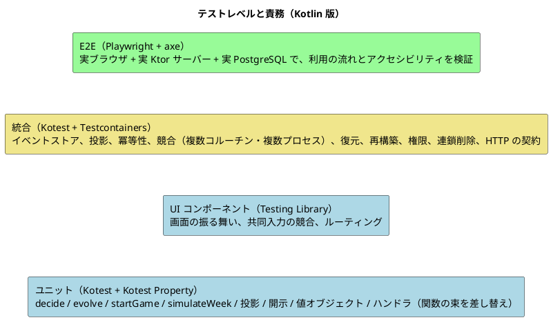
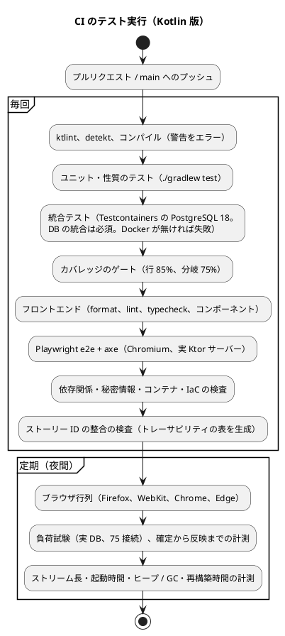

# テスト戦略 - ビールゲームシミュレーション（Kotlin 版）

## 概要

本書は、beer-game-kotlin のテスト戦略を定義します。**`docs/` を設計の正本**とします。実装コードはまだ存在しません。

[beer-game2 のテスト戦略](../beer-game2/test-strategy.md) を出発点に、次の 3 点を Kotlin・関数型・イベントソーシング（ES）+ CQRS に合わせて作り直します。

- **ドメインが純粋関数**（`decideGame` / `evolveGame` / `decideSession` / `evolveSession` / `startGame` / `simulateWeek`）になるため、テストの大半が「入力を与えて出力を確かめる」だけになる。ES では、テストの形が **Given（過去のイベント）/ When（コマンド）/ Then（新しいイベント、またはエラー）** にそのまま対応する（[ガイド 第 8 章](../../reference/関数型プログラミングガイド_Kotlin編.md)）。
- 状態が**イベントの列**になるため、「再生しても同じ状態になる」「投影を作り直しても同じ行になる」という**性質**を、プロパティベーステストで保証する（[ガイド §8.3](../../reference/関数型プログラミングガイド_Kotlin編.md)）。
- 並行性が「行のロック」から「**ストリームの版の一意制約 + 自動再試行**」に変わるため、競合・冪等性・復元の検証を、実際の PostgreSQL で行う（[データモデル](./data-model.md)）。

機能と振る舞いの受入条件は beer-game2 の [ユーザーストーリー](../../requirements/beer-game2/user_story.md) を正本として引き継ぎます。変えるのは、**検証の手段**だけです。

### 基準にする値

beer-game2 のテスト戦略は、beer-game（v1）の実測（199 件、行 90.5%、分岐 79.8%）を基準に目標を決めました。**Kotlin 版は新規のコードで、実測値がありません**。したがって、数値の目標は、beer-game2 の値を**出発点の提案**として引き継ぎ、ウォーキングスケルトンの実測で見直します（設計判断 T-2）。

## テスト形状の選択

[テスト戦略ガイド](../../reference/テスト戦略ガイド.md) では、アーキテクチャに応じて形状を選びます。

| 判断項目 | Kotlin 版の答え | 帰結 |
| :--- | :--- | :--- |
| 業務の中心 | **純粋関数**（`decide` / `evolve` / `simulateWeek` / 投影） | ドメインを厚くテストする（ピラミッド型）。**モックが要らない**（過去のイベントとコマンドを与えるだけ） |
| 永続化の特性 | ストリームの版の一意制約による追記の競合、自動再試行、同一トランザクションでの追記・投影・冪等記録、連鎖削除、追記専用の権限が、実際の PostgreSQL に依存する | 統合テストは、ガイドの標準（15%）より厚くする |
| 画面 | URL ルーティングを持つ SPA。API の契約は beer-game2 と同じ | 画面のテストは beer-game2 から変えない |

**採用する形状は、ピラミッド型です。統合テストは約 3 割までを認めます**（beer-game2 と同じ）。

### 目標の分布

| レベル | 目標の割合 | 理由 |
| :--- | :--- | :--- |
| ユニット（ドメイン、投影、アプリケーション）+ UI コンポーネント | 65% 以上 | 純粋関数は速く、規則の網羅に向く。ES の Given/When/Then は、ここで書く |
| 統合（API + DB） | 30% 以下 | 並行性、冪等性、復元、再構築、権限の検証に必要な分 |
| E2E | 5% 以下 | 利用の流れの要所だけ |

プロパティベーステストは、**1 件のテストが多数の入力を試す**ため、件数の割合ではなく、ユニットの一部として数えます。

## テストレベルの定義



| レベル | 責務 | 対象 | 依存の扱い |
| :--- | :--- | :--- | :--- |
| ユニット（ドメイン） | 規則と計算を検証する。**Given（過去のイベント）→ When（コマンド）→ Then（イベント列、または `DomainError`）**の形で書く | `decideGame`、`evolveGame`、`decideSession`、`evolveSession`、`startGame`、`simulateWeek`、`KitPreset.classify`、`GameSettings.of`、`Disclosure`、`RetentionSaga` の `decide` / `evolve`、値オブジェクト | 外部に依存しない（純粋）。時刻・ID・乱数は、コマンドの値として与える（[ドメインモデル](./domain-model.md)） |
| ユニット（性質） | **どんな入力でも成り立つ性質**を検証する（下記） | 上記すべて、投影、シリアライズ | 同上。`Arb` で入力を生成する |
| ユニット（投影） | イベント列から読み取りモデルの行を作る純粋関数 `Projection<Row>` を検証する。開示の判定も含む | `Projection<Row>.apply` / `replay`、`Disclosure` | 純粋 |
| ユニット（アプリケーション） | 「読む → `decide` → 追記 → 再試行 → 冪等記録」の手順を検証する | コマンドハンドラ、問い合わせ | `EventStore` などの**関数の束**を、メモリ上の実装または失敗を返す関数に差し替える（[ガイド §8.2](../../reference/関数型プログラミングガイド_Kotlin編.md)） |
| UI コンポーネント | 画面の表示、入力、エラー、フォーカス、共同入力の競合、ルーティング | `ui/src/features/` | beer-game2 と同じ（`ApiClient` を差し替える） |
| HTTP の統合 | 境界（認証、Origin 検査、冪等キー、版、エラー形式、セキュリティヘッダー、相関 ID、レート制限、SSE）の契約を検証する | Ktor のアダプター（`testApplication`） | ハンドラはメモリ上の関数の束、または実 DB |
| DB の統合 | 永続化、**ストリームの版の競合と自動再試行**、同一トランザクションでの追記・投影・冪等記録・周辺ストア、**複数ストリームの原子的な追記（`StartGame`）**、**再生・再構築・復元**、**追記専用の権限**、連鎖削除の網羅、マイグレーションを、実際の PostgreSQL 18 で検証する | `EventStore`、投影の更新、周辺ストア、`RetentionSaga` の実行、2 つの API プロセス | Testcontainers の PostgreSQL 18（専用のコンテナ。誤った DB への接続を、接続先の検査で防ぐ） |
| E2E | 利用の流れの要所を、実ブラウザで確認する。アクセシビリティを自動検査する（axe） | 作成、参加、共同入力、確定、観察、SSE の切断、200% 拡大 | 実際の Ktor サーバー、実 DB |

**DB の統合テストは、CI では必ず実行する**。Docker が使えない場合は、スキップではなく失敗にする（環境変数 `CI` が設定されている場合）。手元では、スキップした件数を結果に明示する（beer-game2 の方針を維持）。

### レベル間の重複を避ける方針

- 規則の分岐は、ドメインのユニットで網羅する。HTTP の統合では、境界の契約（ステータス、ヘッダー、エラー形式）だけを確認する。
- **永続化の整合性、並行性、再生・再構築・復元は、DB の統合でだけ検証する**。ユニットでは、メモリ上の関数の束を使う。
- 画面の分岐は、コンポーネントで確認する。E2E は、画面をまたぐ流れと、実ブラウザでしか確認できないこと（拡大、フォーカス、SSE、axe）に限る。

## 開発の進め方（BDD と TDD）

- **BDD（Given/When/Then を先に）**: 受入条件は、実装より先に、Given/When/Then の振る舞いの例として定義する。**ES では、Given は過去のイベントの列、When はコマンド、Then は新しいイベントの列またはエラー**であり、そのままテストコードになる。
- **TDD**: 失敗するテストを書き、**失敗を確認してから**、最小限を実装し、通ったらリファクタリングする。先回りして実装しない。
- **土台を変える最初のスライドでは、後続の振る舞いのテストも先に書く**（`EventStore` の型や、集約の `decide` の型など、共通の土台を作るとき）。順序を守れなかったときは、規則を壊すとテストが落ちることを個別に確かめ、記録に残す。
- **ストーリーとの対応**: テスト名に、ストーリー・受入条件の ID を含める（例: `[US2.4/AC2.4.1] Given 自動確定が有効 When 4 役割の入力がそろう Then 週が一度だけ確定される`）。Kotest の日本語のテスト名を使う（[ガイド §9.4](../../reference/関数型プログラミングガイド_Kotlin編.md) のとおり、関数名の camelCase を強制する整形ルールは外す）。
- **配置**: Gradle のソースセットでレベルを分ける（`test` = ユニットと性質、`integrationTest` = DB と HTTP の統合）。E2E とコンポーネントは、フロントエンドのディレクトリに置く。beer-game2 の `u1`〜`u5` のような、デリバリー単位の名前は使わない。

### テストの形（スケッチ）

```kotlin
test("[US2.4/AC2.4.1] Given 自動確定が有効で 3 役割が入力済み When 最後の役割が保存する Then DecisionSaved と WeekCommitted が一度に返る") {
    val given = sessionStarted(commitMode = AUTO) + decisionSaved(FACTORY, 4) + decisionSaved(DISTRIBUTOR, 4) + decisionSaved(WHOLESALER, 4)
    val state = replaySession(given)

    val result = decideSession(state, saveDecision(RETAILER, quantity = 4, expected = DecisionVersion.ZERO))

    result.shouldBeRight().map { it::class } shouldBe listOf(DecisionSaved::class, WeekCommitted::class)
}
```

過去のイベントの組み立ては、ビルダー（Object Mother）に集めます（下記のテストデータ）。

## 純粋関数のテスト（ドメイン）

| 対象 | 例によるテスト（Given/When/Then） | 検証すること |
| :--- | :--- | :--- |
| `decideGame` | 各コマンドの成功と、不変条件ごとの `GameError`（`AlreadyCreated`、`NotPreparing`、`Forbidden`、`StartConditionNotMet`、`InvitationRevoked` など） | 返すイベント、返さない（空のリスト）、エラーの分類（`Forbidden`、`InvalidState` など） |
| `evolveGame` | 各イベントの適用で、`GameState` が正しく遷移する | 全イベントの網羅（`when` の網羅をコンパイラが保証）、`version` の増加 |
| `decideSession` | 保存、共同入力の競合（`DecisionConflict` に最新値と保存者）、代理入力、確定（手動・自動）、一時停止中の確定の拒否、終了 | 自動確定が **1 回の `decide` で複数のイベント**を返すこと（`DecisionSaved` + `WeekCommitted`（+ `SessionEnded`）） |
| `evolveSession` | `WeekCommitted` の `nextStates` を**そのまま採用**し、`simulateWeek` を呼び直さないこと | 再計算しないこと（D5） |
| `startGame` | 開始条件（各役割に 1 人以上）、二重の開始（`AlreadyStarted`）、両ストリームのイベントの内容（`SessionStarted` が設定と割り当ての写しを運ぶ） | 2 ストリームにまたがる判断 |
| `simulateWeek` | **既知の系列と期待値の組（golden）**。12 ステップ、遅延 0 を含むカスタムの遅延、在庫不足と受注残 | 決定論性（NFR-01） |
| `GameSettings.of`、値オブジェクト | 範囲外の値を**すべて集めて**返す（`NonEmptyList<ValidationError>`）。最終週 1〜50、需要系列の長さ、対象週の表示（AC1.1.2） | 誤りを集めること（[ガイド §3.4](../../reference/関数型プログラミングガイド_Kotlin編.md)） |
| `KitPreset.classify` | キット準拠か、カスタムか、変更項目の列挙（BR-14） | 導出の正しさ |
| `Disclosure` | 寄与者が 2 未満なら合計を出さない。終了前は役割別の値を出さない。将来の需要を出さない | BR-17、FR-04 |
| `RetentionSaga` | 開始、失敗（最大 5 回、指数バックオフ）、完了、完了後の再開始の拒否 | 状態遷移 |

**キット準拠の既定の需要系列（ASM-01）は、JSD の値の確認が済むまで未確定**です（[ドメインモデル](./domain-model.md) の未決事項）。golden のテストは、**カスタムの需要系列**で書き、キット準拠の受入判定は、値が確定するまで保留します。

## プロパティベーステスト

Kotest Property の `checkAll`、`forAll`、`Arb` を使います（[ガイド §8.3](../../reference/関数型プログラミングガイド_Kotlin編.md)）。入力は、型（`Quantity`、`Week`、`RoleMap` など）の**有効な値だけを生成する `Arb`** を、値オブジェクトごとに用意します。**有効なコマンド列の生成**（状態に応じて、その時点で受理されうるコマンドを選ぶ）も用意します。

### 週次計算の性質（beer-game2 から引き継ぎ）

| 性質 | 内容 |
| :--- | :--- |
| 決定論 | 同じ入力から、同じ出力（参照透過性） |
| 非負 | 在庫、受注残、出荷は、常に 0 以上 |
| 保存 | 出荷数は、`min(利用可能量, 充足対象)`。在庫 + 出荷 = 利用可能量。受注残 = 充足対象 − 出荷 |
| 費用 | 週次費用 = 週末在庫 × 在庫単価 + 週末受注残 × 受注残単価。累積費用は、週次費用の和（**合計は `Long` で行い、オーバーフローしないこと**。[ガイド §8.3](../../reference/関数型プログラミングガイド_Kotlin編.md)） |
| 遅延 | 注文・配送・生産は、設定した週数より早く到着しない。カスタムの遅延（0 を含む）でも成り立つ |
| 役割別の結果 | 4 役割の結果の合計が、チームの合計と一致する |

### イベントソーシングの性質（Kotlin 版で追加）

| 性質 | 内容 | 保証すること |
| :--- | :--- | :--- |
| **再生の同値性** | 任意の有効なコマンド列で、`decide` が返したイベントを 1 件ずつ `evolve` して得た状態は、全イベントを `replay`（`fold(evolve)`）して得た状態と一致する | 復元（FR-12）が、再生だけで成り立つこと。`WeekCommitted` の値が事実として固定されること（D5） |
| `evolve` の全域性 | 到達できる任意の（状態, イベント）で、`evolve` は例外を投げない | `evolve` は失敗しない（検証は `decide` の責務） |
| `decide` の純粋性 | 同じ（状態, コマンド）から、同じ結果 | 時計・乱数・I/O への隠れた依存が無いこと |
| 版の連続 | 状態の `version` は、適用したイベントの数に等しい | 楽観的並行制御の前提 |
| 週確定の一回性 | 任意のコマンド列で、同じ週の `WeekCommitted` は高々 1 件。週は 1 から連続して増える | FR-09、NF-R13 |
| 不変条件の保存 | 任意の有効なコマンド列の後で、在庫・受注残が非負。4 役割が揃わないまま確定されない | BR-12、BR-05〜BR-08 |
| 自動確定の等価性 | `AUTO` の最後の `SaveDecision` が返す `WeekCommitted` は、同じ状態への `MANUAL` の `CommitWeek` が返す結果と、`commitKind` 以外が一致する | FR-18 |
| 競合の正しさ | 同じ役割への 2 つの保存を、どちらの順で処理しても、**受理された書き込みは失われず**、版が古い側は `DecisionConflict` と最新値を返す | FR-16、NF-R14 |
| 空のイベント | 状態を変えないコマンド（同じ役割への再割り当て）は、空のリストを返す | D9 |
| 投影の増分と一括 | 任意のイベント列を任意の位置で分けて増分で適用した結果は、全体を `replay` した結果と一致する | 再構築が、増分の更新と同じ行を作ること |
| 開示 | 寄与者が 2 未満なら、`WeekTeamTotals` の合計を返さない。観察者向けの投影の型は、役割別の値を持たない | BR-17、NF-S18 |
| シリアライズの往復 | すべてのイベント型で、`encode` → `decode` が元に戻る。**型の網羅**（`sealed` の全サブクラスが登録されていること）を、リフレクションで検査する | イベントの保存と再生 |
| 個人情報・秘密の不在 | 任意のイベントの JSON に、表示名・資格・招待コード・冪等キーが含まれない（型に項目が無いことと、保存された `payload` の走査） | NF-S14、NF-S21、D7 |
| アップキャスト | 旧い `schema_version` のイベント（保存済みの JSON のフィクスチャ）をアップキャストして `evolve` した結果は、期待する状態と一致する | イベントの形の変更への耐性 |

プロパティのテストは、1 件が多数の入力を試すため、**失敗したときは縮小された最小の反例を、テスト名と同じ ID とともに記録**します。反例は、そのまま例によるテスト（回帰）に加えます。

## アプリケーション層のテスト（関数の束の差し替え）

`EventStore`、`Clock`、`IdGenerator`、資格の発行などは、**関数の束**として定義されます（[データモデル](./data-model.md)、[ガイド §7.2](../../reference/関数型プログラミングガイド_Kotlin編.md)）。テストでは、メモリ上の実装と、**失敗を返す関数**に差し替えます（[ガイド §8.2](../../reference/関数型プログラミングガイド_Kotlin編.md) の `TestDataAccess` と同じ形）。

| テスト | 検証すること |
| :--- | :--- |
| 空のイベント | `decide` が空のリストを返したとき、追記しない |
| 追記の競合と自動再試行 | 最初の追記が `ConcurrencyConflict` を返す関数に差し替え、**再読み込みして `decide` を再評価**し、結果が変わる場合（`DecisionConflict`、`StaleVersion`、`AlreadyStarted`）は、その結果を返すこと |
| 再試行の上限 | 競合が続いたとき、上限の回数で止まり、利用者へ競合を返すこと（上限の値は実装開始時に決める） |
| 冪等 | 同じ冪等キーと同じ内容は、保存済みの応答を返し、追記しない。内容が違えば競合 |
| 周辺ストア | `displayName` と資格のダイジェストが、周辺ストアへ書かれ、**イベントには含まれない**こと |
| 永続化の失敗 | 追記が `PersistenceFailure` を返す関数に差し替え、**受理済みと表示せず**、再試行できる失敗を返すこと（NF-R9） |
| 認証から `Actor` への変換 | 認証の結果が、コマンドの `Actor` として渡ること（認可の規則自体は `decide` のテスト） |
| 副作用の合成 | ログ・計測のラッパー（[ガイド §7.7](../../reference/関数型プログラミングガイド_Kotlin編.md)）が、本体の結果を変えないこと。ログに表示名・資格が含まれないこと |

## イベントストアと投影の統合テスト（実 PostgreSQL）

Testcontainers の PostgreSQL 18 を使い、**マイグレーションを適用した空の DB から始め**ます。ゲームごとに ID を分け、テスト間で干渉しません。

### イベントストア

| テスト | 検証すること |
| :--- | :--- |
| 追記と読み込み | 追記したイベントが、`stream_version` の順に読める。版が連続している（欠番なし） |
| 追記の競合 | 同じストリーム・同じ版への 2 つの追記のうち、**一方だけが成功**し、他方は `ConcurrencyConflict`（一意制約の違反）になる。実際の並行（複数のコルーチン）で行う |
| 複数ストリームの原子性 | `StartGame` が、`GAME` と `SESSION` の両方へ**同一トランザクション**で追記する。**一方の追記を失敗させると、他方も残らない**。二重の開始は、`SESSION` の版 1 の重複で一方だけが成功する |
| 保存の途中の失敗 | 追記の後、投影の更新で失敗を注入しても、**`events`・投影・冪等記録・周辺ストアのどれにも部分更新が残らない**（NF-R5） |
| 追記専用の権限 | アプリケーションが使う DB ロールで、`events` への `UPDATE` と `DELETE` が拒否される（NF-S20）。保持削除のロールで、`game_roots` の削除が連鎖して `events` が消えること（**連鎖削除が、`events` に DELETE 権限を持たないロールでも動くかは、データモデルの未決事項**。結果に応じてテストを確定する） |
| マイグレーション | 空の DB に 001 から順に適用でき、再適用しても変化せず、`events` の一意制約と `CHECK` が効く |

### 冪等性・競合

| テスト | 検証すること |
| :--- | :--- |
| 冪等キーの再送 | 同じキー・同じ内容の再送は、**同じ結果**を返し、`events` が増えない（NF-R6） |
| 内容違いの再送 | 同じキーで内容が違うと競合 |
| 保持の期間 | 24 時間を過ぎた冪等記録は、期限切れとして扱う（時刻はコマンドの値で与える） |
| 資格の再返却 | ゲームの作成・参加・復帰の再送で、同じ資格が返る（応答を暗号化して保存していること。生の資格が DB に残らないこと） |
| 共同入力の競合 | 同じ役割の 2 人が同時に保存すると、自動再試行の後、**一方が `DecisionConflict` と最新値・最後の保存者を受け取り、保存された値が失われない**（NF-R14）。実際の並行で行う |
| 手動確定と自動確定の競合 | 最後の `SaveDecision`（`AUTO`）と進行役の `CommitWeek` が同時でも、`WeekCommitted` は**1 件**で、費用は一度だけ（NF-R13）。`week_commits` の主キーが 2 つ目の防壁になっていること。**2 つの API プロセス**で検証する |
| 再試行の上限 | 競合を意図的に続けたとき、上限で止まり、利用者へ競合を返す |

### 投影・再構築・復元

| テスト | 検証すること |
| :--- | :--- |
| 同期投影 | 追記の直後に読み取ると、必ず反映されている（NF-P2、NF-P19） |
| 投影の整合性の検査 | `projection_checkpoints.projected_version` が、`MAX(stream_version)` と一致する |
| **投影の再構築** | ゲームの投影の行をすべて削除し、`events` から再構築すると、**削除前と同じ行**になる（投影のすべての表を比較）。マイグレーションで投影の列を足した後の再構築も検証する（NF-R15、NF-P18） |
| **再生の同値性（DB 経由）** | DB から読み込んだイベントを再生した状態が、コマンドの実行中に保持した状態と一致する（NF-R16） |
| **復元** | データベースのバックアップから復元し、投影を再構築した後の API の応答が、復元前と同じ（運用の訓練。[運用要件](./operation.md)）。**確定済みの週が失われないこと**（RPO 0。NF-R3） |
| 強制停止 | 確定の途中で JVM のプロセスを強制停止し、再起動後に、**確定済みの週が残り、部分更新が無い**（NF-R3） |
| 観察者の権限 | 観察者用の DB ロールで、`week_role_results`・`role_current_states`・`current_decisions` に**到達できない**（NF-S18） |
| 連鎖削除の網羅 | **削除後に、`game_id` 列を持つすべての表に、そのゲームの行が残らない**（表の一覧は `information_schema` から取得）。`deletion_runs`・`deletion_attempts` も完了と同時に消える |
| 保持削除の再試行 | 削除の失敗を注入し、最大 5 回の指数バックオフで再試行し、**半分の削除を完了としない**（NF-R11）。再起動後に、`deletion_runs` から進行中の手続きを復元する（NF-R12） |
| 個人情報の不在 | 一連の操作の後、`events` の `payload` に、表示名・資格・招待コード・冪等キーの値が含まれない（NF-S21） |

## HTTP の統合テスト（Ktor）

`testApplication` で、アダプターの契約を検証します（ハンドラは、メモリ上の関数の束、または実 DB）。

| 観点 | 検証すること |
| :--- | :--- |
| 認証・認可 | 偽造 Cookie、期限切れ・失効した資格、他のゲームへのアクセス、観察者の書き込みを拒否する。**無効な資格は、すべて同じ応答で返す**（NF-S12） |
| 入力の検証 | 範囲外の値、大きすぎるリクエスト（64 KB）を拒否し、**検証の誤りを項目ごとに集めて**返す |
| エラーの写像 | `DomainError` の分類（`Forbidden`、`NotFound`、`InvalidState`、`Conflict`、`RuleViolation`）が、HTTP の状態に写る |
| 境界の契約 | Origin の検査、冪等キー、版、エラー形式、セキュリティヘッダー、相関 ID（NF-S8、NF-S9、NF-O2） |
| レート制限 | 参加・復帰・招待の専用の制限（NF-S11） |
| SSE | 版の通知を受け、取得した状態が通知の版以上であること。切断後にポーリングへ切り替わり、再接続後に最新へ収束する（NF-P4、NF-R10） |
| ログ | ログに、資格・表示名・非公開の値が含まれない（許可・拒否のテスト。NF-O1） |
| 準備のヘルスチェック | DB に接続できないとき `/ready` が失敗する（NF-O10） |

## E2E

Playwright と axe で、**実際の Ktor サーバー**と実 DB に対して、利用の流れの要所（作成、参加、共同入力、確定、観察、SSE の切断、200% 拡大）を確認します。beer-game2 の内容を引き継ぎます。**API の契約は変わらない**ため、E2E のシナリオは、beer-game2 のものがそのまま使えるはずです（変わる場合は、設計の矛盾として扱う）。

## カバレッジ目標

### 判断（beer-game2 の値を引き継ぐか）

beer-game2 のゲートは、行・関数・文 85%、分岐 75% です。Kotlin 版では、Kover が計測する指標が異なる可能性があるため、**判断が必要**です（設計判断 T-2）。

| 案 | 内容 | 評価 |
| :--- | :--- | :--- |
| **A（採用）** | **行 85%、分岐 75% を、全体のゲートとして引き継ぐ**。関数・文は、ゲートの対象から外す | 純粋なドメインは、100% 近い行の網羅を狙える。分岐は、`when` の網羅（`sealed`）が生成する到達不能な分岐があるため、100% を求めない。関数・文の指標が Kover にあるかは、本書では確認していない |
| B | 行 80%（beer-game3 のチームの基準と同じ） | 緩い。純粋関数の網羅を考えると、緩すぎる |
| C | 行 90% 以上 | 統合のコード（アダプター）のために、価値の低いテストが増える |

トレードオフ: A は、**根拠が beer-game2 の実測（v1 の実測を基準に引き上げた値）であり、Kotlin 版の実測ではない**。ウォーキングスケルトンの実測で見直す。beer-game3 は別のプロジェクトで、行 80% を基準にしている。本プロジェクトは beer-game2 を正本とするため、85% を維持する（揃えるかは未決事項）。

### ゲート（CI の合格条件）

| 指標 | beer-game2 のゲート | Kotlin 版のゲート |
| :--- | ---: | ---: |
| 行 | 85% | 85% |
| 関数 | 85% | （指標なし。Kover の対応は実装開始時に確認） |
| 文 | 85% | （同上） |
| 分岐 | 75% | 75% |

### 層ごとの目標

| 層 | 行 | 分岐 | 方針 |
| :--- | ---: | ---: | :--- |
| `domain`（集約、`simulateWeek`、値オブジェクト、`Disclosure`、`RetentionSaga`） | 100% | 90% | 中核。例と性質のテストで網羅する。`sealed` の網羅が生む到達不能な分岐は、除外ではなく目標を 100% にしないことで扱う |
| 投影（`Projection`） | 100% | 90% | 純粋。再構築の同値性も含める |
| `application`（ハンドラ） | 95% | 85% | 手順の分岐（冪等、競合、再試行、権限）を網羅する |
| `adapters/persistence`（イベントストア、投影の更新、周辺ストア） | 90% | 75% | 分岐は DB の統合で確認する |
| `adapters/http`（**計測対象に含める**） | 90% | 75% | 最初から含める（起動部は除外して、統合で確認する） |
| `ui`（features） | 85% | 80% | beer-game2 と同じ（Vitest で計測。Kover の対象外） |
| 全体（ゲート） | 85% | 75% | 上の表 |

### 計測の範囲

計測の対象は、`domain`、`application`、`adapters` とし、**除外するのは、起動部（`main`）、設定の組み立て、kotlinx.serialization が生成するコード**だけです。**除外の設定が、生成コードだけに効くこと**は、実装開始時に確認します。UI は、Vitest の計測（beer-game2 と同じ）です。

## テストデータ

| 種類 | 方針 |
| :--- | :--- |
| ドメイン | **Given のビルダー**（Object Mother）で、過去のイベントの列を組み立てる（`sessionStarted(...)`、`decisionSaved(...)` など）。コマンドも同様。時刻・ID・乱数は、**コマンドの値**として固定で与える（`decide` は時計を読まないため、時計のスタブが要らない） |
| 週次計算 | 既知の系列と期待値の組（golden）と、**Kotest Property による性質の検証**。需要系列は、キット準拠の値が未確定の間は、カスタムで書く |
| 性質の入力 | 値オブジェクトごとの `Arb`、有効なコマンド列の `Arb`、イベント型ごとの `Arb`（シリアライズの往復で使う） |
| アップキャスト | 旧い `schema_version` のイベントの JSON を、フィクスチャとして保存する（変更しない） |
| DB の統合 | Testcontainers の専用のコンテナ。接続先の名前を検査し、誤った DB への接続を防ぐ。マイグレーションを適用した空の DB から始める。ゲームごとに ID を分け、テスト間で干渉しない |
| 資格 | テスト用の鍵（複数の版）と、テストごとの乱数。生の値を、保存や出力に含めない |

## 非機能のテスト

| 品質特性 | 要件 | 検証の手段 | CI での扱い |
| :--- | :--- | :--- | :--- |
| 正確性・決定論 | NFR-01 | `simulateWeek` の golden と性質のテスト | 毎回 |
| 整合性・冪等性 | NFR-02、FR-09、NF-R5〜NF-R7、NF-R13、NF-R14 | DB の統合（競合、複数プロセス、障害の注入） | 毎回 |
| 再生・再構築・復元 | NF-R15、NF-R16、NF-P18 | 再生の同値性、投影の再構築の一致、復元の訓練 | 毎回（一致の検証）。訓練は四半期とリリース前 |
| 応答性・同時利用 | NFR-03、NFR-04、NF-P1〜NF-P3、NF-P5 | **実 DB を使う負荷試験**（15 ゲーム、75 の SSE 接続）と、ブラウザでの確定から反映まで（p95 2 秒）の計測（Playwright）。**JVM のウォームアップの後**の定常値を測る | 夜間。結果を保存して推移を見る |
| ストリームの再生と追記 | NF-P15、NF-P19、NF-C8 | 1 ストリームを千件・2 千件に伸ばした再生と追記の時間の計測 | 夜間 |
| 起動時間・メモリ | NF-P16、NF-P17 | コールドスタートの計測（`/ready` が成功するまでの時間）、負荷中のヒープと GC の記録 | 夜間 |
| セキュリティ | NFR-06、NF-S1〜NF-S21 | HTTP の統合（Origin、偽造 Cookie、他ゲーム、観察者の権限、ヘッダー）、DB の権限、依存関係・秘密情報・コンテナ・IaC の検査 | 毎回 |
| アクセシビリティ | NFR-08 | コンポーネントと E2E の自動検査（axe）、200% 拡大、手動の確認 | 自動は毎回。手動はリリース前 |
| 可搬性 | NFR-10 | Playwright の行列実行（Chromium、Firefox、WebKit、Chrome、Edge） | 夜間 |
| 観測性 | NFR-11 | ログの許可・拒否のテスト、`/ready` のテスト | 毎回 |

## 静的解析と規約の検査

関数型の規約は、レビューだけに頼らず、静的解析で機械的に守らせます（[ガイド 第 9 章](../../reference/関数型プログラミングガイド_Kotlin編.md)）。

| 検査 | 内容 | CI での扱い |
| :--- | :--- | :--- |
| コンパイラの警告 | 警告をエラーとして扱う | 毎回 |
| detekt | 複雑度、`TooGenericExceptionCaught`、`SwallowedException`、`UnsafeCallOnNullableType`、`ForbiddenMethodCall`（可変コレクションの生成）など。設定値は、**実際の detekt の版で確認してから確定する**（ガイドの例は未確認の設定） | 毎回（警告 0） |
| ktlint | 書式。**整形の副作用が大きいルールは `.editorconfig` で外す**（日本語のテスト名を妨げない） | 毎回 |
| 層の依存 | ドメインのモジュールは、Kotlin の標準と Arrow だけに依存する（Ktor、JDBC に依存しない）。Gradle のモジュール分割で強制する（[バックエンドアーキテクチャ](./architecture-backend.md)） | 毎回（ビルドで失敗） |
| `var`、可変コレクション | ドメインでの `var` と共有する可変コレクションを禁止する。detekt の標準で足りない場合は、カスタムルールで補う（ガイド §9.6、未決事項） | 毎回 |

## CI との連携



| 項目 | 方針 |
| :--- | :--- |
| 失敗時 | どの工程が失敗しても、マージしない。カバレッジの閾値割れも失敗とする |
| 実行時間の目標（提案） | ユニット + 性質: 30 秒以内（コンパイルを除く）、統合（コンテナの起動を含む）: 3 分以内、E2E: 5 分以内、全体: 12 分以内（beer-game2 は 10 分。Gradle のビルドとコンテナの起動を加えた分を見込んだ。実測で見直す） |
| 並列化 | テストクラス単位で並列に実行。DB の統合は、ゲームごとに ID を分け、干渉しない。DB のコンテナは、テストの実行全体で 1 つを共有する |
| 失敗の記録 | Playwright のトレースとスクリーンショット、性質のテストの反例を保存する |
| 定期実行の結果 | 負荷試験と計測の結果を保存し、推移を確認する |
| 差し替えの検査 | **DB の統合が 1 件も実行されなかった場合は、失敗**とする（スキップの暗黙の増加を防ぐ） |

## トレーサビリティ（ユーザーストーリー → テスト）

テスト名にストーリー・受入条件の ID を含める規約により、**対応表を自動で生成**します（テスト結果の XML から ID を抽出する。生成の道具は実装開始時に決める）。下表は、各ストーリーの受入条件を、どのレベルのテストで保証するかの**計画**です。ストーリーの内容は beer-game2 の [ユーザーストーリー](../../requirements/beer-game2/user_story.md) を参照します。

| ストーリー | 受入条件 | 主なレベル | 備考 |
| :--- | :--- | :--- | :--- |
| US1.1 ゲームを作成する | AC1.1.1〜1.1.6 | ユニット（`GameSettings.of`、`KitPreset`、`decideGame`）、HTTP、E2E | 誤りを集める検証、カスタム条件の記録、最終週 1〜50 |
| US1.2 参加して役割を受け取る | AC1.2.1〜1.2.5 | ユニット（`decideGame`）、HTTP、コンポーネント、DB（周辺ストアの表示名） | 共同担当、開始条件、表示名がイベントに入らない |
| US1.3 観察者を招待する | AC1.3.1〜1.3.4 | ユニット、HTTP | |
| US2.1 役割別の状況 | AC2.1.1〜2.1.4 | ユニット（投影）、HTTP（他役割の拒否）、コンポーネント | 共同担当の表示 |
| US2.2 数量を決定する | AC2.2.1〜2.2.4 | ユニット（`decideSession`、競合の性質）、DB（実際の競合）、コンポーネント | 共同入力の競合 |
| US2.3 週の確定 | AC2.3.1〜2.3.5 | ユニット（`simulateWeek`、性質、再生の同値性）、DB（障害の注入、複数プロセス） | 役割別の結果、原子性 |
| US2.4 週を自動で確定する | AC2.4.1〜2.4.5 | ユニット（`decideSession`、自動確定の等価性）、DB（競合）、E2E | 1 回の `decide` で複数のイベント |
| US3.1 停止・代理入力・再開 | AC3.1.1〜3.1.3 | ユニット、HTTP | 代理入力の値をイベントに含む |
| US3.2 復帰 | AC3.2.1〜3.2.5 | ユニット（`decideGame`）、HTTP、E2E、DB（資格の整合） | 進行役の復帰、失効・再発行 |
| US4.1 観察 | AC4.1.1〜4.1.5 | ユニット（`Disclosure`、投影）、DB（権限）、HTTP、E2E | 観察者の権限。`week_team_totals` |
| US4.2 振り返り | AC4.2.1〜4.2.4 | DB（投影）、HTTP、コンポーネント、E2E | 役割別 |
| US4.3 出力 | AC4.3.1〜4.3.3 | ユニット（`buildExport`）、DB、HTTP | 設定・意思決定・履歴を含む |
| US5.1 保持と削除 | AC5.1.1〜5.1.5 | ユニット（`RetentionSaga`）、DB（連鎖削除の網羅） | 残らないことの検証 |
| US6.1 検知 | AC6.1.1〜6.1.6 | HTTP（ログ、`/ready`）、E2E の合成監視 | |
| US6.2 リリースと復元 | AC6.2.1〜6.2.5 | ステージングでのスモークとロールバック、**復元の訓練（バックアップと再構築）** | 運用の手順の検証 |
| 横断 X-1〜X-5 | — | axe、E2E、負荷試験、CI の検査 | |

## beer-game2 からの変更

| # | beer-game2 | beer-game-kotlin | 理由 |
| :--- | :--- | :--- | :--- |
| 1 | Vitest + fast-check、テストは TypeScript | Kotest + Kotest Property、テストは Kotlin | ガイド §8 |
| 2 | ドメインの単体テストは、集約のメソッドの呼び出し | **Given（過去のイベント）/ When（コマンド）/ Then（イベント or エラー）**。モック不要 | ES で `decide` / `evolve` が純粋 |
| 3 | 性質は `simulateWeek` が中心 | 加えて、**再生の同値性、`evolve` の全域性、`decide` の純粋性、投影の増分と一括、シリアライズの往復、個人情報の不在、アップキャスト** | 状態がイベントの列になった |
| 4 | 競合は「行のロックと版」の検証 | **ストリームの版の一意制約 + 自動再試行**の検証。複数ストリームの原子性を加える | データモデルの設計判断 |
| 5 | アウトボックスとイベントの検証 | **投影の再構築の一致、復元、同期投影の反映、投影の整合性の検査** | CQRS。アウトボックスの廃止 |
| 6 | DB 統合は専用の DB（環境変数） | Testcontainers の PostgreSQL 18。CI で必須（Docker が無ければ失敗） | 手元でも CI でも同じ経路 |
| 7 | 追記専用の権限の検証は無い | `events` への `UPDATE` / `DELETE` の拒否と、連鎖削除の確認を加える | データモデルの追記専用の保護 |
| 8 | 層の依存は ESLint の `no-restricted-imports` | Gradle のモジュール分割（ドメインは Arrow と標準だけに依存） | JVM 版 |
| 9 | 静的解析は ESLint + Prettier | detekt + ktlint（ガイド §9）。コンパイラの警告もエラー | ガイド §9 |
| 10 | カバレッジのゲートは、行・関数・文 85%、分岐 75% | **行 85%、分岐 75%**。関数・文は対象外 | Kover の指標（要確認） |
| 11 | 実行時間の目標は全体 10 分 | 全体 12 分（提案） | Gradle のビルドとコンテナの起動を見込む |
| 12 | 負荷試験は 75 の SSE 接続（ブラウザ + サーバー） | 加えて、**JVM のウォームアップ後の定常値**、起動時間、ヒープ / GC、ストリーム長、再構築時間を計測 | JVM と ES で新しく測る |
| 13 | 変異テストは、ドメイン層への導入を検討 | 同じ。Kotlin 向けの道具は未選定 | 実装開始時に確認 |

## 設計判断

### T-1: ドメインのテストは、Given（イベント）/ When（コマンド）/ Then の形に統一する

| 案 | 内容 | 評価 |
| :--- | :--- | :--- |
| **A（採用）** | 過去のイベントの列を与え、コマンドを実行し、返ったイベントまたはエラーを確かめる | ES の `decide` に素直に対応する。BDD の Given/When/Then がそのままテスト名になる。モックが要らない。内部状態の形に依存しない（状態の型を変えても、イベントが同じならテストが壊れない） |
| B | 状態を直接組み立てて `decide` を呼ぶ | 準備が短い。状態の型に強く結びつき、リファクタリングで壊れやすい。イベントの列から状態が作れるという保証（再生の同値性）が薄れる |

トレードオフ: A は、Given のビルダーを用意する手間がある。性質のテスト（再生の同値性）と組み合わせて、状態の組み立てへの信頼を担保する。

### T-2: カバレッジの数値は、beer-game2 の値を出発点として引き継ぎ、実測で見直す

前述の表を参照してください。代替案は、行 80% への緩和（B）と、行 90% への引き上げ（C）です。採用（A）の根拠は、純粋なドメインが 100% 近い網羅を狙えること、アダプターは統合で分岐を確認できること、根拠となる実測が無いため beer-game2 の値を暫定とすることです。

### T-3: DB の統合テストは Testcontainers を使い、CI でも同じ経路にする

| 案 | 内容 | 評価 |
| :--- | :--- | :--- |
| **A（採用）** | Testcontainers の PostgreSQL 18 | 手元と CI で同じ経路。ガイドの表にある。Docker が必要 |
| B | CI のサービスコンテナと、手元の別の DB | Docker 不要の手元の選択肢がある。接続の設定が 2 通りになり、「CI でだけ実行される」差が生まれやすい |

トレードオフ: A は、Docker が使えない環境で統合テストを実行できない。CI では必須とし、手元ではスキップの件数を明示する。

### T-4: 並行性のテストは、実際の並行で行い、決定論的な再現は補助にする

並行の競合は、複数のコルーチン（および 2 つのプロセス）で**実際に**起こして検証します。結果が非決定的な場合に備え、**一方が必ず成功する**（全体で、受理された書き込みが失われない）という性質で判定し、**どちらが成功するか**には依存しません。代替案は、`runTest` の仮想時間で順序を固定する案です（再現性は高いが、実際の DB の一意制約の挙動を検証できない）。アプリケーション層の再試行の分岐は、失敗を返す関数による決定論的なテストで補います。

## 未決事項

- 変異テストの導入の要否と、Kotlin 向けの道具（本書では確認していない）。
- ストーリー ID の整合の検査（テストに存在しない ID、受入条件に対応するテストが無いもの）の厳しさ（警告か、失敗か）。
- 実 DB での負荷試験の環境（CI の夜間か、ステージングか）。
- 手動のアクセシビリティの確認（スクリーンリーダー）を実施する担当者と時期。
- Kover が計測できる指標の種類（行・命令・分岐のほか、関数・文の有無）と、生成コードの除外の方法。
- 追記の競合の自動再試行の上限（データモデルの未決事項）。決まったら、アプリケーション層のテストに反映する。
- 連鎖削除が、`events` に DELETE 権限を持たないロールでも動くか（データモデルの未決事項）。動かない場合の代替に合わせて、権限のテストを確定する。
- 投影の再構築の同時実行制御（追記を止めるか、アドバイザリロックか）。決まったら、再構築中の追記のテストを加える。
- カバレッジの数値を、beer-game3（行 80%）と揃えるか。
- 詳細の設定値（プロパティベーステストの試行回数、detekt の閾値）は、実際の版で確認してから決める。

## 出典

- [テスト戦略ガイド](../../reference/テスト戦略ガイド.md)、[ガイド 関数型プログラミング（Kotlin 編）](../../reference/関数型プログラミングガイド_Kotlin編.md) 第 7 章（イベントソーシング、CQRS、永続化）、第 8 章（テスト戦略）、第 9 章（静的解析）
- [ドメインモデル（Kotlin 版）](./domain-model.md)、[データモデル（Kotlin 版）](./data-model.md)、[技術スタック（Kotlin 版）](./tech-stack.md)、[非機能要件（Kotlin 版）](./non-functional.md)、[バックエンドアーキテクチャ](./architecture-backend.md)、[運用要件](./operation.md)
- [beer-game2 のテスト戦略](../beer-game2/test-strategy.md)、[ユーザーストーリー（beer-game2）](../../requirements/beer-game2/user_story.md)
- [ADR-005](../../adr/beer-game2/005-role-results-and-sql-read-models.md)、[ADR-007](../../adr/beer-game2/007-cascade-deletion-without-queues.md)、[ADR-008](../../adr/beer-game2/008-auto-commit-and-event-audit.md)
