# UI 設計 - ビールゲームシミュレーション（Kotlin 版）

## 概要

本書は、beer-game-kotlin の UI を、画面一覧、画面遷移、画面イメージ、インタラクションの順に定義します。**`docs/` を設計の正本**とします。

画面、遷移、表示名、アクセシビリティは [beer-game2 の UI 設計](../beer-game2/ui-design.md) を正本として**そのまま引き継ぎ**ます。フロントエンドは、既存の React / TypeScript を踏襲します（[フロントエンドアーキテクチャ](./architecture-frontend.md)）。バックエンドが Kotlin のイベントソーシング + CQRS になっても、利用者が見る画面は変わりません。

見直すのは、次の ES + CQRS の影響だけです。

- **保存直後の表示**: コマンドの応答は、追記後の版（`versions`。ストリームごと）だけを返す。画面の表示は応答から作らず、スナップショット（GET state）を取得し、`versions` に追いつくまで待ってから表示する。
- **投影の遅延の扱い**: 現在の設計は、投影を追記と同じトランザクションで更新する（同期投影。[データモデル](./data-model.md)）ため、遅延は通常は無い。ただし、将来の非同期投影や読み取りレプリカに備え、画面が「反映待ち」を扱えるようにする。
- **競合の種類別のメッセージ**: 競合は、業務上の競合（共同入力、確定済みの週、確定の前に入力が変わった）と、追記の競合（自動再試行を使い切った場合）に分かれる。利用者に見せる文言と回復の手段を、エラーの `code` ごとに決める（辞書の正本は本書の「エラーの `code` と表示の辞書」）。
- **結果が不明なときの再送**: 通信が切れて保存の結果が分からないとき、同じ冪等キーで再送して、同じ結果を受け取る。

入力は次のとおりです。

- [ユーザーストーリー](../../requirements/beer-game2/user_story.md)、[システムユースケース](../../requirements/beer-game2/system_usecase.md)
- [フロントエンドアーキテクチャ](./architecture-frontend.md)、[ドメインモデル](./domain-model.md)（エラーの分類、投影）、[データモデル](./data-model.md)（追記と冪等性、投影の更新の方式）
- `aidlc/` の精緻化済みモックアップ（M01〜M08）、アクセシビリティのチェックリスト（beer-game2 と同じ）

## 設計の前提

- 利用者は PC のブラウザ（最新 2 世代の主要ブラウザ）で使います。専用ソフトの導入は不要です（NFR-10）。
- 参加者は役割ごとに見える情報が違います。画面構造そのものが、プレイ中の情報制約と、終了後の学習用の開示を分けます。
- 操作は、明示的なボタンで始めます。入力欄へのフォーカスや入力だけでは、状態を変えません。
- すべての主要な操作をキーボードで完了でき、色だけで状態を表しません（NFR-08）。
- **利用者に見せる語は、日本語の表示名の辞書から取り、英語の列挙値を直接表示しません。**
- **利用者に「ストリーム」「イベント」「投影」の語を見せません。** ES の用語は、設計の内部の語です。画面では「版」（意思決定の版）と、日常の語で説明します。

## 表示名（用語の統一）

| 概念 | 画面上の語 |
| :--- | :--- |
| FACTORY / DISTRIBUTOR / WHOLESALER / RETAILER | 工場 / 一次卸 / 二次卸 / 小売店 |
| 準備中 / 進行中 / 一時停止 / 終了 | ゲームとセッションの状態 |
| MANUAL / AUTO | 確定方式: 進行役が確定 / 自動で確定 |
| KIT / CUSTOM | 条件: キット準拠 / カスタム |
| 発注数（工場は**生産要請数**） | 入力欄の名称。役割に応じて切り替える |
| 共同担当 | 同じ役割に割り当てられた、複数の参加者 |
| 観察用の招待 | 観察者を招くためのコード |
| 意思決定の版（`DecisionVersion`） | 「版」。共同入力の保存のたびに増える番号 |

## オブジェクトと画面（OOUI）

| オブジェクト | 主なアクション | ビュー | 画面 |
| :--- | :--- | :--- | :--- |
| ゲーム | 作成、開始、一時停止、再開、終了、確定方式の変更 | シングルビュー | ゲーム作成、ロビー、進行役のコンソール |
| 参加者（役割・共同担当） | 参加、役割の割り当て・解除、復帰 | コレクションビュー（ロビーの一覧） | 参加・復帰、ロビー |
| 観察用の招待・観察者 | 発行、失効、参加 | コレクションビュー | ロビー、進行役のコンソール、観察者の参加 |
| 週・意思決定 | 状況の確認、数量の入力（共同）、代理入力、確定 | シングルビュー | プレイ、進行役のコンソール |
| 振り返り | 閲覧（役割別）、出力 | シングルビュー | 観察、振り返り |
| 保持（削除の状況） | 状況の確認、再試行 | シングルビュー | 保持状態 |
| 資格 | 失効、再発行 | — | 進行役のコンソール |

## 画面一覧

| ID | 画面 | URL | 利用者 | ユースケース | beer-game2 からの変更 |
| :--- | :--- | :--- | :--- | :--- | :--- |
| S01 | はじめる | `/` | 全員 | UC-01、UC-02 | 変更なし |
| S02 | ゲーム作成 | `/new` | 進行役 | UC-01 | 変更なし。作成の再送（冪等）の扱いを加える（下記） |
| S03 | 参加・復帰 | `/join` | 参加者、進行役 | UC-02、UC-14 | 変更なし |
| S04 | ロビー | `/games/:id/lobby` | 進行役、参加者 | UC-02〜UC-04、UC-16 | 変更なし。反映待ちの表示を共通部品で扱う |
| S05 | プレイ | `/games/:id/play` | 参加者 | UC-05〜UC-07 | 保存直後の表示、競合の種類別のメッセージ、反映待ち（下記） |
| S06 | 進行役のコンソール | `/games/:id/console` | 進行役 | UC-08〜UC-10 | 週確定の競合のメッセージ（確定前に入力が変わった場合の確認ダイアログの開き直し）、停止中の代理入力、反映待ち（下記） |
| S07 | 観察 | `/games/:id/observation` | 進行役、参加者、観察者 | UC-13 | 変更なし |
| S08 | 振り返り | `/games/:id/review` | 全員（終了後） | UC-11、UC-12 | 変更なし。出力は要求時に作るため、「準備中」の状態は不要（下記） |
| S09 | 保持状態 | `/games/:id/retention` | 進行役 | UC-15 | 変更なし |
| S10 | 観察者の参加 | `/observe` | 観察者 | UC-13、UC-16 | 変更なし |
| S11 | ヘルプ | `/help` | 全員 | — | 変更なし |

## 画面遷移

遷移は、beer-game2 と同じです。

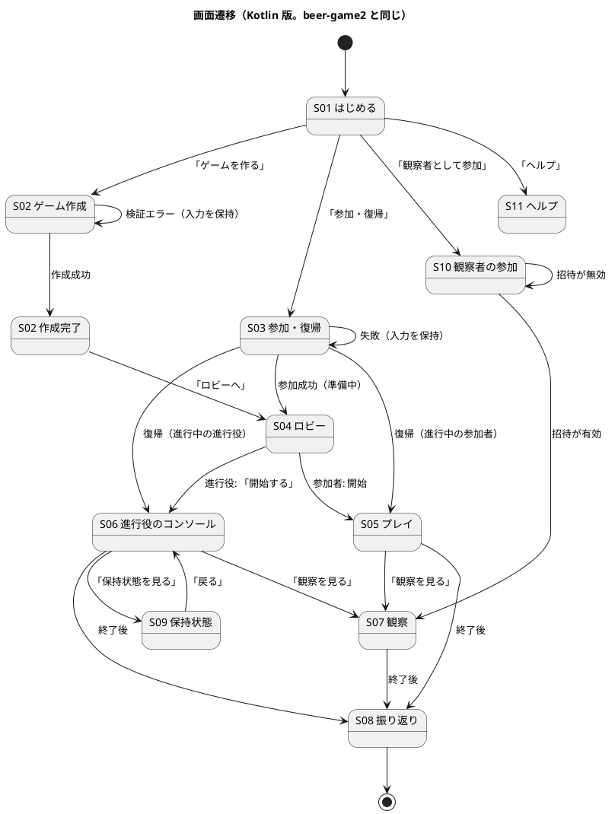

### 遷移の条件

| 遷移 | 条件 |
| :--- | :--- |
| S02 → S02 | 範囲外の入力（最終週 1〜50、需要系列、初期在庫・遅延・費用単価、保持期間）。エラーの要約にフォーカスを移し、入力を保持する。**誤りは、すべて集めて一度に示す**（入力検証が `NonEmptyList<ValidationError>` を返すため。[ドメインモデル](./domain-model.md)） |
| S03 → S04 / S05 / S06 | 資格が有効。準備中ならロビー、進行中なら、参加者はプレイ、進行役はコンソール |
| S10 → S07 | 観察用の招待が有効（失効・期限切れでない） |
| S04 → S05 | 参加者の画面は、ゲームが進行中になると自動で切り替わる |
| S04 → S06 | 各役割に 1 人以上が割り当て済みで、進行役が「開始する」を押す |
| S05、S06、S07 → S08 | ゲームが終了している |
| 権限の無い URL | 資格が無い、または権限の無い画面は、S03（参加・復帰）へ誘導する（再読み込みでも、権限があれば同じ画面に戻る） |

## 画面イメージ

情報の優先順位とグルーピングを描きます。ピクセル単位の精度は求めません。S02、S04、S06 の確認ダイアログ、S08、S10 は、beer-game2 と同じです。**S05 の競合の表示だけを、種類別に拡張します。**

### S02 ゲーム作成

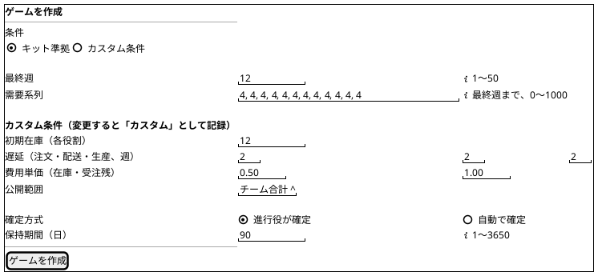

作成後は、参加コードを大きく表示し（フォーカスを移す）、「参加コードをコピー」と「ロビーへ」を並べます。カスタム条件を変更した場合は、作成画面と作成後に「カスタム」の表示を出します。

### S04 ロビー（進行役）

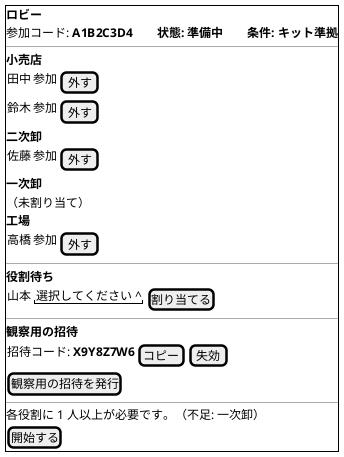

同じ役割に複数人を割り当てられます（共同担当）。参加者の画面は、参加者の一覧と、自分の役割だけを表示し、参加コード、割り当て、観察用の招待、開始は出しません。

### S05 プレイ（参加者・共同入力）

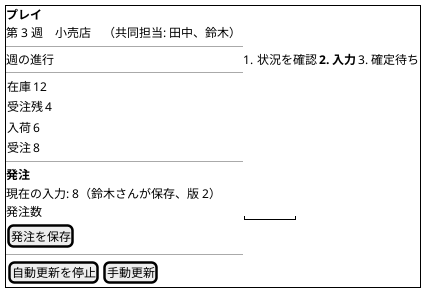

工場の画面では、入力欄の名称を「生産要請数」にします。週の進行は、**「状況を確認 → 入力 → 確定待ち」の 3 段階**で示します（beer-game2 の差分への対応を引き継ぐ）。

### S05 共同入力の競合（他の人が先に保存した場合）

業務上の競合です。ドメインの `DecisionConflict(role, latest)` に対応し、**最新値と最後の保存者**を示します（変更を黙って失いません）。

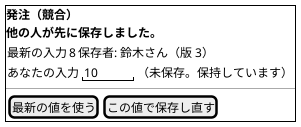

### S05 / S06 週が進んだ場合（確定済みの週への保存・確定）

**新規。** 自分が見ている週がすでに確定されたときに、保存、代理入力、確定を送った場合です。進行役の確定と自動確定が同時に起きた場合、または、確定の直前に表示を開いたままだった参加者の保存で起きます。ドメインの `SessionError.WeekAdvanced`（`session.week_advanced`、Conflict。保存・代理入力・確定のどれも、要求した週 `requestedWeek` が現在の週と違うときに返る）に対応します。入力の最新値の比較は意味が無いため、競合の画面ではなく、**週が進んだこと**を示します。

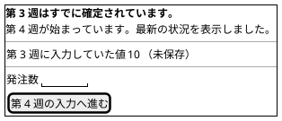

週が変わったときは、**入力欄を空にします**。直前の値は、「第 3 週に入力していた値: 10（未保存）」と参考として表示します。第 4 週の入力欄へ**自動で入れません**（週が違うため、誤って別の週へ保存しない）。利用者が確認して入力します。この規則は、409 の応答で週が進んだと分かった場合も、SSE の通知で週が進んだと分かった場合（自動確定。共同担当の保存で週が確定する場合を含む）も同じです。

### S05 / S06 反映待ち

**新規。** コマンドの応答が示す版（`versions`）に、画面の取得（スナップショット）がまだ追いついていない場合です（現在の同期投影ではまれ。下記）。操作は無効にせず、状況を示します。

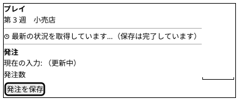

### S06 進行役のコンソール

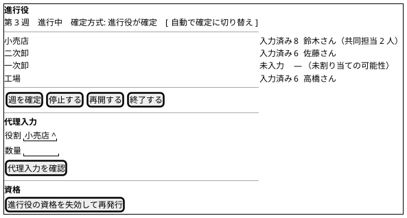

進行役の画面には、各役割の**入力値**と、最後の保存者を表示します（進行役だけが見られる情報）。

**停止中の代理入力**: 代理入力は、一時停止中も進行役が行えます（参加者の保存は、停止中は拒否されます）。停止中の画面は「停止中」と表示し、代理入力の欄は有効のままにします。**停止中の代理入力では、4 役割が揃っても自動確定しません。** 確定は、再開時の自動確定、または進行役の手動の確定で行います。画面には、「停止中のため、再開するまで確定されません。」と示します。確定方式を、停止中に「自動で確定」へ切り替えた場合も同じで、確定は再開時に判定されます。

**4 分割**: 4 役割（工場・一次卸・二次卸・小売店）を 2 × 2 の区画に並べ、同時に見られるようにします（狭い画面では縦 1 列）。各区画には、担当（共同担当を含む）、当週の入力値と保存者、在庫・受注残・入荷予定・累積費用、開閉できる週ごとの履歴を示します。参加者と観察者は、このコンソールを開けません（他の役割の値を見せない）。

### 確認ダイアログ（週確定）

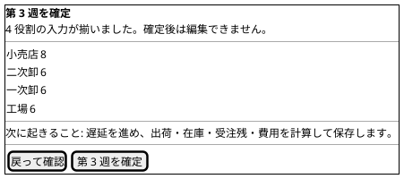

代理入力、停止、再開、終了のダイアログも、対象と影響を示します。確定中は、ボタンを無効にし、「確定中」と表示します。

**確認ダイアログの再オープン**: 確認ダイアログは、開いた時点の週と各役割の入力の版（`basis`）を覚えて確定を送ります（`CommitWeek(requestedWeek, basis)`）。確定の前に、共同担当が保存し直すなどで入力が変わっていた場合、サーバーは `session.decisions_changed` を返します。画面は、「確定の前に入力が変わりました。最新の値を確認してください。」と通知し、**更新した値で確認ダイアログを開き直します**（現在の値と保存者は、応答に含まれる）。進行役が、新しい値を確認して、もう一度確定します。週がすでに進んでいた場合は、`session.week_advanced`（「第 N 週はすでに確定されています。」）で、ダイアログを閉じます。

### S08 振り返り（役割別）

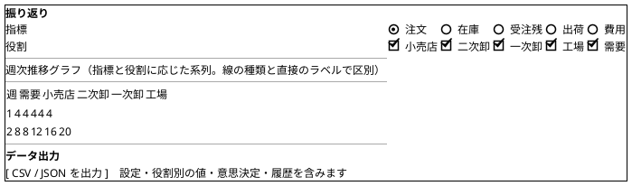

グラフと同じ値の表を、常に併記します（色だけに依存しないため）。ブルウィップ効果が見えるよう、役割別の注文の推移を、既定の表示にします。

### S10 観察者の参加

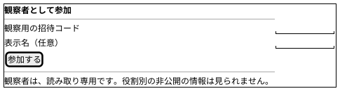

## インタラクション設計

### 共通のルール

| ルール | 内容 |
| :--- | :--- |
| 状態を変える操作 | 明示的なボタンで始める。入力やフォーカスだけでは実行しない |
| 取り返しがつかない操作 | 確認ダイアログを挟む（週確定、代理入力、停止、再開、終了、資格の失効、保持の再試行） |
| 入力の検証 | 画面で即時に補助し、サーバーの検証を正とする。エラーでは入力を保持する。サーバーは誤りを**すべて集めて**返す |
| エラーの通知 | 緊急のエラーは `role="alert"` で通知し、フォーカスを移す。非同期の更新は `aria-live="polite"`。**エラーに相関 ID を表示する** |
| 古い応答 | 版が画面より古い応答は適用しない。同じ版で内容が違えば反映する |
| 更新の制御 | 自動更新の停止と再開、手動更新を利用者に提供する |
| 重複操作 | 処理中はボタンを無効にする。**操作ごとに冪等キーを 1 つ作り、再送でも同じキーを使う**。サーバーは同じキーに同じ結果を返す |
| 画面の切り替え | 題名（`document.title`）を更新し、見出しへフォーカスを移す |
| 保存直後の表示 | 応答の `versions` に、スナップショットの取得が追いついてから、新しい値を表示する。表示は応答から作らない（下記） |

### 保存直後の表示と投影の遅延

コマンドの応答は、`{ versions: { game, session }, ... }`（**追記後の版。ストリームごと**）だけを返します。**画面の表示は、応答から作りません。** 画面は、応答を受けたらすぐスナップショット（GET state）を取得し、`versions` に追いつくまで待ってから表示します。SSE は、他の人の変更の通知（および取得の補助）で、SSE が切れていても自分の保存は画面に出ます。自動確定でも同じで、最後に保存した人の応答にも確定結果は含めず、スナップショットで週の進行を見ます。画面は、次のように振る舞います。

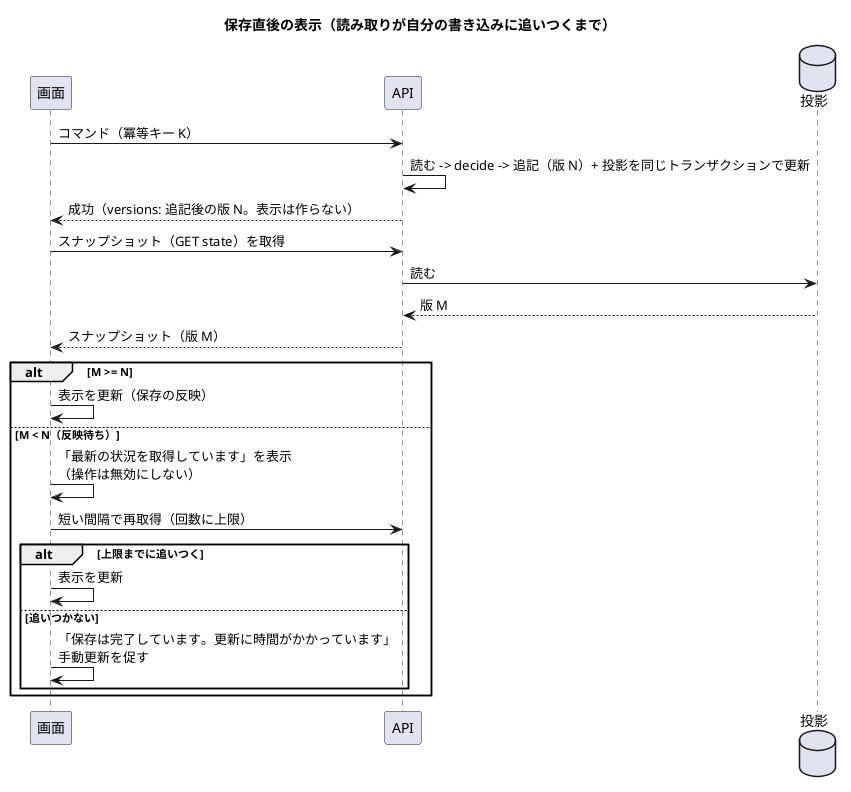

| 項目 | 設計 |
| :--- | :--- |
| 現在の同期投影 | 投影は、追記と同じトランザクションで更新されるため、応答の後の取得は、通常 `M >= N`。**反映待ちの状態は、まれ**（読み取りレプリカや、将来の非同期投影の導入時に起きうる） |
| 画面の保証 | 保存の成功を、**取得したスナップショットの版が応答の `versions` 以上になってから**表示に反映する。更新の経路は、スナップショットの 1 つに統一する。自分の保存が、画面に出ないまま通知だけが先に来る状態を作らない |
| SSE | SSE は、**他の人の変更**を、版が進んだこととして通知する（[ADR-006](../../adr/beer-game2/006-sse-version-only.md) を引き継ぐ）。通知を受けたら再取得する。取得した版が通知の版より小さければ、同じ規則で再取得する。**SSE が切れていても、自分の保存は、応答の後のスナップショットの取得で画面に出る** |
| 楽観的な表示 | **行わない。** 保存直後に、サーバーの結果を待たずに値を書き換えると、競合や拒否のときに画面と状態がずれる。待ち時間は、ボタンの処理中の表示で示す |
| 再取得 | 間隔と上限の回数は、実測で決める。上限に達したら、「保存は完了しています」と示し、手動更新を促す（保存の失敗と取り違えさせない） |
| 他の人の保存 | 共同担当の他の人が保存したときは、SSE の通知で最新になる。**同じ週の間は、入力中の値を保持する**。**週が変わった場合（409 でも SSE の通知でも）は例外で、入力欄を空にし**、直前の値を「第 N 週に入力していた値: 10（未保存）」と参考として表示する。自動確定では、共同担当の保存で週が確定するため、打ちかけの値が次の週に残って誤って保存されることを防ぐ |

反映待ちの表示は、`aria-live="polite"` で通知し、フォーカスを奪いません。

### 競合の種類と表示

ES では、競合が起きる場所が複数あります。利用者が取る行動が違うため、**種類ごとに文言と回復の手段を分けます**。「ストリームの版」などの内部の語は見せません。

| 種類 | 発生する場面 | ドメインのエラー | 自動の処理 | 画面の表示 | 回復の手段 |
| :--- | :--- | :--- | :--- | :--- | :--- |
| 共同入力の競合 | 同じ役割の他の人が先に保存した | `DecisionConflict(role, latest)`（`session.decision_conflict`、`Conflict`） | なし | 「他の人が先に保存しました。」最新の値、保存者、自分の未保存の値を並べる | 最新の値を使う、または、この値で保存し直す |
| 週が進んだ | 保存、代理入力、確定を送る前に、その週が確定された（自動確定、進行役の確定の同時実行）。要求した週 `requestedWeek` が現在の週と違う | `SessionError.WeekAdvanced`（`session.week_advanced`、`Conflict`） | なし | 「第 N 週はすでに確定されています。」最新の状況を表示。入力欄を空にし、自分の入力を参考として示す | 次の週の入力へ進む（入力は自動で引き継がない） |
| 確定の前に入力が変わった | 進行役が確認ダイアログを開いたあと、確定を送る前に、共同担当が保存し直した（週は同じで、`basis` が現在の各役割の意思決定の版と違う） | `DecisionsChanged`（`session.decisions_changed`、`Conflict`。現在の値と保存者を返す） | なし | 「確定の前に入力が変わりました。最新の値を確認してください。」 | 更新した値で確認ダイアログを開き直し、確認してから、もう一度確定する |
| 追記の競合（再試行の上限超過） | 同じゲームへの同時操作が重なり、自動再試行を使い切った | `ConcurrencyConflict` を境界で変換（`app.retry_exhausted`） | **自動で再試行済み**（再読み込みして `decide` を再評価。業務上の競合は、再評価の結果として上の種類で返る） | 「操作が混み合っています。もう一度お試しください。」入力を保持。相関 ID を示す | もう一度操作する（同じ操作なら、新しい冪等キーで送る） |
| 開始の二重実行 | 開始を、同時に 2 人が押した | `AlreadyStarted`（`session.already_started`） | なし | 「すでに開始されています。」→ プレイ・コンソールへ | 最新の状態を表示する |

確定の二重実行（進行役の確定と自動確定の同時実行など）は、週が変わるため、`session.week_advanced` として「週が進んだ」の行で扱います（`StaleVersion` は廃止）。API の `If-Match` は、`SaveDecision`（意思決定の版）にだけ付けます。`CommitWeek` は本文に `requestedWeek` と `basis` を持ち、`If-Match` を使いません。

追記の競合のうち、**多くは再試行で解消し、利用者には見えません**。再試行を使い切って初めて表示します（上限回数は、実装開始時に実測で決める。[データモデル](./data-model.md) の未決事項）。再試行の結果、業務上の競合が返るときは、利用者は上の業務上の競合のどれかを見ます。

### エラーの `code` と表示の辞書

エラーの識別子は、`code` を 1 つに決めます。**小文字のドット区切り `<領域>.<名前>`** です（アプリ層は `app.` を使う）。problem+json の `type` は `/problems/{code}`（相対 URI）で、拡張メンバー `code` に同じ値を入れます。**フロントエンドの辞書の鍵は `code`** で、この表が正本です（[フロントエンドアーキテクチャ](./architecture-frontend.md) の辞書は、この表に従う）。失効・期限切れ・不明は区別せず、同じ `code` を返します（列挙の防止）。

| `code` | HTTP | 発生する場面 | 画面の文言 | 回復の手段 |
| :--- | :--- | :--- | :--- | :--- |
| `session.decision_conflict` | 409 | 共同入力で、他の人が先に保存した | 「他の人が先に保存しました。」（最新の値、保存者、自分の値を並べる） | 最新の値を使う、または、この値で保存し直す |
| `session.week_advanced` | 409 | 保存、代理入力、確定の要求した週が、すでに確定されている | 「第 N 週はすでに確定されています。」 | 次の週の入力へ進む（入力欄は空。直前の値は参考表示） |
| `session.decisions_changed` | 409 | 確定の前に、入力が変わった（`basis` が現在の版と違う） | 「確定の前に入力が変わりました。最新の値を確認してください。」 | 更新した値で確認ダイアログを開き直す |
| `session.already_started` | 409 | 開始の二重実行 | 「すでに開始されています。」 | プレイ・コンソールへ |
| `app.retry_exhausted` | 503（[バックエンドアーキテクチャ](./architecture-backend.md)） | 追記の競合で、自動再試行を使い切った | 「操作が混み合っています。もう一度お試しください。」（相関 ID を示す） | もう一度操作する（新しい冪等キー） |
| `app.idempotency_key_reused` | 409 | 同じ冪等キーで、本文が違う要求を送った | 「操作を確認できませんでした。もう一度操作してください。」（相関 ID を示す） | もう一度操作する（新しい冪等キー） |
| `app.unauthorized` | 403 | 資格が無い、無効、権限が無い | 「この画面を開く権限がありません。」と、参加・復帰への導線 | 参加・復帰へ |
| `game.invitation_invalid` | 403 | 観察用の招待が、失効、期限切れ、不明（区別しない） | 「招待が無効です（失効または期限切れ）。進行役に確認してください。」 | 進行役に新しい招待を依頼する |

上の表にない `code`（入力検証の誤り、保持削除、停止中・終了後の拒否など）も、同じ書式で辞書に足します（`code` 名の一覧は、ドメインモデルとバックエンドアーキテクチャの表が正本）。辞書にない `code` を受け取ったときは、HTTP の状態コードの区分（通信、権限、サーバー）と相関 ID を示す一般の文言にします。

### 結果が不明なとき（通信の途中の切断）

保存や確定の応答を受け取れなかったとき（タイムアウト、切断）、画面は**成功か失敗かを断定しません**。

| 項目 | 設計 |
| :--- | :--- |
| 表示 | 「結果を確認しています…」を `role="status"` で通知。入力を保持する |
| 再送 | **同じ冪等キー**で、自動で再送する（間隔と回数に上限）。サーバーは、すでに追記済みなら、保存した成功の応答をそのまま返す（冪等記録。24 時間。業務の失敗は保存せず、再送でも同じ失敗を再計算して返す）。未追記なら、新たに実行する。資格が失効していれば、過去のキーの再送でも 403（`app.unauthorized`）になる |
| 再送でも不明 | 「結果を確認できませんでした。最新の状態を表示します。」手動更新で状態を見て、保存されていなければ再操作する。**新しい操作（新しい冪等キー）は、利用者が操作したときだけ作る** |
| 資格を含む応答（作成、参加、復帰） | 再送でも、同じ資格の値が返る（応答を暗号化して保存するため）。画面は、再送で受け取った値を通常と同じに扱う |
| ゲーム作成の再送 | 同じ冪等キーでの再送は、すでに作成済みなら同じゲームと参加コードを返す。**二重のゲームを作らない** |

### 主な操作の流れ

| 流れ | 手順 |
| :--- | :--- |
| ゲームの準備 | 進行役がゲームを作成（S02）→ 参加コードを伝える → 参加者が参加（S03）→ 進行役が役割を割り当てる（同じ役割に複数人）（S04）→ 必要なら観察用の招待を発行 → 各役割に 1 人以上で開始 |
| 週のプレイ | 参加者が状況を確認し（S05）、数量を保存 → 進行役が入力状況を確認し（S06）、確認ダイアログで確定（自動確定なら、4 役割がそろった時点で自動）→ 全員の画面が最新になる |
| 共同入力 | 共同担当の誰かが保存すると、全員の画面に、同じ値と版、保存者が反映される。同時に保存した場合は、後の人に競合を示し、自分の入力を保持して、最新値との比較を示す |
| 自動確定 | 確定方式が「自動で確定」のゲームで、最後の役割が保存（または進行役が代理入力）すると、システムが**保存と確定を一度に行い**、全員に「第 N 週が自動で確定されました」と通知する（`aria-live`）。最後に保存した人の応答には確定結果を含めず（`versions` だけ）、画面はスナップショットで週の進行を見る |
| 中断と復帰 | 進行役が停止（参加者の入力は読み取り専用になり、停止中と表示）→ 必要なら**停止中に代理入力**（進行役のみ。自動確定はしない）→ 再開（自動方式なら、再開時に 4 役割が揃っていれば自動確定）。参加者・進行役は、資格で同じ画面へ戻る |
| 観察 | 進行役が観察用の招待を発行 → 観察者が参加（S10）→ 観察（S07）→ 終了後に振り返り（S08） |
| 終了と振り返り | 最終週の確定、または進行役の終了 → 振り返りへ進む → 役割別の比較と出力 |

最終週の確定は、`WeekCommitted` と `SessionEnded` が一度に追記されます。画面は、確定の通知と終了の通知を**別々に出さず**、「第 N 週を確定し、ゲームが終了しました。振り返りへ進めます。」を 1 回示します。

### エラーと状態のフィードバック

| 状況 | 表示 | 回復の手段 |
| :--- | :--- | :--- |
| 作成フォームの検証エラー | エラーの要約と、対象欄への関連付け。**対象の週と修正内容を示す**。**複数の誤りを一度に示す**。入力を保持 | 修正して再送 |
| 数量が不正（負数・小数・空・上限超過） | 「発注数は 0〜1000 の整数で入力してください。」（工場は「生産要請数」）。入力を保持 | 修正して再送 |
| 共同入力の競合 | 最新の入力値と保存者、自分の未保存の値を並べて示す | 最新の値を使う、または、この値で保存し直す |
| 週が進んだ | 「第 N 週はすでに確定されています。」（`session.week_advanced`）と、最新の状況。入力欄は空にし、自分の入力は参考として示し、自動では引き継がない | 次の週の入力へ進む |
| 確定の前に入力が変わった | 「確定の前に入力が変わりました。最新の値を確認してください。」（`session.decisions_changed`）。更新した値で確認ダイアログを開き直す | 値を確認して、もう一度確定する |
| 追記の競合（再試行の上限超過） | 「操作が混み合っています。もう一度お試しください。」相関 ID。入力を保持 | もう一度操作する |
| 結果が不明（通信の切断） | 「結果を確認しています…」。同じ冪等キーで自動で再送。確認できなければ、最新の状態を表示 | 手動更新。必要なら再操作 |
| 停止中 | 「停止中です。進行役の再開を待ってください。」。参加者の入力は無効。進行役の代理入力は有効（確定はしない） | 再開を待つ |
| 終了後 | 「終了しました。入力できません。」。振り返りへの導線 | 「振り返りを見る」 |
| 通信の断（SSE） | 「再接続中です。1 秒ごとに更新しています。」を `role="status"` で通知 | 自動で再接続。手動更新も可能 |
| 反映待ち | 「最新の状況を取得しています。（保存は完了しています）」。操作は無効にしない（応答の `versions` にスナップショットが追いつくまで） | 自動で再取得。上限後は手動更新 |
| 取得の失敗 | 原因の区分（通信、権限、サーバー）と相関 ID を `role="alert"` で通知 | 手動更新。問い合わせの際は相関 ID を伝える |
| 参加・復帰の失敗 | 入力を保持し、理由（コードが無効、受付が終了、資格の期限切れなど）を示す | 入力し直す、進行役に確認する |
| 観察用の招待が無効（`game.invitation_invalid`） | 「招待が無効です（失効または期限切れ）。進行役に確認してください。」（失効・期限切れ・不明は区別しない） | 進行役に新しい招待を依頼する |
| 週確定・進行操作の失敗 | 原因の区分と相関 ID。「最新状態を確認して、再度操作してください。」 | 手動更新して再操作 |
| 権限が無い | 「この画面を開く権限がありません。」と、参加・復帰への導線 | 参加・復帰へ |
| 振り返りの出力の失敗 | 「出力に失敗しました。」。部分的な結果を完全な出力として示さない | 再実行 |

### 画面の状態

| 状態 | 表示 |
| :--- | :--- |
| 読み込み中 | 「読み込み中…」と対象名 |
| データなし | 「データなし」（読み込みの失敗と区別） |
| エラー | 原因の区分と相関 ID。再試行または戻る |
| 古い状態 | 古い応答を適用せず、最新を反映する |
| **反映待ち** | 保存の完了と、最新の取得中であることを示す。操作は無効にしない（**新規**） |
| 停止中 | 停止の説明。参加者の入力は無効（進行役の代理入力は有効） |
| 終了 | 入力不可。振り返りへの導線 |
| オフライン | 入力を保持し、未送信であることを示す（再接続後に再送を確認する。**同じ冪等キーで再送**） |

## 週の進行の表示（引継）

beer-game2 と同じです。

- 教材の 12 ステップは、**システムが確定時に一度に計算する内部の手順**です（参加者の操作は、状況の確認と、数量の入力だけ）。
- 画面では、**「状況を確認 → 入力 → 確定待ち」の 3 段階**で、現在地を示します（`aria-current="step"`）。
- 教材の 12 ステップは、**ヘルプ（S11）と、折りたたみの説明**で提供します（「この週に起きること」）。

## アクセシビリティ（WCAG 2.2 AA を目標）

beer-game2 と同等です。新しい状態の通知（反映待ち、週が進んだ、結果の確認中）も、同じ規則で通知します。

| 観点 | Kotlin 版の設計 |
| :--- | :--- |
| スキップリンク | 「本文へスキップ」を設置 |
| 画面の題名 | 画面ごとに `document.title` と H1 を更新し、フォーカスを見出しへ移す |
| フォーカス表示 | `:focus-visible` で 3px のアウトライン |
| キーボード操作 | ダイアログは Tab の循環、Escape、元のボタンへのフォーカス復帰。共同入力の競合と、週が進んだときの選択も、キーボードで操作できる |
| 状態の通知 | `role="alert"`、`role="status"`、`aria-live="polite"` を使い分ける。自動確定と、他の人の保存を通知する。**反映待ちと、結果の確認中は `role="status"` / `aria-live="polite"`（フォーカスを奪わない）。週が進んだ通知は、`role="alert"` で通知し、フォーカスを新しい週の見出しへ移す** |
| フォームの関連付け | `label`、`aria-invalid`、`aria-describedby` |
| 色への依存 | 状態は文字で示す。グラフは、線の種類・直接のラベル・表で区別する。競合・反映待ちも、色でなく文言で示す |
| コントラスト比 | 設計トークンで色を定義し、**自動検査（axe）と、トークンの比の確認**で、4.5:1（大きな文字と部品は 3:1）を満たすことを確認する |
| 操作対象の大きさ | 24 × 24 CSS px 以上。自動検査で確認する |
| 拡大 | 200% で 1 列に再配置し、横スクロールなし（E2E） |
| 強制カラー、動きの低減 | 対応する。反映待ちの表示は、動きを使わず、文言とアイコンで示す |
| スクリーンリーダー | 主要な流れ（作成、参加、共同入力、確定、振り返り）を、手動で確認し、結果を記録する。**共同入力の競合、週が進んだ場合、反映待ちの読み上げも確認対象に加える** |

## beer-game2 からの変更

画面、遷移、表示名、アクセシビリティは、beer-game2 と同等です。変更は、ES + CQRS の影響に限ります。

| # | beer-game2 | beer-game-kotlin | 理由 |
| :--- | :--- | :--- | :--- |
| 1 | 保存後の表示は、版の通知と再取得 | 応答は `versions` だけを返し、表示は常にスナップショットから作る。スナップショットが `versions` に追いつくまでを「反映待ち」として示す。SSE が切れても自分の保存は出る | 追記の版が、読み取りの保証の基準になる。更新の経路を 1 つに統一する。同期投影では反映待ちは通常は発生せず、非同期への移行に備える |
| 2 | 反映待ちの状態が無い | 画面の状態に「反映待ち」を追加（操作は無効にしない） | 読み取りレプリカ、将来の非同期投影 |
| 3 | 共同入力の競合は 1 種類 | 競合を 5 種類に分ける（共同入力、週が進んだ、確定の前に入力が変わった、追記の再試行の上限超過、開始の二重実行）。識別子は `code`（`<領域>.<名前>`）に統一し、辞書の正本を本書に置く | ES では、業務上の競合と追記の競合の起きる場所が異なる。利用者の取る行動が違う（H6、H9） |
| 4 | 週確定の競合の文言が定義されていない | 「第 N 週はすでに確定されています。」（`session.week_advanced`）。入力欄は空にし、直前の値を参考表示する（409 でも SSE でも）。確定の前に入力が変わった場合は「確定の前に入力が変わりました。最新の値を確認してください。」で、確認ダイアログを更新した値で開き直す | 自動確定と手動確定の同時実行を想定。`CommitWeek` の前提を要求した週と各役割の意思決定の版（`basis`）にした（H6、H10） |
| 5 | 重複操作は冪等キーで防ぐ | 操作ごとに冪等キーを 1 つ作り、**再送でも同じキーを使う**。通信の切断で結果が不明なときは、同じキーで自動再送する | 追記と同じトランザクションで冪等記録を書くため、再送は安全 |
| 6 | 結果が不明なときの表示が定義されていない | 「結果を確認しています…」。成功か失敗かを断定しない | 追記が成功したが応答が届かない場合がある |
| 7 | 振り返りの出力が「準備中」になりうる（`PENDING`） | 出力は、問い合わせ時に `week_role_results` と設定から純粋関数（`buildExport`）で作る。途中の状態が無く、最終週の確定は出力の作成に依存しない | 出力の同期投影の廃止（H3）。出力の準備中の表示は不要 || 8 | 最終週の確定と終了は別の通知になりうる | `WeekCommitted` と `SessionEnded` が一度に追記されるため、通知を 1 回にまとめる | 自動確定・最終週の `decide` が複数イベントを返す（ドメインモデル D6） |
| 9 | 作成フォームの検証エラーは、最初の誤りを示す（想定） | **すべての誤りを集めて、一度に示す** | 入力検証が `NonEmptyList<ValidationError>` を返す（[ドメインモデル](./domain-model.md)） |
| 10 | 一時停止中の代理入力の扱いが定義されていない（想定） | 停止中も進行役の代理入力は有効。ただし自動確定しない（確定は再開時、または手動） | UC-09 の「停止 → 代理入力 → 再開」を成立させる（H1） |

beer-game2 が、v1 の UI 設計の差分（14 件）に対して決めた対応（日本語の表示名、「生産要請数」、3 段階の週の進行、入力値の表示、カスタム条件、観察者の入口、URL ルーティング、共同担当の表示、役割別の振り返り、相関 ID、オフライン、画面ごとの題名、狭い画面の案内、ヘルプ）は、**すべてそのまま引き継ぎます**。

## 未決事項

beer-game2 から継続（そのまま未決）:

- 共同入力の競合で、「この値で保存し直す」の操作の誤りを防ぐ表現（確認の要否）。
- 観察者の表示名を、必須にするか、任意にするか。
- 費用単価の入力の単位（最小単位か、金額の表記か）と、桁の制限。
- 公開範囲の選択肢の一覧（チーム合計のみ、完了状況のみ、など）。

Kotlin 版で加わる未決事項:

解決済み（本書へ反映）:

- コマンドの応答の形: `{ versions: { game, session }, ... }` だけを返し、表示はスナップショットから作る（H8）。
- 確定済みの週への保存を区別する手段: `requestedWeek` と `SessionError.WeekAdvanced`（`session.week_advanced`）で区別する（H2、H6）。
- 出力の同期投影の失敗が最終週の確定を失敗させる懸念: 同期投影を廃止し、出力は要求時に作る（H3）。

Kotlin 版で加わる未決事項:

- **再取得の間隔と上限の回数**（反映待ちの扱い）。実測の遅延に基づいて決める。同期投影では、再取得が必要な場面はまれな想定。
- **追記の競合の再試行を使い切った場合の HTTP の状態コード**（`app.retry_exhausted`）と、画面が「もう一度操作する」のときに新しい冪等キーを作る条件の確認。
- **出力（`buildExport`）が大きい場合のキャッシュ**。要求時に作るため、50 週 × 4 役割では問題ない想定。画面の「出力」が遅いと分かった場合に、キャッシュを検討する（データモデルの未決事項と共通）。
- 非同期投影へ移行する場合に、「反映待ち」の表示の頻度が増える。許容する遅延の上限（NFR-03 の画面反映 2 秒との関係）。

## 出典

- [beer-game2 UI 設計](../beer-game2/ui-design.md)
- [ユーザーストーリー](../../requirements/beer-game2/user_story.md)、[システムユースケース](../../requirements/beer-game2/system_usecase.md)、[要件定義](../../requirements/beer-game2/requirements_definition.md)
- [ドメインモデル（Kotlin 版）](./domain-model.md)、[データモデル（Kotlin 版）](./data-model.md)、[フロントエンドアーキテクチャ](./architecture-frontend.md)、[バックエンドアーキテクチャ](./architecture-backend.md)、[UI 設計ガイド](../../reference/UI設計ガイド.md)
- [ガイド 関数型プログラミングガイド（Kotlin 編）](../../reference/関数型プログラミングガイド_Kotlin編.md) 第 7 章（§7.4 コマンドの検証、§7.5 CQRS、§7.6 永続化とトランザクション境界）
- [ADR-006](../../adr/beer-game2/006-sse-version-only.md)、[ADR-008](../../adr/beer-game2/008-auto-commit-and-event-audit.md)
- `aidlc/spaces/default/intents/261027-beer-game-development/inception/refined-mockups/`
