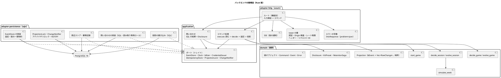
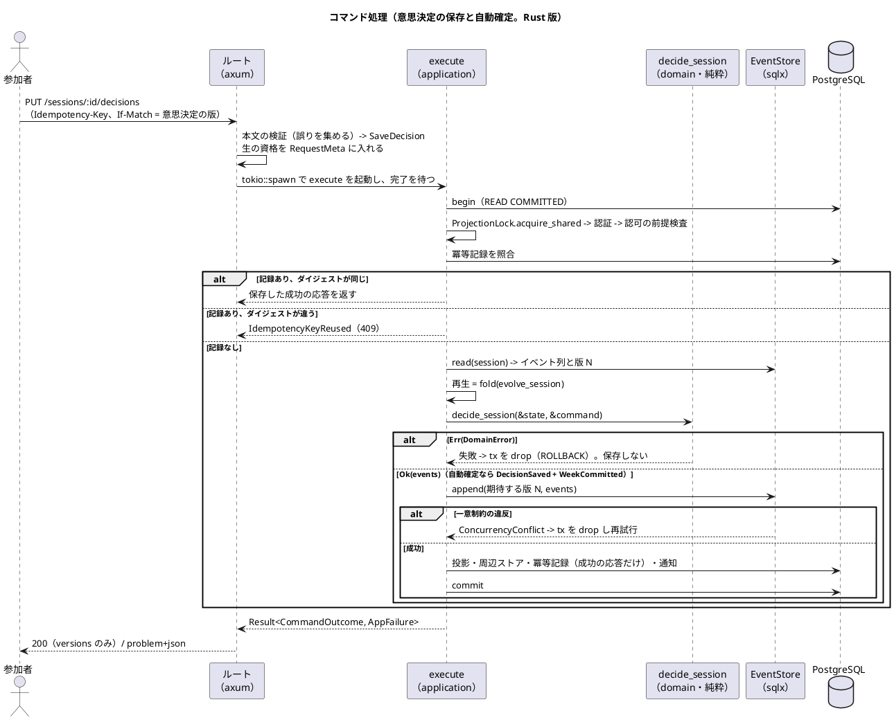

# バックエンドアーキテクチャ - ビールゲームシミュレーション（Rust 版）

## 概要

本書は、beer-game-rust のバックエンドのアーキテクチャを定義します。[ADR-001](../../adr/beer-game-rust/001-rust-version-of-beer-game-kotlin.md) の決定により、**機能・API の振る舞いは beer-game2、設計の構造は [beer-game-kotlin のバックエンドアーキテクチャ](../beer-game-kotlin/architecture-backend.md) を正本**として引き継ぎます。本書は、その構造を **Rust（axum + sqlx + tokio）** で実現する方法と、Rust で変わる点だけを定めます。**`docs/` を設計の正本**とします。実装コードはまだ存在しません。

### 本書の位置づけと確認の範囲

- **本書で確認したこと**: 「コマンド処理の流れ」の `EventStore` トレイト（`begin`・`commit`・`rollback`）、`execute`、競合の再試行、`Secret` 型は、ローカルの rustc 1.97.1（edition 2024）で、標準ライブラリだけで型検査し、テストが通ることを確認しました（2026-11-19。**2026-11-21 のレビュー（H2）で、明示の ROLLBACK を持つ形に改め、再度確認した**。非同期は自前の `block_on` で実行）。**tokio・sqlx・axum と組み合わせた動作は、この確認に含まれません。**
- **確認していないこと**: axum・sqlx・tokio を使った実装（SSE、`LISTEN/NOTIFY`、アドバイザリロック、sqlx のトランザクションの drop の挙動）、tower の層の組み立て、依存の検査の方式は、**未確認の設計のスケッチ**です。[技術スタック](./tech-stack.md) の未決事項と同じで、B1 で確かめます。
- **引き継ぐだけのもの**: 冪等性の表、競合の再試行の一意制約の表、問い合わせ側の開示、API のエンドポイントと認可の表、エラーの写像の表、SSE の仕様（版の通知だけ、再生なし）、保持削除の手順、セキュリティの表は、Kotlin 版の該当節を正本とします。**API の契約（`openapi.yaml`、`code`、problem+json）は変えません。**
- Kotlin 版の実装の経緯（B1〜B12 の注記）は引き継ぎません。Kotlin 版の未決事項は、本書の未決事項に引き継ぎます。

## パターンの選択

Kotlin 版と同じです。業務領域は中核（週次計算と進行）、**イベントソーシング**（状態はイベントの列。イベントが監査の記録を兼ねる）、**CQRS**（コマンド側は `events` へ追記、問い合わせ側は投影テーブルを SQL で読む）。構造は「**核の純粋関数 + 外側の薄い副作用の層**」です。核は、入力の検証、`decide`、`evolve`、投影、`simulate_week`、`Disclosure` で、副作用は HTTP、データベース、時計、乱数、ログです。

## 全体構成



### 層と依存の向き

依存は、外側から内側（ドメイン）への**一方向**です。`domain` は標準ライブラリ（と、`uuid`・`time` などの値の型）だけに依存します（[ドメインモデル](./domain-model.md) の RD5）。

| 層（Cargo のワークスペースの crate） | 責務 | 依存してよい先 |
| :--- | :--- | :--- |
| `domain` | 値オブジェクト、`Command`、`Event`、エラー、`decide` / `evolve`、再生、`start_game`、`simulate_week`、`KitPreset`、投影の純粋関数、`RetentionSaga` の純粋関数。**業務ルールはここにある** | なし（標準ライブラリ、値の型の最小のクレート） |
| `application` | ポート（トレイト）の定義、コマンド処理 `execute`、問い合わせ、競合の再試行、周辺ストアへの書き込み内容の導出（純粋）、開示の判定 `Disclosure`。トランザクションの境界を決める。**ルールは持たない** | `domain` |
| `adapter-http` | axum のルート、DTO の検証（誤りを集める）、認証、Origin 検査、レート制限、ヘッダー、SSE、エラーの写像 | `application`、`domain` |
| `adapter-persistence` | sqlx による `EventStore`、投影の書き込み、問い合わせ、周辺ストア、冪等記録、`ProjectionLock` と `ChangeNotifier`、イベントの JSON 変換（`EventCodec`）、マイグレーション | `application`、`domain` |
| `app`（バイナリ） | 設定の読み込みと検証、ポートの組み立て（ワイヤリング）、起動のモード（api、retention、migrate、rebuild-projections） | 全 crate |

この規則は、**Cargo の依存宣言**（宣言していない crate は `use` できない）と、**依存の検査**（下の「モジュール構成と依存の検査」）の二重で守ります。

### 依存を表す: トレイトによるポート（設計判断 RB1）

Kotlin 版は、依存を `typealias` と `data class` の**関数の束**で表します。Rust 版は、**トレイト**で表し、ジェネリクスによる静的ディスパッチで組み立てます。テストでは、同じトレイトのインメモリ実装に差し替えます。非同期のメソッドは `impl Future<Output = …> + Send` を返します。

```rust
pub enum AppFailure {
    Invalid(Vec<ValidationError>),   // 境界で集めた入力の誤り
    Domain(DomainError),             // decide が返した業務上の失敗
    ConcurrencyConflict,             // 追記の競合。execute が再試行する
    RetryExhausted,                  // 再試行・ロックの待ちの上限。app.retry_exhausted（503、Retry-After）
    IdempotencyKeyReused,            // app.idempotency_key_reused（409）
    Unauthorized,                    // app.unauthorized（403）
    Persistence(PersistenceFailure), // 例外・I/O の失敗を境界で値にしたもの。500 と相関 ID
}

pub struct StreamRead<E> { pub events: Vec<E>, pub version: u64 }

pub trait EventStore<E>: Sync {
    type Tx: Send;
    fn begin(&self) -> impl Future<Output = Result<Self::Tx, AppFailure>> + Send;
    fn read(&self, tx: &mut Self::Tx) -> impl Future<Output = Result<StreamRead<E>, AppFailure>> + Send;
    fn append(&self, tx: &mut Self::Tx, expected: u64, events: Vec<E>)
        -> impl Future<Output = Result<u64, AppFailure>> + Send;
    fn commit(&self, tx: Self::Tx) -> impl Future<Output = Result<(), AppFailure>> + Send;
    fn rollback(&self, tx: Self::Tx) -> impl Future<Output = Result<(), AppFailure>> + Send;   // 明示の ROLLBACK
}
```

上の `AppFailure`（簡略化した型）と `EventStore` は、型検査してテストを通したものです。実際の `EventStore` は、ストリームの種別（`game` / `session`）と複数のストリームの追記（`start_game`）を受け取る形に広げます（スケッチは 1 本のストリーム）。`ProjectionLock`・`ChangeNotifier`・`IdempotencyStore`・`PeripheralStore`・`Clock`・`IdGen`・`CredentialIssuer` も同じ形のトレイトで、**型検査していません**。

**`Tx` は `begin` / `commit` / `rollback` で表します。失敗の経路では `rollback` を明示し、`Tx` の drop による ROLLBACK は、panic・ランタイムの終了のときの保険にします**（設計判断 RB2。2026-11-21 のレビュー H2 で見直し）。

## コマンド側

### コマンド処理の流れ

流れと順序は Kotlin 版と同じです。**処理の順は固定**で、ロック（共有）→ 認証（操作者・資格の有効性）→ 認可の前提検査 → 冪等記録の照合 → 読み込み → `decide` → 追記・投影 → 周辺ストア → 通知 → 冪等記録の保存 → COMMIT です。認可を冪等記録の照合より**先**に置くため、入れ替えで失効した旧担当者が過去のキーを再送しても 403 になります（ADR-004）。



`execute` は、ストリームの種類に依存しない汎用の関数です。ストリームごとの `initial`・`evolve`・`decide` を引数で受け取り、ルールを持ちません（Kotlin 版と同じ）。**型検査したスケッチ**:

```rust
/// 読む -> 再生 -> decide -> 追記。失敗は run_once が rollback する
async fn step<E, S, C, St>(
    store: &St, tx: &mut St::Tx, initial: &S,
    evolve: &(impl Fn(S, &E) -> S + Sync),
    decide: &(impl Fn(&S, &C) -> Result<Vec<E>, String> + Sync),
    command: &C,
) -> Result<u64, AppFailure>
where E: Send, S: Clone + Send + Sync, C: Sync, St: EventStore<E>,
{
    let read = store.read(tx).await?;
    let state = read.events.into_iter().fold(initial.clone(), |s, e| evolve(s, &e));
    let decided = decide(&state, command).map_err(AppFailure::Domain)?;
    if decided.is_empty() { Ok(read.version) }                    // 空の列は追記しない
    else { store.append(tx, read.version, decided).await }
}

async fn run_once</* … */>(/* … */) -> Result<u64, AppFailure> {
    let mut tx = store.begin().await?;
    match step(store, &mut tx, initial, evolve, decide, command).await {
        Ok(version) => { store.commit(tx).await?; Ok(version) }
        Err(failure) => {
            // 失敗の経路は明示の ROLLBACK。ROLLBACK 自体の失敗は、元の失敗を隠さない
            let _ = store.rollback(tx).await;
            Err(failure)
        }
    }
}

pub async fn execute</* … */>(/* … */, max_attempts: u32) -> Result<u64, AppFailure> {
    let mut attempt = 0;
    loop {
        attempt += 1;
        match run_once(/* … */).await {
            Err(AppFailure::ConcurrencyConflict) if attempt < max_attempts => continue,
            Err(AppFailure::ConcurrencyConflict) => return Err(AppFailure::RetryExhausted),
            other => return other,
        }
    }
}
```

上のコードについて、次の 4 つの性質のテストが通ることを確認しました。(1) 成功は `commit` だけで、`rollback` しない。(2) 競合が 2 回続いても、再試行して成功する（試行 3 回で、`rollback` は競合の 2 回、`commit` は最後の 1 回）。(3) 競合が上限まで続くと、すべて `rollback` して `RetryExhausted` を返す（`commit` は 0 回）。(4) 業務の失敗（`decide` が `Err`）は、`rollback` して、再試行も追記もしない。

**`Ignored` の扱い（レビュー M7）**: 実際の `step` の再生は `Evolution`（[ドメインモデル](./domain-model.md) の RD2）を畳み込み、**コマンドの経路で `Ignored` が出たら、状態を信用せず `AppFailure::Persistence`（500・相関 ID）で失敗させます**（fail closed）。保存済みの事実を無視した状態で `decide` すると、不変条件が崩れるためです。`StreamRead.version` は、読み込んだイベントの**件数ではなく、`MAX(stream_version)`** とします（追記の期待する版）。上のスケッチは、簡単のため `S -> S` の `evolve` を使っています。

要点は Kotlin 版と同じです。

- **`StartGame` と開始後の役割の入れ替え**だけは、`game` と `session` の両ストリームを読み、両方の期待する版を持って 1 回の追記で書く別の関数にします。
- **冪等記録に保存するのは、成功した応答だけ**です。業務の失敗は保存せず、再送は同じ失敗を再計算して返します。
- **自動確定のための特別な処理はありません。** `decide_session` が複数のイベントを返すため、`execute` から見ると 1 回の追記です。
- **投影は追記の後に更新します**（同じトランザクション）。複数の投影の行を更新するときの**ロックの順序の規則**（表名の辞書順 → 主キーの昇順）も同じです。
- 周辺ストア（表示名・資格のダイジェスト）の書き込み内容は、**純粋関数で導出**します（`peripheral_writes`）。イベントには入れません（D7）。

### キャンセル安全性（設計判断 RB2）

Kotlin 版は、コルーチンのキャンセルに対して、COMMIT と ROLLBACK を `NonCancellable` で行い、`CancellationException` を再送出します（ADR-005）。**Rust では、キャンセルは「future が drop されること」**です。クライアントが切断すると、axum が処理中の future を drop しうるため、次の方針にします。

**リスクの置き場所（2026-11-21 のレビュー H2・H3 による見直し）**: 「部分更新が残る」ことは、**PostgreSQL のトランザクションの原子性が防ぎます**（COMMIT の前に接続が切れれば、サーバーが中止する）。本当のリスクは次の 3 つです。**(1) ロックと接続が解放されるまでの遅れ**（`pg_advisory_xact_lock_shared`・行ロックを握ったまま接続が残ると、再構築の排他ロックの待ちとプールの枯渇が静かに進む）。**(2) spawn したタスクの寿命**（切り離されたタスクの追跡、シャットダウン）。**(3) COMMIT の結果が呼び出し側に分からなくなること**（タイムアウト・切断）。

| 項目 | 設計 |
| :--- | :--- |
| ROLLBACK | **失敗の経路では `rollback` を明示する**（上の `run_once`。型検査・テスト済み）。`Tx` の drop による ROLLBACK は、**panic・ランタイムの終了のときの保険**とする。sqlx のトランザクションは、drop した時点で ROLLBACK を送らず、接続が次に使われる（またはプールに返る）ときに送る実装だった見込み（**公式の文書で確認していない**）。そのため、drop だけに頼ると、ロックを握ったまま接続が残る時間が生じうる。B1 で挙動を確かめる |
| COMMIT の途中でのキャンセル | `execute` を **`tokio::spawn` した別のタスクで実行**し、ルートはその完了（`JoinHandle`）を待つ。クライアントが切断しても、コマンドの処理は最後まで走る（COMMIT が中途半端にならない）。通常の失敗の経路は spawn の中で完結するため、**ルートの future が drop されても、明示の ROLLBACK は実行される** |
| タイムアウトと「結果が不明」 | tower のタイムアウトが応答した後も、spawn したタスクは COMMIT まで進みうる。**タイムアウトの応答は `type` を付けない 504 とし、画面は「結果が不明」として同じ `Idempotency-Key` で再送する**（[UI 設計](./ui-design.md) の影響表 #1〜#3）。**元の処理が実行中に同じキーの再送が届いたときは、先の処理の完了を待って、保存済みの応答（または同じ失敗）を返す**（冪等記録の照合の前に、同じキーの実行中のコマンドの完了を待つ。実現は B1 で確認。待ちの上限を超えたら `app.retry_exhausted`） |
| プール取得のタイムアウト | プールから接続を取れなかった場合は、**コマンドは未実行が確実**なので、`AppFailure::RetryExhausted`（503・`type` つき・`Retry-After`）に写す。`begin` の失敗は、`Persistence`（500）とは区別する |
| タスクの panic | `JoinHandle` の `JoinError` を `AppFailure::Persistence` に写し、500 と相関 ID にする。**ドメインは panic しない**（RD5）が、境界で守る。**この写像は、panic が unwind で伝わることを前提にするため、release のプロファイルは `panic = "unwind"` を制約として固定する**（`abort` にしない。レビュー M6） |
| spawn したタスクの寿命 | **切り離されたタスクを追跡する仕組みを置く**（`JoinHandle` を drop するとタスクは切り離されたまま走り続ける。tokio の一般的な仕様で、導入するクレートの版での確認は B1）。追跡の道具（`tokio_util` の `TaskTracker` など）は新規依存のため、**B1 の計画で承認を得る**。**同時に走るコマンドのタスクの数に上限を置く**（超えたら `RetryExhausted`）。 |
| シャットダウン | SIGTERM で新しい要求の受付を止め、**SSE の接続に終了を知らせて閉じ**（SSE は自然には閉じず、graceful の待ちが `stopTimeout` まで続き SIGKILL になると「終了コード 0」を満たせない）、追跡しているコマンドのタスクの完了を待つ（待ちの上限は `stopTimeout` より短く）。**axum の graceful shutdown は接続を待つが、切り離されたタスクの完了は待たない**見込みのため、追跡の仕組みで待つ（B1 で確認） |

| 案 | 内容 | 評価 |
| :--- | :--- | :--- |
| **A'（採用。2026-11-21 の見直し）** | `execute` を spawn し、**失敗の経路で `rollback` を明示**する。`Tx` の drop は保険 | 切断で処理が途中で止まらず、ロックの解放が drop の挙動に左右されない。`EventStore` に `rollback` が加わる |
| A（旧。2026-11-19 に承認） | `execute` を spawn し、`Tx` の drop で ROLLBACK | 単純。drop の ROLLBACK の遅延（未確認）で、ロックを握ったまま接続が残りうる |
| B | ハンドラの future の中で直接実行する | 単純。ただし、クライアントの切断で COMMIT の直前に future が drop されうる |

### 冪等性と競合の再試行

冪等記録の表（`idempotency_records`、24 時間、応答を暗号化、`request_digest` に操作者 ID を含める、認可の後に照合する、成功した応答だけを保存する）と、再試行する一意制約の一覧（`uq_events_stream_version`、`uq_idempotency_create`、`pk_idempotency_records`）は、**Kotlin 版を引き継ぎます**。

| 項目 | Rust 版での実現 |
| :--- | :--- |
| 一意制約違反の判別 | PostgreSQL のエラーの SQLSTATE（`23505`）と**制約名**で見分ける。sqlx のエラーから制約名を取る方法は**未確認**（B1 で確認）。40001・40P01 も `ConcurrencyConflict` に写す。55P03 は `RetryExhausted` |
| 再試行の上限 | 初期値は 10（ADR-019 を引き継ぎ、Rust 版で再計測する）。ジッターなし、書き込みの直列化なし |
| `lock_timeout` | **B1 の受入条件に、`lock_timeout` の初期値を入れる**（未設定だと、再構築の間、コマンドがアドバイザリロックを無期限に待ち、spawn したタスクと接続が積み上がる。`idle_in_transaction_session_timeout` は `active` の待ちを切らないため、安全網にならない）。超過（SQLSTATE 55P03）は `RetryExhausted` に写す。**値は実測で決める**（レビュー M4） |
| 待ち | 再試行のあいだに待ちを入れない。入れる場合は `tokio::time::sleep`（計測して決める。未決事項） |
| 暗号化と HMAC | 候補は `hmac`・`sha2`・`base64`、応答の暗号化（AES-256-GCM）のクレートは**未選定**（資格の設計時に決め、承認を得る） |

## 問い合わせ側

Kotlin 版を引き継ぎます。読み取り専用の DB ロールで投影の表を SELECT し、**読み取り専用の REPEATABLE READ のトランザクション**で `projection_checkpoints` を同じトランザクションで読みます（応答の `versions` が行より新しくならない）。観察者は別のロール・別の接続プール（`PgPool`）で、`game_overview`・`session_overview`・`week_team_totals` の 3 表だけを読めます（ADR-009）。出力は要求時に `build_export`（純粋関数）で作ります。

Rust 版の実現として、**用途別に `PgPool` を持ちます**（api は書き込み・読み取り・観察者の 3 つと `LISTEN` の専用接続。削除は retention、所有者は migrate のタスクが持つ。[インフラストラクチャ](./architecture-infrastructure.md)）。プールの配線テスト（`SELECT current_user` の検査）は書き直します（ADR-009）。

### 投影の更新と再構築

投影は、`Projection`（純粋。`&Event -> Vec<RowChange>`）と、SQL への書き込み（境界）に分けます（[ドメインモデル](./domain-model.md)）。再構築は `rebuild-projections` モードで、**1 ゲームを 1 トランザクション**で、排他のロック（`ProjectionLock::acquire_exclusive`。PostgreSQL では `pg_advisory_xact_lock`）を取って行います。コマンドは共有のロック（`pg_advisory_xact_lock_shared`）を取るため、再構築と同時には走りません。**sqlx でアドバイザリロックを扱えるかは未確認**（SQL を直接発行するため、扱えると見込むが、B1 で確認する）。

再生に関する 3 つの性質（永続化往復の同値性、計算と事実の一致、投影の整合）と、検証の場は、[ドメインモデル](./domain-model.md) と Kotlin 版のとおりです。

## イベントの JSON 変換

| 項目 | 設計 |
| :--- | :--- |
| 場所 | `adapter-persistence` の `EventCodec`。**ドメインのイベントには、serde の属性を付けない**（BD5 を引き継ぐ） |
| 形 | 永続化用の DTO（serde の `Serialize` / `Deserialize`）とドメインイベントの相互変換。`event_type` を判別子にした内部タグ付きの列挙型（**書式は未確認**）。`schema_version` を持つ |
| アップキャスト | 旧版の DTO を新版へ変換する純粋関数の列。読み込み時に、`evolve` へ渡す前に適用する。2 段階リリース（読める版を先に、次で書く版）と、N-1 互換の CI ジョブで守る（ADR-006） |
| 網羅の検査 | 変換は `match`（`_` なし）で網羅し、イベントの追加でコンパイルが失敗する。全イベントの往復の性質テスト（proptest）を置く |
| 秘匿 | 永続化の DTO に、表示名・資格の値・招待コードの値のフィールドを**持たせない**（型で防ぐ） |

## API 設計方針

REST + JSON（`/api/v1`）、リアルタイム通知は SSE、エラーは `application/problem+json`、変更系は `Idempotency-Key` を必須とし、`If-Match` は `SaveDecision`（意思決定の版）だけに付けます。**エンドポイントの一覧、コマンドの流れるストリーム、認可、コマンドの応答（`versions` だけ。資格を渡す操作の例外）は、Kotlin 版の表と同じ**で、OpenAPI の契約を共有します。`POST /games/:id/start` は 2 ストリームにまたがる資源として維持します。

### 入力の検証とエラーの写像

**エラーの `code` と HTTP の写像の契約（レビュー M8）**: Kotlin 版は、`DomainError` の `code` と分類から HTTP の `code` への写像の**正本の一部を実装ファイル（`ProblemMapping.kt`）**に持ちます。Rust 版は、次を**この文書と `openapi.yaml` の両方で固定**します（実装ファイルを正本にしない）。(1) 分類が `Forbidden` のドメインの誤り（`session.forbidden`・`game.forbidden`）は、HTTP では **`app.unauthorized`（403）と同じ本文**に写る（資格の失敗と区別しない。NF-S12）。例外は参加コードの失敗の `game.invitation_invalid`（同じ本文）。(2) 409 の `problem+json` は、拡張メンバー（`requestedWeek`・`currentWeek`・`role`・`latest`・`week`・`current`）を操作ごとに持つ。どの操作がどのメンバーを返すかは、`openapi.yaml` の `ConflictProblem` を正本とする。(3) HTTP の層の失敗（`request.*`・`app.rate_limited`・`app.not_ready`）と、`validation.invalid_input` は、`DomainError` でなく `AppFailure` と axum の拒否の写像が持つ。契約テスト（[テスト戦略](./test-strategy.md)）が、`code()` の全体と `openapi.yaml` の一覧を突き合わせる。

**`AppFailure` の写像の表の補足（レビュー L1）**: 表は、ドメインの分類（`Forbidden`・`NotFound`・`InvalidState`・`Conflict`・`RuleViolation`）と、`AppFailure` の列挙子を**別の軸**で示す。`AppFailure` の写像は、`Invalid` → 422（本文の構文エラーは 400）、`Domain` → 分類の写像、`ConcurrencyConflict` → **利用者には返らない**（`execute` が再試行し、上限で `RetryExhausted`）、`RetryExhausted` → 503・`Retry-After`・`type` つき、`IdempotencyKeyReused` → 409、`Unauthorized` → 403、`Persistence` → 500・相関 ID。**統合のエラー型**（`AppFailure::Domain` が包む型、`start_game` の戻り値、`Projection` の `DomainEvent`）は、`GameError`・`SessionError` を包む `DomainError` の列挙型として、B1 の最初のスライドで決める（レビュー L2。未決事項）。

- ルートは、DTO を、スマートコンストラクタで `Command` に変換します。誤りは**すべて集め**（[ドメインモデル](./domain-model.md) の `collect`）、`422` で項目ごとの誤りを返します。本文の構文エラーは `400`。
- ドメインのエラーは、分類で HTTP の状態へ写します。**写像は 1 か所（`adapter-http`）の `IntoResponse` の実装**で、`AppFailure` の 7 種を `match`（`_` なし）で網羅します。写像の表（`Forbidden` → 403、`NotFound` → 404、`InvalidState` → 409、`Conflict` → 409、`RuleViolation` → 422、`Unauthorized` → 403、`RetryExhausted` → 503 と `Retry-After`、`Persistence` → 500）、`code` の一覧、HTTP の層の失敗（`request.*`、`app.rate_limited`、`app.not_ready`）は **Kotlin 版と同じ**です。
- **バックエンド自身が返す 503 は、必ず `type`（problem+json）を持ちます**（画面が「もう一度お試しください」と「結果が不明」を区別するため）。

### 認証とミドルウェア

Kotlin 版は、認証を `execute` の中（トランザクションの中）で行います。Rust 版も同じです。**tower の層で認証しません**（再試行のたびに、同じトランザクションの中で評価し直す必要があるため）。tower の層は、リクエスト ID、Origin 検査、ヘッダー（CSP、HSTS、`nosniff`、Referrer-Policy）、本文のサイズ上限、レート制限、タイムアウトを担当します。**使う層の名前は未確認**です（[技術スタック](./tech-stack.md)）。

## 自動確定

Kotlin 版と同じです。自動確定のための処理はアプリケーション層になく、`decide_session` が複数のイベントを返します。一時停止中の扱い、同時に起きること（最後の保存と手動の確定、共同担当の同時の保存、確定と一時停止）の結果の表も同じです。

## 通知（SSE）

仕様は Kotlin 版を引き継ぎます。**版の通知だけ**を送り（`state-version`。ストリームの種別と版）、内容は運びません。再生（`Last-Event-ID`）は行わず、接続の開始と再接続のたびに、クライアントがスナップショットを取得します。発信は、追記と**同じトランザクション**で `ChangeNotifier::publish` を呼び、コミットされたときだけ配信されます。

| 項目 | Rust 版の設計（未確認のスケッチ） |
| :--- | :--- |
| 受信 | PostgreSQL の `LISTEN` 専用の接続を、1 タスクにつき 1 本、接続プールの外に持つ。受信ループは tokio のタスクで動かし、切断したら再接続して購読し直す |
| 配信 | 受信した通知を `tokio::sync::broadcast` に流し、SSE の接続ごとに `game_id` で絞って送る。**遅い接続のために全体を止めない**（バッファの上限。あふれた接続（`Lagged`）は切断し、クライアントが再接続してスナップショットを取得する） |
| 補完 | 購読中のゲームについて、数秒ごとに `projection_checkpoints` の版を照会し、通知より新しければ通知を出す（NOTIFY の欠落への備え） |
| 認可・心拍・終了 | Kotlin 版と同じ（接続時の認可、定期の照合で資格の失効を検出、60 秒より短い間隔の心拍、SIGTERM で接続を閉じる） |
| 実装 | axum の SSE の応答（`axum::response::sse`）と `tokio-stream` を第一候補とする。**axum 0.8.9 での API は未確認**（B1 の SSE の負荷試験と合わせて確認）。使えない場合の逃げ道は、`text/event-stream` の本文を直接書くこと |

## 保持削除

Kotlin 版の手順を引き継ぎます（期限到来の検出 → `StartDeletion` を `decide` → **削除用のロール**で `game_roots` を 1 回 DELETE（連鎖削除）と証跡の挿入を 1 トランザクション → 失敗なら `RecordFailure`。最大 5 回、指数バックオフ）。保持のモードは API のプロセスと別で、同じイメージの別の起動引数で定期的に起動します。

## 観測性

Kotlin 版の「監視は合成で足す」を、Rust では**関数・トレイトのラップ（デコレータ）と `tracing`** で表します。ビジネスのコードを変えません。

```rust
/// 秘密の値。Debug は伏せ字。ログや panic のメッセージに誤って出ても漏れない（型検査済み）
pub struct Secret<A>(A);
impl<A> Debug for Secret<A> {
    fn fmt(&self, f: &mut Formatter<'_>) -> fmt::Result { f.write_str("Secret([REDACTED])") }
}
```

| 項目 | 設計 |
| :--- | :--- |
| ログ | 構造化 JSON（`tracing` + `tracing-subscriber`）。`LogRecord` は構造体で、**項目として、資格・表示名・非公開の値を持たない**（型で除外する）。相関 ID、操作、結果、ストリームの版、所要時間、ゲームの不透明な ID、参加・復帰の要求だけが持つ接続元の鍵付き要約（`src`）を含む。出力は標準出力 |
| 秘密の型 | `Secret<A>`（上のコード。`Debug` が伏せ字になることのテストを確認済み）。`Display` は実装しない |
| エラー | 予期しないエラーは、相関 ID を含めて必ず記録する。利用者へは相関 ID だけを返す。**panic はフックで記録し、プロセスを継続するか落とすかを未決とする** |
| メトリクス | 応答時間、エラー率、`ConcurrencyConflict` の件数と再試行の回数、`DecisionConflict`、確定の方式、再生したイベント数と所要時間、投影の更新時間、SSE の接続数、通知の遅延、接続プールの使用状況、削除の経過時間。CloudWatch の EMF の JSON 行を標準出力へ出す。**JVM のヒープと GC に当たる項目はない**（tokio のタスク数などの採否は未決） |
| 追跡 | 相関 ID を、HTTP、コマンド、イベントの封筒、SSE の通知、ログに伝える。非同期のタスクをまたぐ伝播は、`tracing` の span と、spawn するときの span の引き継ぎで行う |
| ヘルスチェック | `GET /api/v1/health`（生存）と `GET /api/v1/ready`（`SELECT 1`、接続プールの取得、通知の受信が生きていること） |
| 不変条件の監視 | Kotlin 版と同じ（投影の版の不一致、週確定の重複、資格とイベントの不一致、投影の整合を日次で検査） |

## セキュリティ

Kotlin 版の表を引き継ぎます（資格は 256 ビットの乱数とダイジェスト、鍵の版を値の接頭辞 `v<版>.<乱数>` で持つ、有効期限と失効、認証は `execute` の中、入力の検証、参加・復帰・招待の専用のレート制限と DB の窓 `participation_attempts`、ヘッダー、秘匿、用途別の DB ロール、依存関係の検査）。Rust 版での違いは次のとおりです。

| 項目 | Rust 版 |
| :--- | :--- |
| 乱数 | OS の乱数を使う（`rand` の OS 由来の生成器、または `getrandom`）。**どのクレートを使うかは資格の設計時に決める** |
| 設定の検証 | `AppConfig::load` が、全項目の誤りを集めて `Result` で返し、失敗なら終了する。鍵は `local` 以外で必須 |
| 依存関係 | CI で `cargo deny`（脆弱性・ライセンス・重複）を実行する。**秘密情報の検査**のツールは [インフラストラクチャ](../beer-game-kotlin/architecture-infrastructure.md) の方針に従う（[インフラストラクチャ](./architecture-infrastructure.md) も参照） |
| メモリ安全 | ドメインの crate に `unsafe` を置かない（`#![forbid(unsafe_code)]`。未確認の lint の設定と合わせて確認） |

## ローカル開発（Kotlin 版の H2 の節の扱い）

Kotlin 版は、H2 の PostgreSQL モードでのローカル起動を許し、PostgreSQL 固有の機能を `ProjectionLock` と `ChangeNotifier` のポートの裏に隠し、2 実装を持ちます（ADR-014）。**H2 は JVM の組み込み DB で、Rust 版では使えません**。ローカル開発の DB は **PostgreSQL 18（Docker）に決定しました**（2026-11-19）。

- **ポート `ProjectionLock` と `ChangeNotifier` は維持します。** 動機（PostgreSQL 固有の機能を隠す）と、契約テストを実装ごとに実行する考え方は言語に依存しません。
- ローカルの DB を PostgreSQL にする場合は、実装が 1 つになり、ポートは**テスト用のインメモリ実装との差し替え**のためだけに残ります。別の DB を選ぶ場合は、Kotlin 版の「乖離のリスクと対策」と「本番での拒否の検査」を引き継ぎます。
- **本番・ステージングで、想定外の DB 実装が選ばれないようにする起動時の検査**（許可リスト方式。`APP_ENV` × DB の種別）は、ローカルの DB が PostgreSQL に決定した（2026-11-19）ため、要りません。

## モジュール構成と依存の検査

```text
apps/beer-game-rust/
├── Cargo.toml                       （ワークスペース。依存の版は [workspace.dependencies] にだけ書く）
├── Cargo.lock                       （コミットする）
├── rust-toolchain.toml              （ツールチェーンを固定）
├── deny.toml                        （cargo-deny の設定）
├── crates/
│   ├── domain/                      （純粋）
│   ├── application/                 （ポート、execute、問い合わせ、再試行）
│   ├── adapter-http/                （axum のルート、検証、認証、SSE、エラーの写像）
│   ├── adapter-persistence/         （sqlx、EventStore、投影の SQL、EventCodec、ProjectionLock・ChangeNotifier、マイグレーション）
│   └── app/                         （main、AppConfig、ワイヤリング、起動のモード）
├── contracts/openapi.yaml           （API の契約。beer-game-kotlin と共有する方式は未決）
├── web/                             （フロントエンド。既存を踏襲）
├── features/                        （日本語 Gherkin。両処理系が参照する）
└── infra/                           （Terraform）
```

| 検査 | 内容 | 失敗時 |
| :--- | :--- | :--- |
| crate の依存 | `domain` は他の crate を参照できない。`application` は `adapter-*` を参照できない（Cargo の依存宣言） | ビルドが失敗 |
| 外部クレートの制限 | `domain` と `application` は、axum・sqlx・serde（`domain` のみ）・`tracing-subscriber`・tokio の実行部分を依存に持たない。`cargo metadata` の出力を検査するスクリプトで確認する（**方式は未確認**。`cargo-deny` の `bans` で足りるかも比較する） | CI が失敗 |
| 関数型の規約 | `unwrap`・`expect`・`panic!`・添字アクセス、`unsafe` の禁止（ドメインと application）、時計・乱数の呼び出しの禁止。clippy の lint で守る（**`disallowed_methods` などで足りるかは未確認**） | CI が失敗 |
| 静的解析 | `cargo fmt --check`、`cargo clippy -- -D warnings`、`cargo deny check` | CI が失敗 |
| 契約 | OpenAPI と実装の一致を、契約テストで確認する | CI が失敗 |

## 品質属性への対応

Kotlin 版と同じ対応です（整合性は版の一意制約と 1 トランザクションの追記・投影、可用性は状態を持たない API、性能は 1 ストリーム千件前後の再生、保守性は crate の依存と lint、観測性は合成によるログとメトリクス、テスト容易性は純粋なドメインとトレイトの差し替え）。**性能の見積もりは JVM の値でなく、Rust で再計測します**（ADR-003）。テスト戦略の詳細は [テスト戦略](./test-strategy.md) で定めます。

## 設計判断

### Kotlin 版の設計判断 BD1〜BD12 との対応

| ID | Kotlin 版の決定 | Rust 版の扱い |
| :--- | :--- | :--- |
| BD1 | 層の依存を Gradle のモジュールと関数型の規約の検査で守る | **変更**: Cargo のワークスペースの crate と、依存の検査・clippy で守る |
| BD2 | 依存を関数の束（`typealias`・`data class`）で表す | **変更**: トレイトで表す（RB1） |
| BD3 | 永続化は JDBC の直接の SQL（ORM なし） | **変更**: sqlx の直接の SQL（ORM なし。R3） |
| BD4 | HTTP の枠組みは Ktor | **変更**: axum（ユーザーの決定。R2） |
| BD5 | イベントの JSON 変換は `adapter-persistence` に置き、ドメインに注釈を付けない | **引き継ぐ**（serde の属性をドメインに付けない） |
| BD6 | 同期投影の競合を、ロックの順序の規則で避ける | **引き継ぐ**（`FOR UPDATE` を残すかは、Kotlin 版でも未決） |
| BD7 | 競合の再試行を `execute` に置く | **引き継ぐ**（型検査したスケッチ） |
| BD8 | レート制限の窓を DB に持つ | **引き継ぐ**（ADR-017。仮置き値は取り直す） |
| BD9 | メトリクスは CloudWatch の EMF の JSON を標準出力へ | **引き継ぐ** |
| BD10 | 出力は問い合わせ時に純粋関数で作る | **引き継ぐ**（D11） |
| BD11 | 冪等記録の照合は認可の後、成功の応答だけを保存 | **引き継ぐ**（ADR-004） |
| BD12 | ローカル開発の DB と、PostgreSQL 固有機能のポート | **見直す**: ポートは維持。ローカルの DB は PostgreSQL 18（Docker。2026-11-19 決定） |

### RB1: ポートはトレイトで表し、ジェネリクスで組み立てる（承認済み。2026-11-19）

| 案 | 内容 | 評価 |
| :--- | :--- | :--- |
| **A（採用）** | トレイト + 静的ディスパッチ（ジェネリクス）。非同期は `impl Future + Send` を返す | コンパイル時に解決され、オーバーヘッドがない。テストはインメモリ実装に差し替える。型検査で、`async fn` を返すトレイトのジェネリックな `execute` が書けることを確認した。ワイヤリングの型が長くなる |
| B | `dyn Trait`（動的ディスパッチ）。非同期は `async_trait` などのクレート | 組み立てが簡単。クレートの追加と、実行時のオーバーヘッドがある |
| C | 関数の束（クロージャの構造体）。Kotlin 版と同じ | Kotlin 版と形が一致する。Rust ではクロージャの型と借用が扱いにくく、トレイトのほうが自然 |

### RB2: `execute` は spawn したタスクで実行し、失敗の経路では ROLLBACK を明示する（承認済み。2026-11-19。**2026-11-21 に見直しを承認**）

2026-11-19 に承認した RB2 は「`Tx` の drop で ROLLBACK する」ことを主にしていました。2026-11-21 のレビュー（H2・H3）で、**部分更新は PostgreSQL が防ぐので、本当のリスクはロック・接続の解放の遅れ、spawn したタスクの寿命、COMMIT の結果が分からなくなること**と分かり、ユーザーが**見直しを承認**しました（上の「キャンセル安全性」の案 A'）。`spawn` は維持し、失敗の経路では `rollback` を明示し、`Tx` の drop は保険にします。sqlx の drop での ROLLBACK の挙動、`tokio::spawn` による切断からの隔離、追跡と完了待ちは、B1 で確かめます。

**テスト用の差し込み口（レビュー M10）**: 「追記の後・COMMIT の前で止める」「ルートの future を drop した後に spawn したタスクが完了する」を決定論的に再現するため、**`EventStore` と `Tx` は、テスト用のデコレーター（barrier・フックを持つラッパー）で差し込める形にする**。具体的には、`EventStore` のトレイトを実装した**ラッパー型**が、内側の実装の各メソッドの前後で、待ち合わせ（`tokio::sync::Barrier` など）やカウンタを挟める。本番のコードには、この仕組みを持ち込まない（`#[cfg(test)]` または別の crate のテスト用の型）。

### RB3: 認証は tower の層でなく `execute` の中で行う（承認済み。2026-11-19）

Kotlin 版の決定（認証を再試行のたびに、同じトランザクションの中で評価し直す）を引き継ぎます。axum の extractor には、生の資格（Cookie の値）を取り出す役割だけを持たせます。

## beer-game-kotlin からの変更

| # | beer-game-kotlin | beer-game-rust | 理由 |
| :--- | :--- | :--- | :--- |
| 1 | Ktor | axum | ユーザーの決定 |
| 2 | Gradle のモジュール、detekt・PMD の検査 | Cargo のワークスペースの crate、`cargo metadata` の検査、clippy | 言語・ツールの違い |
| 3 | 関数の束（`typealias`・`data class`）、`suspend` が副作用の型 | トレイト、`impl Future + Send`（RB1） | 言語の違い |
| 4 | `Either` と `Raise`、`AppFailure` は `sealed interface` | `Result` と `?`、`AppFailure` は `enum`（`match` の網羅） | 標準で足りる |
| 5 | `NonCancellable` と `CancellationException` の再送出 | `Tx` の drop で ROLLBACK、`execute` を spawn（RB2） | キャンセルの意味が違う |
| 6 | `Dispatchers.IO` にブロッキング I/O を閉じ込める | sqlx は非同期。ブロッキングの隔離は不要（CPU の重い処理は小さいため `spawn_blocking` も不要の見込み。計測で確認） | JDBC がない |
| 7 | `SharedFlow` と `Flow` による SSE の配信 | `tokio::sync::broadcast` と `tokio-stream`（未確認） | 言語の違い |
| 8 | `Secret<A>` は `value class` | `Secret<A>` は newtype（型検査済み） | 言語の違い |
| 9 | H2 版と PostgreSQL 版の 2 実装、本番での H2 の拒否 | ローカルの DB は PostgreSQL 18（Docker。2026-11-19 決定）。ポートは維持 | H2 は JVM の DB |
| 10 | JVM のヒープ・GC のメトリクス | 該当なし | 実行環境の違い |

上記以外（ES + CQRS の構造、処理の順、冪等性、再試行の対象、問い合わせの開示、SSE の仕様、保持削除、API の契約）は変えません。

## 前提と見直しの条件

- **前提**: sqlx が PostgreSQL のアドバイザリロック、`LISTEN/NOTIFY`、制約名つきのエラー、トランザクションの drop での ROLLBACK を扱える。axum が SSE を提供する。いずれも B1 で確認する。
- **見直しの条件**: 上の前提のどれかが成り立たない場合は、RB1・RB2、SSE の設計、`ProjectionLock` と `ChangeNotifier` の実装を見直す。1 ストリームの再生が千件を大きく超える場合は、スナップショットを検討する（ADR-003）。

## 未決事項

1. **sqlx の機能の確認**（B1）: アドバイザリロック、`LISTEN/NOTIFY`、制約名の取得、`Transaction` の drop の挙動、マイグレーション。
2. **axum の SSE と tower の層**: 使う API・層の名前。
3. ~~**RB2 の承認**~~ **解消（2026-11-19。2026-11-21 に見直しを承認）**: 明示の ROLLBACK を主にし、drop を保険にする。前提（sqlx の drop の挙動、spawn したタスクの追跡）は B1 の受入条件で、成り立たなければ設計を見直す。
4. **シャットダウンの待ち方**: 追跡の仕組み（`TaskTracker` など。新規依存のため B1 で承認）、SSE の終了、同時に走るタスクの数の上限、待ちの上限（`stopTimeout` より短く）。**値は実測で決める。**
5. **panic の扱い**: panic フックで記録し、プロセスを継続するか落とすか。
6. **暗号化と乱数のクレート**: 応答の暗号化（AES-256-GCM）、資格の乱数。承認が要る。
7. ~~**ローカル開発の DB**~~ **解消（2026-11-19）**: PostgreSQL 18（Docker）に決定した。
8. ~~**API の契約の共有方法**~~ **解消（2026-11-19。RF1）**: Kotlin 版のディレクトリのまま共有する。
9. **依存の検査の方式**: `cargo metadata` の検査スクリプトか、`cargo-deny` の `bans` か。
10. **Kotlin 版の未決事項の引き継ぎ**: 投影の再構築中のコマンドの応答（短い待ちか、すぐ 503 か）、`FOR UPDATE` の要否、再試行の間の待ち（ジッター）、観察者への開示、SSE の心拍の間隔、`app` のモードの環境変数の名前。いずれも [Kotlin 版の未決事項](../beer-game-kotlin/architecture-backend.md) に追従する。
11. **同じ `Idempotency-Key` の再送が、元の処理の実行中に届いたときの待ち方**（先の処理の完了を待つ仕組みと、待ちの上限。H4）。
12. **`lock_timeout` の初期値**（M4）、**プール取得のタイムアウト**の値、**同時に走るコマンドのタスクの数の上限**。
13. **統合のエラー型**（`DomainError`。`GameError`・`SessionError` を包む）と、`Projection` の `DomainEvent`（L2）。B1 の最初のスライドで決める。

## 出典

- 型の断片の検査: ローカルの rustc 1.97.1（edition 2024）、2026-11-19。標準ライブラリのみ。
- [バックエンドアーキテクチャ（beer-game-kotlin）](../beer-game-kotlin/architecture-backend.md)
- [ADR-001（Rust 版）](../../adr/beer-game-rust/001-rust-version-of-beer-game-kotlin.md)、[技術スタック（Rust 版）](./tech-stack.md)、[ドメインモデル（Rust 版）](./domain-model.md)
- [関数型プログラミングガイド（Rust 編）](../../reference/関数型プログラミングガイド_Rust編.md)
