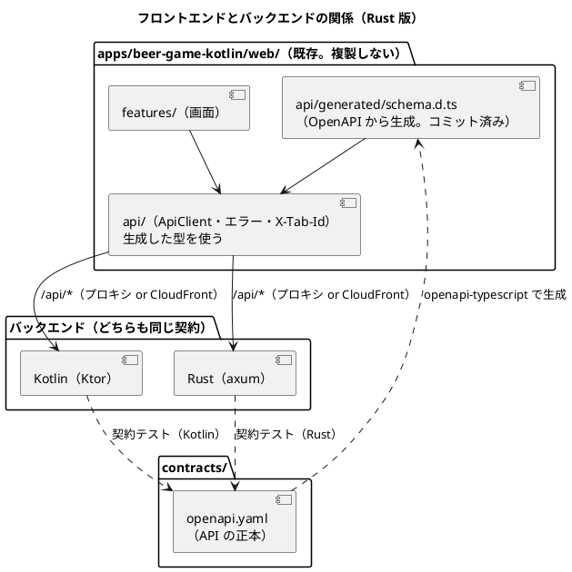

# フロントエンドアーキテクチャ - ビールゲームシミュレーション（Rust 版）

## 概要

本書は、beer-game-rust のフロントエンドのアーキテクチャを定めます。[ADR-001](../../adr/beer-game-rust/001-rust-version-of-beer-game-kotlin.md) の決定は、フロントエンドを**既存の React / TypeScript のまま踏襲する**ことです。**結論: API の契約（`openapi.yaml`、エラーの `code`、problem+json、`versions` だけの応答、`If-Match`）が同じなら、フロントエンドはバックエンドの言語に依存しないため、既存の `web/` をそのまま使えます。** `docs/` を設計の正本とします。

このため、本書は **フロントエンドの設計（構成、ルーティング、状態管理、API の契約、版の扱い、共同入力、エラーの識別子、アクセシビリティ）を複製しません。** 正本は [Kotlin 版のフロントエンドアーキテクチャ](../beer-game-kotlin/architecture-frontend.md)（beer-game2 を引き継ぎ、ES + CQRS の影響を反映済み）です。UI の画面・遷移は [UI 設計（Rust 版）](./ui-design.md) と同じく Kotlin 版を参照します。

本書が定めるのは、**Rust のバックエンドに向けるときの差分**と、**既存の `web/` の実体の調査結果**です。

### 本書の位置づけと確認の範囲

- **本書で確認したこと**: 既存の `apps/beer-game-kotlin/web/` を読み取り専用で調べ、**バックエンドへの結合点**を洗い出しました（2026-11-19。下の表）。コードは変更していません。
- **確認していないこと**: Rust のバックエンドに `web/` を向けたときの実際の動作は、**未検証**です（Rust 版のバックエンドがまだ存在しないため）。契約が同じであれば動く、という**設計上の見込み**にとどまります。
- Kotlin 版の実装の経緯（B1〜B15 の注記）は引き継ぎません。Kotlin 版の未決事項は、本書の未決事項に引き継ぎます。

## 既存の `web/` のバックエンドへの結合点（調査結果）

`apps/beer-game-kotlin/web/` を調べた結果、**Kotlin のバックエンドに結合している箇所は次の 4 つだけ**です。フロントエンドの画面コード（`src/`）は、`/api` への HTTP と、生成した型だけに依存しています。

| # | 結合点 | 内容（確認した実体） | Rust 版で必要な対応 |
| :--- | :--- | :--- | :--- |
| 1 | 開発時の接続先 | `vite.config.ts` が `/api` を `http://localhost:${API_PORT}` へプロキシする（`API_PORT` の既定は 3000、E2E は 3100）。接続先はポート番号の環境変数だけで、Kotlin に固有の値はない | **変更なし**。Rust のバックエンドを同じポートで起動すれば、そのまま接続できる |
| 2 | E2E のバックエンド起動の案内 | `support/hooks.mjs` は、バックエンドが**起動済みであること**を前提にし、起動していなければ、`cd apps/beer-game-kotlin && APP_ENV=local DB_KIND=h2 PORT=… ALLOWED_ORIGINS=… ./gradlew :app:run` という**案内の文言**を出して失敗する（実際の起動はしない） | **案内の文言だけが Kotlin 固有**。起動コマンドを差し替えられるようにする（設計判断 RF3） |
| 3 | 契約と受入条件の場所 | `package.json` の `api:lint`・`api:generate` は `../contracts/openapi.yaml`、`cucumber.mjs` は `../features/**/*.feature` を相対パスで参照する | **契約とフィーチャーファイルの共有方法を決める**（設計判断 RF1。Rust 版の `apps/beer-game-rust/` には現在 `.gitkeep` しかない） |
| 4 | パッケージ名 | `@beer-game-kotlin/web` | 共有するなら、名前の扱い（変更は構造の変更で確認が要る） |

**バックエンドが満たすべき契約の確認事項**（Rust のバックエンドが `web/` と動くための条件。調査で確認した実装の事実）:

| # | 確認した実装の事実 | Rust のバックエンドへの要求 |
| :--- | :--- | :--- |
| a | **`api/client.ts` は、すべての要求に `X-Tab-Id` ヘッダーを付ける**（`sessionStorage` に保存したタブごとの識別子。ADR-020） | バックエンドは、このヘッダーで資格の Cookie の名前（`bg_session_<id>`・`bg_recovery_<id>`）を決める。**ヘッダーなしは従来の名前のまま**（ADR-020 の提案）。**ADR-020 は Kotlin 版でも提案中だが、既存のフロントエンドはすでに送っている**ため、Rust 版でも扱う（無視すると、同じブラウザの複数タブで別の人として操作できない） |
| b | **`features/play/PlayPage.tsx` は、一定の間隔の自動更新（`PLAY_POLL_MS`）と、手動更新、保存・確定の応答の後の取得で更新する。`EventSource`・`useLiveSnapshot` は存在しない**（SSE は未実装） | Rust 版のバックエンドは、**SSE を実装しなくても、既存のフロントエンドは動く**。SSE は契約・非機能要件（NF-P2・NF-P4）にあるが、**フロントエンドが使い始めるまで優先度を下げられる**（未決事項。バックエンドアーキテクチャの SSE の設計は維持する） |
| c | 開発時は、Vite の中継を通すと、バックエンドが見る `Host` と `Origin` が一致せず、変更系の要求が 403 になる。バックエンドの Origin 検査を弱めず、`ALLOWED_ORIGINS=http://localhost:<UI のポート>` を指定する | Rust のバックエンドも、**同じ設定名（`ALLOWED_ORIGINS`）で Origin の許可リストを受け取る**（NF-S8）。環境変数の名前は、フロントエンドの開発手順と E2E に合わせて揃える（未決事項） |
| d | エラーの扱いは `problem+json` の `code` を辞書の鍵にする（`api/problems.ts`、`Record<ErrorCode, …>`） | [UI 設計（Rust 版）](./ui-design.md) の影響の表（#1〜#10）のとおり。**契約から外れた応答（axum の既定の拒否、tower の層のエラー）を、problem+json に統一する** |
| e | 型は `openapi-typescript` 7.13.0 で生成し、生成物 `src/api/generated/schema.d.ts` をコミットする。`api:check` が差分 0 を検査する | 仕様を変えるときは、**仕様 → 契約テスト（Rust 側。Red）→ 実装 → 型の再生成 → 画面**の順（Kotlin 版と同じ） |

## 決定の整理

Kotlin 版の決定を**そのまま引き継ぎます**（小規模・`features/` の機能単位の構造、SPA（React）、Vite でビルドし CloudFront から配信、URL ルーター、画面ごとのカスタムフックと `useState`（グローバルな状態ライブラリなし）、OpenAPI を正本とした型の生成、`ApiClient`、`problem+json` の `code` を鍵にした表示名の辞書、保存後は応答の `versions` を受けてスナップショットを取得、スタイルは CSS の設計トークン、アクセシビリティは WCAG 2.2 AA）。

**Rust 版で変わるのは、バックエンドの接続先と起動の案内だけ**です。

| 決定項目 | 採用 | Kotlin 版との違い |
| :--- | :--- | :--- |
| フロントエンドの実体 | **既存の `web/` を使う**（複製しない。設計判断 RF1） | 設計の正本の置き場所が違う（本書は参照） |
| 開発時の接続先 | `/api` を、Rust のバックエンド（`cargo run`）へプロキシする（`API_PORT`） | プロキシの先が Ktor から axum になるだけ |
| E2E のバックエンド | Rust のバックエンドを、専用のポート（3100）で起動して使う（UI は 5273）。**起動コマンドを差し替えられるようにする**（RF3） | 案内の文言が Gradle 固有 |
| API の契約 | `contracts/openapi.yaml` を**共有する**方針が第一候補（RF1）。契約テストは Rust で書く | Kotlin の契約テストの代わりに Rust の契約テスト |
| リアルタイム更新 | **既存どおり、自動更新（ポーリング）と手動更新**。SSE は未実装のまま | 変更なし（SSE のバックエンド側の設計は維持） |

## 全体構成

**同じフロントエンド・同じ契約・同じフィーチャーファイルを、2 つのバックエンドが満たす**構図です。これは、Rust 版のバックエンドが Kotlin 版と**契約として同等であること**を、既存の画面と E2E で確かめられるという利点があります（設計判断 RF2）。

### 開発と配信

| 項目 | 設計 |
| :--- | :--- |
| 開発 | Vite の開発サーバーが、`/api` を Rust のバックエンドへプロキシする（接続先は `API_PORT`。固定のポートを書かない）。バックエンドは `cargo run` で起動し、データベースは PostgreSQL（ローカルの DB は PostgreSQL 18（Docker。2026-11-19 決定）） |
| Origin の検査 | 中継を通すと Origin が一致しないため、`ALLOWED_ORIGINS=http://localhost:<UI のポート>` を指定する（上の確認事項 c）。バックエンドの Origin 検査は弱めない |
| 型の生成 | `contracts/openapi.yaml` から、`web/src/api/generated/schema.d.ts` へ生成する（`openapi-typescript`）。**生成物はコミットし、`api:check` で差分 0 を検査する**（Kotlin 版の運用を引き継ぐ） |
| 配信 | 静的ファイルを S3 へ版つきで配置し、CloudFront から配信する（[インフラストラクチャ](./architecture-infrastructure.md)）。**フロントエンドは、バックエンドのイメージに含めない**。**同じ `web/` のビルド成果物を、どちらのバックエンドの環境にも配置できる**（契約が同じ間） |
| E2E | Cucumber-JS + Playwright（Chromium）。Vite は 5273、バックエンドは 3100（人の開発サーバーの 3000・5173 は使わない）。前提の準備は実 API、操作は実ブラウザ。**フィーチャーファイルは `@ui` のものを共有する**（[テスト戦略](./test-strategy.md)） |
| ブラウザ行列 | 環境変数 `BROWSER`（chromium・firefox・webkit）で選ぶ（NF-U4）。既存のまま |

## API の契約

契約の置き場所と流れ（仕様を正本とし、型を生成し、実装を契約テストで検証する）、`ApiClient`（`Idempotency-Key` の付与、`If-Match` は `SaveDecision` だけ、`problem+json` の `code` の解釈、相関 ID）、**ストリームごとの版（`versions: { game, session }`）**、共同入力の扱い（`session.decision_conflict`・`session.week_advanced`・`session.decisions_changed`）、エラーの識別子と表示名（辞書の鍵は `code`）、状態の持ち方は、**Kotlin 版と同じ**です。Rust 版の差分は次のとおりです。

| 項目 | Rust 版 |
| :--- | :--- |
| 契約テスト | Kotlin 版は `app` の test（networknt `json-schema-validator`）。**Rust 版は Rust のテスト**（[テスト戦略](./test-strategy.md) の「API の契約テスト」。スキーマ検証の道具は未選定） |
| エラー `code` の一致 | 仕様の `code` の一覧と、Rust の `GameError::code()` などの全体を突き合わせる（欠けても余っても失敗）。**辞書（`Record<ErrorCode, …>`）が仕様の `code` を網羅することは、型検査で守られる**（既存） |
| 変更の手順 | **仕様 → 契約テスト（Rust。失敗）→ Rust の実装 → 型の再生成 → 画面**。契約を変えると、**Kotlin のバックエンドにも影響する**ため、両方の契約テストを通す（RF1） |

## リアルタイム更新の方式

**現在の `web/` は、SSE を使いません**（上の確認事項 b）。更新は、`PLAY_POLL_MS` の間隔の自動更新（黙って状態を取り直す）、手動更新、保存・確定の応答の後の取得（`catchUp`）です。**Rust 版も同じ**にします。

- **SSE の設計**（`state-version` の通知がストリームの種別と版を運ぶ、ストリームごとの版の比較、`useLiveSnapshot`、切断時のポーリング、`Last-Event-ID` による再生はしない）は、Kotlin 版の設計を維持し、**フロントエンドが SSE を使い始める時点**で実装する（バックエンドの SSE は [バックエンドアーキテクチャ](./architecture-backend.md) の設計どおり、axum の SSE を第一候補とする。未確認）。
- **NF-P2（週確定から全画面への反映。2026-11-23 に p95 4 秒以下へ再定義）・NF-P4（SSE が使えないときのポーリング）**: 現在の自動更新の間隔（`PLAY_POLL_MS`、3 秒）では、反映までの p95 は約 2.86 秒（B2・B16 の推定）で、再定義した 4 秒を満たす。旧目標の 2 秒は満たせなかった。
- 同期投影のため、取得したスナップショットの版は、応答の `versions` 以上であることが保証される（バックエンドの問い合わせの REPEATABLE READ と `projection_checkpoints` の同時読み取り）。この保証を **Rust 版のバックエンドも満たす**（統合テストの「問い合わせの一貫性」）。

## 品質属性への対応

Kotlin 版と同じです（アクセシビリティ、堅牢性（版比較・切断時のポーリング・競合時の入力の保持・契約の型による変更の検出）、セキュリティ（資格は JavaScript から読めない Cookie、CSP を前提にインラインのスクリプトを使わない）、観測性（エラー表示の相関 ID）、テスト容易性（`ApiClient` の差し替え、契約テスト））。**Rust 版の追加**: 契約テストは、**同じ契約を 2 つのバックエンド（Kotlin・Rust）が満たす**ことを、同じ `openapi.yaml` に対して検査する。

## テスト戦略との対応

画面は Testing Library、`ApiClient` と自動更新は単体テスト、利用の流れは Cucumber-JS + Playwright（`@ui`）と Playwright の E2E + axe で確認します（[テスト戦略](./test-strategy.md)）。加えて、次を確認します。

- **契約テスト（Rust 側）が、仕様と Rust の実装の一致を保証する**。
- 生成した型でフロントエンドをビルドし、仕様の変更による型エラーを検出する（CI の順序: 仕様の検証 → 型の生成 → 型の検査 → テスト）。
- **RF2: 既存の `@ui` のシナリオと E2E を、Rust のバックエンドに向けて通す**ことを、Rust 版の受入の一部にする。

## 設計判断

### RF1: フロントエンドは複製せず、既存の `web/` と契約・フィーチャーファイルを共有する（承認済み。2026-11-19）

| 案 | 内容 | 評価 |
| :--- | :--- | :--- |
| **A（採用）** | **既存の `apps/beer-game-kotlin/web/` を、そのまま使う**（移動も複製もしない）。Rust 版の CI・E2E は、`web/` を、Rust のバックエンドに向けて実行する。`contracts/openapi.yaml` と `features/` も、現在の場所を共有する | 追加の構造変更が要らない。画面と E2E が 1 か所で、食い違わない。Rust 版が Kotlin 版のディレクトリに依存する（Kotlin 版の変更が Rust 版に影響する） |
| B | `apps/beer-game-rust/web/` に**複製**する（契約・フィーチャーも複製） | Rust 版が自己完結する。画面・契約・E2E が二重になり、差分の管理が要る（UI 設計の RU1 と同じ問題） |
| C | `web/`・`contracts/`・`features/` を、**プロジェクトに属さない共通のディレクトリへ移す** | 正本が 1 つになり、依存の向きが自然になる。**ディレクトリ構造の大規模な変更**で、Kotlin 版のビルド・CI・手順書・文書の参照をすべて直す必要がある。**確認必須** |

トレードオフ: A は、**当面の変更を最小**にして、Rust のバックエンドを既存の画面と契約で検証できます。将来、2 つの版が分かれて進化する場合は、B（複製）または C（共通化）へ移行します（その時点で ADR に記録する）。**C が長期的には自然ですが、構造の変更のため、承認を得てから**にします。

### RF2: Rust のバックエンドの契約上の同等性を、既存の `@ui`・E2E で確かめる（承認済み。2026-11-19）

既存の画面コードと E2E は、API の契約にだけ依存しています（上の調査）。**同じ画面・同じ `@ui` のシナリオを、Rust のバックエンドに向けて通すことは、Rust 版が契約どおりであることの、最も強い検証の 1 つ**です。API の契約テスト（仕様との一致）は、仕様の記述の抜けを検出できない領域（スキーマで表せない条件、SSE）があるため、**画面を通した確認で補います**。

### RF3: E2E のバックエンドの起動を差し替えられるようにする（承認済み。2026-11-19）

`support/hooks.mjs` の案内の文言が Gradle に固有です。**起動コマンドの案内を、環境変数（例: `BACKEND_START_HINT`）または設定で差し替えられるようにする**（承認済み。2026-11-19）。実際の起動を自動化するかは別の判断で、現在の「起動済みを前提にし、起動していなければ案内して失敗する」方式を維持します（人の開発サーバーを止めない、専用のポートを使う、という既存の運用を守る）。**この変更は、既存のファイルの編集で、Kotlin 版の `web/` に影響するため、承認を得てから行います。**

## beer-game-kotlin からの変更

| # | beer-game-kotlin | beer-game-rust | 理由 |
| :--- | :--- | :--- | :--- |
| 1 | フロントエンドの設計を本文に持つ | **差分の文書**。本文は Kotlin 版を正本として参照（RF1） | 二重管理の回避 |
| 2 | プロキシの先は Ktor | Rust のバックエンド（`API_PORT` の同じ仕組み） | 契約が同じ |
| 3 | E2E の起動の案内は Gradle | 差し替え可能にする（RF3。承認済み。編集の実施前に改めて確認） | 案内の文言が言語に固有 |
| 4 | 契約テストは Kotlin | 契約テストは Rust | 言語の違い |
| 5 | （結合点の調査なし） | 既存の `web/` の結合点（4 件）と、バックエンドが満たすべき契約の確認事項（5 件）を整理 | Rust 版のバックエンドを既存の画面に向けるための前提の確認 |

**フロントエンドの構成・ルーティング・状態管理・API の契約・版・共同入力・エラーの識別子・アクセシビリティは変えません。**

## 未決事項

1. ~~**RF1 の承認**~~ **解消（2026-11-19）**: 承認した（案 A: Kotlin 版のディレクトリのまま共有。複製・共通化はしない）。
2. ~~**RF3 の承認**~~ **解消（2026-11-19）**: 承認した。ただし既存の `web/support/hooks.mjs` の編集は、**実際に行う前に改めて確認する**。
3. **環境変数の名前の揃え方**: Rust のバックエンドの設定名（`ALLOWED_ORIGINS`・`PORT`・`APP_ENV` など）を、Kotlin 版と揃えるか。揃えると、E2E の案内・手順書の差分が減る。`DB_KIND` は Rust 版にはない（H2 がない）。
4. ~~**ADR-020（タブごとの Cookie 名）**~~ **解消（2026-11-19）**: Rust 版のバックエンドでも扱うと決定した。
5. **SSE の優先度と NF-P2**（レビュー H5。**2026-11-21 に「B1 で測って決める」と承認**）: 現在のフロントエンドは SSE を使わず、3 秒間隔のポーリング。**ポーリングだけでは旧 NF-P2（p95 2 秒）を満たせない見込み**だった。B1・B2・B16 の実測（p95 約 2.86 秒）を受け、**目標を p95 4 秒以下に再定義することを 2026-11-23 に承認**した（SSE は作らず、既存の `web/` も変えない）。**tower のレート制限は、ポーリングの GET を対象外にする**（[UI 設計](./ui-design.md) の影響表 #12）。
6. **フロントエンドの Rust 版 CI の構成**: `web/` のジョブ（`npm run verify`、`api:check`、`@ui`）を、Rust 版のワークフローで、どのバックエンドに向けて実行するか（Kotlin 版のワークフローの `web`・`ui` ジョブとの重複）。
7. **Rust のバックエンドを既存の `web/` に向けた実際の動作**（RF2）: B1 以降で検証する。
8. **Kotlin 版の未決事項の引き継ぎ**: 表示名の辞書の形式（多言語化の要否）、設計トークンの管理とコントラスト比の自動検査、ルーターのライブラリ（現状は `react-router` 8.5.1）、防御的な再取得の要否、`useLiveSnapshot` の実装時期、アクセシビリティの自動検査（axe）・200% 拡大・スクリーンリーダーの確認、進行役のコンソールの未実装の機能。いずれも [Kotlin 版の未決事項](../beer-game-kotlin/architecture-frontend.md) に追従する。

## 出典

- [フロントエンドアーキテクチャ（beer-game-kotlin）](../beer-game-kotlin/architecture-frontend.md)、[beer-game2 のフロントエンドアーキテクチャ](../beer-game2/architecture-frontend.md)
- [ADR-001（Rust 版）](../../adr/beer-game-rust/001-rust-version-of-beer-game-kotlin.md)、[UI 設計](./ui-design.md)、[バックエンドアーキテクチャ](./architecture-backend.md)、[テスト戦略](./test-strategy.md)、[非機能要件](./non-functional.md)、[インフラストラクチャ](./architecture-infrastructure.md)
- 既存の `web/` の調査（読み取り専用、2026-11-19）: `apps/beer-game-kotlin/web/` の `package.json`、`vite.config.ts`、`cucumber.mjs`、`support/hooks.mjs`、`src/api/client.ts`、`src/features/play/PlayPage.tsx`
- [アーキテクチャ設計ガイド](../../reference/アーキテクチャ設計ガイド.md)
- [ADR-006](../../adr/beer-game2/006-sse-version-only.md)、[ADR-010](../../adr/beer-game2/010-url-router-and-features.md)
