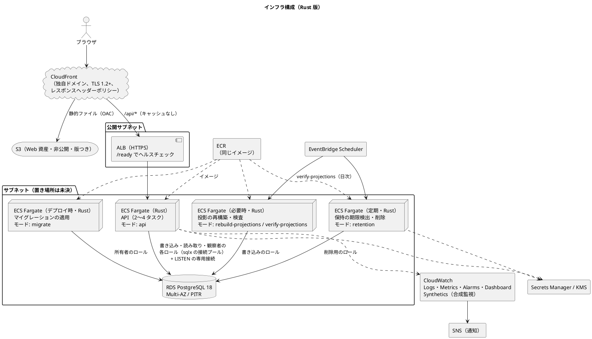
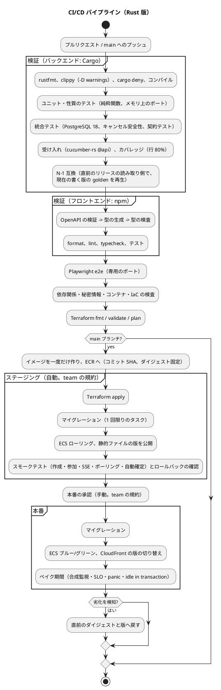

# インフラストラクチャアーキテクチャ - ビールゲームシミュレーション（Rust 版）

## 概要

本書は、beer-game-rust の実行環境と配信の構成を定義します。[ADR-001](../../adr/beer-game-rust/001-rust-version-of-beer-game-kotlin.md) により、[beer-game-kotlin のインフラ](../beer-game-kotlin/architecture-infrastructure.md)（beer-game2 の構成を踏襲）を**正本として引き継ぎ**、Rust で変わる点だけを定めます。**`docs/` を設計の正本**とします。実装コードも、インフラのコードも、まだ存在しません。

引き継ぐ構成は、CloudFront の単一オリジン（静的ファイルは S3、`/api/*` は ALB）、ECS Fargate、RDS for PostgreSQL 18、ECR、Terraform（リモートの状態・環境ごとに分離・モジュール化）、GitHub Actions の OIDC、ステージング自動・本番承認とブルー/グリーン、構造化ログとメトリクス（EMF）、合成監視、アラームです。**非同期・キューは使いません**（Kotlin 版と同じ）。

変わるのは、次の点です。

- **コンテナと起動**: JVM のイメージから、**Rust の単一バイナリ**のイメージへ。実行イメージの選択、ヘルスチェックの方法、起動モードと終了コード。
- **ビルドと CI**: Gradle から Cargo へ（ツールチェーンの固定、`--locked`、キャッシュ）。
- **メモリ・終了・起動時間**: ヒープ・GC・ウォームアップの前提がなくなる。SIGTERM で完了を待って正常終了する（NF-R18）。
- **データベースの接続**: sqlx の接続プール。ロールを用途別に分けるのは同じ。
- ローカル開発の DB は**未決**（H2 を持たない）。

### 本書の位置づけと確認の範囲

- **本書で確認したこと**: ローカルの環境を調べ、**Rust 版のコンテナのビルドと実行は、ここでは検証できない**ことを確認しました（2026-11-19）。ローカルの Rust のホストは `x86_64-apple-darwin` のみで、Linux 向けのターゲットも、クロスコンパイルの道具（`cross`・`cargo-zigbuild`・`zig`）もありません。Docker は動きますが（`linux/x86_64`）、`rust` のイメージも Rust 向けの軽量ベース（`distroless` など）もローカルにありません。PostgreSQL 18.6 のイメージはあり、データモデル・運用要件の実測に使いました。
- **確認していないこと**: 本書のコンテナ、起動モード、SIGTERM の振る舞い、起動時間、メモリ、Terraform、CI/CD は、**すべて未実装・未検証**です。ベースイメージの実在、バイナリの動的／静的リンク、実行イメージに必要なライブラリは**未確認**で、B1 で確かめます。
- **引き継ぐ値**: Terraform・AWS プロバイダー・PostgreSQL・Node の版は、Kotlin 版が確認した値を引き継ぎ、**本書では再確認していません**。
- Kotlin 版の実装の経緯（B2・B3・B14 の注記）は引き継ぎません。Kotlin 版の未決事項は、本書の未決事項に引き継ぎます。

## 確認したバージョン

| 区分 | 技術 | 版 | 出典・備考 |
| :--- | :--- | :--- | :--- |
| 言語 | Rust | **1.97.1**（2026-07-14） | ローカルの `rustc --version`（2026-11-19）。Rust は LTS を持たず、最新の安定版だけがサポートされる（[技術スタック](./tech-stack.md)） |
| ビルド | Cargo（ワークスペース） | Rust に同梱 | `rust-toolchain.toml` で固定、`Cargo.lock` をコミットし `--locked` で実行 |
| Web・非同期・DB | axum 0.8.9、tokio 1.54.1、sqlx 0.9.1 | 同左 | `cargo search`（2026-11-19）。詳細は [技術スタック](./tech-stack.md) |
| IaC | Terraform / AWS プロバイダー | Kotlin 版の値（作業用 1.17.2、`required_version >= 1.17.0`、`~> 6.0`）を引き継ぐ | **再確認していない** |
| データベース | PostgreSQL 18（RDS） | 18 | **再確認していない**（Kotlin 版の確認値）。ローカルの検証は 18.6 |
| フロントエンドのビルド | Node 26 | Kotlin 版・beer-game2 の値 | **再確認していない** |
| コンテナのイメージ | ビルド用・実行用 | **未確認**（下の「イメージ」） | Docker Hub などでの実在を B1 で確認する |

## 決定の整理

Kotlin 版から変更する点を太字で示します。

| 決定項目 | 採用 | Kotlin 版との違い・根拠 |
| :--- | :--- | :--- |
| クラウド・デプロイ形態・配信・データベース・非同期 | AWS（`ap-northeast-1`）、ECS Fargate、CloudFront の単一オリジン、RDS PostgreSQL 18、キューなし | 変更なし |
| 定期処理 | EventBridge による ECS タスク。**同じイメージの別の起動引数**で起動する | 変更なし |
| **イメージ** | **ECR。Rust の単一バイナリを、軽量な実行イメージに載せる。マルチステージ**（設計判断 RI1） | JVM のイメージから変更 |
| **実行環境** | **ネイティブの単一プロセス。SIGTERM で完了を待って正常終了（終了コード 0）。ヘルスチェックはバイナリのサブコマンド** | JVM のヒープ・GC・ウォームアップ・終了コード 143 の扱いがなくなる |
| 秘密情報 | Secrets Manager（鍵の版を複数保持）、KMS。ロールごとに別の DB の接続情報 | 変更なし |
| IaC | Terraform。**Rust 版の環境の置き方は未決**（設計判断 RI5） | team の規約は beer-game3 専用の環境 |
| **ビルド** | **Cargo（`rust-toolchain.toml`、`Cargo.lock`、`--locked`）** | Gradle から変更。フロントエンドは npm のまま |
| CI/CD | GitHub Actions（OIDC）。ステージングは自動、本番は承認 + ブルー/グリーン。**ワークフローは beer-game3 用とは別に新設**（team の規約） | 検証の手順が Cargo になる |
| 観測 | 構造化ログ、メトリクス（EMF）、合成監視、アラーム、ダッシュボード | **JVM の指標が RSS・タスク数・panic・取り残しに変わる**（[運用要件](./operation.md)） |

## 全体構成



### 構成要素

CloudFront、S3（Web）、ALB、保持の定期タスク、RDS、ECR、ネットワーク、観測の基本は、[Kotlin 版](../beer-game-kotlin/architecture-infrastructure.md) と同じです。**変更する要素**を示します。

| 要素 | 設定 |
| :--- | :--- |
| ALB | HTTPS、アイドルタイムアウト 60 秒、ヘルスチェックは `/api/v1/ready`（Kotlin 版の実装のパス。契約を共有する）。**ヘルスチェックの猶予期間は、Rust の起動時間の実測で決める**（JVM の見込みは引き継がない） |
| API サービス | Fargate、常時 2 タスク、CPU 60% で 2〜4 に自動増減。ステートレス。本番はブルー/グリーン、ステージングはローリング。**タスクのサイズの初期案は 1 vCPU / 2 GiB（Kotlin 版と同じ）。実測の前に小さくしない**（設計判断 RI2） |
| 保持・マイグレーション・再構築・検査のタスク | **同じイメージ**を、起動引数（`retention`、`migrate`、`rebuild-projections`、`verify-projections`）で切り替える。保持は EventBridge で 5 分ごと、検査は日次、マイグレーションはデプロイの一部（アプリの起動前）に 1 回限り、再構築は運用者が必要なときに起動する（研修中は、運営者を通じて進行役に「停止」を依頼し、停止中に再構築して再開する。[運用要件](./operation.md)） |
| 秘密情報 | DB の接続情報を、**ロールごとに別の秘密**として持つ。資格の鍵（複数の版）、応答の暗号鍵は変更なし。実行ロールには、そのタスクに必要な秘密の参照権限だけを与える |
| 観測 | JSON ログとメトリクス（EMF）は標準出力へ出し、コンテナのログドライバが CloudWatch Logs へ送る。**RSS・タスク数・接続プールの待ち・panic の件数・`idle in transaction` の件数**のアラームを加える（運用要件） |

### データベースのロールと接続

ロールの定義と権限は [データモデル](./data-model.md) の 5 ロール（`beergame_writer`・`beergame_reader`・`beergame_observer`・`beergame_deleter`・所有者）と同じです。**追記専用の権限と連鎖削除は、PostgreSQL 18.6 で実測済み**です（1 回）。

| ロール | 使うタスク | 接続の持ち方（Rust 版） |
| :--- | :--- | :--- |
| 書き込み | api（コマンド）、rebuild-projections | sqlx の `PgPool`。トランザクション単位。**アプリのロールに `idle_in_transaction_session_timeout` を設定**（[運用要件](./operation.md) の障害パターン 17。実測済み） |
| 読み取り | api（問い合わせ） | 別の `PgPool` |
| 観察者の読み取り | api（観察者の問い合わせ） | **別の `PgPool`**（`beergame_observer` で接続。3 表だけ読める） |
| 通知の受信 | api | **プールの外の専用の接続**（1 タスクにつき 1 本。`LISTEN` 用。sqlx での扱いは未確認） |
| 削除 | retention | 小さな `PgPool` |
| 所有者 | migrate | 1 回限りの接続 |

**接続数の見積もり**: タスク数 × （書き込み + 読み取り + 観察者の各プールの最大 + 通知 1 本）+ 運用のタスク。この合計が RDS のインスタンスの接続数の上限を超えないことを、タスクの最大数（4）で確認します。**プールの大きさは負荷試験で決めます**（未決）。接続を集約するプロキシや接続プーラーは、`LISTEN` が動かない可能性があるため、置きません（Kotlin 版と同じ）。

**TLS**: RDS への接続は、証明書の検証つきの TLS を使う方針です。**sqlx の TLS の実装（rustls か OpenSSL か）と、RDS の CA バンドルの配置は未決**で、実行イメージの選択（下の RI1）に影響します。

## 環境

| 環境 | 用途 | デプロイ | Terraform の状態 |
| :--- | :--- | :--- | :--- |
| ローカル | 開発・確認 | バックエンドは `cargo run`、フロントエンドは Vite（`/api` をプロキシ）。**DB は未決**（[技術スタックの未決事項](./tech-stack.md#未決事項) の 1。**PostgreSQL（Docker など）を推奨**） | — |
| CI | 検証 | GitHub Actions（PostgreSQL 18 のサービスコンテナと testcontainers）。統合テストと受け入れ（`@api`）は PostgreSQL | — |
| ステージング | 本番前の確認 | **`main` への merge で自動**（ローリング。team の規約）。PostgreSQL（RDS） | 専用 |
| 本番 | 運用 | **手動の承認後**（ブルー/グリーン。team の規約）。PostgreSQL（RDS） | 専用 |

各環境の Terraform の状態は、暗号化したリモートの保管先（S3 とロック）に、環境ごとに分けて持ちます（Kotlin 版と同じ）。**H2 がないため、Kotlin 版の「本番・ステージングで H2 を拒否する起動時の検査」は、ローカルの DB に別の軽量 DB を採る場合にだけ必要**です（PostgreSQL を採れば不要）。

## コンテナ

### イメージ（設計判断 RI1）

```text
FROM（ビルド）  rust:<1.97.1 系>            … cargo build --release --locked（ツールチェーンは rust-toolchain.toml で固定）
FROM（実行）    <軽量な実行イメージ>         … バイナリ 1 つと、必要最小限のファイルだけ
                USER <非 root の数値の UID>
                ENTRYPOINT [ "/app/beergame" ]  CMD [ "api" ]     … api / retention / migrate / rebuild-projections / verify-projections / healthcheck
```

- **マルチステージ**にし、実行用のイメージには、バイナリと必要最小限のファイル（証明書の束、RDS の CA バンドル）だけを含めます。ビルドの道具（Rust のツールチェーン、ソース）を含めません。
- **依存のビルドを別の層**にして、アプリだけの変更で層のキャッシュが効くようにします（`Cargo.toml`・`Cargo.lock` だけを先にコピーしてビルドする方法など。**`cargo-chef` のような道具は未選定で、導入は承認が要る**）。
- 実行は**非 root のユーザー**（数値の UID）。ファイルシステムは読み取り専用を目指します。
- イメージのタグは、コミット SHA（ECR の不変のタグ）。以降はダイジェストで固定します（Kotlin 版と同じ）。
- **H2 のような「本番に含めない依存」は無い**ので、Kotlin 版の「配布から H2 を除外する」作業は不要です。

**実行イメージの候補**（**どれも実在・動作を未確認**。B1 で確認して決める）:

| 案 | 内容 | 長所 | 短所 |
| :--- | :--- | :--- | :--- |
| **A（提案）** | glibc を含む最小のイメージ（`distroless` の `cc` など）に、動的リンクのバイナリを載せる | 小さい。シェルがなく攻撃面が小さい。標準の Rust のビルドのまま | シェルがないので、**ヘルスチェックはバイナリのサブコマンドで行う**（下記）。運用時にコンテナ内で調査しにくい |
| B | `debian-slim` に、動的リンクのバイナリを載せる | シェルがあり調査しやすい。OpenSSL の利用が容易 | A より大きく、脆弱性の対象が増える |
| C | `scratch` に、静的リンク（musl）のバイナリを載せる | 最小。依存がない | musl のビルドの設定（OpenSSL を避ける）が要る。DNS・証明書の束を自前で持つ。メモリの確保の性能が glibc と異なりうる |
| D | `alpine` に、musl のバイナリを載せる | 小さく、シェルがある | musl の差異。C と同様 |

**ヘルスチェックの実装（RI3）**: Kotlin 版は、実行イメージに `curl` も `wget` もないため、`bash` の `/dev/tcp` で `/api/v1/ready` に GET を送りました。Rust 版は、案 A・C ではシェルがないので、**バイナリに `healthcheck` サブコマンドを持たせ**、`HEALTHCHECK CMD ["/app/beergame", "healthcheck"]` で `/api/v1/ready` を呼び、200 のときだけ終了コード 0 とします（interval 30s、timeout 3s、start-period は起動時間の実測で決める。retries 3）。

### 起動モードと終了コード

同じイメージを、`CMD`（引数）のモードで切り替えます（**Kotlin 版と同じモードと終了コード**。API の契約と運用手順書を揃えるため）。

| モード | 動作 | 終了 |
| :--- | :--- | :--- |
| `api` | 常駐。SIGTERM で**完了を待って正常終了**（下記） | SIGTERM で **0**（目標。Kotlin 版は 143） |
| `migrate` | マイグレーションを適用して終了 | 成功で 0 |
| `retention` | 保持削除の掃引を 1 回行って終了 | 放棄したゲームがあれば 1、掃引の失敗は 70 |
| `rebuild-projections [ゲーム ID ...]` | 投影を `events` から作り直す | 再構築できなかったゲームがあれば 1、ゲームの一覧を読めなければ 70、形が不正なゲーム ID は 64 |
| `verify-projections` | 投影が、イベントから作り直した結果と一致するかを検査する（日次。投影は変えない） | 不一致があれば 1 |
| `healthcheck` | `/api/v1/ready` を呼ぶ（**Rust 版で追加**） | 200 なら 0、それ以外は 1 |
| 不明なモード | 使い方を示す | 64 |

| 終了コード | 意味（sysexits の慣例に沿う） |
| :--- | :--- |
| 0 | 1 回限りの処理の成功、api の SIGTERM による正常終了 |
| 1 | 放棄・再構築の失敗・投影の不一致・`healthcheck` の失敗 |
| 64 | 使い方の誤り |
| 70 | 起動の失敗（ほか） |
| 78 | 設定の誤り（秘密が無い、ほか）。足りない設定の**名前だけ**をログに出す |

### メモリ・CPU・起動（設計判断 RI2）

| 項目 | 設計 |
| :--- | :--- |
| ヒープ・GC | **存在しない**。JVM の `MaxRAMPercentage`・`ExitOnOutOfMemoryError` に当たる設定はない。メモリ不足は OOM kill として現れ、ECS が再起動する（運用要件の障害パターン 15） |
| タスクのサイズ | 初期案は **1 vCPU / 2 GiB（Kotlin 版と同じ）**。**Rust は小さくできる見込みだが、実測の前に小さくしない**（RN1 と同じ方針）。負荷試験で RSS・タスク数・接続プールの待ちを測り、**十分な余裕を残した上で縮める** |
| CPU | JIT のコンパイルによる起動直後の CPU の高まりはない。自動増減のクールダウンは、JVM のような「起動直後の CPU の高まりを誤解しない」目的では不要だが、**値は実測で決める**（初期値は設ける） |
| 起動の短縮 | AppCDS のような仕組みは不要。ネイティブコンパイル済みのため、起動は短い見込みだが、**実測する**（NF-P16。上限 p95 30 秒を維持し、実測で縮める） |
| ログ | 標準出力（構造化 JSON）。panic も記録する |

### 起動と終了

| 局面 | 設計 |
| :--- | :--- |
| 起動 | 設定を読み込み、検証する（`AppConfig::load`。失敗なら起動しない。終了コード 78）→ 接続プールを作る → 通知の受信を始める → HTTP の受付を始める。`/ready` は、**データベースの接続、通知の受信の接続の生存、スキーマの版が期待と一致すること**が確認できるまで、503（`app.not_ready`）を返す。起動のたびに投影の再構築はしない |
| マイグレーションとの順序 | マイグレーションのタスクが完了してから、アプリのタスクを起動する（デプロイの手順で保証）。アプリは起動時に、期待するスキーマの版が適用済みかを確認し、未適用なら準備できていない |
| 終了（NF-R18） | ECS は、タスクの停止時に SIGTERM を送り、一定の時間（`stopTimeout`）の後に強制終了する。アプリは SIGTERM で、**新しい要求の受付を止め、進行中のコマンドの完了を待ち（待ちの上限は `stopTimeout` より短く）、SSE の接続を閉じ、接続プールを閉じ、終了コード 0 で終わる**。クライアントは、SSE が切れても再接続し、スナップショットを取得して追いつく。**実現は B1 で確認**（[バックエンドアーキテクチャ](./architecture-backend.md) の RB2、未決事項） |
| 負荷分散との整合 | ALB のターゲットの登録解除の遅延（deregistration delay）と、アプリの終了の待ちを整合させる。長い SSE の接続は、猶予の後に切られてよい |
| 1 回限りの処理 | 正常終了は終了コード 0、失敗は 0 以外。失敗は CloudWatch のアラームで通知する |

**SIGTERM の終了コード**: Kotlin 版は、JVM が停止フックを実行して終わるため 143 で、「正常とみなす条件」が人の判断待ちでした。Rust 版は、シグナルを自分で処理して正常終了できるため、**終了コード 0 を目標**とし、アラームの扱いの問題をなくします（実装は未確認）。

## ビルド（Cargo）

| 項目 | 設計 |
| :--- | :--- |
| 構成 | Cargo のワークスペース（`domain`、`application`、`adapter-http`、`adapter-persistence`、`app`。[バックエンドアーキテクチャ](./architecture-backend.md)） |
| 版の管理 | **`[workspace.dependencies]`** に、依存の版を 1 か所だけ書く。`rust-toolchain.toml` でツールチェーンを固定する。`Cargo.lock` をコミットし、`--locked` で実行する |
| 依存の検査 | `cargo deny check`（ライセンス・脆弱性・重複）。チェックサムの検証は Cargo が標準で行う |
| 警告 | `-D warnings`（CI）。clippy と rustfmt を CI で必須にする（team の規約） |
| テスト | `cargo test`（ユニット・性質）と、**統合テスト**（実際の PostgreSQL 18。追記専用の権限、連鎖削除の網羅、複数プロセスの競合、キャンセル安全性）を分ける（[テスト戦略](./test-strategy.md)） |
| 成果物 | `app` の release ビルドのバイナリ 1 つ。**release のプロファイルの設定（`lto`、`codegen-units`、`panic` の方針など）は、ビルドの時間・サイズ・性能を測ってから決める**（未決）。**`panic = "abort"` にするかは、panic の扱い（NF-R18、運用要件）と関わるため、慎重に決める**（`abort` だと、spawn したタスクの panic を `JoinError` として捕捉できず、プロセスが落ちる） |
| フロントエンド | `web/` は npm（Node 26）でビルドし、Cargo のビルドとは独立。仕様から型を生成する手順を、ビルドの前に置く |

**Rust のビルド時間**: 初回のビルドは長い見込みで、**CI の時間とキャッシュの方式が課題**です（[テスト戦略](./test-strategy.md)）。キャッシュの道具（`Swatinem/rust-cache` のようなアクションや `sccache`）は**未選定で、導入は承認が要る**（アクションは SHA で固定する方針）。

## CI/CD



- **ワークフローは beer-game3 用とは別に新設**します（`.github/workflows/beer-game-rust.yml` ほか。未作成）。**既存の文書公開は `main` push、コンテナ公開は tag または手動実行という現在の経路は維持**します（team の規約）。
- ジョブの分割の方針は Kotlin 版と同じです（`contract`、`test`（fmt・clippy・test・統合・受け入れ・カバレッジ）、`deny`、`web`、`ui`、`container`、`n1`）。**Rust のジョブの実行時間（初回のビルド）は未確認**で、`timeout-minutes` は実測してから決めます。
- CI は、GitHub Actions の **OIDC** で、環境ごとの最小権限のロールを引き受ける（長期のアクセスキーを置かない）。アクションの版は、コミット SHA で固定する。
- **コンテナのスモークテスト**（Kotlin 版の `container-smoke.sh` に相当）: イメージをビルド・起動し、`/api/v1/ready` と `/api/v1/health` が 200、HEALTHCHECK が healthy、migrate が終了コード 0、秘密無しは 78、未実装モードは 64、非 root、SIGTERM で終了コード 0（目標）を確認する。**H2 に関する項目はない。**
- ステージングで承認した**同じイメージのダイジェスト**を、本番へ昇格させる。スキーマの変更は拡張 → 互換 → 縮小。**イベントは書き換えない**。投影の形の変更は、マイグレーションの後に投影の再構築で埋める。
- デプロイ・ロールバックの流れ（ビルド → ECR → タスク定義の登録 → migrate（終了コード 0 でなければ中止）→ api の更新 → 静的ファイル → スモークテスト → 履歴の記録。失敗時は直前の版へ自動で戻す。ロールバックは履歴から選び、`confirm_compatible` を必須入力）は Kotlin 版と同じ設計です（[運用要件](./operation.md)）。
- 依存関係の検査は **`cargo-deny`**（Kotlin 版の「JVM の依存関係の検査ツールの選定」は不要）。秘密情報・コンテナ・IaC の検査は beer-game2 のツールの方針（gitleaks、Trivy、Checkov または同等のもの）を引き継ぐ。

### Terraform の構成（設計判断 RI5）

Kotlin 版は、`apps/beer-game-kotlin/infra/` に 8 モジュール（`network`・`rds`・`ecr`・`secrets`・`alb`・`web`・`ecs`・`github_oidc`）と 2 環境（`staging`・`production`）を持ちます。Rust 版の置き方は、**team の規約が「AWS 環境も beer-game3 専用」**としていることもあり、未決です。

| 案 | 内容 | 評価 |
| :--- | :--- | :--- |
| **A（提案）** | Rust 版専用に、`apps/beer-game-rust/infra/` を用意し、Kotlin 版のモジュールを**複製して**出発する。状態・環境・リソースを Rust 版専用にする | 他の版と独立に変更・破棄できる。複製による差分の管理が要る |
| B | Kotlin 版のモジュールを共有モジュールに切り出し、両方から使う | 重複がない。共有モジュールの変更が両方に影響し、**構造の変更で確認が要る** |
| C | 同じ環境（同じ RDS・ECS クラスタ）に Rust 版を同居させる | コストが小さい。版ごとの独立性・障害の分離が弱い。同じスキーマの DB を共有できない（`events` の互換が崩れる） |

**AWS への適用は、確認必須の別のゲート**（本番環境・費用・アカウント・IAM に関わる）です。**本書の段階では、適用しません。**

## 品質属性への対応

| 品質属性 | 対応する設計 |
| :--- | :--- |
| 可用性 | API 2 タスク以上、RDS Multi-AZ、`/ready` のヘルスチェック、最小正常率 100% のローリング、ブルー/グリーン、**SIGTERM での完了待ちと正常終了** |
| スケーラビリティ | CPU ベースの自動増減（2〜4）。状態を持たない API。接続数の上限を、タスクの最大数で確認 |
| セキュリティ | 非 root、シェルのない実行イメージ（案 A）、**データベースのロールの分離**、`unsafe` を使わないドメイン（NF-S22）、依存関係の検査（`cargo-deny`） |
| 運用性 | Terraform、構造化ログ、メトリクス（Rust ランタイムと ES の指標）、合成監視、アラーム、ロールバック、復元の訓練、投影の再構築のタスク |
| コスト | Fargate の最小構成、月次の予算通知。**メモリの使用量は JVM より小さい見込みだが、実測の前にタスクのサイズを小さくしない** |

## beer-game-kotlin からの変更

| # | beer-game-kotlin | beer-game-rust | 理由 |
| :--- | :--- | :--- | :--- |
| 1 | `eclipse-temurin:25-jdk-noble`（ビルド）と `25-jre-noble`（実行）。依存の JAR とアプリの JAR を別の層に | Rust のビルドイメージと、軽量な実行イメージに単一バイナリ。依存のビルドを別の層に（実行イメージは未決。RI1） | 言語・ランタイムの違い |
| 2 | Gradle、バージョンカタログ、ラッパーの固定 | Cargo、`[workspace.dependencies]`、`rust-toolchain.toml`、`Cargo.lock`、`--locked` | 同上 |
| 3 | `JAVA_OPTS`（`MaxRAMPercentage`、`ExitOnOutOfMemoryError`） | なし（OOM は kill として現れる） | GC・ヒープがない |
| 4 | HEALTHCHECK は `bash` の `/dev/tcp`（イメージに `curl`・`wget` がない） | バイナリの `healthcheck` サブコマンド（RI3） | シェルのないイメージに対応 |
| 5 | SIGTERM のコンテナの終了コードは 143（人の判断待ち） | 完了を待って終了コード 0 を目標 | シグナルを自分で処理できる |
| 6 | H2 を配布から除外。本番・ステージングで H2 を起動時に拒否。環境の種別 `APP_ENV` の検査 | 不要（H2 がない）。ローカルの DB が別の軽量 DB の場合だけ必要 | H2 がない |
| 7 | タスクのサイズ 1 vCPU / 2 GiB、JVM の起動の遅さを見込む | 同じサイズを初期案とし、実測してから縮める。起動の遅さは実測する | 実測の前に変えない |
| 8 | 起動モード 5 つ | 6 つ（`healthcheck` を追加） | RI3 |
| 9 | detekt・PMD・ktlint の検証ジョブ（detekt は JDK 21 の専用ジョブ） | rustfmt・clippy・`cargo deny`。ツールチェーンは 1 つ | ツールの違い |
| 10 | Flyway（ベンダー別の配置） | sqlx のマイグレーション（1 系統） | ツールの違い |
| 11 | 依存関係の検査ツールは「JVM に対応するもの」を選定（未決） | `cargo-deny` | R4 で選定済み |
| 12 | Terraform は Kotlin 版専用の `infra/` | Rust 版の置き方は未決（RI5）。team の規約は beer-game3 専用の AWS 環境 | 規約と実態の差 |

上記以外（CloudFront、S3、ALB、RDS、ECR、EventBridge、Secrets Manager、観測の基本、OIDC、ステージング自動・本番承認、ブルー/グリーン、データベースのロール、`LISTEN` の専用接続、接続数の見積もり）は変えません。

## 設計判断

### RI1: 実行イメージは、軽量な最小イメージに単一バイナリを載せる

上の候補（A〜D）のとおりです。**提案は A**（glibc を含む最小のイメージ。シェルなし）です。理由は、攻撃面が小さく、標準の Rust のビルドのまま使えるためです。**ただし、実在・動作・必要なライブラリ（OpenSSL を使う場合）は未確認**で、sqlx の TLS の実装（rustls か OpenSSL か）によって選択が変わります。B1 で、実際にビルド・起動して確認し、決めます。

### RI2: タスクのサイズは、実測の前に小さくしない

初期案は Kotlin 版と同じ 1 vCPU / 2 GiB です。Rust のバイナリはメモリの使用量が小さい見込みですが、**実測がない**ため、RN1 と同じ方針（実測前に厳しくも緩くもしない）にします。負荷試験（NF-C1: 15 ゲーム・75 の SSE 接続）で、RSS（NF-P17: 上限の 70% 以下）・タスク数・接続プールの待ちを測り、余裕を残して縮めます。**縮めた値は、運用要件の RSS の閾値とあわせて見直します。**

### RI3: ヘルスチェックはバイナリのサブコマンドで行う

実行イメージにシェルも `curl` もない（案 A・C）ため、`healthcheck` サブコマンドを持たせます。代替は、シェルのあるイメージ（案 B）で `bash` の `/dev/tcp` を使う方法（Kotlin 版と同じ）です。サブコマンドは、イメージの選択に依存せず、テストもできる（[テスト戦略](./test-strategy.md)）ため、提案とします。

### RI4: SIGTERM では完了を待って終了コード 0 で終わる

NF-R18 の要件です。待ちの上限は `stopTimeout` より短く設定します。**終了コード 0 にすることで、Kotlin 版の「143 を正常とみなすか」の未決を設計で解消**します。実現（tokio のシグナル処理、axum の graceful shutdown、spawn したタスクの完了待ち）は B1 で確認します。

### RI5: Terraform は Rust 版専用に複製して出発する

上の案 A（提案）です。**AWS への適用は別のゲート**で、本書は適用を含みません。

## 前提と見直しの条件

- 常時 2 タスクで足りる前提: 同時に進行するゲームが少数。負荷試験で確認する。
- **ネイティブコンパイルの利点（起動が短く、メモリが小さい）が実測で確認できない場合**は、タスクのサイズを縮めない（RI2）。
- キューを再導入する条件、非同期投影へ移す条件、WAF の導入の条件は、Kotlin 版と同じ。

## 未決事項

1. **実行イメージの選択と実在の確認**（RI1）: ベースイメージのタグ、動的／静的リンク、必要なライブラリ。sqlx の TLS の実装（rustls か OpenSSL か）と RDS の CA バンドル。B1 で、実際にビルドして確認する。
2. **ヘルスチェックのサブコマンド**（RI3）の承認。
3. **AWS 環境と Terraform の置き方**（RI5）: 専用か共有か。team の規約との整合。**AWS への適用の判断・費用・アカウント・IAM**。
4. **SIGTERM の完了待ちの実現と終了コード 0**（RI4）、`stopTimeout`・ALB の登録解除の遅延との整合。
5. **release プロファイルの設定**（`lto`、`codegen-units`、`panic`）。`panic = "abort"` の採否（panic の扱いと関わる）。
6. **Rust のビルドキャッシュの方式**と、CI の `timeout-minutes`（実測してから）。`cargo-chef`・`rust-cache`・`sccache` の導入は承認が要る。
7. **タスクのサイズ、接続プールの大きさ、ヘルスチェックの猶予期間、自動増減のクールダウン**（負荷試験・Fargate での実測で決める。RI2）。
8. **ローカル開発の DB**（[技術スタック](./tech-stack.md) の未決事項 1）。
9. **コンテナのビルド・実行の検証環境**: ローカルには Linux 向けのターゲットも Rust のイメージもない。CI で検証するか、`rust` のイメージを取得して検証するか（イメージの取得は外部へのアクセスを伴う）。
10. **Kotlin 版の未決事項の引き継ぎ**: ECS の置き場所（公開サブネットと NAT・VPC エンドポイントの費用）、KMS の顧客管理鍵、DB ログインロールの分離とマイグレーション用ユーザーの作り方、状態のロック方式、Terraform の IAM とワークフローの突合、初回の適用の順序、業務のスモークテスト、RDS の CA バンドルと `sslmode`、CloudFront の CSP と SSE のオリジン待ち時間、履歴バケットのポリシー、秘密が Terraform の状態に入ること、ステージングと本番の ECR が同一アカウントであること、アクションの SHA 固定と各検査ツール（`actionlint`・`shellcheck`・`tflint`・`checkov`）、独自ドメインと DNS、合成監視の費用と頻度、アカウントの分離、ブルー/グリーンの方式。いずれも [Kotlin 版の未決事項](../beer-game-kotlin/architecture-infrastructure.md) に追従する。

## 出典

- [インフラストラクチャアーキテクチャ（beer-game-kotlin）](../beer-game-kotlin/architecture-infrastructure.md)、[beer-game2 のインフラストラクチャアーキテクチャ](../beer-game2/architecture-infrastructure.md)
- [ADR-001（Rust 版）](../../adr/beer-game-rust/001-rust-version-of-beer-game-kotlin.md)、[技術スタック](./tech-stack.md)、[バックエンドアーキテクチャ](./architecture-backend.md)、[データモデル](./data-model.md)、[テスト戦略](./test-strategy.md)、[非機能要件](./non-functional.md)、[運用要件](./operation.md)
- ローカル環境の調査: `rustc -vV`、`rustup target list --installed`、`docker info`、`docker images`（2026-11-19）
- [アーキテクチャ設計ガイド](../../reference/アーキテクチャ設計ガイド.md)、[関数型プログラミングガイド（Rust 編）](../../reference/関数型プログラミングガイド_Rust編.md)
- team の規約: `aidlc/active-memory/team.md`（Deployment、Code Style）
