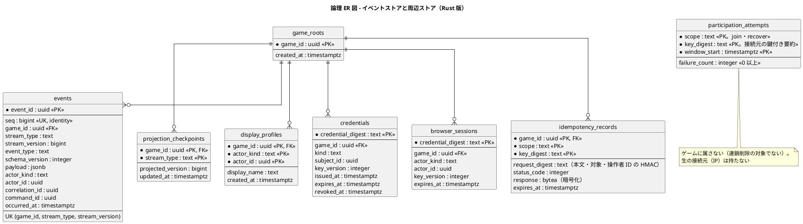

# データモデル設計 - ビールゲームシミュレーション（Rust 版）

## 概要

本書は、beer-game-rust のデータモデルを定義します。[ADR-001](../../adr/beer-game-rust/001-rust-version-of-beer-game-kotlin.md) の決定により、**スキーマの構造は [beer-game-kotlin のデータモデル](../beer-game-kotlin/data-model.md) を正本として引き継ぎ**ます（ES + CQRS、`game_roots` を根にした連鎖削除、追記専用の `events`、同期投影、周辺ストア）。本書は、Rust 版で変わる点（マイグレーション、型の対応、H2 を持たないこと）と、**実際の PostgreSQL で検証した DDL** を定めます。**`docs/` を設計の正本**とします。

### 本書の位置づけと確認の範囲

- **本書で確認したこと**: 「イベントストア」の DDL（`game_roots`、`events`、`projection_checkpoints`、`idempotency_records`、`participation_attempts` と、DB ロール・GRANT）を、**PostgreSQL 18.6**（ローカルの Docker の `postgres:18.6`、使い捨てのコンテナ）に適用し、次の 4 点を実測しました（2026-11-19）。結果は「検証の結果」の表です。
- **確認していないこと**: 投影・周辺ストア・保持削除の他の表の DDL（ER 図と表の定義は Kotlin 版の実ファイル `V002〜V006` に基づく設計で、Rust 版では**未適用**）、sqlx での読み書き、sqlx のマイグレーションの動作。
- **引き継ぐだけのもの**: 投影テーブルの定義（購読するイベント、閲覧できる人）、読み取りの規則、設計判断のまとめは、Kotlin 版を正本とします。
- Kotlin 版の実装の経緯（B1〜B12 の注記）と H2 に関する記述は引き継ぎません。Kotlin 版の未決事項は、本書の未決事項に引き継ぎます。

### beer-game-kotlin からの設計方針の変更

| # | beer-game-kotlin | beer-game-rust | 理由 |
| :--- | :--- | :--- | :--- |
| 1 | Flyway（共通・PostgreSQL・H2 の場所に分ける） | **sqlx のマイグレーション**（1 系統。PostgreSQL のみ） | H2 を持たないため方言の分岐が不要（[技術スタック](./tech-stack.md)、ADR-001 の 014 見直し） |
| 2 | 共通 V001〜V008 と PostgreSQL V101〜V103。番号の付け替えがあった | **最初から 1 系統の連番**。表を足す番号と、その表の GRANT の番号を分け、GRANT は表より後ろに置く | Kotlin 版で、番号の順序の不整合（V101 と V102）が起きた教訓 |
| 3 | `lobby_participants.replaced_at` は V007 で後から追加 | **ロビーの表の作成時から持つ** | 設計が確定済み（開始後の入れ替え） |
| 4 | `uq_idempotency_create` は H2 版で省略 | **常に PostgreSQL の部分一意索引** | H2 を持たない |
| 5 | 型は `timestamp with time zone`（H2 でも通る書き方） | `timestamptz`、`jsonb` をそのまま使う | PostgreSQL のみ |
| 6 | ロールと GRANT は PostgreSQL の統合テストでだけ検証し、H2 では省略 | **すべての環境（ローカルを含む）で PostgreSQL を使う前提**。ローカルの DB は未決だが、PostgreSQL を採る限り、ロールと GRANT の検証は全環境で同じ | [技術スタックの未決事項](./tech-stack.md#未決事項) の 1 |

## 概念データモデル

Kotlin 版と同じです（ゲームの根、イベント、投影、周辺ストア、冪等記録、保持方針、保持削除）。ドメインの概念と表の対応も同じで、表の名称（`events`、`game_overview`、`lobby_participants`、`week_role_results` など）は**変えません**（投影・運用の問い合わせ・文書の対応を保つため）。

## 論理データモデル

### ER 図（イベントストアと周辺ストア）



### ER 図（投影テーブルと保持）

投影テーブルの列は、Kotlin 版の ER 図と同じです。**Rust 版でも列・制約を変えません。** 構成を次の図に示します（列の詳細は [Kotlin 版の ER 図](../beer-game-kotlin/data-model.md) を正本とする）。

```plantuml
@startuml
title 論理 ER 図 - 投影と保持（Rust 版。列は Kotlin 版と同じ）
hide circle
skinparam linetype ortho

entity "game_roots" as roots {
  * game_id : uuid <<PK>>
}

entity "game_overview" as overview {
  * game_id : uuid <<PK, FK>>
  --
  status, final_week, commit_mode
  settings_kind, settings_changes
  retention_days
  created_at, started_at, ended_at
}

entity "game_join_codes" as jc {
  * game_id : uuid <<PK, FK>>
  --
  join_code : text <<UK>>
}

entity "game_settings" as gs {
  * game_id : uuid <<PK, FK>>
  --
  demand, initial_conditions
  費用・遅延・disclosure_policy
}

entity "lobby_participants" as lp {
  * participant_id : uuid <<PK>>
  --
  game_id, role, joined_at
  replaced_at
}

entity "lobby_observer_invitations" as li {
  * invitation_id : uuid <<PK>>
  --
  game_id, expires_at
  revoked_at, created_at
}

entity "lobby_observers" as lo {
  * observer_id : uuid <<PK>>
  --
  game_id, invitation_id, joined_at
}

entity "session_overview" as so {
  * game_id : uuid <<PK, FK>>
  --
  status, week, submitted_role_count
  started_at, ended_at
}

entity "role_current_states" as rcs {
  * game_id : uuid <<PK>>
  * role : text <<PK>>
  --
  inventory, backlog, 待ち行列
  cumulative_cost_minor
  arrivals, orders, as_of_week
}

entity "current_decisions" as cd {
  * game_id : uuid <<PK>>
  * role : text <<PK>>
  --
  week, quantity, decision_version
  editor_kind, editor_id, updated_at
}

entity "week_commits" as wc {
  * game_id : uuid <<PK>>
  * week : integer <<PK>>
  --
  commit_kind, contributors
  stream_version, committed_at
}

entity "week_role_results" as wrr {
  * game_id : uuid <<PK>>
  * week : integer <<PK>>
  * role : text <<PK>>
  --
  demand, shipped, ordered
  ending_inventory, ending_backlog
  weekly_cost_minor, cumulative_cost_minor
}

entity "week_team_totals" as wtt {
  * game_id : uuid <<PK>>
  * week : integer <<PK>>
  --
  total_ordered, total_inventory
  total_backlog, contributors
}

entity "retention_policies" as rp {
  * game_id : uuid <<PK, FK>>
  --
  retention_days
  retention_starts_at, delete_after
}

entity "deletion_runs" as runs {
  * deletion_id : uuid <<PK>>
  --
  game_id : uuid <<UK。外部キーなし>>
  status, attempt, requested_at
  next_attempt_at, last_failure_code
}

entity "deletion_attempts" as da {
  * deletion_id : uuid <<PK, FK>>
  * attempt : integer <<PK>>
  --
  started_at, failure_code
}

entity "deletion_receipts" as dr {
  * deletion_id : uuid <<PK>>
  --
  game_reference_digest, outcome
  recorded_at, expires_at
}

roots ||--|| overview
roots ||--|| jc
roots ||--|| gs
roots ||--o{ lp
roots ||--o{ li
roots ||--o{ lo
roots ||--o| so
roots ||--o{ rcs
roots ||--o{ cd
roots ||--o{ wc
wc ||--|{ wrr
wc ||--|| wtt
roots ||--|| rp
runs ||--o{ da
@enduml
```



`deletion_runs` と `deletion_attempts` は `game_roots` へ外部キーを持ちません（ゲームのデータが消えた後も再試行の記録として生き残るため）。**完了と同じトランザクションで、この 2 表の行も削除**し、`game_id` を含む行を残しません。`deletion_receipts` はゲームを特定しない証跡（ダイジェストだけ）で、1 年後に削除します（Kotlin 版と同じ）。

## イベントストア

ストリーム（`(game_id, stream_type)`、1 ゲームにつき `GAME` と `SESSION` の 2 本）、`stream_version`（1 から連続）、`seq`（ゲームをまたぐ追記の順序。業務上の順序は `stream_version`）、追記と楽観的並行制御、共同入力の競合（ストリームの版とは別）、冪等性、イベントのスキーマ（`schema_version` とアップキャスト）は、**Kotlin 版と同じ**です。

### DDL（PostgreSQL 18.6 で検証済み）

```sql
CREATE TABLE game_roots (
    game_id    uuid        NOT NULL,
    created_at timestamptz NOT NULL,
    CONSTRAINT pk_game_roots PRIMARY KEY (game_id)
);

CREATE TABLE events (
    event_id       uuid        NOT NULL,
    seq            bigint      GENERATED ALWAYS AS IDENTITY,
    game_id        uuid        NOT NULL,
    stream_type    text        NOT NULL,
    stream_version bigint      NOT NULL,
    event_type     text        NOT NULL,
    schema_version integer     NOT NULL,
    payload        jsonb       NOT NULL,
    actor_kind     text        NOT NULL,
    actor_id       uuid,
    correlation_id uuid        NOT NULL,
    command_id     uuid        NOT NULL,
    occurred_at    timestamptz NOT NULL,
    CONSTRAINT pk_events PRIMARY KEY (event_id),
    CONSTRAINT uq_events_seq UNIQUE (seq),
    CONSTRAINT uq_events_stream_version UNIQUE (game_id, stream_type, stream_version),
    CONSTRAINT fk_events_game FOREIGN KEY (game_id) REFERENCES game_roots (game_id) ON DELETE CASCADE,
    CONSTRAINT ck_events_stream_type CHECK (stream_type IN ('GAME', 'SESSION')),
    CONSTRAINT ck_events_stream_version CHECK (stream_version >= 1),
    CONSTRAINT ck_events_schema_version CHECK (schema_version >= 1)
);
CREATE INDEX ix_events_actor ON events (game_id, actor_kind, actor_id);

-- projection_checkpoints、idempotency_records（pk_idempotency_records、部分一意索引 uq_idempotency_create）、
-- participation_attempts も同様（検証した全文は、本書の実装時にマイグレーションとして置く）
```

### 一意制約の衝突の扱い（制約名の正本）

制約名と扱いは **Kotlin 版の表と同じ**です（`uq_events_stream_version`、`uq_idempotency_create`、`pk_idempotency_records` は `ConcurrencyConflict` に写して再試行し、それ以外の一意制約違反は 500 と相関 ID）。Rust 版での**違反の判別**は、SQLSTATE `23505` と制約名で行います。制約名は PostgreSQL のエラーの `CONSTRAINT NAME` フィールドに入ることを実測で確認しました（下の表の 1）。**sqlx のエラーからこの制約名を取る方法は未確認**です（[バックエンドアーキテクチャ](./architecture-backend.md) の未決事項と同じ。B1 で確認）。

### 追記専用の保護

アプリケーションが使う DB ロールには、`events` の **INSERT と SELECT だけ**を与え、UPDATE と DELETE と TRUNCATE を与えません。保持削除は、別のロールが `game_roots` を削除し、**外部キーの連鎖**で `events` の行が消えます。**ローカルを含むすべての環境で PostgreSQL を使うため、H2 版の「追記専用は守られない」という例外はありません。**

ロールは次の 5 つです（`NOLOGIN`。ログイン用のユーザーはこれらのメンバーとして運用で作る。作り方は Kotlin 版と同じ未決事項）。

| ロール | 権限 |
| :--- | :--- |
| `beergame_writer` | `events`・`game_roots` は SELECT・INSERT のみ。投影・周辺ストア・冪等記録・`projection_checkpoints`・`participation_attempts` は SELECT・INSERT・UPDATE・DELETE（再構築が行を消すため） |
| `beergame_reader` | 投影の表（`projection_checkpoints`・`game_join_codes`・`game_settings` を含む）と `display_profiles` の SELECT のみ。`credentials`・`browser_sessions`・`idempotency_records` は含めない |
| `beergame_observer` | `game_overview`・`session_overview`・`week_team_totals` の SELECT のみ（`game_join_codes`・役割別の表には到達できない） |
| `beergame_deleter` | `game_roots` の SELECT・DELETE、`retention_policies` の SELECT、`deletion_runs`・`deletion_attempts` の SELECT・INSERT・UPDATE・DELETE、`deletion_receipts` の SELECT・INSERT・DELETE（`events` ほかの DELETE は持たない） |
| 所有者 | マイグレーションを実行する接続のユーザー。新しいロールは作らない |

観察者の接続プールは、別の `PgPool`（`beergame_observer` のメンバーであるユーザーで接続）です（ADR-009）。

### 検証の結果（PostgreSQL 18.6、2026-11-19）

使い捨てのコンテナに上の DDL とロールを適用し、次を実測しました。

| # | 検証 | 結果 |
| :--- | :--- | :--- |
| 1 | 同じストリームの同じ版への 2 回目の追記 | **SQLSTATE 23505**、`CONSTRAINT NAME: uq_events_stream_version`（制約名がエラーに入る） |
| 2 | 部分一意索引 `uq_idempotency_create` | 別のゲームの同じ `('create', key_digest)` は**違反**。同じキーでも `scope` が `create` 以外なら**通る** |
| 3 | `beergame_writer` による `events` の UPDATE・DELETE・TRUNCATE、`game_roots` の DELETE | すべて **permission denied**（SQLSTATE 42501 相当）。INSERT・SELECT は許可 |
| 4 | `beergame_deleter`（`events` の DELETE 権限なし）が `game_roots` の 1 行を DELETE | 成功し、そのゲームの `events` と `idempotency_records` が**連鎖して消え**、別のゲームの行は残る。`events` を直接 DELETE すると拒否される |

4 は、Kotlin 版 ADR-010 の実測（PostgreSQL 18、1 回）を、Rust 版の DDL で再確認したものです。**1 回の実測で、他の版は未確認**です。

### スナップショット

**導入しません**（Kotlin 版と同じ）。1 ストリームは千件前後と見積もります。**この見積もりは JVM での値ではなく、Rust で再計測します**（ADR-003）。再生時間が NFR-03 の予算を圧迫すると実測で分かった場合にだけ、確定ごとのスナップショットを導入します。

## 投影

同期投影（追記と同じトランザクションで更新）、`projection_checkpoints`、投影の再構築（ゲームごとに 1 トランザクション、アドバイザリロック。コマンドは共有、再構築は排他）、複数の投影の行を更新する順序（表の順序の固定）、投影テーブルの定義、出力を投影にしない（`export_packages` の廃止）、読み取りの規則（参加者・進行役・観察者の読める範囲）、観察のための `week_team_totals` は、**Kotlin 版と同じ**です。投影テーブルの購読するイベントの一覧は Kotlin 版を正本とします。

観察者が読める表は、`game_overview`（参加コードなし）・`session_overview`・`week_team_totals` の **3 表だけ**で、DB の権限でも役割別の表と `game_join_codes` に到達できません（上のロール）。寄与者数による抑止（`contributors < 2`）は、問い合わせの層（`Disclosure`）で行います。

## 周辺ストア

`display_profiles`（表示名。1〜80 文字）、`credentials`（進行役の資格・復帰資格・観察用の招待のダイジェストと鍵の版、`expires_at`、`revoked_at`）、`browser_sessions`（24 時間。操作の認証はこの表だけを見る。失効は行の削除）は、**Kotlin 版と同じ**です。**追記と同じトランザクション**で書き、書く内容は、コマンドが運んだ値とイベントの ID だけです。

- `credentials.revoked_at` は `CredentialRevoked` を追記する同じトランザクションで更新し、**同じ主体の `browser_sessions` の行を削除**します（手動の失効と、役割の入れ替えの自動失効の両方）。
- **整合のルール**: 「`credentials` の発行・失効が、対応する `Credential*` などのイベントと必ず一緒に起きる」ことを、統合テストで確認します。
- 参加・復帰の失敗の窓（`participation_attempts`）の仕様（接続元の鍵付き要約だけを保存、ゲームに属さない、検査の前に 1 を足す、`INSERT … ON CONFLICT DO NOTHING` → `UPDATE … SET failure_count = failure_count + 1`、既定 10 回・10 分の仮置き）は Kotlin 版と同じで、仮置き値は Rust 版で取り直します（ADR-017）。

### 役割の入れ替えと永続化

開始後の入れ替えは、`credentials.revoked_at` の更新、`browser_sessions` の行の削除、`lobby_participants` の `role` を NULL にして `replaced_at` を書く、の 3 つを、イベントの追記と**同じトランザクション**で行います。旧担当者の `lobby_participants` の行、`display_profiles` の行、過去のイベント、`current_decisions` の入力者は消しません。Kotlin 版では `replaced_at` は後から V007 で足されましたが、**Rust 版は `lobby_participants` の作成時から持ちます**。

## 保持削除

`game_roots(game_id)` への外部キー（`ON DELETE CASCADE`）で、**`DELETE FROM game_roots WHERE game_id = $1` の 1 回で、イベント・投影・周辺ストア・冪等記録が連鎖して消えます**（ADR-010。実測は上の 4）。`deletion_runs`・`deletion_attempts` は、同じトランザクションで明示的に削除します。ゲームに属さない `participation_attempts` は対象外です。

削除の網羅は、「削除の完了後に、`game_id` 列を持つ**すべての表**に、そのゲームの行が残らない」ことを、`information_schema` から表の一覧を取得して検査するテストで確認します（Kotlin 版と同じ）。保持削除の流れ（5 分ごとのスケジューラ、`RetentionSaga` の `decide`、削除用ロールでの 1 トランザクション、失敗時の `RecordFailure` と最大 5 回の指数バックオフ）と、`retention_policies`・`deletion_*` のテーブル定義も同じです。

## マイグレーション

- スキーマの変更は**番号つきの SQL マイグレーション**で行い、適用の履歴を DB に残します。管理ツールは **sqlx のマイグレーション**（[技術スタック](./tech-stack.md) の設計判断 R3 とともに採用。**ファイルの命名・適用の動作・チェックサムの検証は未確認**で、B1 で確認する）。
- 変更は、**拡張 → 互換 → 縮小**の順に分け、ロールバックできる単位にします（NFR-12）。
- **イベントは、マイグレーションで書き換えません。** 形の変更は `schema_version` とアップキャストで吸収します。投影の形の変更は、マイグレーションで表を直し、**再構築**で埋めます。
- **表を足す番号と、その表の GRANT の番号を分け、GRANT は表より後ろの番号に置く**（Kotlin 版で、ロールの番号が表の番号と前後して適用できなくなった教訓）。表を足したら、その表の GRANT は、その表のマイグレーションより大きい番号に書く。既定の権限は与えない。

| 番号（予定） | 内容 |
| :--- | :--- |
| 0001 | `game_roots`、`events`（名前つきの一意制約、`CHECK`）、`projection_checkpoints`。**上の DDL で検証済み** |
| 0002 | 周辺ストアと横断: `display_profiles`、`credentials`、`browser_sessions`、`idempotency_records`（`pk_idempotency_records`、部分一意索引 `uq_idempotency_create`）、`participation_attempts`。**後ろの 2 表は検証済み** |
| 0003 | 投影（準備）: `game_overview`、`game_join_codes`、`game_settings`、`lobby_participants`（`replaced_at` を含む）、`lobby_observer_invitations`、`lobby_observers` |
| 0004 | 投影（進行）: `session_overview`、`role_current_states`、`current_decisions` |
| 0005 | 投影（結果）: `week_commits`、`week_role_results`、`week_team_totals` |
| 0006 | 保持: `retention_policies`、`deletion_runs`、`deletion_attempts`、`deletion_receipts` |
| 0007 | ロールと GRANT（上の 5 ロール）。**表（0001〜0006）がすべて揃った後に適用される番号** |

**検証済みなのは、0001 と 0002 の一部と、0007 のうち `events`・`game_roots` まわりの GRANT だけ**です。0003〜0006 の DDL は未検証です。実装時に、Kotlin 版の実ファイル（`V003`〜`V006`）を元に書き、PostgreSQL の統合テストで確認します。

### 型の対応（sqlx）

| PostgreSQL | Rust（候補。**sqlx の対応は未確認**） | 備考 |
| :--- | :--- | :--- |
| `uuid` | `uuid::Uuid`（ドメインでは newtype に包む） | `GameId` など |
| `timestamptz` | `time::OffsetDateTime` | |
| `jsonb`（`events.payload`） | `serde_json::Value` または `sqlx::types::Json<T>` | 書き込みは `EventCodec` の DTO を JSON にして渡す |
| `bigint`（`stream_version`、`seq`） | `i64`（ドメインの `StreamVersion` は `u64` 相当だが、DB との変換で範囲を検査） | |
| `integer` | `i32` | |
| `bytea`（暗号化した応答） | `Vec<u8>` | |
| `text`（列挙の値） | 文字列。ドメインの列挙型との変換は境界の関数で行い、**不明な値は `Persistence` の失敗**にする | `CHECK` 制約と一致させる |

## インデックス（主なもの）

Kotlin 版と同じです（`events` の `(game_id, stream_type, stream_version)` 一意と `(seq)` 一意と `(game_id, actor_kind, actor_id)`、`game_join_codes.join_code` 一意、`credentials` の `(game_id, kind, subject_id)` と `(expires_at)`、`browser_sessions` の `(game_id, expires_at)`、`participation_attempts` の `(window_start)`、`lobby_participants` の `(game_id)`、`idempotency_records` の `(expires_at)` と部分一意、`retention_policies` の `(delete_after, game_id)`、`deletion_runs` の `next_attempt_at` の部分索引）。`events` の 3 つの索引と、`idempotency_records` の部分一意索引は、上の DDL で検証済みです。

## ローカル開発のデータベース

Kotlin 版は、H2 の PostgreSQL モードでローカル起動を許し、省略する制約の一覧（`uq_idempotency_create`、追記専用、ロールの分離、プールの分離、複数プロセスの直列化、削除ロールの限定、REPEATABLE READ）を持ちます。**Rust 版には H2 がなく、ローカルの DB は未決です**（[技術スタック](./tech-stack.md) の未決事項 1）。データモデルの観点では、次のとおりです。

- **PostgreSQL（Docker など）をローカルでも使うなら**、上の制約・ロール・部分一意索引・アドバイザリロック・LISTEN/NOTIFY がすべて使え、**Kotlin 版の「H2 版で省略する制約」の一覧は不要**になる。
- 別の軽量 DB を採るなら、Kotlin 版の「方言の差分」と「乖離のリスクと対策」と同じ作業（差分の実測、契約テストを両実装で実行、`APP_ENV` による本番での拒否）が要る。**データモデルの単純さのため、PostgreSQL を採ることを推奨**します。ただし決定は未決事項です。

## 設計判断のまとめ

Kotlin 版の設計判断 1〜9 は**引き継ぎます**（ストリームの単位、並行制御、スナップショットなし、同期投影、観察の合計、周辺ストア、保持削除、冪等性、出力）。判断 10（ローカル開発の DB）は**見直し**です（H2 がないため。上の節）。

## beer-game-kotlin からの変更

| # | beer-game-kotlin | beer-game-rust | 理由 |
| :--- | :--- | :--- | :--- |
| 1 | Flyway、共通・PostgreSQL・H2 の 3 つの場所 | sqlx のマイグレーション、1 系統 | H2 がない |
| 2 | 番号の付け替え（V101 と V102 の入れ替え）、後から V007・V008 | 最初から連番。表と GRANT の番号を分け、GRANT は後ろ | 教訓の反映 |
| 3 | `${json_type}` のプレースホルダ、`timestamp with time zone` の書き方、`jsonb` の書き込みを方言ごとに分ける | `jsonb`・`timestamptz` をそのまま使う | PostgreSQL のみ |
| 4 | H2 版で `uq_idempotency_create` を省略し、アプリ側で再照合 | 常に部分一意索引 | 同上 |
| 5 | H2 版で省略する制約の一覧 | なし（ローカルも PostgreSQL の場合） | 同上 |
| 6 | 検証は Kotest と Testcontainers の統合テスト | DDL は本書で PostgreSQL 18.6 に適用して実測。統合テストは testcontainers（Rust） | ツールの違い |

上記以外（表と列、制約名、投影、周辺ストア、保持削除、ロール）は変えません。

## 未決事項

1. **ローカル開発の DB**: PostgreSQL（Docker）か、別の軽量 DB か（[技術スタック](./tech-stack.md) の未決事項 1）。PostgreSQL を推奨。
2. **sqlx の確認**（B1）: マイグレーションの命名と動作、型の対応（`Uuid`、`OffsetDateTime`、`Json`）、エラーからの制約名の取得、アドバイザリロック、`LISTEN/NOTIFY`。
3. **0003〜0006 の DDL**: Kotlin 版の実ファイルを元に書き、PostgreSQL で適用して検証する。
4. **`session_overview.week` が最終週 + 1 になる問題**（Kotlin 版で判明、未解決）: `WeekCommitted` か投影が最終週を知る手段の決定が要る。Rust 版では、設計段階で決める（案: `WeekCommitted` のペイロードに最終週を載せない代わりに、投影が `SessionStarted` の設定の最終週を覚える。イベントの構造への影響があるため、ドメインモデルと合わせて決める）。
5. **ロック待ちの上限（`lock_timeout`）と、再構築中のコマンドの応答**（短い待ちか、すぐ 503 か）。
6. **投影の更新の順序と `FOR UPDATE` の要否**: Kotlin 版でも、今のイベント構成では実際の競合は起きないと整理されている。
7. **所有者のロールの作り方（RDS）、通知の受信（`LISTEN`）専用のロールと接続、アプリの用途別のロール・接続への切り替え**: Kotlin 版と同じ未決事項。
8. **`retention_starts_at` の起点**: 暫定で作成時（Kotlin 版・ドメインモデルと共通）。
9. **`events` の長期の保持と、ゲーム削除前の分析の要否**（beer-game2 から継続）。
10. **同期投影のトランザクション時間の実測**（Rust で計測し直す）。

## 出典

- DDL の検証: ローカルの Docker の `postgres:18.6`（使い捨てのコンテナ。ポートを公開せず、終了後に削除）、2026-11-19。
- [データモデル設計（beer-game-kotlin）](../beer-game-kotlin/data-model.md)
- [ADR-001（Rust 版）](../../adr/beer-game-rust/001-rust-version-of-beer-game-kotlin.md)、[技術スタック（Rust 版）](./tech-stack.md)、[ドメインモデル（Rust 版）](./domain-model.md)、[バックエンドアーキテクチャ（Rust 版）](./architecture-backend.md)
- [ADR-010](../../adr/beer-game-kotlin/010-retention-deletion-with-append-only.md)（追記専用と連鎖削除）、[ADR-009](../../adr/beer-game-kotlin/009-observer-access-control.md)（観察者の DB ロール）
