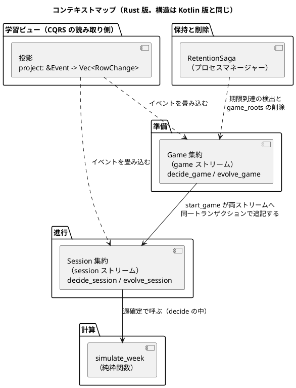

# ドメインモデル設計 - ビールゲームシミュレーション（Rust 版）

## 概要

本書は、beer-game-rust のドメインモデルを定義します。[ADR-001](../../adr/beer-game-rust/001-rust-version-of-beer-game-kotlin.md) の決定により、**機能と振る舞いは beer-game2、設計の構造は [beer-game-kotlin のドメインモデル](../beer-game-kotlin/domain-model.md) を正本**として引き継ぎます。本書は、その構造を **Rust の型**で表す方法と、Rust で変わる点だけを定めます。構造そのもの（2 ストリーム、ES + CQRS、イベントの意味）は変えません。

- 状態はイベントの列です。集約は `decide(&state, &command) -> Result<Vec<Event>, Error>` と `evolve(state, &event) -> Evolution<State>` の 2 つの純粋関数で表します。
- ADT（State・Command・Event・Error）は `enum` と `struct` で表し、不正な値は newtype とスマートコンストラクタで作れなくします。失敗は例外でなく `Result` で返します。
- 読み取りは、イベントを畳み込む純粋関数（投影）に分けます（CQRS）。

入力は [要件定義](../../requirements/beer-game2/requirements_definition.md)（BR・FR・NFR）、[システムユースケース](../../requirements/beer-game2/system_usecase.md)、[ユーザーストーリー](../../requirements/beer-game2/user_story.md) です。**`docs/` を設計の正本**とします。実装コードはまだ存在しません。

### 本書の位置づけと確認の範囲

- **本書で確認したこと**: 3 章の型とコードの断片（値オブジェクト、エラー、誤りの集約、Game 集約の `decide` / `evolve`）は、ローカルの rustc 1.97.1（edition 2024）で、標準ライブラリだけで型検査し、4 件のテストが通ることを確認しました（2026-11-19。`Uuid` と `Instant` は代替の型。本番は `uuid::Uuid` と `time` の型）。それ以外の断片（Session 集約の `decide`、投影のトレイト）は、**型検査していない設計のスケッチ**です。
- **引き継ぐだけで再検討していないこと**: 週次計算の規則（12 ステップ）、観察者の開示の規則、保持削除の細部、エラーコードの一覧、投影の購読表は、Kotlin 版の該当節を正本として参照します。Rust 版で変わるのは表現であり、API の契約（`code`、problem+json）は変えません。
- **Kotlin 版の実装の経緯（B1〜B9 の注記）は引き継ぎません。** 本書は、Kotlin 版の設計の現在の形を出発点とします。Kotlin 版の未決事項は、本書の未決事項に引き継ぎます。

### 設計の前提と原則

Kotlin 版の前提と原則をそのまま引き継ぎます（学習用シミュレーション、アカウントなし、決定論的な週次計算、役割別の情報制限、ルールは集約が持つ、ドメインは純粋、集約は最小の整合性の範囲、個人情報と秘密はイベントに入れない）。Rust 版で加わる原則は次のとおりです。

- **ドメインの crate は I/O に依存しない。** 時刻・乱数・永続化は、コマンドの値として渡す。ドメインの crate の依存に `tokio`・`sqlx` を含めない（[技術スタック](./tech-stack.md) の設計判断 R4）。
- **`unsafe` と `panic` を使わない。** `unwrap`・`expect`・配列の添字は、ドメインの crate で禁止する（clippy の設定で守る。未確認）。`evolve` は全域で、`panic` しない。
- **所有権で状態の更新を表す。** `evolve` は状態を値で受け取り、新しい状態を返す。共有可変状態は持たない。

## 戦略的設計

境界付けられたコンテキストの分類、コンテキストマップ、ユビキタス言語は、[Kotlin 版](../beer-game-kotlin/domain-model.md) と同じです（中核: シミュレーション計算・進行、補完: 準備・学習ビュー、一般: 保持と削除）。コード上の名称は、Rust の命名規約に合わせます。

| 概念（Kotlin 版） | Rust 版の名称 | 備考 |
| :--- | :--- | :--- |
| `GameState`、`SessionState` | `GameState`、`SessionState`（`enum`） | 状態の違いを列挙子で表す |
| `decideGame`、`evolveGame` | `decide_game`、`evolve_game` | snake_case |
| `RoleMap<A>` | `RoleMap<A>` | 同じ |
| `StreamType`（`GAME`、`SESSION`） | `StreamType::Game`、`StreamType::Session` | |
| `Either<DomainError, …>` | `Result<…, GameError>` など | |



## 戦術的設計

### 値オブジェクト

不変で、属性値が同じなら同じものとして扱います。**newtype**（フィールドが非公開のタプル構造体）とスマートコンストラクタ（`of`）で、生成時に検証し、不正な値が存在できないようにします。newtype はゼロコストで、`GameId` と `ParticipantId` を取り違えるとコンパイルが通りません。

```rust
#[derive(Clone, Copy, Debug, PartialEq, Eq, Hash, PartialOrd, Ord)]
pub struct GameId(Uuid);

#[derive(Clone, Copy, Debug, PartialEq, Eq)]
pub struct Quantity(u32);

impl Quantity {
    pub const DEFAULT_MAX: u32 = 1000;

    pub fn of(n: i64) -> Result<Self, ValidationError> {
        u32::try_from(n)
            .ok()
            .filter(|v| *v <= Self::DEFAULT_MAX)
            .map(Quantity)
            .ok_or(ValidationError::QuantityOutOfRange { actual: n, max: Self::DEFAULT_MAX })
    }
    pub fn get(self) -> u32 { self.0 }
}

#[derive(Clone, Copy, Debug, PartialEq, Eq, Hash, PartialOrd, Ord)]
pub enum Role { Factory, Distributor, Wholesaler, Retailer }   // 上流から下流の順

/// 4 役割すべてに値を持つ総称コンテナ。「4 役割が揃う」を型で表す
#[derive(Clone, Debug, PartialEq, Eq)]
pub struct RoleMap<A> { pub factory: A, pub distributor: A, pub wholesaler: A, pub retailer: A }

impl<A> RoleMap<A> {
    pub fn get(&self, role: Role) -> &A { /* match role で 4 つのフィールドを返す */ }
    pub fn map<B>(&self, f: impl Fn(Role, &A) -> B) -> RoleMap<B> { /* 4 役割に f を適用 */ }
}
```

値オブジェクトの一覧（`Units`、`Week`、`Money`、`DemandSeries`、`Pipeline`、`InitialConditions`、`CostPolicy`、`DisclosurePolicy`、`CommitMode`、`SettingsKind`、`GameSettings`、`RoleState`、`RoleWeekResult`、`DisplayName`、`JoinCode`、`InvitationCode`、`CredentialValidity`、`CredentialSubject`、`RetentionPolicy`、`Actor`、`StreamVersion`、`DecisionVersion`）は、[Kotlin 版の表](../beer-game-kotlin/domain-model.md) の意味と制約を引き継ぎます。Rust 版での表現の違いは次のとおりです。

| Kotlin 版 | Rust 版 | 理由 |
| :--- | :--- | :--- |
| `@JvmInline value class` | newtype（`struct X(T)`、フィールド非公開） | ゼロコストの型の区別 |
| `enum class`（`Role`、`CommitMode`） | `enum`（`Copy` を導出） | 同じ |
| `sealed interface`（`Actor`、`SettingsKind`、`CredentialSubject`） | データを持つ `enum` | 網羅検査はコンパイラが行う |
| `Money`（最小単位の整数） | `struct Money(i64)`（算術は `checked_*`） | オーバーフローを黙って起こさない |
| `UUID`、`Instant` | `uuid::Uuid`、`time::OffsetDateTime`（候補） | [技術スタック](./tech-stack.md) |
| `data class` の `copy` | 構造体の更新構文、または所有権を移して書き換える | `evolve` は値で受け取る |

#### 検証の誤りと業務ルールの失敗

入力の形の誤りは `ValidationError` として、境界でコマンドを作るときに**すべて集めて**返します。状態に照らした業務ルール違反は、集約ごとのエラー（`GameError`・`SessionError`）として、`decide` が 1 件返します（Kotlin 版と同じ分け方）。

Kotlin 版の `zipOrAccumulate` に当たるものは、Rust の標準にありません。**誤りを `Vec` に集める小さな関数**で表します。

```rust
fn collect<T>(errors: &mut Vec<ValidationError>, r: Result<T, ValidationError>) -> Option<T> {
    match r {
        Ok(v) => Some(v),
        Err(e) => { errors.push(e); None }
    }
}

pub fn validate_settings(raw: RawSettings) -> Result<GameSettings, Vec<ValidationError>> {
    let mut errors = Vec::new();
    let final_week = collect(&mut errors, Week::of(raw.final_week));
    let demand: Vec<Quantity> = raw.demand.iter()
        .filter_map(|n| collect(&mut errors, Quantity::of(*n)))
        .collect();
    match final_week {
        Some(final_week) if errors.is_empty() => Ok(GameSettings { final_week, demand }),
        _ => Err(errors),
    }
}
```

これは、設定の誤りを全件返す受入条件（AC1.1.2、AC1.1.4）を満たす形です。上のコードは、範囲外の週と範囲外の需要 2 件で、誤り 3 件を返すテストが通ることを確認しました。

### エラーの分類と `code`

分類（`Forbidden`・`NotFound`・`InvalidState`・`Conflict`・`RuleViolation`）、`code` の書式（小文字のドット区切り `<領域>.<名前>`）、`code` の一覧は、**API の契約**であり、[Kotlin 版](../beer-game-kotlin/domain-model.md) の値を変えません。HTTP への写像と problem+json の `type` が変わらないため、フロントエンドと E2E はそのまま使えます。

```rust
#[derive(Clone, Copy, Debug, PartialEq, Eq)]
pub enum ErrorCategory { Forbidden, NotFound, InvalidState, Conflict, RuleViolation }

#[derive(Clone, Debug, PartialEq, Eq)]
pub enum GameError {
    AlreadyCreated,
    NotPreparing,
    Forbidden,
    ParticipantNotFound(ParticipantId),
    // … Kotlin 版の一覧の残りも同じ形で足す
}

impl GameError {
    pub fn code(&self) -> &'static str {            // 例: "game.already_created"
        match self { /* 全列挙子を else なしで網羅する */ }
    }
    pub fn category(&self) -> ErrorCategory { /* 同様 */ }
}
```

`code()` と `category()` を `match` の網羅で書くことで、**列挙子を足したときに `code` の付け忘れがコンパイルエラーになります**（Kotlin 版の「`DomainErrorCodesSpec` が一覧を固定する」に加えた、型による守り）。エラー型には、境界で `thiserror` を使うかを未決事項とします（`Display` の文言は仮置き）。

### 共通の型

イベントの封筒（`EventEnvelope<E>`）は、Kotlin 版と同じ項目（イベント ID、ゲーム ID、ストリーム種別、ストリームの版、スキーマ版、操作者の参照、相関 ID、コマンド ID、発生時刻、ペイロード）を持つ構造体にします。コマンドは、`actor`（`Actor`）と `at`（時刻）を全コマンドが持ちます。`decide` は時計を持たず、`at` を使います。

### Game 集約（準備）

ストリームは `game`。責務と不変条件は Kotlin 版の表（設定の妥当性、作成の一回性、参加の受付、役割の割り当て、開始条件、観察用の招待、資格の有効性、設定の固定、役割の入れ替え、権限）を引き継ぎます。

#### State・Event・Command

```rust
#[derive(Clone, Debug, PartialEq, Eq)]
pub enum GameState {
    NotCreated,
    Preparing(GameData),
    Started(GameData),
}

#[derive(Clone, Debug, PartialEq, Eq)]
pub struct GameData {
    pub game_id: GameId,
    pub participants: BTreeMap<ParticipantId, Option<Role>>,   // 実際は設定・招待・観察者・資格も持つ
}

#[derive(Clone, Debug, PartialEq, Eq)]
pub enum GameEvent {
    GameCreated { game_id: GameId },
    ParticipantJoined { participant_id: ParticipantId },
    RoleAssigned { participant_id: ParticipantId, role: Role },
    RoleUnassigned { participant_id: ParticipantId, role: Role },
    GameStarted { game_id: GameId },
    // … EV-G01〜G12。Kotlin 版の表のとおり
}

pub enum GameCommand {
    CreateGame { actor: Actor, at: Instant, game_id: GameId },
    AssignRole { actor: Actor, at: Instant, participant_id: ParticipantId, role: Role },
    // … JoinGame、UnassignRole、InviteObserver、RevokeCredential など
}
```

`GameState` は**版を持ちません**。ストリームの版は、永続化の層が `(state, version)` として持ちます（設計判断 RD2）。

#### decide と evolve

```rust
pub fn decide_game(state: &GameState, command: &GameCommand) -> Result<Vec<GameEvent>, GameError> {
    match command {
        GameCommand::CreateGame { actor, game_id, .. } => {
            if !matches!(state, GameState::NotCreated) { return Err(GameError::AlreadyCreated); }
            if *actor != Actor::Anonymous { return Err(GameError::Forbidden); }
            Ok(vec![GameEvent::GameCreated { game_id: *game_id }])
        }
        GameCommand::AssignRole { actor, participant_id, role, .. } => {
            let data = state.preparing()?;                         // 準備中でなければ NotPreparing
            if *actor != Actor::Facilitator(data.game_id) { return Err(GameError::Forbidden); }
            let current = data.participants.get(participant_id)
                .ok_or(GameError::ParticipantNotFound(*participant_id))?;
            Ok(match current {
                Some(r) if r == role => vec![],                    // 変化なし。履歴に足さない
                None => vec![GameEvent::RoleAssigned { participant_id: *participant_id, role: *role }],
                Some(old) => vec![                                 // 付け替え = 2 イベント（D9）
                    GameEvent::RoleUnassigned { participant_id: *participant_id, role: *old },
                    GameEvent::RoleAssigned { participant_id: *participant_id, role: *role },
                ],
            })
        }
    }
}

/// evolve は全域。decide が作らない列は Ignored で返し、再生側が検知する
pub enum Evolution<S> { Applied(S), Ignored(S) }

pub fn evolve_game(state: GameState, event: &GameEvent) -> Evolution<GameState> {
    use Evolution::{Applied, Ignored};
    match (state, event) {
        (GameState::NotCreated, GameEvent::GameCreated { game_id }) =>
            Applied(GameState::Preparing(GameData { game_id: *game_id, participants: BTreeMap::new() })),
        (GameState::Preparing(mut data), GameEvent::RoleAssigned { participant_id, role }) => {
            data.participants.insert(*participant_id, Some(*role));
            Applied(GameState::Preparing(data))
        }
        // … 他の組
        (state @ (GameState::NotCreated | GameState::Preparing(_) | GameState::Started(_)), _) => Ignored(state),
    }
}
```

最後の腕は、**状態の列挙子だけを列挙して**、イベントを `_` で受けます。状態を足すとこの腕がコンパイルエラーになり、`evolve` の見直しを強制します（イベントを足したときは、有効な組の追加を忘れても `Ignored` になるため、**性質テストで「`decide` が作る列は `Ignored` にならない」を守ります**。Kotlin 版と同じ方針）。

### Session 集約（進行）

ストリームは `session`。責務、State（`NotStarted`・`Active`・`Paused`・`Ended`）、Command、不変条件（意思決定の条件、保存回数の上限 9 回、共同入力、代理入力、役割の確認、週確定の条件と一回性、自動確定、終了、権限、非負・保存則）、状態遷移は Kotlin 版を引き継ぎます。Rust での形のスケッチ（**型検査していない**）:

```rust
pub enum SessionState {
    NotStarted,
    Active(SessionData),
    Paused(SessionData),
    Ended(SessionData),
}

pub struct SessionData {
    pub game_id: GameId,
    pub settings: GameSettings,                       // 開始時の写し
    pub assignments: RoleMap<BTreeSet<ParticipantId>>, // 開始時の写し（入れ替えだけが変える）
    pub week: Week,
    pub role_states: RoleMap<RoleState>,
    pub decisions: BTreeMap<Role, DecisionEntry>,     // 当週。確定でクリア
    pub decision_versions: RoleMap<DecisionVersion>,  // 当週の版。確定で 0
    pub commit_mode: CommitMode,
}

pub fn decide_session(state: &SessionState, command: &SessionCommand)
    -> Result<Vec<SessionEvent>, SessionError>
{
    match command {
        SessionCommand::SaveDecision { actor, role, requested_week, quantity, expected_version, .. } => {
            let data = state.active()?;                          // 進行中でなければ NotActive / Paused / AlreadyEnded
            // 判定順: 権限 → 週(WeekAdvanced) → 版(DecisionConflict) → 保存回数の上限
            // …
            let saved = SessionEvent::DecisionSaved { /* … */ };
            let after = evolve_session(state.clone(), &saved).into_state();
            let mut events = vec![saved];
            events.extend(auto_commit_events(&after, command)?);   // AUTO で 4 役割が揃えば WeekCommitted（+ SessionEnded）
            Ok(events)
        }
        // CommitWeek: (1) 週が違えば WeekAdvanced (2) basis が違えば DecisionsChanged (3) 揃っていなければ IncompleteDecisions
        // …
    }
}
```

自動確定は、Kotlin 版と同じく **1 回の `decide` が複数のイベントを返す**ことで表します（D6）。`WeekCommitted` は結果と次週の状態を事実として含み、`evolve` はそれを採用するだけで、`simulate_week` を呼び直しません（D5）。

#### 状態遷移

状態遷移図は [Kotlin 版](../beer-game-kotlin/domain-model.md) の `session ストリームの状態` と同じです（`NotStarted` → `Active` ⇄ `Paused` → `Ended`）。

### 2 ストリームにまたがる StartGame

開始は、`game` に `GameStarted`、`session` に `SessionStarted` を**同一トランザクションで**追記する唯一のコマンドです（D3）。Rust でも、2 ストリームを入力に取る独立の関数にします。

```rust
pub struct StartDecision { pub game: Vec<GameEvent>, pub session: Vec<SessionEvent> }

pub fn start_game(game: &GameState, session: &SessionState, command: &StartGame)
    -> Result<StartDecision, DomainError>
{
    // 判定順: 権限 → 開始済み(AlreadyStarted) → 開始条件(StartConditionNotMet)
    // …
}
```

開始後の役割の入れ替え（`assign_role_after_start`）も、`game` と `session` の両方を入力に取る同じ形の関数です。

### 週次計算（simulate_week）

```rust
pub struct WeekOutcome { pub results: RoleMap<RoleWeekResult>, pub next_states: RoleMap<RoleState> }

pub fn simulate_week(
    settings: &SimulationSettings,   // 最終週、需要系列、費用方針
    week: Week,
    states: &RoleMap<RoleState>,     // 前週末の断面
    decisions: &RoleMap<Quantity>,   // 4 役割の当週の発注数または生産要請数
) -> WeekOutcome
```

- **全域**です（`Result` を返さない）。入力の型が検証済みのため失敗しません。
- 永続化・時刻・乱数・通信に依存しません。決定論性（NFR-01）は、この関数が副作用を持たないことで保たれます。
- 規則（12 ステップ、遅延、利用可能量・充足対象・出荷・週末在庫・受注残・費用の式）は、Kotlin 版・beer-game2 と同じで、**本書は新しい規則を加えません**。
- 数量の演算は、整数の飽和・検査付き演算（`checked_add` など）で書き、オーバーフローを黙って起こさない（Kotlin 版は `Int` で、上限 1000 の前提。Rust 版では型で幅を決める。未決事項）。
- 検証は、既知の系列の golden test、proptest による性質テスト（在庫・受注残が非負、出荷が利用可能量を超えない）、**計算と事実の一致**（`fold(evolve)` の結果が、イベントのペイロードと `simulate_week` を直接回した結果の両方と一致する）です。

### RetentionSaga（プロセスマネージャー）

Kotlin 版の D8 のとおり、ES にせず、状態の行を持つプロセスマネージャーにします。遷移は純粋な `decide` / `evolve` で、状態は `enum RetentionState { Pending, InProgress{…}, Failed{…}, Completed, Abandoned{…} }`、不変条件（一度だけ、再試行は最大 5 回の指数バックオフ、完了の定義は `game_roots` の削除の成功、削除後に行が残らない）は Kotlin 版を引き継ぎます。バックオフの揺らぎは、呼び出し側が引いて渡し、ドメインは乱数・時計を読みません。

## ドメインイベント

イベントの一覧（EV-G01〜G12、EV-S01〜S10）、発生条件、ペイロードは、[Kotlin 版のドメインイベント](../beer-game-kotlin/domain-model.md) を正本として**引き継ぎます**（名称も変えません。イベントは永続化され、投影と契約の一部になるため）。

- ペイロードの JSON は、serde の `#[serde(tag = "event_type")]` のような**内部タグ付きの列挙型**で表すことを第一候補とします（Kotlin 版の「`event_type` を判別子にした多相」に対応。**書式は未確認**で、B1 で確かめる）。
- 表示名と資格の値は、ペイロードに含めません（D7）。型の上でも、`GameEvent` のフィールドに `DisplayName` と資格のダイジェストの型を**持たせません**。

## 投影（読み取りモデル）

投影は、イベント 1 件から読み取り用の**行の変更の列**を作る純粋関数です。他の投影を読みません。SQL は知りません。

```rust
pub enum RowChange {
    Upsert { table: ProjectionTable, key: RowKey, values: BTreeMap<Column, Value> },
    Delete { table: ProjectionTable, key: RowKey },
}

pub trait Projection {
    fn project(&self, event: &EventEnvelope<DomainEvent>) -> Vec<RowChange>;
}
```

投影の一覧（`GameOverview`、`GameJoinCodes`、`GameSettingsView`、`Lobby`、`SessionOverview`、`RoleCurrentState`、`CurrentDecisions`、`WeekRoleResults`、`WeekTeamTotals`、`RetentionPolicyView`）、購読するイベント、閲覧できる人、**出力 `buildExport` を投影にしない**こと（D11）、**開示の判定（`Disclosure`）**、観察者が読める 3 表の制限は、Kotlin 版を引き継ぎます。

## 設計判断

### Kotlin 版の設計判断 D1〜D11 との対応

| ID | Kotlin 版の決定 | Rust 版の扱い |
| :--- | :--- | :--- |
| D1 | ストリームは `game` と `session` の 2 本 | **引き継ぐ** |
| D2 | ゲームの終了は投影で導出（`game` に書かない） | **引き継ぐ** |
| D3 | `StartGame` は 2 ストリームへの原子的な追記 | **引き継ぐ**（`start_game` 関数） |
| D4 | `SessionStarted` が設定と割り当ての写しを運ぶ | **引き継ぐ** |
| D5 | `WeekCommitted` は結果と次週の状態を事実として含む | **引き継ぐ**（`evolve` は `simulate_week` を呼ばない） |
| D6 | 自動確定は `decide` が複数イベントを返す | **引き継ぐ** |
| D7 | 個人情報と秘密は周辺ストアへ | **引き継ぐ**（型でも持たせない） |
| D8 | RetentionSaga はプロセスマネージャー | **引き継ぐ** |
| D9 | 共同担当の付け替えは 2 イベント | **引き継ぐ**（上の `decide_game` で確認した形） |
| D10 | `CommitWeek` の前提は週と意思決定の版 | **引き継ぐ** |
| D11 | 出力は投影にせず純粋関数で作る | **引き継ぐ** |

### RD1: 状態の違いは `enum` の列挙子で表し、網羅は `match` に任せる

Kotlin 版の `sealed interface` + `when`（else なし）に対応します。Rust の `match` は網羅性をコンパイラが検査するため、状態・イベント・エラーの列挙子を足したときに、見直す箇所がコンパイルエラーで分かります。ただし、`evolve` の最後の腕に `_` を使うと、**イベントの追加の見落としは検出できません**（上記）。このため、「`decide` が作る列は `Ignored` にならない」性質テストを必須にします。

### RD2: ストリームの版は状態に持たせず、永続化の層が持つ

Kotlin 版は `State.version` を持ち、`evolve` が版を進めて、再生側が「版が増えなかった」ことで不正な遷移を検出します。Rust 版では、`evolve` の結果を `Evolution::{Applied, Ignored}` で**明示**し、版は `(state, version)` として永続化の層が数えます。「版が増えたかで推測する」間接性をなくし、`Ignored` を直接検知（ログとメトリクス）できます。**これは Kotlin 版からの設計の変更**であり、承認を求めます。

| 案 | 内容 | 評価 |
| :--- | :--- | :--- |
| **A（提案）** | `Evolution` で適用の有無を返し、版は外で持つ | 検知が直接的。状態の型が小さい。再生の関数が `Evolution` を畳み込む |
| B | Kotlin 版と同じく、状態に版を持たせ、再生が前後を比べる | 構造が Kotlin 版と一致する。検知が間接的 |

### RD3: 失敗は `Result`、複数の誤りは `Vec` に集める

Arrow の `Either` / `Raise` / `zipOrAccumulate` を使わず、標準の `Result`、`?`、小さな `collect` 関数で表します（[技術スタック](./tech-stack.md) の変更の表）。`Raise` のような「失敗のコンテキスト」は持たず、`?` による早期の失敗で足ります。誤りの集約は上のコードで確認しました。`NonEmptyList` に当たるものは、`Vec` が空でないことを型で保証しない代わりに、`validate_*` が「誤りがあれば必ず 1 件以上」を返す関数の契約とテストで守ります。

### RD4: エラーの `code` は `match` の網羅で付け、一覧は API の契約として固定する

`code()` と `category()` を列挙子ごとの `match` で書くため、列挙子の追加時に付け忘れません。一覧そのものは、フロントエンドの辞書の鍵であり、変えません。**エラー型の `Display` を `thiserror` で書くか、手で書くか**は未決事項です。

### RD5: ドメインの crate の純粋性は、依存の制限と lint で守る

Kotlin 版は detekt の `ForbiddenMethodCall` で時計・乱数の呼び出しを禁止します。Rust 版は、ドメインの crate が `tokio`・`sqlx`・`rand` などに**依存しない**ことを第一の守りとします（依存がなければ呼べません）。`std::time::SystemTime::now` のような標準の呼び出しの禁止は、clippy の `disallowed_methods` で足りるかを未確認とし、B1 で確かめます。

## beer-game-kotlin からの変更

| # | beer-game-kotlin | beer-game-rust | 理由 |
| :--- | :--- | :--- | :--- |
| 1 | `sealed interface`・`data class`・`value class` | `enum`・`struct`・newtype | 言語の違い |
| 2 | `Either<DomainError, List<Event>>`、`Raise` | `Result<Vec<Event>, Error>`、`?` | 標準で足りる（RD3） |
| 3 | `zipOrAccumulate`（Arrow） | `collect` 関数で `Vec` に集める | 標準に無い。小さな関数で足りる |
| 4 | `State.version` と版の増加による不正な遷移の検知 | `Evolution::{Applied, Ignored}`、版は永続化の層（RD2） | 検知を直接にする（承認待ち） |
| 5 | `evolve(state, event): State` | `evolve(state, &event): Evolution<State>`（状態を値で受け取る） | 所有権による更新 |
| 6 | 純粋性は detekt の `ForbiddenMethodCall` | 依存の制限（crate）+ clippy（RD5） | ツールの違い |
| 7 | `Int`、`Money` は最小単位の整数 | 幅を型で決める（`u32`・`i64`）、検査付き演算 | オーバーフローを起こさない |
| 8 | 型の注釈（`@Term`・`@EventSpec`）から用語集・イベント一覧を生成 | 方式は未決（[ADR-001](../../adr/beer-game-rust/001-rust-version-of-beer-game-kotlin.md) の 018 は置き換え） | 注釈は Kotlin の機能 |

上記以外（ストリームの構造、イベントの名称と意味、投影、週次計算の規則、エラーコード、開示の規則）は変えません。

## 未決事項

1. **RD2 の承認**: `Evolution` と、版を永続化の層に置く案を採るか。採らない場合は案 B。
2. **エラー型の実装**: `thiserror` を使うか、手で `Display` を書くか。ドメインの crate の依存を最小にする観点と比較する。
3. **数量・金額の整数の幅**: `Quantity` は `u32`、`Units`（上限のない非負の流れの数量）と `Money` の幅は `u64` / `i64` を第一候補とし、`simulate_week` の演算の範囲を確かめて確定する。
4. **イベントの JSON の書式**: serde の内部タグ付き列挙型で、アップキャスト（`schema_version`）を表せるか。B1 で確かめる。
5. **用語集・イベント一覧の生成方式**: 属性マクロ、doc コメントの抽出、手書き + テストによる整合の検査の比較（ADR-001 の 018）。
6. **純粋性の lint**: clippy の `disallowed_methods` で、時計・乱数の呼び出しの禁止が足りるか（RD5）。
7. **`panic` と `unwrap` の禁止**: ドメインの crate の lint の設定と、テストコードでの例外の扱い。
8. **Kotlin 版の未決事項の引き継ぎ**: 開始後の共同担当の追加と開始後の参加、遅延 0 を許すか、需要の上限、キット準拠の既定の需要系列（JSD の値の確認）、保持の開始の起点、AC1.2.5 の文言の改訂、観察者への入力済みの役割の開示、`InvalidTransition` の通知先、再構築とコマンドの同時実行制御、`WeekCommitted.contributors` の意味。いずれも [Kotlin 版の未決事項](../beer-game-kotlin/domain-model.md) と同じ扱いで、Kotlin 版の決定に追従する。

## 出典

- 型の断片の検査: ローカルの rustc 1.97.1（edition 2024）、2026-11-19。標準ライブラリのみ。
- [ドメインモデル設計（beer-game-kotlin）](../beer-game-kotlin/domain-model.md)
- [ADR-001（Rust 版）](../../adr/beer-game-rust/001-rust-version-of-beer-game-kotlin.md)、[技術スタック（Rust 版）](./tech-stack.md)
- [関数型プログラミングガイド（Rust 編）](../../reference/関数型プログラミングガイド_Rust編.md)
- [要件定義](../../requirements/beer-game2/requirements_definition.md)、[システムユースケース](../../requirements/beer-game2/system_usecase.md)、[ユーザーストーリー](../../requirements/beer-game2/user_story.md)
