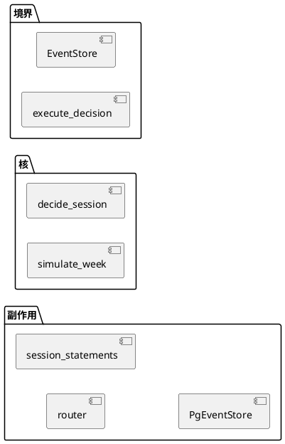

# サイトシーイング・マップ（生成）: アーキテクチャ

この文書は、コードの注釈とソースから生成した。手で編集しない（試験 `livingdoc` が、コードとの差で失敗する）。再生成: `just livingdoc`（`cargo run -q -p beergame-livingdoc -- generate`）。

このアプリケーションは、**副作用を持たない核**と、**副作用を持つ外側**に分かれる。まず見るべき場所を層ごとに示す。
見どころは、注釈 `@landmark` を付けた要素を、ソースの走査で集めたもの（名前や場所は名指ししない）。7 個に絞った。
順序は付けない（処理の流れを順にたどるには、[ガイドツアー](./walking-skeleton-tour.md)を使う）。

## 全体の構成

見どころを、区分ごとの枠に並べる（順序は付けない。枠の間に矢印は引かない）。

### 層の間の依存の向き

ビルドの定義（各クレートの `Cargo.toml`）から導いた、クレートの依存。内側は、外側を知らない。

- `domain` は、どのクレートにも依存しない（最も内側）
- `application` は `domain` に依存する
- `adapter-persistence` は `application`、`domain` に依存する
- `adapter-http` は `application`、`domain` に依存する
- `app` は `adapter-http`、`adapter-persistence`、`application`、`domain` に依存する

### 核

副作用を持たない純粋な規則。入力から結果を決める。テストが速く、同じ入力は同じ結果になる

#### `decide_session`（関数）

進行の規則の全部。入出力も時計も持たない純粋関数なので、規則を表にして網羅的に試せる

場所: `apps/beer-game-rust/crates/domain/src/session.rs`

#### `simulate_week`（関数）

副作用の無い計算。テストが速く、同じ入力は同じ結果になる

場所: `apps/beer-game-rust/crates/domain/src/simulate.rs`

### 境界

核と外側のつなぎ目。ポート（トレイト）で外側の実装を隠し、コマンドの実行手順を持つ

#### `EventStore`（トレイト）

核と永続化のつなぎ目。トレイトで外側の実装を隠すので、核とコマンドの手順は、データベースなしで試せる

場所: `apps/beer-game-rust/crates/application/src/lib.rs`

#### `execute_decision`（関数）

コマンドの実行手順。読む → 決める（ドメイン）→ 追記する → 確定する、を 1 つのトランザクションで行い、競合は読み直して再試行する。業務の規則は持たない

場所: `apps/beer-game-rust/crates/application/src/lib.rs`

### 副作用

データベースと HTTP。ポートを実装し、核が決めた結果を永続化・送受信する

#### `router`（関数）

HTTP の入口。ハンドラーは薄く、入力の形の検証・認証の結果の受け渡し・応答の組み立てだけを行い、業務の規則はドメインに任せる

場所: `apps/beer-game-rust/crates/adapter-http/src/api.rs`

#### `session_statements`（関数）

読み取りモデルの更新。イベントから、投影の表への書き込み（SQL と束縛値）を純粋に導き、追記と同じトランザクションで実行する（CQRS の読み取り側）

場所: `apps/beer-game-rust/crates/adapter-persistence/src/projection.rs`

#### `PgEventStore`（型）

イベントストアの実装。追記専用で、同じ版への同時の追記は一意制約の違反で検出して一方だけを成功させる（楽観的並行制御）

場所: `apps/beer-game-rust/crates/adapter-persistence/src/store.rs`
