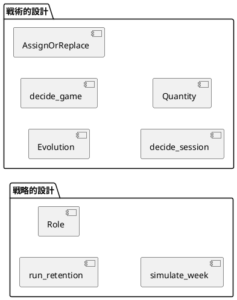

# サイトシーイング・マップ（生成）: DDD

この文書は、コードの注釈とソースから生成した。手で編集しない（試験 `livingdoc` が、コードとの差で失敗する）。再生成: `just livingdoc`（`cargo run -q -p beergame-livingdoc -- generate`）。

このアプリケーションの設計は、**戦略的設計（言葉と、力を注ぐ場所）と、戦術的設計（モデルの部品）**で読む。まず見るべき場所を絞って示す。
見どころは、注釈 `@landmark` を付けた要素を、ソースの走査で集めたもの（名前や場所は名指ししない）。8 個に絞った。
順序は付けない（処理の流れを順にたどるには、[ガイドツアー](./walking-skeleton-tour.md)を使う）。

## 全体の構成

見どころを、区分ごとの枠に並べる（順序は付けない。枠の間に矢印は引かない）。

### 戦略的設計

業務の言葉をそろえ、力を注ぐ場所（中核）を決める。何を作り込み、何を割り切るかの判断

#### `run_retention`（関数）

一般のコンテキスト（保持と削除）。中核ではないので、作り込まずに、期限の検出と連鎖削除を最小の手順で実装し、失敗したら何も消さずに再試行する

場所: [`apps/beer-game-rust/crates/application/src/retention.rs`](https://github.com/k2works/case-study-beer-game-simulation/blob/develop/apps/beer-game-rust/crates/application/src/retention.rs)

#### `Role`（型）

ユビキタス言語の核。4 つの持ち場と、上流・下流の関係を型にする。コード・設計書・画面が同じ言葉で話す

場所: [`apps/beer-game-rust/crates/domain/src/role.rs`](https://github.com/k2works/case-study-beer-game-simulation/blob/develop/apps/beer-game-rust/crates/domain/src/role.rs)

#### `simulate_week`（関数）

中核の計算。力を注ぐ場所で、時計・乱数・永続化に依存しない純粋関数にして、入力だけで結果が決まるようにする

場所: [`apps/beer-game-rust/crates/domain/src/simulate.rs`](https://github.com/k2works/case-study-beer-game-simulation/blob/develop/apps/beer-game-rust/crates/domain/src/simulate.rs)

### 戦術的設計

モデルの部品。集約が規則を持ち、事実（イベント）だけを返し、状態は事実を畳み込んで得る

#### `Evolution`（型）

畳み込みの全域性。`decide` が作らない列は `Ignored` で返して状態を守り、再生側が検知する（fail closed）`decide` が作らない列（例: 未開始への入力の保存）は `Ignored` で返し、状態は変わらない。

場所: [`apps/beer-game-rust/crates/domain/src/foundation.rs`](https://github.com/k2works/case-study-beer-game-simulation/blob/develop/apps/beer-game-rust/crates/domain/src/foundation.rs)

#### `decide_game`（関数）

準備の集約の規則。進行と同じ形（状態とコマンドから、事実か誤りを返す）で、コンテキストごとに規則の置き場が 1 つに決まる

場所: [`apps/beer-game-rust/crates/domain/src/game.rs`](https://github.com/k2works/case-study-beer-game-simulation/blob/develop/apps/beer-game-rust/crates/domain/src/game.rs)

#### `AssignOrReplace`（型）

2 つの集約にまたがる規則。開始後の入れ替えは game と session の 2 本のストリームに同時に事実を残すので、単独の集約ではなく、ここで束ねる

場所: [`apps/beer-game-rust/crates/domain/src/replace_role.rs`](https://github.com/k2works/case-study-beer-game-simulation/blob/develop/apps/beer-game-rust/crates/domain/src/replace_role.rs)

#### `decide_session`（関数）

集約の規則。状態とコマンドから、事実（イベント）か誤りを返す。状態は書き換えない

場所: [`apps/beer-game-rust/crates/domain/src/session.rs`](https://github.com/k2works/case-study-beer-game-simulation/blob/develop/apps/beer-game-rust/crates/domain/src/session.rs)

#### `Quantity`（型）

値オブジェクト。範囲を検証するスマートコンストラクタで作り、フィールドを公開しない。不正な値は、型として作れない

場所: [`apps/beer-game-rust/crates/domain/src/values.rs`](https://github.com/k2works/case-study-beer-game-simulation/blob/develop/apps/beer-game-rust/crates/domain/src/values.rs)
