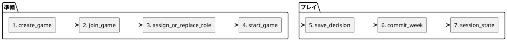

# ガイドツアー（生成）: ウォーキングスケルトン

この文書は、コードの注釈とソースから生成した。手で編集しない（試験 `livingdoc` が、コードとの差で失敗する）。再生成: `just livingdoc`（`cargo run -q -p beergame-livingdoc -- generate`）。

最初の縦の切片（1 ゲーム・4 役割・1 週）を、準備（作成・参加・割り当て・開始）とプレイ（入力・確定・状態の表示）の操作の順に案内する。（7 ステップ）
ステップは、注釈 `@tour` を付けた要素を、ソースの走査で集めて、順位（rank）の順に並べたもの（名前や場所は名指ししない）。
各ステップの説明は、注釈の説明から取り出す。コマンドとイベントの対応は[イベント一覧](./events.md)を参照する。

## 全体の流れ

図の矢印は、読む順序を示す（実行時の呼び出しの順とは限らない。たとえば、問い合わせ側は投影を読むだけで、書き込みの後続ではない）。

### 準備

#### 1. `create_game`（関数）

進行役がゲームを作成する。設定を検証し、参加コードと進行役の資格を発行する。ここから、参加と割り当てを受け付ける準備中が始まる

API: `POST /api/v1/games`

発行するイベント: EV-G01 `GameCreated`

場所: `apps/beer-game-rust/crates/application/src/commands.rs`

#### 2. `join_game`（関数）

参加者が、参加コードと表示名で参加する。アカウントは作らず、復帰資格を発行する

API: `POST /api/v1/participations/join`

発行するイベント: EV-G02 `ParticipantJoined`

場所: `apps/beer-game-rust/crates/application/src/commands.rs`

#### 3. `assign_or_replace_role`（関数）

進行役が、参加者に役割を割り当てる。準備中は割り当て・付け替え、開始後は入れ替えになり、規則はドメインが決める

API: `PUT /api/v1/games/{game_id}/participants/{participant_id}/role`

発行するイベント: EV-G03 `RoleAssigned`

場所: `apps/beer-game-rust/crates/application/src/commands.rs`

#### 4. `start_game`（関数）

進行役がゲームを開始する。各役割に 1 人以上いることを確かめ、game と session の 2 本のストリームへ同じトランザクションで追記する。ここから、入力を受け付けるプレイが始まる

API: `POST /api/v1/games/{game_id}/start`

発行するイベント: EV-G11 `GameStarted`、EV-S01 `SessionStarted`

場所: `apps/beer-game-rust/crates/application/src/commands.rs`

### プレイ

#### 5. `save_decision`（関数）

参加者が、自分の役割の発注量を保存する。意思決定の版が一致しなければ拒否し、保存のたびに版が 1 増える。4 役割がそろうまで、週は進まない

API: `PUT /api/v1/sessions/{session_id}/decisions`

発行するイベント: EV-S05 `DecisionSaved`

場所: `apps/beer-game-rust/crates/application/src/commands.rs`

#### 6. `commit_week`（関数）

進行役が週を確定する。4 役割の入力がそろい、根拠にした版が現在と一致するとき、週次計算を呼んで、次の週の状態を事実として残す

API: `POST /api/v1/sessions/{session_id}/weeks/{week}/commit`

発行するイベント: EV-S08 `WeekCommitted`

場所: `apps/beer-game-rust/crates/application/src/commands.rs`

#### 7. `session_state`（関数）

画面が、いまの週・自分の役割の状態・入力の状況を読む。投影の行から、呼び出した人ごとの規則で見せる範囲を絞り、他の役割の値は返さない（問い合わせ側。書き込みの後続ではない）

API: `GET /api/v1/sessions/{session_id}/state`

場所: `apps/beer-game-rust/crates/adapter-http/src/api.rs`
