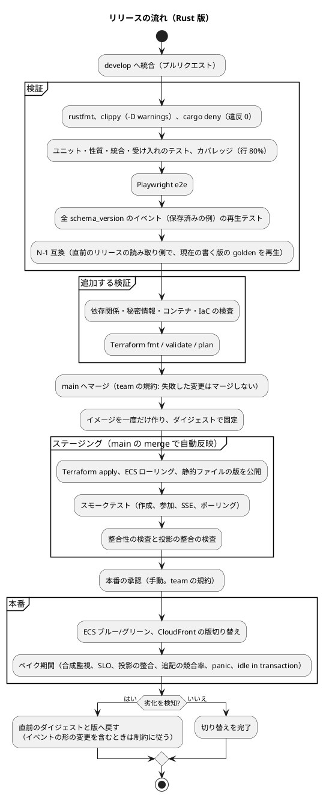

# 運用要件定義 - ビールゲームシミュレーション（Rust 版）

## 概要

本書は、beer-game-rust を本番で運用するための要件を定義します。[ADR-001](../../adr/beer-game-rust/001-rust-version-of-beer-game-kotlin.md) により、[beer-game-kotlin の運用要件](../beer-game-kotlin/operation.md)（beer-game2 の運用要件を引き継いだもの）を**正本として引き継ぎ**、Rust の実行環境で変わるものだけを見直しました。**`docs/` を正本**とします。実装コード、Terraform、アラーム、手順書は**まだ存在せず**、本書の「アラーム」「手順書」は、作成する対象の設計です。

変えるのは、次の 4 点だけです。

- **JVM に固有の監視・障害パターン・手順書**（ヒープ・GC・ウォームアップ・スレッド・ヒープダンプ）を、Rust の実行環境（常駐メモリ、panic、tokio のタスク、接続プール）に読み替える。
- **キャンセル後のトランザクションの取り残し**を、新しい障害パターンとして加える（キャンセル安全性。[非機能要件](./non-functional.md) の NF-R18）。
- ツールの違い（`cargo-deny`、clippy、sqlx のマイグレーション、Rust のツールチェーンの更新）。
- team の規約（`main` の merge で staging へ自動反映、production は手動承認。CI とデプロイのワークフローは beer-game3 とは別に新設）。

ES + CQRS に由来する運用（`events` が状態の正本、投影の再構築、投影の整合の検査、追記の競合率、イベントスキーマの進化と 2 段階のリリース、書く版の切り替え）は、**Kotlin 版と同じ**です。

運用の体制、通知先、連絡先は、**組織に依存するため未決定**です（beer-game2・Kotlin 版と同じ。「要確認」）。

### 本書の位置づけと確認の範囲

- **本書で確認したこと**: キャンセル・panic 後のトランザクションの取り残しを検知するクエリと、自動切断の設定を、**PostgreSQL 18.6**（ローカルの Docker の `postgres:18.6`、使い捨てのコンテナ。終了後に削除）で実測しました（2026-11-19。下の「障害パターン 17」）。
  - `pg_stat_activity` の `state = 'idle in transaction'` で、BEGIN したまま放置したセッションを捉えられる。
  - **ログインロール**に `idle_in_transaction_session_timeout = 2s` を設定すると、放置したセッションが `FATAL: terminating connection due to idle-in-transaction timeout` で切断される。**NOLOGIN のロール（`beergame_writer` など）に設定しても、メンバーのログインユーザーには継承されず、効かない**（2026-11-21 のレビューで再現して確認。この文書の初版は、設定先を NOLOGIN ロールと誤って書いていた）。
- **確認していないこと**: それ以外の運用（監視の閾値、アラーム、バックアップ・復元の所要時間、デプロイ、ブルー/グリーン、各手順書）は、すべて**未実装・未検証**です。Rust 版のインフラ設計は [インフラストラクチャ](./architecture-infrastructure.md) にあります（RI1〜RI5 は承認済みで、実行イメージの実在確認・メモリの割り当て・起動の猶予期間などの実測は B1 以降）。
- Kotlin 版の実装の経緯（B3・B13・B14 の注記）は引き継ぎません（Rust 版の値ではないため）。Kotlin 版の未決事項は、本書の未決事項に引き継ぎます。

### 凡例

Kotlin 版と同じです。**引継**は Kotlin 版と同じ、**変更**は内容を Rust 版に合わせて変える、**新**は Rust 版で加える。

## 運用の前提

| 項目 | 内容 |
| :--- | :--- |
| 利用の形態・重視する時間帯・運用の主体 | Kotlin 版と同じ（研修・授業のセッション。同時に最大 15 ゲーム、拡張目標 25。運営者が実施日時を事前に伝える仕組みが必要（未決）。体制は要確認） |
| 守るべき資産 | **`events` 表（状態の正本）**、資格、保持期間内のゲームの記録。確定済みの週の記録は RPO 0（引継） |
| 作り直せるもの | 投影は `events` から再構築できる。周辺ストア（表示名・資格）は `events` から復元できないため、`events` と同じ重要度で保護する（引継） |
| 実行環境 | **Rust の単一バイナリ**をコンテナで ECS のタスクとして動かす想定（[インフラ](../beer-game-kotlin/architecture-infrastructure.md) を出発点とする。Rust 版の設計は [インフラストラクチャ](./architecture-infrastructure.md)）。ツールチェーンは `rust-toolchain.toml` で固定（1.97.1。[技術スタック](./tech-stack.md)）（変更） |
| 主な SLO | 月間可用性 99.5%、研修中の完全停止を 1 分以内に検知、RTO 15 分、RPO 0（[非機能要件](./non-functional.md)。引継） |

## 運用フロー

| 周期 | 作業 | 主体 | 自動化 | Rust 版 |
| :--- | :--- | :--- | :--- | :--: |
| 常時 | ヘルスチェック、アラートの通知 | 自動 | ALB のヘルスチェック、CloudWatch のアラーム | 引継 |
| 研修の前 | 実施日時の連絡を受け、直前の合成監視（作成から参加、SSE まで）で正常を確認する。**コールドスタート直後も NF-P16 の目標（p95 2 秒以下）を満たすことを確認する**（JIT のウォームアップは無いが、接続プールと OS のキャッシュの影響は残る） | 運用担当 | 合成監視を自動化 | 変更 |
| 研修の中 | アラートに即応できる状態にする（オンコール） | 運用担当 | — | 引継 |
| 日次 | ダッシュボードで、エラー率、応答時間、追記の競合率、投影の整合、削除の滞留と失敗の件数を確認する。**panic の件数と、`idle in transaction` の取り残しの有無も確認する** | 運用担当 | アラートで代替 | 変更 |
| 日次 | コストの確認（予算の 80% 実績、100% 予測の通知） | 自動 | AWS Budgets | 引継 |
| 日次 | 期限切れの資格、ブラウザセッション、冪等記録の掃除 | 自動 | 定期タスク | 引継 |
| 週次 | 失敗した削除（`FAILED`）の確認と再試行 | 運用担当 | 失敗時の通知 | 引継 |
| 月次 | SLO のレポート、容量のレビュー（**常駐メモリ（RSS）と tokio のタスク数を含む**）、**依存クレートの更新（`cargo-deny` の検査を通す）とセキュリティのパッチ** | 運用担当 | レポートを自動生成 | 変更 |
| 四半期 | 復元の訓練（時点復旧）と投影の再構築の訓練 | 運用担当 | 手順をスクリプト化 | 引継 |
| 年次 | 鍵のローテーション、権限の棚卸し、**Rust のツールチェーン（新しい安定版）と基盤イメージの更新の確認**、監査への対応 | 運用担当、セキュリティ責任者 | — | 変更 |
| 随時 | リリースとロールバック（変更管理を参照）。イベントの形の変更を伴うリリースは 2 段階で行う | 開発・運用 | CI/CD | 引継 |

**Rust のサポート期限**: Rust は LTS を持たず、最新の安定版だけがサポートされます（[技術スタック](./tech-stack.md)）。JDK のような「サポート期限の管理」ではなく、**新しい安定版への更新の頻度と、依存クレートの脆弱性・メンテナンス状況の確認**を運用の対象にします。

## 監視設計

閾値は、[非機能要件](./non-functional.md) と beer-game2・Kotlin 版の監視設計から導きます。**根拠のない値は提案で、実装後の実測で見直します。** 警告（Warning）は担当者の確認、重大（Critical）は即時の対応です。メトリクスは、アプリが出力する CloudWatch の EMF の JSON 行（標準出力）を第一候補とします（BD9 を引き継ぐ）。名前は仮です。

### 引き継ぐ項目

**Kotlin 版の「beer-game2 から引き継ぐ項目」（15 行）と「Kotlin 版で加える項目」のうち JVM 以外（投影の遅れ・反映待ちの再取得・投影の整合の検査・追記の競合率・再構築の排他ロックの待ち・再試行の上限超過・再生の所要時間・イベントの読み込み失敗）は、閾値も含めて変えず引き継ぎます。** 主なものは次のとおりです（正本は [Kotlin 版](../beer-game-kotlin/operation.md)）。

| 区分 | 監視項目 | Warning | Critical |
| :--- | :--- | :--- | :--- |
| 可用性 | 主要な操作（作成、参加、確定）の成功 | — | 1 分間、成功が無い |
| 可用性 | 5xx の割合 | 1% 超（5 分） | 5% 超（1 分） |
| 性能 | API の応答（p95） | 800 ms 超（5 分） | 1 秒超（5 分） |
| 性能 | 週確定から画面反映（p95） | 1.5 秒超（5 分） | 2 秒超（5 分） |
| 整合性 | 週結果の重複、不変条件の違反、イベントの欠落 | — | 1 件でも |
| 投影 | `projected_version` と `MAX(stream_version)` の差（5 分ごと）。投影の整合の検査（日次） | — | 差・不一致 1 件 |
| 追記 | 追記の競合率 | 5% 超（5 分。提案） | 20% 超（5 分。提案） |
| 追記 | 再試行の上限超過 | 1 件（5 分） | 5 件（5 分。提案） |
| 追記 | 再生の所要時間（p95） | 100 ms 超（5 分。提案） | 300 ms 超（5 分。提案） |
| イベント | イベントの読み込み失敗（未知の `event_type`・`schema_version`、デコード失敗） | — | 1 件でも |
| データベース | CPU、**接続プールの使用率**（sqlx） | 70% 超 | 80% 超（10 分） |
| 削除 | 期限超過の経過時間 / 再試行の回数 / 恒久的な失敗 | 18 時間 / 3 回目 / — | 24 時間 / 5 回 / 発生から 5 分以内に通知 |
| セキュリティ | Origin 拒否、認証失敗の急増 | 平常の 3 倍（提案） | 平常の 10 倍（提案） |

### Rust 版で読み替え・加える項目

Kotlin 版の JVM の 4 項目（ヒープ、GC の一時停止、OOM とスレッドの飽和、起動の遅さ）を、次のとおり読み替えます。

| 区分 | 監視項目 | Warning | Critical | 情報源 | 根拠 |
| :--- | :--- | :--- | :--- | :--- | :--- |
| メモリ | **常駐メモリ（RSS）の使用率**（コンテナのメモリ上限に対する割合） | 70% 超（10 分） | 85% 超（10 分） | アプリ、ECS | NF-P17（RSS ≤ 上限の 70%、OOM kill 0 件）。**GC はないので、一時停止の項目は削除**。値の提案は Kotlin 版のヒープの閾値を引き継ぐ |
| メモリ | **OOM kill による再起動** | — | 1 件 | ECS | OOM は kill として現れる。原因は、メモリの確保が増え続けるリーク、または長いストリームの再生 |
| 実行 | **panic の件数**（プロセスを落とす／タスクで捕捉した件数） | 1 件（5 分） | 5 件（5 分。提案）、またはプロセスの再起動 | アプリ | **NF-O12（変更）**。ドメインは panic しない設計（RD5）のため、1 件でも不具合を示す。500 と相関 ID の記録を伴う |
| 実行 | **tokio のタスク数の増加**（増え続けて下がらない）、実行の待ち | 単調増加が 30 分（提案） | — | アプリ | タスクのリーク（切断後に spawn したタスクが終わらないなど）の検知 |
| 実行 | **DB の接続プールの待ち**（取得の待ち時間）と枯渇 | 待ちが 100 ms 超（5 分。提案） | 枯渇（取得のタイムアウト） | アプリ | JVM の「ブロッキング I/O 用ディスパッチャーの飽和」に当たる項目。取り残しのトランザクション（パターン 17）の兆候にもなる |
| 実行 | **ファイル記述子の数**（上限に対する割合） | 70% 超（提案） | 85% 超（提案） | アプリ、ECS | SSE の多数の接続・DB の接続の漏れの検知。JVM のスレッド数の代わり |
| データベース | **`idle in transaction` の取り残し**（新） | 1 件が 10 秒を超える（提案） | 5 件、または 30 秒を超える（提案） | DB の問い合わせ（`pg_stat_activity`）のジョブ | **NF-R18（新）**。キャンセル・panic の後の取り残しの検知。**検知クエリを実測で確認済み**（下の障害パターン 17） |
| 起動 | **タスクの起動時間**: ECS がタスクの起動を始めてから `/api/v1/ready` が初めて成功するまで | 60 秒超（提案） | 120 秒超（提案） | ECS | Kotlin 版の区間の定義を引き継ぐ。**Rust は短い見込みだが、実測する**（提案値は上限として維持。RN1） |

**起動時間の測る区間**は、Kotlin 版と同じ 2 つを混ぜずに測ります（アプリの起動時間 = プロセスの開始から `/api/v1/ready` の成功まで、p95 30 秒（NF-P16。上限として維持し、実測で縮める）。タスクの起動時間 = ECS がタスクの起動を始めてからヘルスチェックの成功まで）。RTO（15 分）の見積もりは、タスクの起動時間を使います。

**「整合性」の行**は、Kotlin 版と同じです（`stream_version` の欠番、`week_commits` と `WeekCommitted` の件数の不一致、内部エラー、想定外の一意制約違反）。

### ヘルスチェック

| 種類 | 内容 | Rust 版 |
| :--- | :--- | :--: |
| 生存（liveness） | プロセスが応答する（`GET /api/v1/health`） | 引継 |
| 準備（readiness） | データベースに接続できる（`SELECT 1`）、接続プールの取得、通知の受信が生きている（`LISTEN` の接続）、**マイグレーションが適用済み（スキーマの版が期待と一致）**（`GET /api/v1/ready`） | 引継 |

JVM のウォームアップの猶予期間は不要ですが、**ヘルスチェックの開始待ちの猶予期間は、タスクの起動時間の実測で決めます**（未決）。

### ログと追跡

Kotlin 版と同じです。構造化 JSON（`tracing`）、`LogRecord` の型で資格・表示名・非公開の値を持たせない、相関 ID を HTTP・トランザクション・イベントの封筒・SSE・ログに伝える、監査は `events`（専用の監査表は持たない）、CloudWatch Logs に本番 90 日・その他 14 日。**運用担当が `events` を調べても個人情報に触れません**（NF-S14）。**Rust 版の追加**: panic の記録（panic フックで、相関 ID（取れる場合）とバックトレースを記録し、利用者へは相関 ID だけを返す）。

### ダッシュボード

Kotlin 版の項目（リクエスト量・応答時間・エラー、進行中のゲーム数と SSE の接続数、確定の成功・競合・ロールバック、追記の競合率・再試行の上限超過・再生の所要時間・投影の整合、DB の状態、SLO の消費、削除の状況）に、**JVM のヒープ・GC・スレッドの代わりに、RSS・タスク数・接続プールの待ち・ファイル記述子・panic の件数・`idle in transaction` の件数**を載せます（NF-O5）。

## アラートとエスカレーション

重要度の定義と対応の目標は Kotlin 版と同じです（P1: 研修中の停止、データの整合性の違反、削除の恒久的な失敗、バックアップの失敗。P2: 性能の劣化、配信の遅延、削除の遅れ。P3: 予算、容量の予兆）。Rust 版で加えた項目の重要度は次のとおりです。

| 重要度 | Rust 版で加えた項目 |
| :--- | :--- |
| P1（重大） | OOM kill による再起動、panic の多発（Critical）、`idle in transaction` の Critical、投影の整合の不一致、イベントの読み込み失敗 |
| P2（高） | panic（Warning）、接続プールの枯渇・待ち、RSS の使用率、追記の競合率・再試行の上限超過、再生の所要時間 |
| P3（中） | タスク数の増加、ファイル記述子、起動の遅さ |

インシデント対応の流れ（検知 → 重要度の判断 → インシデントの宣言 → 原因の切り分け → ロールバック／障害パターンの手順 → 復旧の確認 → 運営者への連絡 → 事後分析）は Kotlin 版と同じです。**オンコールの当番、呼び出しの手段、インシデントのチャンネル、運営者への連絡窓口は未定義**です（未決事項）。

## バックアップ設計

**Kotlin 版と同じです**（状態の正本は `events`。RDS の自動バックアップによる PITR と Multi-AZ、保持 7 日。Web の静的ファイルは S3 のバージョニング。イメージは ECR のダイジェスト固定で、イベントの形を変えたリリースの旧イメージは戻せる期間を記録。Terraform の状態は暗号化した S3。秘密情報は Secrets Manager で、資格の鍵は複数の版を同時に保持。エクスポートは保存しない）。

| 指標 | 目標 | 根拠 |
| :--- | :--- | :--- |
| RPO | 確定済みの週は 0 | 追記のコミット後にだけ応答する。Multi-AZ の同期スタンバイ。確定済みの週の事実は `events` にあり、投影が壊れても失われない |
| RTO | 15 分（NF-R4 と同じ値。全パターン共通） | アプリの起動（ECS のタスクの起動時間）と、必要な場合の投影の再構築を含む。投影だけの障害にも別の値を置かない |

**机上の留意点（Kotlin 版の B14 の机上確認を引き継ぐ）**: RPO 0 は Multi-AZ のフェイルオーバーでは成り立つが、**PITR では成り立たない**（復元可能な最新時刻が数分遅れる）。RTO 15 分は、PITR の新しいインスタンスの作成で収まる保証がない（実測が要る）。**この扱いは、人が決める**（未決事項）。

### 復元の手順（要件）

A（データベース全体の復元）と B（投影の再構築）は、Kotlin 版の手順を**そのまま引き継ぎます**（A: 時点復旧 → 保持の定期タスクで期限切れを再削除 → 整合性の検査 → 投影の整合の検査 → 接続先の切り替えと合成監視 → 運営者へ連絡。B: 対象の決定 → 研修中は運営者を通じて進行役に「停止」を依頼 → 排他のアドバイザリロックを取って再構築 → 検査 → 進行役に「再開」を依頼 → 差が残れば投影のバグとして緊急変更）。再構築は `events` を読むだけで、**周辺ストア・削除の受領記録・削除の進行は復元されない**（これらが壊れたときは A）。

**訓練**: 四半期に 1 度、リリース前、バックアップ方針の変更時に、A と B の訓練を行い、RPO と RTO の実測値を記録します。

### バックアップと削除の関係

保持期間後に削除しても、**自動バックアップには最大 7 日間、削除前のデータが残ります**。この期間を保持方針に明記し、運営者へ示します（NF-S16）。**保持の起点は作成時**（暫定。終了時から数える案は未決）。復元時は、削除済みのゲームを再び削除します。保持の定期タスクは EventBridge Scheduler から 5 分ごとに起動し、削除は 1 ゲームずつ 1 トランザクションで、`game_roots` の連鎖削除で `events` を含む全行が消えます（失敗したら何も消えず、5 回まで再試行）。**連鎖削除が、`events` に DELETE 権限を持たないロールでも動くことは、PostgreSQL 18.6 で実測済み**です（[データモデル](./data-model.md)。1 回の実測）。

## 障害対応設計

### 障害パターンと復旧

Kotlin 版の 16 パターンのうち、**1〜14 と 16 は引き継ぎます**（API のタスクの異常、API の全停止、DB のフェイルオーバー、DB の破損・誤操作、SSE の不通、デプロイの失敗、削除の失敗、資格の漏洩、鍵の誤設定・漏洩、CloudFront の設定ミス、利用者側の操作ミス、依存関係の重大な脆弱性、投影の不整合、追記の競合の多発、イベントの読み込み失敗）。**パターン 1 の「OOM なら、ヒープの設定とリークを調べる（パターン 15）」は、Rust 版のパターン 15 を指します。** パターン 15 を読み替え、パターン 17 を加えます。

| # | パターン | 検知 | 影響 | 初動と復旧 | 目標 |
| :--- | :--- | :--- | :--- | :--- | :--- |
| 15 | **Rust のメモリ・panic の劣化**（RSS の逼迫、OOM kill、panic の多発、タスクの滞留）（変更。Kotlin 版は JVM のメモリ・GC） | RSS の使用率、OOM の再起動、panic の件数、タスク数の増加のアラーム | 応答が遅くなる、タスクが落ちる。panic は 500 と相関 ID に写るが、多発は不具合を示す | ダッシュボードで直近の変更（デプロイ、再生するイベントの量）を確認し、**まずタスクを増やす・置き換える**。続く場合は、panic のバックトレース（ログ）を調べ、**長いストリームの再生**（メモリの確保）と**切断後に残るタスク**を疑い、直近のリリースを疑う。**panic が確認できたら、ドメインの `unwrap`・添字アクセスの混入（lint の抜け）を確認する**（RD5）。メモリのプロファイルの取得は、運用担当の承認を得る | 30 分（提案） |
| 17 | **キャンセル・panic 後のトランザクションの取り残し**（新） | `idle in transaction` の件数と経過時間、接続プールの待ち・枯渇 | 接続を占有し続け、プールが枯渇して全体が遅くなる／止まる。ロックを持ったままなら、再構築や他のコマンドが待たされる | 下の手順 | 15 分（提案） |

**パターン 17 の初動と復旧**（検知クエリと自動切断の設定は、**PostgreSQL 18.6 で実測して確認済み**）:

1. **検知**: 次のクエリで、取り残しを確認する（`application_name` でアプリのセッションを区別する）。`state = 'idle in transaction'` のセッションを、BEGIN したまま放置したものとして捉えられることを実測で確認した。

   ```sql
   SELECT application_name, state, round(extract(epoch FROM now() - xact_start)) AS 経過秒
   FROM pg_stat_activity
   WHERE state = 'idle in transaction';
   ```

2. **自動の安全網**: **アプリが接続する「ログインユーザー」（または接続文字列の `options`、接続後の `SET`）に** `idle_in_transaction_session_timeout` を設定し、**取り残しが一定時間で DB によって切断される**ようにする（例: `ALTER ROLE <ログインユーザー> SET idle_in_transaction_session_timeout = '<値>'`）。**NOLOGIN の `beergame_writer` に設定しても効かない**（ロールごとの設定は、ログインしたロール自身にだけ適用され、メンバーシップでは継承されない。**PostgreSQL 18.6 で、NOLOGIN ロールに設定するとメンバーで `SHOW` が `0`（無効）、`SET ROLE` した後も `0`、ログインユーザー自身に設定すると `2s` になることを再現して確認した**。2026-11-21 のレビュー H1）。**ログインユーザーに 2 秒を設定すると、BEGIN したまま放置した接続が `FATAL: terminating connection due to idle-in-transaction timeout` で切断されることを実測で確認した**（2026-11-19）。切断されたトランザクションは ROLLBACK され、保持していたロックは解放される。**値は、コマンドのトランザクションの最大の長さより十分長く決める**（提案: 30 秒。実測で見直す。短すぎると正常な処理を切る）。**統合テストで、アプリの接続で `SHOW idle_in_transaction_session_timeout` が期待値になることを確かめる**（[テスト戦略](./test-strategy.md)）。
3. **原因の調査**: 取り残しが出た時刻の前後の、クライアントの切断・panic・デプロイを確認する。**NF-R18 の前提（失敗の経路での明示の ROLLBACK、spawn による隔離、spawn したタスクの追跡）が破れている可能性**がある。パターン 15 の panic の記録と照合する。
4. **恒久対策**: キャンセル安全性のテスト（[テスト戦略](./test-strategy.md) の RT2）に、再現のテストを加える。

**安全網の位置づけ**: この設定は、NF-R18 を満たす設計（失敗の経路での明示の ROLLBACK、spawn）の**代わりではなく、最後の守り**です。取り残しの件数が 0 でないこと自体を、アラームの対象にします（設定があっても、検知は残す）。**この安全網は `active` の待ち（ロックの待ち）を切らない**ため、`lock_timeout` を別に設定する（[バックエンドアーキテクチャ](./architecture-backend.md)）。

### 利用者・進行役への案内（パターン 15・17。レビュー H9・M18）

パターン 13・14 と同じく、**運営者を通じて進行役へ依頼する文言**を定めます（Kotlin 版のパターン 13・14 に倣う）。

| 場面 | 依頼・案内の文言（案） | 補足 |
| :--- | :--- | :--- |
| パターン 17（取り残し）で、プールが枯渇して全体が遅い／止まる | 「システムが混み合っています。数分お待ちください。**入力済みの発注は保存されています。** 再開の案内があるまで、同じ操作を繰り返さないでください。」 | 利用者が再操作すると負荷が増える。画面は「問題が発生しました。時間をおいて、もう一度お試しください。」を出す（`app.internal`）ため、進行役から口頭でも案内する |
| パターン 15 で、タスクを置き換える（OOM kill、panic の多発） | 「画面が一瞬切れても、自動でつながり直します。切れた場合は、少し待ってから画面を更新してください。入力済みの内容は保存されています。」 | OOM kill でタスクを置き換えると、接続が切れる（SSE を使う場合はそれも切れる） |
| 復旧中の再開の依頼 | 「復旧しました。画面を更新して、続きから操作してください。」 | 進行役が一時停止していた場合は、再開を依頼する |

**自動切断で利用者に何が見えるか（M18）**: `idle_in_transaction_session_timeout` で切断されるのは、**取り残されたトランザクション**（応答を返す役目を終えたもの）で、**利用者の要求に直接の応答を返すものではない**。要求の処理が、切断された接続で失敗した場合は、`Persistence` の失敗（500・相関 ID。`type` つき）として返り、**画面は「結果が不明」でなく失敗として扱う**（[UI 設計](./ui-design.md)）。COMMIT 前に切断されたトランザクションは ROLLBACK されるため、再操作しても二重にならない。ただし、**COMMIT の応答が失われた場合は、結果が不明**であり、同じ `Idempotency-Key` での再送が回復の手段になる。

### 進行役向けの「研修中にシステムが止まったら」の案内（H9）

手順書の一覧（下）に、**運用担当向けでなく、進行役（運営者）向けの案内**を加えます。RTO 15 分は、90 分前後の研修で大きな割合を占めるため、**進行役が待つ間に場を持たせる手段**が要ります。案の項目: (1) まず落ち着いて、**参加者に「入力済みの発注は保存されている」ことを伝える**。(2) 紙などで、各役割の**今週の発注数を控える**。(3) 復旧後、**停止中も受け付ける「代理入力」で、控えた値を入れ直す**（停止して代理入力し、再開する。業務上自然な流れ）。(4) 復旧が長引くときは、**その研修の残りを振り返りの時間に切り替える**（確定済みの週までの結果を見る）。(5) 連絡窓口（運営者を通じた運用担当）。**具体の文言と配布の方法は、運営者と合意して決める**（連絡窓口は未決。Kotlin 版にも同様の案内がないため、Kotlin 版のヘルプ（S11）にも反映できる）。

各パターンの**手順書**は、`docs/operation/beer-game-rust/` に作成します（下の一覧）。

### 事後分析

Kotlin 版と同じです（時系列、原因、検知の遅れ、復旧の手段、再発防止。個人の責任を問わない）。投影の不整合とイベントの読み込み失敗は、原因となったイベントの種類と版を記録し、テストへ反映します。**panic と取り残しは、バックトレースと、キャンセルされたコマンドの種類を記録**し、キャンセル安全性のテストへ反映します。

## 変更管理設計

### リリースの流れ

流れは Kotlin 版と同じです（`develop` へ統合 → 検証 → 追加の検証 → `main` へマージ → イメージを一度だけ作りダイジェストで固定 → ステージング → 本番の手動承認 → 本番（ブルー/グリーン）→ ベイク期間 → 劣化があれば戻す）。**検証の工程は、Rust の道具に置き換えます**（[テスト戦略](./test-strategy.md)）。



**team の規約**: CI とデプロイのワークフローは **beer-game3 用とは別に新しく作ります**（`.github/workflows/beer-game-rust.yml` ほか。未作成）。AWS 環境も beer-game3 専用に用意されているため、**Rust 版の AWS 環境の扱い（専用に用意するか、共有するか）は未決**です。**既存の文書公開は `main` push、コンテナの公開は tag または手動実行という現在の経路は維持します**（team.md）。

### ロールバック

Kotlin 版と同じです（アプリは直前のイメージのダイジェストへ。ただし新しい `schema_version` のイベントが書かれた後は旧イメージへ戻せないことがある。Web は CloudFront の版を戻す。インフラは Terraform の直前の版。DB スキーマは破壊的な変更を前提にせず拡張 → 互換 → 縮小。投影の形は拡張して再構築で埋める）。デプロイの流れは、ビルド → ECR → タスク定義の登録 → **migrate（1 回限りの ECS タスク。終了コード 0 でなければ中止）** → api の更新 → 静的ファイル → スモークテスト → 履歴の記録で、失敗時は直前のタスク定義と静的ファイルの版へ自動で戻す（マイグレーションは戻さない）。ロールバックは履歴から版を選び、**旧イメージが現在のイベントを読めることの確認（`confirm_compatible`）を必須入力**とする方針を引き継ぎます。

**SIGTERM**: Rust のアプリは、SIGTERM で新しい要求を止め、進行中のコマンドの完了を待ち（待ちの上限つき。NF-R18）、**終了コード 0 で正常終了**することを目標とします（Kotlin 版は 143 で、アラームの扱いが未決だった）。**実現は B1 で確認**します（未決事項）。

### イベントスキーマの進化（ES 固有）

**Kotlin 版と同じです。** イベントは変更せず、新しい `schema_version` を追加し、読み込み時にアップキャストを適用します。変更の種類ごとの対応（項目の追加・名前や型の変更・削除・新しいイベントの追加・分割や統合・廃止）と、**2 段階のリリース（読める版を先に上げ、全タスクが新しいアプリになりベイク期間を通した後に、設定で書く版を上げる）**、ロールバックの制約（書く版を上げた後は旧イメージへ戻せないことがある）、検証（全 `schema_version` の golden の再生、N-1 互換のジョブ）を引き継ぎます。**書く版の切り替えは環境変数 `WRITE_SCHEMA_VERSION`（Kotlin 版の提案。Rust 版でも提案。未実装）**とし、変更は本番の環境変数の変更として**確認必須**（承認ゲート）です。

### 変更の承認

標準変更・通常変更・緊急変更の区分と承認は Kotlin 版と同じです。team の規約により、**production への deploy は手動承認が必須**です。**研修の実施日時の前後は、通常変更を凍結**します（実施日時の連絡の仕組みは未決）。

## セキュリティ運用

| 項目 | 要件 | Rust 版 |
| :--- | :--- | :--: |
| 権限 | 最小権限。長期のアクセスキーを置かず、CI は OIDC で一時的な権限を使う。**アプリの DB ロールは `events` への INSERT と SELECT だけ**（追記専用。実測済み）。保持削除は別のロール。**`idle_in_transaction_session_timeout` を、アプリが接続するログインユーザーに設定**（NOLOGIN ロールには効かない。障害パターン 17） | 変更 |
| 鍵と秘密情報 | Secrets Manager で保管し、ローテーションする。鍵の版を管理する | 引継 |
| 脆弱性管理 | 依存関係（**`cargo-deny`**）、秘密情報、コンテナ、IaC を CI で検査し、Critical と High はリリースを止める。月次で更新する | 変更 |
| パッチ | **Rust のツールチェーン（新しい安定版）と基盤イメージの更新を管理する**（Rust は LTS を持たない） | 変更 |
| メモリ安全 | ドメインと application に `unsafe` を置かない（`#![forbid(unsafe_code)]`。NF-S22）。adapter・app で必要になる場合は ADR で承認 | 新 |
| 監査 | 運用担当の本番への操作を記録する（CloudTrail）。ゲームの操作の監査は `events` | 引継 |
| 個人情報 | 収集は表示名のみ。ログ・監視・受領記録・`events` に含めない | 引継 |

## データ運用

Kotlin 版と同じです（保持と削除、削除の運用と証跡、復元後の扱い、追記専用、出力は保存せず要求時に作る、期限切れの掃除）。**変更点**: スキーマの変更は、**sqlx のマイグレーション**を、デプロイ時に 1 回限りのタスクで、拡張 → 互換 → 縮小の順に適用します（イベントは書き換えない）。「追記専用」の連鎖削除が `events` に DELETE 権限を持たないロールで動くことは**実測済み**（1 回、PostgreSQL 18.6）で、Kotlin 版の「動かなければ `SECURITY DEFINER`」の分岐は不要になりました。ただし、**マイグレーションの適用のロール**と、所有者のロールの作り方（RDS）は未決です。

## 容量・コスト管理

| 項目 | 内容 | Rust 版 |
| :--- | :--- | :--: |
| 容量のレビュー | 月次。同時ゲーム数、SSE の接続数、API の p95、DB の接続プールの使用率の推移。**加えて、RSS、tokio のタスク数、再生の所要時間、追記の競合率を確認する** | 変更 |
| 拡張の契機 | API の p95 が 800 ms 超（5 分）、DB の接続プールが 70% 超、SSE の遅延が p95 1 秒超のときに容量アラート。再生の所要時間の p95 が 100 ms を超え続けたときは、スナップショットの導入を検討する | 引継 |
| 自動の増減 | API は CPU 60% を目標に、2〜4 タスクで自動増減。**起動の遅さによる増減の応答の遅れの見込みは、Rust の起動時間の実測で決める**（JVM の見込みは引き継がない） | 変更 |
| 上限を超える見込み | 25 ゲーム・100 接続を超える利用は、実測の飽和点と DB の競合を見て判断する | 引継 |
| コスト | 月次の予算を設定し、実績 80% と予測 100% で通知。開発環境は夜間に縮小（提案）。**Rust のバイナリは小さいため、タスクのメモリの割り当ては、実測してから決める**（Kotlin 版は 2 GiB。引き継がない） | 変更 |

## 運用手順書の一覧（作成予定）

`docs/operation/beer-game-rust/` に作成する手順書です。**すべて未作成**です。手順書は、新しい独自スクリプトを作らず、**定義済みのタスクを使う**方針です（プロジェクトの規約）。必要なタスクが無い場合は、`operating-script` で正式なタスクとして追加します。

| 手順書 | 内容 | 優先度 | Rust 版 |
| :--- | :--- | :--: | :--: |
| アプリケーション開発環境セットアップ | ローカルの構築（Rust のツールチェーン、Docker、sqlx のマイグレーション、PostgreSQL）。ローカルの DB は PostgreSQL 18（Docker。2026-11-19 決定） | 高 | 変更 |
| 障害対応（パターン別） | 障害パターン 17 件の手順（15 を読み替え、17 を追加） | 高 | 変更 |
| リリースとロールバック | 手順、承認、ベイク、切り戻し。イベントの形を変える場合の 2 段階と、旧イメージへ戻せる期間 | 高 | 引継 |
| コンテナのローカル実行とスモークテスト | ローカルの Docker での検証手順 | 中 | 引継 |
| 復元の訓練 | 時点復旧、復元ゲート、整合性の検査、投影の整合の検査、記録の様式 | 高 | 引継 |
| 本番の運用 | デプロイ、ブルー/グリーン、定期タスク、アラームの対応 | 高 | 引継 |
| 投影の再構築 | 対象の決め方、研修中の停止の依頼（運営者を通じて進行役へ。依頼文言）、排他ロックの取り方、実行、検査、再開の依頼 | 高 | 引継 |
| 整合性の検査 | 投影の整合、ストリームの版の連続性、投影の整合の検査 | 高 | 引継 |
| イベントスキーマの変更 | `schema_version` の追加、アップキャスト、golden の更新、書く版の切り替え | 高 | 引継 |
| 保持削除の運用 | 状況の確認、失敗の対応、再試行 | 中 | 引継 |
| 資格の失効・再発行 | 進行役の資格、観察用の招待、復帰資格の失効と再発行 | 高 | 引継 |
| ステージング・本番のセットアップ | AWS の構築（Terraform、ネットワーク、秘密情報） | 中 | 引継 |
| 鍵のローテーション | 資格の鍵、暗号鍵、DB の認証情報 | 中 | 引継 |
| **進行役向けの「研修中にシステムが止まったら」の案内**（新。レビュー H9） | 運営者・進行役向け。入力済みの発注は保存されている旨、紙の控え、停止中の代理入力での入れ直し、振り返りへの切り替え、連絡窓口。パターン 15・17 の依頼文言を含む | 高 | 新 |
| **Rust ランタイムの調査** | RSS、タスク数、接続プール、panic のバックトレースの確認と、メモリのプロファイルの取得（承認、取り扱い）。**取り残しのトランザクションの確認と切断**（`pg_stat_activity`） | 中 | 変更（Kotlin 版の「JVM の調査」を置き換える） |
| 運用コマンド | 運用で使うコマンドの一覧 | 中 | 引継 |

## beer-game-kotlin からの変更

| # | beer-game-kotlin | beer-game-rust | 理由 |
| :--- | :--- | :--- | :--- |
| 1 | JVM のヒープ（GC 後）、GC の一時停止、スレッドの飽和、JDK のサポート期限 | RSS の使用率、OOM kill、タスク数、接続プールの待ち、ファイル記述子。Rust のツールチェーンの更新 | 実行環境の違い（NF-P17、NF-O12） |
| 2 | （なし） | **panic の件数**を監視する（Warning 1 件、Critical 5 件または再起動） | ドメインは panic しない設計。panic は不具合（RD5、NF-O12） |
| 3 | （なし） | **`idle in transaction` の取り残し**の監視、障害パターン 17、`idle_in_transaction_session_timeout` の安全網（ログインユーザーに設定） | キャンセル安全性（NF-R18、RB2）。**設定先は 2026-11-21 に訂正（NOLOGIN ロールには効かない）** |
| 4 | 障害パターン 16 件（15 は JVM のメモリ・GC） | 17 件（15 を Rust のメモリ・panic・タスクに読み替え、17 を追加） | 同上 |
| 5 | 手順書 15 件（「JVM の調査」を含む） | 「Rust ランタイムの調査」に置き換え、**進行役向けの案内**を加えて 16 件。取り残しのトランザクションの確認を含める | 同上 |
| 6 | 起動の遅さの見込みを、増減の応答の遅れとして見込む（JVM） | Rust の起動時間を実測して決める | JIT・JVM の起動がない |
| 7 | タスクのメモリは 2 GiB（`MaxRAMPercentage=70`） | 実測してから決める | JVM の設定は引き継がない |
| 8 | SIGTERM の終了コード 143（アラームの扱いが未決） | 完了待ちの後に終了コード 0 を目標（B1 で確認） | 実装の自由度 |
| 9 | 検証は ktlint・detekt・PMD・Kover | rustfmt・clippy・cargo-deny・cargo-llvm-cov | ツールの違い |
| 10 | デプロイの自動化（Kotlin 版のワークフロー） | team の規約: `main` の merge で staging へ自動反映、production は手動承認。ワークフローは新設。AWS 環境の扱いは未決 | team の規約 |
| 11 | マイグレーションは Flyway | sqlx のマイグレーション | ツールの違い |
| 12 | 連鎖削除の権限が動かなければ `SECURITY DEFINER` の関数（未確認の分岐） | 動くことを実測済み。分岐は不要 | PostgreSQL 18.6 の実測 |

上記以外（運用フロー、バックアップと復元の手順、RPO・RTO、イベントスキーマの進化、変更の承認、保持削除、セキュリティ運用の骨格）は変えません。

## 未決事項

1. **オンコールの体制、通知先、エスカレーション、運営者への連絡窓口**（組織の判断。beer-game2・Kotlin 版から継続）。
2. **研修の実施日時を、運営者から運用側へ伝える手順**と、運用の予定表。
3. **Rust 版のインフラの実測と AWS 環境**: 設計は [インフラストラクチャ](./architecture-infrastructure.md)（RI1〜RI5 は承認済み。Terraform は Rust 版専用に複製して出発）。**実行イメージの実在確認、メモリ・CPU の割り当て、ヘルスチェックの猶予期間は B1 以降の実測**。AWS への適用・費用・アカウント・IAM は別のゲート。
4. **Rust の実測値**: 起動時間（アプリ・タスク）、RSS、タスク数の推移。**実測前は、Kotlin 版の提案値を上限として維持し、実測で見直す**（RN1）。
5. **障害パターン 17 の値**: `idle_in_transaction_session_timeout` の値（提案: 30 秒）、検知の閾値（10 秒・5 件・30 秒）。実測で見直す。
6. **panic の扱い**: panic フックで記録し、プロセスを継続するか落とすか（[バックエンドアーキテクチャ](./architecture-backend.md) の未決事項と同じ）。アラームの閾値（1 件・5 件）の妥当性。
7. **SIGTERM のシャットダウンの実現**: RI4 は承認済み（完了待ちで終了コード 0）。実現（追跡の仕組み、SSE の終了、`stopTimeout` との関係）の確認が B1 に残る。
8. **RPO 0 の範囲と RTO**（PITR では 0 にならない、RTO 15 分に収まる保証がない）の扱い（Kotlin 版の B14 から継続。人が決める）。
9. **ブルー/グリーンの方式**（ECS の組み込み方式か CodeDeploy か）、CloudFront → ALB の暗号化、書く版の切り替え（`WRITE_SCHEMA_VERSION`）、研修中だけ通知する運用の自動化、KMS・DB ログインロールの分離（Kotlin 版の未決を引き継ぐ）。
10. **投影の再構築の排他ロックの待ちの上限**と、再構築中のコマンドの応答（短い待ちか 503 か）、**保持の起点**（暫定。作成時）、**追記の競合の再試行の上限と間隔**、**出力のキャッシュ**、**スナップショットの導入基準の妥当性**、**非同期投影へ移行した場合の閾値**（Kotlin 版と同じ未決事項）。
11. ~~**ローカル開発の DB**~~ **解消（2026-11-19）**: PostgreSQL 18（Docker）に決定した。残りは開発環境セットアップの手順書の作成。
12. **復元の訓練と投影の再構築の訓練の担当者と時期**、合成監視の頻度と費用。

## 出典

- [運用要件定義（beer-game-kotlin）](../beer-game-kotlin/operation.md)、[beer-game2 運用要件定義](../beer-game-ts/operation.md)、[運用要件定義ガイド](../../reference/運用要件定義ガイド.md)
- [ADR-001（Rust 版）](../../adr/beer-game-rust/001-rust-version-of-beer-game-kotlin.md)、[非機能要件](./non-functional.md)、[技術スタック](./tech-stack.md)、[データモデル](./data-model.md)、[ドメインモデル](./domain-model.md)、[バックエンドアーキテクチャ](./architecture-backend.md)、[テスト戦略](./test-strategy.md)
- [インフラストラクチャ（Rust 版）](./architecture-infrastructure.md)、[インフラストラクチャ（beer-game-kotlin）](../beer-game-kotlin/architecture-infrastructure.md)（出発点）
- 取り残しの検知と自動切断の実測: ローカルの Docker の `postgres:18.6`（使い捨てのコンテナ。終了後に削除）、2026-11-19。
- team の規約: `aidlc/active-memory/team.md`（Deployment、Code Style）
